[English](MANUAL.md) | 简体中文

<a id="adhoc-protocol---manual"></a>
# AdHoc 协议 - 手册

本手册讲解 AdHoc 如何工作以及如何使用它:协议描述如何编写、生成器从中产出什么、生成的代码在运行时如何
行为。要快速了解 AdHoc 是什么、能做什么,请参阅 [README](README.zh-CN.md)。

<a id="contents"></a>
## 目录

**I. 导览**

1. [AdHoc 如何工作](#how-adhoc-works)
2. [快速入门](#getting-started)
3. [描述文件](#the-description-file)

**II. 数据**

4. [Packs](#packs)
5. [字段与类型](#fields-and-types)
6. [常量与枚举](#constants-and-enums)
7. [值如何变成字节](#how-values-become-bytes)

**III. 组合数据**

8. [用 pack 构建 pack](#building-packs-from-packs)
9. [Pack Set](#pack-sets)

**IV. 主机**

10. [主机、语言、生成的代码](#hosts-languages-generated-code)

**V. 对话**

11. [连接](#connections)
12. [Actor、状态、分支](#actors-states-branches)
13. [Actor 的种类与运行时的 Actor](#actor-kinds-and-the-actor-at-runtime)

**VI. 投递与传输层**

14. [会话、保证送达、UDP](#sessions-guaranteed-delivery-udp)
15. [流](#streams)
16. [变换链](#transform-chains)
17. [Trim](#trims)
18. [虚拟连接与中继](#virtual-connections-and-relays)
19. [多路复用](#multiplexing)

**VII. 标识、演进、复用**

20. [编号表](#numbers-tables)
21. [演进协议](#evolving-a-protocol)
22. [复用描述](#reusing-descriptions)

**VIII. 参考与工具**

23. [特性](#attributes)
24. [AdHocAgent](#adhocagent)
25. [部署与智能合并](#deployment-and-smart-merge)

---

<a id="how-adhoc-works"></a>
## AdHoc 如何工作

*导览:流程(**描述 → AdHocAgent → 生成器 → 每个主机的代码 → 部署 → 运行时**)与模型(**项目 → 主机 →
连接 → Actor → 状态 → 分支 → pack → 字段 → 字节**)*

AdHoc 是一个面向二进制协议的多语言代码生成器。你用一个 C# 源文件把系统描述一次:它的程序所交换的数据、
这些程序本身,以及它们之间的对话。AdHoc 从这份描述出发,为每个程序、以它的每种语言,生成这样的代码:
把你的数据写成字节、按你声明的规则把字节送过连接、并在另一端把字节读回来。

AdHoc 写入和读取的数据单位是 **pack**:一个带有类型化字段的结构化对象。pack 不绑定网络。同一份把 pack
发过连接的生成代码,也可以用你自己的存储格式来写入和读取它们。

> [!NOTE]
> 三分钟的 AdHoc 可视化概览——系统模型、对话规则、流式架构——在
> [README](README.zh-CN.md) 中。

本章展示各部分如何拼合在一起:把描述变成运行中代码的流程、描述所基于的模型,以及一个 pack 在运行时
经历什么。这里点名的每个概念都有专门的一章;链接通向那里。

<a id="the-pipeline-from-a-description-to-running-code"></a>
### 流程:从描述到运行的代码


1. **描述。** 你编写协议描述:一个 .NET 项目中的普通 C# 文件。你的 IDE 像对待任何其他 C# 代码一样编译并检查它。
   它使用 AdHoc 的词汇——`Host`、`Connects<L, R>`、分支特性、字段特性——这些声明在 `Meta.cs` 中。参见
   [描述文件](#the-description-file)。
2. **AdHocAgent,在你的机器上。** AdHocAgent 是你运行的命令行工具。它用 C# 编译器(Roslyn)编译描述文件,
   并依据每一条 AdHoc 规则检查它们。第一个错误会带着一条消息中止运行;在描述通过之前,没有任何东西离开你的
   机器。AdHocAgent 还让你文件顶部的**编号表**保持最新——pack、主机、连接、Actor 和状态的身份编号——因此它会
   就地重写描述文件。参见 [AdHocAgent](#adhocagent) 和[编号表](#numbers-tables)。
3. **生成器,在云端。** 代码生成不在你的机器上运行:生成器是一个云服务。AdHocAgent 用你的个人 UUID 登录并
   上传检查过的项目。服务器为每个主机以其每种语言生成代码;描述文件名后加 `!` 时,还会在资源允许的范围内
   测试代码。
4. **接收文件夹。** 生成的文件直接流式写入磁盘上的 `<output folder>/<description name>/`,以去掉 `.cs` 的
   描述文件名命名:每种语言一个文件夹(`InCS`、`InJAVA`、`InTS`),其中每个主机一个文件夹。参见
   [快速入门](#getting-started)。
5. **部署与智能合并。** AdHocAgent 按一份 Markdown *部署指令文件*的指示,把收到的文件复制进你的项目。
   生成的文件包含**注入点**:你自己的代码所在的标记区域。每次部署时,**智能合并**把你的代码带入文件的新版本。
   部署所覆盖或删除的一切都会先备份,并附恢复脚本。参见[部署与智能合并](#deployment-and-smart-merge)。
6. **运行时。** 每个主机都是你的程序,由生成的代码、AdHoc 运行时库和你的代码构建而成。各主机通过它们的连接
   交换 pack。参见[运行时模型:每个方向一个缓冲区](#the-runtime-model-one-buffer-per-direction)。

每当描述发生变化,你就重新运行第 2 到第 5 步。要提前看到一次改动波及哪些主机,AdHocAgent 可以比较一份描述的
两个版本并写出影响报告;参见[演进协议](#evolving-a-protocol)。

<a id="the-model-from-the-project-down-to-the-bytes"></a>
### 模型:从项目到字节

一份描述既容纳数据结构——pack 及其字段——也容纳整个网络拓扑:主机以及它们之间的连接。它的实体构成若干
层,每一层都写成一个 C# 构造。


| 层         | 它是什么                                                                                                   | 声明为                                                                                              | 章节                                                                                                                                |
|:-----------|:-----------------------------------------------------------------------------------------------------------|:----------------------------------------------------------------------------------------------------|:------------------------------------------------------------------------------------------------------------------------------------|
| 项目       | 整个描述:一个系统及其所有部分的协议                                                                        | 命名空间中的一个顶层 `interface`                                                                    | [描述文件](#the-description-file)                                                                                                   |
| 主机       | 系统中的一个程序,连同其代码生成所用的语言                                                                  | `struct Name : Host`,直接写在项目中                                                                 | [主机、语言、生成的代码](#hosts-languages-generated-code)                                                                           |
| 连接       | 两台主机——一台左侧主机和一台右侧主机——之间的链路,以及链路上所说的一切                                       | `interface Name : Connects<Left, Right>`,直接写在项目中                                             | [连接](#connections)                                                                                                                |
| Actor      | 连接上一段独立的对话,拥有自己的状态机;可以同时运行多个                                                     | 写在连接体中的状态(连接自身的 Actor),或 `interface Name : Actor`                                   | [Actor、状态、分支](#actors-states-branches)、[Actor 的种类与运行时的 Actor](#actor-kinds-and-the-actor-at-runtime)                 |
| 状态       | 对话的一步:此刻每一方可以发送哪些 pack                                                                     | 一个携带分支特性的空 `struct`                                                                       | [Actor、状态、分支](#actors-states-branches)                                                                                        |
| 分支       | 在一个状态中:一方可以发送的 pack,以及发送它们所通向的状态                                                   | 状态上的一个特性:`[L____________<Next, Packs>]`、`[____________r<Packs>]` 等                        | [Actor、状态、分支](#actors-states-branches)                                                                                        |
| Pack       | 被发送和接收的单位                                                                                         | 项目中、主机中或另一个 pack 中的一个 `class`                                                        | [Packs](#packs)                                                                                                                     |
| 字段       | pack 内的一个类型化的值                                                                                    | 类的一个实例字段                                                                                    | [字段与类型](#fields-and-types)                                                                                                     |
| 字节       | pack 的线上形式:先是它的 id,然后是它的字段,每个字段的位置由其种类和声明顺序固定                            | 生成的                                                                                              | [值如何变成字节](#how-values-become-bytes)                                                                                          |

这架梯子不只是嵌套。pack 是数据:你在项目中或主机中声明它们,处于任何连接之外。分支*引用* pack。
被某个分支发送的 pack 是**可传输的**:它会得到一个**线路 ID**,即在线上位于它之前的那个数字。没有任何分支
发送的 pack 永远不会被单独发送;它仍然可以是另一个 pack 的字段的类型。

下面是一份包含每一层的完整描述:

```csharp
using org.unirail.Meta;

namespace com.my.company
{
    public interface Telemetry                         // 项目
    {
        /// <see cref="InCS"/>
        struct Sensor : Host                           // 主机
        {
            public class Reading                       // pack,在 Sensor 主机中声明
            {
                [MinMax(-40, 125)] short celsius;      // 字段
                ulong                    time;         // 字段
            }
        }

        /// <see cref="InJAVA"/>
        /// <see cref="InTS"/>
        struct Collector : Host                        // 主机
        {
            public class Ack { }                       // 无字段的 pack
        }

        interface Link : Connects<Sensor, Collector>   // 连接:Sensor 是左侧主机,Collector 是右侧主机
        {
            [L____________<Waiting, Sensor.Reading>]   // 分支:左侧主机发送 Reading 并进入 Waiting
            struct Idle { }                            // 状态:第一个声明的状态是初始状态

            [____________R<Idle, Collector.Ack>]       // 分支:右侧主机发送 Ack 并回到 Idle
            struct Waiting { }
        }
    }
}
```

- `Telemetry` 是项目。
- `Sensor` 和 `Collector` 是主机。主机的文档注释给出它的语言:传感器的代码以 C# 生成,采集器的代码以 Java
  和 TypeScript 生成。
- `Reading` 和 `Ack` 是 pack,各自声明在发送它的主机中。`Reading` 有两个字段。`Ack` 没有字段:空 pack 通过
  到达本身来携带信息。
- `Link` 是连接。`Sensor` 是第一个类型实参,是它的左侧主机;`Collector` 是右侧主机。
- `Idle` 和 `Waiting` 是状态。直接写在连接体中的状态属于连接自身的 Actor。第一个声明的状态 `Idle` 是对话
  开始的地方。
- 状态上的特性是分支。下划线旁的字母指明一方:`L` 是左侧主机,`R` 是右侧主机。大写字母表示发送会把对话
  推进到另一个状态,由第一个类型实参命名;小写字母表示状态不变。在 `Idle` 中,`Sensor` 可以发送一个
  `Reading`,这样做会把对话推进到 `Waiting`。在 `Waiting` 中,`Collector` 可以发送一个 `Ack`,这会把它推回
  `Idle`。两台主机得到同一个状态机:每一方的生成代码都知道在每个状态中自己可以发送什么、可以收到什么。
- 在线上,一个 `Reading` 是它的线路 ID 后接它的两个字段。字段不携带数字或标签:它凭自己的位置被认出。
  生成器按种类分组写出字段——定宽数字、位字段、varint、可为空字段和引用字段、`Stream`/`File` 字段——并在
  每组内保持声明顺序,因此交换同一种类的两个字段会改变线上格式
  ([值如何变成字节](#how-values-become-bytes))。`celsius` 以范围 -40..125(166 个值)声明,因此它用
  一个字节走线上。

AdHocAgent 第一次处理这个文件时,会把编号表写到 `interface Telemetry` 上方,并给 `Reading` 和 `Ack` 分配
它们的线路 ID([编号表](#numbers-tables))。

<a id="the-runtime-model-one-buffer-per-direction"></a>
### 运行时模型:每个方向一个缓冲区

在运行时,主机通过 AdHoc 运行时库的一种传输层打开连接:TCP、WebSocket 或 UDP。每个连接有两个缓冲区——
一个用于发送,一个用于接收——其大小由你的代码在创建传输层时选择。每个 pack 的每一个字节都经过这两个
缓冲区。运行时从不分配一个与 pack 等大的缓冲区,任一方向都不——除非你要求它捕获一个收到的 pack 用于
广播([一个 pack 到多个连接](#one-pack-to-many-connections))。


<a id="sending-the-transport-pulls-the-bytes"></a>
#### 发送:传输层拉取字节

从你的代码发送一个 pack 并不会序列化它。`send` 把 pack 放入连接的发送队列然后返回——pack 入队时返回
`true`,连接已关闭或正在关闭、或队列已满时返回 `false`。字节是之后按需产出的。每当套接字还能接收更多
数据,传输层就请求连接的**发送器**填充发送缓冲区。发送器取出队首的 pack,把 pack 的 id 和字段直接写进
缓冲区,直到缓冲区写满。传输层把已写入的内容发出去,下一次填充会恰好在上一次停下的地方继续这个 pack,
必要时停在某个字段的中间。

一个 pack 在发送期间,运行时持有这个 pack 本身和发送器的小型状态机,后者记录写入停下的位置。pack 从不
以一整段连续字节数组的形式存在。

<a id="receiving-bytes-are-consumed-where-they-land"></a>
#### 接收:字节在落地处被消费

接收是发送的镜像。套接字填充接收缓冲区,传输层把字节交给连接的**接收器**。接收器读取 pack id,挑出该
pack 生成的处理器,处理器逐字段地直接从缓冲区消费字节。一个被缓冲区末尾截断的值会在接收器的小型解析器
状态里等待,由下一个缓冲区补全。接收器从不等整个 pack 到齐才开始解码,接收器一返回,接收缓冲区就被复用
于下一次读取。

当目的地示意它不能再接收字节时——例如一个已满的流数据汇——传输层停止读取套接字,直到它可以为止。未读
的数据等在网络里,而不是内存里。

<a id="memory-on-the-serialization-path"></a>
#### 序列化路径上的内存

在从你的 pack 到套接字、再从套接字到你的 pack 这条路径上,一个连接的常驻内存是一个发送缓冲区、一个接收
缓冲区,加上序列化器和解析器的少量状态——无论 pack 有多长。对大小不受限的 `Stream` 字段也是如此:一个
1 GB 的 blob、一个永不停歇的实时数据流,或经中间主机中转的视频,都经过同样的两个缓冲区
([流](#streams))。因此,只要 pack 的主体走 `Stream` 字段,或走一个其值由你的代码逐段产出和消费的抽象
pack,一个 pack 就可以大于任一台主机的内存。

这条路径之外的内存由你自己计算:

- 生成为类的 pack(*具体*实现)是一个持有其字段值的对象;
- 带保证送达的连接会为已发送的 pack 保留一份日志,直到对端确认它们,上限为 `resumable_megabytes`
  (默认 100 MB)——参见[会话、保证送达、UDP](#sessions-guaranteed-delivery-udp);
- 压缩和加密阶段各自持有自己的上下文——参见[变换链](#transform-chains);
- 为广播而捕获的收到 pack 会作为一整段数组被持有,直到最慢的订阅者把它发完——参见
  [一个 pack 到多个连接](#one-pack-to-many-connections)。

因为不会分配与 pack 等大的对象,而套接字缓冲区被复用——C# TCP 传输层从共享数组池租用它们——垃圾回收器
没有逐条消息的大额分配要回收。

<a id="the-socket-buffer-size"></a>
#### 套接字缓冲区大小

缓冲区大小是传输层构造函数的一个实参;在 C# 运行时中默认是 1024 字节。这一个值同时设定传输层打开的每个
连接的两个缓冲区。**最小的缓冲区是 128 字节**——各传输层不检查它,所以不要传更小的值。每个 pack,无论
大小,都按份经过这个大小的缓冲区:发送时把 pack 尽可能多地填入缓冲区,下一次填充继续;接收时解码已到达
的内容,下一次读取继续。在发送之前或接收之后,都不会分配能容纳一整个序列化 pack 的数组。一个生成的 C#
demo 这样创建它的传输层:

```csharp
// 监听侧:每个接受的连接使用 512 字节的发送和接收缓冲区
var server = new Network.TCP.Server("Server name",
                                    CommunicationChannel.Connection.NewWebSocketConnection,
                                    Network.TCP.onFailurePrintConsole,
                                    512,                                // bufferSize
                                    100,                                // 待处理连接的积压数
                                    null,                               // 默认监听套接字
                                    IPEndPoint.Parse("127.0.0.1:1234"));

// 拨号侧:1024 字节缓冲区
var client = new Network.TCP.WebSocket.Client<CommunicationChannel.Connection>("My Client Name",
                                    connection => new CommunicationChannel.Connection(connection),
                                    Network.TCP.onFailurePrintConsole,
                                    1024);                              // bufferSize
```

更大的缓冲区每次系统调用搬运更多字节,因此意味着更少进入内核的调用;它并不改变一个 pack 能装下什么。
小缓冲区——小到 128 字节——适合内存很少或连接很多的主机:1 GB 的 pack 照样能过。几千字节(1-8 KB)是
常见范围。AdHoc 自己的服务用 1024 字节:AdHocAgent 到生成器的连接,以及 AdHoc 监控服务器的监听器。

<a id="threads-the-receive-loop-and-the-transmit-loop"></a>
#### 线程:接收循环与发送循环

连接的每个方向被处理为一个事件序列。接收方处理到达的 pack 和接收超时;发送方处理外发的 pack 和发送超时。
在同一方向内,事件一次处理一个,每个都运行到结束才取下一个。因此在同一方运行的处理器从不相互竞争,它们
所拥有的状态不需要锁。两个方向可以同时在不同线程上运行;在接收处理器和发送处理器之间共享的状态,是你
唯一需要协调的地方。

你的处理器在这些循环上运行。一个阻塞的处理器会卡住它所在的整个方向。运行这些循环的线程由一个传输层的
各连接共享——在 Java 运行时中,它们全部跑在一个线程池上,除非你传入自己的池,否则就是公共 fork-join
池——因此一个阻塞的处理器也会拖住其他连接。把耗时的工作交给另一个线程,并把结果作为一个新 pack 发送。
完整的线程模型在 [Actor 的种类与运行时的 Actor](#actor-kinds-and-the-actor-at-runtime) 中。

<a id="generated-code-and-your-code-at-runtime"></a>
#### 运行时的生成代码与你的代码

一个主机的程序由四部分组成:

| 部分                                | 它装的是什么                                                                                                                                                                   | 由谁编写                                    |
|:------------------------------------|:-------------------------------------------------------------------------------------------------------------------------------------------------------------------------------|:--------------------------------------------|
| 生成的代码(`gen`)                 | pack 及其序列化器和解析器、带发送器和接收器的连接类、带状态和 pack 分发的 Actor、常量                                                                                           | 生成器;每次生成都被替换                     |
| 运行时库(`lib`)                   | 传输层(TCP、WebSocket、UDP)、缓冲区、集合、压缩和加密算法                                                                                                                       | AdHoc;原样复制                              |
| 你在注入点中的代码                  | 在生成的文件内部的标记区域里:一个收到的 pack 对这个 Actor 意味着什么、进入一个状态会启动什么、一次超时做什么                                                                     | 你;由智能合并带入新版本                     |
| 你在生成代码周围的代码              | 创建传输层、建立连接、发送 pack、你自己的数据结构                                                                                                                                | 你                                          |

注入点是生成的文件中属于你的一个区域。下面这段取自 AdHoc 自己协议的生成 C# 代码,是代理收到服务器 `Info`
pack 的地方:

```csharp
case Agent.AdHocProtocol.Server_.Info.__id_:
    actor.OnNewState(conn, CLOSE_.ONE);     // 生成的:状态机已前进
#region> Info OnReceived Event
    // 你的代码:在这里收到 Info 意味着什么
#endregion> ĀĄÿĀĄ.OnReceivedEvent
    // ... 生成的代码继续
```

生成的分发已经把 Actor 推进到下一状态;`#region>` 与 `#endregion>` 之间的行是你的。`#endregion>` 之后的
字符标识这个区域,部署正是靠它们在文件的下一个版本中重新找到你的代码。注入点、生成的块和备份如何工作,
见[部署与智能合并](#deployment-and-smart-merge)。

<a id="what-adhoc-generates-for-each-host"></a>
### AdHoc 为每个主机生成什么

对于每个主机,AdHoc 按主机声明的每种语言生成一个文件夹。例如,接收文件夹为上面的 `Telemetry` 描述装有
`InCS/Sensor/`、`InJAVA/Collector/` 和 `InTS/Collector/`。每个主机文件夹包含:

| 主机文件夹中       | 它是什么                                                                                                                                       | 部署                       |
|:-------------------|:-----------------------------------------------------------------------------------------------------------------------------------------------|:---------------------------|
| `gen/`             | 此主机的生成的协议代码                                                                                                                         | 总是,随主机文件夹          |
| `lib/`             | 此主机语言的 AdHoc 运行时库                                                                                                                    | 总是,随主机文件夹          |
| `LICENSE-GRANT.md` | 生成的代码和库的授权条款                                                                                                                       | 总是,随主机文件夹          |
| `demo`             | 主机的骨架:你必须提供的方法、配置好的传输层、发送的 pack——C# 中是 `demo.cs`,TypeScript 中是 `demo.ts`,Java 中是一个 `demo/` 文件夹            | 仅在你要求时               |
| 项目文件           | 把主机文件夹作为独立项目构建的东西:`Project.csproj`、`package.json`、`tsconfig.json`                                                           | 仅在你要求时               |

"部署"的含义,以及如何要求这些可选项,见[部署与智能合并](#deployment-and-smart-merge)。

对于每个主机和每种语言,一个 pack 以两种形式之一生成。**具体** pack 是一个持有其字段值的类:你创建对象、
填充它、发送它。**抽象** pack 是一个由你自己的类型实现的接口:生成代码在序列化时逐字段从你的对象读取值,
在解析时把收到的值写入你的对象,没有自己的中间对象。你按主机、语言和 pack 选择形式
([主机、语言、生成的代码](#hosts-languages-generated-code))。
AdHocAgent 自己两种都用。在它生成的 C# 代码中,它发给服务器的 `Login` pack 是一个类;而把对你的描述的
解析模型带给生成器的 `Project` pack,是一个由代理自己的模型类实现的接口。

<a id="target-languages-of-adhoc"></a>
### AdHoc 的目标语言

主机用其文档注释中的**语言标记**给出它的语言。凡是有标记的语言都会生成代码:

| 标记      | 语言       |
|:----------|:-----------|
| `InCPP`   | C++        |
| `InRS`    | Rust       |
| `InCS`    | C#         |
| `InJAVA`  | Java       |
| `InGO`    | Go         |
| `InTS`    | TypeScript |
| `InSwift` | Swift      |
| `InC`     | C          |
| `InDart`  | Dart       |
| `InPy`    | Python     |

标记语法及其实现修饰符在[主机、语言、生成的代码](#hosts-languages-generated-code)中。

<a id="glossary-of-adhoc-terms"></a>
### AdHoc 术语表

| 术语                         | 含义                                                                                                                                                 | 章节                                                                  |
|:-----------------------------|:-----------------------------------------------------------------------------------------------------------------------------------------------------|:----------------------------------------------------------------------|
| description                  | 声明一个项目的 C# 源文件(或文件们)                                                                                                                   | [描述文件](#the-description-file)                                     |
| project                      | 命名空间中的顶层 C# 接口:一份描述的根                                                                                                                | [描述文件](#the-description-file)                                     |
| host                         | 系统中的一个程序:`struct Name : Host`                                                                                                                | [主机、语言、生成的代码](#hosts-languages-generated-code)             |
| language marker              | 主机文档注释中的 `<see cref="InCS"/>` 及其同类:主机代码生成所用的一种语言                                                                            | [主机、语言、生成的代码](#hosts-languages-generated-code)             |
| concrete / abstract          | 生成代码中 pack 的两种形式:持有字段值的类,或由你的类型实现的接口                                                                                     | [主机、语言、生成的代码](#hosts-languages-generated-code)             |
| pack                         | 被发送、接收或存储的数据单位:描述中的一个 `class`                                                                                                    | [Packs](#packs)                                                       |
| field                        | pack 的一个类型化的值,在线上凭位置而非编号被认出:交换同一种类的两个字段会改变线上格式                                                                | [字段与类型](#fields-and-types)                                       |
| constants container          | 一个只装常量、从不被发送的声明                                                                                                                       | [常量与枚举](#constants-and-enums)                                    |
| Value Pack                   | 字段能装进 64 位的 pack,生成为单个基元值                                                                                                             | [值如何变成字节](#how-values-become-bytes)                            |
| Pack Set                     | 由 pack、作用域、过滤器和排除构建的 pack 集合:`_<...>`、`X<...>`                                                                                     | [Pack Sets](#pack-sets)                                               |
| connection                   | 两台主机之间的类型化链路:`interface Name : Connects<Left, Right>`                                                                                    | [连接](#connections)                                                  |
| left host / right host       | 连接的第一台和第二台主机;分支名中的字母 `L`/`l` 与 `R`/`r` 指代它们                                                                                  | [连接](#connections)                                                  |
| actor                        | 连接上一段独立的对话,拥有自己的状态机                                                                                                                | [Actor、状态、分支](#actors-states-branches)                          |
| state                        | 带分支特性的空结构体:对话的一步                                                                                                                      | [Actor、状态、分支](#actors-states-branches)                          |
| branch                       | 状态上的一个特性:一方在该状态可发送的 pack,以及下一状态                                                                                              | [Actor、状态、分支](#actors-states-branches)                          |
| transmittable pack / wire id | 被某个分支发送的 pack / 在线上位于它之前的编号                                                                                                       | [编号表](#numbers-tables)                                             |
| numbers tables               | AdHocAgent 维护在项目接口上方的两段文档注释:各实体的身份编号                                                                                         | [编号表](#numbers-tables)                                             |
| transmitter / receiver       | 生成的对象:把连接的外发字节写入发送缓冲区、从接收缓冲区读取传入字节                                                                                    | [运行时模型](#the-runtime-model-one-buffer-per-direction)             |
| socket buffer                | 每个连接一个发送缓冲区和一个接收缓冲区;大小由你选择                                                                                                  | [运行时模型](#the-runtime-model-one-buffer-per-direction)             |
| session                      | 一段能挺过其套接字丢失、并在新套接字上继续的对话                                                                                                     | [会话、保证送达、UDP](#sessions-guaranteed-delivery-udp)              |
| `Stream`, `File`             | 经套接字缓冲区承载任意长度原始字节的字段类型                                                                                                         | [流](#streams)                                                        |
| transform chain              | pack、字段或连接的字节所经过的阶段——压缩、加密算法、你自己的                                                                                           | [变换链](#transform-chains)                                           |
| trim                         | 一个特性(`ToStream`、`FromStream`、`Stream<To, From>`),让某一连接的一侧把载荷作为原始字节而非类型化对象持有                                        | [Trim](#trims)                                                        |
| virtual connection / relay   | 没有直接链路的主机之间的连接,经中继主机承载,中继主机不读取地转发其字节                                                                               | [虚拟连接与中继](#virtual-connections-and-relays)                     |
| multiplexer                  | 一个服务多个连接的监听端口,按每个套接字的第一个字节区分:拨号主机的编号                                                                               | [多路复用](#multiplexing)                                             |
| AdHocAgent                   | 命令行工具:检查、上传、接收、部署                                                                                                                    | [AdHocAgent](#adhocagent)                                             |
| received folder              | `<output folder>/<description name>/`(去掉 `.cs` 的文件名):生成的文件到达的地方                                                                      | [AdHocAgent](#adhocagent)                                             |
| deployment instructions file | 把收到的文件路由进你的项目的 Markdown 文件                                                                                                           | [部署与智能合并](#deployment-and-smart-merge)                         |
| injection point              | 生成的文件中你的代码所在的标记区域                                                                                                                   | [部署与智能合并](#deployment-and-smart-merge)                         |
| smart merge                  | 把你在注入点中的代码带入新生成文件的部署步骤                                                                                                         | [部署与智能合并](#deployment-and-smart-merge)                         |

---

<a id="getting-started"></a>
## 快速入门

*流程:**描述 → AdHocAgent → 生成器 → 接收文件夹 → 部署**——每一步的第一遍*

本章带你从一个空文件夹走到自己项目中的生成代码:安装工具、获得生成器的访问权、拿到模板、编写你的协议、
生成、部署。每一步都链接到完整讲解它的章节。

![本章中由你运行或完成的各步骤,编号与正文一致,画成一个 U 形。顶行从左到右:第 2 步,AdHocAgent 后跟你的 UUID,把它作为 PersonalVolatileUUID 存入可执行文件旁的 AdHocAgent.toml;第 4 步,不带参数运行在你的描述项目文件夹中的 AdHocAgent,在那里写出模板 MyProtocolDescription.cs,覆盖同名文件;第 5 步,你在 IDE 中编辑该文件来编写你的协议——pack 及其字段、主机及其语言、连接、状态和分支——IDE 在你输入时检查 C#。一条箭头沿右侧下行到底行,底行从右往左读:第 6 步,AdHocAgent .MyProtocolDescription.cs——一个带目录部分的路径——把编号表加入描述,用 .description、InCS、InJAVA 和 InTS 主机文件夹填充接收文件夹 MyProtocolDescription,写出 MyProtocolDescription.md 并停止;它下方的警告说明,不带目录部分的裸文件名会被当作 UUID,什么都不生成。第 7 步:你在 .md 文件中加入一条到 /D:/Projects/server/protocol/ 的路由和未使用主机的禁入标记后,AdHocAgent .MyProtocolDescription.md 把该主机的 gen、lib 和 LICENSE-GRANT.md 复制进 D:Projectsserverprotocol,一个只放生成代码的文件夹。](docs/img/dev-02-first-run.zh-CN.svg)

<a id="what-you-need-for-adhoc"></a>
### 使用 AdHoc 需要什么

| 什么                          | 为什么                                                                                | 哪里                                                                                                                                                                 |
|:------------------------------|:--------------------------------------------------------------------------------------|:---------------------------------------------------------------------------------------------------------------------------------------------------------------------|
| .NET 10                       | AdHocAgent 运行在 .NET 10 上;SDK 也用于构建你的描述项目                                | 安装 .NET 10 SDK                                                                                                                                                     |
| 一个 C# IDE                   | 它在你输入时检查描述:语法、类型、对 AdHoc 词汇的引用                                    | [Rider](https://www.jetbrains.com/rider/)、[Visual Studio Code](https://code.visualstudio.com/)、[Visual Studio](https://visualstudio.microsoft.com/vs/community/)   |
| AdHocAgent                    | 检查、上传、接收和部署的命令行工具                                                       | [releases](https://github.com/AdHoc-Protocol/AdHoc-protocol/releases)                                                                                                |
| `Meta.cs` 或 `AdHocAgent.dll` | AdHoc 词汇——`Host`、`Connects<L, R>`、各特性——供你的 IDE 使用                           | [`Meta.cs`](https://github.com/AdHoc-Protocol/AdHoc-protocol/blob/main/src/Meta.cs),或发布版中的 `AdHocAgent.dll`                                                     |
| 一个个人 UUID                 | 准许 AdHocAgent 使用生成器——一个云服务                                                   | 下方的注册                                                                                                                                                           |

<a id="step-1-install-net-and-adhocagent"></a>
### 步骤 1:安装 .NET 和 AdHocAgent

1. 安装 .NET 10 SDK。
2. 从[发布页面](https://github.com/AdHoc-Protocol/AdHoc-protocol/releases)下载 AdHocAgent,把它放进一个独立的
   文件夹。AdHocAgent 把自己的配置文件 `AdHocAgent.toml` 放在可执行文件旁边;文件缺失时,首次运行会从内置模板
   写入它。
3. 如果你还没有 C# IDE,安装一个。

<a id="step-2-get-your-personal-uuid"></a>
### 步骤 2:获取你的个人 UUID

生成器运行在服务器上,AdHocAgent 用个人 UUID 而不是登录名和密码向它标识你。UUID 不需要交互式登录,因此
AdHocAgent 可以在构建流水线中无人值守地运行。

1. 登录 GitHub。
2. 在 [Sign-Up Discussion](https://github.com/orgs/AdHoc-Protocol/discussions/categories/sign-up) 中发布一条消息。
3. 你的请求被处理后,该帖子会消失,一个机器人会在
   [AdHoc-Protocol 组织](https://github.com/orgs/AdHoc-Protocol/projects)中为你创建一个私有项目。其中有一个任务带着你的
   UUID,之后还有你的生成历史以及在其中发现的问题。
4. 带上 UUID 运行一次 AdHocAgent:
   
   ```shell
   AdHocAgent 100b9fd2-e593-485b-a2fe-9b9c82bc1e3f
   ```

AdHocAgent 把 UUID 作为 `PersonalVolatileUUID` 存入 `AdHocAgent.toml`。这个 UUID 是*易变的*:服务器可能在一次
生成期间替换它,AdHocAgent 随后会把新值保存到同一个文件中。请保管好该文件。UUID 被拒绝时该怎么办,见
[AdHocAgent](#adhocagent)。

<a id="step-3-create-the-description-project"></a>
### 步骤 3:创建描述项目

描述是一个 C# 源文件,只有当它属于一个认识 AdHoc 词汇表的 C# 项目时,IDE 才会检查它。这个项目永远不会
被运行;它是为 IDE 而存在的。

1. 在你的 IDE 中创建一个 C# 项目——类库即可。
2. 用 IDE 的常规方式把词汇表交给它——两种方式都可以:
	- 把 [`Meta.cs`](https://github.com/AdHoc-Protocol/AdHoc-protocol/blob/main/src/Meta.cs) 作为现有文件加入项目(或作为指向
	  你存放位置的链接);
	- 或者添加对 AdHocAgent 附带的 `AdHocAgent.dll` 的引用。

<details>
<summary>项目文件中的等价写法(供脚本和 AI 工具使用)</summary>

从项目旁边的文件夹链接 `Meta.cs`:

```xml

<Project Sdk="Microsoft.NET.Sdk">
    <PropertyGroup>
        <TargetFramework>net10.0</TargetFramework>
    </PropertyGroup>
    <ItemGroup>
        <Compile Include="..\AdHoc\Meta.cs" Link="Meta.cs"/>
    </ItemGroup>
</Project>
```

通过引用 `AdHocAgent.dll`:

```xml

<Project Sdk="Microsoft.NET.Sdk">
    <PropertyGroup>
        <TargetFramework>net10.0</TargetFramework>
    </PropertyGroup>
    <ItemGroup>
        <Reference Include="AdHocAgent">
            <HintPath>..\AdHocAgent\AdHocAgent.dll</HintPath>
        </Reference>
    </ItemGroup>
</Project>
```

</details>

词汇表使用了泛型特性,如 `[l____________<PACKS>]`,这需要 C# 11 或更高版本;任何面向 .NET 7 或更新版本的项目
都具备。

> [!IMPORTANT]
> AdHocAgent 内置了词汇表。只把你的描述文件交给它——永远不要给 `Meta.cs`,也不要给会编译 `Meta.cs` 的
> `.csproj`。AdHocAgent 会把它收到的每个文件都当作描述的一部分来编译,因此 `Meta.cs` 会被当作描述检查,
> 并因其中的名字报错而中止运行。

<a id="step-4-get-the-template"></a>
### 步骤 4:获取模板

在你的描述项目的文件夹中不带参数运行 AdHocAgent:

```shell
AdHocAgent
```

它会打印帮助,把模板 `MyProtocolDescription.cs` 写入当前文件夹,然后等待回车。同名的现有文件会被
覆盖。SDK 风格的项目会包含文件夹中的每个 `.cs` 文件,因此 IDE 会立即看到这个新文件。

模板是规范的第一份描述,它原样就能通过 AdHocAgent 的检查。它的代码行如下(此处的注释有所缩短):

```csharp
using org.unirail.Meta; // AdHoc 词汇表

namespace com.my.company // 必需
{
    public interface MyProject // 项目
    {
        class CommonPacket{ } // 在项目中声明的空 pack:所有主机共用

        /// <see cref="InTS"/>-  TypeScript: abstract code
        /// <see cref="InCS"/>   C#: concrete code
        /// <see cref="InJAVA"/> Java: concrete code
        struct Server : Host // 一台主机
        {
            public class PacketToClient{ } // Server 主机的一个空 pack
        }

        /// <see cref="InTS"/>   TypeScript: concrete code
        /// <see cref="InCS"/>-  C#: abstract code
        /// <see cref="InJAVA"/> Java: concrete code
        struct Client : Host // 一台主机
        {
            public class PacketToServer{ } // Client 主机的一个空 pack
        }

        // 连接:Client 是左侧主机,Server 是右侧主机。
        interface Connection : Connects<Client, Server>{
            [l____________<(CommonPacket, Client.PacketToServer)>]
            [____________r<(CommonPacket, Server.PacketToClient)>]
            struct Start { }
        }
    }
}
```

它是最小的、包含每个部分的描述:一个项目、一个所有主机共享的 pack、两个主机、一条连接和一个
状态。

- `using org.unirail.Meta;` 引入词汇表。命名空间是必需的:AdHocAgent 拒绝命名空间之外的项目。
  项目是顶层接口 `MyProject`。见[描述文件](#the-description-file)。
- `CommonPacket` 声明在项目中,因此任何主机都可以使用它。`PacketToClient` 和 `PacketToServer` 声明在
  主机内部,属于该主机。这三个都是空 pack:它们不带字段。见 [Packs](#packs)。
- `Server` 和 `Client` 是主机。每行文档注释用一个标记命名一种语言;紧跟标记之后的 `-` 请求该语言的*抽象*代码,无标记则是*具体*代码。因此 `Server` 得到抽象 TypeScript、具体 C# 和具体 Java;
  `Client` 得到具体 TypeScript、抽象 C# 和具体 Java。具体 pack 是持有自身值的类;抽象 pack
  是由你自己的类型实现的接口。见[主机、语言、生成的代码](#hosts-languages-generated-code)。
- `Connection` 把 `Client`(它的左侧主机)与 `Server`(它的右侧主机)连接起来。见[连接](#connections)。
- `Start` 是该连接唯一的状态。它的第一个分支 `l____________` 用一个元组列出左侧主机(`Client`)可以
  发送的 pack;第二个分支 `____________r` 列出右侧主机(`Server`)可以发送的 pack。字母是小写的,因此发送
  不会改变状态。见 [Actor、状态、分支](#actors-states-branches)。

<a id="step-5-compose-your-protocol"></a>
### 步骤 5:编写你的协议

模板是一个起点。在 IDE 中编辑 `MyProtocolDescription.cs` 来编写你自己的协议:重命名项目
和命名空间,声明你的程序之间交换的 pack 及其字段、主机及各自需要的语言,以及
带有状态和分支的连接。IDE 会在你输入时检查 C#——语法、类型、对 AdHoc 词汇表的引用;
AdHoc 自己的规则由 AdHocAgent 在下一步检查。

对模板的第一次编辑:每个主机得到一个带字段的 pack,连接的分支列出这些新 pack。

```csharp
using org.unirail.Meta;

namespace com.my.company
{
    public interface MyProject
    {
        class CommonPacket{ }

        /// <see cref="InTS"/>-
        /// <see cref="InCS"/>
        /// <see cref="InJAVA"/>
        struct Server : Host
        {
            public class PacketToClient{ }

            public class Answer                 // Server 主机的一个新 pack
            {
                string text;                    // 一个字段
            }
        }

        /// <see cref="InTS"/>
        /// <see cref="InCS"/>-
        /// <see cref="InJAVA"/>
        struct Client : Host
        {
            public class PacketToServer{ }

            public class Question               // Client 主机的一个新 pack
            {
                [MinMax(1, 100)] int topic;     // 带声明范围的字段
                string               text;
            }
        }

        interface Connection : Connects<Client, Server>{
            [l____________<(CommonPacket, Client.PacketToServer, Client.Question)>]
            [____________r<(CommonPacket, Server.PacketToClient, Server.Answer)>]
            struct Start { }
        }
    }
}
```

没有被任何分支列出的 pack 永远不会被单独发送,因此新 pack 只有在分支点名时才生效。你可以声明什么,
以及在哪里有说明:

| 你声明的内容                             | 章节                                                                                                                                                                                           |
|:-----------------------------------------|:-----------------------------------------------------------------------------------------------------------------------------------------------------------------------------------------------|
| pack、字段和字段类型                     | [Packs](#packs)、[字段和类型](#fields-and-types)                                                                                                                                                |
| 常量和枚举                               | [常量和枚举](#constants-and-enums)                                                                                                                                                             |
| 主机及其语言                             | [主机、语言、生成的代码](#hosts-languages-generated-code)                                                                                                                                       |
| 连接、Actor、状态、分支                  | [连接](#connections)、[Actor、状态、分支](#actors-states-branches)                                                                                                                              |
| 会话、流、隧道、共享端口                 | [会话、保证送达、UDP](#sessions-guaranteed-delivery-udp)、[流](#streams)、[虚拟连接和中继](#virtual-connections-and-relays)、[多路复用](#multiplexing)                                           |

本章其余部分适用于任何描述;示例中使用的是模板的文件名。

<a id="step-6-generate-the-first-code"></a>
### 步骤 6:生成第一份代码

带着描述文件运行 AdHocAgent。路径**必须包含目录部分**:

```shell
AdHocAgent .\MyProtocolDescription.cs        # Windows
AdHocAgent ./MyProtocolDescription.cs        # Linux, macOS
```

完整路径也可以。名字后加 `!`——`AdHocAgent .\MyProtocolDescription.cs!`——代码还会在服务器资源允许的范围内经过测试。

> [!WARNING]
> AdHocAgent 会把第一个既不含 `\` 也不含 `/` 的参数当作 UUID。`AdHocAgent MyProtocolDescription.cs` 什么也不生成,
> 却仍然打印 "Volatile personal UUID updated successfully!"。以裸文件名给出的部署指令文件也是一样。

这次运行做了什么:

1. AdHocAgent 编译描述并检查它。有错误时,运行到此停止,给出文件、行号和要修复的内容;此时还没有
   发送任何东西。
2. 它把编号表写入你的描述文件:pack、主机和连接的标识编号,以及分支之后的简短
   `/*…*/` 标记。对于模板,你的文件现在开头是这样的(项目自己的编号因项目而异):
   
   ```csharp
   namespace com.my.company // 必需
   {
       /** packs
           <see cref='Client.PacketToServer'/>ā    1
           <see cref='CommonPacket'/>ÿ             0
           <see cref='Server.PacketToClient'/>Ā    2
       */
       /** project
           <see cref='MyProject'/>ǃƴǣźč

           hosts
           <see cref='Server'/>ÿ
           <see cref='Client'/>Ā

           connections
           <see cref='Connection'/>ÿ
       */
       public interface MyProject // 项目
   ```
   
   分支则变成 `[l____________<(CommonPacket, Client.PacketToServer)>/*Ā*/]`。十进制那一列是每个 pack 的线路
   ID。这些编号是你的实体的身份:把改写后的文件纳入版本控制,并且永远不要编辑这些编号
   或标记。见[编号表](#numbers-tables)。
3. 它上传项目并显示生成器的进度。服务器生成代码;名字后加 `!` 时,还会在资源允许的范围内测试它。
4. 生成的文件到达**接收文件夹** `MyProtocolDescription`——以描述文件命名,在
   输出文件夹中创建;除非你以最后一个参数指定另一个文件夹,否则输出文件夹就是当前文件夹。AdHocAgent 在每次生成
   开始时清空接收文件夹,因此永远不要在那里编辑文件。
5. 第一次运行时还没有部署指令文件。AdHocAgent 在接收文件夹
   旁边写入 `MyProtocolDescription.md`,说明这一点,然后停止。

要只检查描述而不上传,以及所有其他参数和选项,见 [AdHocAgent](#adhocagent)。

<a id="what-comes-back-from-the-generator"></a>
### 生成器返回了什么

对于模板,输出文件夹现在大致包含:

```text
MyProtocolDescription.cs           your description, with its numbers tables
MyProtocolDescription.md           the deployment instructions, written on the first run
MyProtocolDescription/             the received folder
├─ .description/                   a copy of the description files of this generation
├─ InCS/
│  ├─ Client/                      gen/, lib/, LICENSE-GRANT.md, demo.cs, Project.csproj
│  └─ Server/                      the same for the Server host
├─ InJAVA/
│  ├─ Client/                      gen/, lib/, LICENSE-GRANT.md, demo/
│  └─ Server/
└─ InTS/
   ├─ Client/                      gen/, lib/, LICENSE-GRANT.md, demo.ts, package.json, tsconfig.json
   └─ Server/
```

`gen` 是主机生成的代码,`lib` 是 AdHoc 运行时库,`demo` 是你可以从它起步的主机骨架。每个
部分的用途见[AdHoc 为每个主机生成什么](#what-adhoc-generates-for-each-host)。

<a id="step-7-deploy-the-first-code-into-your-project"></a>
### 步骤 7:把第一份代码部署到你的项目中

打开 `MyProtocolDescription.md`。它列出了语言文件夹及其中的主机文件夹,并在它的快速
入门中解释自己。要部署一个主机,在它那一行的末尾写一条**路由**——一个目标为你项目中某个文件夹的 Markdown 链接——并
在你不使用的每个主机的行尾放上 `⛔`:

```markdown
- 📁[InCS](/D:/Work/MyProtocolDescription/InCS)
	- 📁[Client](/D:/Work/MyProtocolDescription/InCS/Client) ⛔
	- 📁[Server](/D:/Work/MyProtocolDescription/InCS/Server) [](/D:/Projects/server/protocol/)
```

然后在已接收的文件上运行部署:

```shell
AdHocAgent .\MyProtocolDescription.md
```

AdHocAgent 会报告它将要做什么;当接收文件清单有变化,或某个目标中有它要
删除的文件时,它会在写入任何内容之前询问 `y`。主机的 `gen`、`lib` 和许可证文件落在 `D:\Projects\server\protocol\`。
把 `protocol/gen` 和 `protocol/lib` 加入你构建的源文件夹。从此,这个描述的每次生成
都按同样的路由部署。

> [!WARNING]
> 目标文件夹属于生成器。其中不由部署写入的文件会先被备份,然后被删除。把
> 每个主机路由到一个只存放生成代码的文件夹——你的源码旁边的 `protocol` 文件夹——永远不要路由到项目根目录。

AdHoc 自己的服务就是这样布局的:每个服务都有一个 `protocol` 文件夹,其中只有 `gen`、`lib` 和 `LICENSE-GRANT.md`,没有
别的。要同时部署 `demo` 或项目文件,以及带过滤器的路由、智能合并和备份,见
[部署与智能合并](#deployment-and-smart-merge)。

<a id="where-to-go-next-with-adhoc"></a>
### 接下来去哪里

- 描述文件本身——项目、C# 构造、命名规则:[描述文件](#the-description-file)。
- 数据——pack、字段及其类型、常量、线上的字节:[Packs](#packs)、[字段和类型](#fields-and-types)、
  [常量和枚举](#constants-and-enums)、[值如何变成字节](#how-values-become-bytes)。
- 主机及其语言:[主机、语言、生成的代码](#hosts-languages-generated-code)。
- 对话——连接、Actor、状态、分支:[连接](#connections)、
  [Actor、状态、分支](#actors-states-branches)。
- 命令行工具的每个任务和选项:[AdHocAgent](#adhocagent)。

---

<a id="the-description-file"></a>
## 描述文件

*流程:**描述** → AdHocAgent → 生成器 → 生成的代码 → 部署 · 模型:**项目** → 主机 → 连接 → Actor → 状态 → 分支 →
pack → 字段*

协议描述是 .NET 项目中的一个普通 C# 源文件。C# 就是描述语言:你的 IDE 和 C# 编译器
检查它的语法和对 AdHoc 类型的每个引用,然后 AdHocAgent 检查 AdHoc 自己的规则。本章讲文件
本身——如何声明项目、C# 构造如何映射到 AdHoc 实体、哪些名字被允许、注释会变成什么,
以及 AdHocAgent 在文件顶部维护的编号表。每个实体都有自己的章节;下面的映射表链接到它们。


<a id="a-description-is-compiled-c"></a>
### 描述是被编译的 C#

每个描述文件都以

```csharp
using org.unirail.Meta;
```

开头。它导入 AdHoc 的词汇表:`Host`、`Connects<L, R>`、分支特性、语言标记 `InCS`、`InJAVA`、`InTS`、
字段特性和内置类型。AdHocAgent 通过这些类型在 `org.unirail.Meta`
命名空间中的全名来识别它们,因此它们必须来自那里——在你的 IDE 中来自 `Meta.cs` 或 `AdHocAgent.dll`,在 AdHocAgent 运行时
来自它自己的副本([快速入门](#getting-started))。

AdHocAgent 把它收到的所有描述文件用 C# 编译器(Roslyn)一起编译,关闭警告。C# 编译错误
会让运行带着编译器的消息停止,此时还没有检查任何 AdHoc 规则;你的 IDE 会在你输入时显示同样的错误。只有在那
之后,AdHocAgent 才把编译后的声明读作 AdHoc 实体,并检查每个实体的规则——也就是本文档
在每个实体下列出的错误。

C# 的访问修饰符在描述中没有意义:凡是 C# 接受它们的地方,AdHocAgent 都忽略它们。`public ulong timestamp;`、
`private float x;` 和 `ulong timestamp;` 声明的是同一种字段,`public class` 和 `class` 是同一个 pack。

<a id="the-project-interface"></a>
### 项目接口

**项目**是声明在命名空间顶层的 C# `interface`。命名空间是必需的:它会成为
生成代码的根命名空间或包(package)。

```csharp
using org.unirail.Meta;

namespace com.my.company
{
    public interface MyProject
    {
        // 描述:pack、主机、连接、...
    }
}
```

文件级命名空间效果相同,还能省一层花括号和缩进:

```csharp
using org.unirail.Meta;

namespace com.my.company;

public interface MyProject
{
    // 描述:pack、主机、连接、...
}
```

这两个骨架展示了文件的形状;它们是合法的 C#,但还不是能生成代码的描述。项目至少
需要一条连接,连接至少需要一个状态。原样运行时,任一骨架都会以 "There is no information
available about connections."(退出码 45)停止。

最小的完整项目有一个 pack、两个主机和一条带一个状态的连接:

```csharp
using org.unirail.Meta;

namespace com.my.company
{
    public interface Endianness
    {
        class Sample
        {
            [MinMax(0, 12345)]  ulong field_u2;
            [MinMax(-12345, 0)] long  field_uq;
            float                     field_f;
            double                    field_d;
        }

        ///<see cref='InTS'/>
        ///<see cref='InJAVA'/>
        ///<see cref='InCS'/>
        struct Server : Host { }

        ///<see cref='InTS'/>
        ///<see cref='InJAVA'/>
        ///<see cref='InCS'/>
        struct Client : Host { }

        interface Channel : Connects<Client, Server>
        {
            [_____lr_____<Sample>]
            struct Start { }
        }
    }
}
```

`_____lr_____` 是两侧共用的分支:在 `Start` 中,任一主机都可以发送 `Sample`,而状态保持不变。pack
叫 `Sample`,不叫 `Endianness`:与项目同名的 pack 会在生成的代码中被改名(见
[描述实体的命名规则](#naming-rules-for-description-entities))。
[快速入门](#getting-started)中的初始模板是另一个完整的第一份项目。

AdHocAgent 对项目本身的报告:

| 情况                                | 会发生什么                                                                                                                        |
|:------------------------------------|:-----------------------------------------------------------------------------------------------------------------------------------|
| 文件中没有顶层接口                  | 停止:"No project detected. Provided file … is incomplete or in the wrong format. Try using the init template."                   |
| 项目在命名空间之外                  | 停止:"The following projects do not have a namespace defined: …",然后是 "Please define the appropriate namespaces and try again." |
| 根项目没有任何连接                  | 停止:"There is no information available about connections."(退出码 45)                                                           |

命名空间上的文档注释不会丢失:AdHocAgent 把它放在项目自己的文档之前,两者都进入
生成的代码。

<a id="several-projects-in-one-description"></a>
### 一份描述中的多个项目

每个顶层接口都是一个项目。AdHocAgent 遇到的第一个——其命令行中第一个文件里的第一个——是**根项目**:它的主机会被生成。其余项目是库,根项目可以扩展它们并从中取用实体:

```csharp
using org.unirail.Meta;

namespace com.my.company
{
    public interface MyProject : Shared                // 根项目:文件中第一个
    {
        /// <see cref="InCS"/>
        struct Sensor : Host { }

        /// <see cref="InJAVA"/>
        struct Collector : Host { }

        interface Link : Connects<Sensor, Collector>
        {
            [l____________<Shared.Reading>]
            struct Start { }
        }
    }

    public interface Shared                            // 库项目
    {
        class Reading { float value; }
    }
}
```

顺序很重要。若 `Shared` 在文件中排第一,`Shared` 就成为根项目;它没有连接,因此本次运行以退出码 45 停止。描述也可以拆分到多个文件:在第一个参数之后,AdHocAgent 接受更多 `.cs` 文件,或一个 `.csproj`,并读取其 `<Compile Include="…"/>` 项中列出的文件——而不是 SDK 风格项目默认编译的那些文件([AdHocAgent](#adhocagent))。项目如何扩展其他项目、导入选定实体并修改它们,见[复用描述](#reusing-descriptions)。

<a id="from-c-constructs-to-adhoc-entities"></a>
### 从 C# 构造到 AdHoc 实体

AdHocAgent 依据声明的 C# 种类、所在位置以及实现的接口来判断它是什么。大多数 AdHoc 实体扩展 `org.unirail.Meta` 的某个类型;其余的靠位置区分。

| C# 构造 | 位置 | AdHoc 实体 | 章节 |
|:--|:--|:--|:--|
| 命名空间顶层的 `interface` | 文件 | 项目;`interface P : Other` 扩展项目 `Other` | 本章,[复用描述](#reusing-descriptions) |
| `class` | 项目、主机、另一个 pack | pack | [Pack](#packs) |
| 没有字段、也没有分支发送它的 `class` | pack 可处的任何位置 | 常量集,不是 pack | [常量与枚举](#constants-and-enums) |
| 只有一个名为 `TYPEDEF` 的字段的 `class` | pack 可处的任何位置 | 类型别名:带其特性的字段类型,可复用 | [字段与类型](#fields-and-types) |
| `class X : HeaderFor<…>` / `: FieldsInjectInto<…>` | 项目、主机;头部也可在连接中 | pack 头部 / 字段注入器 | [用 pack 构建 pack](#building-packs-from-packs) |
| `class X : Stream` / `: File` | pack 可处的任何位置 | 命名导管:作为字段类型的原始字节流 | [流](#streams) |
| `class X : DateTimeDef` / `: TimeSpanDef` / `: Duration` | pack 可处的任何位置 | 时间类型 | [字段与类型](#fields-and-types) |
| `class X : Modify<P>` | 项目 | pack 或 pack 头部的修改器 | [用 pack 构建 pack](#building-packs-from-packs),[复用描述](#reusing-descriptions) |
| `interface X : Modify<C>`,`C` 为连接 | 项目 | 拒绝:连接不能被修改 | [复用描述](#reusing-descriptions) |
| `struct X : Host` | 直接在项目中 | 主机 | [主机、语言、生成的代码](#hosts-languages-generated-code) |
| `struct X : Modify<H>`,`H` 为主机 | 直接在项目中 | 主机修改器 | [主机、语言、生成的代码](#hosts-languages-generated-code) |
| 带路由特性的 `struct` | 连接或 Actor 体 | 状态 | [Actor、状态、分支](#actors-states-branches) |
| 不实现任何接口的 `struct` | 连接体之外 | 常量容器 | [常量与枚举](#constants-and-enums) |
| `enum` | 连接体之外 | 枚举(一组命名常量);位标志用 `[Flags]` | [常量与枚举](#constants-and-enums) |
| `enum _DefaultMaxLengthOf` | 项目 | 项目的默认长度上限,不是枚举 | [字段与类型](#fields-and-types) |
| `interface X : Connects<L, R>` | 直接在项目中 | 连接 | [连接](#connections) |
| `interface X : VirtuallyConnects<L, R, PATH>` | 直接在项目中 | 虚拟连接 | [虚拟连接与中继](#virtual-connections-and-relays) |
| `interface X : Multiplex<(…)>` | 直接在项目中 | 多路复用器 | [多路复用](#multiplexing) |
| `interface X : Actor` | 连接体,或其中将 Actor 分组的接口 | Actor | [Actor 的种类与运行时的 Actor](#actor-kinds-and-the-actor-at-runtime) |
| 无 AdHoc 基类型的 `interface` | 连接体 | 一组 Actor | [Actor 的种类与运行时的 Actor](#actor-kinds-and-the-actor-at-runtime) |
| 无 AdHoc 基类型的 `interface` | 项目中的其他位置 | 常量容器 | [常量与枚举](#constants-and-enums) |
| 返回元组的方法,例如 `(L____________, Pong) Ping(PingReq r);` | 连接体 | RPC Actor | [Actor 的种类与运行时的 Actor](#actor-kinds-and-the-actor-at-runtime) |
| `interface X : _<…>` | 项目、主机、连接 | 命名 Pack Set | [Pack Set](#pack-sets) |
| 泛型 `interface F<SCOPE>`(一个类型参数),通常带过滤特性 | 项目、主机、连接 | 过滤器模板 | [Pack Set](#pack-sets) |
| `interface X : IfSendingFrom<H, C>`;条目为端点的 `interface X : _<…>` | 项目 | 端点:一台主机在一条连接上发送;端点集 | [Trim](#trims) |
| `interface X : Resumable<HOST, PACKS>` | 连接体 | `HOST` 发送的 `PACKS` 的保证送达 | [会话、保证送达、UDP](#sessions-guaranteed-delivery-udp) |
| 实例字段 | 类中 | 字段 | [字段与类型](#fields-and-types) |
| `const` 或 `static` 字段 | 类、struct 或接口中 | 常量 | [常量与枚举](#constants-and-enums) |
| `/// <see cref="InCS"/>` 及其他标记 | 主机的文档注释中 | 主机的语言与实现设置 | [主机、语言、生成的代码](#hosts-languages-generated-code) |

一份合法描述中的若干行:

```csharp
using org.unirail.Meta;

/// 商店的订单服务。
namespace com.my.company
{
    public interface Shop                                  // 项目
    {
        struct Limits                                      // 常量容器
        {
            public const byte MAX_ITEMS = 100;
        }

        enum Payment { Card, Cash }                        // 枚举

        class Order                                        // pack
        {
            [MinMax(1, Limits.MAX_ITEMS)] byte items;      // 字段,受常量限制
            Payment                            payment;    // 以该枚举为类型的字段
        }

        /// <see cref="InJAVA"/>
        struct Store : Host                                // 主机
        {
            public class Receipt { ulong serial; }         // Store 主机的一个 pack
        }

        /// <see cref="InTS"/>
        struct Browser : Host { }                          // 主机

        interface Session : Connects<Browser, Store>       // 连接
        {
            [L____________<Paying, Order>]                 // 分支
            struct Open { }                                // 状态

            [____________R<Open, Store.Receipt>]           // 分支
            struct Paying { }                              // 状态
        }
    }
}
```

<a id="what-a-connection-body-may-hold"></a>
#### 连接体可以容纳什么

连接体描述的是对话,而不是数据。它容纳状态、Actor 及对它们分组的接口、RPC 方法、其分支使用的命名 Pack Set 与过滤器模板、pack 头部(`HeaderFor`)以及保证送达声明(`Resumable<…>`)。pack、枚举和常量容器声明在连接体之外。连接体中出现不是 `HeaderFor` 的 `class`、`enum`,或不带路由特性的 `struct`,会使运行停止:"The entity '…' (line …) cannot be declared inside a Connection body"(退出码 22)。见[连接](#connections)。

<a id="the-four-roles-of-a-struct"></a>
### struct 的四种角色

pack 永远是 `class`。`struct` 从不是 pack;它恰好承担四种角色之一,AdHocAgent 这样区分它们:

| 角色 | AdHocAgent 如何识别 | 可处的位置 | 约束 |
|:--|:--|:--|:--|
| 状态 | 至少带一个路由特性 | 连接或 Actor 体 | 必须为空:没有字段、方法或嵌套类型(否则退出码 22) |
| 主机 | 实现 `Host` | 直接在项目接口中 | - |
| 主机修改器 | 实现 `Modify<H>`,其中 `H` 是一台主机 | 直接在项目接口中 | - |
| 常量容器 | 不实现任何接口 | 连接体之外的任何位置 | 只允许 `const` 和 `static` 字段 |

struct 的其他一切情形都是错误:

- 带路由特性的 struct 位于连接或 Actor 体之外:"The State '…' (line …) must be declared inside a Connection/Actor body."(退出码 22)。
- 不带路由特性的 struct 位于连接体之内:"cannot be declared inside a Connection body"(退出码 22)。
- 实现任何其他接口的 struct,或在项目接口之外的某处实现 `Host`:"Unknown struct … entity type. If it is a Host, it should extend 'org.unirail.Meta.Host'. If it is a Host Modifier, it should extend 'org.unirail.Meta.Modify'."
- 主机永远是 struct:`interface X : Host` 并不声明主机,AdHocAgent 会忽略它且不给出任何消息。

时间类型同样如此:`DateTimeDef`、`TimeSpanDef` 和 `Duration` 由 `class` 实现;实现它们的 struct 是 "Unknown struct"。

<a id="naming-rules-for-description-entities"></a>
### 描述实体的命名规则

描述中的名字会成为每种目标语言代码中的名字,因此必须在所有语言中都合法。

| 规则 | AdHocAgent 的处理 |
|:--|:--|
| 名字不得以 `_` 开头或结尾(`key_`、`_id`)。特殊的 `enum _DefaultMaxLengthOf` 是唯一例外。 | 停止:"Entity names cannot start or end with an underscore _. Please correct the name '…' (line: …) and try again." |
| 名字不得是 C#、C++、Java、TypeScript、Rust 或 Go 的关键字,也不得为 `arguments`、`eval` 或 `undefined`。检查区分大小写。 | 停止。对 pack、主机、连接、Actor、状态、枚举或项目:"The entity '…' name … is prohibited. Please correct the name manually.";对字段、常量或枚举成员:"The field '…' name … is prohibited." |
| 成员不得与包含它的类或 struct 同名。 | C# 编译器使运行停止:错误 CS0542,"member names cannot be the same as their enclosing type" |
| 并排声明的 pack 必须有不只是字母大小写的差异(`Status` 与 `STATUS`)。 | 停止:"Cross-platform naming conflict"——两者的 Java 类会在不区分大小写的文件系统上互相覆盖 |
| 直接声明在项目中的 pack 不应与项目同名。 | 警告,并在生成的代码中将该 pack 改名:把某个字母大写(`Endianness` 变为 `ENdianness`) |
| 嵌套的 pack 或枚举不应与外层作用域中的类型同名。 | 警告:在其父级内部,该名字现在指嵌套类型,因此那里引用了外层类型的字段会得到嵌套类型 |
| Actor 有保留名(`Actor0`、`Connection`、`OnReceived`……)。 | 见[Actor、状态、分支](#actors-states-branches) |

关键字列表是六种语言的并集,因此一些普通词也被占用:`type`、`number`、`function`、`var`、`let`、`final`、`native`、`transient`、`declare`、`match`、`loop`、`fn`、`chan`、`select`。改动一个字母的大小写即可保留这个词:AdHoc 自己的协议就把字段声明为 `Type tYpe;` 和 `string namespacE;`。

<a id="comments-in-a-description"></a>
### 描述中的注释

你为实体写下的文字,会随它进入每种语言生成的代码:

- 声明之前的注释——`///`、`/** */` 或 `//`——成为生成的类、字段或常量的文档(C# 中的 XML 文档、Java 中的 Javadoc、TypeScript 中的 JSDoc)。
- 声明行末尾的 `//` 注释,成为生成行末尾的注释。
- 命名空间的文档注释放在项目文档之前。
- 含有语言标记(`<see cref="InCS"/>`)或编号表的文档注释块是配置,不是文档。关于一台主机的文字,请写在它自己的注释块中。

每条注释落在何处、在每种语言中如何转义,见[Pack](#packs)。

<a id="doc-comment-directives--with--or--"></a>
#### 文档注释指令:带 `+` 或 `-` 的 `<see cref="…"/>`

在 pack 或主机的文档注释中,`<see cref="…"/>` 不是引用,而是指令;紧跟其 `/>` 之后写下的 `+` 或 `-` 会修改它:

| 所在的文档注释 | `<see cref="…"/>` 的含义 | 章节 |
|:--|:--|:--|
| pack | 把被引用的 pack 或字段的字段并入本 pack;后跟 `-` 则移除它们 | [用 pack 构建 pack](#building-packs-from-packs) |
| 主机 | 语言标记,其后最多两个 `+`/`-` 字符:具体或抽象代码,哈希与相等性的开或关;标记之后的引用是该设置所作用的实体 | [主机、语言、生成的代码](#hosts-languages-generated-code) |

由于 pack 的前置文档注释中每个 `<see cref>` 都是字段指令——后面没有标记时,它会把字段并入——在那里作为文档写下的普通引用会把字段拉进这个 pack。项目接口的文档注释是第三种情况,而且根本不是放引用的地方。

> [!WARNING]
> 项目接口的文档注释只接受纯文本。AdHocAgent 会把紧在项目接口之前、带有 `<see cref>` 的注释块当作旧形式的编号表,并在重写文件时删除它。要取用另一个项目的单个声明,请改为在项目的基类型列表中写 `_<…>`([复用描述](#reusing-descriptions))。

<a id="the-numbers-tables-at-the-top-of-the-file"></a>
### 文件顶部的编号表

首次运行时,AdHocAgent 在项目接口紧前方写入两个文档注释——`/** packs` 和 `/** project`——并从此保持它们最新。它们为每个必须在各次运行之间保持身份的实体——项目及其主机、连接、Actor、状态和 pack——保存一个编号,以及每个可传输 pack 的线路 ID。编号表下方的代码不携带编号,因此声明可以移动、重排和改名,而不改变线上的任何东西。请用 IDE 改名,IDE 会同时改掉编号表行中的引用;手工改名后,下一次运行会停止,直到你改正该行。代码中仅存的标记是路由特性之后的短块注释,例如 `/*Ā*/`,用于标识分支。编号表属于 AdHocAgent:唯一属于你的部分,是 pack 编号之后的文字——它的标签,分支可以按标签选取 pack。绝不要编辑编号或标记。字段没有编号:字段在线上以位置标识,位置取决于同类字段之间的声明顺序,因此交换两个同类字段会改变 pack 的线上格式([值如何变成字节](#how-values-become-bytes))。编号表、标签以及它们如何保持正确,见[编号表](#numbers-tables)。

---

<a id="packs"></a>
## Packs

*模型:项目 → 主机 → 连接 → Actor → 状态 → 分支 → **pack** → 字段 → 字节*

**pack** 是 AdHoc 在主机之间搬运的数据单元。你在描述中把它声明为一个 C# `class`;它的实例字段就是在线上旅行的数据。主机发送或接收的一切都是 pack。对于每个发送或接收某 pack 的主机,生成器以该主机的每种语言为它生成一个类型,连同把 pack 写入套接字缓冲区并读回的代码。

本章讲 pack 本身:可以声明在何处、pack 如何嵌套、描述中的哪些类是线上的 pack、哪些只是生成器的辅助构造、空 pack,以及你写的文档如何到达生成的代码。字段及其类型见[字段与类型](#fields-and-types)。声明在 pack 内的常量与枚举见[常量与枚举](#constants-and-enums)。pack 的字节布局见[值如何变成字节](#how-values-become-bytes)。

<a id="what-a-pack-contains"></a>
### pack 包含什么

pack 类可以容纳四种成员:

| 成员 | 含义 | 详情 |
|:--|:--|:--|
| 实例字段:`int x;` | 数据。随 pack 的每个实例传输 | [字段与类型](#fields-and-types) |
| `const` 或 `static` 字段 | 常量。生成为 pack 类型的常量,从不传输 | [常量与枚举](#constants-and-enums) |
| 嵌套 `class` | 另一个 pack,或另一种类(见[哪些类是 pack](#which-classes-are-packs)),通过本 pack 命名 | [嵌套 pack](#nested-packs) |
| 嵌套 `enum` | 枚举。可在本处或其他任何位置用作字段类型 | [常量与枚举](#constants-and-enums) |

只有实例字段是数据。成员只有常量和嵌套声明的 pack 完全没有数据:它是[空 pack](#empty-packs)。

> [!IMPORTANT]
> **字段顺序是 pack 的一部分。** 字段在线上不携带编号或标签。字段按你声明的顺序传输,基元类型字段也不例外。重排一个已部署 pack 的字段,对每个发送或接收它的主机都意味着改变。布局见[值如何变成字节](#how-values-become-bytes);由其他 pack 组合而成的 pack 的最终字段顺序见[用 pack 构建 pack](#building-packs-from-packs)。

<a id="where-a-pack-may-be-declared"></a>
### pack 可以声明在何处

pack 可以位于项目中的以下位置:

| 位置 | 含义 |
|:--|:--|
| 直接在项目接口中 | 公共 pack:任何主机都可以发送或接收它 |
| 在主机内(`struct Server : Host`) | 属于该主机的 pack。这对主机生成的代码意味着什么,见[主机、语言、生成的代码](#hosts-languages-generated-code) |
| 在另一个 pack 内 | 嵌套 pack(下一节) |
| 在常量容器内(无基类型的 `struct` 或 `interface`) | 归组在某个名字下的 pack,见[常量与枚举](#constants-and-enums) |
| 在连接内(`interface X : Connects<…>`) | **不允许。** 连接体唯一可容纳的类是 pack 头部(`HeaderFor`,见[用 pack 构建 pack](#building-packs-from-packs))。任何其他类或枚举都会使代理以退出码 22 停止(见[连接](#connections)) |

`AdHocAgent` 为新用户写出的项目展示了前两个位置。`CommonPacket` 是公共的,`PacketToClient` 属于 `Server`,`PacketToServer` 属于 `Client`。随后连接指明每一侧发送哪些 pack:

```csharp
using org.unirail.Meta;

namespace com.my.company
{
    public interface MyProject
    {
        class CommonPacket{ }                  // 公共 pack,每台主机都可使用

        /// <see cref="InTS"/>-
        /// <see cref="InCS"/>
        /// <see cref="InJAVA"/>
        struct Server : Host
        {
            public class PacketToClient{ }     // 属于 Server
        }

        /// <see cref="InTS"/>
        /// <see cref="InCS"/>-
        /// <see cref="InJAVA"/>
        struct Client : Host
        {
            public class PacketToServer{ }     // 属于 Client
        }

        interface Connection : Connects<Client, Server>{
            [l____________<(CommonPacket, Client.PacketToServer)>]
            [____________r<(CommonPacket, Server.PacketToClient)>]
            struct Start { }
        }
    }
}
```

描述按普通 C# 编译,因此 C# 的可访问性规则适用。项目接口的成员默认是公共的。`struct` 或 `class` 的成员默认是私有的,因此当连接或另一台主机引用某个 pack 时,要把它标记为 `public`,如上文的 `Server.PacketToClient`。命名规则(pack 不能持有与自己同名的成员、保留字)见[描述文件](#the-description-file)。

对带字段的 pack,生成器生成一个类。一个精简的 C# 示例:该类携带 pack 的线路 ID、每个字段一个属性,以及运行时的序列化器与解析器接口:

```csharp
public partial class TeamCoordination : IEquatable<TeamCoordination>,
                                         AdHoc.Connection.Receiver.BytesDst,     // 从接收缓冲区解析
                                         AdHoc.Connection.Transmitter.BytesSrc   // 序列化到发送缓冲区
{
    public int __id => __id_;
    public const int __id_ = 4;                     // pack 的线路 ID

    public uint team_id { get; set; } = (uint) 0;
    public string? objective { get; set; } = null;
    // ... 其他字段、相等性、哈希、序列化器和解析器
}
```

字段数据不超过 8 字节的 pack 生成为值类型而不是类:见[值如何变成字节](#how-values-become-bytes)中的 Value Pack(值包)。你的主机得到的是具体类还是由你实现的抽象类,按主机和语言分别设定:见[主机、语言、生成的代码](#hosts-languages-generated-code)。

<a id="nested-packs"></a>
### 嵌套 pack

声明在 pack 内的类是一个独立的 pack。嵌套只给它一个限定名,别无其他。嵌套 pack 有自己的字段,当某个分支选中它时,还有自己的线路 ID。它从不是父级数据的一部分。数据只能通过字段嵌套:类型为 pack 的字段,在父级内部携带该 pack 的整个实例(见[字段与类型](#fields-and-types))。

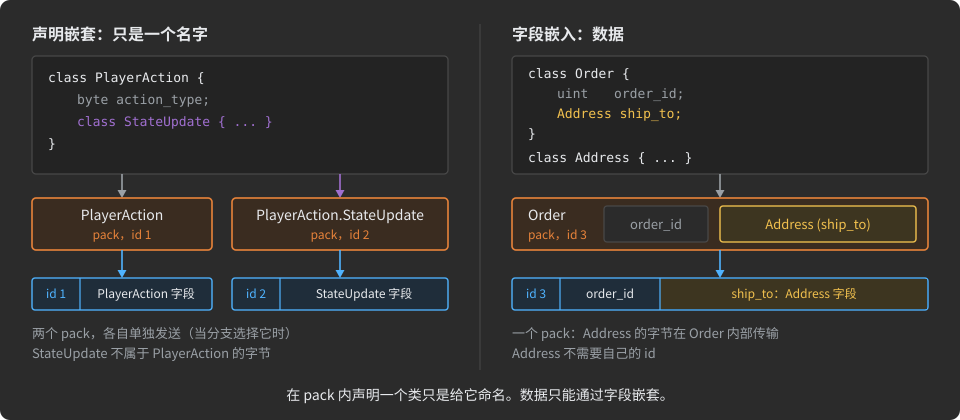

```csharp
using org.unirail.Meta;

namespace com.my.company
{
    public interface Game
    {
        /// <see cref="InCS"/>
        struct Server : Host
        {
            public class PlayerAction
            {
                byte action_type;
                int  action_id;
                Kind kind;                         // 用作字段类型的嵌套枚举

                public enum Kind : byte { Move, Attack, Chat }

                public class StateUpdate           // 独立的 pack,名为 PlayerAction.StateUpdate
                {
                    ushort state_id;
                    bool   is_active;
                }
            }
        }

        /// <see cref="InTS"/>
        struct Client : Host { }

        interface Channel : Connects<Client, Server>
        {
            [____________r<(Server.PlayerAction, Server.PlayerAction.StateUpdate)>]
            struct Start { }
        }
    }
}
```

pack 可以嵌套到任意深度,枚举也以同样方式嵌套在 pack 中。生成的代码保留嵌套:在 C# 中,`PlayerAction.StateUpdate` 是嵌套在 `PlayerAction` 内的分部类。每个 pack 的代码进入自己的文件,文件名取 pack 的路径、名字之间以 `_` 相连:嵌套在 `GameStateUpdate` 内、而 `GameStateUpdate` 又嵌套在项目级 pack `PlayerAction` 内的 pack `ChatMessage`,生成到 `PlayerAction_GameStateUpdate_ChatMessage.cs`。

pack 还充当**作用域**:分支或 Pack Set 可以选中一个 pack 连同其内部声明的所有 pack。因此你嵌套 pack 的方式决定了这类选择会取到什么。见[Pack Set](#pack-sets)。

<a id="which-classes-are-packs"></a>
### 哪些类是 pack

描述中并非每个 `class` 都是线上的 pack。代理由类实现的接口和容纳的内容来判定。只有**可传输的** pack 才能被分支发送。其余种类是编译期构造:有些可以作字段类型,都不能单独发送。

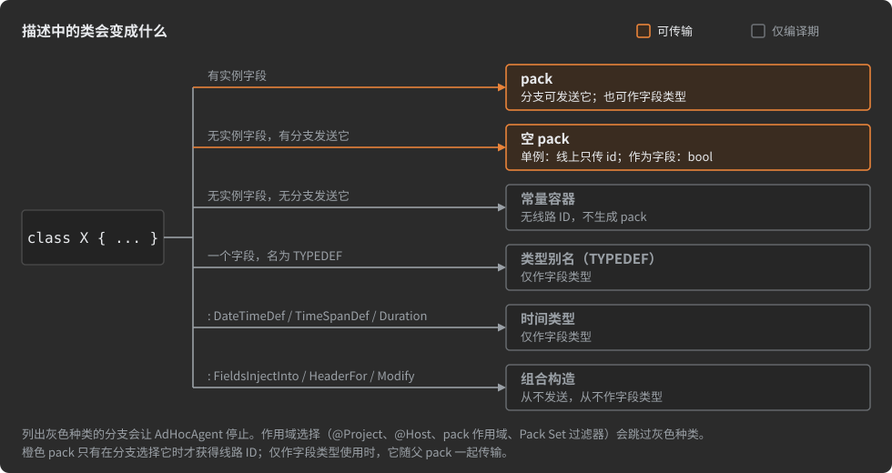

| 满足……的 `class` | 是…… | 分支可发送它 | 可作字段类型 | 详情 |
|:--|:--|:--|:--|:--|
| 有实例字段 | pack | 是 | 是 | 本章,[字段与类型](#fields-and-types) |
| 没有实例字段,且有分支发送它 | 空 pack | 是 | 是,作为 `bool` | [空 pack](#empty-packs) |
| 没有实例字段,也没有分支发送它 | 常量容器 | 否 | 仅作为 `bool`(见[空 pack](#empty-packs)) | [常量与枚举](#constants-and-enums) |
| 恰好有一个名为 `TYPEDEF` 的字段 | 类型别名(TYPEDEF) | 否 | 是 | [字段与类型](#fields-and-types) |
| 实现 `DateTimeDef`、`TimeSpanDef` 或 `Duration` | 时间类型 | 否 | 是 | [字段与类型](#fields-and-types) |
| 实现 `FieldsInjectInto<…>` | 字段模板 | 否 | 否 | [用 pack 构建 pack](#building-packs-from-packs) |
| 实现 `HeaderFor<…>` | pack 头部 | 否 | 否 | [用 pack 构建 pack](#building-packs-from-packs) |
| 实现 `Modify<…>` | 既有实体的修改器 | 否 | 否 | [复用描述](#reusing-descriptions) |

命名的 `Stream` 与 `File` pack(`class X : Stream { }`)是另一种情况,见[流](#streams)。

由上表得出的规则:

- 列出不可传输类型的分支会使代理停止:*"Type '…' is a TYPEDEF (Type Alias) and not a transmittable message type … can only be used as field types within Pack declaration"*。同一检查覆盖枚举、常量集、时间类型、字段模板、头部和修改器。
- 作用域选择(`@Project`、`@Host`、pack 作用域、Pack Set 过滤器)只收集可传输的 pack,静默跳过其余。见[Pack Set](#pack-sets)。
- 可传输的 pack 只有在分支真正选中它时才获得线路 ID。只用作字段类型的 pack 在其父级内部传输,不需要自己的 ID。编号规则见[编号表](#numbers-tables)。

<a id="empty-packs"></a>
### 空 pack

**空 pack** 是一个没有实例字段的可传输 pack。它仍然可以持有常量和嵌套声明。空 pack 不携带数据，只携带"它到达了"这一事实，所以它是发出事件信号或状态间转换的自然方式。

```csharp
/// <see cref="InCS"/>
struct Server : Host
{
    /// 邀请客户端进入对话的下一个状态。
    public class Invitation { }     // 空 pack:由连接的某个分支发送
}
```

**生成器产出什么。** 生成的类型没有实例成员，每条消息也不产生分配。接收代码是一个静态处理器，不消费任何载荷字节:线上只有 pack id。这是空 pack 在 C# 中的接收侧:

```csharp
public static partial class Invitation
{
    public const int __id_ = 3;

    public class Handler : AdHoc.Connection.Receiver.BytesDst
    {
        public int __id => __id_;
        public static readonly Handler ONE = new Handler();     // 唯一的实例

        bool AdHoc.Connection.Receiver.BytesDst.__put_bytes(AdHoc.Connection.Receiver __src) => true;   // 没有字节可读
    }
}
```

一个没有实例字段的类,只有在某个分支发送它时才成为空 pack。没有任何分支发送的空类会被自动重新归类为常量容器:它得不到线路 ID,也没有生成的 pack(见[常量和枚举](#constants-and-enums))。要把嵌套声明归为一组而从不传输这组内容,请有意声明一个常量容器。

<a id="an-empty-pack-as-a-field-type"></a>
#### 空 pack 作为字段类型

以空 pack 为类型的字段只能携带"存在"或"缺席"。因此代理会把该类型替换为 `bool`(`true` = 存在)并打印一条警告:

```text
WRN  Empty pack used as field datatype — replaced with `bool`
```

替换遵循字段的形态:

```csharp
class Empty { }

class Degenerate
{
    Empty                empty;          // bool
    Empty?               empty_Q;        // 可为空的 bool:null、false、true
    [D(3)] Empty[]       arr3_empty;     // 由 3 个 bool 组成的数组
    Map<int, Empty>      map_int_empty;  // Map<int, bool>
}
```

| 空 pack 的用法 | 结果 |
|:--|:--|
| 字段类型、数组元素、`Map` 值 | 替换为 `bool`,并给出上述警告 |
| `Map` 键 | 错误:*"… is a Map with a key of empty pack …, which is unsupported and unnecessary"* |
| `Set` 元素 | 不支持:只有两种可能取值的集合不携带任何信息,且 `Set<bool>` 会被拒绝。代理目前还没有捕获这种情况:它会把 `Set<Empty>` 变成 `Set<bool>` 并给出上述警告。不要这样声明 |

该类不必在任何地方被发送:没有任何分支发送的空类是常量容器(它的常量照常生成),以它为类型的字段同样是一个 `bool`。`struct` 或 `interface` 常量容器根本不是字段类型,见[常量和枚举](#constants-and-enums)。

pack 头部、字段模板、时间类型和具名 `Stream`/`File` pack 也没有自己的字段。它们不是空 pack,`bool` 替换不适用于它们。

<a id="documentation-in-the-generated-code"></a>
### 生成的代码中的文档

你在描述中为实体写下的内容,会随它进入每种语言的生成代码。你只写一次,写成 C# 注释;代理为每种目标语言渲染它:Java 用 javadoc,TypeScript 用 JSDoc,C# 用 XML 文档。

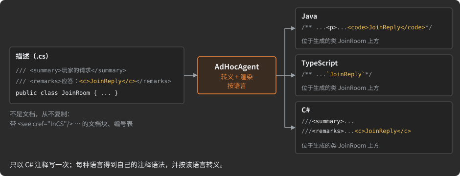

<a id="which-comments-are-documentation"></a>
#### 哪些注释是文档

| 描述中的注释 | 变成 |
|:--|:--|
| 紧邻声明上方的 `///` 行或 `/** … */` 块 | 生成的声明的文档 |
| 声明上方的普通 `//` 行(位于上一个声明之后) | 也是文档,逐行拼接 |
| 声明自身行尾的 `//` 注释 | 生成行尾的注释 |
| 含有语言标记(`<see cref="InCS"/>` …)或编号表的文档块 | 不是文档:它是配置,不会被复制 |

```csharp
/// <summary>玩家请求加入房间。</summary>
/// <remarks>服务器用 <c>JoinReply</c> 回复。</remarks>
public class JoinRoom
{
    /// 要加入的房间;0 表示任意空闲房间。
    uint    room_id;
    string? password;   // 可选,至多 255 个字符
}
```

生成的 C# 同时携带两条注释(省略生成代码的标记注释):

```csharp
/// <summary>
/// 玩家请求加入房间。
/// </summary>
/// <remarks>
/// 服务器用 <c>JoinReply</c> 回复。
/// </remarks>
public partial class JoinRoom : IEquatable<JoinRoom>, AdHoc.Connection.Receiver.BytesDst, AdHoc.Connection.Transmitter.BytesSrc
{
    /// <summary>
    /// 要加入的房间;0 表示任意空闲房间。
    /// </summary>
    public uint room_id { get; set; } = (uint) 0;

    public string? password { get; set; } = null;  //可选,至多 255 个字符
```

而生成的 Java 用 javadoc 携带同样的文本:

```java
/**
 * A player's request to join a room.
 * <p>
 * The server answers with <code>JoinReply</code>.
 */
```

<a id="where-the-documentation-of-each-entity-goes"></a>
#### 每个实体的文档去向

| 在描述中 | 在生成的代码中 |
|:--|:--|
| 一个 pack | 它的类。对 Value Pack:它的类型、该 pack 的调用和 `Pack.Nullable`。还有该 pack 在某个状态中的处理器:`OnReceived.Pack` 和 `OnSerialized.Pack` |
| 一个字段 | 关于该字段的每一个声明:读它的、写它的、询问它的值或制造它的项的;它的属性;`Pack.field__` 及其常量 |
| 一个枚举及其成员 | 该枚举及其常量 |
| 一个主机、一个项目 | 该主机的文件 |
| 一个连接、一个 Actor、一个状态 | `Connection` 类、该 Actor 和该状态的类 |
| 只对 RPC 方法分组的接口 | 无处:它在生成的代码中没有自己的类 |

<a id="how-the-text-is-rendered"></a>
#### 文本如何渲染

- **转义。** 文本按目标语言转义。`<` 和 `&` 无法破坏 javadoc 或 XML 文档,`*/` 也无法结束注释。在 Java 中,`@` 和 `\` 写成实体,所以游离的 `@` 不会被读成 javadoc 标签,`\u` 也不会被 `javac` 解码。出于同样的原因,含有 `\u` 的行尾 `//` 注释会在 `u` 前面多写一个反斜杠。
- **结构。** `<summary>` 和 `<remarks>` 保持各自的位置:在 C# 中第一节是摘要,后面的各节是备注;在 Java 和 TypeScript 中各节变成段落。`<para>` 变成段落。`<c>` 和 `<code>` 变成代码:C# 中用 `<c>`,Java 中用 `<code>`,TypeScript 中用反引号。
- **引用。** 文本内的引用 `<see cref="UserTier"/>` 写成它指向的名字,用代码字体。每种语言按自己的方式命名实体,所以名字完全按你写下的样子保留。
- **指令。** 作为组合指令的引用 `<see cref="Pack.field"/>+` 或 `<see cref="Pack.field"/>-` 在文档中不留下任何内容,它所在行的其余部分也不留下。标记必须紧跟在 `/>` 之后。
- **过滤器。** 在项目完成之前,文本保留 Pack Set 的 `[KeepDoc]` 和 `[SkipDoc]` 过滤器所读取的标记。文档最后才为每种语言渲染。见 [Pack Sets](#pack-sets)。

<a id="pitfalls-of-documentation-comments"></a>
#### 文档注释的陷阱

> [!WARNING]
> **在 pack 的文档内部,每个 `<see cref>` 都是组合指令。** 代理把 pack 前导文档注释中的引用读作添加字段的指令(带 `-` 时则是移除字段),不管后面有没有 `+`。一个普通的 `<see cref="UserTier"/>` 会把 `UserTier` 的字段导入这个 pack;对主机或连接的引用会让代理停止。在 pack 的文档中,用 `<c>UserTier</c>` 来提及其他实体。见[用 pack 组装 pack](#building-packs-from-packs)。

- **把主机的文档和它的配置分开。** 含有语言标记的文档块整体上是配置,其中的散文会被丢弃。把关于主机的文本写在它自己的文档块里:

  ```csharp
  /// 接受玩家连接并运行游戏房间。
  /**
      <see cref="InCS"/>
      <see cref="InJAVA"/>-
  */
  struct Server : Host { }
  ```

- **游离的 `//` 注释会被吸收。** 上一个声明和本声明之间的每一行 `//` 都会变成本声明的文档,隔着空行也一样。放在 pack 上方的分节横幅(如 `// ==== Headers ====`)最终会进入该 pack 的生成文档。改用 `#region` 名字来写这种横幅:region 名字不是注释,永远不会成为文档。
- **编辑文档不改变协议。** 它改变生成的注释,不改变主机做的任何事。[演进协议](#evolving-a-protocol)一章列出了什么会改变线上格式。

---

<a id="fields-and-types"></a>
## 字段和类型

*模型:项目 → 主机 → 连接 → Actor → 状态 → 分支 → pack → **字段** → 字节*

**字段**是 pack 类的实例字段。它的 C# 类型选定 AdHoc 的一种数据类型,它的特性收窄该类型:一个长度、一个范围、一种分布。pack 的字段就是它的数据。它们按你声明的顺序传输(见[值如何变成字节](#how-values-become-bytes))。

本章解释字段可以拥有的每种类型:它意味着什么、如何声明、生成器为它产出什么、代理拒绝什么。每个值如何变成字节——包括范围、位打包和 varint——是[值如何变成字节](#how-values-become-bytes)的主题。字节通道 `Stream` 和 `File` 有自己的一章:[流](#streams)。

<a id="the-field-types-at-a-glance"></a>
### 字段类型一览

| 值的种类 | 声明为 | 章节 |
|:--|:--|:--|
| 整数、浮点数、`bool`、`char` | `int count;` `double ratio;` `bool on;` | [数值及其他基元类型](#numeric-and-other-primitive-types) |
| TypeScript 主机能作为普通数字持有的 64 位整数 | `longJS id;` `ulongJS size;` | [longJS 和 ulongJS](#longjs-and-ulongjs) |
| 可能缺席的值 | `int? count;`(引用类型总是可选的) | [可选字段](#optional-fields) |
| 文本 | `string name;` `[D(+N)] string name;` | [字符串](#strings) |
| 数组 | `T[]`、`T[,]`、`T[,,]`,配合 `[D(N)]` | [数组:恒定、固定和动态长度](#arrays-constant-fixed-and-dynamic-length) |
| 映射、集合 | `Map<K, V>`、`Set<K>`,配合 `[D(+N)]` | [Map 和 Set](#map-and-set) |
| 多维数组 | `[D(-2, ~3)] T name;` | [多维数组](#multidimensional-arrays) |
| 数组、映射或集合的数组 | `T[][,,]`、`Map<K, V>[]` | [集合的数组](#arrays-of-collections) |
| 嵌套 pack、枚举 | `Point origin;` `Mode mode;` | [pack 和枚举作为字段类型](#packs-and-enums-as-field-types) |
| 已知长度的原始字节 | `[D(32)] Binary[] hash;` | [Binary](#binary) |
| 类型的具名别名 | 一个字段名为 `TYPEDEF` 的类 | [TYPEDEF](#typedef) |
| 若干备选中的一个值 | 由可选字段组成的 pack | [备选项:恰好取一](#alternatives-exactly-one-of-several) |
| 时刻、最近的时刻、时长 | `DateTime`、`DateTimeDef`、`TimeSpanDef`、`Duration` | [时间类型](#time-types) |
| 经通道流式传输的字节 | `[S(N)] Stream`、`[S(N)] File` | [流](#streams) |

<a id="numeric-and-other-primitive-types"></a>
### 数值及其他基元类型

除 `decimal` 外,所有 C# 数值基元类型都是字段类型:代理遇到 `decimal` 会以 "Unsupported field type" 停止。

| 类型 | 范围 |
|:--|:--|
| `sbyte` | −128 到 127 |
| `byte` | 0 到 255 |
| `short` | −32,768 到 32,767 |
| `ushort` | 0 到 65,535 |
| `int` | −2,147,483,648 到 2,147,483,647 |
| `uint` | 0 到 4,294,967,295 |
| `long` | −9,223,372,036,854,775,808 到 9,223,372,036,854,775,807 |
| `ulong` | 0 到 18,446,744,073,709,551,615 |
| `float` | ±1.5 × 10⁻⁴⁵ 到 ±3.4 × 10³⁸ |
| `double` | ±5.0 × 10⁻³²⁴ 到 ±1.7 × 10³⁰⁸ |

还有两种基元类型补全这个集合:

- `char` 是 16 位无符号值(一个 UTF-16 码元)。
- `bool` 占 1 位。`bool?` 占 2 位,有三个编码:0 false、1 true、2 null。

对基元字段来说,声明的类型只是起点。`[MinMax]` 收窄范围,`[A]`、`[V]` 和 `[X]` 为偏斜的分布选择 varint 编码。两者改变的是一个值占多少位,而不是你使用的 API 类型。见[值如何变成字节](#how-values-become-bytes)。

<a id="longjs-and-ulongjs"></a>
### longJS 和 ulongJS

TypeScript 的 `number` 只在 −(2⁵³ − 1) 到 2⁵³ − 1 之间精确表示整数。超出这个范围的 64 位字段在 TypeScript 侧需要 `BigInt`,计算更慢。当 TypeScript 主机发送或接收一个值落在安全范围内的 64 位字段时,用 `longJS` 或 `ulongJS` 声明它,而不是 `long` 或 `ulong`。

两者在 `org.unirail.Meta` 中声明为带范围的 `long` 的 [TYPEDEF](#typedef):

```csharp
public class longJS {  [MinMax(-0x1FFFFFFFFFFFFF, 0x1FFFFFFFFFFFFF)] long TYPEDEF; }   // −(2⁵³ − 1) … 2⁵³ − 1
public class ulongJS { [MinMax(0, 0x1FFFFFFFFFFFFF)]                 long TYPEDEF; }   // 0 … 2⁵³ − 1
```

因为它们是范围,它们像任何其他 `[MinMax]` 字段一样在线上被收窄(见[值如何变成字节](#how-values-become-bytes))。在任何可以放类型的地方使用它们:

```csharp
class Ledger
{
    longJS                   balance;
    ulongJS?                 last_tx;             // 可选
    [D(10)] longJS[]         recent_balances;     // 恰好 10 项
    [D(10)] ulongJS?[,,]     sizes;               // 至多 10 个可为空的项
    Map<longJS, ulongJS?>    totals;
}
```

<a id="optional-fields"></a>
### 可选字段

当一个字段可以没有值时,它是**可选的**。你用尾部 `?` 声明可选值类型(`int?`、`byte?`、`MyEnum?`)。引用类型(字符串、pack、数组、映射和集合)直接出现在 pack 中时总是可选的;它们不需要 `?`。在集合内部,项类型上的 `?` 使项可选:

```csharp
class Packet
{
    string    user;            // 可选:引用类型总是可选的
    string[]  tags;            // 字段可选;项不可选
    string?[] emails;          // 字段及其项都可选
    uint?     optional_field;  // 一个可选的 uint
}
```

| 声明 | 字段可以缺席 | 项可以为 null |
|:--|:--|:--|
| `int count;` | 否 | - |
| `int? count;` | 是 | - |
| `string name;`、`Point origin;` | 是 | - |
| `int[] ids;`、`Set<int> ids;` | 是 | 否 |
| `int?[] ids;`、`Set<int?> ids;` | 是 | 是 |
| `Map<string?, int?> scores;` | 是 | 一个 null 键,以及 null 值 |

一个实例混用了可选枚举、pack 和 varint 整数:

```csharp
public class QuitRoomResponse
{
    MID?     mid;           // 一个可选枚举
    [X] int? result;        // 一个可选 varint
    [X] int? rid;
}

public class RoomChangeResponse
{
    MID?      mid;
    RoomInfo? roomInfo;     // 允许写 ?,但不改变任何行为:pack 字段总是可选的
}
```

**生成器产出什么。** 引用类型的字段缺席时为 `null`。可选基元在 API 中保留其普通类型,并多出两个成员。在 C# 中,对应 pack `PlayerEvent` 里的 `[X] long? event_id;`:

```csharp
public long event_id { get; set; } = PlayerEvent.event_id__.NULL;            // 值
public bool event_id_hasValue => event_id != PlayerEvent.event_id__.NULL;    // 有值吗?
public void event_id_to_null() => event_id = PlayerEvent.event_id__.NULL;    // 使其缺席
```

`event_id__.NULL` 是该字段为"缺席"保留的一个该值类型的编码;你的代码用 `_hasValue` 测试字段,而不是比较值。

一个缺席字段在线上占一位,或占一个位字段的备用编码。见[值如何变成字节](#how-values-become-bytes)。

<a id="strings"></a>
### 字符串

`string` 字段是不可变的字符序列。除非你另作说明,它最多容纳 255 个字符:`[D(+N)]` 设置单个字段的上限,`_DefaultMaxLengthOf.Strings` 设置整个项目的默认值(见[集合上限](#collection-limits-_defaultmaxlengthof))。

```csharp
class Packet
{
    string             string_field_with_max_255_chars;
    [D(+6)]    string  string_field_with_max_6_chars;
    [D(+7000)] string  string_field_with_max_7000_chars;
}
```

上限按 UTF-16 码元计数,这是 C#、Java 和 JavaScript 字符串的单位。基本多文种平面之外的字符(比如 emoji)计为两个。

在许多字段中使用的字符串类型,最好声明一次,作为 [TYPEDEF](#typedef):

```csharp
class max_6_chars_string { [D(+6)] string TYPEDEF; }

class Packet
{
    string             string_field_with_max_255_chars;
    max_6_chars_string string_field_with_max_6_chars;
}
```

**生成器产出什么。** 一个可为空的字符串属性,以及旁边的上限常量。在 C# 中:

```csharp
public string? objective { get; set; } = null;
public partial struct objective__ { public const int STR_LEN_MAX = 100; }
```

字符串如何编码见[值如何变成字节](#how-values-become-bytes)。一侧必须作为原始 UTF-8 字节接收的字符串(以便不解析就存储或中继它)是 trim 过的字段:见 [Trims](#trims)。

<a id="arrays-constant-fixed-and-dynamic-length"></a>
### 数组:恒定、固定和动态长度

数组字段持有一种类型的项。方括号选择三种形态之一。逗号不是格式问题:它们决定形态。

| 声明 | 形态 | 一个值的长度 | 线上的长度 |
|:--|:--|:--|:--|
| `T[]` | 恒定长度 | 恰好是声明的长度 | 从不发送 |
| `T[,]` | 创建时固定 | 创建字段时选定,至多声明的长度;字段只有一个长度 | 发送一次 |
| `T[,,]` | 动态 | 每个值有自己的长度,至多声明的长度(一个列表) | 随每个值发送 |

`[D(N)]` 设置声明的长度;没有它,长度是 255(`_DefaultMaxLengthOf.Arrays`)。数组中的 `string` 保留自己的上限,在同一个特性中用 `+N` 设置:

```csharp
class Dim_forms
{
    [D(10)] int[]     arr10_ints;     // 恰好 10 个 int;线上不发送长度
    [D(10)] int[,]    fix10_ints;     // 至多 10 个,字段创建时固定
    [D(10)] int[,,]   list10_ints;    // 至多 10 个,每个值有自己的长度

    [D(10)] int?[]    arr10_ints_Q;   // 10 个可选的 int

    string?[]               strs;           // 255 个字符串,每个至多 255 字符
    [D(100, +10)] string?[] arr100_strs10;  // 100 个字符串,每个至多 10 字符
}
```

对每种集合,长度都表示"多少项",但数组和集合的写法不同:

```csharp
[D(300)]  int[]    reply;   // 恰好 300 个 int
[D(+300)] Set<int> reply;   // 至多 300 个互不相同的 int
```

**生成器产出什么。** 三种形态在 API 上也有差别。在 C# 中:

| 形态 | 字段类型 | 创建 | 长度 | 赋入另一个长度的值 |
|:--|:--|:--|:--|:--|
| `T[]` | `int[]` | `arr10_ints_new()` | `arr10_ints_len` = `arr10_ints__.ARRAY_LEN` | 截断或用零填充到 `ARRAY_LEN` |
| `T[,]` | `int[]` | `fix10_ints_new(int size)` | `fix10_ints_len` | 截断到 `fix10_ints__.ARRAY_LEN_MAX` |
| `T[,,]` | `List<int>` | `list10_ints_new(int size)` | `list10_ints_len()` | 截断到 `list10_ints__.ARRAY_LEN_MAX` |

可以为 null 的项使用运行时库的集合,比如 C# 中的 `NullablePrimitiveList<int>.RW`;被 `[MinMax]` 收窄后打包进位中的项也一样(`BitsList<byte>.RW`)。赋值经过字段的 setter(`fix10_ints(int[] src)`),它按最后一列所示把值适配到声明的长度。

<a id="-or--whose-length-is-it"></a>
#### `[,]` 还是 `[,,]`:长度属于谁

`[,]` 的长度属于**字段**:它只选定一次,该字段的每个值都恰好是这个长度。`[,,]` 的长度属于**每个值**,并随值一起在线上传递。

在普通 pack 字段上,两者看起来一样:字段持有一个数组,无论哪种形式都只有一个长度。一旦数组位于集合内部——作为 `Map` 的键或值、作为 `Set` 的项、或作为另一个数组的元素——它们就不同了。

![三行,每行一种数组形式,各展示一个 Map 三个键的值。T[] 是一串项方框,没有长度方框。集合内的 T[,]:整个字段只写一次长度方框,随后是若干个等长的值。集合内的 T[,,]:每个值前面都有自己的长度方框,且各值长度不同](docs/img/dev-05-array-forms.zh-CN.svg)

| 声明                           | 长度                                                       |
|:-------------------------------|:-----------------------------------------------------------|
| `Map<string, string[,,]> tags` | 每个键都有一个自有长度的列表                               |
| `Map<string, string[,]> tags`  | map 中每个列表的长度**相同**,在创建 map 时选定             |
| `string[][,,] rows`            | 行数固定,每行各有自己的长度                               |
| `string[][,] rows`             | 行数固定,所有行长度相同                                   |

(`string[][,,]` 的哪对括号是外层数组,在[集合数组](#arrays-of-collections)中解释。)

> [!WARNING]
> 在集合内部使用 `[,]`,只适用于确实共享同一长度的值:矩阵的一行、固定大小的哈希。其他长度的值不会报错:生成的代码会把它适配到字段的长度。多重映射、标签列表等值长度各不相同的东西,都用 `[,,]`。

<a id="the-d-attribute"></a>
### `[D]` 特性

`[D(...)]` 声明字段的每一个长度和维度。它的参数是数字、`const` 名称或 `[ValueFor]` 常量(见[常量和枚举](#constants-and-enums))。每个数字前面的前缀说明它描述什么:

| 参数     | 含义                                                                                                                                                                                                   | 适用于                                             |
|:---------|:-------------------------------------------------------------------------------------------------------------------------------------------------------------------------------------------------------|:---------------------------------------------------|
| `N`      | 数组的长度:`[]` 恰好 `N`,`[,]` 和 `[,,]` 至多 `N`。在[集合数组](#arrays-of-collections)上:当项(或 map、set 的键)是数组时,为内层数组的长度;否则为外层数组的长度                                     | 用 `[]`、`[,]` 或 `[,,]` 声明的字段                |
| `+N`     | 固有长度:`string` 至多 `N` 个字符,`Set` 或 `Map` 至多 `N` 项                                                                                                                                          | `string`、`Set`、`Map`,也可作为数组的项            |
| `-N`     | 一个长度为常量 `N` 的维度                                                                                                                                                                              | [多维数组](#multidimensional-arrays)               |
| `~N`     | 一个至多 `N` 的维度,在字段创建时固定                                                                                                                                                                   | [多维数组](#multidimensional-arrays)               |

代理检查参数:

| 声明                                                   | 结果                                                                                                                                              |
|:-------------------------------------------------------|:--------------------------------------------------------------------------------------------------------------------------------------------------|
| 无参数的 `[D()]`                                       | 错误,退出码 2                                                                                                                                    |
| 字段没有 `[]`、`[,]` 或 `[,,]` 却用了 `N`              | 错误:*"… does not have an array declaration such as '[]', '[,]', or '[,,]'"*                                                                       |
| `+N` 用在非 `string`、`Set`、`Map` 上                  | 错误                                                                                                                                              |
| 数组上单个 `-N` 或 `~N`                                | 被接受为外层数组的长度。前缀被忽略:括号决定形式。`[D(-3)] float[,]` 是创建时固定、至多 3 个元素的数组                                             |
| 不带括号的 `Map` 或 `Set` 上单个 `-N` 或 `~N`          | 错误                                                                                                                                              |
| 两个或更多 `-N` / `~N`                                 | 多维数组                                                                                                                                          |
| `[Key: D(...)]` 或 `[Val: D(...)]` 内的 `-N` 或 `~N`   | 错误:键和值不能是多维的                                                                                                                          |
| pack 头部字段上的 `[D]`                                | 错误:头部大小固定(见[用 pack 组装 pack](#building-packs-from-packs))                                                                             |

> [!TIP]
> 在普通数组上,把长度写成裸数字,让括号选择形式。单个 `-N` 或 `~N` 看起来像一种形式,但并不选择形式。

<a id="collection-limits-_defaultmaxlengthof"></a>
### 集合上限:`_DefaultMaxLengthOf`

每个没有显式长度的数组、map、set 和字符串,默认都限制为 255 项(字符串为字符)。要为整个项目修改这些默认值,声明一个名为 `_DefaultMaxLengthOf` 的枚举,只写你想改的成员:

```csharp
enum _DefaultMaxLengthOf
{
    Arrays  = 255,
    Maps    = 255,
    Sets    = 255,
    Strings = 255,
}
```

| 成员           | 默认值 | 适用于                                                                                                                                              |
|:---------------|:-------|:----------------------------------------------------------------------------------------------------------------------------------------------------|
| `Arrays`       | 255    | 没有 `N` 长度的数组                                                                                                                                  |
| `Maps`         | 255    | 没有 `+N` 的 map                                                                                                                                    |
| `Sets`         | 255    | 没有 `+N` 的 set                                                                                                                                    |
| `Strings`      | 255    | 没有 `+N` 的字符串                                                                                                                                   |
| `Uncompressed` | 1024   | 长度永远不会超过这么多字节的 pack 会失去其变换链的压缩阶段;0 表示每个 pack 都保留压缩。见[变换链](#transform-chains)                                  |

- 省略的成员保留默认值。名字不符的成员被忽略,不给出消息。
- 导入的项目可以声明自己的 `_DefaultMaxLengthOf`。导入的设置先应用,根项目的设置最后应用,因此根项目胜出(见[复用描述](#reusing-descriptions))。
- 该枚举只配置代理。它不出现在生成的代码中。

<a id="map-and-set"></a>
### Map 和 Set

`Map<K, V>` 和 `Set<K>` 在 `org.unirail.Meta` 中声明。map 或 set 默认至多容纳 255 项;`[D(+N)]` 设置单个字段的上限。

```csharp
using org.unirail.Meta;

class Inventory
{
    [D(+20)] Set<uint>          max_20_uints_set;
    [D(+20)] Map<Point, uint>   map_of_max_20_items;
}
```

键、项和值可以是基元类型、字符串、枚举、pack、`DateTime`、`DateTimeDef` 类型和数组。键类型上的 `?` 允许一个 null 键;值或项类型上的 `?` 允许 null 值:

```csharp
class Collections
{
    Set<byte?>           bytes_or_null;     // 项可以为 null
    Set<Point3>          points;            // pack 作为项
    Set<int[]>           arrays;            // 数组作为项
    Map<string?, int>    by_name;           // 允许一个 null 键
    Map<Point2, Point3>  pack_to_pack;      // 两侧都是 pack
    Map<Mode?, Mode?>    enum_to_enum;      // 枚举,两侧都可为空
    Map<DateTime, int>   by_time;
    Map<int, bool>       flags;             // bool 作为值(VALUE)没问题
}
```

用作键或值的数组通常是 `[,,]`:每个项各有自己的长度。`[,]` 让 map 的每个键(或每个值)长度相同;见[长度属于谁](#-or--whose-length-is-it)。

有些键携带的信息太少,不实用,代理拒绝它们:

| 声明                                     | 结果                                                                                                                                         |
|:-----------------------------------------|:---------------------------------------------------------------------------------------------------------------------------------------------|
| `Set<bool>`、`Set<bool?>`                | 错误:*"… is a Set of `bool` type, which is unsupported and unnecessary"*                                                                     |
| `Map<bool, V>`                           | 错误:*"… is a Map with a key of type `bool`, which is unsupported and unnecessary"*                                                          |
| 键是空 pack 的 `Map`                     | 错误。空 pack 只携带它的存在性(见 [pack](#packs))                                                                                            |
| 项是空 pack 的 `Set`                     | 不支持,原因与 `Set<bool>` 相同。代理不会停止:它把项类型替换为 `bool` 并警告。不要这样声明                                                   |
| `Map` 或 `Set` 嵌套在 `Map` 或 `Set` 内  | 不支持:代理以 *"Unsupported field type"* 停止(退出码 23)。用 pack 作为值                                                                   |

**生成器产出什么。** 在 C# 中,map 是 `Dictionary<K, V>`,set 是 `HashSet<K>`,带有创建方法、添加方法,以及作为常量的上限:

```csharp
public Dictionary<string, int>? _event_data;
public Dictionary<string, int>? event_data_new(int _items) { ... }
public bool event_data(string key, int value) { ... }   // 键是新键时为 true
public interface event_data__
{
    public const int TYPE_LEN_MAX = 50;                    // [D(+50)]
    public struct Key { public const int STR_LEN_MAX = 100; }
}
```

<a id="key-and-val-attribute-targets"></a>
### `[Key:]` 和 `[Val:]` 特性目标

`Map` 或 `Set` 字段上的特性作用于集合本身。要把特性应用到键类型或值类型,使用 C# 特性目标:`[Key: ...]` 用于 `Map` 的键或 `Set` 的项,`[Val: ...]` 用于 `Map` 的值。

```csharp
[Key: D(+30)]               // 每个字符串键:至多 30 个字符
[Val: D(100), X]            // 每个值:至多 100 个 int 的列表,ZigZag varint
Map<string, int[,,]> MAP;

[D(+70)]                    // 这个 set:至多 70 项
[Key: D(30)]                // 每个项:至多 30 个 double 的列表
Set<double[,,]> SET;
```

| 规则                                                           | 否则                                                                                                                            |
|:---------------------------------------------------------------|:--------------------------------------------------------------------------------------------------------------------------------|
| `[Val:]` 只能用在 `Map` 字段上                                 | 错误,退出码 2                                                                                                                    |
| `[Key:]` 只能用在 `Map` 或 `Set` 字段上                        | 错误,退出码 2                                                                                                                    |
| 目标中的 `[D]` 只能使用 `N` 和 `+N`                            | 错误:键和值不能是多维的                                                                                                          |
| `[Key: D(+N)]` 只能用在字符串键或项上                          | 错误:`[Key: D(+30)] Set<double[,,]>` 被拒绝;列表键用 `[Key: D(30)]`                                                            |
| `[Val: D(+N)]` 仅在**键**也是字符串时被接受                    | 在 `Map<int, string>` 上报错:代理检查键类型,而不是值类型。用 TYPEDEF 限制字符串值的长度(见下方提示)                            |

varint 特性以同样方式应用到元素(见[值如何变成字节](#how-values-become-bytes)):

```csharp
class Counters
{
    [Val: X]          Map<uint, int>           deltas;      // ZigZag varint 值
    [Key: V] [Val: V] Map<uint, uint>          both;        // varint 键和值
    [Key: X]          Set<int>                 ids;         // varint 项
    [D(-3, ~3, +200)] [Val: D(100), X] Map<Str30, int[,]>[] grids;   // 3 × (≤3) 个至多 200 项的 map;每个值是
                                                                       // 一个至多 100 个 varint int 的数组,每个 map 一个长度
}                                                                      // (Str30 是 TYPEDEF,见下文)
```

> [!TIP]
> 把 `[Val: ...]` 列表写在字段的其他特性列表之后:代理会把跟在 `[Val: ...]` 列表之后的每个特性列表也应用到值上。要限制字符串**值**的长度,给值一个字符串 [TYPEDEF](#typedef)(`Map<int, max_100_chars_string>`),而不是 `[Val: D(+N)]`。

在许多字段中使用的复杂键和值类型,写成 TYPEDEF 更清晰:

```csharp
class string_max_30_chars   { [D(+30)] string TYPEDEF; }
class list_of_max_100_ints  { [D(100), X] int[,,] TYPEDEF; }

class Lookup
{
    Map<string_max_30_chars, list_of_max_100_ints>[,,] MAP;    // 这种 map 的列表
}
```

<a id="multidimensional-arrays"></a>
### 多维数组

**多维数组**是有两个或更多维度的字段,每个维度的长度是常量,或在字段创建时固定。你用两个或更多带前缀的 `[D]` 参数声明它,每个维度一个;字段不需要括号:

| 参数 | 维度                             |
|:-----|:---------------------------------|
| `-N` | 常量长度 `N`                     |
| `~N` | 至多 `N`,在字段创建时固定       |

```csharp
class Pack
{
    [D(-2, -3, -4)] int     ints;                         // 2 × 3 × 4 个 int
    [D(-2, ~3, ~4)] Point   points;                       // 2 × (≤3) × (≤4) 个 Point
    [D(-2, -3, -4)] string  strings_with_max_255_chars;   // 2 × 3 × 4 个字符串
    [D(-5, -12, +40)] string? labels;                     // 5 × 12 个可为空的字符串,每个至多 40 字符
}
```

> [!CAUTION]
> 注意前缀。`[D(2, 3)]` 不是 2 × 3 数组:不带前缀的数字是数组长度,需要括号。

一个字段至多有 32 个维度。

**生成器产出什么。** 代理按声明顺序把各维度连同其种类传给生成器:常量(`-N`)或创建时固定(`~N`)。`-N` 维度总是恰好有 `N` 个单元格;`~N` 维度在你的代码创建字段时获得其长度(至多 `N`),并保持不变。每个单元格用每个维度一个索引来访问。成员名称从你的生成的代码中复制。

**作为集合的单元格。** 括号让每个单元格成为集合:

- 只有一对括号时,每个单元格就是那个数组:`[D(-7, -34)] string?[] blocks;` 是一个 7 × 34 数组,其单元格是 255 个可为空字符串的数组。
- 有两对括号时,维度取代外层那对括号,每个单元格是内层数组:`[D(-5, ~12, 6)] string[,][] grid;` 是一个 5 × (≤12) 数组,其单元格是恰好 6 个字符串的数组。
- 带括号的 map 或 set 变成 map 或 set 的多维数组:维度取代括号。

```csharp
class Grids
{
    [D(-3, ~3)]       Map<int[], byte?>[]  maps;          // 3 × (≤3) 个 map,每个至多 255 项
    [D(+100, -3, ~3)] Map<int, string>[]   maps_100;      // 3 × (≤3) 个 map,每个至多 100 项
    [D(-3, ~69, +10)] [Key: D(+100)] Set<string?>[] sets; // 3 × (≤69) 个 set,每个至多 10 个字符串,每个字符串至多 100 字符
}
```

<a id="arrays-of-collections"></a>
### 集合数组

**集合数组**是项为数组、map 或 set 的数组。你用第二对括号声明它。AdHoc 完全按 C# 的方式读取类型,而 C# 有两条规则决定哪对括号是外层数组:

1. **两对之间没有 `?` 时,左边那对是外层数组。** `string[][,,]` 是字符串列表(`[,,]`)的数组(`[]`)。这是 C# 交错数组的规则。
2. **两对之间的 `?` 封闭元素类型。** 在 `string?[]?[,,]` 中,元素是可为空的数组 `string?[]?`,`?` 之后的那对是外层数组:可为空定长数组的列表(`[,,]`)。

![两个用颜色标注的声明。上方:[D (-100, 20, +50)] string?[][,,] a;,-100 与左侧括号对(外层数组,恰好 100 个元素)、20 与右侧括号对(每个内层列表至多容纳 20 个)、+50 与 string(至多 50 个字符)、以及 ?(字符串可为 null)颜色对应。小图把外层数组画成 100 个槽位,每个槽位持有一个自有长度的列表。下方:string?[]?[,,] d;,string?[]? 被框为元素——一个可为空的定长数组,? 之后的 [,,] 标为外层列表](docs/img/dev-05-nested-declaration.zh-CN.svg)

`[D]` 参数遵循同样的划分:裸 `N` 是元素(内层)数组的长度,单个 `-N` 或 `~N` 是外层数组的长度(其形式来自括号),`+N` 是字符串或 map 和 set 的长度:

| 声明                                | 外层数组                            | 元素                                                                          |
|:------------------------------------|:------------------------------------|:------------------------------------------------------------------------------|
| `[D(-100)] string?[][,,] a;`        | `[]`:恰好 100                       | `[,,]`:至多 255 个可为空字符串的列表                                          |
| `[D(+50, -100)] string?[,,][,] b;`  | `[,,]`:至多 100                     | `[,]`:单一长度的数组,创建时选定;字符串至多 50 个字符                         |
| `[D(~11, 12, +13)] string?[,][] c;` | `[,]`:至多 11,创建时固定            | `[]`:恰好 12 个可为空字符串的数组,字符串至多 13 个字符                        |
| `string?[]?[,,] d;`                 | `[,,]`:至多 255                     | `[]?`:可为空的数组,每个恰好 255 个可为空字符串                               |
| `Map<int[,,], int[,,]>[,] e;`       | `[,]`:至多 255,创建时固定           | map                                                                           |
| `[D(3)] Set<Item>[] f;`             | `[]`:恰好 3                         | 至多 255 个 `Item` pack 的 set                                                |
| `Map<int[,,]?, byte[,]>?[]? g;`     | `[]`:恰好 255                       | 可为空的 map;键是可为空的 int 列表,值是单一长度的 byte 数组                  |

可为空性在每一层都是独立的:字段(总是可选)、内层集合(`Set<int>?[]`、`T[]?[,,]`)、项(`T?`),以及 map 的键和值(`Map<K?, V?>`)。

**生成器产出什么。** 外层数组和内层集合在生成的代码中保持各自的形式:以上面的 `b` 为例,外层 `[,,]` 容纳至多 100 个元素,每个元素是一个数组,其单一长度在字段创建时选定,每个字符串容纳至多 50 个字符。每一层的上限都是字段的常量,与普通数组一样(`ARRAY_LEN_MAX`、`STR_LEN_MAX` 等)。成员名称从你的生成的代码中复制。

<a id="packs-and-enums-as-field-types"></a>
### pack 和枚举作为字段类型

类型为 pack 的字段在其父级内部携带该 pack 的一个完整实例;类型为枚举的字段携带其常量之一。pack 字段总是可选的;枚举字段加 `?` 才可选。

```csharp
using org.unirail.Meta;

namespace com.my.company
{
    public interface MyProject3
    {
        /// <see cref="InJAVA"/>
        struct Server : Host
        {
            public class QuitRoomResponse
            {
                MID?     mid;           // 一个可选枚举
                [X] int? result;
            }
        }

        public class RoomInfo
        {
            [X] long  id;
            [X] int?  rank;
        }

        enum RoomType { CLASSICS = 1, ARENA = 2, }

        enum MID { ServerRegisterReq = 1001, ServerRegisterRes = 1002, ServerListReq = 1003, ServerListRes = 1004, }

        /// <see cref="InTS"/>
        struct Client : Host
        {
            public class RoomChangeResponse
            {
                MID?      mid;
                RoomInfo? roomInfo;     // 在项目级声明的 pack

                public class EnterRoomRequest
                {
                    MID?     mid;
                    RoomType tYpe;      // `type` 在目标语言中是保留字
                    [X] int  rank;
                }
            }
        }

        // @MyProject3:项目中的每个 pack,包括声明在主机内部和其他 pack 内部的(见 Pack Sets)
        interface MainConnection : Connects<Server, Client>{ [_____lr_____<@MyProject3>] struct Start { } }
    }
}
```

**递归 pack。** pack 可以引用自身,直接引用或通过其他 pack 引用。树就是一个含有自身集合的 pack:

```csharp
class Folder
{
    string                    name;
    [D(65535)] Folder[,,]     folders;   // 子文件夹:pack 引用自身
    [D(65535)] FileEntry[,,]  files;
}

class FileEntry
{
    string                    name;
    ulong                     size;
    [D(32)] Binary[]          sha256;
}
```

经过多个 pack 的循环也允许(`A` 有 `B`,`B` 有 `A`)。代理检测每个循环,并为每个递归 pack 记录一个从循环推导出的嵌套上界(`nested_max`),传给生成器。非递归 pack 的嵌套深度由描述固定。

只被一个 pack 使用的枚举可以声明在该 pack 内部(见 [pack](#packs) 的嵌套 pack)。枚举作为字段类型的规则(枚举至少需要两个常量;常量值全部相同的枚举变成 `bool`;`struct` 或 `interface` 常量容器不是字段类型)在[常量和枚举](#constants-and-enums)中。没有实例字段的类作为字段类型会变成 `bool`:无论有分支发送它(空 pack),还是没有(常量容器)——见 [pack](#packs) 的空 pack。

本章的类型可以在一个 pack 中自由组合:

```csharp
class max_100_chars_string { [D(+100)] string TYPEDEF; }

class TeamCoordination
{
    public uint                        team_id;
    [D(-3)]   float[,]                 waypoints;   // 至多 3 个,创建时固定
    max_100_chars_string               objective;
    [D(+10)]  Set<max_100_chars_string> members;    // 至多 10 个名字
    [D(100)]  Binary[,]                raw_data;    // 至多 100 字节
    [D(+50)]  Map<max_100_chars_string, int> scores;
}
```

<a id="binary"></a>
### Binary

`Binary`(来自 `org.unirail.Meta`)是原始字节:`Binary` 数组是 AdHoc 原样搬运而不解释的字节。`Binary` 的存在让同样的字节在每种语言中都有自然的类型:Java 中的有符号 `byte`,C# 中的无符号 `byte`。

| 声明                    | C#           | Java              | TypeScript     |
|:------------------------|:-------------|:------------------|:---------------|
| `Binary[]`, `Binary[,]` | `byte[]`     | `byte[]` (signed) | `Uint8Array`   |
| `Binary[,,]`            | `List<byte>` | `ByteList.RW`     | `Uint8List.RW` |

`Binary` 数组适合**长度属于格式**的字节:哈希、签名、固定大小的标签。定长数组完全不发送长度;值就是数组:

```csharp
using org.unirail.Meta;

class Result
{
    [D(32)] Binary[] sha256;   // 恰好 32 字节,无长度前缀
    [D(4)]  Binary[] tag;      // 恰好 4 字节
}
```

长度属于值属性的字节(blob、序列化对象、文件)通常属于 `File` 或 `Stream` 字段,它在套接字缓冲区和通道之间移动字节,而不把它们放进数组。如何在 `Binary`、`File` 和 `Stream` 之间选择,见[流](#streams)。

**抽象 pack 的 `Binary` 字段。** 当你的主机自己实现 pack(抽象实现,见[主机、语言、生成的代码](#hosts-languages-generated-code))时,没有数组可填。pack 改为得到套接字缓冲区的一个窗口:该部分缓冲区持有(接收时)或有空间容纳(发送时)的字段字节,从元素 `item` 开始。你的代码按自己的方式取用或填充窗口:放进数组、放进另一个缓冲区、直接写入文件。该方法每部分调用一次;之后编解码器越过窗口前进,无论你的代码对它做了什么。对于字段 `data`,窗口方法是:

| 语言       | 接收                                                                                            | 发送                                                                                                  |
|:-----------|:------------------------------------------------------------------------------------------------|:------------------------------------------------------------------------------------------------------|
| C#         | `void _data(Base_.Receiver ctx, Base_.Receiver.Slot __slot, int item, ReadOnlySpan<byte> src)`  | `void _data(Base_.Transmitter ctx, Base_.Transmitter.Slot __slot, int item, Span<byte> dst)`          |
| Java       | `void _data(Base_.Receiver ctx, Base_.Receiver.Slot __slot, int item, java.nio.ByteBuffer src)` | `void _data(Base_.Transmitter ctx, Base_.Transmitter.Slot __slot, int item, java.nio.ByteBuffer dst)` |
| TypeScript | `_dataˎ(ctx: Base_.Receiver, __slot: Base_.Receiver.Slot, item: number, src: Uint8Array): void` | `_data̍(ctx: Base_.Transmitter, __slot: Base_.Transmitter.Slot, item: number, dst: Uint8Array): void`  |

TypeScript 名称以修饰字符结尾(接收用 U+02CE,发送用 U+030D);从生成的代码中复制它们。在接收侧,长度随值传递的数组(`[,]`、`[,,]`)还会得到 `_data_new(ctx, slot, items_count)`,在第一个窗口之前调用,用于分配字段(C# 还加 `_data_done(ctx, slot, recent, total)`,在最后一项到达时调用)。在发送侧,`_data()` 告知字段是否有值,`_data_len` 给出要发送的项数。

同样的窗口适用于任何按存储形式在线上传输的单字节元素普通字段数组(`sbyte`、`byte`、单字节枚举)。这类数组用作 `Map` 或 `Set` 的键或值、或用于多维数组时,保留其逐元素方法。

<a id="typedef"></a>
### TYPEDEF

**TYPEDEF** 为一个字段类型起一个名字。它是别名,不是新类型:以它标注的字段就是被别名类型的字段,带有该类型的全部约束。当多个字段共享一个带约束的类型时声明一个 TYPEDEF,之后的改动只需在一处进行。

TYPEDEF 是一个只含一个字段的类,且该字段名为 `TYPEDEF`。类名成为字段类型的别名:

```csharp
class max_6_chars_string    { [D(+6)]     string TYPEDEF; }
class max_7000_chars_string { [D(+7_000)] string TYPEDEF; }

class Packet
{
    max_6_chars_string                     string_field_with_max_6_chars;
    max_7000_chars_string                  string_field_with_max_7000_chars;
    [D(100)] max_7000_chars_string[]       array_of_100_strings_with_max_7000_chars;
}
```

TYPEDEF 可以用在任何能放类型的地方:字段、数组元素(方括号留在字段上:`max_7000_chars_string[]`)、map 的键或值、set 的元素。TYPEDEF 上的文档注释为别名撰写文档:

```csharp
/// 覆盖长文本的默认字符串上限(255 字符)。
class max_65_000_chars { [D(+65_000)] string TYPEDEF; }

/// 至多 30 个字符的字符串键。
class Str30 { [D(+30)] string? TYPEDEF; }

/// 至多 100 个 varint int 的变长列表。
class List100_intsX { [D(100), X] int[,,] TYPEDEF; }

class Lookup
{
    [D(-3, ~3, +200)] Map<Str30, List100_intsX>[] tables;
}
```

**随别名一起携带的内容。** 类型、它的可为空性,以及在 `TYPEDEF` 字段上解析出的每一项约束:`[D]` 的长度和维度、`[S]`、`[MinMax]`,以及 varint 特性 `[A]`、`[V]`、`[X]`。varint 特性必须声明在 TYPEDEF 本身上,而不是使用它的字段上:

```csharp
class my_varint_int_type { [X] int TYPEDEF; }   // 分布随别名传播到每个使用者
```

在使用别名的字段上写 varint 特性(`[X] my_varint_int_type v;`)会让 agent 以退出码 2 停止。

`longJS` 和 `ulongJS` 就是这种 TYPEDEF。

**规则。**

| 声明                                                                                                                | 结果                                                                                  |
|:--------------------------------------------------------------------------------------------------------------------|:--------------------------------------------------------------------------------------|
| TYPEDEF 和字段同时声明 map 或 set 长度、外层数组、元素数组或字符串长度限制                                          | 错误:*"Typedef … may generate invalid type nesting or clashes"*                       |
| 声明了 `Map` 或 `Set` 的 TYPEDEF 被用作 `Map` 的键或 `Set` 的元素                                                   | 错误:*"… This nested Map/Set declaration is not supported"*                           |
| 用作 `Map` 值的 TYPEDEF 声明了 `Map` 或 `Set`、map 或 set 长度、外层数组或维度                                      | 不支持。agent 目前还不会捕获它;不要这样声明                                           |
| 在分支中列出 TYPEDEF                                                                                                | 错误:TYPEDEF 不是可传输的 pack,只是字段类型(见 [Packs](#packs))                    |

TYPEDEF 在编号表中没有自己的行(见 [Numbers tables](#numbers-tables))。

> [!WARNING]
> **TYPEDEF 不携带变换链和 trim。** 写在 `TYPEDEF` 字段上的[变换链](#transform-chains)或 [trim](#trims)不会到达使用别名的字段,而且 agent 不会给出警告:
>
> ```csharp
> class CutPayload  { [ToStream<FromProducer>] Payload TYPEDEF; }   // trim 不会传到任何地方
> class ZstdPayload { [Zstd]                   Payload TYPEDEF; }   // 链不会传到任何地方
> ```
>
> 把链和 trim 写在使用别名的字段上,或者放进一个 flow——flow 会随别名传播。要给成帧和链起同一个名字,用命名的 `Stream` pack 代替 TYPEDEF:以它标注的字段会继承它的链和 trim。见[变换链](#transform-chains)和 [Streams](#streams)。

<a id="alternatives-exactly-one-of-several"></a>
### 备选:恰好取其一

AdHoc 没有联合类型。联合能表达的每一种形态都用 pack 和可选字段表达,每种形态有自己的数据形状:

| 数据是……                                     | 声明                                                                                                                                                                                                                  |
|:---------------------------------------------|:----------------------------------------------------------------------------------------------------------------------------------------------------------------------------------------------------------------------|
| 若干备选中恰好取其一                         | 一个 pack,每个备选对应一个可选字段。接收方测试哪个字段被设置                                                                                                                                                          |
| 同时取一个或多个备选                         | 同一个 pack,无需改动                                                                                                                                                                                                  |
| 共享字段的备选                               | 一个基础 pack 加上继承或 mixin:共享字段只声明一次,每个备选是自己的 pack(见 [Building packs from packs](#building-packs-from-packs))                                                                                |
| 整条消息是若干种之一                         | 多个 pack。pack id 区分它们,分支列出一侧可以发送哪些 pack(见 [Actors, states, branches](#actors-states-branches))。大多数事件和响应类型属于这一类,而不是放进字段                                                  |
| 集合的每个元素各自做一次选择                 | 每个元素一个 pack,把备选放成可选字段:`Item[] items` 配 `class Item { A? a; B? b; }`                                                                                                                                |

```csharp
class Value                     // 三者恰好取其一
{
    string?   text;
    ulong?    amount;
    Response? response;
}
```

(字段不能命名为 `number`、`type` 或其他目标语言的关键字;见[描述文件](#the-description-file)。)

未设置的备选只占一位(见 [How values become bytes](#how-values-become-bytes))。联合类型能多提供的是"恰好一个备选被设置"的保证。AdHoc 把这件事留给填充 pack 的代码:在 pack 的文档中写明这条规则,在构造 pack 的地方强制执行它,并在接收端按固定顺序读取各备选。

**没有固定类型的值。** `Object` 类型同样不存在。按你对值的了解来选择:

| 你知道……                                | 声明                                          |
|:----------------------------------------|:----------------------------------------------|
| 可能类型的集合                          | 一个由可选备选组成的 pack,如上                |
| 它是固定大小的序列化字节                | `[D(N)] Binary[]`                             |
| 它是可变大小的序列化字节                | 一个 `[S(N)] File` 字段(见 [Streams](#streams)) |

<a id="time-types"></a>
### 时间类型

AdHoc 有四种时间类型,从朴素到紧凑。它们都以毫秒数或以所声明精度的步数在线上传播。

| 类型          | 值是……                                                  | 锚点               | 大小                                              | 剩余容量用来做什么                                   |
|:--------------|:--------------------------------------------------------|:-------------------|:--------------------------------------------------|:-----------------------------------------------------|
| `DateTime`    | 一个时刻                                                | Unix epoch         | 6 字节                                            | -                                                    |
| `DateTimeDef` | 所声明范围内的一个时刻                                  | 固定的 `min`       | 按所声明精度覆盖该范围所需的最少整字节数          | 扩展 `max`,或用 `@precision` 细化 `precision`        |
| `TimeSpanDef` | 一个最近的时刻,落在以现在为终点的窗口内                 | 接收方的"现在"     | 覆盖窗口所需的最少整字节数,外加 1 分钟余量        | 细化 `precision`                                     |
| `Duration`    | 某件事花了多长时间,从零到所声明的最大值                 | 零                 | 1 到 7 字节                                       | 提升 `max`                                           |


> [!IMPORTANT]
> `DateTimeDef`、`TimeSpanDef` 和 `Duration` 类型要声明为 **`class`**,绝不用 `struct`。实现了 `Host` 之外接口(或 host 的 `Modify`)的 `struct` 会被拒绝,报 `Unknown struct <name> entity type`。它们的属性要声明为 `public`:没有 `public` 的属性不实现接口成员,默认值生效。

时间类型只能作字段类型。把它列进分支是错误。

<a id="datetime"></a>
#### `DateTime`

普通的 `DateTime` 字段以 Unix epoch 以来的毫秒数保存一个时刻,范围是 1970-01-01 到 9999-12-31。1970 年之前的日期无法表示。该值在线上占 6 字节;可为空的 `DateTime?` 把范围的最大值保留为它的空值。

```csharp
class Pack
{
    DateTime  createdAt;
    DateTime? deletedAt;
}
```

在 C# 中该字段是 `DateTime`;在 Java 中是标有 `@AdHoc.DateTime` 的毫秒 `long`。要把普通 `DateTime` 收窄到一个日期范围,`[MinMax]` 有接受日期的构造函数(见 [How values become bytes](#how-values-become-bytes))。

<a id="datetimedef-a-moment-within-a-declared-range"></a>
#### `DateTimeDef`:所声明范围内的一个时刻

对锚定在历史上某个点的时刻,用 `org.unirail.Meta.DateTimeDef`:出生日期、注册时间、审计记录。值是 `min` 以来 `precision` 步的数量:

`value = (time − min) / precision`

你声明一个实现 `DateTimeDef` 的类,并重写你需要的成员:

| 成员        | 含义                       | 默认值                                  |
|:------------|:---------------------------|:----------------------------------------|
| `min`       | 锚点:最早的时刻          | `DateTimeOffset.MinValue.LocalDateTime` |
| `max`       | 你需要的最晚时刻           | `DateTimeOffset.MaxValue.LocalDateTime` |
| `precision` | 一步                       | `TimeSpan.FromMinutes(1)`               |

```csharp
class Seconds50Years : DateTimeDef
{
    public DateTime min       => new(2000, 1, 1);
    public DateTime max       => new(2050, 1, 1);
    public TimeSpan precision => TimeSpan.FromSeconds(1);
}

class UserProfile
{
    Seconds50Years joinedAt;
}
```

**定尺寸。** agent 计算 `min` 和 `max` 之间的步数、这些步需要的位数,并向上取整到整字节。五十年按秒计约为 1.58 · 10⁹ 步:31 位,所以 4 字节。第四字节有剩余容量,agent 用两种方式之一使用它:

- **范围扩展(默认)。** 精度保持所声明的值,`max` 向前移动,直到字节被填满。对 `Seconds50Years`,`max` 变为 2136-02-07 06:28:15,即 `min` 之后 2³² − 1 秒。扩展到 `DateTime.MaxValue` 为止。
- **提升精度(`@precision`)。** 把属性名带上 `@` 写出:`public TimeSpan @precision => ...`。范围保持接近你请求的值,剩余位让步长更细:每个剩余位把精度除以 2,直到 1 ms,而 `max` 变为 `min` 加上这些字节在新步长下的全部容量:最多约为请求范围的两倍,当 1 ms 下限挡住细化时还会更多。这种形式不会在 `DateTime.MaxValue` 处拦住 `max`:会越过它的范围会让 agent 停止。

```csharp
class Decade : DateTimeDef
{
    public DateTime min        => new(2020, 1, 1);
    public DateTime max        => new(2030, 1, 1);
    public TimeSpan @precision => TimeSpan.FromMinutes(1);   // 需要 23 位,分到 24 位
}
```

`Decade` 需要 23 位,分到 3 字节。用 `@precision` 时,剩余位把步长减半到 30 秒,`max` 移到约 2035 年 12 月。不带 `@` 时,步长保持一分钟,`max` 移到约 2051 年 11 月。

要声明 `max`。省略它时,它默认为 9999 年末:从 2020 年起按一分钟精度约为 4.2 · 10⁹ 步,4 字节。而写 `max => new(2050, 1, 1)` 时,同一类型只需 3 字节,且范围扩展会把 `max` 带到 2051 年末。再看几个尺寸:五十年按一天精度需要 15 位,即 2 字节;一天按毫秒精度需要 27 位,即 4 字节。

`DateTimeDef` 只改变一个时刻占多少字节。它在每台主机上、两个方向上都相同,两端都按普通的日期时间值工作。

**规则。**

| 声明                                        | 结果                                                    |
|:--------------------------------------------|:--------------------------------------------------------|
| `min` 或 `max` 超出 `DateTimeOffset` 的范围 | 错误:*"Invalid min value …"*、*"Invalid max value …"* |
| `max` 早于 `min`                            | 错误                                                    |
| `precision` 为零或为负                      | 错误:*"precision must be a positive time span"*       |

生成的类型携带最终的 `min` 和 `max`(扩展之后,以 Unix epoch 以来的毫秒计)以及 `precision`(以毫秒计)。

> [!WARNING]
> - **`min` 要声明在 1970-01-01 00:00 UTC 之后。** 生成的代码把 `min` 位于或早于 epoch 的定义当作循环窗口处理,就像对待 `TimeSpanDef` 那样。默认的 `min`(公元 1 年)就落入这种情况,所以总要声明 `min`。
> - **`precision` 保持在 1 ms 或以上。** 它按整毫秒导出;更细的步长会导出为 0。
> - **超出 `min` … `max` 的值不会被拒绝。** 生成的编码器按范围取模回绕它们,所以要在你自己的代码里检查范围。

<a id="timespandef-a-recent-moment"></a>
#### `TimeSpanDef`:最近的时刻

当值总是最近的、且它的年龄比日期更重要时,用 `org.unirail.Meta.TimeSpanDef`:遥测采样、传感器环形缓冲区、会话活跃度。值编码为周期内的一个位置;接收方把它放到自己的时间线上,落在以其当前时间之后一分钟为终点的那一个周期的窗口里。只有最近时刻的窗口花字节,从不为完整日历花字节。

| 成员        | 含义                     | 默认值                    |
|:------------|:-------------------------|:--------------------------|
| `interval`  | 你需要的历史窗口         | `TimeSpan.FromDays(1)`    |
| `precision` | 你至少需要的一步         | `TimeSpan.FromSeconds(1)` |

```csharp
class SecondsADay : TimeSpanDef
{
    public TimeSpan interval  => TimeSpan.FromDays(1);
    public TimeSpan precision => TimeSpan.FromSeconds(1);
}

class Sample
{
    SecondsADay taken;
}
```

**定尺寸,分三步。**

1. **字节。** agent 取能容纳 `interval / precision` 步的最少字节数(至多 8)。比 1 ms 更细的 `precision` 按 1 ms 计;为零或为负的 `interval` 或 `precision` 是错误。
2. **余量。** 它在 `interval` 之外再预留一分钟的容量。如果字节的剩余容量不足一分钟,就加一个字节。
3. **精度。** 它把 `interval` 加一分钟摊到字节的全部容量上:新精度为 `(interval + 1 minute) / capacity`,向上取整到整毫秒(至少 1 ms)。周期变为 `capacity × precision`。

一台以一秒精度保留最近 27 小时的监视器需要 97,200 步,所以是 3 字节(16,777,216 步)。那一分钟轻松放得下。精度变为 ⌈97,260,000 ms / 16,777,216⌉ = 6 ms,周期为 16,777,216 × 6 ms = 100,663,296 ms,约 27.96 小时。上面的 `SecondsADay` 结果相同:3 字节、6 ms 步长、约 27.96 小时的周期。运行时全程用整数运算完成这些。

**为什么要有余量。** 值编码为周期内的位置,不带周期编号。接收方把它解码进窗口 (now + 1 minute − cycle, now + 1 minute]:它取包含"now + 1 minute"的那个周期,而当值会落到该点之后时,取前一个周期。因此,在周期即将回绕前发出、在回绕后收到的数据包仍然落在正确的周期里,只要它的年龄低于 cycle − 1 minute。较新一端的那一分钟吸收因发送方时钟偏快而略领先于接收方时钟的值;没有它,这样的值会被解码到整整一个周期之前。

**使用规则。** 只使用"现在"与生成代码暴露的最早有效时刻之间的时刻:now − (cycle − 1 minute)。更老的值有歧义:它们会解码进更晚的周期。

| 语言       | 最早有效时刻                                                                                              |
|:-----------|:----------------------------------------------------------------------------------------------------------|
| C#         | `SecondsADay.EarliestValidDate`(一个 `DateTime`)                                                        |
| Java       | `SecondsADay.DT.getEarliestValidMillis()`(毫秒);`getEarliestValidDateTime()`(编码后的值)              |
| TypeScript | `SecondsADay.DT.EarliestValidMillis`(毫秒);`EarliestValidDateTime`(编码后的值)                        |

<a id="duration-how-long-something-took"></a>
#### `Duration`:某件事花了多长时间

对经过的时长,用 `org.unirail.Meta.Duration`:请求延迟、任务运行时长、超时、心跳周期。`Duration` 没有日历锚点,这一点不同于 `DateTimeDef`;也永不回绕,这一点不同于 `TimeSpanDef`,所以它不需要余量。值是从零开始的步数:

`value = elapsed / precision`,落在 `[0, max]` 内

| 成员        | 含义                                            | 默认值                       |
|:------------|:------------------------------------------------|:-----------------------------|
| `max`       | 你需要的最大时长,以步数表示                   | 允许的最大值:2⁵³ − 2 步    |
| `precision` | 一步,按整毫秒取,至少 1 ms                     | `TimeSpan.FromSeconds(1)`    |

**定尺寸。** agent 取能容纳 `max` 步的最少整字节数(1 到 7),然后把 `max` 提升到这些字节能容纳的最大值。精度从不改变。需要 7 字节或更多的 `max` 被设为 2⁵³ − 2,每种语言都能把它保存为精确整数(TypeScript 中就是普通的 `number`)。

```csharp
class RequestLatency : Duration
{
    public long     max       => 30_000;                          // 15 位:2 字节;max 变为 65,535
    public TimeSpan precision => TimeSpan.FromMilliseconds(19);   // 65,535 × 19 ms ≈ 20.75 分钟
}

class Duration3days : Duration
{
    public long     max       => 99;                              // 1 字节;max 变为 255 步
    public TimeSpan precision => TimeSpan.FromDays(3);            // 255 × 3 天 = 765 天
}

class OneSecond : Duration { }                                    // 默认值:7 字节,1 秒步长

class ApiCall
{
    RequestLatency latency;
    OneSecond      uptime;
}
```

一个以一秒精度运行至多一小时的任务是 3,600 步:12 位,即 2 字节。`max` 被提升到 65,535 步,约 18.2 小时,不花额外成本。

| 声明                          | 结果                                            |
|:------------------------------|:------------------------------------------------|
| `max` 为零或为负              | 错误:*"max must be a positive step count"*    |
| `precision` 为零或为负        | 错误:*"precision must be a positive time span"* |
| `max` 大于 2⁵³ − 2            | 被钳制到 2⁵³ − 2                                |
| `precision` 带不足一毫秒的零头 | 零头被丢弃;低于 1 ms 时变为 1 ms               |

<a id="what-the-generator-produces-for-time-types"></a>
#### 生成器为时间类型产出什么

每个 `DateTimeDef`、`TimeSpanDef` 和 `Duration` 在每种语言中都成为独立的类型,字段使用它:

| 语言       | 生成的类型                                                                                                                                                                                                                                                                                                      |
|:-----------|:----------------------------------------------------------------------------------------------------------------------------------------------------------------------------------------------------------------------------------------------------------------------------------------------------------------|
| C#         | 一个 `readonly struct`,包裹原始值,并与原始值及 `DateTime`(`DateTimeDef`、`TimeSpanDef`)或 `TimeSpan`(`Duration`)隐式互转。常量:`MIN_DATE`、`MAX_DATE`、`PRECISION`;对 `Duration`:`PRECISION` 和 `MAX`                                                                                              |
| Java       | 基元类型字段上的注解(`@SecondsADay int taken`)。对 `DateTimeDef` 或 `TimeSpanDef`,注解持有编解码器 `DT` 和常量 `MIN_DATE`、`MAX_DATE`、`PRECISION`;对 `Duration`,是常量 `PRECISION`、`MAX` 和辅助方法 `Value.Millis(...)`、`Value.Seconds(...)`                                                              |
| TypeScript | 一个带品牌的 `number` 类型,配一个同名命名空间,持有编解码器 `DT` 和常量 `MIN_DATE`、`MAX_DATE`、`PRECISION`;对 `Duration`,是常量 `PRECISION`(以毫秒计)、`MAX` 和辅助函数 `Value(...)`——它把步数转成毫秒                                                                                                   |

```csharp
// C#:DateTimeDef 类型的字段按 DateTime 读写
profile.joinedAt = DateTime.UtcNow;
DateTime when    = profile.joinedAt;
```

时间类型可以可选(`RequestLatency?`),也可以作数组元素(`[D(10)] RequestLatency[,]`)。`DateTimeDef` 类型还可以作 set 的元素或 map 的键(`Map<Seconds50Years, int?>`)。

<a id="stream-and-file-fields"></a>
### Stream 和 File 字段

还有两个字段类型在套接字缓冲区与你代码的通道之间搬运字节,而不把负载留在内存里:`[S(N)] Stream`(分块,可中途截断)和 `[S(N)] File`(先给一个长度,然后是字节)。conduit 字段让它的 pack 变为抽象,且不能放进集合内部。两者都在 [Streams](#streams) 中讲解。

---

<a id="constants-and-enums"></a>
## 常量与枚举

*模型:项目 → 主机 → 连接 → Actor → 状态 → 分支 → pack → 字段 · **常量与枚举**:编译进每台需要它们的主机的代码中,从不发送*

常量是生成器以字面量写进生成的代码的命名值。枚举是同类型整数常量的命名集合。两者都从不在线上传输:需要某常量的主机拥有自己的副本,编译进自己的代码,对端从不从连接上读取它。真正在线上传输的是枚举类型的字段,它以小编码的形式传输,而不是常量本身——见 [How values become bytes](#how-values-become-bytes)。

常量有三个用途:

* 让每台主机拿到同样的数字、字符串、位掩码和查找表,只在描述中声明一次;
* 为字段特性提供参数:`const` 可以作 `[D(...)]` 里的长度,或 `[MinMax(...)]` 里的边界;
* 枚举给字段一个封闭的词汇表,生成器用能容纳它的最少位数来编码。

<a id="declaring-a-constant-const-and-static"></a>
### 声明常量:const 和 static

常量是受支持类型的 `const` 或 `static` 字段。它可以声明在任何实体的主体里:项目接口、主机、pack、常量容器、连接、多路复用器。它属于声明它的实体,成为该实体生成类型的成员。

| 常量的类型                                                                                            | 说明                                                                                                                                    |
|:------------------------------------------------------------------------------------------------------|:----------------------------------------------------------------------------------------------------------------------------------------|
| `bool`, `sbyte`, `byte`, `short`, `ushort`, `int`, `uint`, `long`, `ulong`, `char`, `float`, `double` | 该类型的任何值,包括 `NaN`、`±Infinity`、`-0.0` 和大于 `long.MaxValue` 的 `ulong` 值                                                     |
| `string`                                                                                              | 至多 1000 个字符                                                                                                                        |
| `Binary`, `longJS`, `ulongJS`                                                                         | [Fields and types](#fields-and-types) 中的 AdHoc 类型                                                                                   |
| 以上任一种的数组                                                                                      | 仅限 `static`(C# 不允许 `const` 数组);至多 255 个元素,字符串元素至多 1000 个字符;`null` 元素被拒绝                                   |

任何其他类型都会让 agent 停止:"Constant field '...' cannot have ... type. Supported: bool, byte/sbyte, short/ushort, int/uint,
long/ulong, char, float, double, string, binary, longJS, ulongJS."

两个关键字的区别在于谁计算值:

|                     | `const`                        | `static`                                                                                 |
|:--------------------|:-------------------------------|:-----------------------------------------------------------------------------------------|
| 计算者              | C# 编译器                      | agent,在生成时:它运行 C# 初始化器                                                      |
| 初始化器            | C# 编译期表达式;不能调方法     | 任何 C# 表达式:`Math.Sin(23)`、`string.Join(...)`、`nameof(...)`、其他 static            |
| 可作特性参数        | 可以                           | 不可以(C# 的规则)                                                                      |
| 数组                | 不行                           | 可以                                                                                     |

agent 按 `static` 字段在文本中出现的顺序各求值一次:读取另一个 static 的 static 必须排在它之后。求值使用固定区域性(invariant culture),所以 `$"{1.5}"` 在每台机器上都是 `"1.5"`。每个常量都必须有初始化器。

```csharp
class Settings
{
    const  int    MAX_RETRY = 7;               // 编译期:可用作特性参数
    static double HALF_TURN = Math.PI / 2;     // 由 agent 在生成时计算

    [D(MAX_RETRY)] int[,] attempts;            // 该 const 为字段提供参数
}
```

生成的代码保存算出的值,而不是表达式。`static` 标量变成目标语言里的普通常量,`static` 数组变成只读数组字面量。AdHoc 自己的协议用这一点来发送小数字,把数字代表的文本留在家里。`Progress` 是一个 23 位的 [Value Pack](#how-values-become-bytes);它的字段 `what`、`lang` 和 `level` 是字符串表的索引:

```csharp
public class Progress {
    [MinMax(0, 15)]  byte what;    // 其文本在 TEXT 中的索引
    [MinMax(0, 31)]  byte lang;    // 其名称在 LANG 中的索引
    [MinMax(1, 4)]   byte pass;
    [MinMax(1, 4)]   byte passes;
    [MinMax(0, 100)] byte percent;
    [MinMax(0, 4)]   byte level;   // 其文本在 LEVEL 中的索引

    static string[] TEXT  = { "accepted", "generating code", "compiling", "running tests", "done", "delivering the result" };
    static string[] LANG  = { "C++", "Rust", "C#", "Java", "Go", "TS", "Swift", "C", "Dart", "Python" };
    static string[] LEVEL = { "none", "delivered code compiled", "compiled", "all stages compiled", "full" };
}
```

生成的 C# 把这些表放在 pack 旁边,线上只传 pack 的 23 位:

```csharp
public static readonly string[] LANG  = new string[] { "C++", "Rust", "C#", "Java", "Go", "TS", "Swift", "C", "Dart", "Python" };
public static readonly string[] LEVEL = new string[] { "none", "delivered code compiled", "compiled", "all stages compiled", "full" };
public static readonly string[] TEXT  = new string[] { "accepted", "generating code", "compiling", "running tests", "done", "delivering the result" };
```

常量也会在不声明为字段的情况下出现。你应用的每个自定义特性都成为它所应用实体的常量,而一些内置特性(`TransmitTimeout`、`Resumable`……)会作为其状态、Actor 或连接的常量发出;
见 [Attributes](#attributes)。

<a id="computed-constants-valuefor"></a>
### 计算常量:[ValueFor]

`const` 只能存放 C# 编译器能算出的东西,而特性参数又只能是 `const`。要把一个计算值放进特性,或者直接放进常量,就在一个
`static` 代理字段里计算它,并用 `[ValueFor(TARGET)]` 标记这个代理。生成时,代理把代理的**值和类型**都复制给 `const`
`TARGET`。在描述文件中,这个 `const` 保留一个占位值,C# 能看到的只有它。

```csharp
class Login
{
    [ValueFor(NAME_CAP)] static int name_cap = "anonymous".Length * 4;          // 36
    [ValueFor(MAX_IDS)]  static int max_ids  = (int)Math.Pow(2, 5);             // 32
    [ValueFor(TEMP_LO)]  static int temp_lo  = -(int)Math.Round(Math.PI * 100); // -314
    [ValueFor(TEMP_HI)]  static int temp_hi  = 1000 + 1;                        // 1001
    const int NAME_CAP = 1;                    // 占位值:C# 只能看到这些
    const int MAX_IDS  = 1;
    const int TEMP_LO  = 0;
    const int TEMP_HI  = 1;
    const int PLAIN    = 16;                   // 一个普通的 const:C# 自己折叠它

    [D(+NAME_CAP)]             string?   nick;        // 最多 36 个字符
    [D(MAX_IDS)]               int[]?    ids;         // 32 个条目
    [D(Login.MAX_IDS)]         ushort[]? codes;       // 经其 pack 名限定:也可以
    [D(+(PLAIN * 2))]          string?   note;        // 普通 const 的表达式:C# 会计算它
    [MinMax(TEMP_LO, TEMP_HI)] int       temperature; // -314 … 1001
}
```

`[ValueFor]` 的参数只是给目标起名;它自身的值从不被使用。这个特性有 `long`、`ulong`、`double`、`bool` 和 `string` 的重载,
因此目标可以是任何类型的 `const`,只要它的值能不加强转地转换成这些类型之一——即所有基元类型和 `string`。目标采用代理的类型:
用 `[ValueFor(VF_WIDER)] static long vf_wider = int.MaxValue + 1L;`,生成的代码里 `const int VF_WIDER` 就是一个 `long`。

**[ValueFor] 常量可以用在哪里。** C# 在编译每一处对 `const` 的使用时都使用占位值。代理只在以下位置替换占位值:在字段特性里、
按名字整体读取这个常量的地方:

| 接受的用法                                     | 示例                                                        |
|:---------------------------------------------|:-----------------------------------------------------------|
| `[D]` 的长度,也可带 `+`、`-`、`~`           | `[D(MAX)]`、`[D(+MAX)]`、`[D(-MAX)]`、`[D(~MAX)]`          |
| 管道的上限                                      | `[S(MAX)]`                                                  |
| 范围或 varint 的边界                             | `[MinMax(LO, HI)]`、`[A(LO, ...)]`、`[V(...)]`、`[X(...)]`  |
| 以上任意用法经 pack 名限定                          | `[D(Login.MAX_IDS)]`                                        |

其他所有用法都被拒绝,因为那样占位值会被静默使用:围绕常量的表达式(`[D(MAX_IDS * 2)]`、`-MAX_IDS`)、用它初始化的另一个
`const` 或 `static`、枚举成员、任何其他特性。代理会打印该行并给出三种修复办法:在上面的特性之一中按名字使用常量;在另一个带自己
`[ValueFor]` 的 static 里算出你需要的值;或者在 C# 做计算的地方改读 static 代理而不是常量。

| 规则             | 代理的行为                                                                                                                                                                                                              |
|:---------------|:----------------------------------------------------------------------------------------------------------------------------------------------------------------------------------------------------------------------|
| 每个目标一个代理       | 第二个指向同一 `const` 的 `[ValueFor]` 是错误                                                                                                                                                                                   |
| 作用域            | 在项目、主机、pack 和常量容器里都可以使用                                                                                                                                                                                              |
| 特殊值            | `NaN`、`±Infinity`、`-0.0`、`double.Epsilon`、`ulong.MaxValue - 5`,以及含引号、反斜杠、`\u` 序列、控制字符、CR/LF、代理项对、U+2028/U+2029 或 `${...}` 的字符串,都会被写成让 C#、Java 和 TypeScript 各自还原出精确值的形式 |

一个主机作用域的例子,值由一个枚举成员和一个枚举的名字算出:

```csharp
/// <see cref="InCS"/>
struct Server : Host
{
    public enum MAV_BATTERY_FUNCTION : byte
    {
        MAV_BATTERY_FUNCTION_UNKNOWN,
        MAV_BATTERY_FUNCTION_ALL,
        MAV_BATTERY_FUNCTION_PROPULSION,
        MAV_BATTERY_FUNCTION_AVIONICS,
        MAV_BATTERY_TYPE_PAYLOAD,
    }

    [ValueFor(HOST_BATTERY)] static byte host_battery = (byte)(MAV_BATTERY_FUNCTION.MAV_BATTERY_FUNCTION_ALL + 2); // 3
    const byte HOST_BATTERY = 0;

    [ValueFor(HOST_NAME)] static string host_name = nameof(MAV_BATTERY_FUNCTION) + "::" + MAV_BATTERY_FUNCTION.MAV_BATTERY_TYPE_PAYLOAD;
    const string HOST_NAME = "";
}
```

> [!WARNING]
> `static` 初始化器作为 C# 运行,所以它看到的是 C# 对枚举的编号方式。当一个枚举混用显式值和隐式值时,AdHoc 对隐式成员的编号方式不同
> (见[枚举成员的编号](#numbering-of-enum-members)),计算出的常量就不再与生成的枚举一致。给这种枚举的每个成员都赋值,或者都不赋值。

<a id="constants-containers"></a>
### 常量容器

**常量容器**是一种存放常量和嵌套声明、但从不被传输的类型。它给常量一个位置和名字——单位、限制、掩码——并把嵌套声明组织成一个
生成的代码会照抄的层级。

有三种声明方式:

| 声明                                                                            | 成为常量容器的原因                                                                                                         |
|:-------------------------------------------------------------------------------|:------------------------------------------------------------------------------------------------------------------|
| 不实现任何接口的 `struct Name { ... }`                                                 | 无接口的 struct 无论声明在哪里都是常量容器                                                                                        |
| 第一个基项不是 AdHoc 接口的嵌套 `interface Name { ... }`                                     | 这类接口也充当 Actor 层级的命名空间,见 [Actor 的种类与运行时的 Actor](#actor-kinds-and-the-actor-at-runtime)                                  |
| 没有实例字段、也没有分支引用的 `class Name { ... }`                                            | 代理会自动把这样的空 pack 重新归类为常量容器                                                                                          |

`struct` 形式是明确的选择:它永远不可能变成可传输的 pack。空 `class` 一旦有分支发送它,就仍是 pack,一个单例信号;见 [Packs](#packs)。

```csharp
struct SI_Unit                       // 常量容器
{
    struct time                      // 嵌套容器:SI_Unit.time
    {
        const string s  = "s";       // 秒
        const string ms = "ms";      // 毫秒
        const string us = "us";      // 微秒
        const string Hz = "Hz";      // 赫兹
    }

    struct distance
    {
        const string km  = "km";     // 千米
        const string m   = "m";      // 米
        const string m_s = "m/s";    // 米每秒
    }

    struct derived                   // [ValueFor] 在容器内部同样有效
    {
        [ValueFor(km_in_m)]        static long   src_km_in_m = 1000L * 1;
        [ValueFor(speed_of_light)] static double src_c       = 299_792_458.0;
        [ValueFor(label)]          static string src_label   = string.Concat("k", "m", "/", "s"); // "km/s"
        const long   km_in_m        = 0;
        const double speed_of_light = 0;
        const string label          = "";
    }
}
```

规则:

* `struct` 或 `interface` 常量容器不是字段类型:它没有要发送的值。不要用它给字段定型;要表达一个封闭的值集合,请用枚举(下文)。
  空 `class` 用作字段类型时变成 `bool`,即使它是常量容器也一样,见 [Packs](#packs)。
* `struct` 和 `class` 形式不能声明在连接体内:在那里,不是状态的类、枚举和结构都会被拒绝。连接内的接口是 Actor 的命名空间。
* 实现了接口但又不是主机(或主机修饰器)的 struct 不是容器,而是错误(“Unknown struct ...”),见
  [描述文件](#the-description-file)。
* 不要在容器里声明实例字段。代理不会拒绝它们,但容器从不被发送,所以这些字段没有意义。

<a id="enums-and-flags-enums"></a>
### 枚举与标志位枚举

描述文件里的枚举就是 C# 的 `enum`:同一类型的具名整数常量。它可以声明在项目里、主机里、pack 里或常量容器里,但不能声明在连接体内。
作为字段类型,它给字段一个封闭的值集合;枚举字段见[字段与类型](#fields-and-types)。

```csharp
[Flags]                              // 位集合:成员用 | 组合
enum GIMBAL_DEVICE_FLAGS
{
    GIMBAL_DEVICE_FLAGS_RETRACT    = 1,
    GIMBAL_DEVICE_FLAGS_NEUTRAL    = 2,
    GIMBAL_DEVICE_FLAGS_ROLL_LOCK  = 4,
    GIMBAL_DEVICE_FLAGS_PITCH_LOCK = 8,
    GIMBAL_DEVICE_FLAGS_YAW_LOCK   = 16,
}

enum MID                             // 显式消息编码
{
    ServerRegisterReq   = 1001,
    ServerRegisterRes   = 1002,
    ServerListReq       = 1003,
    ServerListRes       = 1004,
    ChangeRoleServerReq = 1005,
    ChangeRoleServerRes = 1006,
    ServerEventReq      = 1007,
    ServerEventRes      = 1008,
}
```

有两种:

* **标准枚举**——字段恰好持有其中一个成员;
* **标志位枚举**,用 `[Flags]`(`System.FlagsAttribute`)标记——字段持有成员的任意组合,每个成员是一个或多个位。代理把 `[Flags]`
  读作枚举的种类;它不会变成自定义元数据。

每种枚举在线上的编码方式——连续枚举的偏移、稀疏枚举的索引、标志位枚举的掩码——见
[值如何变成字节](#how-values-become-bytes)。上面的 `MID` 枚举是从 1001 起连续八个编码,在线上占 3 位。

<a id="numbering-of-enum-members"></a>
#### 枚举成员的编号

显式值是可选的。代理按如下规则给没有值的成员编号:

| 枚举                        | 没有值的成员得到                                                                                          |
|:--------------------------|:-----------------------------------------------------------------------------------------------------|
| `[Flags]`                 | 按声明顺序,取没有任何显式值占用的最小的二的幂                                                                                |
| 标准枚举,全部没有显式值        | 按声明顺序编号为 0, 1, 2, …                                                                                  |
| 标准枚举,部分显式值            | 先取显式值之间的空档,从小到大;再取最小显式值以下的值,向 0 递减;最后取最大显式值以上的值                                                |

混合情形与 C# 不同。在 `enum E { A = 5, B, C }` 里,C# 给出 `B = 6`、`C = 7`;AdHoc 给出 `B = 4`、`C = 3`。生成的枚举带的是 AdHoc 的值,
而描述文件里的 C# 代码(如 `(int)E.B` 这样的 `static` 初始化器)按 C# 的值计算。要么给每个成员都赋值,要么都不赋值。

<a id="what-the-agent-checks-and-does-with-an-enum"></a>
#### 代理对枚举的检查与处理

| 情形                                                                            | 结果                                                                                                     |
|:------------------------------------------------------------------------------|:-------------------------------------------------------------------------------------------------------|
| 少于两个成员的枚举                                                                   | 错误:“Enum {E} line:N has only one field. This is redundant. Delete it or add more fields.”              |
| 两个以上成员全部共用同一个值,且被用作字段类型                                                  | 警告“... As field data type it's useless and will be replaced with boolean”;这类字段变成 `bool`             |
| 标准枚举中共享同一个值的成员(别名)                                                       | 同一个编码以该值第一个成员的名字传输;代理会记录日志                                                                         |
| 没有显式的底层类型                                                                      | 枚举获得能容纳其所有值的最窄整数类型,而不是 C# 默认的 `int`                                                            |
| 显式的底层类型(`enum E : byte`)                                                  | 按声明保留                                                                                                  |
| 三个以上非零值、全是二的幂、没有负数,且没有 `[Flags]`                                     | 提示信息:“The `E` enum appears to be a flags enum. The [Flags] attribute may be missing.”                  |

在 C# 自身需要的地方,显式底层类型仍然必要:用到第 31 位的标志位枚举必须声明为 `: uint`,因为 `2147483648` 放不进 C# 默认的 `int`。

生成的代码在每种语言里重复这个枚举,每个值都显式写出。在 C# 里它是一个带显式值的 `enum`:

```csharp
public enum Type : byte
{
    Actor = 6,
    Connection = 5,
    Constant = 4,
    Field = 3,
    Host = 1,
    Pack = 2,
    Project = 0,
    State = 7,
}
```

在 Java 里,枚举是一个 type-use 的 `@interface`,把值存为基元常量,并给承载它们的基元变量打标签;SlimEnum 插件把这些标签变成有类型的补全
(见[值如何变成字节](#how-values-become-bytes))。

<a id="where-constants-and-enums-end-up"></a>
### 常量与枚举的去向

声明在 pack 内部的常量属于那个 pack:每个生成代码包含这个 pack 的主机,都包含这个常量。常量容器或枚举则单独分发。它经以下五条路径中的
任意一条到达一个主机的生成代码,且路径可以叠加:

| # | 路径                                                                                                   | 到达                |
|:--|:------------------------------------------------------------------------------------------------------|:--------------------|
| 1 | 声明在主机体内,任意深度(也可嵌套在那里面的 pack 中)                                                | 该主机               |
| 2 | 声明在所有主体之外的项目层(直接在项目里,或嵌套在那里面的 pack 中)                                     | 项目的每个主机        |
| 3 | 列在项目接口的 `_<T>` 中                                                                            | 项目的每个主机        |
| 4 | 是主机发送或接收的某个 pack 的字段(或 Map 值)的类型,即使隔着 `TYPEDEF`                                | 该主机               |
| 5 | 被主机作用域内某个 pack 的常量初始化器引用                                                       | 该主机               |

路径 1、2 和 3 只适用于至少持有一个常量的容器,以及枚举:只嵌套其他声明的容器(命名空间外壳)自身不分发。无论经哪条路径,常量都以
主机生成代码的静态成员形式发出,从不被序列化。

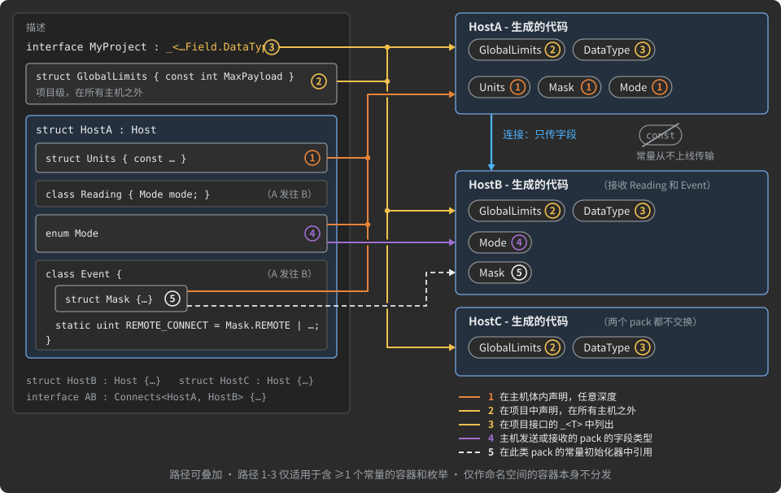

路径 3 能把声明在其他路径到不了的地方——主机体内,或另一个项目里——的容器或枚举拉进来。AdHoc 自己的协议就利用它把 `DataType`
枚举(声明在一个 pack 深处)分发给每个主机:

```csharp
public interface AdHocProtocol :
    _<
        AdHocProtocol.Agent.Project.Host.Pack.Field.DataType // 把 DataType 枚举传播到所有主机
    >
{
    // ...
}
```

只有项目接口能这样分常量:把容器或枚举列在项目的 `_<...>` 里,而不是主机的。从其他项目导入、用 `X<>` 移除导入,以及用 `Modify<>`
修改导入的枚举和常量,见[复用描述](#reusing-descriptions)。

<a id="cross-pack-constant-references"></a>
#### 跨 pack 的常量引用

常量可以从另一个容器的常量算出。那么,凡是有第一个 pack 的主机也必须要有那个容器,否则它的生成代码无法编译。路径 5 做的正是这件事:
代理遍历主机作用域内每个 pack 的每个常量的初始化器,跟随每个解析为另一个常量容器或枚举中常量的标识符,并把那个容器加入该主机。

```csharp
/// <see cref="InCS"/>
struct Monitor : Host
{
    public class Event
    {
        uint id;                                   // 一个复合事件 id,由 Mask 和 Action 构成

        public struct Mask   { public const uint REMOTE  = 1u << 31; public const uint THIS  = 0; }
        public struct Action { public const uint CONNECT = 1;        public const uint CLOSE = 2; }

        static uint REMOTE_CONNECT = Mask.REMOTE | Action.CONNECT;
        static uint THIS_CONNECT   = Mask.THIS   | Action.CONNECT;
    }
}
```

`Mask` 和 `Action` 声明在 `Monitor` 的体内,所以路径 1 把它们给了 `Monitor`。接收 `Event` 的主机经路径 5 得到它们,因为
`REMOTE_CONNECT` 和 `THIS_CONNECT` 的初始化器点名了它们。既不发送也不接收 `Event` 的主机两者都得不到。生成的 `Event` 携带算出
的值 `REMOTE_CONNECT = 2147483649U` 和 `THIS_CONNECT = 1U`,生成的容器则携带 `REMOTE`、`CONNECT` 和其余常量。

路径 5 的细节:

* **作用域。** 主机发送或接收某个 pack 时,该 pack 在主机作用域内。在该主机上有语言配置的 pack
  (见[主机、语言、生成的代码](#hosts-languages-generated-code))也算。
* **由引用驱动。** 规则跟随标识符,而不是结构:被引用的容器可以是同级的、嵌套的或声明在任何地方,表达式可以是任何形式——位运算、
  算术、嵌套、成员访问链。
* **不去重。** 主机已经发送或接收的被引用 pack 不会第二次加进常量列表:它已经作为 pack 在主机的代码里。

---

<a id="how-values-become-bytes"></a>
## 值如何变成字节

*模型:项目 → 主机 → 连接 → Actor → 状态 → 分支 → pack → **字段 → 线路上的字节***

本章跟随一个值,从你声明的类型一直走到线路上的字节。它涵盖:基元字段值所存的三个层、声明的范围如何把字段收窄到几个位、varint 压缩
如何声明与检查、字符串和长度如何写出、一个小 pack 如何折叠成一个整数(Value Pack),以及 pack 的字段按什么顺序写出。两个贯穿始终的
事实:多字节值按**小端序**写出;本章的一切对你的代码不可见——生成的 API 接收和返回的都是你声明的值。

<a id="value-layers-ext-int-iot"></a>
### 值的三层:exT、inT、ioT

每个基元类型字段的值以三种表示存在,生成器在它们之间转换:

| 层      | 名称          | 它是什么                                                                                          |
|:--------|:--------------|:--------------------------------------------------------------------------------------------------|
| `exT`   | exTernal 类型 | 你的代码所看到的:getter 的返回类型、setter 的参数,以语言类型的粒度为准                               |
| `inT`   | inTernal 类型 | 值在生成的对象里如何存储,以语言类型的粒度为准                                                          |
| `ioT`   | IO 线路类型   | 值如何传输:一段字节或位,没有语言粒度                                                                  |

一个取值在 40,000,000,000 到 40,000,000,093 之间的基元字段,对你的 exTernal 代码必须是 `long`,但它只持有 94 个不同的值。
按 `value - 40,000,000,000` 存储和传输,只需要 7 位:


这两种转换在不同的地方产生收益:

* **`inT ↔ ioT`** 在每次发送和每次接收时运行。线路上没有语言粒度,所以这里的节省是实打实的。一个取值从 1,000,000 到 1,080,000 的
  基元字段跨 80,000 个值;无论怎么存,它都存在一个 `int` 里,因为没有语言有 3 字节整数;但它以 `value - 1,000,000` 的形式在 3 个
  字节里传输,接收方把 1,000,000 加回去。同理,跨度需要 3、5、6 或 7 字节的基元字段就恰好用那么多字节传输。

  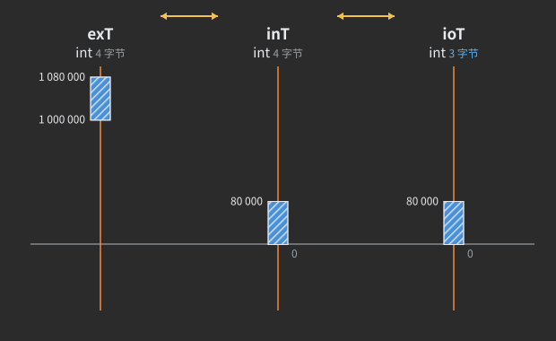

* **`exT ↔ inT`** 只在基元集合里节省内存,那里条目的宽度由集合而不是语言类型决定。存储按声明范围的**跨度**来选择:1,000,000 到
  1,000,004 是五个值,3 位,所以这样的集合按位打包存放——每条目 3 位而不是 4 字节,每个条目存为 `value - 1,000,000`,访问器把
  偏移加回来。`[MinMax(-5, 5)] int[]` 是 11 个值,每条目 4 位,存为 `value + 5`。更宽的跨度会落入能容纳它的最窄元素的有类型数组:
  `[MinMax(400_000_000, 400_000_193)] int[]` 每条目占一个字节。

在 TypeScript 里,位移只在后一处应用。单个基元字段、基元的 `Map`/`Set` 条目、普通 `Array` 的基元元素,无论装什么都是 `number`,
所以不做位移;只有类型化数组(`Uint8Array` … `Uint32Array`)、建立在它们之上的集合,以及位打包存储里的值才会被位移。

无论底层发生什么,**基元字段生成的 API 只说 `exT`**:它的 getter、setter 和按字段生成的常量
([`MIN`、`MAX`、`NULL`、`ZERO`](#range-constants-in-the-generated-code))用的都是你声明的值。

<a id="narrowing-a-primitive-field-with-minmax"></a>
### 用 [MinMax] 收窄基元字段

`[MinMax(min, max)]` 声明数值基元字段的闭区间(在集合上,则是其基元条目的闭区间)。生成器随后用能容纳这个范围的最少的位或字节来
存储和发送该值。

```csharp
[MinMax(400_000_000, 400_000_193)] int ranged_field;  // 194 个值:一个字节,偏移 400 000 000
[MinMax(-5, 5)]                    int trim;          // 11 个值:4 位
[MinMax(1_000, 1_010)]             int level;         // 11 个值:同样 4 位
[MinMax(1_000, 1_009)]             int? setting;      // 10 个值 + null = 11 个编码:4 位
```

**存储的是相对 `min` 的偏移**,即 `value - min`,所以只有**跨度**决定宽度,与数值大小无关:`[MinMax(-5, 5)]` 和
`[MinMax(1_000, 1_010)]` 都装 11 个值,都占 4 位。(当原始值本身已能放进同样的宽度时,生成器可能不做位移地存储;宽度相同,访问器
的行为也相同。)存储按跨度选择,可为空的字段要多算一个编码:

| 跨度(`max - min`,可为空时 +1) | 存储                                                                                          |
|:------------------------------|:----------------------------------------------------------------------------------------------|
| 小于 128                      | **位字段**:能容纳最大编码的最少的位,与 pack 的其他位字段打包在一起                              |
| 最多 255                      | 一个字节                                                                                       |
| 更大                          | 内存中是最窄的无符号 16、32 或 64 位整数;线上恰好用跨度所需的字节数                               |

因为偏移从 `min` 算起,范围可以跨越零点,既不符合其宽度的有符号类型也不符合无符号类型:`[MinMax(-100, 150)] int` 是 251 个值,
占一个字节。

位字段为 `N` 个值保存编码 `0 … N-1`,字段可为空时再加一个“无值”编码。所以 `[MinMax(0, 7)] byte` 占 3 位,
`[MinMax(-11, 75)] short`(87 个值)占 7 位,`[MinMax(1, 8)] int?`(8 个值 + 空)占 4 位,空值编码是 8。数值相同的编码和值永远不会
在你的代码里相遇:访问器会做转换。

**exTernal 类型由范围选定。** 生成的 getter 和 setter 使用能容纳 `min … max` 的最窄整数类型,它可能朝任一方向偏离声明的类型:

```csharp
[MinMax(-1128, 873)] byte altitude_offset;  // 范围超出 byte:生成的字段是 short
[MinMax(20, 120)]    int  temperature;      // 范围放进 byte:生成的字段是 byte
[MinMax(40_000_000_000, 40_000_000_093)] long ranged_long; // 对你的代码仍是 long,内部 7 位
```

`[MinMax]` 的规则:

* **单值范围被拒绝。** `[MinMax(5, 5)]` 只剩一个可能的值,字段不携带任何信息。代理会停下:“... declares a range of a single
  value ... Widen the range, or declare the value as a constant instead of a field.”
* **每个字段一个范围特性。** `[MinMax]`、`[A]`、`[V]`、`[X]` 中至多一个能应用于一个字段,跨多个特性列表也一样。否则:
  “The MinMax attribute for Field ... cannot be used with VarInt attributes[X, V, A]. Use VarInt attribute arguments to set
  MinMax restrictions.” 特性类声明了 `AllowMultiple = true`,所以 C# 能编译第二个;代理会拒绝它。
* **仅限数字。** `[MinMax]` 在 `bool`、`string`、`DateTime` 和 pack 类型字段上被拒绝。在集合上它作用于条目;
  `[Key: MinMax(...)]` 和 `[Val: MinMax(...)]` 分别针对 Map 的键和值。
* **边界可以是算出来的。** 边界可以是整体按名引用的 [`[ValueFor]` 常量](#constants-and-enums)。
* **构造函数。** `MinMax(long, long)`、`MinMax(ulong, ulong)` 和 `MinMax(double, double)` 声明整数范围和浮点范围。特性类还声明了
  日期构造函数,并允许以方法为目标;但代理只在数值字段上赋予范围含义,并拒绝 `DateTime` 字段上的 `[MinMax]`。也不要在数值字段上使用
  日期构造函数:代理只把它们的前两个参数——年和月——读作边界。要给日期设界,请用 `DateTimeDef`,见
  [字段与类型](#fields-and-types)。

在 `float` 或 `double` 字段上,范围被记录下来并以 `MIN`/`MAX` 发布。两个边界都落在 `float` 范围内时字段生成为 `float`,否则为
`double`:

```csharp
[D(10), MinMax(-0.7, 0.7)] float[]   gains;    // 一个 float,范围 -0.7 … 0.7
[MinMax(-1.5, 1.5)]        double    weight;   // 边界放进 float:字段变成 float
```

> [!WARNING]
> 因为 `[MinMax]` 落在 `float` 范围内的 `double` 会变成 `float`,它只保留 24 位尾数而不是 53 位。对精度敏感的 `double` 不要加
> `[MinMax]`。

`longJS` 和 `ulongJS` 是建立在 `long` 上的 `[MinMax]` TYPEDEF,像任何其他范围一样收窄;见[字段与类型](#fields-and-types)。

<a id="bit-fields-small-values-share-the-packs-bits"></a>
### 位字段:小值共享 pack 的位

在每个 pack 中,一个码值能放进 7 位以内的基元类型字段——即它的所有取值,加上可为空时的一个"无值"码值,最多 128 个码值——
就是一个**位字段**。它不占用自己的字节:pack 里所有位字段的位被打包在一起,低位在前、按声明顺序排列,
并且对整个 pack 只向上取整到整字节一次。在线上,它们构成
[pack 的布局](#the-layout-of-a-pack-on-the-wire)中的第 2 组。

| 字段                       | 码值                 | 位数                      |
|:--------------------------|:---------------------|:--------------------------|
| `bool`                    | 2                    | 1                         |
| `bool?`                   | 3:false、true、无值   | 2                         |
| 有 3 个值的枚举             | 3                    | 2                         |
| 同一个枚举,可为空          | 4                    | 2                         |
| `[MinMax(0, 7)] byte`     | 8                    | 3                         |
| `[MinMax(1, 8)] int?`     | 9                    | 4                         |
| `[MinMax(-20, 20)] sbyte` | 41                   | 6                         |
| `[MinMax(0, 100)] byte`   | 101                  | 7                         |
| `[MinMax(0, 127)] byte`   | 128                  | 7                         |
| `[MinMax(0, 127)] byte?`  | 129                  | 不是位字段:占一个字节      |

```csharp
public class Status
{
    long                    at;         // 8 字节,固定宽度:不是位字段
    bool                    ignition;   // 1 位
    bool?                   door_open;  // 2 位
    Gear                    gear;       // 2 位 - enum Gear { Park, Drive, Reverse }
    Gear?                   wanted;     // 2 位
    [MinMax(0, 100)] byte   fuel_pct;   // 7 位
    [MinMax(-20, 20)] sbyte tilt;       // 6 位
    [D(+32)] string         driver;     // 引用字段:第 4 组的一个空值位
}
```

这六个位字段共占 20 位,所以 `Status` 在 `at` 的 8 个字节之后写入 3 个字节的位存储。每个字段的码值是
`value - min`,所以 `bool?` 存 0 表示 false、1 表示 true、2 表示无值,访问器双向转换:你的代码看到的是 `bool?`、
`Gear` 和 `byte`,永远看不到码值。当 pack 还有 varint 字段时,它们的长度位也并入同一块位存储(见
[varint 是如何写入的](#how-a-varint-is-written))。字段全部能放进 64 位的 pack 更进一步,变成单个
整数——一个 [Value Pack](#value-packs)。

<a id="enums-on-the-wire"></a>
### 枚举在线上

枚举类型的字段以**码值**传输,绝不是声明的常量本身。AdHocAgent 根据枚举的取值选择码值方案:

| 枚举                                  | 线上的码值                                                                                                  | 示例                                                                            |
|:-------------------------------------|:----------------------------------------------------------------------------------------------------------|:--------------------------------------------------------------------------------|
| 常规,值连续或接近                      | `value - min`(一个表达式)                                                                                | `enum Shifted { P = 10, Q = 11, R = 12 }`:`value - 10`,2 位                   |
| 常规,值稀疏                          | 值在全部不同取值中的序号(一个 switch)                                                                      | `enum Sparse { LOW = -7, MID = 0, HIGH = 300 }`:用 2 位传 0、1、2,而不是 9 位  |
| `[Flags]`                            | 位掩码,从最低标志位到所有标志位的按位或;当最低标志位不在第 0 位时向下移位                                       | `[Flags] enum AccessHigh { B4 = 16, B5 = 32, B6 = 64 }`:`value >> 4`,3 位      |

switch 方案每个方向都要付出一次查表的开销,所以只在它能让字段变窄时才保留它,无论有无空值码值;否则使用
减法。`enum MID { ServerRegisterReq = 1001, … ServerEventRes = 1008 }` 是连续的,以 `value - 1001` 传输,占 3
位。`enum Collide { A = -1, B = 3, C = 7 }` 以序号 0、1、2 传输,它的空值码值是 3——与 `B`
的值是同一个数;生成的访问器把码值和取值区分开,所以两者在你的代码里永不相遇。一个从 0 开始的二选一枚举
(`enum Mode { SPLIT = 0, MERGE = 1 }`)的码值等于取值。

flags 枚举的宽度等于它的掩码:八个标志位 `1 … 128` 占满一个字节,16 个标志位占两个字节,一个可为空的 16 标志位字段占 17
位。编号、底层类型、别名和 `bool` 替代在[常量与枚举](#constants-and-enums)中说明。

<a id="absent-values-on-the-wire"></a>
### 线上的缺失值

一个可为空的字段(用 `?` 声明,或者是引用类型:字符串、pack 类型的字段、集合——见
[字段与类型](#fields-and-types))在没有值时,以两种方式之一付出代价:

| 字段                                                                           | "无值"如何发送                                                                                                                              |
|:------------------------------------------------------------------------------|:--------------------------------------------------------------------------------------------------------------------------------------------|
| 位字段(跨度小于 128):`bool?`、小的 `[MinMax]` 范围、小枚举                     | 在字段的位里多一个**码值**:`bool?` 占 2 位(0 为 false,1 为 true,2 为 null);`[MinMax(1_000, 1_009)] int?` 用 4 位放 11 个码值 |
| 其他可为空的字段:更宽的数值、字符串、pack、集合                                   | 在 pack 的空值位里占一**位**(1 = 有值);缺失的字段不再发送任何其他内容                                                                          |

空值位以八位一字节写入,每个字节恰好位于它覆盖的字段之前(见
[pack 在线上的布局](#the-layout-of-a-pack-on-the-wire))。在内存中,生成的代码仍可能用一个空闲码值表示窄范围字段的
null;这个码值作为字段的 `NULL` 常量发布(对 `[MinMax(0, 254)] byte?`,`NULL = 0xFF`)。
可为空的 `DateTime` 保留其最大值,见[字段与类型](#fields-and-types)。

可为空集合的元素面临同一个问题:null 还能不能放进元素自己的类型?如果能(`bool?`、一个枚举、
`[MinMax(1_000, 1_009)] int?`),null 就是多出来的一个码值,集合按码值读写。如果不能——恰好出现在
8 + 1、16 + 1、32 + 1 和 64 + 1 位这四种宽度——把每个元素加宽会让集合翻倍,于是元素保持其
原生类型,null 单独保存,每个元素一位,并有它们自己的 API(`set1(i, null)`、`putNullKey`、
`Add(null)`)。那里唯一保留的哨兵值在批量设置器里:它从一个更宽类型的普通数组填充这样的列表,在那个
数组里,`NULL` 是数据范围之外的一个值。

在 [Value Pack](#value-packs) 内部,每个字段都是一个位槽,同一个问题决定可为空字段的 null
是它槽位里的一个空闲码值,还是额外的一位。三种情况并排放在同一个 pack 里:

```csharp
[MinMax(2_000_000, 2_000_510)] int? null_fits_9bit;       // 511 个值 + null = 512 个编码:null 放进这 9 位
[MinMax(2_000_000, 2_000_511)] int? null_needs_10th_bit;  // 512 个值填满 9 位:null 占第 10 位
[MinMax(2_000_000, 2_000_512)] int? null_is_spare_code;   // 513 个值需要 10 位:null 是其中的空闲编码
```

<a id="varint-declaring-where-values-cluster"></a>
### Varint:声明值聚集的位置

<a id="how-a-varint-is-written"></a>
#### varint 是如何写入的

varint 把一个数按 7 位一组写出,最低组在前。每个字节携带这个数的 7 位;它的高位表示
后面是否还有字节。全零的前导组不发送。所以**开销跟随实际发送的数的大小,
而不是声明类型的宽度**:装着 `3` 的 `long` 花费一个字节,同一个 `long` 装着 `3,000,000,000` 时花费五个字节。

| 字节数 | 发送的数(到基点的距离)              |
|:------|:-------------------------------------|
| 1     | 0 … 127                              |
| 2     | 128 … 16,383                         |
| 3     | 16,384 … 2,097,151                   |
| 4     | 2,097,152 … 268,435,455              |
| 5     | 268,435,456 … 34,359,738,367         |

因此,压缩是**分布**的性质,而不是类型的性质。在整个范围上均匀分布的值省不下
任何东西;varint 只会添上它的续位。聚集的值能省,只要生成器减去它们聚集的那个点,
让线上走一个小数而不是大数。只有描述文件能说出那个点在哪里——温差很小,
单调计数器无界增长,剩余租约紧贴在它的上限之下——而没有什么能测量尚未发送的流量。
这就是 AdHoc 让你声明分布、并由 AdHocAgent 检查这份声明的原因。

**位字段内部的 varint 形式。** 当 pack 还有位字段时,它的不可为空 varint 字段
([pack 在线上的布局](#the-layout-of-a-pack-on-the-wire)中的第 3 组)以共享这些字节的第二种形式写入。
负载字节数作为一到四个**长度位**进入位字段之间,负载随后按这个数量的整字节写出,
小端序。一个 16 位字段占一个长度位(0:后面一个字节,1:后面两个字节)和一到两个字节。
开销仍然跟随实际发送的数的大小:长度位取代了续位。没有位字段的 pack,以及
[Value Pack](#value-packs) 的 varint 字段,使用 7 位分组形式。

<a id="the-varint-attributes-a-v-and-x"></a>
#### varint 特性 [A]、[V] 和 [X]

三个特性声明整数基元类型字段(在集合上则是其整数元素)的分布。每个特性命名一个
集中点,由生成器减去它:

| 特性                                      | 值聚集在……附近                       | 线上发送                       |
|:-----------------------------------------|:--------------------------------------------|:-------------------------------|
| `[A(minMostProbableValue = 0, max = 0)]` | **最小值**,偶尔向上偏移                        | `value - minMostProbableValue` |
| `[V(maxMostProbableValue = 0, min = 0)]` | **最大值**,偶尔向下偏移                        | `maxMostProbableValue - value` |
| `[X(amplitude = 0, zero = 0)]`           | 一个**中心**,向两个方向偏移                     | `ZigZag(value - zero)`         |

三者中**声明的范围都是硬限制,而不是提示**:范围之外的值无法传输。特性补充说明的是
质量集中在范围内的哪个位置,因此生成器减去哪一端。

`[A]` 和 `[V]` 先命名集中点,再命名远端边界。**`[X]` 正好相反**:`[X(amplitude, zero)]`
先命名边界,因为它的中心默认为 0,是最常被省略的参数。`amplitude` 是 `ulong`,`zero` 是
`long`;其余参数是 `long`。

下面每张图都是一条已发送数值的流:时间从左向右,值轴竖直,云团越暗,
该值出现得越频繁。标注的线是你声明的集中点,而发送到线上的是到那条线的竖直
距离。密集的条带花费一个字节,只有稀疏的边缘花费更多,所以这条线必须放在云团所在处。

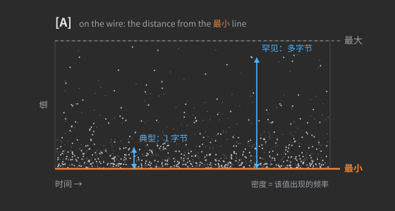

```csharp
[A]               uint? bytes_received; // 0 … uint.MaxValue - 远端边界由类型推导
[A(1_000, 9_000)] short chunk_len;      // 1 000 … 9 000 - 1 000 是下界,不是提示
```

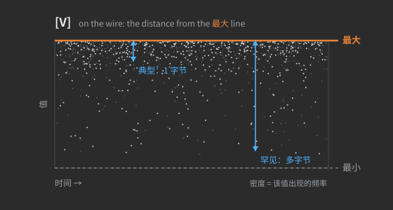

```csharp
[V]            short? charge_deficit; // -32 768 … 0 - 远端边界由类型推导
[V(30_000, 0)] int    lease_seconds;  // 0 … 30 000 - 通常接近完整租约
```

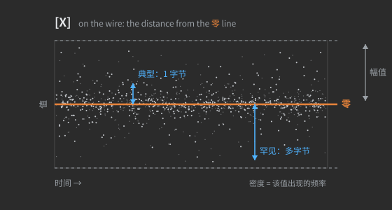

对 `[X]` 来说,amplitude 是**最大**偏差,不是典型偏差:字段的范围恰好是 `zero ± amplitude`,
范围之外的值无法传输。按典型摆动来设定 amplitude 是 `[X]` 最常见的误用。也要注意参数顺序:
`[X(50, 20_000)]` 是以 20,000 为中心的 ±50 窗口,而不是以 50 为中心的 ±20,000 窗口。

围绕中心做普通减法会让一半的值变成负数,而负数没有可丢弃的全零前导组。
ZigZag 把两个方向交错起来——`0, -1, 1, -2, 2, …` 变成 `0, 1, 2, 3, 4, …`——使得
任意符号的小偏差仍是小数。

```csharp
[X]        short? temperature_delta; // 围绕 0 的 -32 767 … 32 767 - amplitude 由类型推导
[X(1_000)] int    cursor_shift;      // -1 000 … 1 000 - 任一方向的小偏移花费一个字节
```

AdHoc 的 varint 从不携带符号:减去基点总是得到非负数,而 `[X]` 显式覆盖双侧的情形。
因此一个小负数绝不可能花费符号扩展的 64 位 varint 的全部十个字节。

该用哪个特性:

| 你的值                                       | 声明                                                                                  | 线上                          |
|:--------------------------------------------|:-------------------------------------------------------------------------------------|:--------------------------------|
| 在一个范围内均匀散布                          | `[MinMax(min, max)]`——不用 varint                                                     | 固定的位数或字节数               |
| 大多贴近下界,偶尔高得多                        | `[A(floor, max)]`                                                                    | `value - floor`                 |
| 大多贴近上界,偶尔低得多                        | `[V(ceiling, min)]`                                                                  | `ceiling - value`               |
| 大多围绕一个中心,向两侧偏移                    | `[X(maximum deviation, center)]`                                                     | `ZigZag(value - center)`        |
| 跨度能放进一个字节                             | `[MinMax]`——AdHocAgent 会拒绝 varint,见[一字节规则](#the-one-byte-rule)                | 一个位字段或一个字节             |

<a id="derived-bounds-and-named-arguments"></a>
#### 派生边界与具名参数

省略远端边界是常见情形:`[A]`/`[V]` 的第二个参数,`[X]` 的第一个参数。此时生成器
从声明类型推导它,**相对于集中点**,所以得到的范围偏离了类型自身的范围:

| 声明类型         | `[A]` 把 `max` 推导为  | `[V]` 把 `min` 推导为    | `[X]` 把范围推导为       |
|:-----------------|:------------------------|:-------------------------|:---------------------------|
| `short`          | `short.MaxValue + min`  | `short.MinValue + max`   | `zero ± short.MaxValue`    |
| `ushort`, `char` | `ushort.MaxValue + min` | `-ushort.MaxValue + max` | `zero ± ushort.MaxValue`   |
| `int`            | `int.MaxValue + min`    | `int.MinValue + max`     | `zero ± int.MaxValue`      |
| `uint`           | `uint.MaxValue + min`   | `-uint.MaxValue + max`   | `zero ± uint.MaxValue`     |
| `long`           | `long.MaxValue + min`   | `long.MinValue + max`    | `zero ± long.MaxValue`     |
| `ulong`          | `ulong.MaxValue + min`  | `long.MinValue + max`    | `zero ± long.MaxValue`     |

边界只在参数被**省略**时才推导。显式写出的 `0` 和其他边界一样:`[V(30_000, 0)] int` 就是 0 …
30,000。两个参数都按所写使用;如果远端边界落在错误的一侧,两者会被交换。

声明类型规定的是可用的**宽度**,不是最终范围。`[A(1000)] short q;` 是 1,000 … 33,767:偏移用掉了
负的那一半。如果值也会落在集中点之下,选择方向匹配的特性:对 `[A]`,第一个参数*就是*集中点,
所以 `[A(-500, 1000)]` 聚集在 -500。要聚集在 1,000 且向两侧偏移,
写 `[X(amplitude, zero: 1_000)]`;只向下偏移则用 `[V(1_000, min)]`。推导的范围必须放进 64 位:`[A(n)] ulong`
在 `n > 0` 时,以及 `[V(n)] long` 或 `ulong` 在 `n < 0` 时,会超出它——这时应把两个边界都写出来。

**exTernal 类型根据得到的范围重新计算**,可以向任一方向移动。`[X] uint u;` 跨越 ±`uint.MaxValue`,
不再放得下 `uint`,所以生成的字段是带符号的 64 位整数;`[X(1_000)] int i;` 只需要 -1,000 … 1,000,
生成的字段收窄到 16 位。带符号类型上光秃的 `[X]` 保持其类型:围绕 0 的 ±`short.MaxValue` 是 -32,767 … 32,767,
仍放得下 `short`。范围依然对称,所以 `short.MinValue` 不在其中;在可为空字段上,这个空闲码值就用来放"无
值"标记。`ulong` 上光秃的 `[X]` 让字段变成带符号的 `long`,因此大于 `long.MaxValue` 的值无法传输。

要省略的不是最后一个参数时,用 C# 具名参数指明你保留的那个——`minMostProbableValue` / `max`、
`maxMostProbableValue` / `min`、`amplitude` / `zero`:

```csharp
[A(max: 5_000)]  int   queue_depth; //       0 …  5 000 - 集中点保持在 0
[V(min: -5_000)] int   headroom;    //  -5 000 …      0
[X(zero: 1_000)] short level;       // -31 767 … 33 767 - amplitude 是推导的:1 000 ± short.MaxValue
```

最后一行展示了这条规则的两半:amplitude 来自**声明的**类型(`short.MaxValue`),而 33,767 不再
放得下 `short`,所以生成的字段是 `int`。中心也可以与更宽的 amplitude 组合:`[X(ushort.MaxValue + 7, 4)] int?`
是 `4 ± 65,542`,仍是 `int`。

<a id="when-varint-loses"></a>
#### varint 何时吃亏

在 7 位分组形式中,varint 每八位花掉一位作为续位标志,所以一个用满类型宽度的数
会比定宽字段**更长**。(下面的数字针对这种形式;位字段内部的形式付出的是长度位。)
相对固定的 4 字节字段,varint 在到基点的距离低于 2,097,152 时获胜,到
268,435,455 为止持平,超出则吃亏。基点留在零——`[A]` 不带参数、用于从不小的值——这些
普通字段在每个数据包上都吃亏:

| 字段                                                               | 定宽 | Varint                                                |
|:------------------------------------------------------------------|:------|:------------------------------------------------------|
| 均匀分布的 `uint`——哈希、校验和、UUID 的一半                        | 4     | 大多数值是 5(+25 %)                                  |
| 均匀分布的 `ulong`                                                 | 8     | 9 或 10;约一半的值占 10                               |
| 以秒计的 Unix 时间(约 17 亿)放在 32 位字段里                       | 4     | 总是 5                                                |
| 纬度乘以 10⁷ 后的量级(55.75° 是 557,500,000)                     | 4     | 离赤道超过 26.8° 的每个纬度都是 5                       |
| 超过 268,435,455 的单调 id                                         | 4     | 从此永远是 5                                          |

`[A] uint request_id;` 用在已经越过 268,435,455 的计数器上,每个数据包都要多付一个字节。

肥尾不是问题。当典型值真的很小——常见情况一个字节、离群值五个字节——varint
只在离群值超过流量四分之三时才落后于固定的 32 位字段。让 varint 吃亏的是基点放错了
位置,导致**没有**一个值是小的。围绕 400,000,000 聚集、散布 200 的值只携带八位信息,然而
基点为零时 varint 要在每个数据包上用五个字节拼出完整的量级——这与上面第一个 `[MinMax]` 示例
是同一个字段,在那里它只占一个字节。

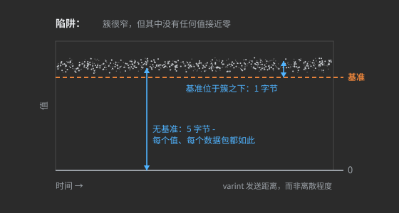

四个条件决定 varint 是否划算,而且四个都必须声明,不能靠猜:

1. **基点位于质量所在之处。** 没有它,"值是聚集的"什么也换不来。
2. **方向与尾部匹配**——向上(`[A]`)、向下(`[V]`)或双向(`[X]`)。给紧贴顶部的值用 `[A]`
   会让每个值离基点都有一整个跨度。
3. **减法后的典型距离放进一到三个字节。** 四字节是持平,五字节是亏损。
4. **跨度超过一个字节。** 否则位打包完胜。这一条由 AdHocAgent 强制执行。

<a id="the-one-byte-rule"></a>
#### 一字节规则

varint 靠丢弃前导零字节来节省,所以必须有东西可丢。起作用的是所传输数的跨度——
对 `[A]`/`[V]` 是 `max - min`,对 `[X]` 是 `2 × amplitude`——这是 `inT` 层,而不是声明类型。如果这个跨度
放进一个字节,AdHocAgent 会**拒绝**该字段:"... declares a value span that fits in a single byte, so varint has no leading zero bytes to skip ...
Use `[MinMax(min, max)]` for a range this narrow"。对 `[X]` 而言,这意味着 amplitude 为 127 或更小。

```csharp
[A(1_000, 1_100)] int offset;          // 硬范围 1 000 … 1 100,跨度 100 - 被拒绝
[X(50, 20_000)]   int sensor_reading;  // 硬范围 19 950 … 20 050,跨度 100 - 被拒绝
```

这样的声明背后藏着两种不同的错误,它们需要相反的修法。

**范围真的就是那么窄。** 那么这是偏移加位打包的活:

```csharp
[MinMax(1_000, 1_100)] int offset;     // 101 个值:线上 7 位
```

**或者,典型偏差被写在了最大值该在的位置。** `[X(50, 20_000)]` 承诺读数绝不离开 19,950 …
20,050,于是 20,100 无法传输,而 `[MinMax]` 只会让这堵墙变成永久。声明真实的边界,保留中心:

```csharp
[X(2_000, 20_000)] int sensor_reading; // 18 000 … 22 000,以 20 000 为中心:典型读数花费 1 字节,罕见摆动 2
```

<a id="restrictions-on-varint-attributes"></a>
#### varint 特性的限制

| 规则                              | 细节                                                                                                                                                                                                                                                                     |
|:----------------------------------|:---------------------------------------------------------------------------------------------------------------------------------------------------------------------------------------------------------------------------------------------------------------------------|
| 仅限宽于一个字节的整数             | `short`、`ushort`、`char`、`int`、`uint`、`long`、`ulong`。对 `byte`、`sbyte`、`bool`,AdHocAgent 拒绝该特性,因为 inTernal 类型只跨一个字节;对 `float`、`double`、`string`、`Binary`、`DateTime`、`Stream`/`File` 则是因为 varint 需要整数 |
| 每个字段一个范围特性               | `[A]`、`[V]`、`[X]` 和 `[MinMax]` 互相排斥:`[MinMax]` 声明不压缩的均匀分布,varint 特性声明自带边界的偏斜分布                                                                                              |
| 不能用在头部字段上                 | 头部的线上尺寸是固定的;见[用 pack 搭建 pack](#building-packs-from-packs)                                                                                                                                                                                              |
| 集合                              | 特性作用于元素;`[Key: …]` / `[Val: …]` 指向 Map/Set 的键或 Map 的值:`[Val: X] Map<uint, int> deltas;` 对值做 ZigZag;`[A, D(5)] uint[]`、`[X, D(5)] int?[,]`                                                                                 |
| `TYPEDEF`                         | 在 typedef 内部声明特性,而不是在使用它的字段上;别名把分布带给每一个使用者                                                                                                                                                                                                |
| 计算边界                           | 边界可以是一个整体命名的 [`[ValueFor]` 常量](#constants-and-enums)                                                                                                                                                                                                        |

```csharp
[A]                  uint?  bytes_received;  // 偏向低端,  varint
[V]                  short? charge_deficit;  // 偏向高端,varint
[X]                  short? temperature;     // 双向,   varint
[MinMax(-11, 75)]    short  celsius;         // 范围内均匀:不用 varint,7 位字段
[MinMax(-1128, 873)] byte   altitude_offset; // 范围超出 byte:生成的字段是 short
```

<a id="range-constants-in-the-generated-code"></a>
### 生成代码中的范围常量

基元类型字段的范围不会留在描述文件里。生成器把它作为常量发布在一个辅助类型中,类型名是
字段名加两个尾部下划线,即 `<field>__`;Map 的键和值各有一组:

| 常量          | 含义                                                                                                                        |
|:-------------|:----------------------------------------------------------------------------------------------------------------------------|
| `MIN`, `MAX` | 字段的闭区间范围:声明的、推导的,或其类型的完整范围                                                                            |
| `NULL`       | "无值"是空闲码值的可为空字段:该码值,以值的形式写出                                                                            |
| `ZERO`       | varint 字段:集中点,以 0 传输的那个值——`[A]` 是 `min`,`[V]` 是 `max`,`[X]` 是 `zero`                                          |

```csharp
[A(1_000)]      short chunk_len; // MIN = 1 000   MAX = 33 767   ZERO =  1 000
[V(30_000, 0)]  int   lease;     // MIN =     0   MAX = 30 000   ZERO = 30 000
[X(1_000, 50)]  int   drift;     // MIN =  -950   MAX =  1 050   ZERO =     50
[MinMax(-5, 5)] int   trim;      // MIN =    -5   MAX =      5
[MinMax(1, 7)]  byte? bits;      // MIN =     1   MAX =      7   NULL = 8
```

它们全部是 **exTernal(`exT`)值**,即你的代码传给设置器、从读取器取回的那些数;移位、ZigZag 或
位打包后的形式从不外露。光秃的 `[V] uint` 报告 `MIN = -4,294,967,295` 和 `MAX = 0`,而不是存储时的 0 … 4,294,967,295。用
它们在设置器之前校验输入——`MIN … MAX` 之外的值无法传输——或给滑块定尺寸,而不必把数字
复制进每台主机。

每个数值基元类型字段在 C#、Java 和 TypeScript 中都携带 `MIN` 和 `MAX`,范围就是类型完整范围的字段也不例外。在 C# 中
常量是 `Pack.field__.MIN`;Java 多嵌套一层,是 `Pack.field__.Val.MIN`;在 TypeScript 中是 `Pack.field__.MIN`。AdHoc
自己的 `Login` pack 展示了一个普通 `ulong` 的 C# 形式:

```csharp
public partial struct uuid_hi__
{
    public const ulong MIN = 0x0;
    public const ulong MAX = 0xFFFF_FFFF_FFFF_FFFFUL;
}
```

<a id="strings-and-lengths-on-the-wire"></a>
### 线上的字符串与长度

`string` 以其 UTF-16 码元数量的 varint 计数发送,随后每个码元各作为一个 1 到 3 字节的 varint。文本在
pack 内部不转换为 UTF-8:发送方写出语言原生的字符串,接收方重建它,中间没有解码步骤。每个字符的开销:

| 字符                                                                          | AdHoc 中的字节数                  | UTF-8 中的字节数  |
|:-------------------------------------------------------------------------------|:---------------------------------|:-------------------|
| U+0000 … U+007F(ASCII)                                                       | 1                                | 1(同样的字节)     |
| U+0080 … U+07FF(拉丁文补充、希腊文、西里尔文、希伯来文、阿拉伯文)                  | 2                                | 2                  |
| U+0800 … U+3FFF(天城文、泰文、假名等)                                          | 2                                | 3                  |
| U+4000 … U+FFFF(CJK 表意文字、韩文音节等)                                       | 3                                | 3                  |
| 高于 U+FFFF(emoji 和其他基本多文种平面之外的字符)                                | 6(两个码元,各 3 字节)            | 4                  |

pack 是成帧的——接收方恰好读取 pack 的那些字节,丢一个字节就使帧失效——所以 pack 内的字符串
不需要自同步编码。限制 `[D(+N)]` 按 UTF-16 码元计数,所以一个 emoji 算两个;见
[字段与类型](#fields-and-types)。当接收方需要原始 UTF-8 字节而不是字符串——为了存储或中继它们,或
写入文件——trim 会在那一段链路上把该字段按 UTF-8 发送;见 [Trims](#trims)。

集合在元素之前携带其长度,常量长度的数组除外(带 `[D]` 的 `T[]`),它的长度从不上线;
各种形式见[字段与类型](#fields-and-types)。数组或列表的长度是一个定宽字段,按声明的
最大长度定宽:

| 声明的最大长度      | 长度字段     |
|:------------------------|:-------------|
| 不超过 255               | 1 字节       |
| 不超过 65,535            | 2 字节       |
| 不超过 16,777,215        | 3 字节       |

空集合发送零长度;缺失的集合除其空值位外什么都不发送。没有 `[D]` 的字段,其默认最大值
来自 `_DefaultMaxLengthOf`(除非改动,默认 255);见[字段与类型](#fields-and-types)。

<a id="value-packs"></a>
### Value Packs

**Value Pack** 是所有字段合起来能放进 64 位的 pack。生成器把它折叠成单个整数:没有对象,没有
堆分配,没有间接寻址——在 C# 和 Java 中总是如此,在 TypeScript 中只要 pack 放进 53 位。Value Pack 不用
标记声明;由生成器识别它。

```csharp
class PositionPack      // 48 位:一个 Value Pack
{
    float x;            // 32 位
    byte  layer;        //  8 位
    byte  flags;        //  8 位
}

class StatusFlags       // 6 位:一个 Value Pack
{
    [MinMax(0, 7)] byte priority;  // 3 位
    bool                is_leader; // 1 位
    [MinMax(0, 3)] byte mode;      // 2 位
}
```

<a id="what-makes-a-pack-a-value-pack"></a>
#### 什么让一个 pack 成为 Value Pack

当每个字段都是下列之一,且它们的宽度加起来不超过 64 位时,这个 pack 就是 Value Pack:

| 字段种类                      | 宽度                                         |
|:----------------------------|:---------------------------------------------|
| `bool`                      | 1 位                                         |
| 整数、`float`、`double`      | 其类型的宽度,用 `[MinMax]` 可更少              |
| `char`                      | 16 位                                        |
| 枚举                         | 其码值的宽度                                  |
| `DateTime`                  | 64 位                                        |
| 另一个 Value Pack            | 它自己的宽度                                  |

可为空字段需要给它的 null 留地方:位里有空闲码值就用空闲码值,否则再加一位。字符串、数组、其他
集合、`Binary`、`Stream`/`File` 字段以及包含自身的 pack,永远不会构成 Value Pack。AdHocAgent 自己的估算按
每个字段的声明宽度、外加每个可为空字段一位来计数;生成器用收窄后的宽度做最终决定,所以一个
仅靠 `[MinMax]` 特性压到 65 位以内的 pack 同样是 Value Pack。

```csharp
class Point2 { float x; float y; }           // 64 位:一个 Value Pack;作为数组条目它是一个数
class Point3 { float x; float y; float z; }  // 96 位:一个普通 pack;作为条目它是一个嵌套对象
class Over_64bit_by_one { float? f32; int i32; } // 33 + 32 = 65 位:不是 Value Pack
```

对 Value Pack 来说太宽、又需要单独发送的值——比如三个 `float` 坐标——仍然可以不借助对象传输:作为
空 pack 的头部字段([带头部的空 pack](#an-empty-pack-with-a-header-values-without-an-object))。

Value Pack 可以像任何其他类型一样做字段、数组元素、Map 的键或值以及 Set 的元素。注入进 Value Pack 的字段
(见[用 pack 搭建 pack](#building-packs-from-packs))并入它的位,只要仍然放得下,pack 就仍是 Value Pack。

<a id="how-a-value-pack-is-laid-out"></a>
#### Value Pack 的位布局

在其载体整数内，每个字段占固定数量的位，保存其编码（`value - min`）。槽位按宽度排序，
最宽在前；同宽度的字段保持声明顺序。AdHoc 的 `Progress` pack 占 23 位：


在线上，单独发送的 Value Pack 是它的 pack id 加上固定位数，向上取整到整字节（`Progress`：3 字节）。
Value Pack 的 varint 字段跟在固定位之后，各自作为独立的 varint：在注入了 `[X] short event_code` 的
`StatusFlags` 中，6 个固定位占一个字节，`event_code` 以 ZigZag varint 紧随其后。Value Pack 内的可为空字段在其槽位
存在空闲编码时使用它：一个有五个值的 3 位枚举字段，其槽位保存 5 时表示 null。

<a id="smart-flattening"></a>
#### 智能扁平化

只有一个字段且该字段是 Value Pack 的 pack，会消失在使用它的字段中：字段直接取内部值。

```csharp
class Temperature   { float celsius; }
class SensorReading { Temperature measurement; }   // 生成为:float measurement

class Pressure       { float kilopascals; }
class PressureSensor { Pressure? reading; }        // 生成为:float? reading - null 得以保留

class Voltage      { float volts; }
class PowerLevel   { Voltage? level; }
class DeviceStatus { PowerLevel? power; }          // 链条也会扁平化:power 是可为空的 float
```

可为空性在扁平化后保留：链条中任一环可为空，扁平化后的字段就可为空。每个可空环节在字段的位内
保留自己的空编码，因此在线上"没有功率等级"和"有功率等级但没有电压"对
`DeviceStatus.power` 仍然可区分。作为 Set 项，给定 `class FloatWrapper { float v; }` 和 `class FloatWrapperNullable { float? v; }`，字段
`Set<FloatWrapper?>`、`Set<FloatWrapperNullable>` 和 `Set<FloatWrapperNullable?>` 都会变成 `Set<float?>`。

<a id="the-generated-value-pack-in-c-java-and-typescript"></a>
#### C#、Java 和 TypeScript 中生成的 Value Pack

| 目标       | 表示                                                                                                       | 分配                             |
|:-----------|:-----------------------------------------------------------------------------------------------------------|:---------------------------------|
| C#         | 基于一个无符号整数 `Value` 的可变 `partial struct`，每个字段一个属性                                       | 无：值类型                       |
| Java       | 标记载体基元类型的 type-use `@interface`，静态访问方法在嵌套接口中                                         | 无：只有基元类型                 |
| TypeScript | `type Pack = number` 与访问器函数的 `namespace Pack { ... }` 合并                                          | pack 不超过 53 位时无分配        |

三者在在线上写下完全相同的字节。

**C#。** struct 包着一个宽度足够容纳其位数的无符号整数 `Value`——23 位的 `Progress` 用 `uint Value`，64 位 pack 用
`ulong Value`。它有从载体构造的构造函数（`new Progress(bits)`）、与载体的双向隐式转换，实现
`IEquatable<T>`，其 `==`/`!=` 运算符也适用于 `Progress?`。字段即属性：

```csharp
var progress = new Progress();
progress.what    = 2;                 // "compiling"
progress.percent = 40;
progress.pass    = 1;
uint bits = progress;                 // 到载体的隐式转换
string text = Progress.TEXT[progress.what];
```

**Java。** Java 没有用户自定义值类型，所以永远不创建实例。pack 是一个注解，标记承载它的基元
类型，`@Progress int`；载体是能容纳它的最小 Java 基元：`boolean`、`byte`、`char`、`int` 或 `long`。无符号 8 位
和 16 位字段映射到 `char`。每次字段访问都是注解的嵌套接口——分组——中的静态方法：Java
注解本身不能持有静态方法，所以分组 `get`、`set`、`hasValue`、`to_null`、`New` 和 `jso` 承载它们。
[SlimEnum IntelliJ 插件](https://github.com/cheblin/SlimEnum)（[JetBrains Marketplace](https://plugins.jetbrains.com/plugin/10316-slimenum)）
读取这些 `@interface` 标记——在 Value Pack 和枚举上——让 IDE 把普通的 `long` 当作有类型的枚举或标志集：
上下文感知补全、switch-case 收窄、感知按位或组合的标志，以及非法值检测。

**TypeScript。** pack *就是*一个 number：`type Pack = number`，合并的 `namespace Pack` 持有分组 `get`、`set`、`hasValue`、
`to_null`、`New` 和 `jso`，每组中每个字段一个函数，执行位运算。宽于 53 位的
pack 放不进 `number`，改为类实例。整个 pack 的"无值"是一个越界哨兵，写成字面量类型，因此 TypeScript
会自动收窄它。

带范围的单字段 pack，如 `[MinMax(400_000_000, 400_000_193)] int`，在 TypeScript 集合中保存并以其**编码**发送，
`value - MIN`——这里是一个字节。`Pack.Nullable.get( code )` 给出值，`Pack.Nullable.set( value )` 给出编码。接近
`long` 末端的范围使值成为 `bigint`（放不进 `number` 的 53 位），而其编码仍是 `number`。在**抽象**（`-`）
pack 中，你的代码实现的访问器以编码形式收发这样的字段——一个 `number`，正是在线上传输的东西；不做移位，
不为每个项创建 `bigint`，需要值时用 `Pack.Nullable.get`/`set` 转换。在 C# 和 Java 中，这些访问器收发
pack 本身：那里它是值类型，移位没有成本。

<a id="working-with-a-value-pack-in-java-and-typescript"></a>
#### 在 Java 和 TypeScript 中使用 Value Pack

两种语言中调用写法相同——pack，然后分组，然后字段：

| 操作                              | 调用                                              |
|:----------------------------------|:--------------------------------------------------|
| 读字段                            | `Pack.get.field( pack )`                          |
| 写字段                            | `pack = Pack.set.field( pack, value )`            |
| 字段是否持有值                    | `Pack.hasValue.field( pack )`                     |
| 使字段不持有值                    | `pack = Pack.to_null.field( pack )`               |
| 构造 pack                         | `Pack.New.of( field, field, ... )`                |
| 从空 pack 开始（Java）            | `Pack.EMPTY_PACK`                                 |
| pack 的 JSON 文本                 | `Pack.jso.n( pack )`，也可 `Pack.New.str( pack )` |

```java
@PositionPack long pack = PositionPack.New.of( 1.5f, (char) 3, (char) 4 ); // x, layer, flags:描述中的顺序
pack = PositionPack.set.x( pack, 2.5f );
float x = PositionPack.get.x( pack );
System.out.println( PositionPack.jso.n( pack ) );
```

```typescript
let pack = PositionPack.New.of( 1.5, 3, 4 );
pack     = PositionPack.set.x( pack, 2.5 );
const x  = PositionPack.get.x( pack );
console.log( PositionPack.jso.n( pack ) );
```

* **pack 在前，值在后，setter 返回 pack。** pack 是值，所以调用不原地修改任何东西：
  `Pack.set.field( pack, value )` 不写 `pack =` 就会丢失结果。例外是宽于 53 位的 TypeScript pack：它是对象，
  setter 修改它并返回同一对象，所以同一行代码两种情况都适用。
* **`Pack.New.of` 按声明顺序接收字段**，而不是按位的顺序（在 `Progress` 中，`percent` 位于第 0 位，却是第五个
  参数）。应不持有值的字段之后用 `Pack.to_null.field( pack )` 设置。
* **`hasValue` 和 `to_null` 只在 pack 有可为空字段时存在。**
* **单字段 pack 有同样的分组**，所以 pack 增加第二个字段时代码不变。它的 setter 只接收值：
  `Pack.set.field( value )`。
* **JSON。** Java 中文本来自运行时的 `JsonWriter`。TypeScript 中是 `JSON.stringify`；`bigint` 写成数字
  后跟 `n`，即 `AdHoc.JSON_EXT()` 的写法，无论是否调用过 `JSON_EXT()`。
* **生成的代码自带文档。** 每个 Value Pack 的文档注释以 pack 及其字段的名字列出这些调用，
  可直接复制：构造、读取、写入、JSON 和整 pack 缺失形式。

> [!NOTE]
> 旧的访问器 `Pack.field__.Val.get( pack )`（Java）和 `Pack.field__.get( pack )`（TypeScript）不再生成。
> 辅助对象 `Pack.field__` 只保留字段常量：`MIN`、`MAX`、`NULL`。

<a id="a-value-pack-that-may-be-absent"></a>
#### 可能缺失的 Value Pack

以可为空 Value Pack 为类型的字段需要一个代表"无 pack"的值。生成器挑选载体的一个越界编码，
发布为 `NULL`：

* **C#**：嵌套 struct `Pack.Nullable` 持有载体（`value`），可转换为 pack（`Value`），并有 `hasValue`、`to_null()` 和
  常量 `NULL`。
* **Java**：注解 `@Pack.Nullable` 标记可能不持有 pack 的基元；其分组 `Pack.Nullable.value` 有 `set( pack )`、
  `to_null()`、`hasValue( maybe )` 和 `get( maybe )`，旁边是常量 `Pack.Nullable.NULL`。可空形式可能需要比 pack
  更宽的基元：保存在 `int` 中的 32 位 pack 在可为空时是 `long`，`NULL = 0x1_0000_0000L`。
* **TypeScript**：字面量类型哨兵，如上所述。

<a id="the-layout-of-a-pack-on-the-wire"></a>
### pack 在线上的布局

线上的 pack 是它的 pack id（见[编号表](#numbers-tables)）、头部字段（如有，见
[由 pack 构建 pack](#building-packs-from-packs)），然后是首尾相接的字段。作为另一个 pack 的字段使用的 pack
就地写入，不带 pack id。pack 前面没有长度：接收方从自己的生成代码知道接下来
是什么。字段不携带编号也不携带标签；只按位置识别。

生成器按组写入字段。每组内字段保持描述中的顺序：

| 组                               | 字段                                                                              | 写入方式                                                                                                                                                                                 |
|:---------------------------------|:----------------------------------------------------------------------------------|:---------------------------------------------------------------------------------------------------------------------------------------------------------------------------------------|
| 1. 固定宽度基元                  | 非可空的数字和 `char`，且不是位字段                                               | 其字节，小端序                                                                                                                                                                         |
| 2. 位字段                        | `bool`、小的 `[MinMax]` 范围、小枚举及其可空形式                                  | 打包在一起，低位在前，向上取整到整字节                                                                                                                                                 |
| 3. varint 字段                   | `[A]`、`[V]`、`[X]` 字段                                                          | 每个一个 varint；pack 有位字段时，其长度位接续位字段字节，载荷字节随后（见[varint 如何写入](#how-a-varint-is-written)）                                                                  |
| 4. 可空和引用字段                | 字符串、pack 类型字段、集合、null 不是编码的可空字段                              | 每八个字段前面一个字节的空值位，然后是每个存在的字段                                                                                                                                   |
| 5. 管道                          | `Stream` 和 `File` 字段                                                           | 在一切之后                                                                                                                                                                             |

第 1 至 3 组保存单个基元字段——数字、布尔、字符、枚举和用作字段的 Value Pack。在仅由
基元字段构成的 pack 中，固定宽度字段按宽度从宽到窄写入；同宽度的字段保持声明顺序。当 pack
由其他 pack 组合而成时，先写自己的字段，继承和注入字段随后，顺序见
[由 pack 构建 pack](#building-packs-from-packs)。

一个完整示例：

```csharp
class Reading
{
    string?                 label;     // 第 4 组:空值位,然后是 varint 计数 + 字符
    ushort                  sensor;    // 第 1 组:2 字节
    [MinMax(-11, 75)] short celsius;   // 第 2 组:87 个值,7 位
    bool                    alarm;     // 第 2 组:1 位
    [X(2_000, 20_000)] int  pressure;  // 第 3 组:ZigZag(value - 20 000),位字段之间的一个长度位,然后是它的字节
    uint?                   sequence;  // 第 4 组:空值位,然后是 4 字节
    [D(16)] ushort[,]       samples;   // 第 4 组:空值位,然后是一个 1 字节长度和每个条目 2 字节
}
```

取 `label = "ok"`、`sensor = 513`、`celsius = 20`、`alarm = true`、`pressure = 20 001`、`sequence` 缺失、`samples = [1, 2]`，
pack id 之后的字节是：

| 字节             | 字段                    | 原因                                                                                       |
|:-----------------|:------------------------|:-------------------------------------------------------------------------------------------|
| `01 02`          | `sensor`                | 513 = 0x0201，小端序                                                                       |
| `9F`             | `celsius`、`alarm`      | celsius 编码 20 - (-11) = 31 在第 0~6 位，alarm 在第 7 位                                  |
| `00`             | `pressure` 及其长度     | 位字段继续进入第二个字节：pressure 的长度位 0，随后一个载荷字节                            |
| `02`             | `pressure` 及其载荷     | 20 001 - 20 000 = 1，ZigZag(1) = 2                                                         |
| `05`             | 空值位                  | label 存在（位 0），sequence 缺失（位 1），samples 存在（位 2）                            |
| `02 6F 6B`       | `label`                 | 2 个码元，然后是 `o` 和 `k`                                                                |
| `02 01 00 02 00` | `samples`               | 长度 2 一个字节（最大为 16），然后两个 `ushort`                                            |

十四个字节，`sequence` 只花费它的空值位。`celsius` 和 `alarm` 的八位填满第一个位字段字节，所以
`pressure` 的长度位开启第二个；若 `celsius` 为 6 位，三者将共享一个字节。


<a id="why-reordering-fields-changes-the-protocol"></a>
#### 为什么调整字段顺序会改变协议

字段没有编号，所以其顺序是线上格式的一部分，与类型同等重要。生成器只把字段移入
其组（且在仅含基元字段的 pack 中在宽度之间移动）；它从不按名称排序字段，同组同宽的
字段保持描述中的顺序——基元字段也不例外。由此有两个后果：

* **同组的两个字段互换位置，线上就是另一个 pack。** 交换 AdHoc 自己的
  `Login` pack 中的 `ulong uuid_hi;` 和 `ulong uuid_lo;`，两台主机就会读到对方的另一半。发送或接收该 pack 的每台
  主机都必须重新生成并一起部署。
* **越过其他组字段移动的字段不改变任何东西**：越过字符串移动的基元字段仍在其组内同一
  位置。

移动整个声明——pack、主机、连接——也不改变任何东西：它们按编号识别，不按位置（见
[编号表](#numbers-tables)）。相反，按名称排序 pack 的字段或按含义分组，是对协议的更改。
哪些编辑改变线上格式、如何引入协议的新一代、以及列出每次编辑波及哪些主机的 `.cs~` 报告，
见[协议的演进](#evolving-a-protocol)。

---

<a id="building-packs-from-packs"></a>
## 由 pack 构建 pack

*模型：项目 → 主机 → 连接 → Actor → 状态 → 分支 → **pack → 字段** → 线上字节*

pack 不必自己声明每个字段。它可以从其他 pack 获取字段、放弃其中一些，项目也可以用一条
声明给许多 pack 附加字段。可附加两种不同的东西，它们落在不同位置：

- **载荷字段**成为 pack 的一部分。用 C# 继承或 `_<(...)>` 继承它们，用 XML 指令
  （`<see cref="..."/>+` 和 `-`）导入或移除它们，或用 `FieldsInjectInto` 模板把它们注入到整个 pack 集合。它们出现在生成的
  pack 类中，随 pack 的载荷传输，就像在类体中声明的字段一样。
- **头部字段**是用 `HeaderFor` 声明的协议元数据。它们不是 pack 类的一部分。连接在
  pack id 与载荷之间发送它们，且只在 pack 单独发送时。

本章前半部分讲载荷字段：Agent 如何组装 pack 的字段列表，以及字段以什么顺序输出。
后半部分讲 pack 头部。

<a id="how-a-packs-field-list-is-assembled"></a>
### pack 的字段列表如何组装

Agent 分四步构建每个 pack 的字段列表，顺序始终相同。每一步都遵循两条规则。

**名称占用。** 字段名一旦进入列表就被占用。后续步骤带来同名字段时跳过它，无论
该字段的类型如何。唯一例外是字段注入，它会替换已有的字段。

**共享字段，而非副本。** 导入或继承的字段与其源 pack 中的字段是同一个字段定义，不是
它的副本。源 pack 是字段唯一被定义的地方。每个由它构建的 pack 都跟随它：在源中改变字段的类型、特性或
文档，每个获取该字段的 pack 随之改变。用 IDE 重构重命名字段，IDE
也会重命名指向它的 `cref`。

| 步骤 | 来源                                                                                            | 名称已在列表中的字段             |
|------|-------------------------------------------------------------------------------------------------|----------------------------------|
| 1    | **原生字段**——在类体中声明                                                                      | -（它们最先到来）                |
| 2    | **字段注入**——目标集合包含该 pack 的每个 `FieldsInjectInto` 模板                                | 注入字段**替换**它               |
| 3    | pack 文档注释中的 **XML 指令**，从上到下：`-` 移除，`+`（或无标记）添加                         | 添加时被跳过                     |
| 4    | **基类列表**，从左到右：C# 基类，然后是 `_<...>` 项；`X<...>` 移除                              | 被跳过                           |


在另一项目中声明的 `Modify<Pack>` 之后可以改动列表。这是把复用的 pack 适配到新项目的工具，
见[复用描述](#reusing-descriptions)。

组合引用可能形成环：pack `A` 导入 `B` 的字段，而 `B` 继承 `A`。Agent 检测环并
在第二遍解析这些 pack。环不是错误。

<a id="importing-and-removing-fields-with-xml-directives"></a>
### 用 XML 指令导入和移除字段

**XML 指令**是 pack 正上方文档注释中的 `<see cref="..."/>` 元素。后跟 `-` 则移除；后跟
`+`——或任何其他内容，或无内容——则添加。无论如何都写上 `+`，紧跟在 `/>` 之后：它为
读者和生成的文档把该行标记为指令（见下方警告）。指令在第 3 步运行，在原生和注入字段之后、
基类列表之前。

| 指令                                         | 效果                                                             |
|----------------------------------------------|------------------------------------------------------------------|
| `/// <see cref="Pack.field"/>+`（或无标记）  | 添加该字段，除非其名称已被占用                                   |
| `/// <see cref="Pack"/>+`（或无标记）        | 添加 `Pack` 的每个字段，每个都受名称占用约束                     |
| `/// <see cref="Pack.field"/>-`              | 移除该字段，如果此刻列表持有它                                   |
| `/// <see cref="Pack"/>-`                    | 移除此刻列表持有的 `Pack` 的每个字段                             |

指令从上到下运行，名称的首次出现胜出。同一行标记之后的文本被忽略，所以
`/// <see cref="Player.id"/>+ // the key` 没问题。

典型用法是携带大 pack 少数字段的小更新 pack：

```csharp
class Player
{
    /// <summary>唯一 ID</summary>
    public int id;

    /// <summary>当前游戏得分</summary>
    public int score;

    /// <see cref="Player.id"/>+
    /// <see cref="Player.score"/>+
    class Update_score { }
}
```

`Update_score` 生成为 `{ int id; int score; }`，两个字段带着它们的文档。现在用 IDE 把 `score` 重命名为
`experience`，把类型改为 `long`：

```csharp
class Player
{
    public int  id;
    public long experience;

    /// <see cref="Player.id"/>+
    /// <see cref="Player.experience"/>+
    class Update_score { }
}
```

你没有碰 `Update_score`：IDE 重命名了 `cref`，它指向的字段现在是 `long`。`Update_score` 生成为
`{ int id; long experience; }`。

<a id="---removes-a-field-that-is-already-in-the-list"></a>
#### `-` 移除已在列表中的字段

`-` 不是名称屏蔽。它移除的正是那个字段定义——如果指令运行的那一刻列表持有它。由此
有三个后果：

- 把 `-` 放在带来该字段的 `+` **之后**。在它上面的 `-` 移除不了任何东西，然后 `+` 又会添加该字段。
- `-` 挡不住基类列表的字段。基类列表字段在第 4 步到来，在所有 XML 指令运行之后。要丢弃继承
  的字段，在基类列表中用 `X<...>`，或者用 `+` 选择性导入字段而不是继承。
- `-` 只按身份移除它指名的字段。来自不同 pack 的同名字段保留。

移除字段，再从另一 pack 导入同名字段，即完成替换：

```csharp
class Common
{
    public int    id;
    public int    version;
    public string debug_tag;
}

class WideId
{
    public long id;
}

/// <see cref="Common"/>+
/// <see cref="Common.id"/>-
/// <see cref="WideId.id"/>+
class Ticket { }               // { int version; string debug_tag; long id; }
```

`Common.id` 在整个 `Common` 进入后被移除，释放了名称，`WideId.id` 占据它。注意新的 `id` 去到
列表末尾。

三个常见模式，用上面的 `Common` 和另一个源 pack：

```csharp
class SessionInfo
{
    public string token;
    public long   expires;
}

// 原生字段胜出:Common.version 被跳过,尽管它的类型不同。
/// <see cref="Common"/>+
class Release
{
    public string version;     // { string version; int id; string debug_tag; }
}

// 导入一个 pack,丢弃它的一个字段,再导入另一个 pack。
/// <see cref="Common"/>+
/// <see cref="Common.debug_tag"/>-
/// <see cref="SessionInfo"/>+
class LoginPacket { }          // { int id; int version; string token; long expires; }

// 改变导入字段的类型:原生声明它。
/// <see cref="Common"/>+
class BigIdPacket
{
    public long id;            // { long id; int version; string debug_tag; }
}
```

在 `BigIdPacket` 中，`<see cref="Common.id"/>-` 不会改变任何东西：原生 `long id` 占用了名称，所以 `Common.id` 从不进入
列表。

> [!WARNING]
> Agent 把 pack 正上方文档注释中的**每个** `<see cref>` 都当作指令读取。如果元素后
> 的文本以 `-` 开头，则移除；其他任何内容——`+`、其他文本或无内容——则添加。你本想作为普通链接的
> 引用因此会导入字段，而对主机或连接的引用会以 "Unexpected attempt to apply add modification by ... to the pack ..." 中止运行。
> 在 pack 的文档中按名称引用其他实体，并把 `+` 或 `-` 紧跟 `/>` 书写。指令和普通
> 引用在生成文档中的样子见 [Packs](#packs) 一章。

<a id="inheriting-fields-c-inheritance-and-_"></a>
### 继承字段：C# 继承与 `_<(...)>`

继承在第 4 步带来另一 pack 的所有字段。这是给许多 pack 同一组字段的最短方式。

C# 基类是单继承形式：

```csharp
class Root                     // 共享字段;没有分支发送 Root 本身
{
    long id;
    long hash;
    long order;
}

/// <see cref='InCS'/>
struct BackendServer : Host
{
    public class ReplyInts : Root
    {
        [D(300)] int[] reply;
    }
}
```

`ReplyInts` 的字段列表是 `{ reply, id, hash, order }`。原生字段在前，基类字段在后，因为基类
列表是第 4 步。

> [!NOTE]
> 继承字段跟在 pack 自己的字段之后。AdHoc 自己的协议展示了这一点：
> `class Constants : Entity { [MinMax(0, 0xFFFF - 1)] ushort? parent; [D(65_000)] int[,] constants; }` 配合
> `class Entity { string name; max_65_000_chars doc; string inline_doc; }`，生成的字段顺序为
> `parent, constants, name, doc, inline_doc`。

多个来源时，添加 Meta 接口 `_<...>`，以 pack 元组为参数。如有 C# 基类，它排在最前：

```csharp
class Tracing  { long trace_id; long span_id; }
class Audit    { long user_id;  long stamp; }
class Envelope { long stamp;    int  hops; }

class Transfer : Tracing, _<(Audit, Envelope)>
{
    long amount;
}
// { amount, trace_id, span_id, user_id, stamp, hops }  - stamp 是 Audit 的:最左的来源胜出
```

基类列表从左到右运行，所以多个来源定义同名时最左者胜出：`Envelope.stamp` 被跳过。

基类列表中的 `X<...>` 移除那一刻列表持有的、所指名 pack 的每个字段。因为继承字段是共享的
而非复制的，这跨层级有效：

```csharp
class TransferLite : Transfer, X<Tracing> { }      // { amount, user_id, stamp, hops }
```

`TransferLite` 通过 `Transfer` 继承 `trace_id` 和 `span_id`。它们正是 `Tracing` 的字段，所以 `X<Tracing>` 移除它们。

与继承字段同名的原生字段替换继承字段。AdHoc 自己的协议用这种方式重新声明其基类 pack 的坐标：
`class View : XY { int x; int y; int w; int h; ... }`。

**生成器产出什么。** 派生 pack 的生成类型持有其所有组合字段；你的代码像读写原生字段一样读写它们。
C# 基类也随派生 pack 一起传输：它被包含在发送或接收该派生 pack 的每台主机的生成代码中。
它是普通 pack，分支也可以单独发送它。`_<...>` 中指名的 pack 只是字段来源，
不会以这种方式被拉入。

<a id="the-final-field-order-of-a-composed-pack"></a>
### 组合 pack 的最终字段顺序

字段顺序是线上格式的一部分(见[值如何变成字节](#how-values-become-bytes)),所以每个组合出来的字段落在哪里都很重要。规则由四个步骤推出:

1. 原生字段,不含被注入器替换掉的;
2. 注入的字段,按它们在注入器中声明的顺序;多个注入器按声明顺序生效;
3. 由 XML 指令添加的字段,从上到下;
4. 来自基类列表的字段,从左到右。

被注入器或头部修改器替换的字段会移动到其所在组的末尾。一个包含每一步的例子:

```csharp
class Tracing { long trace_id; }
class Common  { int id; int version; }

class Stamp : FieldsInjectInto<Order>
{
    long stamp;
}

/// <see cref="Common"/>+
class Order : Tracing
{
    int    version;
    string note;
}
// Order: { version, note, stamp, id, trace_id }
```

`version` 和 `note` 是原生字段。`stamp` 是注入的。`Common` 添加 `id`,跳过已被占用的 `version`。`Tracing` 添加 `trace_id`。
如果 `Stamp` 在 `long stamp;` 之后也声明了 `int version;`,注入的 `version` 会替换原生的那个,并落在注入字段之中,
位于 `note` 和 `stamp` 之后:`{ note, stamp, version, id, trace_id }`。

生成器按这个列表工作。在线上,字段按种类分组;每个组内部保持这个顺序,见
[值如何变成字节](#how-values-become-bytes)。因此,移动一条指令、重排基类列表或添加一个注入器都会改变协议。

<a id="field-injection-fieldsinjectinto"></a>
### 字段注入:`FieldsInjectInto`

**字段注入器**是一个实现 `FieldsInjectInto<PackSet>` 的类。它是一个模板:它的字段被添加到 `PackSet` 中的每个数据 pack 上,
而注入器本身不是 pack。当一整族 pack 都必须在载荷中携带某些字段时使用它,比如请求 id 或事件码。

```csharp
class CommonFields : FieldsInjectInto<_<(MyProject, X<Point2d>)>>
{
    string name;
    int    length;
}

class Point2d { float X; float Y; }
class Point3d { float X; float Y; float Z; }
```

目标集合是 `MyProject` 中位于其主机之外的每个数据 pack,减去 `Point2d`。`Point2d` 保持 `{ X, Y }`。`Point3d` 变成
`{ X, Y, Z, name, length }`:注入的字段**追加**在原生字段之后。

`PackSet` 是一个 [Pack Set](#pack-sets) 表达式:一个 pack、一个命名 Pack Set、一个带或不带 `@` 的项目、主机或 pack 作用域、
`_<...>`、`X<...>`、一个过滤器模板,或它们的元组。元组不需要 `_<...>` 包装。一个实际例子把一个 varint 字段注入到
项目的每个 pack 中:

```csharp
class CommonPayloadFields : FieldsInjectInto<Headers>
{
    [X] short event_code;
}
```

注入的字段是普通载荷字段,所以允许所有字段类型和特性——这里是 `[X]`。下面描述的头部字段规则要严格得多。

**哪些 pack 是目标。**注入到达集合中的每个数据 pack,包括仅作为其他 pack 的字段类型使用的 pack 和
Value Pack:在实际项目中,Value Pack `StatusFlags` 也得到了 `event_code`。枚举、常量集、typedef、
`DateTimeDef`、`TimeSpanDef` 和 `Duration` 定义、头部、头部修改器和其他注入器永远不是目标。

**名称冲突。**如果目标已经有一个与注入字段同名的字段,注入器的定义——类型、特性、文档——会替换它,
该字段在注入字段中占其位置,位于剩余原生字段之后。注入在 XML 指令和基类列表(第 2 步)之前运行,
所以注入的名称也胜过它们。

**规则**

| 规则                       | 会发生什么                                                                                                                                                               |
|----------------------------|----------------------------------------------------------------------------------------------------------------------------------------------------------------------------|
| 注入器不是 pack | 它没有线路 ID,也没有生成的类;把它列为分支载荷会停止运行:"Type '...' is a FieldsInjectInto (Template) and not a transmittable message type." |
| 注入器自己的字段  | 只注入其主体中声明的字段;它的基类列表和文档注释中的 `<see cref>` 引用编辑的是它的目标集合,而不是它的字段                    |

**陷阱**

- 注入器会改变每个目标的线上格式,包括没有分支直接发送的嵌套子 pack 和 Value Pack。
- 不带 `@` 的项目作用域只包含主机之外的 pack。`FieldsInjectInto<MyProject>` 会漏掉在主机内部声明的 pack;写成
  `FieldsInjectInto<@MyProject>` 才能到达它们,见 [Pack Sets](#pack-sets)。

<a id="pack-headers-headerfor"></a>
### pack 头部:`HeaderFor`

**pack 头部**是一组携带协议元数据的字段——路由数据、序号、会话 id、时间戳——它走在 pack 载荷之前,但不是 pack 的一部分。
你为一组 pack 声明一次。连接在 pack id 之后、载荷之前发送它的字段,你的代码可以在载荷被解析之前读取它们。

头部位于连接上,不在 pack 里:生成的 pack 类没有头部字段,同一个 pack 对象可以用不同的头部值发送。

<a id="declaring-a-header-and-where-its-declaration-sits"></a>
#### 声明头部以及声明放在哪里

把头部声明为一个实现 `HeaderFor<PackSet>` 的类;它的字段就是头部字段。`PackSet` 是一个
[Pack Set](#pack-sets) 表达式,所以头部可以针对一个 pack、一个元组、一个带 `@` 的递归作用域、一个命名 Pack Set
或一个过滤器模板,并用 `X<...>` 排除。

**你在哪里声明头部类,就决定了它的作用域**——它随哪些传输走:

| 声明位置                | 头部随其目标 pack 走                        |
|-------------------------|---------------------------------------------------------------|
| 直接在项目中 | 双向,在携带该 pack 的每条连接上 |
| 在主机 `H` 内部       | 只在**去往** `H` 的路上:当 `H` 是接收方时    |
| 在连接内部     | 双向,只在该连接上                   |

连接主体除了 `HeaderFor` 头部之外不接受其他类(见[连接](#connections))。主机作用域的头部描述的是它的主机期望在
收到的 pack 前面看到什么:在 `NodeA` 中声明的头部随 `NodeB` 发给 `NodeA` 的 pack 走,而不随
`NodeA` 发出的 pack 走。

<a id="several-headers-on-one-pack"></a>
#### 一个 pack 上的多个头部

头部之间不会互相覆盖。每个作用域匹配该传输、且目标集合包含该 pack 的头部都会随行,
各自作为自己的一组字段。同一个 pack 上的项目头部、主机头部和连接头部全都一起走。

这个描述是从一个实际测试项目精简而来的:

```csharp
using org.unirail.Meta;

namespace com.company.demo
{
    public interface Headers
    {
        class max_100_chars_string
        {
            [D(+100)] string TYPEDEF;
        }

        // 项目作用域:项目内主机之外的每个 pack,ServerStatus 除外。
        class ProjectScopeHeader : HeaderFor<(Headers, X<ServerStatus>)>
        {
            public ulong timestamp;
            public uint  session_id;
        }

        // 项目作用域:嵌套在 PlayerAction 中的 pack(不含 PlayerAction 本身),ChatMessage 除外。
        class RecursiveHeader : HeaderFor<(@PlayerAction, X<PlayerAction.GameStateUpdate.ChatMessage>)>
        {
            public uint transaction_id;
        }

        class PrecedenceTestPacket { max_100_chars_string test_data; }
        class TeamCoordination     { public uint team_id; }
        class PlayerEvent          { public byte event_type; }
        class ServerStatus         { public uint uptime; }

        class PlayerAction
        {
            public byte action_type;

            public class GameStateUpdate
            {
                public ushort state_id;

                public class ChatMessage
                {
                    public ulong timestamp;

                    public class AuthRequest
                    {
                        [D(32)] byte[] auth_token;
                    }
                }
            }
        }

        /// <see cref = 'InCS'/>
        struct NodeA : Host
        {
            // 主机作用域:这些 pack 发往 NodeA 时随行。
            class NodeAHeader : HeaderFor<(PlayerEvent, PrecedenceTestPacket)>
            {
                public          uint host_specific_id;
                [MinMax(0, 31)] byte flags;            // 5 位
            }
        }

        /// <see cref = 'InJAVA'/>
        struct NodeB : Host
        {
            // 主机作用域:PlayerEvent 发往 NodeB 时随行。
            class NodeBHeader : HeaderFor<PlayerEvent>
            {
                public uint sequence_id;
                bool        is_urgent;
            }
        }

        interface CommunicationChannel : Connects<NodeA, NodeB>
        {
            // 连接作用域:双向,仅此连接。
            class ChannelScopeHeader : HeaderFor<(TeamCoordination, PrecedenceTestPacket)>
            {
                public uint   sequence_num;
                public ushort priority;
                bool          flag_bit;
            }

            interface Actor2 : Actor
            {
                [_____lr_____<@Headers>]       // 任一侧都可以发送项目的每个 pack
                struct Start { }
            }
        }
    }
}
```

两个主机生成的代码给每个 pack 恰好这些头部:

| Pack                             | NodeA → NodeB                          | NodeB → NodeA                                       |
|----------------------------------|----------------------------------------|-----------------------------------------------------|
| `PrecedenceTestPacket`           | ProjectScopeHeader, ChannelScopeHeader | ProjectScopeHeader, NodeAHeader, ChannelScopeHeader |
| `PlayerEvent`                    | ProjectScopeHeader, NodeBHeader        | ProjectScopeHeader, NodeAHeader                     |
| `TeamCoordination`               | ProjectScopeHeader, ChannelScopeHeader | ProjectScopeHeader, ChannelScopeHeader              |
| `PlayerAction`                   | ProjectScopeHeader                     | ProjectScopeHeader                                  |
| `PlayerAction.GameStateUpdate`   | ProjectScopeHeader, RecursiveHeader    | ProjectScopeHeader, RecursiveHeader                 |
| `...GameStateUpdate.ChatMessage` | ProjectScopeHeader                     | ProjectScopeHeader                                  |
| `...ChatMessage.AuthRequest`     | ProjectScopeHeader, RecursiveHeader    | ProjectScopeHeader, RecursiveHeader                 |
| `ServerStatus`                   | 无                                   | 无                                                |

对照声明读这张表。`ProjectScopeHeader` 在除 `ServerStatus` 之外的每个 pack 上。`RecursiveHeader` 跳过 `PlayerAction`
本身,因为 `@PlayerAction` 取嵌套在其中的 pack 而不取容器,它也跳过被 `X<...>` 移除的 `ChatMessage`——但
不跳过嵌套在 `ChatMessage` 内部的 `AuthRequest`:`X<ChatMessage>` 只移除那一个 pack。`NodeAHeader` 只朝 `NodeA` 走,
`NodeBHeader` 只朝 `NodeB` 走。发往 `NodeA` 的 `PrecedenceTestPacket` 上叠了三个头部。


<a id="what-the-generator-produces-for-headers"></a>
#### 生成器为头部生成什么

生成的 pack 类不含头部字段。头部出现在连接中:

- `Connection.Transmitter.Header` 和 `Connection.Receiver.Header` 为每个可能沿该方向传输的头部各持有一个嵌套接口,
  每个字段有一个 getter 和一个 setter 方法,还有一个 `getXxxHeader()` 方法,当该头部不在当前
  pack 上时返回 `null`。头部字段的行尾注释会带到它的访问器上。
- `send` 方法把该 pack 沿该方向携带的每个头部的值作为参数,一个头部接一个头部,排在
  连接参数之前。
- 接收处理器在该 pack 之后,为它携带的每个头部得到一个头部对象。
- 每个 Actor 都有带头部的钩子:发送侧的 `OnSerializing` / `OnSerialized` 和
  接收侧的 `OnReceiving` / `OnReceived`。`OnReceiving` 在 pack id 和头部各位已经到达、载荷**尚未**解析时运行,
  所以你可以先检查路由或会话字段。见 [Actor 种类与运行时的 Actor](#actor-kinds-and-the-actor-at-runtime)。

对于上面的例子,`NodeA` 的 C# 侧是这样的:

```csharp
// Connection.Receiver.Header(形态)
public interface Header
{
    interface ChannelScopeHeader
    {
        uint   sequence_num();  void sequence_num(uint src);
        ushort priority();      void priority(ushort src);
        bool   flag_bit();      void flag_bit(bool src);
    }
    ChannelScopeHeader getChannelScopeHeader();   // null 表示当前 pack 没有 ChannelScopeHeader
    // ... ProjectScopeHeader, NodeAHeader, RecursiveHeader 同样如此
}
```

```csharp
// 发往 NodeB:ProjectScopeHeader + ChannelScopeHeader
Actor2.Start.send(packet,
                  timestamp, sessionId,             // ProjectScopeHeader
                  sequenceNum, priority, flagBit,   // ChannelScopeHeader
                  conn);

// 从 NodeB 接收:三个头部
Actor2.Start.OnReceiveD.PrecedenceTestPacket.handlers += (pack, project, nodeA, channel, conn, actor) =>
{
    ulong ts    = project.timestamp();
    byte  flags = nodeA.flags();
    uint  seq   = channel.sequence_num();
};
```

接收到的头部对象是连接的可复用接收缓冲区上的视图。在处理器里读值;不要保留引用,
因为下一个 pack 会覆盖它们。

<a id="headers-on-the-wire"></a>
#### 线上的头部

一个独立 pack 发出的顺序是:pack id,然后(在编址多个 Actor 的连接上)Actor 地址,然后头部各位,
然后是载荷。该 pack 上所有头部的字段一组接一组地按位打包,顺序由
生成器为连接固定——即 `send` 方法列出它们的顺序。`bool` 占 1 位,带 `[MinMax(0, 31)]`
的字段占 5 位,其他基元类型占完整宽度;总和向上取整到整字节。不在该 pack 上的头部不占空间。
在例子中,`NodeA` 收到的 `PrecedenceTestPacket` 携带 96 + 37 + 49 = 182 个头部位。

用作另一个 pack 字段的 pack——子 pack——不携带头部:头部属于一次传输,而不属于 pack。一个
既被单独发送又被用作字段的 pack,只在单独发送时才有头部。


<a id="which-packs-carry-headers"></a>
#### 哪些 pack 携带头部

头部只附着于分支发送的 pack——在[编号表](#numbers-tables)中获得线路 ID 的那些 pack。
没有分支发送的目标什么也得不到,没有这种目标的头部会从生成的代码中省略。

头部附着于每一种被发送的 pack:Value Pack 和空 pack 也是(对空 pack 来说,头部就是 pack id 之后的全部内容),
以及 `Stream` / `File` 管道 pack,此时头部在 pack id 之后、成帧之前(见[流](#streams))。
一个实际测试项目把连接作用域的头部放在一个 Value Pack 和一个空 pack 上:

```csharp
class Flags                        // 一个 Value Pack
{
    [MinMax(0, 15)] byte kind;
    bool                urgent;
}

class Nop { }                      // 一个空 pack

// 位于发送 Flags 和 Nop 的连接内部
class Route : HeaderFor<(Flags, Nop)>
{
    [MinMax(0, 7)] byte hop;       // 3 位
}
```

同一个项目还把它与一个排除一个 pack 的项目头部(`HeaderFor<(ResumableTest, X<Telemetry>)>`)、一个主机
头部和另一个连接上的头部组合在一起;当其中几个匹配同一次传输时,它们如上所述叠加。

保证送达使用同样的机制:`Resumable<HOST, PACKS>` 和 `[UDP]` 会生成由 Agent 制作的无字段头部,
绑定方式与任何其他头部相同(见[会话、保证送达、UDP](#sessions-guaranteed-delivery-udp))。

<a id="an-empty-pack-with-a-header-values-without-an-object"></a>
#### 带头部的空 pack:没有对象的值

超过 64 位的 pack 不是 [Value Pack](#value-packs):三个 `float` 坐标构成一个 12 字节的 pack,具体 pack 是每条消息一个
对象。当这样的值单独发送时,一个带头部的空 pack 可以在两侧都不创建对象的情况下携带它们:

```csharp
class Position { }                              // 一个空 pack:只有它的 id 走线

interface Link : Connects<Station, Drone>
{
    class XYZ : HeaderFor<Position>             // 坐标随头部走
    {
        public float x;
        public float y;
        public float z;
    }

    [____________r<Position>]
    struct Live { }
}
```

- 发送时,生成的 `Position` 的 `send` 以 `x`、`y`、`z` 为参数,一个头部接一个头部;这些值像任何头部一样存入
  连接发送队列的槽位中,而空 pack 没有对象要创建。
- 接收时,处理器得到 `XYZ` 头部作为接收缓冲区上的视图,从中读 `x()`、`y()`、`z()`。要在
  处理器里读:下一个 pack 会覆盖这个视图。
- 在线上,这个 pack 是它的 id 后跟 96 个头部位,12 字节——与 pack `{ float x, y, z; }` 的成本相同。

头部规则决定了什么能放进去(见下文):单个、不可为空的基元类型,可选地用 `[MinMax]` 收窄。字符串、数组
和嵌套 pack 需要普通 pack,或者一个从你自己的结构读写的抽象 pack
([主机、语言、生成的代码](#hosts-languages-generated-code))。

<a id="rules-for-header-fields-and-names"></a>
#### 头部字段与名称的规则

接收方必须能在不知道载荷的情况下读取头部,所以每个头部字段都有固定大小。

| 规则                                                                                                                                              | 违反时 Agent 的反应                                                                                                                                                                             |
|---------------------------------------------------------------------------------------------------------------------------------------------------|----------------------------------------------------------------------------------------------------------------------------------------------------------------------------------------------------------|
| 头部字段是单个、不可为空的基元类型:`bool`、`byte`、`sbyte`、`short`、`ushort`、`int`、`uint`、`long`、`ulong`、`float`、`double` | "The header field \`F\` line:N of \`Path\` must be a non-nullable, non-varint, single, primitive type. The current type is invalid."                                                                     |
| 不允许 string、`Binary`、pack、数组、`Map` 或 `Set` 字段                                                                                            | 同上                                                                                                                                                                                         |
| 不允许 `[D]`、`[A]`、`[V]` 或 `[X]`                                                                                                                   | 同上                                                                                                                                                                                         |
| 不允许可为空字段(`int?`)                                                                                                                        | 同上;之后还有一项检查 "Error: Nullable header fields are not allowed.",列出所有漏过的可为空头部字段                                                                      |
| 允许 `[MinMax(min, max)]`,并把字段收窄到其范围所需的位数                                                                 | -                                                                                                                                                                                                        |
| 头部名称唯一;头部字段名称在项目的**所有**头部之间唯一,且不同于其自己头部的名称               | Agent 提议改名(`name_1`、`name_2`、……),每次改名记录一条警告,并在控制台询问 "Do you accept these changes and wish to continue? (yes/no)";除 `yes` 之外的任何回答都停止运行 |
| 在连接主体内部,只允许 `HeaderFor` 这一个类                                                                                   | "The entity '...' (line N) cannot be declared inside a Connection body..."(退出码 22)                                                                                                                |
| 头部不是载荷                                                                                                                         | 在分支中点名它会停止运行:"... is a Header (Packet Metadata) and not a transmittable message type."                                                                                           |

名称规则存在的原因是:生成的连接在一个对象上暴露其所有头部的字段,所以两个头部都有
`timestamp` 字段会冲突。头部名称永远不会与载荷字段名称冲突:头部生活在 pack 之外。在无人值守的运行中
没有人回答 `yes`,所以自己把头部字段起成唯一的名字。

与注入器一样,头部只携带其主体中声明的字段。它的基类列表和文档注释中的 `<see cref>` 引用
编辑的是它的目标集合。

<a id="modifying-a-header-modify"></a>
### 修改头部:`Modify<Header>`

**头部修改器**改变一个已有的头部——通常是来自导入项目的——而不重写它。在任何连接主体之外,
声明一个恰好带一个类型参数的、实现 `Modify<Header>` 的类。修改器做三件事:

1. **添加字段。**修改器中声明的每个字段都被添加到头部。
2. **覆盖字段。**与头部字段同名的修改器字段会替换它。替换字段移动到头部末尾,
   这会改变头部的位布局。
3. **编辑目标集合。**修改器基类列表中 `_<...>` 里的 pack 或 Pack Set 被添加到头部的目标中;`X<...>`
   移除它们。

```csharp
class SessionHeader : HeaderFor<Point2d>
{
    int plain_id;
    int session;
}

class SessionHeaderModifier : Modify<SessionHeader>, _<Point3d>, X<Point2d>
{
    long routing_hash;     // 新增
    uint session;          // 替换 int session
}
// SessionHeader:目标集合 { Point3d },字段 { plain_id, routing_hash, session (uint) }
```

基类列表中的 pack 要放在 `_<...>` 里:C# 要求基类在前,所以 `Modify<...>` 之后的 pack 必须包装起来。一个
来自流式测试项目的实际例子:

```csharp
class StreamSequenceHeader : HeaderFor<(NamedStream, NamedStreamZstd, NamedFile, UniversalStreamPack)>
{
    public uint sequence_num;
    public long timestamp_ns;
}

class StreamSequenceHeaderModifier : Modify<StreamSequenceHeader>, _<SmallNamedFile>, X<NamedFile>
{
    public short routing_priority;
    public uint  sequence_num;
}
// 目标集合:NamedStream, NamedStreamZstd, UniversalStreamPack, SmallNamedFile
// 字段:  timestamp_ns, routing_priority, sequence_num(修改器的)
```

Agent 在把头部绑定到 pack 之前先把修改器合并进头部,所以修改后的头部随头部所到之处的每次传输走。
修改器的字段遵守与头部字段相同的规则;违反规则会得到相同的消息,只是称其为 "header modifier field"。
用于 pack、主机、连接和其他实体的 `Modify<>` 在[复用描述](#reusing-descriptions)中介绍。

> [!WARNING]
> 只有单参数形式才是头部修改器。Meta 还声明了双参数的 `Modify<Target, Modifications>`,但类
> `Modify<SomeHeader, (PackA, PackB)>` 不会被合并进 `SomeHeader`:Agent 忽略第二个参数,也不会把该类的
> 字段添加到头部。像 `@MyProject` 这样的作用域会像数据 pack 一样把它捡起来,它会被当作 pack 发送。头部修改器会
> 为其所有目标改变头部;要添加 pack,把它们放进修改器基类列表的 `_<...>` 里。

<a id="related-composition-and-headers"></a>
### 相关:组合与头部

- [Packs](#packs) —— 嵌套 pack、空 pack、指令在生成的文档中如何呈现。
- [How values become bytes](#how-values-become-bytes) —— 生成器如何在线上对字段分组。
- [Pack Sets](#pack-sets) —— `FieldsInjectInto<>`、`HeaderFor<>` 和 `_<>` 都接受的每一种表达式。
- [Connections](#connections) 和 [Actor kinds and the actor at runtime](#actor-kinds-and-the-actor-at-runtime) —— 头部访问器和
  钩子所在的位置。
- [Reusing descriptions](#reusing-descriptions) —— `Modify<>` 与改造复用的 pack。

---

<a id="pack-sets"></a>
## Pack Set

*模型:项目 → 主机 → 连接 → Actor → 状态 → 分支 → **pack** → 字段 —— Pack Set 为以上各层选择 pack*

**Pack Set** 是一个指名一组 pack 的表达式。凡是规则作用于“这些 pack”的地方,你都给它一个 Pack Set:一个分支发送哪些
pack,一次 RPC 调用接收并返回哪些 pack,一个头部或一个注入器针对哪些 pack,一个主机配置哪些 pack,或一条保证送达规则
把哪些 pack 记入日志。它们全部接受同一种表达式语言,并用同一个解析器来解析:

| 消费方                                                | 描述位置                                                                       |
|------------------------------------------------------|-------------------------------------------------------------------------------|
| 状态上分支的 `PACKS`                                  | [Actors, states, branches](#actors-states-branches)                           |
| RPC 方法的参数与回复                                  | [Actor kinds and the actor at runtime](#actor-kinds-and-the-actor-at-runtime) |
| `HeaderFor<PackSet>`、`FieldsInjectInto<PackSet>`     | [Building packs from packs](#building-packs-from-packs)                       |
| `Resumable<HOST, PACKS>`、`[UDP<EXCLUDE_PACKS_SET>]`  | [Sessions, guaranteed delivery, UDP](#sessions-guaranteed-delivery-udp)       |
| 主机配置分组                                          | [Hosts, languages, generated code](#hosts-languages-generated-code)           |

Pack Set 由 Agent 在读取描述时解析。它在生成的代码中不留下任何东西:留下来的只是每个消费方最终得到的 pack 列表。


<a id="the-parts-of-a-pack-set-expression"></a>
### Pack Set 表达式的组成部分

本章的示例使用这个项目:

```csharp
using org.unirail.Meta;

namespace com.my.company
{
    public interface Shop
    {
        /// 📈 服务器性能指标。
        class CpuStats { float load; }

        /// ⛔ 旧版载荷。
        class V1Payload { int value; }

        class Order
        {
            long id;

            public class Line   { int sku; int qty; }
            public class Cancel { long order_id; }
        }

        /// <see cref = 'InCS'/>
        struct Server : Host
        {
            /// 🔒 用户凭据。
            public class Credentials { string login; string password; }

            public class Report
            {
                string title;

                public class Subscribe   { int period_s; }
                public class Unsubscribe { int reason; }
            }
        }

        /// <see cref = 'InTS'/>
        struct Client : Host { }

        interface Link : Connects<Server, Client>
        {
            [_____lr_____<@Shop>]
            struct Start { }
        }
    }
}
```

Pack Set 表达式由以下部分构成:

| 部分                   | 写法                  | 贡献                                                                     |
|------------------------|-----------------------|-------------------------------------------------------------------------|
| 一个 pack              | `Order`               | 该 pack                                                                 |
| 一个递归 pack 作用域    | `@Order`              | 嵌套在 `Order` 内的每个 pack,任意深度,但不含 `Order`                     |
| 一个主机作用域          | `Server`, `@Server`   | 直接声明在主机内的 pack;带 `@` 时,主机内的每个 pack                       |
| 一个项目作用域          | `Shop`, `@Shop`       | 主机之外的 pack;带 `@` 时,项目的每个 pack                                |
| 一个 Named Pack Set    | `Reports`, `@Reports` | 它的 pack;带 `@` 时,嵌套在它的 pack 内的 pack                             |
| 一个就地集合            | `_<...>`              | 内部表达式所贡献的内容                                                    |
| 一个排除项              | `X<...>`              | 移除内部表达式所贡献的内容                                                |
| 一个过滤器模板          | `ActiveOnly<@Shop>`   | 其参数中通过其过滤器的 pack                                               |
| 一个元组                | `(A, B, X<C>)`        | 它的各个元素,从左到右                                                    |

Meta 把 `_<TYPES>` 和 `X<TYPES>` 声明为各带一个类型参数。C# 没有可变参数泛型,所以多个类型以元组形式传入:
`_<(A, B, C)>`。单个类型不需要括号:`_<A>`。同一个 `_<>` 包装器也用于组合 pack 的字段(见
[Building packs from packs](#building-packs-from-packs))和为端点分组(见 [Trims](#trims));它的含义取决于它所处的位置。

只有数据 pack 才会被选中。枚举、常量集、typedef、头部、字段注入器以及 `DateTimeDef`、`TimeSpanDef` 和
`Duration` 定义会被每个作用域跳过。若把这类实体直接写进分支的 `PACKS`,运行会中止(见
[Actors, states, branches](#actors-states-branches))。

<a id="in-place-pack-sets-_-tuples-and-x"></a>
### 就地 Pack Set:`_<>`、元组与 `X<>`

`_<...>` 就地构造一个集合,`X<...>` 从中取出 pack:

```csharp
interface OrderTraffic : _<(Order, @Order, X<Order.Cancel>)> { }    // Order, Order.Line
```

`Order` 添加该 pack,`@Order` 添加嵌套在它内部的内容,`X<Order.Cancel>` 从中移除一个。

**元素从左到右生效。** Agent 从左到右遍历接口的基类列表,并在每个基类内部按书写顺序从左到右遍历每个元组的元素。
一个 `X<...>` 只移除在它之前添加的内容:在 `_<(X<Order.Cancel>, @Order)>` 中,排除项在最前面,什么也移除不了,随后
`@Order` 照样把 `Order.Cancel` 加了进来。把排除项放在最后。

**`X<Pack>` 只移除那个 pack。** 嵌套在它内部的 pack 会保留。要一并移除它们,写 `X<@Pack>`,或两者都写:`X<(Order, @Order)>`。

<a id="named-pack-sets"></a>
### Named Pack Set

**Named Pack Set** 是一个嵌套接口,其**第一个**基接口是 `_<...>`。此后,凡是接受 Pack Set 的地方,它的名字就代表这个集合。
后面可以跟更多基类,其中可以有 `X<...>`,它们像元组元素一样从左到右生效。

```csharp
interface Reports    : _<@Server.Report> { }               // Server.Report.Subscribe, Server.Report.Unsubscribe
interface Everything : _<@Shop>, X<V1Payload> { }          // Shop 中除 V1Payload 外的所有 pack
interface Readable   : _<(Everything, X<Server.Credentials>)> { }
```

一个真实的测试项目一次性定义其各条链路的 pack,并从第一个集合派生出第二个:

```csharp
interface Everything : _<(Tick, Flags, Nop, Note, Bulk, Order, Telemetry, Blob, Frame, FrameZstd, Thumb, Capture, Attachment, Album, Archive, Vault)> { }

interface Guaranteed : _<(Everything, X<Telemetry>)> { }
```

**规则**

- 可以在项目的任何位置声明 Named Pack Set,包括在使用它的连接内部。
- 一个集合可以引用文件中在它之后声明的另一个集合:Agent 会先构建那一个。两个互相引用的集合不会中止运行;
  Agent 会在第二遍中解开这个环。
- 第一个基类是 `X<...>` 的接口不是 Pack Set。要以 `_<...>` 开头。
- 元素为 `IfSendingFrom<...>` 端点的 `_<...>` 是 Endpoint Set,不是 Pack Set(见 [Trims](#trims))。
- Agent 无法解析的元素会中止运行:“Unresolved symbol '...' (line N) in PackSet collection.”

> [!WARNING]
> 不要在 Named Pack Set 上方的文档注释里放 `<see cref>` 元素,哪怕是作为普通引用也不行:当前的 Agent 会以内部错误
> 失败,而不是给出一条消息。用纯文本描述 Pack Set,并在它的基类列表里列出它的 pack。

<a id="project-host-and-pack-scopes-and-"></a>
### 项目、主机和 pack 作用域,以及 `@`

**作用域**是用作“其内部 pack 集合”的一个项目、一个主机或一个 pack。不带 `@` 时作用域是浅层的;带前缀 `@` 时它是递归的。
在 pack 上,`@` 取内容而排除容器本身。

| 表达式      | 在 `Shop` 中选中                                                                             |
|------------|-----------------------------------------------------------------------------------------------|
| `Order`    | `Order`                                                                                       |
| `@Order`   | `Order.Line`, `Order.Cancel`                                                                  |
| `Server`   | `Server.Credentials`, `Server.Report`                                                         |
| `@Server`  | `Server.Credentials`, `Server.Report`, `Server.Report.Subscribe`, `Server.Report.Unsubscribe` |
| `Shop`     | `CpuStats`, `V1Payload`, `Order`, `Order.Line`, `Order.Cancel`                                |
| `@Shop`    | 全部九个 pack                                                                                  |

确切规则:

- **pack** 不带 `@`:该 pack 本身。带 `@`:嵌套在它内部的每个 pack,任意深度,不含该 pack。两者都要时,写 `(Order, @Order)`。
- **主机** 不带 `@`:直接声明在主机内的 pack。带 `@`:主机内部的每个 pack,任意深度。
- **项目** 不带 `@`:项目中不在任何主机内部的每个 pack,**任意**嵌套深度 —— `Order.Line` 也包含在内。带
  `@`:项目的每个 pack,包括主机内部的 pack。仅项目自己的 pack:被导入的项目是它自己的作用域。
- **Named Pack Set** 不带 `@`:它的 pack。带 `@`,在 Pack Set、头部、注入器或主机配置中:嵌套在它的每个 pack 内部的
  pack,那些 pack 本身被排除。在分支的 `PACKS` 中,Named Pack Set 上的 `@` 是另一层含义 —— 它的 pack 被喂给
  分支的过滤器参数,见 [Actors, states, branches](#actors-states-branches)。


**`@` 怎么写。** `@` 是 C# 的逐字标识符前缀,所以 C# 忽略它,`@Shop` 按 `Shop` 编译。Agent 读的是源
文本:首 token 以 `@` 开头的表达式是递归的。在点分名字上,前缀放在第一段之前,作用于整个引用:
`@Server.Report` 是 `Server.Report` 的递归作用域。

**什么不是作用域。** 连接不是作用域:在 Named Pack Set、头部或注入器中写 `@Link` 会以
“Unresolved symbol '...' (line N) in PackSet collection.” 中止运行,在分支的 `PACKS` 中则以 “Unexpected item ... in the ... PACKS argument” 中止。
`Project` 和 `Host` 也不是关键字。在 `using org.unirail.Meta;` 之下,名字 `Host` 解析到 Meta 的 `Host` 接口,它
不是实体,会以同样方式失败。请指名你自己的项目和主机。

> [!IMPORTANT]
> 不带 `@` 的项目会排除声明在主机内部的每个 pack。`[_____lr_____<Shop>]` 让连接携带 `CpuStats`、
> `V1Payload` 和各个 `Order` pack,但不携带 `Server.Credentials` 或各个 report pack。当主机的 pack 属于这个集合时,写 `@Shop`。
> 在分支中,当不带 `@` 写出的项目或主机自己不持有任何 pack 时,Agent 会发出警告。

<a id="filtering-a-set-by-name-and-by-documentation"></a>
### 按名称和按文档过滤集合

四个 Meta 特性用正则表达式收窄集合:

| 特性                | 效果                             | 匹配对象          |
|---------------------|---------------------------------|----------------------|
| `[KeepName(regex)]` | 只保留匹配的 pack                | pack 的完整路径      |
| `[SkipName(regex)]` | 移除匹配的 pack                  | pack 的完整路径      |
| `[KeepDoc(regex)]`  | 只保留匹配的 pack                | pack 的文档池        |
| `[SkipDoc(regex)]`  | 移除匹配的 pack                  | pack 的文档池        |

你把它们放在 Named Pack Set 或过滤器模板(见下文)上;每个都可以出现多次。在 **Named Pack Set** 上,它们过滤该集合通过
`_<...>` 和 `X<...>` 收集到的每个 pack,包括直接列出的 pack。在**过滤器模板**上,它们过滤其参数及其基类列表产生的一切。
分支特性把这同样的四个过滤器作为构造函数参数,但在那里它们只作用于 `@` 作用域的 pack,见
[Actors, states, branches](#actors-states-branches)。

**多个过滤器如何组合。** 同一类的模式以 OR 连接:两个 `[KeepDoc]` 特性会保留匹配其中任意一个的 pack。四类
依次应用,所以跨类之间以 AND 组合。一个 pack 存活的条件是:

- 没有 `[KeepName]`,或它匹配其中之一,**且**
- 没有 `[KeepDoc]`,或它匹配其中之一,**且**
- 它不匹配任何 `[SkipName]`,**且**
- 它不匹配任何 `[SkipDoc]`。

同时有 `[KeepName]` 和 `[KeepDoc]` 时,pack 必须每类各匹配一个。Agent 按 KeepName、KeepDoc、
SkipName、SkipDoc 的顺序运行各阶段;由于每个阶段只做收窄,结果与顺序无关。

**模式如何匹配。** 模式是 .NET 正则表达式,编译时不带 `IgnoreCase` 或任何其他匹配选项。它
区分大小写,其中的空格就是字面空格,并且除非你以 `^` 或 `$` 加锚,它可以在文本的任何位置匹配。
分支特性的过滤器参数以同样方式编译:大小写、空格、加锚以及下面的前三条陷阱对它们同样适用。

<a id="the-name-a-filter-sees-the-full-path"></a>
#### 过滤器看到的名称:完整路径

`KeepName` 和 `SkipName` 匹配 pack 的**完整路径**:它在根项目之下各层包容实体的名字,以点连接。它
既不包含命名空间,也不包含根项目的名字。在 `Shop` 中,完整路径是 `CpuStats`、`Order.Line`、`Server.Report.Subscribe`
等等;被导入项目的 pack 以那个项目的名字开头。因此 `^com\.` 这样的模式永远匹配不到。

由于匹配不加锚,一个裸名字也会匹配更长的名字。给它加锚 —— 并且记住,位于根项目顶层的 pack
名字前面没有点:

| 模式                             | 匹配                                                   | 不匹配                                              |
|----------------------------------|--------------------------------------------------------|-----------------------------------------------------|
| `"Line"`                         | `Order.Line`, `Order.LineV2`, `Order.Outline`          | -(范围太宽)                                          |
| `"\.Line$"`                      | `Order.Line`                                           | `Order.LineV2`, `Order.Outline`, 顶层的 `Line`       |
| `"(^\|\.)Line$"`                 | `Order.Line`, 顶层的 `Line`                            | `Order.LineV2`, `Order.Outline`                     |
| `"\.Subscribe$\|\.Unsubscribe$"` | `Server.Report.Subscribe`, `Server.Report.Unsubscribe` | `Server.Subscriber`, `Server.Unsubscribed`          |

名称过滤器是你从并排声明的多个协议世代中选出一个的方式,比如 `V1` 容器下的一切;
[Multiplexing](#multiplexing) 展示了世代通常呈现的形态。

```csharp
[KeepName(@"(^|\.)V1\.")]                     // 任何名为 V1 的容器内的 pack,包括顶层
interface Generation1<SCOPE> { }

[SkipName(@"(^|\.)Test$")]                    // 丢弃名为 Test 的 pack
interface NoTests<SCOPE> { }

[KeepName(@"\.Subscribe$|\.Unsubscribe$")]    // Server.Report.Subscribe, Server.Report.Unsubscribe
interface SubsUnsubs<SCOPE> { }
```

<a id="the-doc-pool-comments-and-tags"></a>
#### 文档池:注释与标签

`KeepDoc` 和 `SkipDoc` 匹配 pack 的**统一文档池**,这是一段由以下部分组成的文本:

1. 直接位于 pack 类上方的注释行 —— `///` 文档和普通的 `//` 行,不含 `<see cref>` 指令行(
   `/* ... */` 块注释不属于文档池);
2. pack 的**标签**:编号表中该 pack 那一行数字之后的文本(见 [Numbers tables](#numbers-tables))。**每个**已加载项目的
   编号表都算数,所以你在自己的表中为一个导入 pack 写的标签也会被搜索。

这两个来源不作区分。编号表中一行如 `<see cref='CpuStats'/>ÿ   0 📈 metrics` 会把 `📈 metrics` 加入
`CpuStats` 的文档池,效果与一行 `/// 📈 metrics` 注释完全相同。标签可以是 emoji 或关键字;分支按标签选择 pack 的方式与按
注释相同。

```csharp
[KeepDoc(@"📈")]
interface MetricsOnly<SCOPE> { }      // 从 @Shop 中:CpuStats

[SkipDoc(@"⛔|🙈")]
interface NoLegacy<SCOPE> { }         // 从 @Shop 中:除 V1Payload 外的所有 pack

[KeepDoc(@"📈")]
[SkipDoc(@"⛔")]
interface ActiveMetrics<SCOPE> { }    // 从 @Shop 中:CpuStats
```

更大的描述可以只靠标签来路由:pack 在编号表中携带方向标签,如 `🖥️👉` 或 `🖥️👈`,一个 Named Pack Set
`[KeepDoc(@"🖥️👉|🖥️👈")] interface ... : _<@SomeHost>, X<...> { }` 汇聚两个方向,每个分支各保留一个标签。

**正则模式的陷阱**

- `"base"` 也会匹配 `database`,在文档池的任何位置。让模式更具体,或使用不会出现在散文中的标签。
- 空格是字面量。`"common | 🔑"` 的备选项是 `common␠` 和 `␠🔑`,当文档池以 `common` 结尾或
  `🔑` 前面没有空格时就会失败。写 `"common|🔑"`。
- 许多 emoji 带有一个不可见的变体选择符(U+FE0F),例如 `👁️`、`🛡️`、`🖥️`。模式必须恰好包含文本中的码位:
  把 emoji 从注释或标签中复制进模式。
- 空模式会中止运行(“[KeepName] has an empty or null regex pattern.”),无效模式也一样(“... contains an invalid
  regex: ...”),两者都在声明处报告。

<a id="filter-templates-f"></a>
### 过滤器模板:`F<SCOPE>`

**过滤器模板**是恰好带一个类型参数的泛型嵌套接口。它定义*如何*过滤;使用它的地方以类型实参提供*过滤什么*:

```csharp
[SkipDoc(@"⛔|Deprecated")]
interface ActiveOnly<SCOPE> { }

[KeepName(@"(^|\.)Order\.")]
interface OnlyOrders<SCOPE> { }

// interface Link : Connects<Server, Client> 的状态,写来替代 Start
[l____________<ActiveOnly<@Shop>>]         // 服务器可以发送项目的每个活跃 pack
struct ActiveState { }
```

`ActiveOnly<@Shop>` 对 `@Shop` 求值,并保留通过模板过滤器的内容。参数可以是任何 Pack Set 表达式,包括元组。
分支语法见 [Actors, states, branches](#actors-states-branches)。

AdHoc 自己的协议在使用它的连接内部声明了一个过滤器模板,选出文档中带有某个
标签的 pack:

```csharp
interface SaveLayout : Connects<Agent, LayoutFile>
{
    [KeepDoc("🔠")] interface LayoutFilter<SCOPE> { }

    [_____lr_____<LayoutFilter<@AdHocProtocol>>]
    struct Start { }
}
```

面向这条连接的 pack 在它们的文档注释中带有一行 `///🔠`。

**带基类列表的模板。** 模板可以有自己的基类列表,其中 `SCOPE` 代表参数:

```csharp
interface WithoutLegacy<SCOPE> : _<SCOPE>, X<V1Payload> { }     // 参数,减去 V1Payload
```

Agent 遍历基类列表并用参数替换 `SCOPE`,然后应用模板的过滤器(如果有的话)。带基类列表的模板必须包含 `_<SCOPE>`,
否则参数永远不会进入集合。不带基类列表的模板只是对它的参数求值。

**规则**

| 规则                                                                                   | 违反时 Agent 的反应                                                                                                                                                                                                                                                                                                                 |
|----------------------------------------------------------------------------------------|--------------------------------------------------------------------------------------------------------------------------------------------------------------------------------------------------------------------------------------------------------------------------------------------------------------------------------------------|
| 每个泛型嵌套接口都是过滤器模板,且恰好有一个类型参数                                        | “Filter template '...' (line N) declares K generic parameters, but a filter template must have exactly ONE generic parameter — the scope placeholder.” 改为在使用处把多个作用域以元组传入。                                                                                                                             |
| 模板总是带着参数使用                                                                     | 裸写的 `ActiveOnly` 本身就是 C# 错误(CS0305),而 Agent 遇到编译错误即停止:“The protocol description file ... has an issue: ... error CS0305: Using the generic type '...' requires 1 type arguments”。Agent 自己对同一错误的检查报告 “Filter template '...' cannot be used without a scope argument.” |
| 模板不是实体                                                                            | 它从不出现在编号表或生成的代码中                                                                                                                                                                                                                                                                               |

**模板还是 Named Pack Set。** 当同一个过滤器要应用于不同作用域时,用过滤器模板。当一个过滤后的子集本身是一个
概念时,改为把过滤器和作用域绑定进一个 Named Pack Set:特性写在接口上,它们过滤
它的 `_<...>` 和 `X<...>` 收集到的内容:

```csharp
[KeepName(@"\.Report\.")]
interface ReportTraffic : _<@Shop>, X<Server.Report.Unsubscribe> { }    // Server.Report.Subscribe

// interface Link : Connects<Server, Client> 的状态,写来替代 Start
[l____________<ReportTraffic>]
struct Reporting { }
```

过滤器的第三个位置是分支特性的构造函数参数,见 [Actors, states, branches](#actors-states-branches)。

<a id="combining-sets-union-intersection-difference"></a>
### 组合集合:并集、交集、差集

过滤器、作用域和集合都是 C# 接口,所以它们可以组合。

**并集。** 传给模板的元组先合并,再过滤:

```csharp
[KeepDoc(@"👁️Public")]
interface PublicView<SCOPE> { }

interface PublicFeed : _<PublicView<(@Order, @Server.Report)>> { }
```

**交集。** 把一个过滤后的集合用作另一个模板的参数,就一步步收窄。从内向外读:

```csharp
interface ActiveOrders : _<OnlyOrders<ActiveOnly<@Shop>>> { }
// 1. Shop 的每个 pack,2. 去掉 ⛔ / Deprecated,3. 只留 Order 内部的 pack
```

用两个角色模板时,`PublicView<AdminView<@Shop>>` 只保留同时满足两者的 pack。

**差集。** 包住模板的 `X<...>` 移除在模板中存活的 pack。

三者可以与 Named Pack Set 和普通 pack 组合在一个表达式里:

```csharp
[KeepDoc(@"🚨")]
interface CriticalAlerts<SCOPE> { }

interface AdminDashboard : _<(ReportTraffic,                  // 一个 Named Pack Set
                              CriticalAlerts<@Server>,        // 加上 Server 主机的每个 🚨 pack
                              X<ActiveOnly<@Order>>)> { }     // 减去嵌套在 Order 中的活跃 pack
```

顺序仍然重要:`X<...>` 移除的是前两个元素添加的内容。

**示例:每个角色一个集合。** 在 pack 的注释或标签中用 `👁️Public` 或 `🛡️Admin` 标记它们;每个客户端主机的连接
便恰好得到自己的视图:

```csharp
// PublicView 如上声明
[KeepDoc(@"🛡️Admin")]
interface AdminView<SCOPE> { }

/// <see cref = 'InTS'/>
struct GuestApp : Host { }

/// <see cref = 'InTS'/>
struct AdminApp : Host { }

interface GuestLink : Connects<Server, GuestApp>
{
    [l____________<PublicView<@Shop>>]                          // 仅 Public pack
    struct Start { }
}

interface AdminLink : Connects<Server, AdminApp>
{
    [l____________<(PublicView<@Shop>, AdminView<@Shop>)>]      // 并集:Public 或 Admin
    struct Start { }
}
```

<a id="rules-for-pack-sets-at-a-glance"></a>
### Pack Set 规则一览

| 情况                                                                            | 结果                                                                                                                              |
|---------------------------------------------------------------------------------|-----------------------------------------------------------------------------------------------------------------------------------|
| 元素无法解析到任何已知对象——笔误、连接、裸 `Host`                                | "Unresolved symbol '...' (line N) in PackSet collection."；在分支的 `PACKS` 中："Unexpected item ... in the ... PACKS argument"    |
| 带有多个类型参数的泛型嵌套接口                                                  | "Filter template '...' declares K generic parameters ..."                                                                         |
| 不带参数使用过滤器模板                                                          | C# 错误 CS0305，由 Agent 在读取描述之前报告                                                                                        |
| 命名 Pack Set 上方的文档注释中有 `<see cref>`                                    | Agent 因内部错误而失败；用纯文本描述该集合                                                                                          |
| 空的或无效的过滤模式                                                            | 在声明处停止本次运行                                                                                                                |
| 第一个基类不是 `_<...>` 的接口                                                  | 不是命名 Pack Set                                                                                                                 |
| 由端点组成的 `_<...>`                                                           | 一个 Endpoint Set，见 [Trim](#trims)                                                                                              |
| 互相指名的 Pack Set                                                             | 在第二遍解析中解决                                                                                                                  |
| `X<...>` 位于添加该 pack 的元素之前                                             | 不移除任何东西                                                                                                                    |

<a id="related-pack-sets"></a>
### 相关：Pack Set

- [Actor、状态、分支](#actors-states-branches)——分支的 `PACKS`、分支过滤器实参、分支中命名 Pack Set 上的 `@`。
- [由 pack 构建 pack](#building-packs-from-packs)——以 Pack Set 为目标的头部和注入器。
- [主机、语言、生成的代码](#hosts-languages-generated-code)——主机配置中，主机名作为其 pack 的集合。
- [编号表](#numbers-tables)——标签存放的位置。

---

<a id="hosts-languages-generated-code"></a>
## 主机、语言、生成的代码

*模型：项目 → **主机** → 连接 → Actor → 状态 → 分支 → pack → 字段。流程：描述 → AdHocAgent → 生成器 → **按主机和语言生成代码** → 部署 → 运行时*

**主机**是通信的端点：一个发送和接收 pack 的程序。主机是生成器的工作单元：每个主机都得到自己的代码，以你为它指定的每种语言生成；对它处理的每个 pack，你决定由生成的代码持有数据，还是由你自己的结构持有数据。本章介绍如何声明主机、如何选择它的语言、如何在生成的对象与你自己的结构之间选择（全局、按 pack、按字段），以及生成器交回什么。

<a id="declaring-a-host"></a>
### 声明主机

主机是一个实现标记接口 `org.unirail.Meta.Host` 的 C# `struct`。把它**直接**声明在项目接口中，并把语言标记放进它的文档注释：

```csharp
using org.unirail.Meta;

namespace com.example.shop
{
    public interface Shop
    {
        class Order
        {
            long              id;
            [D(+64)] string   customer;
        }

        /// <summary>订单服务。</summary>
        /**
        <see cref="InCS"/>
        <see cref="InJAVA"/>--
        */
        struct Server : Host
        {
            public class Receipt
            {
                long id;
                long total_cents;
            }

            public class OutOfStock
            {
                long id;
            }
        }

        /// <see cref="InTS"/>
        struct Client : Host { }

        interface Session : Connects<Client, Server>
        {
            [l____________<Order>]
            [____________r<Server>]
            struct Open { }
        }
    }
}
```

`Server` 以 C# 和 Java 生成，`Client` 以 TypeScript 生成（AdHocAgent 写出的项目模板以同样方式混合语言，见[快速入门](#getting-started)）。声明在主机体内的 pack（如 `Server.Receipt`）与其他 [pack](#packs) 一样。嵌套不限制谁发送或接收它们——任何连接都可以携带 `Server.Receipt`——但它把主机名放进 pack 的路径中，并使该 pack 成为主机自身 Pack Set 的一部分（见[作为命名 Pack Set 的主机](#a-host-as-a-named-pack-set)——上面的分支 `[____________r<Server>]` 就用到了它）。对常量容器或枚举来说，被声明在主机体内本身就是一条进入该主机生成代码的路由，见[常量与枚举](#constants-and-enums)。主机是一种节点*类型*，而不是单个进程：任意多个运行中的程序都可以是同一主机的实例。每个主机还有一个编号，即它的 `uid`，保存在项目的[编号表](#numbers-tables)中。

解析器检查：

| 情况                                                                          | 结果                                                                                       |
|:------------------------------------------------------------------------------|:-------------------------------------------------------------------------------------------|
| `struct X : Host` 直接位于项目接口中                                          | 一个主机                                                                                   |
| `struct X : Host` 位于任何其他位置（pack、主机、嵌套接口之内）                | 错误："Unknown struct ... If it is a Host, it should extend `org.unirail.Meta.Host`"        |
| `interface X : Host`                                                          | 不是主机。Agent 不带消息地忽略它——主机一律声明为 `struct`                                   |
| 完全没有语言标记的主机                                                        | 错误（退出码 45）："The host ... lacks language implementation information"                 |
| 导入后出现两个同名主机                                                        | 错误，见[复用描述](#reusing-descriptions)                                                   |

主机携带哪些枚举和常量集——其语言配置中点名的 pack 也计入——在[常量与枚举](#constants-and-enums)中说明。Agent 如何对描述中的每个 `struct` 分类，见[描述文件](#the-description-file)。

<a id="language-markers"></a>
### 语言标记

**语言标记**是对 `Meta.cs` 中某个语言接口的 `<see cref="..."/>` 引用，写在主机的文档注释里。一个标记同时做两件事：为该主机开启这种语言，并设置一个[实现修饰符](#implementation-modifiers-who-holds-the-data)（上面 `InJAVA` 后面的 `--`）。**没有标记，就没有代码**：主机只以它的注释点名的语言生成代码。

| 标记      | 语言       | 标记      | 语言       |
|:----------|:-----------|:----------|:-----------|
| `InCPP`   | C++        | `InTS`    | TypeScript |
| `InRS`    | Rust       | `InSwift` | Swift      |
| `InCS`    | C#         | `InC`     | C          |
| `InJAVA`  | Java       | `InDart`  | Dart       |
| `InGO`    | Go         | `InPy`    | Python     |

每种语言都会生成代码。唯一取决于语言的是 UDP:TypeScript 和 Dart 的运行时没有 UDP 传输层
([会话、保证送达、UDP](#sessions-guaranteed-delivery-udp))。

一个主机可以点名多种语言，每行一个标记：

```csharp
///<see cref = 'InTS'/>   将以 TypeScript 实现
///<see cref = 'InCS'/>   将以 C# 实现
///<see cref = 'InJAVA'/> 将以 JAVA 实现
///<see cref = 'InCPP'/>  将以 C++ 实现
///<see cref = 'InRS'/>   将以 RUST 实现
///<see cref = 'InGO'/>   将以 GO 实现
///<see cref = 'InSwift'/> 将以 Swift 实现
///<see cref = 'InC'/>    将以 C 实现
///<see cref = 'InDart'/> 将以 Dart 实现
///<see cref = 'InPy'/>   将以 Python 实现
struct FreeClient : Host{ }
```

`Meta.cs` 还声明了一个接口 `All`。它**不是**语言标记：在主机注释中，Agent 把它当作普通引用，要么带警告地忽略，要么拒绝。逐一显式点名每种语言。

两种注释形式都可以：`///` 行和 `/** ... */` 块。含有语言标记的文档注释块是**配置，不是文档**——Agent 让它远离生成代码的注释，其中的散文也一样。连续的 `///` 行算一个块，所以直接写在 `/// <see cref="InCS"/>` 行上方的 `/// <summary>` 行会随它一起被丢弃。把主机的描述放在它自己的 `/// <summary>` 块里，把配置放在 `/** ... */` 块里，就像上面的 `Shop.Server` 和 AdHoc 自己的协议那样：

```csharp
/// <summary>
/// 定义 Server 主机。它负责接收协议描述、
/// 生成源代码,并回送结果或任何错误。
/// 嵌套在此主机内的 pack 定义了它能发送或接收的消息。
/// </summary>
/**
<see cref = 'InJAVA'/> `Server` 主机的以下 pack 在 JAVA 中完全实现并生成。
<see cref = 'Result'/>
<see cref = 'Progress'/>
<see cref = 'Agent.Login'/>
<see cref = 'Agent.Version'/>
<see cref = 'Server.Invitation'/>
<see cref = 'Server.InvitationUpdate'/>
<see cref = 'Agent.Project.Connection.Actor.State.Branch'/>
<see cref = 'InJAVA'/>-- 其余 pack 在 JAVA 中以抽象(无实现)方式生成。
*/
struct Server : Host{
    // ... Server 主机的各个 pack
}
```

标记后面的自由文本（如上面的句子）会被忽略。

> [!NOTE]
> 以 TypeScript 生成的主机不能位于 `[UDP]` 连接上：TypeScript 运行时没有 UDP 传输层。见[会话、保证送达、UDP](#sessions-guaranteed-delivery-udp)。

<a id="implementation-modifiers-who-holds-the-data"></a>
### 实现修饰符：谁持有数据

**实现修饰符**是紧跟在标记之后的一到两个字符。第一个字符决定谁持有 pack 的数据；第二个决定是否生成相等性与哈希方法。

| 修饰符 | 示例                     | 实现                                    | 相等性与哈希 |
|:------:|:-------------------------|:----------------------------------------|:-------------|
|  `++`  | `<see cref='InCS'/>++`   | 具体：生成的 pack 持有数据              | 生成         |
|  `+-`  | `<see cref='InCS'/>+-`   | 具体：生成的 pack 持有数据              | 不生成       |
|  `-+`  | `<see cref='InCS'/>-+`   | 抽象：你的代码持有数据                  | 生成         |
|  `--`  | `<see cref='InCS'/>--`   | 抽象：你的代码持有数据                  | 不生成       |

Agent 如何读取它：

* 修饰符是紧跟在标记之后的一到两个 `+`/`-` 字符（标记与它们之间允许有空白）。该行上的任何其他内容——尾部的 `//` 注释、一个句子——都不是它的一部分。
* 没有修饰符的标记意味着 `++`。
* 单个字符设置实现，并把相等性与哈希留在 `+`：`<see cref='InCS'/>-` 意味着 `-+`。

写在一个后面什么都没有的标记上的修饰符，是该语言的**主机默认设置**。它可以对单个 pack 和单个字段覆盖——见[实现管理：主机、pack 与字段规则](#implementation-management-host-pack-and-field-rules)。


<a id="concrete--the-generated-pack-holds-the-data"></a>
#### 具体(`+`)：生成的 pack 持有数据

生成器输出一个完整的类，每个 pack 字段对应一个存储字段。**接收**时，解析器把整个 pack 从套接字缓冲区读进这样一个对象；在你的代码看到这个 pack 之前，每个字段都已解码，然后你的代码可以随机访问所有字段。**发送**时，你的代码填充一个对象并把它交给生成的 `send` 方法。当这些 pack *就是*你的数据模型时，用 `+`：它们是你传给方法并存储的普通对象。

<a id="abstract---your-code-holds-the-data"></a>
#### 抽象(`-`)：你的代码持有数据

生成器输出一个由**你的**类实现的抽象类型，每个字段一个访问器：

* 在该主机**接收**此 pack 的地方，每字段一个 setter——解析器在从缓冲区解码每个字段时调用它；
* 在该主机**发送**此 pack 的地方，每字段一个 getter——序列化器在把每个字段写进缓冲区时调用它。

任何一侧都不分配生成的对象，也不存在 pack 的副本：数据从套接字缓冲区直接进入你的结构，再从你的结构直接进入套接字缓冲区。这就是为什么 `-` 也适合大于你愿意为之花费内存的 pack，以及只转发数据的主机。

| 语言       | 具体 pack                                 | 抽象 pack                                                                    |
|:-----------|:------------------------------------------|:-----------------------------------------------------------------------------|
| C#         | `partial class`，每字段一个属性           | `partial interface`：发送用 `_field { get; }`，接收用 `_field { set; }`       |
| Java       | `class`，每 pack 字段一个字段             | `interface`，每字段一个访问器方法                                            |
| TypeScript | `class`                                   | `abstract class`，带 `protected abstract get _field()` / `set _field(...)`   |

一个真实案例是 AdHocAgent 自己：在它自己的主机 `Agent` 上，描述你项目的那些 pack 在 C# 中是抽象的。描述这样声明该 pack（节选）：

```csharp
struct Agent : Host
{
    public class Project
    {
        public class Host
        {
            byte uid;
            uint default_impl_hash_equal;
            // ... 更多字段
        }
    }
}
```

生成器输出一个每字段一个 getter 的接口（节选）：

```csharp
public partial interface Host : AdHoc.Connection.Transmitter.BytesSrc
{
    public byte _uid { get; }
    public uint _default_impl_hash_equal { get; }
    // ... 序列化器——一个默认接口方法——通过这些 getter 拉取字段
}
```

而 Agent 自己的模型类实现它，于是序列化器直接读取 Agent 的结构：

```csharp
public class HostImpl : Entity, Project.Host
{
    public byte _uid => (byte)uid;
    public uint _default_impl_hash_equal { get; set; }
    // ...
}
```

**收到的抽象 pack 落到哪里。** 接收器需要为每个到来的 pack 准备一个对象。生成的主机文件里有一个 `_Allocator`，每个接收的 pack 对应一个工厂，命名为 `new_` 加上 pack 的路径、点号换成 `_`（`Collector.Telemetry` 对应 `new_Collector_Telemetry`；导入项目的 pack 以该项目名开头，如 `new_AdHocProtocol_Server_Info`）。对具体 pack，默认工厂创建一个新的生成对象；对抽象 pack，它抛出 "The producer of ... is not assigned"。在第一个这样的 pack 到达之前，指派你自己的工厂。对下面示例中的 Java 主机 `Collector`：

```java
Collector._Allocator.DEFAULT.new_Collector_Telemetry = receiver -> mySink;
```

C# 和 TypeScript 代码有同样的 `_Allocator` 和同样的工厂名（在 C# 中：`_Allocator.DEFAULT.new_... = receiver => ...;`）。每连接状态保存在哪里、接收循环和发送循环如何调用你的代码，见 [Actor 的种类与运行时的 Actor](#actor-kinds-and-the-actor-at-runtime)。

**抽象 pack 中的数组**在不必逐元素移交时不会逐元素移交。单字节元素的数组（`Binary`、`sbyte`、`byte`、单字节枚举）以**接收缓冲区本身的窗口**形式交给你的代码，缓冲区的一部分对应一次调用，并用一个 `item` 实参说明该部分在数组中从哪里开始（具体 pack 则按缓冲区的整块把这样的数组复制进自己的数组）。线上形态与存储形态完全一致的较宽元素数组，按整元素窗口移交；被缓冲区边界切成两半的那个元素会先组装好，再通过逐元素方法移交。存储得比线上形态更宽的元素（线上三字节，内存中一个 `int`）逐元素移交。位打包的项以八项一组传输，按整组窗口移交。一个以这种方式接收每个 pack、涵盖全部三种语言的实测主机：

```csharp
/**
        <see cref = 'InTS'/>--
        <see cref = 'InJAVA'/>--
        <see cref = 'InCS'/>--
        */
struct BlockEcho : Host{ }
```

单个 `Binary` 字段的字节窗口 API 在[字段与类型](#fields-and-types)中描述。带 `Stream` 或 `File` 字段的 pack 在任何主机上都不能按生成原样使用，无论修饰符怎么说，因为只有你的代码能提供管道的数据源和数据汇：配置为具体的 pack 保持其余字段具体，并变成一个由你实现管道方法的抽象类；配置为抽象的 pack 照常是一个接口——见[流](#streams)。

<a id="equality-and-hash-second-position"></a>
#### 相等性与哈希（第二个位置）

第二个位置为 `+` 时，生成器为该 pack 输出相等性与哈希方法，使 pack 可以充当基于哈希的集合中的键：C# 中的 `IEquatable<T>.Equals` 和 `GetHashCode`，Java 中的 `equals` 和 `hashCode`，TypeScript 中的静态 `equals(a, b)` 和 `hash(hash, pack)`。在抽象 pack 中，它们被声明出来供你的实现使用。为 `-` 时一个都不输出：生成代码更少，也无需为从不进入这类集合的 pack 做哈希工作。

<a id="choosing--or---generated-objects-or-your-own-structures"></a>
### 选择 `+` 还是 `-`：生成的对象还是你自己的结构

问**数据在主机中生活在哪里**，而不是消息有多大。

* **pack 就是主机的数据。** 一个新应用，其模型*就是*协议：用 `+`。pack 是普通对象，像其他对象一样被构建、存储和传递。
* **主机已经有自己的模型。** 一个获得网络层的既有系统——有自己的查询和结果结构的数据库节点、有自己的请求对象和日志的消息代理、有自己的记录的客户端库。对**整个主机**用 `-`：
  
  ```csharp
  /// <see cref='InJAVA'/>--
  struct Broker : Host { }
  ```
  
  每个 pack 都成为系统自有对象之上的一个接口：收到的数据逐字段流入它们，发送的数据逐字段流出它们，没有东西被转换两次，也没有第二个需要保持同步的模型。用 `+` 的话，每条消息会存在两份——生成的对象一份、系统自己的一份——并且每个方向每条消息都多一次复制。逐个列出 pack 会用更长的篇幅说出同样的话，并随着 pack 增加而过时。
* **混合。** 模型大体是协议，但有少数 pack 太大而无法一次持有，或者映射到主机已有的结构。保留 `+` 作为主机默认设置，只让那些 pack——或只让那些字段——抽象：见下一节；对大到无法实体化的 pack，见[流](#streams)。

这个选择是按主机做的。同一个 pack 可以在把它绑定到既有系统的主机上是抽象的，在没有自己模型的新客户端上是具体的；线上的字节两种方式都一样。

<a id="implementation-management-host-pack-and-field-rules"></a>
### 实现管理：主机、pack 与字段规则

实现种类——具体或抽象——不是 pack 的属性。它对每个组合 **(主机, 语言, 实体)** 分别决定，其中实体是一个 pack 或单个字段。你写的一条规则恰好钉住一个这样的组合；同一个 pack 在另一台主机上、同一个 pack 在另一种语言中、以及所有其他 pack，都保留自己的设置。

实现**只能在主机的文档注释中**配置（`struct ... : Host`，或 `struct ... : Modify<Host>`）。你从不给 pack 或字段本身打标签；你打开一个语言作用域并*引用*目标：

```csharp
/**
<see cref='InCS'/>-                 // 一个 C# 标记:抽象实现……
<see cref='Telemetry'/>             // ……作用于整个 pack(加前缀 @ 则改为取其嵌套 pack)
<see cref='Frame.samples'/>         // ……或作用于单个字段
*/
```

字段引用的写法与 pack 引用相同；Agent 靠 `cref` 解析到什么来区分它们。

> [!NOTE]
> 写在 **pack** 注释里的 `<see cref='Pack.field'/>+` 或 `-` 是另一个特性——字段注入，见[由 pack 构建 pack](#building-packs-from-packs)。实现配置只从主机读取。

<a id="implementation-levels-and-their-precedence"></a>
#### 实现层级及其优先级

在同一 (主机, 语言) 内，一个 pack 或字段的设置来自点名它的最具体层级：

| 层级            | 声明方式                                                                                              | 作用于                                |
|:----------------|:------------------------------------------------------------------------------------------------------|:--------------------------------------|
| 字段            | 标记后跟一个**字段**引用 `<see cref='Pack.field'/>`                                                   | 仅该字段（仅实现）                    |
| Pack / Pack Set | 标记后跟一个**类型**引用：pack、Pack Set、主机、项目，带或不带 `@`                                    | 该作用域内的 pack                     |
| 主机默认        | 标记后不跟任何引用                                                                                    | 未在以上层级点名的每个 pack           |

字段规则胜过 pack 规则：在一个具体 pack 中把一个字段配置为抽象，只有那个字段是抽象的，pack 的其余部分仍是普通的存储对象。对字段只有第一个修饰符字符起作用（`+` 具体，`-` 抽象）；相等性与哈希属于整个 pack。

<a id="how-the-agent-reads-a-host-comment"></a>
#### Agent 如何读取主机注释

Agent 从上到下读取注释，并维护一个**运行中设置**——每种语言一个修饰符，在第一个标记之前全部为 `++`。

1. **一个标记**改变运行中设置中属于自己语言的部分，开启该语言，并取整个运行中设置（所有语言）的一份副本。
2. **标记之后、下一个标记之前的引用是它的组。** 组点名的每个 pack——直接地、通过 Pack Set、或通过作用域——收到那份副本。组中点名的字段收到副本中的实现字符。
3. **在多个组中被点名的 pack 或字段**保留最后一个点名它的组的副本。
4. **主机默认设置**是**最后一个没有组的标记**所取的副本，无论它位于何处；没有这样的标记时默认为 `++`。

对单一语言的主机，这给出简单的读法：标记后跟引用是例外清单，后面什么都没有的标记是所有其他 pack 的规则。大多数主机只需要一行：

```csharp
/// <see cref='InJAVA'/>--       // 为此主机生成 Java;每个 pack 都抽象,无相等性与哈希
struct Node : Host { }
```

只有当某些 pack 与其余不同时才需要第二行。配置此时读作先例外后规则：

```csharp
/**
<see cref='InJAVA'/>--
<see cref='RowsResult'/>
<see cref='Row'/>
<see cref='Cell'/>
<see cref='InJAVA'/>+-
*/
struct Driver : Host { }
```

`RowsResult`、`Row` 和 `Cell` 在 Java 中是抽象的；`Driver` 的其余每个 pack 都是具体的且无相等性与哈希。对单一语言，两部分的顺序无关紧要：先写规则再写例外，结果相同。AdHoc 自己的协议用这个模式：它的 `Server` 主机（上面所示）列出七个在 Java 中为具体的 pack，其余设为 `--`；它的 `Agent` 主机列出十二个具体的 C# pack，并以 `<see cref = 'InCS'/>--` 结尾。

**一个 pack 在一台主机上抽象。** 第一个标记没有组，所以它设置 Java 默认（`++`）；第二个使 `Telemetry` 在 `Collector` 上的 Java 中抽象：

```csharp
/**
    <see cref='InJAVA'/>

    <see cref='InJAVA'/>-
    <see cref='Telemetry'/>
*/
struct Collector : Host
{
    public class Telemetry
    {
        long  sensorId;
        int   sequence;
        float value;
    }

    public class Heartbeat
    {
        long timestamp;
    }
}
```

抽象的 `Telemetry` 被逐字段解析进你的处理器，从不作为整体分配；`Heartbeat` 保持为普通的存储对象。在任何其他主机上，`Telemetry` 遵循该主机自己的配置。

**具体 pack 中一个字段抽象。** 同一机制可达单个字段：

```csharp
/**
    <see cref='InCS'/>

    <see cref='InCS'/>-
    <see cref='Frame.samples'/>
*/
struct Router : Host
{
    public class Frame
    {
        long                       timestamp;
        int                        channel;
        [D(1_000_000)] int[,,]     samples;
    }
}
```

在 C# 中，`Frame` 是普通对象：`timestamp` 和 `channel` 被存储并可随机访问。`samples` 是抽象的：多达一百万个项在到达时交给你的代码，从不被 `Frame` 对象持有。对无界的、或发送方可能需要中途中止的载荷，专用的 [`Stream`](#streams) 字段是更好的工具；字段级抽象实现是让*任何*字段变为事件驱动而非存储的通用方法。

**用 `@` 取整个子树。** `<see cref='@Target'/>`（其中 `Target` 不是字段）递归地取 `Target` 作用域内每个可传输的 pack——`Target` 可以是 pack、主机、项目或 Pack Set。容器本身被排除：`@` 取它的子代，不取容器 pack。

```csharp
class Dashboard
{
    public class Cpu    { float load; }
    public class Memory { long used; }
}

/**
<see cref="InTS"/>--
<see cref="@Dashboard"/>
<see cref="InTS"/>+-
*/
struct Panel : Host { }
```

`Dashboard.Cpu` 和 `Dashboard.Memory` 在 `Panel` 上是抽象的且无相等性与哈希；其余每个 pack 是具体的且无相等性与哈希。不带 `@` 的引用究竟取什么（pack：pack 本身；主机：直接声明在其中的 pack；项目：其主机之外任意深度的每个 pack），以及 `@` 如何对待 Pack Set（每个成员的子代），见 [Pack Set](#pack-sets)。

**两种语言、一个 Pack Set 和一个默认设置。**

```csharp
public interface Backend
{
    interface ServerSidePacks : _<(@Monitoring.Network, @Monitoring.Authorizer)> { }

    /**
    <see cref='InCS'/>+-

    <see cref='InJAVA'/>
    <see cref='ServerSidePacks'/>
    <see cref='Agent.Result'/>
    <see cref='Agent.Login'/>

    <see cref='InJAVA'/>--
    */
    struct Server : Host { }

    // ... Agent 和 Monitoring 主机、它们的 pack 与连接
}
```

1. `InCS+-` 没有组：在 C# 中，`Server` 的每个 pack 都是具体的且无相等性与哈希。
2. `InJAVA`（即 `++`）有组：`ServerSidePacks` 的 pack、`Agent.Result` 和 `Agent.Login` 在 Java 中是具体的且有相等性与哈希。它们的 C# 部分是 `+-`，即该行处 C# 设置的现状。
3. `InJAVA--` 没有组且位于最后：它是主机默认设置，所以其余每个 pack 在 Java 中都是抽象的——并且，因为它复制整个运行中设置，在 C# 中为 `+-`。

<a id="implementation-rules-in-a-host-with-several-languages"></a>
#### 多语言主机中的实现规则

因为副本保存**所有**语言,组会把它的 pack 在该行处所有语言的设置固定下来,而写在组之后的默认标记会把该组的修饰符一并带走。下面是一个可用的真实例子,来自一个流测试:

```csharp
/**
    <see cref = 'InCS'/><see cref = 'InJAVA'/><see cref = 'InTS'/>

    <see cref = 'InCS'/>-
    <see cref = 'Payload'/>

    <see cref = 'InJAVA'/>-
    <see cref = 'Payload.data_chunk'/>
*/
struct Consumer : Host{ }
```

| 行                               | 该行之后的当前设置(C# / Java / TS) | 效果                                                                                    |
|:---------------------------------|:-----------------------------------|:----------------------------------------------------------------------------------------|
| `InCS`, `InJAVA`, `InTS`         | `++` / `++` / `++`                 | 三个不带组的标记;最后一个(`InTS`)给出默认值 `++` / `++` / `++`                          |
| `InCS-` + `Payload`              | `-+` / `++` / `++`                 | `Payload`:在 C# 中为抽象,在 Java 和 TypeScript 中为具体                                 |
| `InJAVA-` + `Payload.data_chunk` | `-+` / `-+` / `++`                 | `Payload.data_chunk`:在 Java 中为抽象——在 C# 中也是,因为 `Payload` 在 C# 中本来就是抽象的 |

有两种布局会出错:

```csharp
/**
<see cref='InJAVA'/>--
<see cref='RowsResult'/>
<see cref='InJAVA'/>+-
<see cref='InCS'/>+-
*/
```

`RowsResult` 的副本取自 C# 标记之前,因此在 C# 中它是 `++`,而其余每个 pack 都是 `+-`。

```csharp
/**
<see cref='InJAVA'/>+-
<see cref='InJAVA'/>--
<see cref='Cell'/>
<see cref='InTS'/>
*/
```

最后一个不带组的标记是 `InTS`,它的副本里带着上一行 Java 的 `--`:Java 默认值变成 `--`,而不是 `+-`。

始终能得到所写效果的布局:

1. 先写默认值:每种语言各一个不带组的标记。
2. 然后写组。在开始另一种语言的组之前,重申你刚写完其组的那种语言的默认值。

```csharp
/**
<see cref='InCS'/>+-
<see cref='InJAVA'/>+-

<see cref='InJAVA'/>--
<see cref='RowsResult'/>
<see cref='Row'/>

<see cref='InJAVA'/>+-
<see cref='InCS'/>-
<see cref='Payload'/>
*/
struct Driver : Host { }
```

结果:两种语言的默认值都是 `+-`;`RowsResult` 和 `Row` 在 Java 中为抽象、在 C# 中为 `+-`;`Payload` 在 C# 中为抽象、在 Java 中为 `+-`。


<a id="host-configuration-targets-warnings-and-errors"></a>
#### 主机配置:目标、警告与错误

| 情形                                                                                                                                            | 结果                                                                                                                                                                                                         |
|:------------------------------------------------------------------------------------------------------------------------------------------------|:-------------------------------------------------------------------------------------------------------------------------------------------------------------------------------------------------------------|
| 标记之后对 pack、Pack Set、主机、项目或字段的引用                                                                                                | 配置目标                                                                                                                                                                                                     |
| 标记之后对枚举、常量容器、常量或从不传输的其他 pack(头部、`TYPEDEF`……)的引用                                                                    | 被静默忽略:它没有实现类型                                                                                                                                                                                    |
| 标记之后对任何其他实体的引用(连接、Actor、状态、`All`……)                                                                                        | 错误(退出码 45):"Only transmittable packets or containers of packets are allowed." 或 "Modifiers (++, +-, -+, --) must target transmittable entities: Packs, Pack Sets, Hosts, Projects, or Fields."           |
| 无法解析的引用                                                                                                                                  | 错误:"Reference to unknown entity ... on {host} host configuration detected."                                                                                                                                |
| 第一个标记之前的引用                                                                                                                            | 警告:该目标("found on host ... without a preceding language specifier")被忽略                                                                                                                                |
| 主机既不发送也不接收的被配置 pack                                                                                                               | 连同 pack 列表一起被记录为 "redundant language configurations",随后是 "This usually indicates a typo. Redundant settings will be ignored.";运行继续                                                            |

像 `<see cref='@MyProject'/>` 这样的宽范围会点名项目的每个 pack,因此它会把主机用不到的每个 pack 都列为冗余。缩小范围,或者使用带过滤的 [Pack Set](#pack-sets)。

> [!WARNING]
> 在 `/** */` 块中,行尾没有任何内容的标记会从下一行的开头取它的修饰符。如果那一行以 `+` 或 `-` 开头(比如列表项),那个字符就会变成修饰符。不要让散文行以 `+` 或 `-` 开头,或者始终写出修饰符。

<a id="modifying-an-imported-host"></a>
### 修改导入的主机

要修改在另一个项目中声明的主机的语言配置,直接在你的项目中声明一个 `struct`,其**第一个**基是 `Modify<ImportedHost>`,并像往常一样在它的注释里写配置行:

```csharp
public interface Deploy : Platform
{
    /**
    <see cref='InCS'/>--

    <see cref='InJAVA'/>
    <see cref='Platform.Order'/>

    <see cref='InJAVA'/>--
    */
    struct ServerTuning : Modify<Platform.Server> { }
}

public interface Platform
{
    class Order   { long id; }
    class Receipt { long id; long total; }

    /**
    <see cref='InCS'/>--
    <see cref='InJAVA'/>+-
    */
    struct Server : Host { }

    /// <see cref='InTS'/>
    struct Client : Host { }

    interface Session : Connects<Client, Server>
    {
        [l____________<Order>]
        [____________r<Receipt>]
        struct Open { }
    }
}
```

代理对主机修饰符的处理:

* 修饰符的语言被加入目标的语言中——修饰符可以开启一种新语言;
* 它的配置行在目标自己的行**之后**读取,因此它的组会覆盖目标针对同一 pack 的组,而它最后一个不带组的标记成为默认值;
* 它的行从自己的当前设置开始,每种语言都是 `++`;
* 修饰符本身被移除:它不生成任何自己的东西。

由于第三点,修饰符中的默认标记会把它没有提到的每种语言重置为 `++`。要在修饰符中重申**每种**语言的默认值,就像上面第一行那样:如果没有 `<see cref='InCS'/>--`,`Server` 的 C# 默认值会变成 `++`。上面的结果:`Server` 在两种语言中都是不带相等性和哈希的抽象,只有 `Order` 例外,它在 Java 中是带这两者的具体。其他种类的 `Modify<>`,以及用 `X<Host>` 移除一个导入的主机,见[复用描述](#reusing-descriptions)。

<a id="a-host-as-a-named-pack-set"></a>
### 主机作为命名的 Pack Set

主机的名字也代表一个 [Pack Set](#pack-sets):**直接**声明在主机体内的每个可传输 pack。在上面的 `Shop` 中,分支 `[____________r<Server>]` 让服务器发送 `Server.Receipt` 和 `Server.OutOfStock`;之后加入 `Server` 的 pack 会自动加入该分支。使用 `@`(`<see cref='@Server'/>`、`[____________r<@Server>]`)时,这个名字涵盖嵌套在任意深度的 pack。在主机的配置注释中同样如此解读。

<a id="what-the-generator-produces-for-a-host"></a>
### 生成器为主机生成什么

对于每个主机和它点名的每种语言,生成器返回一棵独立的源码树:生成的代码(`gen`)、运行时库(`lib`)、一个演示,以及该语言的项目文件。各部分如何布局、如何到达你的项目,见[AdHoc 的工作原理](#how-adhoc-works)和[部署与智能合并](#deployment-and-smart-merge)。

**命名空间。**`gen` 代码采用你的项目的命名空间。`lib` 代码始终在 `org.unirail`(以及 `org.unirail.collections`)中,无论你的命名空间是什么。两个独立生成的项目加载进同一个进程——一个 JVM、一个 .NET 进程、一个 JavaScript bundle——因此会带上两份 `org.unirail` 库类型,互相冲突。每个进程只保留一个项目的生成代码,或者给其中一个项目的 `lib` 一个自己的命名空间。

**TypeScript。**生成的 TypeScript 项目带有 `package.json` 和 `tsconfig.json`。`tsconfig.json` 比 `strict` 更严格:它还开启 `noImplicitOverride`、`noImplicitReturns`、`exactOptionalPropertyTypes`、`noPropertyAccessFromIndexSignature`、`noUncheckedSideEffectImports` 和 `isolatedModules`,并把不可达代码和未使用标签视为错误。`npm start` 先检查类型:npm 运行 `prestart` 脚本 `tsc --noEmit -p .`,只有类型成立时才启动演示。演示本身通过 `tsx` 运行,`tsx` 执行 TypeScript 时不检查类型,所以直接用 `tsx`(或 `node --import tsx`)启动会跳过检查。`typecheck` 脚本单独运行同一项检查。生成的代码和运行时库把"无值"写作 `undefined`,绝不使用 `null`,因此传给它们的 `null` 无法编译。

相关:[Packs](#packs)、[Pack Set](#pack-sets)、[连接](#connections)、[流](#streams)、[复用描述](#reusing-descriptions)、[编号表](#numbers-tables)。

---

<a id="connections"></a>
## 连接

*模型:项目 → 主机 → **连接** → Actor → 状态 → 分支 → pack → 字段*

**连接**是两台主机之间链路的静态定义:一条带类型的管道,这两台主机彼此所说的一切都经它流动。每条消息、每次状态转移和每次 RPC 调用都声明在连接内部。本章介绍如何声明连接、连接与主机对的绑定规则、如何从其他连接组合出连接、连接在运行时是什么,以及它的两个超时。连接*内部*的东西——Actor、状态、分支——是[Actor、状态、分支](#actors-states-branches)一章的主题。

![上带是描述:左侧是主机 Client,右侧是主机 Server,由一个写着 "interface Session : Connects<Client, Server>" 的方框连接,标注 L(第一个类型参数)和 R(第二个)。连接框内是水平泳道:连接自身的 Actor(Actor0),带有体内声明的状态;一个具名 Actor 和一个 RPC Actor,各带小的状态框;一个标着 "packs of both directions" 的双向箭头。下带是一台主机上的运行时:一个标为 External 的传输层框(TCP、WebSocket、隧道端点;Close ()、Abort ()、两个超时),通过 External (ext) / External (null) 连接到一个标为 Internal 的生成 Connection 框,其中持有发送器、接收器和各 Actor。来自传输层的箭头把它的事件送入 OnExternalEvent (connection, event),后者先把每个事件交给各 Actor(1),再交给 Connection.OnEvent.handlers,即你的代码(2);OnOpen () 和 OnClose () 每次网络连接各来一次。旁注:连接使用哪个端口或套接字在部署时决定。](docs/img/dev-11-connection-anatomy.zh-CN.svg)

<a id="what-a-connection-is"></a>
### 连接是什么

连接接口的体定义它的**协议流程**:pack 可以传播的顺序,以及对每个 pack 的有效应答。你用[Actor、状态和分支](#actors-states-branches)来构建它;它们一起为每个 Actor 构成一台状态机,跟踪每个时刻可以发送或接收哪些 pack。

连接不涉及套接字。它是拥有自己的端口,还是与其主机的其他连接共享端口,在部署时决定——见[多路复用](#multiplexing)。

<a id="declaring-a-connection"></a>
### 声明连接

连接是一个 C# 接口,第一个基是 `org.unirail.Meta.Connects<L, R>`,直接声明在项目接口中。第一个类型参数是**左侧**主机,第二个是**右侧**主机;两者都必须是主机(实现 `Host` 的 `struct` 类型)。左/右角色是分支引用的对象:分支说明由左侧还是右侧主机发送它的 pack。

```csharp
using org.unirail.Meta;

namespace com.example.shop
{
    public interface Shop
    {
        class Order { long id; }

        /// <see cref="InCS"/>
        struct Server : Host
        {
            public class Receipt { long id; long total_cents; }
        }

        /// <see cref="InTS"/>
        struct Client : Host { }

        interface Session : Connects<Client, Server>
        {
            [l____________<Order>]
            [____________r<Server.Receipt>]
            struct Open { }
        }
    }
}
```

这里 `Client`(左)发送 `Order`,`Server`(右)发送 `Receipt`。一台主机可以参与任意多个连接,而连接可以承载声明在项目任意位置的 pack,包括声明在另一台主机内部的。下面是一个真实例子,同一台主机的多个连接,每个只有一个状态且没有转移:

```csharp
interface TrialCommunicationActor : Connects<FrontendServer, TrialClient>{
    // 从 FrontendServer 发往 TrialClient
    [l____________<(Point3,
                         Root,
                         TrialClient.TrialClientPack)>]
    // 从 TrialClient 发往 FrontendServer
    [____________r<(Point3,
                         TrialClient.TrialClientPack)>]
    struct Start { }
}

interface CommunicationActor : Connects<FrontendServer, FullFeaturedClient>{
    // 从 FrontendServer 发往 FullFeaturedClient
    [l____________<(Point3,
                         Root,
                         TrialClient.TrialClientPack,
                         FullFeaturedClient.Login,
                         FullFeaturedClient.FullFeaturedClientPack)>]
    // 从 FullFeaturedClient 发往 FrontendServer
    [____________r<(Point3,
                         TrialClient.TrialClientPack,
                         FullFeaturedClient.FullFeaturedClientPack)>]
    struct Start { }
}
```

`TrialClient.TrialClientPack` 声明在 `TrialClient` 主机中,同样经过 `FrontendServer`-`FullFeaturedClient` 连接传输。

<a id="rules-for-declaring-a-connection"></a>
#### 声明连接的规则

| 规则                                                                                     | 否则代理的做法                                                                                                                    |
|:-----------------------------------------------------------------------------------------|:----------------------------------------------------------------------------------------------------------------------------------|
| 连接直接声明在项目接口中                                                                  | 错误:"The definition of the connection ... should be placed directly within the project's scope."                                  |
| `Connects<L, R>`(或 `VirtuallyConnects<L, R, PATH>`)是**第一个**基接口                   | 该接口不被当作连接;它的状态随后被报告为声明在连接之外                                                                              |
| `L` 和 `R` 是主机                                                                        | C# 编译器拒绝这些类型参数                                                                                                          |
| 连接(虚拟连接除外)至少有一个 Actor,且该 Actor 至少有一个状态                              | 错误:"Connection ... does not have any actor with any states."——见[Actor、状态、分支](#actors-states-branches)                       |
| 根项目至少有一个连接                                                                      | 错误(退出码 45):"There is no information available about connections."                                                             |
| 两台主机之间至多有一条连接                                                                | 错误,见下一节                                                                                                                      |

连接的体可以包含:

* 状态——携带分支特性的空 `struct`;
* Actor 和 RPC 方法——见[Actor、状态、分支](#actors-states-branches)和[Actor 的种类与运行时的 Actor](#actor-kinds-and-the-actor-at-runtime);
* 头部 pack——实现 `HeaderFor<...>` 的类,见[用 pack 构建 pack](#building-packs-from-packs);
* `Resumable<HOST, PACKS>` 接口,**只能**声明在这里——见[会话、保证送达、UDP](#sessions-guaranteed-delivery-udp);
* 基于接口的状态和 Actor 修饰符。

其他所有类——普通 pack、`class X : Modify<SomeHeader>`——以及每个枚举或非状态 struct 都会被拒绝(退出码 22):"The entity ... cannot be declared inside a Connection body."。把 pack 声明在连接之外,并从它的分支中引用它们。

<a id="one-connection-per-pair-of-hosts"></a>
### 每对主机一条连接

任意两台主机之间**至多**由一条连接相连:物理的 `Connects<>` 或虚拟的 [`VirtuallyConnects<>`](#virtual-connections-and-relays),主机顺序任意。`Connects<A, B>` 和 `Connects<B, A>` 连接的是同一对。同一对之间的第二条连接是错误:

> The hosts A and B are joined by more than one connection: ... A pair of hosts may be joined by at most one connection — physical or
> virtual, in either host order.

一条连接总是够用。它在**两个**方向上承载 pack;任意多个 Actor 同时在它之上进行独立的对话;而虚拟连接已经在其路径上承载多达 `MaxTunnels` 条并发隧道,因此永远不需要在同一对主机之间声明平行的隧道(见[虚拟连接与中继](#virtual-connections-and-relays))。

<a id="connecting-a-host-to-itself"></a>
### 主机与自身连接

主机是节点的一种**类型**,不是单个进程。当同一主机类型的不同实例需要彼此交谈时——消息代理之间的复制、集群节点间的 gossip、网状网络中的对端——声明一条从该主机到自身的连接:

```csharp
/// <see cref='InJAVA'/>
struct Broker : Host
{
    public class Append { long offset; [D(+4096)] string record; }
    public class Ack    { long offset; }
}

interface InterBroker : Connects<Broker, Broker>
{
    [ReceiveTimeout(30)]
    [l____________<Broker.Append>]
    [____________r<Broker.Ack>]
    struct Replicating { }
}
```

只生成一台主机,它持有连接的**两端**:连接承载的每个 pack 都由它既发送又接收,每台状态机都运行其左侧和右侧分支,每个 RPC 都由它既调用又应答。每个套接字仍然有呼叫方和接受方。**拨号**的实例是**左侧**,**接受**的实例是**右侧**:声明为由左侧发送的 pack 由呼叫方发送、由接受方接收,反之亦然。这样状态机、RPC 角色和头部方向都保持其含义。在例子中,拨号的消息代理发送 `Append`,接受的消息代理以 `Ack` 应答。

生成的代码在运行时唯一需要了解的是 Actor 实例 id 空间的哪一半属于自己:拨号的实例取左半,接受的实例取右半,因此在同一套接字两端同一时刻创建的实例绝不会得到相同的 id。这在套接字连接时决定一次;每个 pack 不增加任何内容。

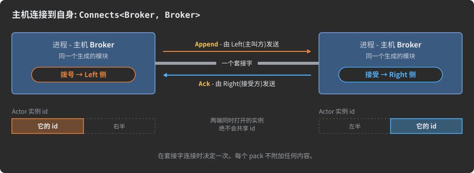

规则与后果:

* `Connects<X, X>` 是 `(X, X)` 这对的唯一连接。
* **不要**仅仅为了扮演呼叫方就发明第二个主机类型(`BrokerPeer`)。那会为实际上是一个进程的东西生成两个模块,而它们生成的类同名,无法并排加载。
* 只有物理的 `Connects<>` 能把主机与自身相连。从主机到自身的虚拟连接会把隧道路由回它出发的那台主机;代理会拒绝它:"The virtual connection ... should connect two distinct hosts."
* 自连接上的 trim 端点 `IfSendingFrom<Host, Connection>` 指名两段链路,见[Trims](#trims)。在多路复用端口上,自连接以共享主机自己的 `uid` 打开,见[多路复用](#multiplexing)。

<a id="composing-connections-and-swaphosts"></a>
### 组合连接与 SwapHosts

连接可以取用另一条连接的状态,而不必重复它们。通常的来源是导入项目的连接(导入项目在[复用描述](#reusing-descriptions)中解释):

```csharp
using org.unirail.Meta;

namespace com.example.office
{
    public interface Office : Chat
    {
        class Command { [D(+100)] string text; }

        /// <see cref='InCS'/>
        struct Guest : Host { }

        /// <see cref='InJAVA'/>
        struct Bot : Host { }

        // Guest 扮演 Member 的角色:它是左侧主机,就像 Member 在 Talk 中那样。
        interface GuestTalk : Connects<Guest, Chat.Hub>, Chat.Talk
        {
            [l____________<Command>]
            struct Commands { }
        }

        // 这里 Hub 是左侧主机:SwapHosts 把 Talk 调转方向,因此 Hub 仍然负责应答,而 Bot 扮演 Member。
        /// <see cref='SwapHosts{Chat.Talk}'/>
        interface BotTalk : Connects<Chat.Hub, Bot>
        {
            [____________r<Command>]
            struct Commands { }
        }
    }

    public interface Chat
    {
        class Say  { [D(+500)] string text; }
        class Seen { long message_id; }

        /// <see cref='InTS'/>
        struct Member : Host { }

        /// <see cref='InJAVA'/>
        struct Hub : Host { }

        interface Talk : Connects<Member, Hub>
        {
            [l____________<Say>]
            [____________r<Seen>]
            struct Chatting { }
        }
    }
}
```

`GuestTalk` 在自己的 `Commands` 旁边得到 `Talk` 的状态 `Chatting` 的副本:`Guest` 发送 `Say` 和 `Command`,`Hub` 发送 `Seen`。`BotTalk` 得到两侧互换后的同一状态:`Hub`(现在是左侧)发送 `Seen`,`Bot`(右侧)发送 `Say` 和 `Command`。

组合的作用:

| 形式                                                      | 写在哪里                                                           | 效果                                                                                                          |
|:----------------------------------------------------------|:-------------------------------------------------------------------|:--------------------------------------------------------------------------------------------------------------|
| 一条基连接,`interface C : Connects<L, R>, Base`           | 基列表中,`Connects<>` 之后                                          | `Base` 自身 Actor 的状态(直接声明在其体内的状态)被复制进 `C` 自身的 Actor                                       |
| `SwapHosts<Base>`                                         | 作为连接文档注释中的 `<see cref='SwapHosts{Base}'/>`                | 同样的复制,但每个被复制状态的左、右分支互换                                                                     |
| 另一条连接的一个状态                                       | 作为连接文档注释中的 `<see cref='Base.State'/>`                     | 只复制那个状态                                                                                                 |
| `X<Base.State>`                                           | 基列表中,在它要移除的基之后                                          | 排除那个被复制的状态                                                                                           |

规则:

* `Connects<>` 仍是第一个基;被组合的基跟在它后面。
* 只复制基自身 Actor 的状态。基的具名 Actor 和 RPC 方法不复制:在组合连接自身中声明它们。
* 组合连接必须声明至少一个自己的状态;被复制的状态不计入这项检查。
* 被复制的状态和连接自己的状态组成一个 Actor,因此它们合起来必须是一台有效的状态机:全部独立状态,或一条相互链接的状态链——见[Actor、状态、分支](#actors-states-branches)。
* 每对主机一条连接的规则仍然适用:组合连接连接的主机对不能被其他连接连接。

已有的连接不能被修改:AdHocAgent 拒绝连接修饰符(`Modify<Connection>`),而会重新定义其主机的形式(`Modify<TargetConnection, L, R>`)也会中止运行。要在其他主机之间复用某条连接的状态机,像上面那样从它组合一条自己的连接。用 `_<Connection>` 把整条导入的连接加入项目,见[复用描述](#reusing-descriptions)。

<a id="the-connection-at-runtime"></a>
### 运行时的连接

对于每个连接,它的每个主机都会得到一个生成的 `Connection` 类(每种语言都一样),命名空间以该连接命名——上面例子中的 `Session` 对应 `com.example.shop.Session.Connection`。**会话(session)** 是这个类的一个存活实例:两个运行中主机之间的一场对话。会话之下的网络连接只是它的传输层;使用
[`[Resumable]`](#sessions-guaranteed-delivery-udp) 时,会话可以活过一个丢失的套接字。

运行时把一个存活的连接分成两半:

| 半部         | 由谁提供                                                        | 是什么                                                                                                                      |
|:-------------|:----------------------------------------------------------------|:----------------------------------------------------------------------------------------------------------------------------|
| **External** | 传输层:TCP 或 WebSocket 连接、隧道端点                          | 搬运字节;知道 `IsOpen`、`Close()`、`Abort()` 以及两个超时                                                                    |
| **Internal** | 生成的 `Connection`                                             | 提供待发送的字节(它的发送器)并接收到达的字节(它的接收器);拥有各 Actor;听取各事件                                           |

生成的 `Connection` 有一个无参构造函数。`External(ext)` 把它安置到一个传输层上,并返回它之前所在的传输层;`External(null)` 把它卸下(在多路复用器的共享主机上,这会把它归还给池)。各语言中服务器、客户端和多路复用端口的接线方式见[多路复用](#multiplexing)。

**事件。** 传输层通过 `OnExternalEvent(connection, event)` 报告发生在它身上的事情。生成的代码先把每个事件交给各 Actor,然后才交给你的处理器:connect 会把各 Actor 置入它们的起始状态,因此处理器发出的 pack 会让它们从那里继续推进。在 C# 中你这样订阅:

```csharp
com.example.shop.Session.Connection.OnEvent.handlers += (conn, e) =>
    org.unirail.Network.TCP.onEventPrintConsole(conn.ext_connection, e);
```

除了详细事件之外,`OnOpen()` 和 `OnClose()` 对会话所栖身的每个网络连接各来一次,而且总是轮流出现:当连接可以使用时来 `OnOpen`(对 WebSocket 而言,在升级完成之后),当会话离开它时来 `OnClose`,无论是什么结束了它。没有 `[Resumable]` 时,一个会话只有一个网络连接,因此这一对事件每个会话各来一次。可恢复的会话在套接字丢失并被挂起时听到 `OnClose`,在它继续使用的套接字上再次听到 `OnOpen`;close **事件**只在会话结束时到达它的各 Actor 一次——见[会话、保证送达、UDP](#sessions-guaranteed-delivery-udp)。这两个钩子在生成的类里都有供你的代码使用的注入点;你自己的按连接状态及其清理由
[Actor 的种类与运行时的 Actor](#actor-kinds-and-the-actor-at-runtime) 介绍。

| 事件                                            | 含义                                                                                            |
|:------------------------------------------------|:------------------------------------------------------------------------------------------------|
| `THIS_CONNECT` / `REMOTE_CONNECT`               | 本端已连接 / 对端连接到了本端                                                                     |
| `THIS_CLOSE_GRACEFUL` / `REMOTE_CLOSE_GRACEFUL` | 本端 / 对端在队列排空之后有序关闭                                                                 |
| `THIS_CLOSE_ABRUPTLY` / `REMOTE_CLOSE_ABRUPTLY` | 本端 / 对端突然断开连接(中止、重置、套接字错误)                                                 |
| `TRANSMIT_TIMEOUT` / `RECEIVE_TIMEOUT`          | 一个[连接超时](#connection-timeouts-transmittimeout-and-receivetimeout)到期                       |
| `WEBSOCKET_...`                                 | 同上,以及 WebSocket 传输层上特有的事件(握手失败、ping、pong)                                    |

这些事件是标志位,因此有辅助方法测试类别:`IsClose()`、`IsRemote()`、`IsGraceful()`、`IsAbrupt()`、`IsTimeout()`。

**连接如何结束。**

* **优雅关闭**——在传输层上调用 `Close()`,或状态机到达 `Close` 状态:不再接受新 pack,队列排空,然后链路关闭。
* **中止**——`Abort()`:硬性停止;缓冲的数据可能丢失。
* **丢失**——套接字错误、消失的对端、你的代码以 0 应答的超时(默认值,见
  [下文](#connection-timeouts-transmittimeout-and-receivetimeout)):若当前状态或连接上有 `[Resumable(seconds)]`,会话会被**挂起**并等待它的对端;否则它随连接一起结束。你的代码发起的优雅关闭和中止总是结束会话。见[会话、保证送达、UDP](#sessions-guaranteed-delivery-udp)。

`End` 状态结束一对 Actor,同时让连接为其他 Actor 保持打开;`Close` 关闭连接——见
[Actor、状态、分支](#actors-states-branches)。虚拟连接以同样的事件和同样的 `OnClose()` 结束,如同物理连接,见[虚拟连接与中继](#virtual-connections-and-relays)。监听主机接受的每个连接都可以加密,声明在连接上的变换链会包裹它承载的一切——见[变换链](#transform-chains)。

<a id="connection-timeouts-transmittimeout-and-receivetimeout"></a>
### 连接超时:TransmitTimeout 与 ReceiveTimeout

有两个特性限制连接可以停滞多久。两者都写在**状态**上,取值以**秒**为单位:

* `[TransmitTimeout(seconds)]`——对端最多可以花多长时间来接受本端写出的内容;
* `[ReceiveTimeout(seconds)]`——在本端等待时,对端最多可以保持沉默多久。

它们是连接仅有的两个超时特性。AdHoc 自己的 `Communication` 连接节选:

```csharp
/// <summary>阶段 1:初始状态。Agent(左侧主机)必须发送它的 `Version`,
/// 这会让状态机转移到 `VersionMatching` 状态。</summary>
[TransmitTimeout(12)]                                       // 为这个状态设置 12 秒的超时。
[L____________ /*ÿ*/<VersionMatching, Agent.Version>/*ÿ*/] /*ÿ*/ // 主导方 L→R:发送 Version,转移到 VersionMatching。
struct Start /*ÿ*/{ }

// ...

/// <summary>阶段 6:Server 处理项目,然后从 `Info_Result` Pack Set 发送最终响应并退出。
/// 工作期间它用 `Progress` 报告自己正在做什么,次数不限,状态保持不变。</summary>
[ReceiveTimeout(120)]
[____________R /*ÿ*/<Close, Info_Result>/*ÿ*/] /*ÿ*/
[____________r<Server.Progress>/*Ā*/]
struct Project /*Ą*/{ }
```

**它们属于连接,而不属于状态。** 进入一个状态时,生成的代码把两个值写到连接的传输层上(以毫秒计)。因此一个连接上的所有 Actor 共享同一对值——最后进入的状态胜出——而当其中一个到期时,整个连接连同它的所有 Actor 一起关闭。每一端写什么值取决于它在那个状态里做什么:

| 在进入的状态中,本端……          | 它设置的 TransmitTimeout                                            | 它设置的 ReceiveTimeout                                             |
|:-------------------------------|:--------------------------------------------------------------------|:--------------------------------------------------------------------|
| 发送 pack                      | 状态的 `[TransmitTimeout]`,若状态没有则为 60 秒                     | -                                                                   |
| 接收 pack                      | -                                                                   | 状态的 `[ReceiveTimeout]`,若状态没有则为 60 秒                      |
| 不发送 / 不接收                | 无限制                                                              | 无限制                                                              |

在上面的 `Start` 中,Agent 发送:它得到 12 秒的发送限制,没有接收限制;而在 `Start` 中接收的 Server 等待 60 秒。在 `Project` 中,Agent 接收并最多等待 120 秒。

![一条连接上两个状态的时间线,左侧主机一条泳道,右侧主机一条泳道。状态 A 带 [TransmitTimeout (12)],只有左侧主机在其中发送:进入时左侧泳道显示 Transmit 12 秒、Receive 无限制;右侧泳道显示 Transmit 无限制、Receive 60 秒(默认)。状态 B 带 [ReceiveTimeout (30)],只有右侧主机发送:左侧泳道显示 Transmit 无限制、Receive 30 秒;右侧泳道显示 Transmit 60 秒(默认)、Receive 无限制。第三行“连接的一对值”表明,最后进入的状态写入的值会替换先前的值,并且另一个 Actor 进入自己的状态时也会覆盖它们。](docs/img/dev-11-connection-timeouts.zh-CN.svg)

**什么会重启它们、什么会终结它们。** `[ReceiveTimeout]` 度量对端的沉默:任何到达的字节都会重启它,无论该字节是给哪个 Actor 的。`[TransmitTimeout]` 在已写出的字节等待对端取走时运行。当某个限制到期时,传输层先询问连接——`OnReceiveTimeout()` 或 `OnTransmitTimeout()`——还要再等多久:生成的默认值回答 0,连接按丢失关闭(因此可恢复的会话会被挂起)。你的代码可以改为应答这次沉默——发送一个心跳并返回等待应答的毫秒数,或返回 `int.MaxValue` 表示这次不设限制。当前状态在它的 `OnTimeout Receiver` /
`OnTimeout Transmitter` 注入点听到超时事件,见 [Actor 的种类与运行时的 Actor](#actor-kinds-and-the-actor-at-runtime)。

**把它们写在连接自己的状态上。** 把超时写在直接声明在连接体里的状态上(连接自己的 Actor,即 `Actor0`)。写在另一个 Actor 的状态上时,agent 会警告:该值仍将是整个连接的,由最后进入状态的实例设置。要限制**单个** Actor 实例、而让连接及其其他 Actor 继续运行,改用 `[Deadline(seconds)]` 和
`[Idle(seconds)]`——见 [Actor 的种类与运行时的 Actor](#actor-kinds-and-the-actor-at-runtime)。

|                  | `[TransmitTimeout]` / `[ReceiveTimeout]`      | `[Deadline]` / `[Idle]`                          |
|:-----------------|:----------------------------------------------|:-------------------------------------------------|
| 作用范围         | 整个连接                                      | 一个 Actor 实例                                  |
| 由什么设置       | 进入状态(最后进入者胜出)                    | 实例进入状态 / 它的 pack                         |
| 到期时           | 连接关闭(或按丢失被挂起)                    | 实例结束;连接继续存活                           |
| 写在哪里         | 连接自己的 Actor 的状态                       | 任意 Actor 的状态(`[Idle]` 也可写在 Actor 上)   |

相关:[主机、语言、生成的代码](#hosts-languages-generated-code)、[Actor、状态、分支](#actors-states-branches)、
[会话、保证送达、UDP](#sessions-guaranteed-delivery-udp)、[虚拟连接与中继](#virtual-connections-and-relays)、
[多路复用](#multiplexing)、[复用描述](#reusing-descriptions)。

<a id="serial-links-and-fast-recovery-framing"></a>
### 串行链路与快速恢复:Framing

TCP、WebSocket 和隧道会把连接的字节完整且有序地送达。UART、RS-485 总线或无线电调制解调器交付的则是裸字节流:字节可能丢失、翻转或多出来。AdHoc 的 pack 自身不带长度也不带标记,因此在这样的链路上,一个损坏的字节就会让接收器与其后的每个 pack 失去同步。针对这类链路,运行时提供**成帧层(framing layer)**:一对位于生成的连接与字节流之间的类。

| 类                               | 端        | 它做什么                                                                                              |
|:---------------------------------|:----------|:------------------------------------------------------------------------------------------------------|
| `Connection.Transmitter.Framing` | 发送      | 把每个 pack 包进一帧:标记 `0xFF`、转义了 `0x7F` 和 `0xFF` 的 pack 字节、一个 CRC-16                   |
| `Connection.Receiver.Framing`    | 接收      | 按标记找到帧,去除转义,校验 CRC,然后把 pack 传下去                                                   |

两者都在 C# 和 Java 运行时中(Java 中为 `org.unirail.AdHoc.Connection.Receiver.Framing`)。TypeScript 运行时没有它们,这是设计使然:TypeScript 主机运行在由 TCP 或 WebSocket 承载其字节的地方。

```
0xFF  [ the pack's bytes, 0x7F and 0xFF escaped ]  [ CRC-16 of the pack, 2 bytes, escaped ]
```

**每个 pack 一帧。** `0xFF` 在线路上只作为一帧的开始出现。在帧内,低七位全为 1 的字节——`0x7F` 或 `0xFF`——写作 `0x7F`,它的最高位移入下一个字节:一次转义只花**一位**,而不是一个字节;即便一帧完全由这类字节组成,最多也只每八个字节增长一个字节。一帧额外加上它的标记和两个 CRC 字节。

**接收:边到达边解码,完好无损才分发。** 成帧层在接收缓冲区中原地去除转义,并随着字节到达把 pack 的字节交给生成的接收器,因此 pack 像在任何连接上一样逐字段解码。只有在 CRC 匹配之后,pack 才被**分发**——它的 `OnReceived` 处理器才运行。CRC 不匹配的 pack 被丢弃。

**恢复。** 出现损坏字节之后——一个不可能出现的 `0xFF`、一帧在 pack 完整之前就结束——成帧层丢弃该帧,并跳过字节直到下一个 `0xFF`。下一个完好的帧被正常接收:一次故障只损失损坏的那个 pack,其后的不受牵连。在字节可能丢失的链路上,为那些绝不能丢失的 pack 配上保证送达
([会话、保证送达、UDP](#sessions-guaranteed-delivery-udp))。

**错误**送往静态的 `Connection.Receiver.error_handler`,除非你设置了自己的处理器,否则它把错误打印到控制台:

| 错误               | 含义                                                                                                                                 |
|:-------------------|:-------------------------------------------------------------------------------------------------------------------------------------|
| `CRC_ERROR`        | 帧完整到达,但 CRC 不匹配:该 pack 被丢弃                                                                                            |
| `BYTES_DISTORTION` | 出现了不该出现的字节,或 pack 尚未完整就来了新帧:该帧被丢弃,成帧层寻找下一个标记                                                    |
| `FFFF_ERROR`       | 连续两个帧标记                                                                                                                       |

**发送。** `Transmitter.Framing.Read( buffer, offset, length )` 用成帧后的字节填充你的缓冲区:它返回写入的数量,缓冲区放不下帧的下一份时返回 `0`,没有 pack 在等待时返回 `-1`。它在同一个缓冲区里原地编码,不需要第二个缓冲区;任意大小的 pack 都分份送出,如同在任何连接上一样。

C# 中的接线:

```csharp
var rx = new AdHoc.Connection.Receiver.Framing(connection.receiver);        // 位于生成的接收器之前
var tx = new AdHoc.Connection.Transmitter.Framing(connection.transmitter);  // 位于生成的发送器之后

// 端口的读循环:字节随到随收
int n = port.Read(inBuffer, 0, inBuffer.Length);
if (0 < n) rx.Write(inBuffer, 0, n);

// 端口的写循环:按端口能承受的进度送出帧
int m = tx.Read(outBuffer, 0, outBuffer.Length);
if (0 < m) port.Write(outBuffer, 0, m);
```

`connection` 是一个生成的连接,按你的主机创建其连接的方式创建;你的代码照旧用 `send` 在它上面排队 pack,成帧层只改变它的字节在线路上的样子。`switch_to(...)` 把一个成帧层移到另一个接收器或发送器上并重置它。

---

<a id="actors-states-branches"></a>
## Actor、状态、分支

*模型:项目 → 主机 → 连接 → **Actor → 状态 → 分支** → pack → 字段*

一个[连接](#connections)说明哪两台主机对话。它的体说明它们可以说什么、谁来说、何时说。三个构造完成这件事:

- **Actor** 是连接上的一场独立对话,拥有自己的有限状态机(FSM);
- **状态** 是这场对话的一个阶段;
- **分支** 是状态上的一个特性。它命名一方在该状态下可以发送的 pack,并说明发送其中之一是否会把对话推进到另一个状态。

两台主机从描述中得到同一台状态机。每台主机在每个时刻都知道自己可以发送哪些 pack、可以接收哪些 pack。生成的代码拒绝此外的一切。

本章介绍如何声明 Actor、状态和分支,以及 agent 检查的规则。Actor 的种类(函数组、RPC 方法、带多个实例和 `MaxActiveInstances` 的 Actor)与运行时 Actor 的一生在
[Actor 的种类与运行时的 Actor](#actor-kinds-and-the-actor-at-runtime) 中介绍。

<a id="actors-independent-conversations-on-one-connection"></a>
### Actor:一条连接上的独立对话

**Actor** 是连接内有状态行为的单位。每个 Actor 拥有一台 FSM。FSM 的当前状态决定此刻可以发送和接收哪些 pack。一条连接上的多个 Actor 是相互独立的对话:每个 Actor 跟踪自己的状态。当一条连接有多个 Actor 时,每个 pack 携带它所属的 Actor,对有实例的 Actor 还携带实例。文件传输可以在一个 Actor 中运行,聊天在另一个 Actor 中运行,共用同一个套接字。谁也不必等对方到达某个特定状态。

你把 Actor 声明为一个接口,继承 `org.unirail.Meta.Actor`,位于连接之内。它的体装着它的状态。生成器用 Actor 的 `MaxActiveInstances` 属性决定其实例如何创建、寻址和限制(见
[Actor 的种类与运行时的 Actor](#actor-kinds-and-the-actor-at-runtime))。

```csharp
interface Link : Connects<Client, Server>
{
    // 一次上传:Client 发送一个 blob,Server 确认它,对话结束
    interface Upload : Actor
    {
        int Actor.MaxActiveInstances => UNLIMITED;

        [L____________<Waiting, Blob>]
        struct Start { }

        [____________R<End, BlobAck>]
        struct Waiting { }
    }
}
```

Actor 可以放在哪里:

- 直接放在连接体里;
- 放在嵌套于连接内的普通接口里。普通接口充当一组 Actor 的命名空间,生成的代码把这些 Actor 放进对应的命名空间;
- 不能放在另一个 Actor 内。"The Actor X at line N cannot be declared inside another Actor" 会让 agent 停止。

写在连接体里(或分组接口里)的 RPC 方法,例如 `(L____________, Pong) ping(Ping req);`,也会成为一个 Actor。每个 RPC 方法各自是一个 Actor:它有自己的类和 actor id,与其他 Actor 并列。它不属于 [Actor0](#actor0-the-connections-own-actor)。在返回类型中,接口 `L____________` 和
`____________R` 标记由哪一方发起调用。没有标记的方法可以被任一方调用,并变成两个 Actor。RPC 简写形式在
[Actor 的种类与运行时的 Actor](#actor-kinds-and-the-actor-at-runtime) 中介绍。

Actor 的名字会成为生成代码中的类名。有些名字被生成的 API 占用,会让 agent 停止并报
"Error: 'X' (line N) is a reserved identifier and cannot be assigned."(退出码 123):

| 保留的 Actor 名                                                                                                                                                                       |
|---------------------------------------------------------------------------------------------------------------------------------------------------------------------------------------|
| `Actor0`, `id`, `Id`, `OnSerializing`, `OnSerialized`, `OnReceiving`, `OnReceived`, `OnEvent`, `BroadcastActor`, `BroadcastActorInstance`, `Actors`, `Actor`, `Connection`, `Virtual` |

每个物理连接都需要至少一个带至少一个状态的 Actor。否则 agent 停止并报 "Connection X (line N)
does not have any actor with any states. Please add a state and restart."。[虚拟连接](#virtual-connections-and-relays)是例外:它可以完全不携带 Actor。确实声明了 Actor 的虚拟连接,其声明方式与此处所示完全相同,它们的 pack 经由隧道传输。

<a id="actor0-the-connections-own-actor"></a>
### Actor0,连接自己的 Actor

每个连接有一个隐式 Actor,即 **Actor0**。你永远不把它声明为接口:直接写在连接体里的状态就是 Actor0 的状态。把 Actor0 用于关乎整个连接的事:开场握手、登录、keep-alive、全连接范围的通知。`Actor0` 是保留名。

Actor0 仅在连接体声明了至少一个状态时才存在。连接体里只有具名 Actor、RPC 方法和分组接口的连接没有 Actor0:agent 丢弃这个空占位符,不会为该连接生成任何名为 `Actor0` 的东西。

```csharp
interface Link : Connects<Client, Server>
{
    //--- Actor0:直接写在连接体里的状态
    [TransmitTimeout(5)]
    [L____________<Greeting, Hello>]
    struct Start { }

    [ReceiveTimeout(10)]
    [____________R<Ready, Welcome>]
    [____________R<Close, Refused>]
    struct Greeting { }

    // 工作状态:没有出路,Actor0 一直停留在这里,直到连接结束
    [ReceiveTimeout(30)]
    [_____lr_____<Beat>]
    struct Ready { }

    //--- 一个具名 Actor:Actor0 的同级,不属于它
    interface Notify : Actor
    {
        [____________r<(Note, Alert)>]
        struct Messages { }

        [l____________<Flag>]
        struct Flags { }
    }

    //--- 一个 RPC 方法:自成一个 Actor,也是 Actor0 的同级
    (L____________, Pong) ping(Ping req);
}
```

Actor0 与具名 Actor 的不同之处:

- **整个连接生命期只有一个。** 无论它的状态是什么,这一点都成立。Actor0 不需要 `MaxActiveInstances`,它的 actor id 是 `0`。当 Actor0 有转移时,每个连接持有自己的 Actor0 实例,生成的
  `Actor0.Acquire(conn)` 返回它。
- **`End` 不会释放它。** 对具名 Actor 而言,到达 `End` 会释放实例。Actor0 的释放会把它放回初始状态,因为 Actor0 与连接同寿。
- **它没有 epoch**(见[引领状态的一方](#the-side-that-leads-a-state))。它只有一个实例,因此没有 pack 可能属于更旧的实例。
- **只有停留状态会让它成为函数组。** 当 Actor0 的每个状态都只有停留分支时,Actor0 成为函数组,就像任何状态从不变化的其他 Actor 一样(见
  [链或函数组](#chain-or-function-group-the-two-shapes-of-an-actor))。此时生成的代码没有
  `Acquire(conn)`:一个共享对象 `Actor0.one` 服务每个连接。

全连接范围的超时 `[TransmitTimeout]` 和 `[ReceiveTimeout]` 属于 Actor0 的状态。写在具名 Actor 的状态上时 agent 会警告(见[连接](#connections))。按实例的限制(`[Deadline]`、`[Idle]`)在
[Actor 的种类与运行时的 Actor](#actor-kinds-and-the-actor-at-runtime) 中介绍。

<a id="states-the-phases-of-a-conversation"></a>
### 状态:对话的各个阶段

**状态** 是 Actor 对话的一个阶段。它定义 Actor 处于其中时各方可以发送哪些 pack。你把状态声明为一个**空 `struct`**,带一个或多个分支特性。它位于 Actor 体中;对 Actor0 而言则直接位于连接体中。状态没有字段或方法:关于它的一切都写在它的分支特性里。

```csharp
[L____________<Running, JobStart>] // 分支:左侧主机发送 JobStart,Actor 转移到 Running
struct Start { }                    // 状态:一个空 struct
```

agent 如何识别并检查状态:

| 规则                                                                                                                                                  | 否则会发生什么                                                                                                                                                                  |
|-------------------------------------------------------------------------------------------------------------------------------------------------------|---------------------------------------------------------------------------------------------------------------------------------------------------------------------------------|
| 一个 `struct` 是状态,当且仅当它携带至少一个分支特性。                                                                                               | -                                                                                                                                                                               |
| 状态声明在连接或 Actor 之内。                                                                                                                         | "The State 'X' (line N) must be declared inside a Connection/Actor body."(退出码 22)                                                                                        |
| 状态为空:没有字段、方法或嵌套类型。                                                                                                                 | "The state struct 'X' (line N) must be empty - states cannot contain fields, methods, or nested types..."(退出码 22)                                                        |
| 在连接或 Actor 之内,每个 `struct` 都是状态。不带分支特性的 struct——比如常量容器——不属于那里。                                                       | "The entity 'X' (line N) cannot be declared inside a Connection body..."(退出码 22)                                                                                         |
| 状态名在一个 Actor 内唯一,包括嫁接来的状态。                                                                                                         | "[!] FSM Integrity Error: Duplicate state names detected in Actor 'X'",后跟一张状态映射表(见[从另一个 Actor 嫁接流程](#grafting-a-flow-from-another-actor))                    |

**初始状态是 Actor 中声明的第一个状态**(对 Actor0 而言是连接体中的第一个)。给它一个清晰的名字,比如
`Start` 或 `Handshake`。在生成的代码中它也可用作 `State.O`。当该 Actor 有任何转移时,其余每个状态都必须能通过转移从初始状态到达(见
[链或函数组](#chain-or-function-group-the-two-shapes-of-an-actor))。

状态机只由事件驱动:发送一个 pack、接收一个 pack、一次超时。生成器从描述写出全部转移代码。你的代码把处理器挂到生成的状态上(见
[生成器为 Actor 和状态产出什么](#what-the-generator-produces-for-actors-and-states))。同一侧的处理器一次只调用一个,如
[Actor 的种类与运行时的 Actor](#actor-kinds-and-the-actor-at-runtime) 所述。

agent 按 Actor 给状态编号,如同它给 pack 和分支编号一样。编号存放在描述中:永远不要编辑它们(见
[编号表](#numbers-tables))。

可以放在状态上的特性,在其主题所在处介绍:

| 在状态上                                      | 含义                                                                  | 出处                                                                          |
|-----------------------------------------------|-----------------------------------------------------------------------|-------------------------------------------------------------------------------|
| `[TransmitTimeout(s)]`、`[ReceiveTimeout(s)]` | 全连接范围的超时,在进入该状态时设置                                  | [连接](#connections)                                                          |
| `[Deadline(s)]`、`[Idle(s)]`                  | 一个 Actor 实例在该状态中可以停留多久、或可以保持沉默多久             | [Actor 的种类与运行时的 Actor](#actor-kinds-and-the-actor-at-runtime)         |
| `[Resumable(seconds)]`                        | 重连的对端在此状态下恢复会话                                          | [会话、保证送达、UDP](#sessions-guaranteed-delivery-udp)                      |
| 自定义特性                                    | 保留为生成的状态的常量                                                | [特性](#attributes)                                                           |

<a id="branches-and-the-routing-attributes"></a>
### 分支与路由特性

**分支** 声明一方在某个状态下可以发送哪些 pack。分支分两种:

- **转移分支(transitional branch)** 在它的 pack 之一被发送后,把 FSM 移到目标状态;
- **停留分支(stay branch)**(非转移分支)让 FSM 留在原处。

分支是状态 struct 上的特性,称为路由特性。一个状态可以携带任意多个。全部五个路由特性都在 `Meta.cs` 中以 `AttributeUsage(AttributeTargets.Struct, AllowMultiple = true)` 声明。因此 C# 本身就拒绝把它们放在 struct 以外的任何东西上。从 RPC 标记 `L____________` 或 `____________R` 派生的接口会让 agent 停止并报
"Expected 'struct' instead of 'interface'"。


| 带 `PACKS`                            | 不带 `PACKS`                   | 谁发送    | 种类         | 效果                                                          |
|---------------------------------------|--------------------------------|-----------|--------------|---------------------------------------------------------------|
| `[L____________<Target, PACKS>(...)]` | `[L____________<Target>(...)]` | Left      | 转移         | Left 发送其中某个 pack,FSM 移到 `Target`                    |
| `[l____________<PACKS>(...)]`         | `[l____________(...)]`         | Left      | 停留         | Left 发送,FSM 留在原处                                      |
| `[____________R<Target, PACKS>(...)]` | `[____________R<Target>(...)]` | Right     | 转移         | Right 发送其中某个 pack,FSM 移到 `Target`                   |
| `[____________r<PACKS>(...)]`         | `[____________r(...)]`         | Right     | 停留         | Right 发送,FSM 留在原处                                     |
| `[_____lr_____<PACKS>(...)]`          | `[_____lr_____(...)]`          | 任一方    | 停留         | 任一方发送,FSM 留在原处                                     |

`(...)` 代表四个可选的构造函数参数 `(KeepDoc, SkipDoc, KeepName, SkipName)`。它们在全部十个特性类上都一样。`PACKS` 是该分支的 Pack Set 表达式。两者都在
[为分支选择 pack](#choosing-the-packs-of-a-branch) 中介绍。

<a id="reading-a-routing-attributes-name"></a>
#### 读懂路由特性的名字

路由特性的名字编码两个事实:

- **字母的位置说明谁发送。** 下划线左侧的字母表示左侧主机,即 `Connects<L, R>` 的第一台主机。右侧的字母表示右侧主机,即第二台。中间的 `lr` 表示任一主机。
- **字母的大小写说明谁引领。** 大写字母使分支成为转移分支:发送方引领状态并把 FSM 移到 `Target`。小写字母构成停留分支。

不存在双方的转移形式:一次转移总是属于一方。`_____lr_____` 分支表现为左侧主机的一个停留分支,加上右侧主机的一个完全相同的停留分支。因此,下面每条“按方”应用的规则都对它在两方分别适用。

<a id="the-side-that-leads-a-state"></a>
#### 主导状态的一方

过渡分支赋予其发送方把状态机移出该状态的权力。在一个状态中拥有过渡分支的一方**主导**该状态。它是该状态的 *Main* 一方，代理的消息中称此为 *Master authority*。另一方在该状态中是 **Follower**：它只能使用该状态的驻留分支。在只有驻留分支的状态中，没有主导方，双方平等。

一个状态只能由一方主导。同时带有 `L____________` 和 `____________R` 分支的状态会让代理停止：

```text
State X line:N contains BOTH Left (L____________) and Right (____________R) Master authority branches.
A state can only assign Master authority to one side.
```

因此，同一状态的所有过渡分支都属于同一台主机。主导权仍可在状态之间转移，如[接力棒传递示例](#worked-state-machine-examples)所示。角色来自分支，而不是主机名。名为 `Server` 的主机主导某个状态，仅仅是因为该状态上写了一条 `____________R` 分支。

为什么只有一个主导方：两台主机运行同一状态机的副本，只有主导方可以改变状态。Follower 无法发起与主导方竞争的过渡。仍有一种竞争可能：Follower 可能恰在得知主导方已经离开之前发出一个驻留 pack。**epoch** 解决这个竞争：

- 完整 actor(带 `MaxActiveInstances`)的每个实例维护一个 4 位 epoch 计数器;
- 每次过渡使它递增,到 16 后回绕;
- 实例发出的每个 pack 携带其当前 epoch;
- 接收方丢弃 epoch 与其自身实例 epoch 不一致的 pack。生成的代码提供了一个注入点 `Epoch mismatch`,供你编写反应逻辑。

因此,来自上一个状态的迟到 pack 会被丢弃,而不会被当作新状态的 pack。针对接收方不认识的实例的 pack,只有当其 epoch 为 0 时才开启新实例。任何其他 epoch 意味着该实例已不存在,pack 被丢弃。Actor0 和函数组 actor 没有 epoch:Actor0 只有一个实例,而函数组从不改变状态。

<a id="transition-targets-a-state-end-or-close"></a>
#### 过渡目标:一个状态、End 或 Close

`L____________` 和 `____________R` 的第一个泛型参数是 `TARGET_STATE`,约束为 `where TARGET_STATE : struct`。代理接受:

| 目标 | 含义 |
|------|------|
| 本 actor 的一个状态 | 状态机移到那里 |
| 另一个 actor 或另一条连接的状态 | 该状态以及从它可达的一切,被复制进本 actor(见[从另一个 actor 嫁接流程](#grafting-a-flow-from-another-actor)) |
| `org.unirail.Meta.End` | 对话结束。actor 实例对被释放,连接为其他 actor 保持打开。对 Actor0,`End` 使它回到初始状态。 |
| `org.unirail.Meta.Close` | 连接优雅地结束。已排队的 pack 先发完,然后连接连同其所有 actor 一起关闭。 |

任何其他 struct 会让代理停止:"State X (line N): transitional branch attribute targets `T`, which is not a known state, `Close`, `End`, or `X<...>`. Fix the target and rerun." 消息中提到了 `X<...>`,但 `X<>` 是接口,所以 C# 本身就拒绝它作为 `TARGET_STATE`(错误 CS0453,即 `struct` 约束)。写在 `PACKS` 内的 `Close` 或 `End` 会被忽略:它们是目标,不是 pack。

不要把你自己的状态命名为 `End` 或 `Close`。代理按名称识别这两个内置目标,因此指向这种状态的过渡会被读成内置的 `End` 或 `Close`。该状态本身随后没有任何过渡可达,代理会把该 actor 判为混合了链接状态与孤立状态的 actor 而拒绝(见[链或函数组](#chain-or-function-group-the-two-shapes-of-an-actor))。

<a id="choosing-the-packs-of-a-branch"></a>
### 选择分支的 pack

每个分支解析为一个 pack 集合。该集合来自特性的两个可选部分:

- `PACKS` 泛型参数,一个 Pack Set 表达式;
- 四个构造器过滤器 `KeepDoc`、`SkipDoc`、`KeepName`、`SkipName`。

Pack Set 本身(`_<>`、`X<>`、命名 Pack Set、作用域、过滤模板)在 [Pack Sets](#pack-sets) 中定义。本节讲分支如何使用它们。


<a id="direct-packs-and--scopes"></a>
#### 直接 pack 与 @ 作用域

在 `PACKS` 内,`@` 前缀决定元素如何使用:

- **不带 `@`,元素是直接包含。** 它的 pack 无条件加入分支。四个过滤器从不碰它们。
- **带 `@`,元素是作用域。** 其中任意深度处的所有可传输 pack 被收集进一个缓冲区。只有这个缓冲区会经过四个过滤器,幸存者加入分支。
- **当 `PACKS` 持有 `@` 作用域时,过滤器只作用于该作用域。** 它们从不扩展到整个项目。
- **直接 pack 与过滤后的 pack 合并**为一个集合,无重复。

| `PACKS` 元素 | 不带 `@` | 带 `@` |
|---|---|---|
| 一个 pack | 该 pack 本身 | 递归地嵌套在它内部的 pack,但不含该 pack 本身 |
| 一台主机 | 仅直接声明在该主机中的 pack | 主机内任意深度处的每个 pack |
| 一个项目 | 仅项目中不在其任何主机内的 pack | 项目的每个可传输 pack |
| 一个命名 Pack Set | 其成员,作为直接 pack | 其成员,送入分支过滤器 |
| 过滤模板 `F<@Scope>` | 模板的结果,经模板自身特性过滤后,作为直接 pack 进入 | - |
| `_<...>`、元组 `(A, B, ...)` | 其元素,各自按自己的规则 | - |
| `X<...>` | 移除 pack(见[用 X<> 在分支内移除 pack](#removing-packs-with-x-inside-a-branch)) | - |
| 一条连接 | 错误:"Unexpected item X (line:N) in the S PACKS argument" | 同样的错误 |

每类元素的确切选择规则见 [Pack Sets](#pack-sets)。对分支而言,有三条推论最重要:

- `[_____lr_____<MyProject>]` 只发送项目主机之外的 pack,而 `[_____lr_____<@MyProject>]` 发送项目的每个可传输 pack。不带 `@` 书写的项目或主机,若自身没有 pack 而其主机或嵌套 pack 有,会触发警告:"The project `X` (line N) is written without `@`, so it adds only the packs declared right in it - none here. Its nested scopes (hosts, packs ) hold N transmittable pack (s): to send them, write `@X`."
- 连接不是作用域。要表达"这条连接可以承载的一切",请用项目、主机或命名 Pack Set。
- **不带 `PACKS` 参数时**,过滤器作用于你项目的所有可传输 pack,任意深度,包括主机内。这仅在至少给出一个过滤器时发生。既没有 `PACKS` 也没有过滤器的分支什么都不选。对于导入项目的 pack,把该项目命名为作用域(`<@ImportedProject>`)或逐一列出 pack。

<a id="the-branch-filters-keepdoc-skipdoc-keepname-skipname"></a>
#### 分支过滤器 KeepDoc、SkipDoc、KeepName、SkipName

四个构造器参数都是 `string`,都默认为 `""`,意思是"无过滤"。每个都是一条 .NET 正则表达式:

| 参数 | 匹配对象 | 效果 |
|------|----------|------|
| `KeepDoc` | pack 的**统一文档池**:它的类级 `///` 文档注释和它的标签(pack 表中该行编号后的文本,见[编号表](#numbers-tables)),以空格连接 | 只保留匹配的 pack |
| `SkipDoc` | 统一文档池 | 移除匹配的 pack |
| `KeepName` | pack 的**项目内路径**:以点连接的名字,如 `Telemetry.Gps` 或 `Server.V2.Query`。命名空间和你项目的名字不在其中。 | 只保留匹配的 pack |
| `SkipName` | 同一路径 | 移除匹配的 pack |

过滤器按固定顺序运行:KeepDoc → SkipDoc → KeepName → SkipName。每一步作用于上一步留下的内容。因此两个 Keep 会收窄集合(pack 必须同时匹配两者),而 Skip 从幸存者中移除。

你可以按位置传过滤器(用空字符串占位),也可以用 C# 命名参数语法按名传:

```csharp
[l____________<@MyProject>(KeepName: @"(^|\.)V2\.")]   // 命名参数:直接跳到 KeepName
[l____________<@MyProject>("", "", @"(^|\.)V2\.")]     // 位置参数:KeepDoc 和 SkipDoc 为空
```

模式的匹配方式:

- **子串匹配。** 模式在文本任意位置匹配。`"status"` 也匹配 `"final_status"`。请用词边界(`@"\bstatus\b"`)或其他可区分的模式。不要在文档模式里依赖 `^`/`$` 锚:文档注释和标签被连接成一段文本。
- **`|` 是正则的或,空格是字面量。** `"📈 | server"` 意思是 `"📈 "` 或 `" server"`。请写 `"📈|server"`。
- **区分大小写。** 模式编译时不带 `IgnoreCase` 或任何其他匹配选项。
- **名字没有前导点。** 声明在项目顶层的 pack 按 `Telemetry.Gps` 匹配,而不是 `.Telemetry.Gps`。`@"(^|\.)Telemetry\."` 在任意层级匹配 `Telemetry` 作用域。`@"\.Telemetry\."` 在顶层会错过它。
- **无效模式会让代理停止:**"Branch attribute at line N: KeepDoc pattern `...` is not a valid regex - ...",随后是 "Fix the regex and rerun."

分支过滤器只细化 `@` 作用域,或在没有 `PACKS` 时细化整个项目。作为特性声明在命名 Pack Set 或过滤模板上的过滤器则不同:它们细化该集合的每个成员(见 [Pack Sets](#pack-sets))。

<a id="branch-pack-collection-examples"></a>
#### 分支 pack 收集示例

下面的 pack 属于项目 `MyProject`。表格展示每个分支时代理解析出的集合。每一行位于各自 actor 的一个状态上,因此各行之间不争夺 pack。

```csharp
public interface MyProject
{
    /// 📈 cpu load
    class CpuLoad { float value; }

    /// 📈 server memory
    class MemUsage { long bytes; }

    /// ⛔ 📈 legacy load
    class OldLoad { float value; }

    class Telemetry
    {
        public class Gps   { double lat; double lon; }
        public class Speed { float kmh; }
    }

    class V2
    {
        public class Query     { int id; }
        public class QueryTest { int id; }
    }

    class StringMessage { string text; }
    class WarningEvent
    {
        /// critical
        public class DiskFull { int disk; }
        /// critical deprecated
        public class OldDiskFull { int disk; }
        public class Minor { int code; }
    }
    class ErrorEvent
    {
        /// critical
        public class Crash { string place; }
    }

    /// handshake
    class ClientHello { int version; }
    class ClientVersion { int version; }
    // ... 主机和连接
}
```

| 分支 | 解析出的 pack | 原因 |
|---|---|---|
| `[l____________<(CpuLoad, MemUsage)>]` | `CpuLoad`、`MemUsage` | 仅直接 pack |
| `[l____________("📈")]` | `CpuLoad`、`MemUsage`、`OldLoad` | 无 `PACKS`:对整个项目做 KeepDoc |
| `[l____________("📈\|server", "⛔")]` | `CpuLoad`、`MemUsage` | KeepDoc,然后 SkipDoc 移除 `OldLoad` |
| `[l____________(KeepName: @"(^\|\.)Telemetry\.")]` | `Telemetry.Gps`、`Telemetry.Speed` | 对整个项目做 KeepName |
| `[l____________<(StringMessage, @WarningEvent, @ErrorEvent)>("critical", "deprecated")]` | `StringMessage`、`WarningEvent.DiskFull`、`ErrorEvent.Crash` | `StringMessage` 是直接的。过滤器只看到嵌套在两个作用域内的 pack:`Minor` 不是 critical,而 `OldDiskFull` 是 deprecated。 |
| `[l____________<@MyProject>(KeepName: @"(^\|\.)V2\.")]` | `V2.Query`、`V2.QueryTest` | 对项目作用域做 KeepName |
| `[l____________<@MyProject>("📈", SkipName: @"Old")]` | `CpuLoad`、`MemUsage` | KeepDoc,然后 SkipName |
| `[L____________<Next>("handshake")]` | `ClientHello` | 过渡分支,对整个项目做过滤 |
| `[L____________<Next, (ClientHello, ClientVersion)>]` | `ClientHello`、`ClientVersion` | 带直接 pack 的过渡分支 |
| `[l____________<(CpuLoad, MemUsage)>("⛔")]` | `CpuLoad`、`MemUsage` | **过滤器被忽略**:`PACKS` 没有 `@` 作用域 |

最后一行是一个真实的陷阱。与不含 `@` 作用域的 `PACKS` 参数一起给出的过滤器没有可作用的对象,而代理对此不置一词。要把列出的 pack 与过滤出的 pack 组合,请把作用域放进元组:`[l____________<(CpuLoad, @Telemetry)>(KeepName: "Gps")]`。

过滤模板是过滤作用域的可复用形式。下面的模板保留文档池中含有 `🔠` 的每个 pack,在单状态连接中任意一方都可以发送这些 pack:

```csharp
[KeepDoc("🔠")] interface Tagged<SCOPE> { }

interface Saving : Connects<Editor, Store>
{
    [_____lr_____<Tagged<@MyProject>>]
    struct Start { }
}
```

<a id="removing-packs-with-x-inside-a-branch"></a>
#### 用 X<> 在分支内移除 pack

`PACKS` 内的 `X<...>` 无条件减去 pack:过滤器对它不适用。它只移除**元组中排在它之前**的元素作为直接 pack 加入的内容:

| `PACKS` | 结果 |
|---|---|
| `<(Server, X<Server.Ack>)>` | 声明在 `Server` 中的 pack,不含 `Ack` |
| `<(X<Server.Ack>, Server)>` | 声明在 `Server` 中的全部 pack:减法先发生,什么都没移除 |
| `<(NamedSet, X<B>)>` | 集合成员,不含 `B` |
| `<(All<@Server>, X<(Server.Ack, Server.Nack)>)>`,其中 `interface All<SCOPE> { }` | `Server` 内任意深度处的每个 pack,不含 `Ack` 和 `Nack`:过滤模板的结果是直接的 |

> [!WARNING]
> `X<...>` 不移除同一 `PACKS` 中 `@` 作用域提供的 pack。`@` pack 在整个元组读完之后才经过滤并加入,所以 `<(@Server, X<Server.Ack>)>` 仍包含 `Ack`。要从递归作用域中减去,请把作用域包进过滤模板(上表最后一行)或不带 `@` 使用的命名 Pack Set。

<a id="pack-id-dispatch-and-uniqueness"></a>
### pack id 分发与唯一性

在线上,接收方只能靠 pack id 区分 pack。在 actor 内部,pack id 单独决定收到的 pack 属于哪个分支,进而决定用哪个处理器、进入哪个下一状态。这就是为什么一个分支可以携带若干 pack 作为互斥选项。C# 方法 `LogEvent(...)` 的四个重载变成一个状态,其分支列出四个 pack。每个 pack 有自己的 id 和自己的生成的处理器:

```csharp
class NoArg { } // 表示 "no argument" 的空 pack

interface LogEventActor : Actor
{
    [l____________<(NoArg, StringMessage, WarningEvent, ErrorEvent)>]
    struct LogEvent { }
}
```

因此,可能是若干种类之一的消息被建模为多个 pack:pack id 是判别符,分支列出一方可以发送哪些 pack(见[字段与类型](#fields-and-types))。

这条规则的另一面:**在活跃作用域内,一个 pack 每方最多被认领一次。** 两次认领会让分发器对同一个线上 pack 有两个处理器、可能还有两个下一状态。活跃作用域取决于 actor 的形态(见[链或函数组](#chain-or-function-group-the-two-shapes-of-an-actor)):

| actor 形态 | 检查的活跃作用域 | 一个 pack 可出现 |
|---|---|---|
| 链(有过渡) | 每个状态各自、按方 | 每状态每方一次。同一个 pack 可以再出现在另一个状态。 |
| 函数组(仅驻留分支) | 所有状态一起、按方 | 整个 actor 中每方一次 |

作用域按方划分,因为双方有各自的分发表。一个 pack 可以被 Right 分支认领,同时属于一个 Left 分支。两次驻留认领仍冲突。同一状态上两条相同的 `[l____________<B>]` 行是错误,同一状态上的 `_____lr_____<(A, B)>` 与 `l____________<B>` 也是错误,因为 `lr` 分支同时也是 Left 分支。违规会让代理停止并给出类似下面的报告(设置了 `NO_COLOR` 时无颜色):

```text
━━━━━━━━━━━━━━━━━━━━━━━━━━━━━━━━━━━━━━━━━━━━━━━━━━━━━━━━━━━━━━━━━━━━━━━━━━━━━
  FSM AMBIGUITY  ·  same packet ID claimed by multiple handlers
━━━━━━━━━━━━━━━━━━━━━━━━━━━━━━━━━━━━━━━━━━━━━━━━━━━━━━━━━━━━━━━━━━━━━━━━━━━━━━
  actor:  Link.Job
  side:   Left host
  scope:  active scope of state 'Processing'
  ▌ packet  Outcome   (com.demo.Shop.Outcome)
  ├─ state 'Processing'  ·  Stay  ·  line 32
  └─ state 'Processing'  ·  Transitional → End  ·  line 32
  ...
[ERR] FSM Ambiguity detected — see report above.
```

报告列出每个冲突的 pack 和每次认领:状态、Stay 或带目标的 Transitional,以及行号,或对嫁接而来的状态标注 "grafted from"。报告的解释文字和建议修法仍描述链旁的 "overlay" 状态。代理已不再允许那种形态(见[链或函数组](#chain-or-function-group-the-two-shapes-of-an-actor)),所以只需从报告中取冲突 pack 的清单,按下面所示修复。

唯一性检查在分支合并之前运行。之后,一方中共享目标状态的分支合并为携带其 pack 并集的一条分支。一方在同一状态上的两条驻留分支也会合并,因为两者的目标都是状态本身。因此,把一个 pack 列表分散在多条特性行上是可以的。重复列出同一个 pack 则不行。

分支全部解析为空 pack 列表的 actor 没有可发送的东西,会让代理停止:"The actor X (line N) does not have any packs to transmit: every branch of its states resolves to an empty list of packs..." 通常的原因是项目或主机书写时没带 `@`。[直接 pack 与 @ 作用域](#direct-packs-and--scopes)中展示的警告会指出它。

<a id="when-one-payload-must-mean-two-things"></a>
#### 当一份载荷必须意味两件事

有时同一份数据必须在一个状态中触发不同的结果:普通更新保持状态,而最终更新结束状态。不要把同一个 pack 列两次。通过[继承](#building-packs-from-packs)从第一个 pack 派生出第二个 pack。新 pack 有相同的字段和自己的 pack id:

```csharp
class StatusPayload { string message; }
class FinalStatusPayload : StatusPayload { } // 字段相同,新的 pack id

interface Job : Actor
{
    int Actor.MaxActiveInstances => 8;

    [L____________<Processing, JobStart>]
    struct Start { }

    [l____________<StatusPayload>]           // 状态保持
    [L____________<End, FinalStatusPayload>] // 状态向前转移
    struct Processing { }
}
```

同样的拆分也可以用标签做。让模式无法匹配到对方的 pack。对于标记为 `status` 和 `final_status` 的 pack,普通的 `"status"` 也会匹配 `final_status`,代理会报 FSM 歧义。词边界把两者分开:

```csharp
[l____________(@"\bstatus\b")]
[L____________<End>(@"\bfinal_status\b")]
struct Processing { }
```

<a id="broad-inclusions-next-to-explicit-branches"></a>
#### 宽泛包含与显式分支并列

宽泛包含(整个主机、项目、递归作用域)很容易认领同方另一分支在同一作用域中已认领的 pack。先声明显式分支。然后从每个宽泛包含中减去那些分支在该方拥有的 pack,对每个使用宽泛包含的一方分别做:`l____________` 对应左侧,`____________r` 对应右侧,以及 `_____lr_____` 的两半。在函数组 actor 中,作用域是整个 actor:

```csharp
struct DeviceB : Host
{
    public class Ack { }
    public class Nack { int code; }
    public class Reading { int value; }
    public class Health { byte level; }
}

interface Bus : Connects<DeviceA, DeviceB>
{
    interface Replies : Actor
    {
        [____________r<(DeviceB.Ack, DeviceB.Nack)>]
        struct Acks { }

        // DeviceB 声明的其余一切:Reading、Health
        [____________r<(DeviceB, X<(DeviceB.Ack, DeviceB.Nack)>)>]
        struct Others { }
    }
}
```

不带 `@` 的 `DeviceB` 是直接包含,所以它后面的 `X<>` 有效。若用 `@DeviceB`,减法将不适用(见[用 X<> 在分支内移除 pack](#removing-packs-with-x-inside-a-branch)中的警告)。

<a id="chain-or-function-group-the-two-shapes-of-an-actor"></a>
### 链或函数组:actor 的两种形态

一个 actor 的状态恰好构成两种形态之一。代理根据分支判定是哪一种:

- **链。** 至少一个状态有过渡分支。各状态构成一台连通的状态机。**每个状态都必须能从初始状态**(第一个声明的状态)**经过渡到达**。只有驻留分支但有过渡到达的状态是链的普通状态。它是最终工作状态:没有分支从它引出,actor 停在那里直到连接结束,就像 [Actor0](#actor0-the-connections-own-actor) 中的 `Ready`。命名 actor 的实例仍可在那里被 `[Deadline]` 或 `[Idle]` 限制结束(见 [actor 种类与运行时的 actor](#actor-kinds-and-the-actor-at-runtime))。
- **函数组。** 没有任何状态有过渡分支。状态机从不移动。每个状态始终活跃,充当一组具名的即发即弃操作。没有主导方。不为对话创建实例:生成的类持有一个共享对象 `one`,服务每条连接。

**混合两者是错误。** 没有任何过渡到达的纯驻留状态不能与链并存:

```csharp
interface Work : Actor
{
    int Actor.MaxActiveInstances => 4;

    [L____________<Running, JobStart>]
    struct Start { }

    [l____________<JobChunk>]
    [L____________<End, JobDone>]
    struct Running { }

    [____________r<Note>] // 被拒绝:没有任何转移通向这里
    struct Overlay { }
}
```

```text
[FSM Integrity Error] Actor 'Link.Work' (line: 21) illegally mixes linked and isolated states.
  Linked chain states : 'Start', 'Running'  ( reachable from the initial state 'Start' )
  Isolated states     : 'Overlay'  ( no transition leads to them )
An Actor's FSM must be strictly one of the following:
  • Stateful Actor  — A single, connected state machine. ...
  • Singleton Actor — A collection of completely independent states using ONLY non-transitional branches ...
Resolution: Extract the isolated states into their own separate Actor.
```

修法是把孤立状态移到它们自己的 actor 里,即链旁的一个函数组:

```csharp
interface WorkNotes : Actor
{
    [____________r<Note>]
    struct Overlay { }
}
```

出于同样的原因,声明顺序很重要。如果链的第一个声明状态只有驻留分支,它就是没有出路的初始状态。链的其余部分不可达,同一个错误会把那些状态列为孤立状态。


|  | 链 | 函数组 |
|---|---|---|
| 有过渡分支 | 是,至少一条 | 无 |
| 同时活跃的状态 | 仅当前状态 | 所有状态 |
| pack id 唯一性 | 每状态、每方 | 跨所有状态、每方 |
| 谁主导 | 当前状态中拥有过渡分支的一方 | 无人:双方平等 |
| 实例 | 创建与结束,见 `MaxActiveInstances` | 无:一个共享对象。`MaxActiveInstances` 被忽略并给出警告 |
| 代理消息中的名字 | "Stateful Actor" | "Singleton Actor" |

命名链 actor 必须声明 `MaxActiveInstances`。唯一例外是形态恰好等同于一次 RPC 调用的 actor(Call → Reply → End)。函数组 actor 不需要 `MaxActiveInstances`。两条规则都在 [actor 种类与运行时的 actor](#actor-kinds-and-the-actor-at-runtime) 中解释。

<a id="multi-path-transitions-and-loops"></a>
### 多路径迁移与循环

一个有多种可能结果的状态带有若干条过渡分支,每条各有自己的目标。这些分支全部属于主导该状态的一侧。接收方通过 pack id 得知结果:

```csharp
interface Vault : Actor
{
    int Actor.MaxActiveInstances => 4;

    [L____________<Evaluating, AccessRequest>]
    struct Start { }

    [____________R<VaultOpen, (AccessGranted, LimitedAccessGranted)>] // 成功,有两种变体
    [____________R<Close, AccessDenied>]                               // 失败:连接关闭
    struct Evaluating { }

    [_____lr_____<VaultData>]        // 双方交换数据,状态不变
    [L____________<End, VaultLeave>] // Client 离开,对话结束
    struct VaultOpen { }
}
```

目标可以往回指,因此链可以成环。下面的连接有两条出路离开它的第一个状态、一个只被穿过的状态,以及一个刷新循环:

```csharp
interface Viewing : Connects<Editor, Viewer>
{
    [L____________<LayoutSent, Layout>] // 先发布局...
    [L____________<Operate, Document>]  // ...或者直接发文档
    struct Start { }

    [L____________<Operate, Document>] // 只被穿过:文档跟在布局之后
    struct LayoutSent { }

    [____________r<ShowCode>]          // Viewer 的命令,状态不变
    [____________R<Refresh, UpToDate>] // Viewer 请求最新数据
    struct Operate { }

    [L____________<Operate, (Document, UpToDate)>] // 最新数据,或"什么都没有变"
    struct Refresh { }
}
```

登录循环也是同样的形状。在状态 `One` 中,双方都发送普通 pack,右侧用 `[____________R<Live, Login>]` 把对端登录进来。在 `Live` 中,同样的普通 pack 继续流动,而 `[____________R<One, Logout>]` 指回去。

<a id="grafting-a-flow-from-another-actor"></a>
### 从另一个 Actor 嫁接一段流程

过渡的目标可以是另一个 Actor 中声明的状态,甚至可以是另一条连接中的状态。此时代理会把那段流程**嫁接**进当前 Actor:

1. 它从初始状态开始遍历状态图。
2. 当一条分支指向不在当前 Actor 中的状态时,代理把该状态连同其分支复制过来,并把这条分支重定向到副本。
3. 它从副本继续遍历,因此从副本可达的每个状态也都会被复制。遍历在 `End` 和 `Close` 处停止。

结果是一个可复用的块,例如一套标准的拆除流程或错误流程,只写一次,就能嫁接进任意多个 Actor:

```csharp
interface Link : Connects<Client, Server>
{
    // 一段可嫁接进其他 Actor 的拆除流程
    interface CommonFlows : Actor
    {
        [L____________<Closing, Goodbye>]
        struct Leaving { }

        [____________R<End, GoodbyeAck>]
        struct Closing { }
    }

    interface Job : Actor
    {
        int Actor.MaxActiveInstances => 8;

        [L____________<Running, JobStart>]
        struct Start { }

        [l____________<JobChunk>]
        [____________r<JobDone>]
        [L____________<CommonFlows.Leaving, JobCancel>] // Leaving 和 Closing 被复制进 Job
        struct Running { }
    }
}
```

嫁接之后,`Job` 有四个状态:`Start`、`Running`、`Leaving` 和 `Closing`。

嫁接的细节:

- **任何能解析到该状态的 C# 名称都可以**,可以是 `CommonFlows.Leaving` 这样的相对名称,也可以是
  `com.demo.actors.Demo.Shared.CommonFlows.Leaving` 这样指向另一条连接中状态的完全限定名。
- **每个外部状态在每个 Actor 中只复制一次**,无论有多少条分支指向它。
- **副本保留其原始状态的编号。** 副本不会在目标 Actor 中重新编号。
- **分支字母保持其位置。** 在副本中,`L` 仍然指它被嫁接进的那条连接的第一个主机。来自主机顺序不同的连接的块会交换两侧。
- **源块本身就是一个独立的 Actor。** 上面的 `CommonFlows` 也是 `Link` 的一个 Actor,有自己生成的类。它像任何 Actor 一样被检查。
  形状为 Call → Reply → End 时,它不需要 `MaxActiveInstances`。更长的块则需要。
- **状态名必须保持唯一。** 嫁接进来的状态与本地状态同名时,代理会停止。报告会打印该 Actor 的完整状态表,把每个状态标记为
  `(Original)` 或 `(Grafted from X, original line: N)`,用 `[!]` 标出冲突,并以
  "State name collision detected. Reusable FSM blocks must be grafted into Actors where their state names do not conflict with
  existing ones." 结尾。请在目标 Actor 中或在块中重命名该状态。

<a id="what-the-generator-produces-for-actors-and-states"></a>
### 生成器为 Actor 和状态产出什么

对每个 Actor,生成器产出一个类:`Actor0`、`Job` 等等,放在以连接和任何分组接口命名的命名空间之下。类内部,`State` 为每个状态
(包括嫁接来的副本)持有一个嵌套类,外加内置的 `CLOSE_` 和 `END_`:

| 生成的成员                                                                                              | 说明                                                                                                                                                                                                                                                                                          |
|------------------------------------------------------------------------------------------------------|----------------------------------------------------------------------------------------------------------------------------------------------------------------------------------------------------------------------------------------------------------------------------------------------|
| `State.<Name>.ONE`                                                                                   | 该状态的唯一实例(状态不持有数据)                                                                                                                                                                                                                                            |
| `State.<Name>.uid`                                                                                   | 该状态的编号。嫁接的副本携带其原始状态的编号,因此一个 Actor 的两个状态可能共享同一个编号。                                                                                                                                                                              |
| `State.O`                                                                                            | 初始状态的实例                                                                                                                                                                                                                                                                 |
| `State.<Name>.Transmitter`,经 `State.<Name>.ONE.transmitter` 访问                                    | 该主机在该状态下可发送的每个 pack 对应一个发送方法:带字段的 pack 用 `send(pack, conn)`,空 pack 用 `send_<Pack>(conn)`。在 Java 中,Value Pack 用 `send_<Pack>(value, conn)`。在具名 Actor 中,每个发送方法还把 Actor 实例作为最后一个参数。 |
| `State.<Name>.OnReceiveD.<Pack>.handlers` (C#), `State.<Name>.OnReceived.<Pack>.handlers` (Java)     | 在该状态下收到该 pack 时被调用的处理器                                                                                                                                                                                                                           |
| `State.<Name>.OnSerializeD.<Pack>.handlers` (C#), `State.<Name>.OnSerialized.<Pack>.handlers` (Java) | 从该状态发出该 pack 后被调用的处理器                                                                                                                                                                                                                             |
| `OnActivate`                                                                                         | 进入该状态时运行的注入点。它还会把该状态的 `[TransmitTimeout]`/`[ReceiveTimeout]` 写到连接上。                                                                                                                                               |
| `CLOSE_`                                                                                             | 进入时启动连接的最后一次传输:已排队的 pack 被发出,然后连接关闭                                                                                                                                                                                   |
| `END_`                                                                                               | 进入时释放该 Actor 实例(对 Actor0:回到初始状态)                                                                                                                                                                                                                |

处理器类以 pack 的路径加下划线命名,例如 `AdHocProtocol_Server_Invitation`。处理器会收到 pack(空 pack 没有 pack 参数)、连接、
Actor 实例,以及处理完这个 pack 之后 Actor 所处状态的发送器。在过渡 pack 之后,那是目标状态的发送器。在驻留 pack 之后,那是当前状态
的发送器。以 `End` 或 `Close` 收尾的 pack 之后处理器拿不到发送器;当该主机在下一个状态中无可发送时也没有。因此,处理器只能用下一个
状态允许的 pack 来回应。

当过渡 pack 被发送或接收时,生成的代码按顺序执行以下步骤:

1. Actor 的状态改变(`OnNewState`)。在完整 Actor 中,这还会递增 epoch。
2. 你的处理器运行。
3. 新状态的 `OnActivate` 运行。

两个主机在同一个 pack 上做相同的迁移。它们的状态机副本无需任何额外消息就能保持同步。

每个状态还守卫自己的 pack。pack 发出前,当前状态会检查它的 pack id。状态不允许的 pack 会被拒绝,并以
`DISCARDED_BYSTATE`("Sending unexpected id ... at State ...")报告给发送器的错误处理器。在接收侧,状态不期望的 id
会被报告给接收器的错误处理器("Receiving unexpected id ... at State ...")。

下面是 AdHoc 自己的 `Communication` 连接的 Agent 侧代码,用 C# 写成(见
[真实状态机:AdHoc 的 Communication 连接](#a-real-state-machine-adhocs-communication-connection)):

```csharp
// VersionMatching 中的 Server.Invitation(一个空 pack)把 Actor0 迁移到 Login:处理器拿到 Login 的发送器
Actor0.State.VersionMatching.OnReceiveD.AdHocProtocol_Server_Invitation.handlers += (conn, actor, transmitter) =>
{
    PersonalVolatileUUID(out var hi, out var lo); // Agent 的一个辅助方法,不是生成的
    transmitter.send(new AdHocProtocol.Agent_.Login { uuid_hi = hi, uuid_lo = lo }, conn);
};

// Server.Progress 是 Project 的一条驻留分支:状态不变。Agent 在 Project 中不发送任何东西,
// 所以处理器拿不到发送器
Actor0.State.Project.OnReceiveD.AdHocProtocol_Server_Progress.handlers += (pack, conn, actor) => TaskProgress.show(pack);

// 第一个 pack 从初始状态发出
Actor0.State.O.transmitter.send(new AdHocProtocol.Agent_.Version { uid = (ushort)VER }, connection);
```

Server 侧用 Java 写成,从 `LoginResponse` 的发送器回应一次登录:

```java
Actor0.State.Login.OnReceived.AdHocProtocol_Agent_Login.handlers.add(
        (pack, conn, actor, transmitter) -> transmitter.send_AdHocProtocol_Server_Invitation(conn)); // State.LoginResponse.Transmitter
```

实例创建、限额、池化以及调用你的处理器的线程,在
[Actor 的种类与运行时的 Actor](#actor-kinds-and-the-actor-at-runtime) 中介绍。

<a id="worked-state-machine-examples"></a>
### 状态机实例演练

这些示例使用完整 Actor,因此声明了 `MaxActiveInstances`(见
[Actor 的种类与运行时的 Actor](#actor-kinds-and-the-actor-at-runtime))。代理接受该属性的两种写法:
`int Actor.MaxActiveInstances => N;` 和 `int MaxActiveInstances => N;`。

**接力棒传递:主导权交替。** 每个状态由一侧主导,主导权来回传递,直到握手结束:

```csharp
interface SecureHandshake : Actor
{
    int Actor.MaxActiveInstances => 1;

    [L____________<AwaitingChallenge, ClientHello>]
    struct Initializing { }

    [____________R<Verifying, (AuthChallenge, UpgradeRequest)>]
    struct AwaitingChallenge { }

    [L____________<Finalizing, ChallengeResponse>]
    struct Verifying { }

    [____________R<End, (AccessOk, AccessDenied)>]
    struct Finalizing { }
}
```

**一侧流式发送,另一侧掌控。** Client 作为 Follower 自由发送数据,只有 Server 推进状态。Server 掌控是因为状态就是这样写的,
而不是因为它是服务器:

```csharp
interface TelemetryStream : Actor
{
    int Actor.MaxActiveInstances => 4;

    [l____________<(SensorData, GpsCoords)>] // Client 流式发送,状态不变
    [____________R<Paused, PauseCmd>]        // Server 暂停流
    [____________R<Close, Terminate>]        // Server 结束整条连接
    struct Active { }

    [____________R<Active, Resume>]
    struct Paused { }
}
```

**共同协作,一个定稿方。** 双方都能编辑,只有 Client 可以定稿。然后由 Server 决定:

```csharp
interface CollaborativeEdit : Actor
{
    int Actor.MaxActiveInstances => 5;

    [_____lr_____<(TextInsert, TextDelete, CursorMove)>] // 双方都能编辑
    [L____________<Reviewing, FinalizeDoc>]              // 只有 Client 可以定稿
    struct Editing { }

    [____________R<Editing, (Approved, NeedsChanges)>]
    struct Reviewing { }
}
```

**一行写完整整个项目。** 在项目上用 `@`,双方都可以发送项目中每一个可传输的 pack,而状态永远不变。这就是一个只有一个状态的
函数组:

```csharp
public interface GameProject
{
    class UserPoint    { float X; float Y; float Z; }
    class PlayerAction { int ActionId; }
    class ServerUpdate { int Health; }
    // ...更多 pack,在项目中、在主机中、嵌套在 pack 中

    /// <see cref="InCS"/>
    struct PlayerClient : Host { }

    /// <see cref="InJAVA"/>
    struct GameServer : Host { }

    interface GameplayCommunication : Connects<PlayerClient, GameServer>
    {
        interface MainActor : Actor
        {
            [_____lr_____<@GameProject>]
            struct Playing { }
        }
    }
}
```

`@GameProject` 收集项目中任何位置声明的 pack。如果不写 `@`,`<GameProject>` 只会给出主机之外的那些 pack。

<a id="a-real-state-machine-adhocs-communication-connection"></a>
### 真实状态机:AdHoc 的 Communication 连接

AdHocAgent 通过 AdHoc 自己的描述文件 `AdhocProtocol.cs` 中的 `Communication` 连接与生成器服务器对话。整个连接就是 Actor0
的状态机:状态直接写在连接体中。下面展示的是去掉代理写进活动文件里的 `/*…*/` 编号标记后的样子。

```csharp
interface Communication : Connects<Agent, Server>
{
    // 一个命名 Pack Set:Server 的两个最终答复
    interface Info_Result : _<(Server.Info, Server.Result)> { }

    [TransmitTimeout(12)]
    [L____________<VersionMatching, Agent.Version>] // Agent 以自己的版本号开场
    struct Start { }

    [TransmitTimeout(1)]
    [____________R<Login, Server.Invitation>] // 版本被接受
    [____________R<Close, Server.Info>]       // 版本被拒绝,附原因
    struct VersionMatching { }

    [L____________<LoginResponse, Agent.Login>]
    struct Login { }

    [TransmitTimeout(12)]
    [____________R<TodoJobRequest, (Server.Invitation, Server.InvitationUpdate)>] // 被接受,可能附一个新的 UUID
    [____________R<Close, Server.Info>]                                          // 被拒绝
    struct LoginResponse { }

    [TransmitTimeout(2)]
    [L____________<Project, Agent.Project>] // 任务:用于生成的描述
    struct TodoJobRequest { }

    [ReceiveTimeout(120)]
    [____________R<Close, Info_Result>] // 结果,或没有结果的原因
    [____________r<Server.Progress>]    // Server 正在做什么,可重复任意多次
    struct Project { }
}
```

![AdHoc 自身协议的 Communication 状态机,画成一个 U 形:Start、VersionMatching 和 Login 在上方从左到右,LoginResponse、TodoJobRequest 和 Project 在下方从右到左,终态 Close 在中间。由 Agent 主导的 Start 在 Agent.Version 上进入 VersionMatching。由 Server 主导的 VersionMatching 在 Server.Invitation 上进入 Login,或在 Server.Info 上进入 Close。由 Agent 主导的 Login 在 Agent.Login 上进入 LoginResponse。由 Server 主导的 LoginResponse 在 Server.Invitation 或 Server.InvitationUpdate 上进入 TodoJobRequest,或在 Server.Info 上进入 Close。由 Agent 主导的 TodoJobRequest 在 Agent.Project 上进入 Project。由 Server 主导的 Project 在 Server.Progress 上自循环,并在 Server.Info 或 Server.Result 上进入 Close。Agent 发出的 pack 的箭头为橙色,Server 发出的为蓝色。每个声明了超时的状态都会显示该超时;Login 没有声明超时。](docs/img/dev-12-communication-fsm.zh-CN.svg)

一次运行的过程:

| 状态             | 主导方  | 发送的 pack                                                            | 下一状态                 |
|-------------------|--------|-----------------------------------------------------------------------|----------------------------|
| `Start`           | Agent  | `Agent.Version`                                                       | `VersionMatching`          |
| `VersionMatching` | Server | `Server.Invitation` / `Server.Info`                                   | `Login` / `Close`          |
| `Login`           | Agent  | `Agent.Login`                                                         | `LoginResponse`            |
| `LoginResponse`   | Server | `Server.Invitation` or `Server.InvitationUpdate` / `Server.Info`      | `TodoJobRequest` / `Close` |
| `TodoJobRequest`  | Agent  | `Agent.Project`                                                       | `Project`                  |
| `Project`         | Server | `Server.Progress` (stay, repeated) / `Server.Info` or `Server.Result` | `Project` / `Close`        |

这个示例展示了:

- 主导权在 Agent 和 Server 之间逐状态交替。
- `VersionMatching` 和 `LoginResponse` 各有两个出口。
- `Info_Result` 是一个用作分支 `PACKS` 的命名 Pack Set。
- `Project` 把一条驻留分支(`Progress`)与一条终止过渡组合在一起。
- 连接范围的超时挂在 Actor0 的状态上。

这台状态机的 Agent 侧处理器见
[生成器为 Actor 和状态产出什么](#what-the-generator-produces-for-actors-and-states)。Agent 在这次交换前后所做的事情在
[AdHocAgent](#adhocagent) 中描述。

<a id="actor-state-and-branch-rules-at-a-glance"></a>
### Actor、状态与分支规则一览

| 规则                                                                                                                                                                        | 代理的检查                      |
|-----------------------------------------------------------------------------------------------------------------------------------------------------------------------------|-------------------------------------------|
| 一条物理连接至少有一个 Actor,且至少有一个状态。                                                                                                       | 错误                                     |
| Actor 不声明在另一个 Actor 内部,其名称也不得是保留名。                                                                                                | 错误(保留名的退出码为 123) |
| 状态是连接或 Actor 内部的空 struct,至少带一个路由特性。那里的每个 struct 都是一个状态。                                              | 错误(退出码 22)                      |
| 初始状态是第一个声明的状态。                                                                                                                                | -                                         |
| 只有当连接体声明了状态时,Actor0 才存在。                                                                                                                | -                                         |
| 一个 Actor 要么是链(从第一个状态可达所有状态),要么是函数组(只有驻留分支),不能两者兼有。                                                            | 错误                                     |
| 具名链式 Actor 必须声明 `MaxActiveInstances`,除非其形状为 Call → Reply → End(见 [Actor 的种类与运行时的 Actor](#actor-kinds-and-the-actor-at-runtime))。 | 错误                                     |
| 路由特性只能放在 struct 上,且任何接口都不得派生自 RPC 标记 `L____________` / `____________R`。                                                    | C# 错误 / 错误                          |
| 状态名在每个 Actor 内唯一,嫁接的副本也计入。                                                                                                                  | 错误,附状态表                   |
| 一个状态的过渡分支只能属于一侧。                                                                                                                         | 错误                                     |
| 过渡的目标是一个状态(本 Actor 的,或通过嫁接来自另一个 Actor 的)、`End` 或 `Close`。                                                                                 | 错误                                     |
| 你自己声明名为 `End` 或 `Close` 的状态:指向它的过渡会被读作内置目标。                                                                              | 错误:该状态被孤立              |
| 一个 pack 在每侧每个状态(链)或每个 Actor(函数组)中只能认领一次。驻留/驻留重复也计入。                                                                | 错误:FSM AMBIGUITY 报告               |
| 分支的 `PACKS` 可以写 pack、主机、项目、命名 Pack Set、过滤模板、`_<>`、`X<>`。不允许写连接。                                              | 错误                                     |
| 过滤模式必须是合法的正则表达式。                                                                                                                                      | 错误                                     |
| 一个 Actor 至少要有一个可发送的 pack。                                                                                                                                     | 错误                                     |
| 不带 `@` 的项目或主机本身不贡献任何 pack,而其嵌套作用域里却有 pack。                                                                                         | 警告                                   |
| 过滤器旁边是没有 `@` 作用域的 `PACKS`。                                                                                                                           | **被静默忽略**                      |
| `X<...>` 放在它应当移除的 pack 之前,或指向 `@` pack。                                                                                                   | **静默地什么也不移除**              |
| `PACKS` 中出现 `Close` / `End`。                                                                                                                                             | 被忽略                                   |

路由特性不参与特性替换,当前代理也不会修改被导入项目的连接和状态(见[复用描述](#reusing-descriptions))。完整的特性目录
(含路由特性)见[特性](#attributes)。

---

<a id="actor-kinds-and-the-actor-at-runtime"></a>
## Actor 的种类与运行时的 Actor

*模型:项目 → 主机 → 连接 → **Actor** → 状态 → 分支 → pack → 字段 · 流程:描述 → 生成的代码 → **运行时,你的代码在 Actor 中***

[Actor、状态、分支](#actors-states-branches) 定义了 Actor 以及其状态和分支的写法。本章从那一章结束的地方开始:描述可以产出哪几种
Actor,每种有多少实例、何时存在,RPC 方法如何变成 Actor,`MaxActiveInstances` 如何设定对话的并发度,实例如何开始和结束,以及
生成器构建完它们之后你自己的代码放在哪里。

<a id="four-kinds-of-actor"></a>
### 四种 Actor

每个 Actor 都属于一条连接。生成器把它做成什么只取决于两件事:它状态机的形状(由过渡分支连接起来的状态链,或一组完全没有过渡的
状态——见 [Actor、状态、分支](#actors-states-branches)),以及 `MaxActiveInstances` 的值。

| 种类                     | 来源                                                                                       | 实例                                                                         | 标识(线上地址)         | `MaxActiveInstances`    | 结束方式                                                                 |
|:-------------------------|:------------------------------------------------------------------------------------------------------|:----------------------------------------------------------------------------------|:---------------------------------------|:------------------------|:------------------------------------------------------------------------|
| **Actor0**               | 直接声明在连接体中的状态                                                       | 每条连接恰好一个,每侧各一个                                          | 固定                                  | 恒为 1                | 随连接                                                     |
| **函数组 Actor** | 状态只有非过渡分支的 Actor                                             | 每个对话没有实例:每台主机一个共享对象                          | 固定:Actor 的类型                | 被忽略,附警告 | 永不                                                                   |
| **RPC Actor**            | 一个 RPC 方法,或形状恰好为 `Call → Reply → End` 且不声明 `MaxActiveInstances` 的 Actor | 调用方:每次调用注册一个实例;回应方:每个请求一个池化上下文 | 动态:调用方实例的地址 | 无限制,隐含      | 回复发出后                                                 |
| **有状态 Actor**       | 状态构成由过渡分支连接的链的 Actor                                    | 每个对话一对——每台主机一个实例——直到上限           | 动态:类型 + 实例               | 必须声明                | 在 `End` 或 `Close`、由 `[Deadline]` / `[Idle]`,或随连接 |

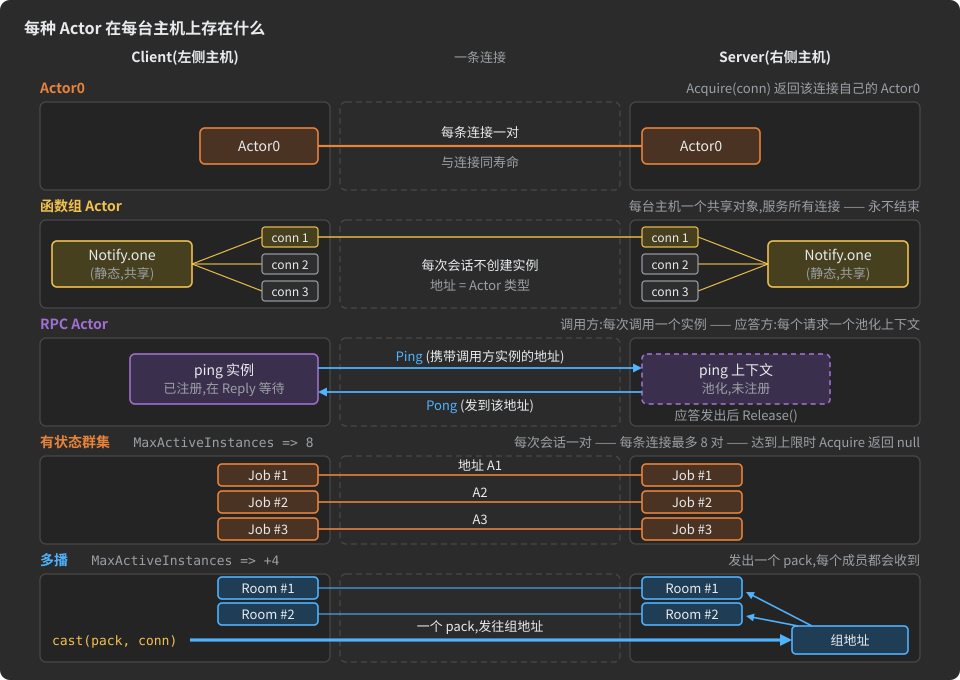

**标识决定成本。** pack 携带的地址说明对端的哪个对象来处理它:

- *绑定到类型。* 函数组 Actor 的 pack 只携带 Actor 的类型。不为对话创建任何东西,不跟踪任何东西,Actor 声明的每个 pack
  都可以在连接打开的任何时刻发送,从分支允许的任一台主机发出。
- *绑定到动态回调地址。* RPC 调用方取一个实例,请求携带该实例的地址。回应方回应到那个地址,不保留任何注册。
- *绑定到类型 + 实例。* 有状态 Actor 的两个实例——每台主机一个——共享一个动态地址,因此每个 pack 都恰好在这两个对应方之间
  传输。双方都运行同一台状态机的副本,它是这场对话的唯一事实来源;守护它免受过期 pack 影响的 epoch 在
  [Actor、状态、分支](#actors-states-branches) 中解释。

**一对中的第二个实例如何出现。** 开启对话的一侧用生成的 `Acquire` 取一个实例。它的第一个 pack 携带新地址和 epoch 0。
当它到达时,对端的连接在该地址下找不到实例,就从该 Actor 的池中取一个并注册在那里;这场对话之后的每个 pack 都交给那个实例。
如果一个 pack 到达时对端已不认识该地址,且 epoch 不是 0,那它属于一场在该侧已经结束的对话:它被丢弃。

**该用哪种。** 不驱动任何工作流的相关单向通知和状态更新放进函数组 Actor:没有会话要跟踪,没有实例要分配。一次请求配一个答复
就是 RPC 方法。多步交换——握手、文件传输、协同编辑——是有状态 Actor。Actor0 是连接自己的状态机;见
[Actor、状态、分支](#actors-states-branches)。状态全是即发即弃的 Actor0,本身就是一个函数组 Actor。

<a id="function-group-actor"></a>
### 函数组 Actor

**函数组 Actor** 是其状态只使用非转移分支(`l____________`、`____________r`、
`_____lr_____`)的 Actor。它从不改变状态,因此它的每个状态都是一组有名字的单向函数,在两台主机上始终可用。
代理的消息把这一类称为 "Singleton Actor";本手册使用*函数组 Actor*,并把*单实例*留给
`MaxActiveInstances => 1` —— 那是另一回事。

它承载的操作是**即发即弃**:一台主机发出一个 pack,不期待应答,状态机停留在原地。因为
没有分支是转移性的,任何一方都不主导状态 —— 双方是平等的。

<a id="declaring-a-function-group-actor"></a>
#### 声明一个函数组 Actor

一组 C# 重载,例如:

```csharp
// 普通 C#,不是描述:在连接体中,void 方法是错误
void LogEvent();
void LogEvent(StringMessage msg);
void LogEvent(WarningEvent ev);
void LogEvent(ErrorEvent ev);
```

变成一个状态,其分支列出每个参数 pack。接收方按 pack id 区分这些重载(见
[Actor、状态、分支](#actors-states-branches))。几组相关的函数就是一个 Actor 的几个状态 —— 这是紧凑形式,每个
状态都是一个始终可用的函数组:

```csharp
using org.unirail.Meta;

namespace com.demo.log
{
    public interface LogDemo
    {
        ///<see cref = 'InCS'/>
        struct Client : Host { }

        ///<see cref = 'InJAVA'/>
        struct Server : Host { }

        class NoArg         { }
        class StringMessage { string text; }
        class WarningEvent  { int code; string text; }
        class ErrorEvent    { int code; string text; }
        class StatusPayload { byte level; }
        class PartialStatus { byte level; string part; }

        interface ClientServer : Connects<Client, Server>
        {
            interface MyFunctions : Actor
            {
                // Client 以无参数或三种 pack 之一调用 LogEvent
                [l____________<(NoArg, StringMessage, WarningEvent, ErrorEvent)>]
                struct LogEvent { }

                // Client 报告其状态:完整的或部分的
                [l____________<(StatusPayload, PartialStatus)>]
                struct UpdateStatus { }
            }
        }
    }
}
```

**不存在 void 参数。** 每个分支都携带一个具体的 pack。对于没有参数的函数,每个项目声明一个空 pack ——
`class NoArg { }` —— 并把它与该状态的其他 pack 一起列出。如果你按文档标签而不是按罗列来选择该状态的 pack,
就在编号表中把 `NoArg` 与该状态的其他 pack 一起打上标签([编号表](#numbers-tables))。

**按标签选择 pack。** 当 pack 在其 `///` 注释中或编号表中带有诸如 `log_events` 的标签时,分支可以
按标签选择它们而不是罗列它们:`[l____________("log_events")]`。四个可选参数 `(KeepDoc, SkipDoc, KeepName, SkipName)`
以及命名一组 pack 的所有其他方式见 [Pack Sets](#pack-sets)。

一个双向的实例 —— Server 推送通知和告警,Client 发送标志:

```csharp
interface Notify : Actor
{
    [____________r<(Note, Alert)>]
    struct Messages { }

    [l____________<Flag>]
    struct Flags { }
}
```

<a id="what-the-generator-produces-for-a-function-group-actor"></a>
#### 生成器为函数组 Actor 生成什么

Actor 类有一个静态的共享对象(C# 中的 `one`),由该主机的每条连接使用。它的 id 是 Actor 的类型,它的 epoch
永远是 0,它的 `Release` 什么也不做 —— 没有实例可释放。每个状态为它发送的每个 pack 得到一个静态 `send`
重载,为它接收的每个 pack 得到一个处理器列表。在 C# 中,在上面示例的 Client 上:

```csharp
// 随时发送一个 Flag:无需获取,无需释放
Notify.Flags.send(flag, conn);

// 来自 Server 的 Note 在这里意味着什么
Notify.Messages.OnReceiveD.Note.handlers += (note, conn, actor) => Show(note);
```

<a id="rules-for-function-group-actors"></a>
#### 函数组 Actor 的规则

| 规则 | 代理的行为 |
|:--|:--|
| Actor 中任何地方都没有转移分支 | 该 Actor 是一个函数组,一个主机范围的全局对象;不需要 `MaxActiveInstances` |
| 在它上面声明了 `MaxActiveInstances` | 忽略,并给出警告 *"contains only fire-and-forget functions but assigned MaxActiveInstances value. MaxActiveInstances is ignored"*;组播 `+N` 也会被清除。Actor0 不得到警告 |
| 一个 pack 由同一方在它的两个状态中发送 | 错误:它的所有状态同时处于活跃状态,因此 pack id 必须在整个 Actor 范围内按发送方唯一([Actor、状态、分支](#actors-states-branches)) |
| 非转移状态与链混在一个 Actor 中 | 错误:一个 Actor 要么是链,要么是函数组([Actor、状态、分支](#actors-states-branches)) |

> [!NOTE]
> 一个声明了 `int MaxActiveInstances => UNLIMITED;` 的函数组 Actor 可以编译,但这一行除了产生
> 上面的警告之外什么也不做。删掉它。

<a id="rpc-methods"></a>
### RPC 方法

**RPC 方法**是声明在连接体中、或连接体内的普通分组接口中的 C# 方法;结构化虚拟连接
也接受它们([虚拟连接与中继](#virtual-connections-and-relays))。代理把每个方法变成一个带两态
状态机的 Actor:`Call → Reply → End`。它的返回类型是一个由方向标记和回复 pack 组成的元组;它的唯一
参数是请求:

```csharp
(L____________, UserProfile) GetUser(UserId id);   // Left 用 UserId 调用 GetUser,Right 用 UserProfile 回复
```

在返回元组中,`L____________` 和 `____________R` 是来自 `org.unirail.Meta` 的标记接口,与同名的分支特性
是两回事;你只在这里写它们。

<a id="unidirectional-request-response-rpc"></a>
#### 单向请求-响应(RPC)

一台主机调用,并期待另一台给出结果。**返回元组内**的标记命名**发送请求**的主机;
对端主机总是应答。

| 返回元组中的标记 | 调用方(发送请求) | 应答方 |
|:--|:--|:--|
| `L____________` | 连接的左侧主机 | 右侧主机 |
| `____________R` | 右侧主机 | 左侧主机 |
| 无 | 任一主机 —— 见[双向请求-响应](#bidirectional-request-response) | 另一台 |

```csharp
using org.unirail.Meta;

namespace com.demo.rpc
{
    public interface RpcDemo
    {
        ///<see cref = 'InCS'/>
        ///<see cref = 'InTS'/>
        struct Client : Host { }

        ///<see cref = 'InJAVA'/>
        ///<see cref = 'InCS'/>
        struct Server : Host { }

        class NoArg    { }
        class Ping     { long stamp; }
        class Pong     { long stamp; }
        class Status   { byte level; }
        class FileName { string name; }
        class FileId   { long id; }
        class FileData { Binary[] data; }
        class NotFound { string what; }
        class Query    { int id; }
        class Found    { int id; string value; }
        class Nope     { int id; }

        interface Link : Connects<Client, Server>
        {
            // Client 提问,Server 回答
            (L____________, Pong) ping(Ping req);

            // Server 提问,不带参数
            (____________R, Status) status(NoArg _);

            // 两种请求、两种答复:每种恰好发送一个
            (L____________, FileData, NotFound) FetchFile((FileName, FileId) query);

            // 任一侧都可以提问:两个 Actor,lookupL 和 lookupR
            (Found, Nope) lookup(Query q);
        }
    }
}
```

方法 `ping` 代表下面这个 Actor,你自己也可以把它完整写出来:

```csharp
interface ping : Actor          // 不写 MaxActiveInstances:这个确切形状和方法一样被设为不限
{
    [L____________<Reply, Ping>]   // 调用方主导 Call
    struct Call { }

    [____________R<End, Pong>]      // 应答方主导 Reply
    struct Reply { }
}
```

| 代理合成的内容 | 值 |
|:--|:--|
| Actor 名 | 方法名(`ping`);未给出标记时为 `<name>L` 和 `<name>R` |
| 状态 `Call`,编号 0 | 一条由调用方主导的转移分支;它的 pack 是请求;目标 `Reply` |
| 状态 `Reply`,编号 1 | 一条由应答方主导的转移分支;它的 pack 是回复;目标 `End` |
| `MaxActiveInstances` | 不限 |
| 位置 | 外层连接或分组接口的一个 Actor,在 Actor0 旁边 —— 不在它内部 |
| 持久编号 | 由代理以 `/*…*/` 注释写在方法名之后([编号表](#numbers-tables)) |

**请求和回复都是 Pack Set。** 参数类型,以及返回元组中标记之后的每个元素,接受
分支的 `PACKS` 所接受的一切:一个 pack、一个命名的 Pack Set、带或不带 `@` 的 `Project`/`Host`/`Pack`
作用域、就地 `_<…>`、`X<…>` 排除、过滤器模板,或这些的元组([Pack Sets](#pack-sets))。多个请求变体是一个元组参数
类型;多个回复变体是多个元组元素。无论哪种方式,这些元素都是**备选** —— 恰好发送集合中的一个 pack —— 而不是
C# 值元组的字段。返回元组的元素构成**一个**集合,所以一个元素中的 `X<…>` 也会移除其他元素命名的
pack。这些 pack 和 Pack Set 可以声明在项目中的任何地方,在连接之前或之后:代理在
读完所有 pack 之后解析它们。

```csharp
interface CPURequest : _<(ForPeriod, ForRange)> { }   // 一个命名 Pack Set

interface TelemetryLink : Connects<Dashboard, Server>
{
    (L____________, CpuList)                         getCPU(CPURequest req);          // 一个命名 Pack Set 作为请求
    (L____________, _<@Replies>, X<Replies.Legacy>)  ask(RecentOnly<@Requests> req);  // 一个作用域减去一个 pack;一个过滤器模板
}
```

在这段摘录中,`Replies` 和 `Requests` 是带有嵌套 pack 的 pack,`RecentOnly<SCOPE>` 是一个过滤器模板,主机和
其他 pack 声明在项目的别处 —— 每种形式选择什么见 [Pack Sets](#pack-sets)。

<a id="what-the-generator-produces-for-an-rpc-method"></a>
#### 生成器为 RPC 方法生成什么

RPC 的两台主机得到不同的代码,因为它们的职责不同。

**调用方**得到一个完整的 Actor 类。`Acquire(conn)` 从该 Actor 的池中取出一个实例,把它注册到连接上并
置于 `Call`;请求通过 `Call` 状态的发送器发出,这会把实例移到 `Reply`;回复在
`Reply` 到达,它的处理器运行,到 `End` 的转移把实例归还到它的池。实例持有回调上下文,所以
回复会按状态校验,并到达发起请求的逻辑。

**应答方**得到一个小型上下文类。对每个进来的请求,它的连接从该 Actor 的池中取出一个上下文对象,并
盖上调用方的地址和 epoch。上下文**不注册**到连接上:它不计入任何限额,
连接也不跟踪它。请求处理器收到 `(request, connection, context)`;你通过上下文作答,现在或
稍后从另一个处理器作答,并在回复发出后用 `Release(connection)` 把上下文归还到它的池。池是热的时,
任何一侧都不会为一次调用分配 Actor 对象。

在 C# 中,对上面的 `ping`:

```csharp
// Client——调用方。在启动时执行一次:答复在这里意味着什么。
ping.State.Reply.OnReceiveD.Pong.handlers += (pong, conn, actor) => Show(pong);

// 每次调用:从池中取一个实例,注册到 conn 上,处于 Call 状态;永不为 null——RPC Actor 没有上限。
var actor = ping.Acquire(conn);
ping.State.Call.ONE.transmitter.send(request, conn, actor);   // Call -> Reply;回复把它移到 End 并归还到池中
```

```csharp
// Server——应答方:回应每个 Ping,并在 Pong 序列化完成后归还上下文。
ping.OnReceiveD.Ping.handlers   += (req, conn, ctx) => ctx.send(MakePong(req), conn);
ping.OnSerializeD.Pong.handlers += (_, conn, ctx) => ctx.Release(conn);
```

处理器类以 pack 命名;声明在主机或另一个 pack 内部的 pack 以其路径用 `_` 连接命名(例如
下面级联中主机 `Gateway` 的 pack `Download` 名为 `OnReceiveD.Gateway_Download`)。Java 使用相同的结构,
写作 `OnReceived.<Pack>.handlers.add(...)`,TypeScript 用 `acquire(conn)`。生成的代码从不把应答方的上下文归还到它的
池:你的代码来做,而回复的 `OnSerializeD` 处理器,如上所示,就是做这件事的地方。

<a id="bidirectional-request-response"></a>
#### 双向请求-响应

当**任一主机**都可以发起同一个交互时,把标记从返回元组中省略。代理随即产生**两个 Actor** ——
`<name>L`,左侧主机在其中调用;`<name>R`,右侧主机在其中调用 —— 各自有自己的 `Call` 和 `Reply`。双方
在同一时刻各自发起的调用运行在两个独立的 Actor 中,永不相互冲突。

```csharp
(Found, Nope) lookup(Query q);              // Actor lookupL 和 lookupR
PlayerPosition Ping(PlayerPosition echo);   // 裸返回类型:也是双向的,一种回复
```

这两个 Actor 有两个编号,记在编号表的一行上([编号表](#numbers-tables))。

<a id="cascading-rpc-multi-hop-relay"></a>
#### 级联 RPC(多跳中继)

当一台主机与持有数据的主机之间没有直接连接时,调用经由中间的主机**级联**。每一跳是一个
独立的 RPC,有自己的 Actor 和自己的生命周期;中间主机收到下一跳的回复,并把它作为自己的
回复转发出去。

```
Dashboard  <->  Gateway  <->  Server
(browser)       (relay)      (data source)
```

同一个签名声明在两条连接上:

```csharp
using org.unirail.Meta;

namespace com.demo.cascade
{
    public interface Cascade
    {
        ///<see cref = 'InJAVA'/>
        struct Server : Host { }

        ///<see cref = 'InCS'/>
        struct Gateway : Host
        {
            public class Download { long session_id; }
            public class Upload   { Binary[] data; }
        }

        ///<see cref = 'InTS'/>
        struct Dashboard : Host { }

        interface ServerToGateway : Connects<Server, Gateway>
        {
            (____________R, Gateway.Upload) getSessionFiles(Gateway.Download req);   // Gateway 向 Server 提问
        }

        interface GatewayToDashboard : Connects<Gateway, Dashboard>
        {
            (____________R, Gateway.Upload) getSessionFiles(Gateway.Download req);   // Dashboard 向 Gateway 提问
        }
    }
}
```


异步级联:

1. Dashboard 调用 `getSessionFiles`:在 Dashboard 上取出一个调用方实例,在 Gateway 上取出一个应答方上下文。
2. Gateway 的请求处理器朝 Server 发起一个**新的** `getSessionFiles`:在
   Gateway 上有第二个、独立的调用方实例,在 Server 上有一个应答方上下文。处理器把 Dashboard 一侧的上下文及其连接
   保存在 Server 一侧调用方实例的一个字段中。
3. Server 以 `Upload` 回复,并把它的上下文归还。
4. Gateway 收到回复;它 Server 一侧的实例到达 `End` 并归还到它的池。它的回复处理器通过
   保留的 Dashboard 一侧上下文发送文件,该上下文随后也归还到它的池。
5. Dashboard 收到回复;它的实例到达 `End`,你的代码拿到了文件。

在中继期间,Gateway 持有两个对象:一个面向 Dashboard 的应答方上下文和一个面向 Server 的调用方实例。你在
Gateway 的两个处理器中编写中继逻辑;每一跳的 Actor 创建、寻址和清理由生成代码完成。

<a id="parser-rules-for-rpc-methods"></a>
#### RPC 方法的解析器规则

| 声明 | 结果 |
|:--|:--|
| 方法在连接体中、或连接体内的分组接口中 | 一个 RPC Actor |
| 方法在连接之外的任何地方(在主机中、在项目接口中) | 忽略 —— 不生成任何东西 |
| 方法在一个 `Actor` 内部 | 错误:RPC 方法不能声明在另一个 Actor 内部 |
| `void` 返回类型 | 错误:即发即弃需要完整声明 —— 一个[函数组 Actor](#function-group-actor) |
| 返回元组中出现 `l____________` 或 `____________r` | 错误:请求及其回复是转移,所以只能出现 `L____________` 或 `____________R` |
| 返回类型只有标记,例如 `L____________ Get(Req r);` | 错误:至少需要一个回复 pack,放在元组中 |
| 返回元组有标记但没有回复 pack | 错误,理由同上 |
| 没有参数 | 错误:声明一个空 pack,例如 `class NoArg { }`,并写作 `Name(NoArg _)` |
| 多于一个参数 | 错误:把请求备选放进一个元组参数,`Name((A, B) req)` |
| 请求或回复解析不到任何可传输的 pack —— 什么都不保留的过滤器、移除一切的 `X<…>` | 错误 |

通过的变体,来自一个真实描述:

```csharp
(L____________, TeamCoordination)          RequestTeamCoordination(PlayerPosition query);
(____________R, ServerStatus)              GetServerStatus(NoArg _);
PlayerPosition                             Ping(PlayerPosition echo);
(L____________, ServerStatus, PlayerEvent) ComplexQuery((PlayerAction, TeamCoordination) query);
(PlayerPosition, PlayerAction)             Ping2(PlayerPosition echo);
```

<a id="when-the-rpc-shorthand-is-not-enough"></a>
#### 当 RPC 简写不够用时

**并发调用的限额。** 简写总是不限的。要给它设限,就把 Actor 完整写出来并给它一个
`MaxActiveInstances`:

```csharp
interface FetchFile : Actor
{
    int Actor.MaxActiveInstances => 14;

    [L____________<Reply, (FileName, FileId)>]
    struct Call { }

    [____________R<End, (FileData, NotFound)>]
    struct Reply { }
}
```

**手写的同形 Actor。** 状态机恰好是两个状态、各一条分支、双方交替、
第一条分支去往第二个状态、第二条去往 `End` 或 `Close` 的 Actor,也是一个 RPC Actor:它在没有
`MaxActiveInstances` 的情况下被接受,并被设为不限。

**没有组播。** RPC Actor 只为一次调用而活。在 `Call → Reply → End` 形状的 Actor 上写组播 `+N` 会给出警告,
并且组播被关闭。

**回复之后继续的对话。** 一旦状态机不是 `Call → Reply → End` 之外的任何形状 —— 例如一个
先被接受、然后报告进度、然后给出结果的长时间任务 —— 它就是一个普通的有状态 Actor,必须声明
`MaxActiveInstances`:

```csharp
interface LongJob : Actor
{
    int Actor.MaxActiveInstances => UNLIMITED;

    [L____________<Reply, JobRequest>]
    struct Call { }

    [____________R<Running, JobAccepted>]
    [____________R<End, JobRejected>]
    struct Reply { }

    [____________r<JobProgress>]      // Server 报告,状态不变
    [____________R<End, JobResult>]   // Server 结束任务
    struct Running { }
}
```

<a id="full-featured-actor"></a>
### 全功能 Actor

**全功能 Actor** 是连接作用域内的一个 C# 接口，它扩展 `org.unirail.Meta.Actor`，并把其状态完整写出
([Actor、状态、分支](#actors-states-branches))。它的并发模式是 `MaxActiveInstances` 的值，你可以用两种形式之一来写——
agent 取名字以 `MaxActiveInstances` 结尾的属性，并读取其常量值：

```csharp
int MaxActiveInstances => 8;         // 接口的一个属性
int Actor.MaxActiveInstances => 8;   // Actor 成员的显式实现
```

你是否必须写它取决于 Actor 的种类：

| Actor                                        | 不写 `MaxActiveInstances`                                                                                              | 写了 `MaxActiveInstances`             |
|:---------------------------------------------|:----------------------------------------------------------------------------------------------------------------------------|:--------------------------------------|
| Actor0                                       | 1                                                                                                                           | 恒为 1                              |
| 函数组 Actor                         | 无需任何声明                                                                                                              | 被忽略，并给出警告               |
| RPC 方法                                   | 无上限                                                                                                                   | 不可能：请把 Actor 完整写出 |
| 手写的 `Call → Reply → End` / `Close` | 无上限                                                                                                                   | 按所写的值                            |
| 任何其他有状态 Actor                     | **错误**:*"must explicitly define 'MaxActiveInstances': how many of its conversations may run at once on one connection"* | 按所写的值                            |

`Meta.cs` 中的 `Actor` 接口声明该属性时带有方法体 `=> 1`。agent 不把它当作默认值：它只读取你的 Actor 所声明的内容。

<a id="concurrency-modes"></a>
#### 并发模式

| 模式                | 声明                                  | 标识                                                     | 行为                                                                        |
|:--------------------|:---------------------------------------------|:-------------------------------------------------------------|:--------------------------------------------------------------------------------|
| **单实例** | `int MaxActiveInstances => 1;`               | 每条连接一个实例：一个稳定的目的地            | 当连接上已有一场对话开着时，下一次 `Acquire` 被拒绝 |
| **群集**           | `int MaxActiveInstances => 8;`(任意 N)       | 每个实例一个动态地址                               | 每条连接最多 N 个并发实例；会检查上限               |
| **无上限群集** | `int MaxActiveInstances => UNLIMITED;`       | 每个实例一个动态地址                               | 无上限，也不做上限检查                                                     |
| **组播**       | `int MaxActiveInstances => +4;`(一元加号) | 每个实例一个动态地址，外加一个固定的组地址 | 最多 N 个实例；投向组地址的 pack 会到达所有实例         |

```csharp
using org.unirail.Meta;

namespace com.demo.modes
{
    public interface Modes
    {
        ///<see cref = 'InCS'/>
        struct Client : Host { }

        ///<see cref = 'InJAVA'/>
        struct Server : Host { }

        class Pause     { }
        class Resume    { }
        class JobStart  { int job; string what; }
        class JobChunk  { int job; Binary[] data; }
        class JobCancel { int job; }
        class JobDone   { int job; bool ok; }
        class Blob      { Binary[] data; }
        class BlobAck   { int size; }
        class RoomJoin  { string who; }
        class RoomSaid  { string who; string text; }
        class RoomLeave { string who; }

        interface Link : Connects<Client, Server>
        {
            // 单实例:每条连接一场控制对话
            interface Control : Actor
            {
                int Actor.MaxActiveInstances => 1;

                [L____________<Paused, Pause>]
                struct Running { }

                [L____________<Running, Resume>]
                struct Paused { }
            }

            // 群集:最多同时 8 个任务,每个任务一对实例
            interface Job : Actor
            {
                int Actor.MaxActiveInstances => 8;

                [L____________<Running, JobStart>]
                struct Start { }

                [Deadline(30)]                  // 每个任务自己的:八个任务,八个截止时间
                [l____________<JobChunk>]
                [____________r<JobDone>]
                [L____________<End, JobCancel>]
                struct Running { }
            }

            // 无上限群集:不做上限检查
            [Idle(15)]                          // 对端沉默 15 秒的上传会自行结束
            interface Upload : Actor
            {
                int Actor.MaxActiveInstances => UNLIMITED;

                [L____________<Waiting, Blob>]
                struct Start { }

                [____________R<End, BlobAck>]
                struct Waiting { }
            }

            // 组播:最多 4 个成员,共用一个地址
            interface Room : Actor
            {
                int Actor.MaxActiveInstances => +4;

                [L____________<Inside, RoomJoin>]
                struct Start { }

                [____________r<RoomSaid>]
                [L____________<End, RoomLeave>]
                struct Inside { }
            }
        }
    }
}
```

该值成为生成的属性 `MaxActiveInstances`，双方都知晓。`UNLIMITED` 是 `Meta.Actor` 的常量 0;
RPC Actor 在生成的代码中显示最大的 `int` 值，任何连接都达不到它。无上限群集省去了上限检查的工作，
并让对端可打开的实例数量不受约束：只在私有的、受控的、可信的环境中使用它——agent 自己的错误文本
也会警告这会暴露于资源耗尽攻击。

`+1` 会给出警告：只限一个成员的组播组就是一个普通的单播 Actor。

<a id="the-group-address"></a>
#### 组地址

组播 Actor 的固定地址是一个**在线路上有地址的组**:与
[`[Grouped]`](#actors-of-many-connections-grouped) 给出的组属于同一种，每条连接一个，由连接在其 Actor 之间保管。

- `Room.Multicast( connection )` 返回该连接的组，并在首次调用时创建它；由 Actor 的 `multicastFactory` 来创建。
- 实例**在打开时加入组**,在任一侧都一样——由本侧 `Acquire` 打开的实例和对端打开的实例都如此——并在
  结束时、即在其 `Release` 中退出组。
- 在某个状态的 Transmitter 上调用 `cast( pack, connection )` 会把 pack **只发送一次**,发往组地址。
  对端的组再把它交给那边的每个成员，无论它们处于什么状态、什么 epoch。
- 一个实例同一时间只在一个组里。一个 `join` 了另一个组的实例会离开原地址，投送不再到达它。
- 所有成员共享的内容放入 Actor 的组类的注入点 `Group`。要自定义组，就扩展该类并
  设置 `multicastFactory` 来创建它。

<a id="nesting-actors"></a>
### 嵌套 Actor

Actor 接口和 RPC 方法可以放在连接作用域内的普通分组接口里。生成器保留层级结构：每个
分组接口成为生成的 API 的一个命名空间(C#)或包(Java)层级。

```csharp
using org.unirail.Meta;

namespace com.demo.nesting
{
    public interface Nesting
    {
        ///<see cref = 'InCS'/>
        struct Client : Host { }

        ///<see cref = 'InJAVA'/>
        struct Server : Host { }

        class ForPeriod   { long since; long until; }
        class CpuList     { float[] load; }
        class MemList     { long[] used; }
        class Subscribe   { int what; }
        class Sample      { int what; long value; }
        class Unsubscribe { int what; }
        class Restart     { string reason; }
        class Done        { }
        class Failed      { string why; }

        interface Link : Connects<Client, Server>
        {
            interface Telemetry
            {
                (L____________, CpuList) getCpu(ForPeriod req);
                (L____________, MemList) getMemory(ForPeriod req);

                [Idle(120)]   // 停止续订的订阅者会被放行
                interface Feed : Actor
                {
                    int Actor.MaxActiveInstances => 16;

                    [L____________<Live, Subscribe>]
                    struct Start { }

                    [____________r<Sample>]
                    [l____________<Subscribe>]
                    [L____________<End, Unsubscribe>]
                    struct Live { }
                }
            }

            interface Admin
            {
                (L____________, Done, Failed) restart(Restart req);
            }
        }
    }
}
```

生成的 C# 类为 `…Link.Telemetry.getCpu`、`…Link.Telemetry.Feed` 和 `…Link.Admin.restart`。分组接口
不会生成自己的类，所以它上面的文档注释不会进入生成的代码([Pack](#packs))。Actor 不能声明在
另一个 Actor 内部,RPC 方法也不行：两者都是错误。

<a id="actor-lifecycle"></a>
### Actor 生命周期


<a id="opening-an-actor-instance-and-its-limit"></a>
#### 打开 Actor 实例及其上限

`MaxActiveInstances` 是一个双方都知晓的上限，每一侧都在实例注册的地方检查它：

| 事件                                                           | 会发生什么                                                                                                                                              |
|:----------------------------------------------------------------|:----------------------------------------------------------------------------------------------------------------------------------------------------------|
| 本侧的 `Acquire` 将超过此连接上的上限 | 那一个实例被**拒绝**:`Acquire` 返回 `null`(TypeScript 中为 `undefined`),什么都不发送,连接及其其他实例继续运行 |
| 对端打开的实例比上限多一个                 | 对端被视为故障或恶意的:**连接被中止**                                                                                   |
| Actor 是 `UNLIMITED`                                        | 不保留计数，也不做任何检查                                                                                                                   |
| RPC Actor                                                       | 永不拒绝：调用方的上限是最大的 `int`,而回复方的上下文根本不被注册                                                |
| Actor0                                                          | `Acquire(conn)` 返回连接自己的 Actor0：每条连接一个，与连接同寿命                                               |

<a id="how-an-actor-instance-ends"></a>
#### Actor 实例如何结束

| 原因                                            | 范围          | 细节                                                                                                                                                                                                                                       |
|:-------------------------------------------------|:---------------|:----------------------------------------------------------------------------------------------------------------------------------------------------------------------------------------------------------------------------------------------|
| 转移到 `End`                              | 这一对实例      | 实例对被删除；连接保持打开，供其他 Actor 使用([Actor、状态、分支](#actors-states-branches))                                                                                                            |
| 转移到 `Close`                            | 连接 | 先排空发送队列，然后连接关闭([Actor、状态、分支](#actors-states-branches))                                                                                                                               |
| `[Deadline]` 或 `[Idle]` 到期                 | 此实例  | 触发 `OnDeadline`;其默认行为在本侧结束这一对——见下文                                                                                                                                                                        |
| `[ReceiveTimeout]` / `[TransmitTimeout]` 到期 | 连接 | 它们是整个连接的超时：连接关闭，连同其所有 Actor([连接](#connections))                                                                                                                                      |
| 连接丢失或断开                 | 连接 | 若当前状态或连接上带有 `[Resumable(seconds)]`,会话被挂起并等待其对端；否则实例随连接一起结束([会话、保证送达、UDP](#sessions-guaranteed-delivery-udp)) |
| 虚拟连接的隧道关闭        | 隧道     | 其实例随它一起结束([虚拟连接与中继](#virtual-connections-and-relays))                                                                                                                                                 |

实例的每一次结束都经过它的 `Release`:若有组则退出组，从连接的 Actor 表中移除，
重置回起始状态，并归还到它的池中。

<a id="per-instance-timers-deadline-and-idle"></a>
#### 逐实例计时器：[Deadline] 和 [Idle]

连接的超时会结束连接上的一切。有两个特性改为只限制**一个实例**;连接和上面的其他
Actor 继续存活。

- **`[Deadline(seconds)]`** 写在**状态**上：一个实例可以在其中停留多久。计时在实例进入该状态时设定，
  在它离开时丢弃。一条连接上的八个任务有八个截止时间，而连接的超时不受影响。
- **`[Idle(seconds)]`** 写在 **Actor** 或**状态**上：一个租约。当对端有那么长时间没有发来*它的* pack 时，实例结束。
  写在 Actor 上时，它在每个状态都生效；写在状态上时，只在实例处于该状态时生效。

`[Idle]` 在**不**主导该状态的一侧生效——即在那里没有转移分支的一侧。那一侧自己无法结束这一对实例，
否则它会永远保留一个已消失对端的实例。主导该状态的一侧在它决定时结束这一对，所以
`[Idle]` 不适用于它；在无人主导的状态里，它在两侧都生效。在上面的 `Upload` 中,Server 主导 `Waiting`,所以
那里 `[Idle(15)]` 在 Client 上生效：一个 15 秒内没等到 `BlobAck` 的 Client 会结束它的实例。

**只有收到的 pack 才算数。** 实例收到的每个 pack 都会把它的截止时间往后推；它发送的不算。一个向已离开的订阅者
推送事件的服务器绝不能靠这个续命：续订的订阅者继续存活，停止续订的被放行。
在下面这段摘自一份实际描述的代码中，主机、pack 以及承载穿过 `Hub` 的隧道的两条连接都声明在
同一个项目里([虚拟连接与中继](#virtual-connections-and-relays)):

```csharp
interface ViewerToServer : VirtuallyConnects<Viewer, Server, Hub>
{
    [Idle(120)]   // Viewer 用 WatchSub 续租;一声不吭就消失的 Viewer 会被放行
    [Grouped]
    interface Watch : Actor
    {
        int Actor.MaxActiveInstances => 4;

        [L____________<Live, WatchSub>]
        struct Start { }

        [____________r<WatchEvent>]          // Server 的事件不续租
        [l____________<WatchSub>]            // Viewer 的续订会续租
        [L____________<End, WatchUnsub>]
        struct Live { }
    }
}
```

**当时间耗尽时**,实例收到 `OnDeadline`——一个注入点，其生成的默认行为在本侧释放该实例。
对于 Actor0(它的这一对就是连接本身),它会关闭连接。对端通过自己的截止时间或
随连接一起结束它自己的实例。

**它的代价。** 实例中一个字段，带 `[Idle]` 时两个。连接只保存其实例中最近的那个截止时间，放在
传输层已有的截止时间列表里：没有计时器对象，循环里也没有逐实例的东西。一个被往后推的截止时间——
一个 `[Idle]` 实例收到的每个 pack——代价是一次加法和一次比较；只有当某个截止时间提前时才触碰列表。时间到时，
只检查那条连接的实例。Java 在连接自己的循环上触发截止时间。C# 在连接的维护中、暂停其 I/O 的情况下触发它们，
所以实例从不会在自己的某个 pack 正在被处理时触发(C# WebSocket 客户端传输层为每条连接使用一个
计时器)。TypeScript 为每条连接使用一个计时器。虚拟连接的实例把它的截止时间保存在载体
连接上([虚拟连接与中继](#virtual-connections-and-relays))。这两个特性，以及 `[Grouped]`,也会作为其状态或 Actor 的常量进入生成的
代码([特性](#attributes))。

| 特性                                     | 写在                                  | 限制                                                                           | 结束                 |
|:----------------------------------------------|:------------------------------------|:---------------------------------------------------------------------------------|:---------------------|
| `[ReceiveTimeout(s)]`、`[TransmitTimeout(s)]` | 状态(把它们写在 Actor0 的状态上) | 连接的静默 / 停滞的发送                                       | 整个连接 |
| `[Deadline(s)]`                               | 状态                               | 一个实例在该状态停留多久                                         | 那个实例        |
| `[Idle(s)]`                                   | Actor 或状态                      | 在不主导的一侧,一个实例多久没有收到对端的 pack | 那个实例        |

<a id="overriding-the-default-lifecycle-actions"></a>
#### 覆盖默认的生命周期动作

每个默认动作——达到上限时拒绝(`Check limit`)、在 `END` 时释放(`END OnActivate`)、在 `CLOSE` 时关闭
(`CLOSE OnActivate`)、在截止时释放——都位于生成的代码中某个注入点旁边，而截止时的默认动作位于
一个注入点之内(`Actor OnDeadline`),所以你可以用自己的错误处理或恢复逻辑替换它。显式上限和终止状态之外的一切
都由你的代码负责。

<a id="your-code-lives-in-the-actor"></a>
### 你的代码住在 Actor 里

生成的 Actor 不是一个用来查找东西的裸地址：它是**拥有**对话中自己那一部分的对象。实例
需要什么——对你的对象的引用、计数器、缓冲区、标志位——就放进它的字段；它做什么就放进它的注入点。
注入点如何在重新生成后存活，见[部署与智能合并](#deployment-and-smart-merge)。

| 注入点                                                                      | 何时运行                                                                                                                                                                           | 放什么                                                                  |
|:-------------------------------------------------------------------------------------|:-------------------------------------------------------------------------------------------------------------------------------------------------------------------------------|:--------------------------------------------------------------------------|
| `Actor`(类体)                                                             | -                                                                                                                                                                              | 实例的字段和方法；Actor 的池也声明在这里 |
| `Import`                                                                             | -                                                                                                                                                                              | 你的 `using` / `import` 行                                             |
| `Actor OnReceiving`、`Actor OnReceived`、`Actor OnSerializing`、`Actor OnSerialized` | 此 Actor 的每个 pack,在它的状态看到它之前，在该方向的循环上                                                                                                   | 针对 Actor 全部 pack 的检查和簿记                         |
| `<Pack> OnReceived Event`、`<Pack> OnSerialized Event`                               | 此状态的一个 pack 到达 / 发出，在该方向的循环上                                                                                                              | 这个 pack 对此实例意味着什么                                     |
| `OnReceiving code`、`OnReceived code`、`OnSerializing code`、`OnSerialized code`     | 此状态的每个 pack,在该方向的循环上，在逐 pack 事件之前                                                                                                  | 针对一个状态全部 pack 的检查                                         |
| `OnReceiving Error code`                                                             | 一个此状态不接受的 pack 到达了，就在它被报告为错误之前                                                                                                | 诊断                                                               |
| `OnActivate code`                                                                    | 实例已进入该状态                                                                                                                                             | 进入该状态要启动什么                                            |
| `OnClose`、`OnTimeout Receiver`、`OnTimeout Transmitter`                             | 关闭事件到达：会话结束(已挂起的会话会把它扣留到等待耗尽)/ 处于此状态时连接超时触发                            | 此实例归还或报告什么                                  |
| `Actor OnNewState`                                                                   | 在每次状态变化之前，包括重置回起始状态                                                                                                           | 跨状态的簿记                                                 |
| `Epoch mismatch`                                                                     | 一个针对此实例的过期 pack 被丢弃                                                                                                                                     | 诊断                                                               |
| `Actor OnConnected`、`Actor OnEvent`                                                 | 连接已连接 / 任何连接事件                                                                                                                                | 实例对连接的逐个反应                                   |
| `Actor OnDeadline`                                                                   | `[Deadline]` 或 `[Idle]` 到期                                                                                                                                               | 你自己的动作，代替默认的释放                            |
| `END OnActivate`                                                                     | 这一对即将删除，就在实例归还到池中之前                                                                                                              | 实例在被复用前交出什么                          |
| `CLOSE OnActivate`                                                                   | Actor 已转移到 `Close`,在连接排空并关闭之前                                                                                                            | 最后一份报告                                                             |
| `Group`(`[Grouped]` 和组播 Actor)                                           | -                                                                                                                                                                              | 一个组的所有成员共享什么                                         |
| `Connection code`                                                                    | -                                                                                                                                                                              | 整个连接的状态                                             |
| `Check limit`(在连接里)                                                    | 一个受限 Actor 的实例即将被计入 `MaxActiveInstances`,在连接的锁之下——本侧的 `Acquire` 和对端打开的实例都会经过 | 你自己的准入规则                                                   |
| `Connection Release`                                                                 | 连接对象归还到它的池中——在连接对象被池化的地方生成，例如多路复用端口上([多路复用](#multiplexing))                          | 清理你的连接字段                                           |

**处理器参数就是上下文。** 每个处理器都收到它为之运行的 Actor 和连接。在生成的 Actor 旁边放一张
`Map<actor, state>` 之类的旁表，是在重复实例本身已经承载的信息，每个 pack 都要付出一次查找和一次锁的代价，而且
可能错误地比实例活得更久。运行时本来就保管着一条连接的各个 Actor，并把关闭或超时通知给其中每一个。

<a id="pooled-instances-reset-and-hand-over"></a>
#### 池化实例：重置与移交

Actor 实例、回复方上下文和池化的连接对象都会被复用。由此有两条规则：

- **重置你添加的东西。** 在你用 `Acquire` 取得一个实例之后立刻清空你的字段，或者在它归还之前在 `END OnActivate` / `Connection Release`
  中清空。对端侧的实例由连接从池中取出，而不是由你的代码，所以 `END OnActivate` 是
  能覆盖两侧的地方。缓冲区按实例分配一次，而不是按对话分配一次。
- **在 `END` 之前移交。** `END` 之后实例将服务于另一场对话。必须活得更久的结果——一个判定、一个文件——在
  `END OnActivate` 中移交给一个比对话长寿的对象(你的任务、你的会话),那个对象同时在那里放下它对
  Actor 的引用。

<a id="the-two-loops-threads-and-actor-handlers"></a>
### 两个循环：线程与 Actor 处理器

**连接的每个方向都是一个单线程事件循环**,每个方向一个。**接收**循环处理入站 pack 和
接收超时，并运行你的 `OnReceiving` / `OnReceived` 处理器。**发送**循环处理出站 pack 和发送超时，
并运行你的 `OnSerializing` / `OnSerialized` 处理器。

- **运行到完成。** 在一个方向内，事件一次处理一个。一个事件被分发给各个 Actor 及其当前
  状态，只有当它返回后，才取该方向的下一个事件。Actor 不并行运行：一条连接上的几个 Actor
  是同一条线程轮流推进的几台状态机。同一侧上的处理器从不竞争，它们自己拥有的状态不需要锁。
- **两个方向，两条线程。** 接收循环和发送循环是独立的线程，可能同时运行。一个既被接收
  处理器触碰又被发送处理器触碰的字段，是连接内部唯一需要你协调的地方；只被一侧触碰的字段
  不需要锁。
- **状态机在两侧之间是安全的。** 当前状态连同 epoch 一起在连接的锁之下发布，所以
  一侧所做的转移在另一侧被完整地看到。在某个瞬间从连接读到的值——比如连接丢失时一个已挂起
  会话的等待时间——反映的是其 Actor 状态的一致快照。
- **来自外部的代码。** 另一条连接的循环或你的工作线程伸进一个 Actor，是线程之间唯一需要
  协调的地方。把它做成一次定义明确的交接，而不是共享的可变状态。从任何线程发送都只是把 pack 放进连接的
  队列；从发送侧处理器发出的 pack 由发送线程自己入队，线程之间没有任何交接。

> [!WARNING]
> 不要在处理器内阻塞。一个慢的处理器会卡住它的整个方向，而且在 C# 和 Java 运行时中一个传输层循环可能服务
> 多条连接：你的处理器运行期间，该循环的每条连接都在等待。把耗时的工作交给另一条线程，把结果
> 作为下一个事件发回来。

<a id="actors-of-many-connections-grouped"></a>
### 跨多条连接的 Actor:[Grouped]

有些工作跨越连接：一个信息源的每个订阅者、一个列表的每个观察者都收到同样的事件，无论它从哪条连接——
或哪条隧道——上来。Actor 上的 **`[Grouped]`** 让主机把它的实例从所有连接汇聚成组，而不需要在旁边放一张表。
该特性写在 Actor 接口上。
[逐实例计时器](#per-instance-timers-deadline-and-idle) 中的 `Watch` Actor——位于一条穿过中继主机的虚拟连接上——把它与
`[Idle(120)]` 写在一起：沉默的订阅者自行结束，而 Server 把它所有 Viewer 的实例汇聚成组。下面的
示例用到它。

**组由你扩展。** Actor 得到自己的组类 `Watch.Group`,它扩展运行时的 `Connection.Group`。
一个组的所有成员共享什么——一个计数器、一个缓存、最近的事件、面向全体成员的方法——就放进它的注入点 `Group`,
并在重新生成后存活。要自定义组，就扩展 `Watch.Group`,并把你的对象传给 `join`:每个成员都能看到它，
带有类型，作为它的 `group`。

**列表就是组。** 成员通过实例本身链接起来:Actor 扩展运行时的成员类，它有
`prev`、`next` 和 `group`。加入把实例放到头部；离开在原地解除链接。两者都是 O(1),没有遍历，
也不创建对象，所以把一个实例移到另一个组很快，也不给垃圾回收器留下任何东西。`group` 只在它为
空时被占用，通过被加入组的锁之下的 compare-and-set 完成，所以一个实例至多在一个组里，无论哪些线程在哪里加入它。
组就是它自己的锁：运行时的 `FastReentrantSpinLock`(在 C# 中是它的字段 `Lock`)。无人持有时它只花几条指令，
有人持有时短暂自旋，而且它是可重入的，所以成员可以在遍历自己所在组的中途离开。
TypeScript 是单线程的，遍历时不用锁。

| 实例的成员      | 它是什么                                                                                                        |
|:----------------------------|:------------------------------------------------------------------------------------------------------------------|
| `connection`                | 它所属的连接，加入时设定                                                                   |
| `join( connection, group )` | 加入该组并离开原来所在的组;`false`——它已在那个组里，或一次并发加入抢先占用了它 |
| `leave()`                   | 离开它的组                                                                                                  |
| `group`                     | 它所在的组，类型为 `Watch.Group` 或你的子类                                                          |
| `prev`、`next`              | 它前后的成员                                                                                             |

| 组的成员         | 它是什么                                                |
|:----------------------------|:----------------------------------------------------------|
| `head`、`size`              | 第一个成员、成员数量                        |
| `prev`、`next`、`list`      | 它在其组列表中前后的组，以及那个列表 |
| `join( groups )`、`leave()` | 加入一个组列表、离开它                         |

C# 中这些方法拼作 `Join` / `Leave`。

**它结束时自行离开。** 它的 `Release` 把它取出，无论结束来自它的状态机、它的 `[Deadline]` 或
`[Idle]`,还是它的连接或隧道关闭。组从不会持有一个已消失的实例，所以不需要写任何清扫或租约代码。

```java
static final Watch.Group WATCHERS = new Watch.Group();

// 订阅到达:实例加入
Watch.State.Start.OnReceived.WatchSub.handlers.add( ( pack, conn, actor, transmitter ) -> actor.join( conn, WATCHERS ) );

// 给所有成员的一个事件——来自任何地方,或来自某个成员自己:组就是它自己的锁
WATCHERS.acquire();
try { for( Watch w = WATCHERS.head; w != null; w = w.next ) Watch.State.Live.ONE.transmitter.send( event, w.connection, w ); }
finally { WATCHERS.release(); }
```

在 C# 中，遍历使用 `WATCHERS.Lock.Acquire()` / `WATCHERS.Lock.Release()`。

**组也有列表。** `Connection.Groups` 以同样的方式列出各个组——一套遥测的各个信息源、一个聊天的各个房间。组
用 `group.join( groups )` 加入,O(1),一次一个列表，遍历写作 `for( g = groups.head; g != null; g = g.next )`,
在列表的锁之下进行(列表就是它自己的锁，和组一样)。扩展 `Groups` 来放入所列各组共享的内容。

遍历只在把 pack 入队期间持有锁：一次发送只是把 pack 放进队列，仅此而已。

<a id="one-pack-to-many-connections"></a>
### 一个 pack 到多条连接

主机经常要把同一个 pack 发给许多对端：把一个实时事件发给每个订阅者，把一个设置发给某型号的每台设备。AdHoc 有两种做法，
而且都不会为每个接收者复制 pack。

|                    | 带类型的 pack 的扇出                 | 已接收 pack 的广播                                                   |
|:-------------------|:-------------------------------------|:---------------------------------------------------------------------|
| 共享的内容         | 一个 pack 对象                       | 接收到的 pack 的字节，只捕获一次                                     |
| 序列化             | 每条连接一次，从对象序列化           | 不再序列化：每条连接复制捕获的字节                                   |
| 谁维持其存活       | 你的代码                             | 引用计数；最后一次发送后，捕获归还到池                               |
| 典型用途           | 你的主机自己产生的事件               | 存储接收内容并转发的中继主机                                         |

<a id="fan-out-of-a-typed-pack-one-object-many-queues"></a>
#### 带类型的 pack 的扇出：一个对象，多个队列

`send` 不会序列化 pack：它把对 pack 的**引用**放入连接的发送队列
（见[发送：传输层拉取字节](#sending-the-transport-pulls-the-bytes)）。在 N 条连接上发送同一个对象，它就同时位于 N 个队列中；
每条连接的发送器在自己的套接字有空间时把它写入自己的发送缓冲区，并维护自己的游标。对象被读取 N 次，复制零次。
[多连接 Actor：[Grouped]](#actors-of-many-connections-grouped) 中对分组的遍历正是如此：

```java
for( Watch w = WATCHERS.head; w != null; w = w.next ) Watch.State.Live.ONE.transmitter.send( event, w.connection, w );
```

- **对象在最后一条连接写完它之前一直是共享的。** 运行时不会为带类型的 pack 维护计数。在每条连接都到达该 pack 的
  `OnSerialized` 事件之前，不要修改它、复用它或把它归还到池；简单的规则是每个事件用新对象。
- **getter 读取有状态数据源的抽象 pack 不能共享。** 如果你的 getter 从数据库游标拉取行，第一条写入该 pack 的连接会为所有连接把它消费掉。
- **带 `Stream` 或 `File` 字段的 pack 不能共享：**发送器读取你提供的数据源，而数据源只能读一次。
- **[Value Pack](#value-packs) 没有对象。** 它的值被复制进每个队列槽位，所以用循环发送来做扇出——它就是一个数字，复制它没有成本。

<a id="broadcast-of-a-received-pack-the-bytes-captured-once"></a>
#### 已接收 pack 的广播：字节，只捕获一次

一个从数据源接收 pack 并转发给订阅者的主机——监控后端、行情数据中心、日志代理——不需要重新序列化每个 pack。运行时
可以**在接收器解码传入 pack 的同时捕获它的字节**，在同一趟对接收缓冲区的遍历中完成，并把这一份捕获交给每个订阅者。
这些类在 C# 和 Java 中相同：

| 类                                                              | 角色                                                                                                  |
|:----------------------------------------------------------------|:------------------------------------------------------------------------------------------------------|
| `Connection.Receiver.BytesCopy`                                 | 已接收 pack 主体的捕获；`BytesCopy.InMemory` 是池化的实现                                             |
| `Connection.Transmitter.Broadcastable`                          | 广播者可以发送的东西：`BytesCopy` 就是其中之一                                                        |
| `Connection.Transmitter.Broadcaster<DST>`                       | 一个订阅源的订阅者：`Subscribe`、`Unsubscribe`、`PrepareBroadcastIfAnySubscriber`、`Broadcast`        |
| `Connection.Transmitter.Broadcaster`（每条连接生成一个）        | 该连接的各发送器的广播者；它在连接关闭时退订该连接                                                    |

步骤如下，正是 AdHoc 自己的监控后端的做法（C#）：

```csharp
// 1. 订阅源的订阅者，在到观察端的连接上。
public class Feed : ToObservers.Connection.Transmitter.Broadcaster
{
    public static readonly Feed ONE = new();

    // 一个捕获如何排入一个订阅者：作为 actor RealTimeData 发送的一个 pack
    protected override bool Broadcasting(AdHoc.Connection.Transmitter.Broadcastable src, ToObservers.Connection.Transmitter dst)
        => dst.sending_put(RealTimeData.one, src, -1, 0);
}
// 在观察端的 Subscribe 和 Unsubscribe pack 的 OnReceived 处理器中：
//     Feed.ONE.Subscribe(conn.transmitter);      Feed.ONE.Unsubscribe(conn.transmitter);

// 2. 当一个 pack 开始从数据源到达时布防捕获——在该 pack 的工厂中。
_Allocator.DEFAULT.new_Monitoring_Sessions_Authorizer_CheckAttempt = receiver =>
{
    Feed.ONE.PrepareBroadcastIfAnySubscriber(receiver, CheckAttempt.__id_);   // 仅在有人订阅时才捕获
    return pool.Acquire();                                                     // 你的对象：它的 setter 填充一条数据库命令
};

// 3. 当 pack 已经到达：存储它，然后广播捕获的字节。
public void __OnReceived_ServerToMonitoring__Actor0__One(ToServer.Connection conn, ToServer.Actor0 actor, ToServer.Actor0.State.One.Transmitter transmitter_)
{
    try     { insert.ExecuteNonQuery(); }                   // setter 把值直接写进了命令的参数
    catch( Exception e ) { Console.WriteLine(e.Message); }  // 绝不让异常逃逸进接收循环
    finally { Feed.ONE.Broadcast(conn.receiver); pool.Release(this); }   // Broadcast 也会清空捕获槽位
}
```

发生的事情：

1. 接收器读取 pack id 并调用工厂。`PrepareBroadcastIfAnySubscriber` **仅当订阅源至少有一个订阅者时**才把池化的
   `BytesCopy.InMemory` 附加到接收器；一个订阅者都没有时，什么都不捕获，什么都不花费。
2. 生成的解码器逐字段消费 pack——这里写入 setter，而 setter 直接写进数据库命令的参数——它消费的接收缓冲区的每一段
   切片同时也被复制进捕获，从传输层头部之后开始。解码与捕获是对字节的一趟遍历。
3. pack 完整到达后，你的 `OnReceived` 处理器运行：它存储 pack，然后调用 `Broadcast(receiver)`。
4. `Broadcast` 把捕获从接收器上取下，在一次原子步骤中为每个订阅者取一个引用，并通过你的 `Broadcasting` 把捕获排入
   每个订阅者。每个订阅者的发送器用自己的游标把捕获的字节复制进自己的发送缓冲区，并在最后一个字节之后归还自己的
   引用。最后一个订阅者之后，捕获归还到它的池。

**成本与限制。**

- **每次广播一份主体副本。** 捕获把 pack 的整个主体保存在一个数组中，从捕获开始，直到接受了它的最慢订阅者把它
  发完——这是运行时把一个 pack 保存为一个连续数组的唯一地方
  （[序列化路径上的内存](#memory-on-the-serialization-path)）。捕获是池化的——启动时 `BytesCopy.InMemory.InitPool(5)`
  会创建一个 32 个的池——数组按翻倍增长并保留其最大尺寸。
- **广播永不阻塞。** 发送队列已满的订阅者会拒绝该捕获：它错过这个事件，保持订阅状态，数据源和其他订阅者都不等它。
  如果在这里丢失事件要紧，把*进入*该主机的段做成保证送达段（[会话、保证送达、UDP](#sessions-guaranteed-delivery-udp)）；
  扇出段是尽力而为的。
- **先存储，再转发。** 订阅者在 pack 完整到达且你的处理器存储它之后才收到它。缓慢的存储会延迟广播以及数据源连接上的
  后续接收，但永远不会影响订阅者的发送器。
- **始终调用 `Broadcast`。** 它会清空接收器的捕获槽位；跳过它——比如它之前抛出了异常——捕获就会丢失，无法归还池中。
  在 `finally` 中调用它。
- **两段上是同一个 pack。** 捕获的字节原样转发，所以订阅者的连接必须携带同一个 pack、相同的主体编码；各段的头部没有
  问题，因为捕获从头部之后开始。被捕获的 pack 绕过发送侧的状态检查和 `OnSerialized` 事件：描述必须允许该 pack 出现在
  发送它的状态中。不要捕获带 `Stream` 字段或变换链的 pack，Value Pack 用循环发送来扇出。
- **另一个方向。** 发送侧有一个对应的分接头 `Connection.Transmitter.BytesCopy`，它复制发送器写出的字节。

<a id="parser-checks-for-actor-kinds"></a>
### Actor 种类的解析器检查

| 检查                                                                                  | 结果                                                                             |
|:--------------------------------------------------------------------------------------|:---------------------------------------------------------------------------------|
| 在另一个 Actor 内部声明的 Actor                                                       | 错误                                                                             |
| 在 Actor 内部声明的 RPC 方法                                                          | 错误                                                                             |
| 没有 `MaxActiveInstances` 的有状态 Actor，且不是 `Call → Reply → End` 形状           | 错误                                                                             |
| 一个 Actor 中同时有链接状态和孤立状态                                                 | 错误（见 [Actor、状态、分支](#actors-states-branches)）                          |
| 函数组 Actor 上的 `MaxActiveInstances`                                                | 警告；被忽略，多播被清除                                                         |
| `+1`                                                                                  | 警告：一个成员的多播就是单播                                                     |
| `Call → Reply → End` Actor 上的 `+N`                                                 | 警告；多播被关闭                                                                 |
| 非 Actor0 的 Actor 的状态上的 `[ReceiveTimeout]` / `[TransmitTimeout]`                | 警告：它们是整条连接的超时（见[连接](#connections)）                             |
| RPC 方法规则                                                                          | 见 [RPC 方法的解析器规则](#parser-rules-for-rpc-methods)                         |

相关：[Actor、状态、分支](#actors-states-branches)讲状态、分支和 epoch；[连接](#connections)讲连接的事件和超时；
[会话、保证送达、UDP](#sessions-guaranteed-delivery-udp)讲已挂起的会话；[虚拟连接与中继](#virtual-connections-and-relays)讲隧道上的
Actor；[部署与智能合并](#deployment-and-smart-merge)讲注入点。

---

<a id="sessions-guaranteed-delivery-udp"></a>
## 会话、保证送达、UDP

*模型：项目 → 主机 → **连接 → 会话** → Actor → 状态 → 分支 → pack → 字段。运行时：什么比套接字活得久，哪些 pack 能在套接字
丢失后幸存。*

描述中的一条连接是两台主机之间的协议。在运行时，它的活实例是一个**会话**：生成的连接对象、它的 Actor、每个 Actor
所处的状态，以及你的代码附加在它们之上的一切。它下面的网络连接——TCP 套接字、WebSocket、UDP 连接——只是承载它。
本章展示会话如何比它的套接字活得久，你选择的 pack 如何在套接字丢失后仍恰好一次、按序送达，以及 `[UDP]` 如何在同一套
机制上构建数据报传输层。

<a id="what-a-session-is"></a>
### 什么是会话

按[连接](#connections)中的运行时术语，会话是连接的 `Internal` 一半（生成的连接对象）连同它的 Actor；传输层是
`External` 一半。默认两者同生同死：套接字丢失时会话结束，它的 Actor 收到关闭事件，再次连接的对端从第一个状态开始
新会话。

三个声明把两者解耦。每一个都建立在前一个之上：

| 声明                     | 位置                                  | 它提供什么                                                                                                                                                                                                                        |
|:-------------------------|:--------------------------------------|:----------------------------------------------------------------------------------------------------------------------------------------------------------------------------------------------------------------------------------|
| `[Resumable(seconds)]`   | 在 Connection 或状态上                | 丢失的套接字把会话**挂起**至多 `seconds` 秒。及时回来并证明自己身份的对端会继续它：同样的 Actor 处于同样的状态。                                                                                                                  |
| `Resumable<HOST, PACKS>` | Connection 体内部的一个接口           | **保证送达**：`HOST` 在那里发送的 `PACKS` 的 pack 恰好一次、按序到达，即使跨越套接字丢失。发送方把它们记入日志，并重放接收方没有收到的部分。                                                                                      |
| `[UDP(seconds)]`         | 在 Connection 上                      | 连接运行在 UDP 之上，其上的每个 pack 双向都得到保证，如同每台主机对自己发送的一切声明了 `Resumable<HOST, PACKS>`。`[UDP<EXCLUDE_PACKS_SET>(seconds)]` 让你点名的 pack 不受保护。                                                  |

![两个套接字之上的一个会话：在套接字 1 上，Actor 处于 Working 状态，pack 1 到 5 被发送；套接字在 pack 4 和 5 在途时丢失；会话挂起等待至多 [Resumable (seconds)]；在新的套接字 2 上，对端登录并调用 reclaim (session_id)；同一个 Actor 在同一状态继续，pack 4 和 5 在 pack 6 和 7 之前从发送方的日志重放。页脚对比了 TCP——你保证那些不能丢失的 pack——与 UDP——每个 pack 都被保证，你排除那些可以丢失的。](docs/img/tldr-session.zh-CN.svg)

下面各节跟随一个会话走过它的一生：它可以等多久（[在连接丢失后保留会话](#keeping-a-session-across-a-lost-connection)）、
丢失时发生什么（[会话的连接丢失时会发生什么](#what-happens-to-a-session-when-its-connection-is-lost)）、对端如何把它取回
（[身份与认领](#identity-and-reclaim)）、哪些 pack 得到保证（[保证送达](#guaranteed-delivery)），以及 UDP 传输层
（[UDP 连接](#udp-connections)）。

<a id="keeping-a-session-across-a-lost-connection"></a>
### 在连接丢失后保留会话

`[Resumable(seconds)]` 说明会话在套接字丢失后能存活多久，单位是秒。等待期间，会话处于**挂起**状态：它保留自己的
Actor 和状态，但没有套接字。

<a id="declaring-the-wait-on-a-connection-and-on-its-states"></a>
#### 在连接及其状态上声明等待时间

该特性有两种形式：`[Resumable(seconds)]` 和无参数的 `[Resumable]`。它放在 Connection（接口）或状态（结构体）上：

- 在 **Connection** 上，它是其所有状态的等待时间。
- 在**状态**上，它是 Actor 处于该状态时的等待时间。它**覆盖** Connection 值，向上或向下。`[Resumable(0)]` 在该状态
  关闭挂起。无参数的 `[Resumable]` 保留 Connection 值。
- 没有该特性的状态取 Connection 值。默认值 `0` 让会话随套接字一起结束。
- 无参数形式属于状态：在 Connection 上没有可供它保留的 Connection 值。给 Connection 写上秒数。在声明了保证送达段的
  Connection 上，不带秒数的 `[Resumable]` 会让 agent 中止并报错
  "[Resumable (-1)] on the connection C ... is too short ..."。

一个带登录和工作阶段的完整描述：

```csharp
using org.unirail.Meta;

namespace com.company.demo{
    public interface Sessions{
        /// <see cref="InCS"/>
        /// <see cref="InJAVA"/>
        struct Client : Host{
            public class Login{
                public long  resume_token; // 首次登录时为 0，否则是 Server 上次给的会话 id
                public ulong account;
            }
            public class Upload{
                public ulong         offset;
                [D(65_536)] Binary[,] data; // 至多 64 KiB
            }
            public class Logout{ }
        }

        /// <see cref="InCS"/>
        /// <see cref="InJAVA"/>
        struct Server : Host{
            public class Welcome{
                public long session_id; // Client 为下一次 Login 保存的东西
            }
            public class Denied{ }
            public class Progress{
                public ulong offset;
            }
        }

        [Resumable(30 * 60)]                              // 每个状态的默认值：半小时
        interface Communication : Connects<Client, Server>{
            [Resumable(0)]                                // 登录之前没有值得保留的内容
            [L____________<Authorizing, Client.Login>]
            struct Start{ }

            [Resumable(0)]
            [____________R<Working, Server.Welcome>]
            [____________R<Close, Server.Denied>]
            struct Authorizing{ }

            [Resumable(60 * 60 * 24)]                     // 工作会话等待一天
            [l____________<Client.Upload>]
            [____________r<(Server.Progress, Server.Welcome)>] // Welcome 也在这里：认领之后，此状态回应新的登录
            [L____________<Start, Client.Logout>]         // 登出之后等待时间又回到 Start 的：0
            struct Working{ }
        }
    }
}
```

相反的默认值同样可行：不写 Connection 特性，只给少数值得保留的状态标注。在这个群集 Actor 的摘录中
（一条连接上八个作业，见 [Actor 种类与运行时的 Actor](#actor-kinds-and-the-actor-at-runtime)），只有正在运行的作业会挂起
会话；`CommonFlows.Leaving` 是从同一描述中别处嫁接来的拆除流程（见 [Actor、状态、分支](#actors-states-branches)）：

```csharp
interface Job : Actor{
    int Actor.MaxActiveInstances => 8;

    [TransmitTimeout(5)]
    [L____________<Running, JobStart>]
    struct Start{ }

    [ReceiveTimeout(20)]
    [Resumable(5 * 60)]                               // 该连接没有 [Resumable]：只有正在运行的作业被保留，5 分钟
    [Deadline(30)]
    [l____________<JobChunk>]
    [____________r<JobDone>]
    [L____________<CommonFlows.Leaving, JobCancel>]
    struct Running{ }
}
```

选定一种默认值并标注例外：要么写 Connection 值，再在没有值得保留内容的状态上加 `[Resumable(0)]`；要么不写 Connection
值，只在少数需要的状态上加 `[Resumable(seconds)]`。

<a id="which-value-applies-the-state-or-the-connection"></a>
#### 哪个值生效：状态还是 Connection

| 声明                                                       | Actor 处于该状态时的等待时间                         |
|:-----------------------------------------------------------|:-----------------------------------------------------|
| Connection 上有 `[Resumable(m)]`，状态上无                 | `m`                                                  |
| 状态上有 `[Resumable(s)]`                                  | `s`，无论它比 Connection 值大还是小                  |
| 状态上有 `[Resumable(0)]`                                  | `0`：在此状态丢失会结束会话                          |
| 状态上有 `[Resumable]`（无参数）                           | Connection 值（Connection 没有时为 `0`）             |
| 两者都没有                                                 | `0`：会话随套接字一起结束                            |

较短的状态值不会截断保证送达：当连接上 [`Resumable<HOST, PACKS>`](#guaranteed-delivery) 的日志仍持有未确认的 pack 时，
等待时间取状态值与 Connection 值中**较大**的一个。最大值只在这种情况下适用，而不是普遍适用于状态与其 Connection 之间。

`[Resumable(seconds)]` 写在声明该 Connection 的项目中。你导入的描述中的 Connection 或状态不能被修改
（见[复用描述](#reusing-descriptions)），所以它保留作者写下的等待时间。

<a id="what-the-generator-produces-for-resumable"></a>
#### 生成器为 `[Resumable]` 生成什么

agent 把该特性作为名为 `resume_` 的常量传给生成器，位于 Connection 或状态上；无参数形式以 `-1` 传递，意为"使用
Connection 的秒数"（这些常量见[特性](#attributes)）。在生成的代码中，等待时间变成生成的连接的一个字段，由每个状态在
成为当前状态时写入，以及一个在丢失时刻由运行时询问的方法。对于上面的 `Communication` 连接，C# 代码：

```csharp
public partial class Connection : AdHoc.Connection.Internal
{
    public const uint resume_ = 1800U;            // Connection 上的 [Resumable(30 * 60)]

    internal volatile int ResumableSeconds = 1800; //当前状态的已挂起会话秒数；每个状态的 OnActivate 都会覆盖它
    public int resumable_seconds(AdHoc.Connection.External connection, Network.TCP.ExternalConnection.Event Event)
    {
#region> ResumableSeconds
#endregion> ÿÿ.ResumableSeconds
        return ResumableSeconds;
    }
    …
}
```

以及在该连接的 Actor 的 `Working` 状态中：

```csharp
public void OnActivate(Connection conn, Actor0 actor, State prevState, …)
{
#region> OnActivate code
#endregion> ÿÿĀ.OnActivate
    …
    conn.ResumableSeconds = 86400;                // 此状态的 [Resumable(60 * 60 * 24)]
}
```

`resumable_seconds(connection, event)` 收到的连接和事件与传输层传给 `OnExternalEvent` 的相同。注入区
`ResumableSeconds`（注入区中的代码在重新生成后保留，见[部署与智能合并](#deployment-and-smart-merge)）是你的代码改变决定的
地方：按原因给出不同等待，或返回 `0` 拒绝挂起，比如在你自己的登出之后：

```csharp
#region> ResumableSeconds
        if (logged_out) return 0;                 // 你的一个字段：登出之后没有值得保留的内容
        if (Event.IsTimeout()) return 5 * 60;     // 沉默的对端得到 5 分钟，断掉的套接字得到状态的值
#endregion> ÿÿ.ResumableSeconds
```

任何地方都没有 `[Resumable]` 的连接不会得到这样的方法：运行时默认返回 `0`，它的会话从不挂起。

> [!WARNING]
> 等待时间是每条连接一个值，各个状态在成为当前状态时把自己的秒数写进去——连接自己的 Actor 的状态和连接上其他
> Actor 的状态都一样。当多个 Actor 实例共享一条连接时，如上面的群集，丢失时刻的等待时间是**最后**进入的状态写下的
> 值，而不是所有实例所处状态的组合。当你需要覆盖所有实例的策略（任何作业运行时都挂起）时，在 `ResumableSeconds`
> 区中计算它。

<a id="what-happens-to-a-session-when-its-connection-is-lost"></a>
### 会话的连接丢失时会发生什么

<a id="loss-versus-intent"></a>
#### 丢失与意图

当结束不是来自你自己代码的意图时，连接就是**丢失或断开的**：

- 套接字错误；
- 超时：`OnReceiveTimeout` 或 `OnTransmitTimeout` 回答了 `0`（见[连接](#connections)）；
- 对端关闭它那一侧，无论是否优雅；
- 接收器遇到无法分发的 pack id：字节流已经错位，所以通道像断开的链路一样被丢弃；
- 你的代码在连接的 `External` 上调用 `lost()`。

你的代码发起的**优雅关闭**和 **Abort** 表达意图。它们总是立即结束会话，不管秒数怎么说。

<a id="parking-a-session"></a>
#### 挂起会话

丢失时由传输层决定：

1. 如果对端从未被识别（其身份为 `0`，见[身份与认领](#identity-and-reclaim)），会话立即结束。根本不会询问秒数。
2. 否则传输层询问 `resumable_seconds(connection, event)`。`0` 立即结束会话：关闭事件到达连接和它的 Actor，如同
   没有 `[Resumable]`。
3. 任何其他值把会话**挂起**到当前时间加上该秒数。它的 Actor、它们的状态和你的应用状态保持原样。

会话挂起期间，它的 Actor 听不到任何消息：关闭事件被**扣留**，因为它表示会话已完结，而这还不知道。生成的连接的
`OnClose()` 会运行，因为它所在的连接已经结束；当会话坐到新连接上时，`OnOpen()` 再次运行。`OnOpen` 和 `OnClose`
包住会话骑乘的每条连接；关闭**事件**每个会话只来一次。


<a id="what-a-parked-session-holds"></a>
#### 挂起的会话持有什么

挂起的会话持有：

- 它在主机上的连接**槽位**。挂起的槽位不计入持有套接字的连接数（服务器在接受时检查的数字），主机的 census 把它计为
  `parked`（C#：TCP 主机上的 `census`、`censusText()`）；
- 生成的连接对象及其 Actor、它们的状态，以及你的代码附加在它们之上的一切。它的接收器在会话挂起时关闭，发送器也是
  如此，除非这一侧记日志：记日志的一侧保留发送器，连同它的发送队列和它正在生成的 pack，保持丢失时的样子；
- 有保证送达时，它已发送的保证送达 pack 的**日志**和接收方的位置。会话挂起期间，日志以磁盘上的文件形式存在。

它不持有套接字和传输层缓冲区：它们在会话挂起时归还各自的池，被关闭的接收器或发送器的变换链阶段也是如此
（见[变换链](#transform-chains)）。

挂起的会话仍然不是免费的，它的资源只有在对端回来或时间耗尽时才归还。把秒数设为重连对端真正需要的值，并在没有
值得保留内容的状态上保留 `[Resumable(0)]`。

可以重建的状态根本不需要挂起。描述会话内容的 pack——用户、进度、待处理工作——由同一份生成的代码序列化到文件或
数据库行中：文件或数据库列中的 pack 与线路上的 pack 是同样的字节，因为 AdHoc 的序列化不绑定套接字。把这样的状态
描述为 pack，存储它，并在对端回来时从中重建会话，无论是一分钟后还是一个月后。只挂起无法重建的东西：送达了一半的
保证送达流、进行中的事务。

<a id="packs-in-flight-at-the-moment-of-loss"></a>
#### 丢失时刻在途的 pack

- **接收侧。** 收到一半的保证送达 pack 被保留，未完成地留在会话中：接收方的位置也计入它的字节，重连后这个 pack
  从套接字切断它的那个字节继续。其他收到一半的 pack 被丢弃。
- **发送侧，保证送达的 pack。** 发到一半的保证送达 pack 在日志中；重连后日志从接收方报出的位置继续，即 pack 的中间。
- **发送侧，其他 pack。** 未保证、正在发送的 pack 随套接字被丢弃。在没有日志的连接一侧，仍在发送队列中等待的 pack
  也被丢弃，并报告给发送器的错误处理器。在记日志的一侧，队列在挂起后存活。
- **挂起期间发送。** 在记日志的一侧，你的代码可以继续向挂起的会话发送保证送达的 pack：发送它的线程立即把它记入
  日志，重连后发出（直到日志上限）。未保证的 pack 在会话挂起期间发送会被丢弃。
- **管道。** 传输途中的保证送达 `Stream` 或 `File` pack **从套接字切断它的那个字节继续**：接收器保留这个 pack
  和它的接收端直到重连，发送方从日志重放其余部分，日志保存着它最初发出时的字节——你的数据源不会被再次读取。
  未保证的管道随套接字丢失：接收器丢弃它已收到的部分，它的流以被拆除告终（见[流](#streams)）。
- **丢失了日志的发送方。** 如果日志不再持有切断处之后的字节，接收方丢弃那个未完成的保证送达 pack，把它报告给你的
  错误处理器（`onFailure`：带某个 id 的保证送达 pack 被连接丢失切断并被丢弃），并从发送方给出的位置继续
  （[发送方丢失了日志时](#when-the-sender-has-lost-its-journal)）。

<a id="when-a-parked-session-ends"></a>
#### 已挂起会话何时结束

如果对端及时回来并报出自己的会话,会话就继续([身份与认领](#identity-and-reclaim))。
如果时间先耗尽,会话被彻底结束:被扣留的关闭事件(`REMOTE_CLOSE_ABRUPTLY`)到达
连接及其 Actor——Actor 的生命周期出口见 [Actor 的种类与运行时的 Actor](#actor-kinds-and-the-actor-at-runtime)——
编解码器被关闭,日志被删除,槽位回到池中。之后到来的对端什么都找不到,
会开始一个新会话。

<a id="identity-and-reclaim"></a>
### 身份与认领

身份确认是一次普通的状态机握手,不是什么特殊模式。新套接字是匿名的,所以每个连接——首次登录
和重连都一样——从头启动它的状态机,走你普通的登录流程。用什么来识别一个对端(令牌、账号、
设备)由你的协议定义。一旦你的处理器认出了对端,它通过调用连接的 `External`(生成的代码中是
`conn.ext_connection`)上的两个方法之一来告诉传输层:

| `External` 的成员               | 作用                                                                                                                                                                                                                                                                                                                                                                                 |
|:--------------------------------|:-------------------------------------------------------------------------------------------------------------------------------------------------------------------------------------------------------------------------------------------------------------------------------------------------------------------------------------------------------------------------------------|
| `long identify(int id)`         | 设置此连接的身份,并触发 `resume`(见下文)。不认领任何已挂起会话。返回一个不透明的**会话 ID**。用同一个身份再次调用不会再次触发 `resume`。                                                                                                                                                                                                                                             |
| `long reclaim(long session_id)` | 对端出示来自上一次连接的会话 ID。如果以其名义挂起的会话仍然存在,该会话**转移到此连接上**,连接的新会话被丢弃。如果没有匹配(太迟、从未挂起,或该 ID 指的正是此连接本身),则效果等同于用 ID 中的身份调用 `identify`。返回此连接的新会话 ID。                                                                                 |
| `int id`                        | 身份;未设置时为 `0`。                                                                                                                                                                                                                                                                                                                                                                 |
| `long session()`                | 此连接的会话 ID;没有时为 `-1`。                                                                                                                                                                                                                                                                                                                                                       |
| `int parked`                    | 已挂起会话还要等待的秒数;时间已到但尚未回收时为 `0`;连接没有已挂起会话时为 `-1`。                                                                                                                                                                                                                                                                                                   |
| `void lost()`                   | 以丢失方式结束连接:已确认身份的会话被挂起。                                                                                                                                                                                                                                                                                                                                           |

**会话 ID** 是对端跨套接字保留的唯一值。它打包了会话所在的槽位和身份(槽位在高 32 位,
身份在低 32 位);你的代码只负责传递它,从不拆开它。在对端上持久保存它,
并在下次登录时交回来。

<a id="continuing-on-the-accepting-side-reclaim"></a>
#### 在接受连接的一侧继续:认领

在接受连接的一侧,回归的对端到达一个**新**套接字,它占用一个新槽位,槽位上是一个处于
初始状态的新会话。新登录在那里运行。当你的登录处理器调用 `reclaim(session_id)` 且已挂起的
会话还在时:

- 两个会话交换槽位:已挂起的那个移到新套接字上,新的那个移到空出的槽位上,而该槽位
  回到池中;
- 新会话听到 `OnClose()`,到达的会话听到 `OnOpen()`;
- 新连接的加密密钥被加入到达的会话(见[变换链](#transform-chains));
- 到达的会话在此连接上完成身份确认,并在其上触发 `resume`;
- `reclaim` 返回一个新的会话 ID,对应新槽位。把它发给对端:旧的 ID 不再指代任何已挂起会话。

```csharp
// Server：在你的 Client.Login 处理器内部。conn 是该 pack 到达时所在的生成连接。
var ext = conn.ext_connection;
long session_id = pack.resume_token != 0
                      ? ext.reclaim(pack.resume_token) // 以此令牌挂起的会话移到此套接字上
                      : ext.identify(account_id);      // 首次登录：仅身份（你的一个非零 int）
var session = (Connection)ext.Internal;                 // 认领之后：已挂起的会话——不再是 conn
// 通过 session 把 session_id 在 Server.Welcome 中发回；Client 保存它供下一次 Login 使用
```

`reclaim` 成功后,你的处理器收到 pack 时所用的生成连接(`conn`)是那个刚刚离开此套接字的
新会话。现在位于套接字上的会话是传输层的 `Internal`。


`reclaim` 是唯一的汇合点:新登录状态机在这里把套接字交给已挂起的工作状态机。一个正在
`Working` 中途的对端重连后,通过与首次客户端相同的登录状态证明自己是谁,然后
在服务器侧继续 `Working`。已挂起的会话已经持有每个 Actor、状态和字段。因此
恢复不是一个独立协议:不要在它之上添加你自己的"我进行到哪了"数据包或重放逻辑。

`reclaim` 返回后,此套接字上的会话是已挂起的那个,处于它被挂起时的状态:你的处理器
接下来发送的任何东西都由它发出。因此,完成对端登录的那些 pack 必须能在会话可能被挂入的
状态下发送。这就是为什么上面的描述中 `Server.Welcome` 也列在 `Working` 里:重连的
Client 在 `Authorizing` 中等待它,而被认领的会话从 `Working` 中应答它。

<a id="continuing-on-the-dialing-side"></a>
#### 在拨号一侧继续

在发起连接的一侧,会话属于客户端复用的那个连接对象。和任何一侧一样,只有当它的连接
确认了身份才会被挂起,所以拨号一侧也在自己的连接上调用 `identify`(身份由它自选,
例如接受一侧分配给它的那个)。重连同一个客户端(在 C# 中,对同一个
`Network.TCP.Client<INT>` 调用 `ConnectAsync`)在时间尚未耗尽时继续其已挂起会话。如果时间
已耗尽,过期的会话先被结束(其 Actor 收到关闭事件),然后这次连接开始一个新会话。失败的
重连会把会话放回去,等待它剩余的时间。

身份随连接对象一起存活。当新套接字建立时,运行时会自行触发 `resume`,
除非你的连接处理器用另一个身份确认了该连接。

然而,连接事件会把连接自己的 Actor 放回它的初始状态([Actor 的种类与运行时的
Actor](#actor-kinds-and-the-actor-at-runtime)):登录在这同一个连接对象上重新运行,丢失之前
Actor 所处 的状态已经没了。运行时恢复它拥有的东西——已挂起的会话对象、日志、接收方的
位置——所以一条保证送达的流会从它停下的确切位置重放。而拨号一侧的状态机通过一个**不**保证送达的
pack 到达的状态不会被重放,登录的重启也不会把状态机送回那里。接下来的两节
展示你的代码如何弥补这一点。

差别来自对象:在接受一侧,重启的登录状态机和已挂起的工作状态机是不同槽位上的不同
对象,所以重启登录从不触碰工作状态;在拨号一侧,一个连接对象
同时承载两者。

<a id="resume-the-runtime-tells-your-code-that-the-session-continues"></a>
#### resume:运行时告诉你的代码会话在继续

续接握手本身是内部的:运行时用生成器自动加入项目的服务 pack 来说它([日志如何工作](#how-the-journal-works))。
高层代码永远看不到它们,也永远不发送它们。
续接只以生成方法 `resume(connection)` 的形式到达你的代码,当对端完成身份确认时,在**两**
端各按每连接一次触发:

- 在为保证送达的 pack **记日志**的一侧,它是放行信号:日志被交给新连接,
  保证送达的 pack 再次流动(先重放,再发新的)。
- 在**接收**保证送达的 pack 的一侧,它是提示,要求报出自己已消费的位置,好让发送方
  从那里继续。当该位置被发出时它返回 `true`。
- `resume(null)`——连接为 null——告诉接收一侧相反的消息:发送方无法从它的
  位置继续(它的日志没了),位置已跳过丢失的字节,这些字节中不会有任何内容被重放。
  还没有位置的接收方——在其会话的第一次连接上——会得到同样的应答:它的位置
  被设为发送方日志的起点,它听到 `resume(null)`,没有什么要恢复。

生成的接收一侧,C# 代码:

```csharp
public bool resume(AdHoc.Connection.External connection)
{
    //在此 `connection` 上运行一次，就在
    //对端被确认身份（identify()/reclaim()）且此会话在其上继续的那一刻。
#region> Resumable
#endregion> ÿÿ.Resumable
    if (connection == null)
        return false;
    ext_connection = connection;

    control.Continue(); //对端被要求从此接收器的位置继续
    return true;
}
```

在只记日志的一侧,同一个方法安置连接、把日志上线并返回 `false`。你的代码
放进 `Resumable` 区域。

<a id="restoring-the-state-of-a-receiving-side"></a>
#### 恢复接收一侧的状态

当接受续接流的就绪与否取决于状态机状态时——典型的是拨号一侧,它通常是保证送达流的
接收方——把恢复的门控放在 `resume` 上,而不是你自己的重连记账上:

1. 在非计划丢失时,**快照**当前状态机状态,并让连接退回其初始状态以进行
   登录。
2. **仅**当 `resume(connection)` 以非 null 连接触发时才恢复快照:这是表明
   此连接续接了已确认身份会话的唯一信号。
3. 如果 `resume` 根本没有被调用——连接从未确认身份,或连接不可恢复——就
   没有什么可继续的:从零开始。
4. 在 `resume(null)` 时,丢弃快照并重新同步。崩溃并丢失日志的发送方确认身份的方式与
   首次连接者一模一样,所以仅凭已确认的身份不能证明数据存活。

`resume` 何时触发取决于在哪一侧。在接受一侧,它在你的登录处理器内部触发,即处理器调用
`identify` 或 `reclaim` 时——登录之后。在连接保留了身份的拨号一侧,它在新
套接字连上之后立即触发——登录重新运行之前。`resume` 也是生成连接的公开方法,所以你的
代码可以在接收一侧就绪的时刻自行触发它。接收方的位置只在其会话挂起期间才能在丢失后存活:
会话未被挂起的接收方会不带位置地重新开始。

> [!IMPORTANT]
> 接收方报出的位置必须到达持有日志的会话——在接受一侧,是被认领的那个,
> 而不是运行登录的新会话。哪一侧说什么、何时说,是你登录设计的一部分。

这是你在运行时回调之下快照并恢复的应用状态——不是你自己在线路上实现的恢复协议。

<a id="pitfalls-of-session-identity"></a>
#### 会话身份的陷阱

- **身份 `0` 表示"未确认身份"。** 身份为 `0` 的连接永远不会被挂起。使用非零身份。
- **会话 ID 不是秘密。** 它是一个 `long` 里的槽位号加身份,`reclaim` 会把已挂起会话
  移给出示它的任何人。先在你的登录中认证对端,并检查出示的会话 ID 确实是你
  发给该对端的。
- **保留最新的会话 ID。** 每次 `reclaim` 都返回一个新的;对端必须保存它供下次重连使用。
- **每次登录只调用一次:`identify` 或 `reclaim`,不要两个都调。** `reclaim` 以会话
  ID 中身份的 `identify` 收尾,而对连接已有身份的 `identify` 什么都不做。在新连接上
  `identify(42)` 之后,对一个身份为 `42` 的会话 ID 调用 `reclaim` 仍会把已挂起会话移进来,
  但不在其上触发 `resume`:它的日志保持离线,作为接收方它也不报位置。
- **在记日志的一侧,先确认身份再发送。** 当发送一侧的连接没有身份时,生成的保证送达 pack 的发送
  会抛异常("A Resumable pack before the peer was identified"),且生成连接的日志阶段只在
  `resume(connection)` 中上线。在你的代码发送之前先确认连接的身份。
- **在接收保证送达 pack 的一侧,要到达 `resume`。** 发送方扣留其保证送达的 pack,直到接收方
  报出位置([日志如何工作](#how-the-journal-works))。
- **不保证送达的状态转移不会被重放**,在拨号一侧(见上文)。

<a id="guaranteed-delivery"></a>
### 保证送达

续接保住会话;它不承诺丢失之前发出的 pack 会到达。`Resumable<HOST, PACKS>`
承诺。它声明在 Connection 体内,指明 `HOST`——该 Connection 两个主机之一——在其上
以保证送达的方式发送的 pack:它们跨丢失的套接字**恰好一次、按序**到达。一个这样的声明是一段
**保证送达段**:一条连接上的一个发送主机。

<a id="declaring-a-guaranteed-leg"></a>
#### 声明保证送达段

声明是一个扩展 `Resumable<HOST, PACKS>` 的接口,可设置日志大小:

- `HOST` 是发送主机,即外层 Connection 的 Left 或 Right 主机。
- `PACKS` 是一个 Pack Set,或一个由 pack、Pack Set、作用域和排除项组成的元组——与
  pack 头部 `HeaderFor<>` 的目标相同的表达式(见 [Pack Sets](#pack-sets) 和[由 pack 组装 pack](#building-packs-from-packs))。作用于
  主机作用域的过滤器模板也行,旁边可以带排除项,例如
  `Resumable<Server, (ToMonitoring<@Monitoring>, X<@Monitoring.VolatileInfo>)>`,其中 `ToMonitoring<>` 是你描述中的
  一个过滤器模板。
- `int resumable_megabytes => N;` 限制此段的日志大小,单位是 MB。默认 `100`,最小 `1`,最大 `2048`:
  一个会话的各位置必须彼此保持在有符号 32 位距离之内。agent 只检查下
  界;更大的值会让运行时在生成的连接创建日志时抛异常。

两个方向都保证送达、使用不同集合和日志大小、共享 30 分钟等待时间的一条链路:

```csharp
/// 主机在任何链路上可能发送的一切，快照 Telemetry 也包括在内。
interface Everything : _<(Tick, Flags, Nop, Note, Bulk, Order, Telemetry, Blob, Frame, FrameZstd, Thumb, Capture, Attachment, Album, Archive, Vault)>{ }

/// 值得记日志的 pack：除快照之外的一切。
interface Guaranteed : _<(Everything, X<Telemetry>)>{ }

[Resumable(30 * 60)]
interface CtoA : Connects<C, A>{
    [l____________<(Everything, C.HelloFromC, Relayed)>] // C → A
    [____________r<(Everything, A.HelloFromA)>]          // A → C
    [____________R<Live, Login>]                         // A 让对端登录
    struct One{ }

    [l____________<(Everything, C.HelloFromC, Relayed)>]
    [____________r<(Everything, A.HelloFromA)>]
    [____________R<One, Logout>]                         // A 让对端登出
    struct Live{ }

    /// C → A：整个保证集合，大 pack 包括在内，一个大日志。
    interface FromC : Resumable<C, (Guaranteed, C.HelloFromC, Relayed)>{
        int resumable_megabytes => 100;
    }

    /// A → C：更窄的集合，更小的日志。
    interface FromA : Resumable<A, (Tick, Note, Order, A.HelloFromA, Capture, Thumb)>{
        int resumable_megabytes => 20;
    }
}
```

只在一个方向保证送达的链路只声明一段;另一个主机的 pack 照旧传输:

```csharp
[Resumable(10 * 60)]
interface BtoC : Connects<B, C>{
    [l____________<(Everything, B.HelloFromB, Relayed)>] // B → C
    [____________r<(Everything, C.HelloFromC)>]          // C → B：普通 pack
    struct One{ }

    /// 只有 B 发给 C 的 pack 能在套接字丢失后幸存；大 pack 留在此集合之外。
    interface FromB : Resumable<B, (Guaranteed, B.HelloFromB, Relayed, X<Blob>)>{
        int resumable_megabytes => 50;
    }
}
```

`Telemetry` 被有意留在两个集合之外。快照描述当前状态,重连后反正会完整重发;
重放过期的样本只会填满日志。

`Resumable` 在 `VirtuallyConnects` 体内也是合法的(见[虚拟连接与中继](#virtual-connections-and-relays))。

<a id="how-the-journal-works"></a>
#### 日志如何工作

- **发送。** 生成的代码在把每个保证送达的 pack 入队时给它打上标记,日志——位于生成的
  发送器与套接字之间的那个阶段——在这些字节发出时复制每个被标记 pack 的字节,在 pack 的变换
  链(如果有)之后。`PACKS` 之外的 pack 直接通过,不复制。当日志达到 `resumable_megabytes` 时,
  发送侧不再从队列中取任何 pack——无论是否保证送达,因为同一个队列保持它们的顺序——直到
  接收方确认;只有服务 pack 仍照常发出。套接字在线时,一旦有 512 KiB 发出而未确认,同样的事会更早发生:
  套接字丢失时在途的部分会在下一个套接字上再次发送。
- **确认。** 接收方统计它已取走的保证送达 pack 的字节数,包括未完成的那个:它的**位置**。每当它的位置
  越过又一个 64 KiB 的台阶(每次接收调用检查一次),它就发送一个 `Confirm_`,
  发送方则释放该台阶之下的每一个已记日志的字节。
- **开始与继续。** 接收方在自己的 `resume` 中报出位置,发送方从那里重放日志,
  然后继续发新 pack。在位置到达之前——无论是会话的第一次连接还是重连之后——
  保证送达的 pack 只记日志,不发送;不保证送达的 pack 照常流动,所以你的登录可以运行。
  因此接收一侧必须到达 `resume`
  ([resume](#resume-the-runtime-tells-your-code-that-the-session-continues))。否则保证送达的 pack 会填满
  日志,达到上限后队列里什么都不再发出,包括你登录用的 pack。
- **日志存在哪里。** 最新的字节保存在内存中,缓冲区从小起步,在对端跟得上时增长。
  超出它的积压写入磁盘上的文件(每个 4 MB,位于系统临时目录下按进程划分的目录中;
  C#:静态字段 `AdHoc.Connection.Transmitter.Resumable.dir`)。会话挂起期间,日志存于
  磁盘。完全位于已确认位置之下的文件在每次确认时被删除;一旦全部
  确认完毕,就不再持有任何字节。失败的文件操作会结束会话。

你的代码看到每个保证送达的 pack 恰好到达一次、按序到达,仅此而已:握手、位置和日志
都活在生成的代码和运行时中。

在流式传输层上(TCP、WebSocket、隧道),两侧互相告知的内容由**服务 pack** 传送:它们是普通的生成 pack,
但你不声明它们。当项目在某条流式连接上保证送达 pack 时,生成器加入五个服务 pack,编号紧接在描述中的 pack
之后,并像对任何 pack 一样生成它们的序列化、解析和分派;运行时只持有握手的逻辑。

| Pack        | 字段 | 发送者              | 含义                                                                       |
|:------------|:-----|:--------------------|:---------------------------------------------------------------------------|
| `Confirm_`  | -    | 接收方              | 又取走了一个 64 KiB 台阶:日志释放到该台阶为止的字节                        |
| `Continue_` | 位置 | 接收方,每连接一次  | 从此位置继续                                                               |
| `Fresh_`    | -    | 接收方,每连接一次  | 没有位置:这一侧的会话是新的                                                |
| `Ok_`       | -    | 发送方              | 日志持有所报出的位置;此 pack 之后的字节从该位置继续                        |
| `Lost_`     | 位置 | 发送方              | 日志不持有所报出的位置(或在本会话中尚未应答过);流从此位置继续              |

- `Confirm_` 只有 pack id:id 为一字节时只有 1 字节,每 64 KiB 保证送达的 pack 一个。
- 位置按其宽度取模传输,宽度由项目中最大的 `resumable_megabytes` 决定:至多 7 时 3 字节,至多 1024 时 4 字节
  (默认的 100 也在其中),更大时 5 字节。读取的一侧取最接近自己位置的值。
- 在新套接字上,双方达成一致之前什么都不发送。拨号一侧只发送它的登录。接受一侧在你的代码标识了对端之后,
  报出自己的位置(`Continue_` 或 `Fresh_`)并等待。拨号一侧回应自己的位置,以及对所听到位置的 `Ok_` 或 `Lost_`,
  然后重放自己的日志;接受一侧回应 `Ok_` 或 `Lost_`,并重放自己的日志。
- 停在一个保证送达 pack 中间等待的接收方恰好读取两个服务 pack——对端的位置和对自己位置的回答——然后这个
  pack 继续:在 `Ok_` 之后从它停下的字节继续;在 `Lost_` 之后被丢弃。

在 UDP 上,数据报头部携带同样的信息([UDP 连接](#udp-connections))。


<a id="what-the-guarantee-costs"></a>
#### 保证的代价

- 每个保证送达的 pack 在每次发送时都被复制进日志,而不只是在丢失之后。
- 接收方报告自己的进度:每 64 KiB 保证送达的 pack 对应一个 `Confirm_`,只有 pack id——id 为一字节时
  只有 1 字节,约 0.002%。新套接字每个方向多一个位置,外加一个 `Ok_` 或 `Lost_`。
- pack 本身不为保证携带任何字节,没有 `Resumable` 的连接完全不携带它的任何东西。
- 没有在流式连接上保证送达 pack 的项目没有服务 pack:它们不占 pack 编号。
- 日志持有每一个未确认的字节——每个连接每个发送主机最多 `resumable_megabytes`——只要
  会话存活,无论是否挂起。只保证那些不能丢的 pack,不要什么都保证。
- 保证 pack 的连接把其变换链应用到**每个 pack** 上,而不是整个流;重连后从日志重放的
  pack 用它被写入时所在连接的密钥解密,接收方丢了密钥的 pack 被整个丢弃(见[变换链](#transform-chains))。

<a id="when-the-sender-has-lost-its-journal"></a>
#### 当发送方丢了日志

保证只在发送方的会话和日志存活期间成立。日志随会话挂起,发送方
进程死亡时日志就没了。当重连的接收方报出一个发送方不再持有的位置——典型情况是
发送方崩溃后带着空日志回来——发送方以 `Lost_` 和它所能继续的位置作答。在本会话中尚未应答过的
日志也给出同样的回答,所以属于更早会话的位置绝不会被当成本会话的位置。
接收方的位置向前跳过那些已不存在的字节,而不是永远等下去,它停在中间的保证送达 pack 被丢弃并报告给
你的错误处理器,其代码听到 `resume(null)`:它看到一个缺口,必须重新同步([恢复接收一侧的
状态](#restoring-the-state-of-a-receiving-side))。

`PACKS` 之外的 pack 照旧传输:它们随会话继续,但随套接字丢失的 pack 就是丢了。活过
其秒数的会话重新开始,其 Actor 在时间耗尽时收到了关闭事件。

<a id="rules-for-resumable"></a>
#### `Resumable<HOST, PACKS>` 的规则

| 规则                                                                                                                           | 否则 agent 的做法                                                                                                                                                                                                    |
|:-------------------------------------------------------------------------------------------------------------------------------|:---------------------------------------------------------------------------------------------------------------------------------------------------------------------------------------------------------------------|
| 只能声明在 Connection 体内(`Connects` 或 `VirtuallyConnects`)。                                                                | 停止:"... is a Resumable, and a Resumable can be declared only inside a Connection body. Move it into the Connection whose leg it guards."                                                                           |
| `HOST` 是该 Connection 两个主机之一。                                                                                          | 停止(退出码 77):"Resumable X ... names H as HOST, but C connects L and R. HOST has to be one of them."                                                                                                               |
| Connection 带 `[Resumable(seconds)]`,至少一秒:日志只有在会话能比丢失活得更久时才有用。                                         | 停止:"The connection C ... declares a Resumable but carries no [Resumable(seconds)]: say how long a session outlives its socket, at least one second." / "[Resumable(0)] on the connection C ... is too short ..." |
| `resumable_megabytes` 至少为 1。                                                                                               | 停止:"X ... sets resumable_megabytes to N; the journal needs at least one megabyte."                                                                                                                                 |
| `resumable_megabytes` 至多为 2048。                                                                                            | agent 不检查:生成的连接创建更大的日志时,运行时抛异常。                                                                                                                                                              |
| 每个 Connection 每个主机一份声明;一个 Connection 可以每个方向各带一份。                                                        | 停止(77):"A and B both make H resumable on C. One Resumable per host per connection: merge their pack sets into one declaration."                                                                                    |
| 只有 `HOST` 在该 Connection 上真正发送的 pack 才算数。                                                                         | 警告并丢弃该 pack:"Resumable X ... lists P, but H does not transmit it on C; the pack is dropped from the set."                                                                                                      |
| 之后至少还剩一个 pack。                                                                                                        | 停止(77):"Resumable X ... is left with no pack: H transmits none of the packs it lists on C."                                                                                                                        |
| 不能在 `[UDP]` Connection 内。                                                                                                 | 停止(见 [UDP 连接的规则](#rules-for-udp-connections))。                                                                                                                                                              |

<a id="what-the-generator-produces-for-a-guaranteed-leg"></a>
#### 生成器为保证送达段生成什么

- 声明变成一个以它命名、带尾随下划线的**头部 pack**(`FromB_`、`FromC_`),**没有
  字段**,有三个常量:`mb`(日志大小)、`Host` 和 `Conn`(发送主机与
  连接的编号)。它像其他头部一样绑定(见[由 pack 组装 pack](#building-packs-from-packs)):该段的每个
  pack 都获得一个该类型的人造头部字段。头部在线上不占任何位置;它把 pack 标记为
  保证送达,应用永远看不到它。
- 发送一侧的生成连接持有日志(大小为 `resumable_megabytes`),把每个
  保证送达 pack 的发送路由经过其发送队列的被标记路径,并在 `resume` 中把日志上线。
- 接收一侧的生成连接统计保证送达 pack 的字节数,自行报告位置,并
  在 `resume` 中报出它。
- 一旦项目的任一流式连接保证送达 pack,就为项目生成五个服务 pack(`Confirm_`、`Fresh_`、`Continue_`、`Ok_`、
  `Lost_`),编号紧接在描述中的 pack 之后。这类连接的两侧都得到它们的序列化、解析和分派,以及生成接收器的
  第二个实例:在保证送达 pack 未完成地等待时,由它读取服务 pack。agent 不为它们编号,[编号表](#numbers-tables)
  也不保存它们。

<a id="udp-connections"></a>
### UDP 连接

Connection 上的 `[UDP(seconds)]` 表示它承载在 UDP 之上。

<a id="every-pack-guaranteed-both-ways"></a>
#### 每个 pack 都保证送达,双向

数据报自身可能丢失、重复或乱序,而连接仍然保持,所以在 UDP 上一个没有
记日志的 pack 可能干脆永远不到达。这就是为什么 `[UDP]` Connection 双向保证**每个** pack:agent
为它的两个主机各声明一个 `Resumable<HOST, PACKS>`,覆盖该主机在此 Connection 上发送的每个 pack(主机
到自身的连接只有一侧,只得到一个)。保证送达在套接字丢失后做的事,UDP 在
每个丢失的数据报之后都做:接收方从数据报编号看出缺口,请求从它到达的位置继续,
发送方从日志重放其余部分。送达是恰好一次、按序——并且同样跨越丢失的连接。

一份完整的描述,快照不加保护([在 UDP 上让 pack 不受保护](#leaving-packs-unguarded-on-udp)):

```csharp
using org.unirail.Meta;

namespace com.company.game{
    public interface Game{
        class Chat{
            [D(+200)] string text;
        }

        /// <see cref="InCS"/>
        /// <see cref="InJAVA"/>
        struct Client : Host{
            public class Input{
                public uint tick;
                public byte buttons;
            }
            public class PlayerPosition{
                public float x;
                public float y;
            }
        }

        /// <see cref="InCS"/>
        /// <see cref="InJAVA"/>
        struct Server : Host{
            public class Score{
                public uint player;
                public int  points;
            }
            public class Telemetry{
                public float load;
                public uint  players;
            }
        }

        /// 快照：下一个替换上一个，所以丢了一个不值得重放。
        interface Volatile : _<(Client.PlayerPosition, Server.Telemetry)>{ }

        [UDP<Volatile>(30 * 60)]                          // 在 UDP 之上；会话比其套接字多活 30 分钟
        interface GameLink : Connects<Client, Server>{    // 这里没有 Resumable<HOST, PACKS>：每个 pack 都已得到保证
            [l____________<(Client.Input, Client.PlayerPosition, Chat)>]
            [____________r<(Server.Score, Server.Telemetry, Chat)>]
            struct Play{ }
        }
    }
}
```

没有排除项时,特性就是简单的 `[UDP(30 * 60)]`。

- `seconds` 就是 Connection 的 `[Resumable(seconds)]`:会话比其套接字多活多久,至少一秒。
  不带 seconds 的 `[UDP]` 取 Connection 的 `[Resumable(seconds)]`。两者必须有一个;两个都给时,
  必须一致。
- 任一主机在此 Connection 上发送的每个 pack(被排除的除外)都被复制进发送方的日志,
  每个发送主机 `resumable_megabytes` = 100。这些日志的大小不能改。
- 每个受保护的 pack 都是保证送达的 pack,所以[身份与认领](#identity-and-reclaim)的规则对它们全部
  适用:在你的代码发送之前确认连接身份,并让接收一侧到达 `resume`。你登录用的 pack 也受
  保护,除非 `[UDP<EXCLUDE_PACKS_SET>]` 把它们排除在外:发送受保护登录 pack 的一侧
  在连接一打开就先确认其连接身份。
- 两侧关于已记日志的流互相告知的内容在数据报的头部中传输,不在 pack 里:UDP 连接
  不发送服务 pack。
- 保证送达 pack 的标记是以 Connection 和主机命名的头部 pack,`Connection_Host_`(这里
  是 `GameLink_Client_` 和 `GameLink_Server_`)。它们没有字段,在 pack 中不占位置。agent 把它们编号在
  项目最高 pack 编号之上,且不把这些编号保存在[编号表](#numbers-tables)中。
- 生成器从连接常量中的一个布尔常量 `udp_` 得知传输层,并把
  连接接到 UDP 运行时而不是 TCP。
- `[UDP]` Connection 上的变换链(`[Zstd]`、`[ChaCha20]`……)应用到在其上发送的**每个
  pack**,这样一个丢失的数据报不会破坏其后所有内容的压缩器或
  密码。任何带 `Resumable<HOST, PACKS>` 的 Connection 也一样,在 TCP 上同样如此(见[变换链](#transform-chains))。

在运行时(所有运行时的 UDP 传输层共享同一设计),一个连接的每个数据报以 9 字节头部开始:
1 字节标志位、4 字节连接 ID、1 字节序号系列和 3 字节数据报编号。标志位说明其后
是否有流数据,并携带服务 pack 在流上所携带的内容:确认、继续的位置,以及位置已丢失的回答。数据报传输层没有 FIN:对端
通过沉默被认为丢失,这会触发 `OnReceiveTimeout`,若以 `0` 应答,则像 TCP 一样挂起已确认身份的会话。
UDP 主机的设置(C#:`Network.UDP.Host`):

| 设置           | 默认值     | 含义                                                                                                                                                                                                                                                                |
|:---------------|:-----------|:--------------------------------------------------------------------------------------------------------------------------------------------------------------------------------------------------------------------------------------------------------------------|
| `idle_timeout` | 30 000 ms  | 这么久没有收到任何数据就询问 `OnReceiveTimeout`:连接的初始接收超时。                                                                                                                                                                                                |
| `keepalive`    | 15 000 ms  | 这么久没有发送任何数据就发一次 ping,以维持 NAT 绑定和对端的空闲计时器。                                                                                                                                                                                              |
| `mtu`          | 1200 字节  | 发送的最大数据报载荷。                                                                                                                                                                                                                                               |
| `key`          | 无         | 服务器的静态 X25519 密钥。设置后,每个连接都加密(一次握手,然后对每个数据报使用带认证的加密算法,数据报末尾带 16 字节标签);客户端固定匹配的公钥。见[变换链](#transform-chains)。                                                                                     |
| `window`       | 256 KiB    | 在拥塞控制介入之前,每个连接允许多少日志字节未确认在外。                                                                                                                                                                                                              |
| `congestion`   | 开         | 带 pacing 的拥塞控制。关闭时,发送方按窗口允许的速度全速发送:仅用于局域网或专用链路。                                                                                                                                                                                  |

<a id="rules-for-udp-connections"></a>
#### UDP 连接的规则

| 规则 | 否则 agent 的做法 |
|:--|:--|
| `[UDP]` 只能标注在 Connection 上,不能标注在 Actor 或状态上:传输层是为整个连接选择的。(C# 允许该特性在 struct 上通过编译;agent 会拒绝它。) | 停止:"[UDP] on X ...: the transport is chosen for a whole connection. Move it to C." |
| `[UDP]` Connection 内不能有 `Resumable<HOST, PACKS>`:每个 pack 已经都是保证送达的。 | 停止(77):"The connection C ... is [UDP]: every pack on it is guaranteed already, both ways. Remove the Resumable X ...; to leave packs out, list them in [UDP<EXCLUDE_PACKS_SET>]." |
| 等待时间必须给出:`[UDP(seconds)]` 或 `[Resumable(seconds)]`,至少一秒,两者都给出时必须相等。 | 停止:"... says [UDP(a)] and [Resumable(b)]: two waits for one session. Keep one of them." / "... is [UDP] without seconds: say how long a session outlives its socket - [UDP(seconds)], at least one second." / "[UDP(0)] on the connection C ... is too short ..." |
| 除 TypeScript 和 Dart 外,所有运行时都有 UDP 传输层:`[UDP]` Connection 的任何主机都不能生成为 TypeScript(浏览器无法打开 UDP 套接字)或 Dart。 | 停止:"The connection C ... is [UDP], and its host H is generated in TypeScript: the TypeScript runtime has no UDP transport ... Take [UDP] off the connection, or InTS off the host." Dart 同理,对应 InDart。 |
| `[UDP]` Connection 不能列在 `Multiplex<...>` 中:多路复用端口是 TCP 端口,而 UDP 连接有自己的端口([多路复用](#multiplexing))。 | 停止:"The connection C ... is [UDP], and the multiplexer M ... lists it ... Take it out of the multiplexer." |

<a id="leaving-packs-unguarded-on-udp"></a>
#### 在 UDP 上让 pack 不受保护

有些 pack 不值得这份保证:一次遥测采样、一次位置更新、反正会被下一个替换的快照。在泛型实参
`[UDP<EXCLUDE_PACKS_SET>(seconds)]` 中点名它们,它们仍像以前一样在 Connection 上传输——双向,
无论哪个主机发送——但**不受保护**:日志中没有副本,不重放。在 `GameLink` 示例中,
`Volatile` 让 `PlayerPosition` 和 `Telemetry` 不受保护。

- `EXCLUDE_PACKS_SET` 的形式与 `Resumable<HOST, PACKS>` 的 `PACKS` 相同:一个 Pack Set,或一个由 pack、Pack
  Set、作用域和排除项组成的元组。
- 随其数据报一起丢失的不受保护的 pack 就是永远丢失,而且无人察觉:它不在日志中。同一数据报中受保护的
  pack 会通过重放回来;不受保护的不会,连接丢失之后也不会被重放。
- 一个主机在此 Connection 上的 pack 全部被排除时,它不保留日志。
- 列出的 pack 若没有任何主机在此 Connection 上发送,则什么也不改变,agent 会给出警告,因为这很可能是集合中的一处
  笔误:"[UDP<…>] on C ... lists P to exclude, but no host sends it on this connection: nothing to exclude."
- `seconds` 的用法与 `[UDP(seconds)]` 相同:不带 seconds 的 `[UDP<EXCLUDE_PACKS_SET>]` 取 Connection 的
  `[Resumable(seconds)]`。

> [!NOTE]
> UDP 连接的保证就是保证送达的保证,代价落在每个 pack 上:日志中的一份副本。在
> TCP 上你选择哪些 pack 不能丢;在 UDP 上你选择哪些可以丢。

<a id="session-rules-at-a-glance"></a>
### 会话规则一览

| 规则 | 细节 |
|:--|:--|
| 会话 | 生成的连接对象、它的 Actor 及其状态,以及你的代码附加的内容。套接字只是承载它。没有 `[Resumable]` 时两者一同结束。 |
| 连接丢失或断开 | 套接字错误、以 `0` 应答的超时、对端关闭、无法分发的 pack id,或 `lost()`。当对端已确认身份且 `resumable_seconds` 返回大于 0 时,会话被挂起;否则结束。 |
| 正常关闭、`Abort` | 由你自己的代码发起:总是立即结束会话。 |
| `[Resumable(seconds)]` | 在 Connection 上:其所有状态的等待时间。在状态上:覆盖 Connection 的值;`[Resumable(0)]` 在那里关闭挂起;`[Resumable]`(仅在状态上)保留 Connection 的值。当一条保证送达段持有未确认的 pack 时,取两者中较大的。`0` 是默认值,会话随套接字结束。写在声明 Connection 的地方:导入的 Connection 不能修改。 |
| 生成的等待 | 每个连接一个字段,由每个成为当前状态的状态写入(连接上任何 Actor 的均可);`resumable_seconds(connection, event)` 在 `ResumableSeconds` 注入区之后返回它。 |
| 挂起期间 | 槽位、生成的连接、Actor、状态、你的对象和日志被保留;套接字和缓冲区不保留。Actor 什么也听不到;`OnClose` 运行;关闭事件被扣留。 |
| 身份 | 在每个新套接字上运行你普通的登录状态机,然后 `identify(id)`(非零 `int`,返回一个会话 ID)或 `reclaim(session_id)`(把一个已挂起会话移到此连接上,返回一个新的会话 ID)。没有单独的恢复协议。 |
| 拨号一侧 | 只有自己的连接已确认身份时才挂起。重连同一个客户端会继续其已挂起会话;connect 重启它自己 Actor 的状态机;身份保留时,`resume` 在套接字一建立就到来。 |
| 汇合点 | `reclaim` 之后,已挂起会话在套接字上应答:完成对端登录的那些 pack 必须能在会话可能被挂入的状态下发送;通过传输层的 `Internal` 到达那个会话。 |
| `resume(connection)` / `resume(null)` | 对端已确认身份时,在每个连接上、两端各触发一次:日志的放行信号,接收方报出自己位置的提示。`null`:发送方的日志已丢失,位置已跳变,重新同步。 |
| 发了一半的 pack | 保证送达的 pack——`Stream`/`File` 通道也算——从套接字切断它的那个字节继续,取自日志,不再读取其数据源;其他 pack 被丢弃。 |
| 收了一半的 pack | 保证送达的 pack 被保留,从它停下的字节继续;如果发送方的日志不再持有那个字节,它被丢弃并报告给你的错误处理器。其他 pack 被丢弃。 |
| `Resumable<HOST, PACKS>` | 让 `HOST` 在该 Connection 上发送的 `PACKS` 恰好一次、按序送达;只能声明在 Connection 体内;每个主机每个 Connection 一个;日志上限由 `resumable_megabytes` 限定(默认 100,至少 1,至多 2048);Connection 必须带 `[Resumable(seconds)]` ≥ 1。 |
| 保证送达的发送 | 发送一侧的连接未确认身份时抛出异常。保证送达的 pack 只有在接收方在其 `resume` 中报出自己的位置之后才离开发送方,首次连接也一样。到达日志上限时,发送队列对每个 pack 都停止。 |
| `identify` / `reclaim` | 每次登录用其中一个,不能两个都用:用同一身份 `identify` 之后,`reclaim` 把已挂起会话移入而不在其上触发 `resume`。 |
| `[UDP(seconds)]` | 在 Connection 上:经 UDP 传输;两个主机的每个 pack 都保证送达,每个发送主机 100 MB 日志;内部不能有 `Resumable<>`;TypeScript 和 Dart 中没有;不能列在 `Multiplex<>` 中。 |
| `[UDP<EXCLUDE_PACKS_SET>(seconds)]` | 同 `[UDP(seconds)]`,但集合中的 pack 不受保护地传输:不记日志,不重放。 |
| 过期 | Actor 收到关闭事件(`REMOTE_CLOSE_ABRUPTLY`);日志被删除;之后到来的对端开始一个新会话。 |
| 代价 | 已挂起会话保留其槽位、对象和日志,直到对端回来或时间耗尽;一个保证送达的 pack 每次发送都花一份日志副本,接收方每 64 KiB 花一个 `Confirm_`。 |
| 替代方案 | 把会话状态描述成 pack,用生成的序列化存储它们(文件、数据库),回来时从它们重建会话,只挂起无法重建的部分。 |

---

<a id="streams"></a>
## 流

*模型:项目 → 主机 → 连接 → Actor → 状态 → 分支 → **pack → 字段 → 线路字节**;运行时:你的数据源 → **套接字缓冲区** → 线路 →
**套接字缓冲区** → 你的数据汇*

流是一个字段值,或一个完整的 pack,其字节在产生的同时穿过连接,而不是先
组装好再发送。本章涵盖两个原始字节通道 `Stream` 和 `File`、它们的成帧和
大小上限、命名通道 pack、如何在 `Binary`、`File` 和 `Stream` 之间选择,以及类型化 pack 如何
流式传输。压缩和加密流是[变换链](#transform-chains)的主题;决定中间层保留流的
哪些部分是 [Trim](#trims) 的主题。

> [!NOTE]
> "Stream" 在描述中指代三种不同的东西。本章中它是**字段类型** `Stream`(以及继承它的
> pack)。trim 特性 `[Stream<To, From>]` 与它无关,在 [Trim](#trims) 中介绍。
> 全章还用到两个术语:**原始通道**是用裸类型 `Stream` 或 `File` 声明的字段;
> **命名通道 pack** 是继承 `Stream` 或 `File` 的类。单独的"通道"指两者之一。

<a id="what-streaming-adds-to-the-pull-based-core"></a>
### 流式传输为拉取式核心增添了什么

AdHoc 运行时是拉取式的(见 [AdHoc 如何工作](#how-adhoc-works))。只有当套接字缓冲区有空间时,
发送器才向生成的代码要字节;接收器则在字节到达时把它们交给生成的代码。pack 发送前
从不渲染成字节数组,接收后也从不从字节数组组装。无论负载多大,
连接的每个方向都持有一个可复用的套接字缓冲区,外加一小份解析器状态:一个携带
1 GB 数据的 `Stream` 字段与一个 64 字节的状态 pack 花费同样的缓冲区。

`Stream` 的分块成帧在这个核心之上增加了三个性质:

- **总大小不需要事先知道。** `Stream` 在任何人知道它会有多长之前就开始传输。
  发送方发出一个个块,并用一个终止符结束流。
- **仅从成帧就能看出终点。** 中间层可以转发、存储或重放一个分块流,而不
  解码其中任何一个字节:块长度告诉它流在哪里结束。
  [虚拟连接](#virtual-connections-and-relays)的生成中继正是建立在这一点上的。
- **流可以提前停止,也可以永不停止。** 数据源决定流何时结束:在一个已知数量之后、
  中途,或者一路没有天然总量的实时源持续数小时之后。

<a id="the-streaming-model-at-a-glance"></a>
### 流式传输模型一览

AdHoc 的每个流式传输特性都是同一个拉取式核心之上的一层。从你的数据向下到套接字:

![AdHoc 流式传输的层叠结构,自上而下:按主机、语言、pack 和字段生成为具体或抽象的 pack 字段;由 [S(N)] 限定上限的原始 Stream 和 File 通道;由阶段组成的变换链,包裹字段、pack 或连接的序列化字节;为某个端点在某一深度切断链的 trim;连接——Connects 上的链包裹一跳,虚拟连接携带完整对话穿过中继主机;最底部是每个方向唯一的可复用套接字缓冲区。每层都标注了介绍它的章节。](docs/img/dev-15-streaming-layers.zh-CN.svg)

- **Pack 字段**生成为具体对象(`+`)或抽象的事件驱动代码(`-`),按主机、
  语言、pack 和字段决定——见[主机、语言、生成的代码](#hosts-languages-generated-code)和
  下文的[流式传输类型化 pack](#streaming-typed-packs)。
- **`Stream` 和 `File` 字段**是你的数据源或数据汇与套接字缓冲区之间的原始字节通道,由
  `[S(N)]` 限定上限——本章。
- **变换链**(`[Zstd]`、`[ChaCha20]`、你自己的阶段)包裹字段、pack 或整个
  连接的序列化字节——见[变换链](#transform-chains)。
- **Trim**(`[ToStream<E>]`、`[FromStream<E>]`)为某个端点在某一深度切断链,让那一侧持有原始
  字节——见 [Trim](#trims)。
- **连接**:物理 `Connects<>` 上的链包裹一跳承载的一切;`VirtuallyConnects<>` 及其
  生成的中继携带完整对话穿过从不解码它的中继主机——见
  [连接](#connections)和[虚拟连接与中继](#virtual-connections-and-relays)。

按负载选择机制:

| 负载是…… | 使用 | 介绍于 |
|:--|:--|:--|
| 发送时长度已知的字节:一个数据库单元格、一个序列化值、一个令牌、磁盘上的 BLOB | 一个 `File` 字段或一个命名 `File` pack | [原始通道](#raw-conduits---stream-and-file) |
| 恰好 16 字节(UUID、MD5、IPv6 地址),或 1 到 8 个有含义的字节 | 一个由两个 `ulong` 半段组成的 pack;一个基元类型或 Value Pack | [Binary、File 或 Stream——按字节的形状选择](#binary-file-or-stream---choosing-by-the-shape-of-the-bytes) |
| 无界、实时或可中断的原始字节:编码器输出、一路采集 | 一个 `Stream` 字段或一个命名 `Stream` pack | [原始通道](#raw-conduits---stream-and-file) |
| 太大、无法在接收一侧物化的类型化 pack | 该主机、语言、pack 或字段的抽象(`-`)实现 | [流式传输类型化 pack](#streaming-typed-packs) |
| 中间层必须不解析就存储、重放或转发的类型化 pack | 一个 `[ToStream<E>]` / `[FromStream<E>]` / `[Stream<To, From>]` trim | [Trim](#trims) |
| 中间层原样存储或提供的大段文本:日志、文档 | 加在 `string` 字段上的同一种 trim(切点链路上为 UTF-8) | [Trim](#trims) |
| 以上任何一种,压缩和/或加密 | 一条变换链:`[Zstd]`、`[ChaCha20]`、自定义阶段 | [变换链](#transform-chains) |
| 一个连接承载的一切,压缩和/或加密 | 同一条链,声明在连接上 | [变换链](#transform-chains) |
| 穿过一个或多个中继主机的完整对话 | `VirtuallyConnects<L, R, PATH>` 和生成的中继 | [虚拟连接与中继](#virtual-connections-and-relays) |

这些层可以组合。一个 `Stream` 字段可以携带一条链;一条链可以被 trim 为某个端点切断;一条物理
连接可以在整条链路上携带一条链;而隧道本身就是一条分块流,端到端地
携带着各条链。

<a id="raw-conduits---stream-and-file"></a>
### 原始通道——`Stream` 与 `File`

原始通道是用 `org.unirail.Meta` 中的类型 `Stream` 或 `File` 声明的字段。当字节不
来自 pack 时使用它:文件句柄、数据库 BLOB、编码器的输出、另一个套接字。生成的代码从不
持有这个值。在出方向上,运行时从你的数据源直接读进套接字缓冲区;在入方向上,它
把套接字缓冲区直接写进你的数据汇。任何一侧都不会把字节装进一个与其全长
相等的数组。

```csharp
class Capture {
    public ulong sequence;
    [S(200_000)] Stream feed;       // 分块：发送方可以随时结束该流
}

class Attachment {
    public ulong sequence;
    [D(+100)] string name;
    [S(300_000)] File content;      // 一个长度前缀：字节从一个文件直接送入套接字
}
```

两个字段都需要[下文](#the-size-cap-of-a-conduit---sn)介绍的大小上限 `[S(N)]`。不同的是
成帧——接收方如何得知字节在哪里结束。

<a id="stream-framing---chunked-and-interruptible"></a>
#### `Stream` 成帧——分块、可中途截断

`Stream` 以块序列的形式传输,每块前面有一个两字节小端长度,并以长度
零结束:

```
[len][data] [len][data] … [len][data] [0x0000]
```

两字节长度能容纳的 65 536 个值中,有两个不是长度:

| 长度值 | 含义 |
|:--|:--|
| `0x0001` - `0xFFFE` | 后跟一个该长度的块;一个块最多携带 `0xFFFE` = 65 534 字节 |
| `0x0000` | 流已正常结束 |
| `0xFFFF`(`ABORT`) | 流已**作废**结束:接收方在其最后一个完整 pack 之后收到的内容要被丢弃,流的其余部分也不会再来 |

发送器每趟经过套接字缓冲区至多写一个块,大小取缓冲区中剩余的空间,所以实际中
一个块大约和套接字缓冲区一样长;`0xFFFE` 是格式的上限,不是典型大小。块从不
为空:长度零是终止符。成帧的代价是每块两字节,外加两字节的终止符。

`Stream` 是**可中途截断的**:只要它的数据源说结束了,它就结束,无论已经发了多少字节。接收方
看到一次正常的流结束,并保留已发送的一切。`ABORT` 是另一回事:它由中继在
其转发的数据源中途消失时写入,也由隧道端点用来结束其隧道(见
[虚拟连接与中继](#virtual-connections-and-relays))。在 pack 内部,以
`ABORT` 结束的字段流会让 pack 不完整:接收方把它报告为损坏的 pack。

<a id="file-framing---one-length-up-front"></a>
#### `File` 成帧——开头一个长度

`File` 以一个 varint 编码的总长度开头,随后是恰好那么多个字节:

```
[varint total][data …]
```

- 前缀的宽度跟随**实际**发送的总长度,而不是 `[S(N)]` 上限:1 GB
  上限下的一个 100 字节文件只有一个字节的前缀。
- 数据源必须在第一个字节发出之前知道自己的长度。在 C# 中,运行时从可定位的
  `System.IO.Stream`(其 `Length`)取得;在 Java 中,生成的方法返回一个 `SeekableByteChannel`(其
  `size()`)。长度未知的数据源(无法定位的流),或超过上限的数据源,会在
  任何字节发出之前就在发送一侧失败。
- 接收方在前缀一到达时就对照其上限检查总长度,然后才读取负载字节,
  并恰好读取那么多个字节。总长度为 0 是合法的:一个 `0x00` 字节,没有主体。任何
  不解码就转发 `File` 的一方都必须读取前缀才能知道它在哪里结束。
- `File` **不可**中途截断。长度一旦上线,接收方就等待恰好那么多个字节,所以
  数据源必须恰好交付它声明的长度——不多不少。

<a id="chunked-or-length-prefixed---comparing-the-framings"></a>
#### 分块还是长度前缀——比较两种成帧


| 负载 | 线路格式 | 总长度事先知道? | 可中途截断? |
|:--|:--|:--|:--|
| `Stream` | `[len₁][data₁] … [0x0000]` | 否 | 是 |
| `File` | `[varint total][data]` | 是,必须 | 否 |
| trim 过的 pack 负载 | 分块,同 `Stream` | 否 | 否 |
| trim 过的 `string` 负载 | `[varint total][UTF-8]`,同 `File` | 是 | 否 |

分块成帧让两端都能增量地生产和消费,无需约定总长度,也让任何一方——
接收方、存储或中继——仅凭成帧就能找到流的终点。它的代价是每块两字节。当总长度
容易得知时——磁盘上的文件、内存中的缓冲区——`File` 的单个前缀更紧凑。
[trim](#trims) 借用分块成帧是为了同样的边界可见性,但穿过切点的是一个完整的
序列化值,所以 trim 过的负载不可中途截断:被截断的负载对解码它的人来说
是一个残缺的对象。对于固定大小的内容,比如哈希和签名,用 `Binary` 数组,它根本没有长度前缀
(见 [Binary、File 或 Stream——按字节的形状选择](#binary-file-or-stream---choosing-by-the-shape-of-the-bytes))。

<a id="what-the-generator-produces-for-a-conduit-field"></a>
#### 生成器为通道字段产出什么

通道字段会改变其 pack 在生成代码中的形态:

- **生成的 pack 在任何主机上都不能原样使用**,无论它的
  [实现修饰符](#hosts-languages-generated-code)是什么:只有你的代码能提供数据源和数据汇。配置为具体的
  pack 其余字段保持具体,但变成一个抽象类(C# `abstract partial class`,Java
  `abstract class`),其通道方法是 `protected abstract`;配置为抽象的 pack 是一个接口(C#
  `partial interface`,Java `interface`),与任何抽象 pack 一样。生成的 `demo` 会展示要实现的方法。
- **每个字段,pack 至多声明三个方法**:一个返回运行时发送该字段时读取
  的数据源,一个返回接收该字段时写入的数据汇,还有一个说明该字段是否
  有值要发送。只发送该 pack 的主机得到第一个和第三个,只接收它的主机得到第二个。
  在 C# 中数据源和数据汇是 `System.IO.Stream`。在 Java 中,`Stream` 字段返回 `ReadableByteChannel` 数据源
  和 `WritableByteChannel` 数据汇;`File` 字段对两者都返回 `SeekableByteChannel`。
- **通道字段总是携带一个存在位。** 当"是否有值"方法返回 `false` 时,该字段不发送,
  接收方也从不请求数据汇。这就是为什么通道字段上的 `?`(`Stream? feed;`)什么都不改变。
- **通道不能放在集合内部**——不能作为数组元素、`Map` 的键或值,或 `Set` 的元素。它是
  一种整字段的线路格式,有自己的成帧。

下面这是生成器为 AdHoc 自身协议的 `FileEntry` pack 在 C# 中产出的代码,其 `bytes` 字段是一个
`[S(0x5_000_000)] Stream`(有删节):

```csharp
public partial interface FileEntry : AdHoc.Connection.Receiver.BytesDst, AdHoc.Connection.Transmitter.BytesSrc
{
    public string? _path { get; set; }

    System.IO.Stream _bytes_(AdHoc.Connection.Receiver scope);    // 接收到的通道要写入的数据汇
    System.IO.Stream _bytes_(AdHoc.Connection.Transmitter scope); // 发送的通道要从中读取的数据源
    bool __bytes_hasValue(AdHoc.Connection.Transmitter scope);    // false：该字段不发送
    // ……生成的序列化与反序列化代码
}
```

这是 AdHocAgent 自己对它的实现——项目的每个文件都通过这三个方法,在上传时从磁盘流出、
下载时流到磁盘:

```csharp
class Entry(Files owner) : AdHocProtocol.FileEntry {
    public string? _path { get; set; }
    public string src = "";    // 仅发送：从中读取字节的文件

    public Stream _bytes_(AdHoc.Connection.Transmitter scope) => File.OpenRead(src);
    public bool __bytes_hasValue(AdHoc.Connection.Transmitter scope) => File.Exists(src);

    public Stream _bytes_(AdHoc.Connection.Receiver scope) {
        var dst = owner.resolve(_path!);
        Directory.CreateDirectory(Path.GetDirectoryName(dst)!);
        return new FileStream(dst, FileMode.Create, FileAccess.Write, FileShare.None);
    }
}
```

<a id="a-conduit-at-runtime---sources-sinks-and-the-end-of-a-stream"></a>
#### 运行时的通道——数据源、数据汇与流的结束

运行时在该字段于 pack 中轮到的那一刻才请求数据源或数据汇,然后分块
搬运字节:从你的数据源 `Read` 到套接字缓冲区的空闲部分,从套接字
缓冲区的已接收部分 `Write` 到你的数据汇。在运行时内部,通道在发送一侧是一个 `Connection.Transmitter.BytesSrc`,
在接收一侧是一个 `Connection.Receiver.BytesDst`——与每个生成的 pack 实现的两个契约
相同,中继消费一条流再重新发出也是靠它们(见[虚拟连接与中继](#virtual-connections-and-relays))。

- **`Read` 和 `Write` 运行在连接的发送循环和接收循环上。** 对于 `System.IO.Stream` 数据源,C#
  运行时把返回 0 的 `Read` 视为流结束。返回一个能立即应答 `Read` 的数据源;
  等待数据的数据源在等待期间会占住整个连接的发送循环。
- **当 `Stream` 通道结束时**,运行时会关闭你返回的 `FileStream`,而对任何
  其他数据源或数据汇只是丢弃引用。要自己决定,就在返回流之前,在 scope 实参上
  调用 `scope.OnStreamComplete(hook)`。钩子收到发送器或接收器和一个标志:流以其
  终止符结束时为 `true`,被拆除时为 `false`——例如,删除一个收了一半的文件。`scope.OnStreamComplete()`
  不带实参则告诉运行时不要动这个流(一个你继续使用的 `FileStream`)。
- **`File` 通道**在其承诺的长度走完后关闭其数据源和数据汇。
- **当连接断开**且通道正在进行、携带它的 pack 是保证送达的时,接收一侧保留这个 pack 和它的数据汇;
  如果会话继续,这个 pack 从套接字切断它的那个字节继续,从日志重放,日志保留着字节最初发出时的样子——
  你的数据源不会被再次读取。不保证送达的 pack 随套接字丢失,接收一侧丢弃它已收到的部分。见[会话、保证送达、UDP](#sessions-guaranteed-delivery-udp)。

<a id="pausing-an-endless-stream-for-urgent-packs"></a>
#### 为紧急 pack 暂停无尽的流

连接的发送器**一次写一个 pack**:携带 `Stream` 的 pack 一旦开始,排在它后面
的一切都要等到那条流结束。因此,一路无尽的源——视频、音频、采集——绝不能是一个无尽的 pack。把它作为
一串 `Stream` pack——**段**——来发送,并利用 `Stream` 在数据源说结束时就会结束这一事实:

1. 源是一个命名 `Stream` pack,反复发送。`[S(N)]` 限定一个段;源整体没有终点。
2. 当你的代码有紧急 pack 要发送时,用 `send` 把它排队,并让当前段结束:段数据源的下一个 `Read`
   返回 0。运行时写入两字节的终止符,接收方保留该段的每一个字节。
3. 发送器取队列中的下一个 pack——紧急的那个——它在数据源结束该段之后,
   大约一个套接字缓冲区的字节之内发出。
4. 下一个段继续携带源。

```csharp
/// <see cref="InCS"/>
struct Drone : Host
{
    [S(64_000_000)] public class VideoSegment : Stream { }  // 无尽流的一段，至多 64 MB

    public class Alert                                       // 紧急：在两个段之间发出
    {
        byte code;
        [MinMax(0, 100)] byte battery;
    }
}

/// <see cref="InTS"/>
struct Operator : Host
{
    public class Command { [MinMax(-100, 100)] sbyte pitch; [MinMax(-100, 100)] sbyte roll; }
    public class Land { }                                    // 紧急命令
}

interface Link : Connects<Operator, Drone>
{
    [l____________<(Operator.Command, Operator.Land)>]
    [____________r<(Drone.VideoSegment, Drone.Alert)>]
    struct Flying { }
}
```

- **另一个方向从不等待。** 接收和发送运行在独立的循环上,所以操作员发给无人机的
  `Land` 不会排在无人机的视频后面:只有与段同向的 pack 才等它结束。
- **在接收方能续上的地方结束段。** 段不能暂停后再作为同一个 pack 继续——它结束,
  源在下一段中继续。在你的解码器能重新接上的边界处切,比如一帧或一组帧,或者
  反正就在这样的边界处结束段,这样一个紧急 pack 最多只等一个段。
- **绝不让 `Read` 等编码器。** 等待数据的数据源会占住整个连接的发送循环。
  编码器没有准备好的数据时,结束这个段,有了再发下一个。
- **让源远离日志。** 保证送达的 pack 会被复制进发送方的日志;给警报和命令
  加保证(见[会话、保证送达、UDP](#sessions-guaranteed-delivery-udp)),让段不保证送达。

<a id="the-size-cap-of-a-conduit---sn"></a>
### 通道的大小上限——`[S(N)]`

`[S(N)]` 声明接收一侧接受的最大通道,单位字节。它在每个通道上都是强制的,
因为通道携带生成的代码无法检查的字节:上限把端点或中间层与
发送超出约定字节的对端隔离开。在 `Meta.cs` 中它是 `SAttribute(long maxLength)`,可用于字段或
继承 `Stream` 或 `File` 的类。

```csharp
[S(100_000)] File raw;                 // 裸 File 字段：必须有 [S]
[S(100_000), ChaCha20] Stream secret;  // 叠在上面的链不能替代上限
```

在运行时,上限在两侧都强制执行:

- **接收 `Stream` 时**,运行时数它写入你数据汇的字节数;当计数将超过 `N` 时,
  接收失败。
- **接收 `File` 时**,声明的总长度在长度前缀一到达就被检查;超过 `N` 的总长度
  在读取任何负载字节之前就失败。
- **发送时**,产出超过 `N` 字节的 `Stream` 数据源,或长度超过 `N` 的 `File` 数据源,会在
  发送方失败。

失败是一个异常:C# 中是 `InvalidOperationException`,Java 中是 `RuntimeException`,TypeScript 中是 `Error`(例如
"Stream would exceed max size of 100000 bytes.")。

| 规则 | 细节 |
|:--|:--|
| 每个裸 `Stream` / `File` 字段上都必须有 | 直接标注、通过携带它的 [TYPEDEF](#fields-and-types),或用命名通道 pack 标注字段——pack 自带上限 |
| 每个命名通道 pack 上都必须有 | `[S(N)] class Frame : Stream { }` |
| 一个实参,一个整数常量 | 编译期常量表达式;命名常量也行(见[常量与枚举](#constants-and-enums)) |
| `N` 必须大于 8 | 能装进 8 字节的负载不大于一个 64 位基元类型:用基元类型或 `Binary` 数组 |
| 绝不加在用命名通道 pack 标注的字段上 | pack 已经声明了上限;agent 报告重复并指出 pack 的上限 |
| 绝不加在非通道字段上 | 不加在基元类型、pack 类型或 `string` 字段上,包括被 trim 变成定向的字段:trim 过的字段包裹的是有界负载——一个 pack,或由 `[D(+N)]` 限定上限的字符串——那本身就是它的限制 |
| trim 不能把它从通道上解除 | 携带 trim 的裸 `Stream` 字段仍是原始通道,仍需要 `[S(N)]` |
| 与变换阶段无关 | 上限数的是通道自身的字节;叠在其上的阶段对此毫无影响 |

通过 `TYPEDEF` 携带的上限长这样:

```csharp
class Feed { [S(1_000_000)] Stream TYPEDEF; }   // 别名携带着上限

class Probe {
    Feed raw;                                   // 一个上限为 1 000 000 字节的裸 Stream
}
```

`TYPEDEF` 携带上限,但不携带变换链:见[字段与类型](#fields-and-types)。

<a id="named-conduit-packs"></a>
### 命名通道 pack

继承 `Stream` 或 `File` 的类是**命名通道 pack**:一种可复用的成帧类型,把它的上限、
以及可选的一条变换链,收在一个名字之下。

```csharp
[S(150_000)]       class Frame     : Stream { }   // 分块、可中途截断，至多 150 000 字节
[S(150_000), Zstd] class FrameZstd : Stream { }   // 同上，但带压缩
[S(64_000)]        class Thumb     : File   { }   // 一个长度前缀，至多 64 000 字节

[S(100_000_000)]
class NamedStream : Stream {
    public const string ContentType = "application/octet-stream";   // 生成 pack 的元数据，从不上线
    public const int    ChunkHintKB = 64;
}

class Album {
    public ulong sequence;
    Thumb     cover;     // 一个上限为 64 000 字节的 File 通道
    Frame     preview;   // 一个上限为 150 000 字节的 Stream 通道
    FrameZstd packed;    // 同上，但带 pack 的 [Zstd] 链
}
```

- **`[S(N)]` 是强制的**,恰好一个大于 8 的整数常量实参——与字段上的规则相同。
- **类体没有实例字段。** 常量和静态字段是允许的:它们成为生成 pack 的常量
  (`NamedStream.ContentType`),从不作为负载传输。实例字段是错误——它永远到不了
  线上。
- **继承 `Stream` 或 `File`,不能都继承。** 它们描述的是不相容的线路格式。
- **命名 `File` pack 不带变换链,也不带 trim**——见
  [组合通道 pack 的链与其字段的链](#composing-a-conduit-packs-chain-with-the-fields)。
- **列在通道上时,它是可传输的 pack**,和其他 pack 一样有 pack id:它作为 pack
  id 单独发送,然后是绑定到它的头部(见[用 pack 构建 pack](#building-packs-from-packs)),再然后是成帧和
  字节。

在 agent 发给生成器的描述元数据中,通道 pack 的种类编码在其上限的符号里:
`Stream` 为负,`File` 为正,普通 pack 为零。

<a id="a-named-conduit-pack-as-a-field-type"></a>
#### 具名管道 pack 作为字段类型

以具名管道 pack 为类型的字段,解析方式**与裸形式完全相同**。下面两个字段是等价的:

```csharp
[S(1_110_000)] class Report : File { }

class Shipment {
    Report report;                  // 解析为:[S(1_110_000)] File report;
}
```

agent 在 `TYPEDEF` 处理之后、管道检查运行之前,把这样的字段重写为裸管道,因此别名管道 pack 的 `TYPEDEF` 也会被重写。该 pack 只贡献它的成帧种类、它的上限,以及——对 `Stream` pack 而言——它的链:

| 在这样的字段上                            | 结果                                                                                                                                                                                                              |
|:------------------------------------------|:------------------------------------------------------------------------------------------------------------------------------------------------------------------------------------------------------------------|
| 生成的元数据中的字段类型                  | `Stream` 或 `File`(`t_stream` / `t_file`),而不是该 pack:该字段不是对子 pack 的引用                                                                                                                              |
| 字段的最大长度                            | pack 的 `[S(N)]` 上限,单位为字节                                                                                                                                                                                 |
| 线路字节                                  | 只有成帧和字节:没有 pack id,绑定到该 pack 的头部被剥离——头部搭载在独立发送的 pack 上,而不是字段上                                                                                                                |
| 变换链与 trim                             | 继承自 `Stream` pack,并与字段自己声明的内容组合——见[组合管道 pack 的链与字段的链](#composing-a-conduit-packs-chain-with-the-fields)和 [Trims](#trims);`File` pack 没有任何可下传的东西                              |
| 字段上的 `[S(N)]`                         | 拒绝:上限属于 pack                                                                                                                                                                                               |
| 作为数组、`Map` 或 `Set` 的元素           | 拒绝,正如裸 `Stream` / `File` 不能被收集一样;把管道包进一个普通 pack,再收集那个 pack                                                                                                                            |
| `Report? report;`                         | `?` 被忽略,与裸 `File?` / `Stream?` 相同                                                                                                                                                                         |

因为不再有任何东西把这样的 pack 当作子 pack 引用,**仅**用作字段类型、且从未在信道上列出的具名管道 pack 会完全从生成的代码中消失,正如它所代表的裸类型一样。当你还想把它连同 pack id 和头部独立发送时,把它列在信道上。

<a id="binary-file-or-stream---choosing-by-the-shape-of-the-bytes"></a>
### Binary、File 还是 Stream——按字节的形状选择

内存中的 `ByteBuffer`、数据库中的一行、磁盘上的一个文件,都是信道可以读取的数据源。字节存放在哪里并不决定类型;决定类型的是字节的形状和它们所走的代码路径。`Binary` 数组(见[字段与类型](#fields-and-types))用于**长度是格式一部分**的字节:哈希、签名、固定大小的标签。长度是值的属性的字节——BLOB、序列化的对象、令牌、数据库行的一个单元格——无论存放在哪里,都属于 `File` 或 `Stream` 管道。

| 字节是……                                                                                        | 声明                                                     | 原因                                                                                         |
|:------------------------------------------------------------------------------------------------|:---------------------------------------------------------|:---------------------------------------------------------------------------------------------|
| 1 到 8 字节且有含义:端口、计数器、小 id、带端口的 IPv4 地址                                     | 基元类型,或 [Value Pack](#how-values-become-bytes)     | 一个基元类型:没有数组、没有循环、没有对象                                                   |
| 恰好 16 字节:UUID、MD5 摘要、IPv6 地址                                                          | 由两个 `ulong` 半部组成的 pack                           | 线上 16 字节,两侧各两次 64 位读取                                                           |
| 作为格式一部分的固定长度:32 字节哈希、4 字节标签                                                | `[D(N)] Binary[]`                                        | 没有长度前缀:值就是数组                                                                     |
| 发送字段时已知的可变长度:单元格、序列化的值、令牌、BLOB                                          | `[S(N)] File`                                            | 一个 varint 长度,然后字节在套接字缓冲区和你的信道之间按块移动                                |
| 直到结束才知道长度,或可能被截断的传输:编码器馈送、捕获                                          | `[S(N)] Stream`                                          | 分块且可中断                                                                                 |
| 必须充当 `Map` 键、`Set` 元素或数组元素的字节                                                   | `Binary[]` 或 `Binary[,,]`                               | 管道不能被收集;让这样的键保持短小                                                           |

描述没有建模其类型的序列化对象,放进 `[S(N)] File`。当可能类型的集合已知时,一个由可选 alternatives 组成的 pack 描述得更好(见[字段与类型](#fields-and-types))。

**两条代码路径的代价。** `Binary` 数组是一个**值**:它被整体持有,接收方为它分配一个数组。它的字节不是逐个移动的——具体 pack 把套接字缓冲区持有的每一段一次性整块复制,抽象 pack 则以缓冲区的一个窗口接过那一段(见[字段与类型](#fields-and-types))。管道是一条**信道**:字节在套接字缓冲区与你的实现所拥有的东西——`ByteBuffer`、文件、数据库页——之间移动,值从不被整体持有。一个很长的 `Binary[,,]` 几乎总是伪装成数组的 `File`。

在选择管道之前,权衡它的两个后果:在每台主机上,这个 pack 需要你的代码提供数据源和数据汇(它生成为抽象类或接口),而且这个字段不能放进集合。两者都是从不把字节放进数组的代价;固定大小的 `Binary[]` 两者都不付。

<a id="worked-example---delivering-an-archive-of-any-size"></a>
### 完整示例——交付任意大小的归档

AdHoc 自己的协议以任意大小的归档交付项目的文件——agent 上传的描述源码和它接收的生成的代码。归档是一个条目列表 pack,每个条目是一个路径加一条管道:

```csharp
/// 文件归档的线上格式,以及定义它的唯一位置。
[Zstd]
public class SrcZip : StreamFlowAttribute { }

public class FileEntry {
    [D(+4096)] string path;              // 归档内部以 '/' 分隔的路径
    [S(0x5_000_000)] Stream bytes;       // 原始文件内容,最大 80 MiB,在磁盘和套接字之间管道传输

    public class List {
        [D(0xFFFF)] FileEntry[,] files;  // 最多 65 535 个条目
    }
}
```

携带归档的 pack 在自己的字段上命名这条链:

```csharp
public class Result {
    string task;
    [SrcZip] FileEntry.List result;      // 生成的代码,在线上压缩,两端带类型
}
```

一个携带数千个文件的 `Result` 流经一个套接字缓冲区。随着套接字缓冲区腾出空间,每个条目的字节按块从磁盘读出,`SrcZip` 链(`[Zstd]`,见[变换链](#transform-chains))通过自己固定大小的暂存缓冲区动态压缩它们,归档大小的缓冲区从不存在——服务器上没有,agent 里没有,中间也没有。agent 以抽象方式实现 `FileEntry.List` 和 `FileEntry`:一个重新就绪的 `FileEntry` 实例服务每一个条目,因为条目严格地一个接一个写入和读取,而每个接收到的条目在列表把它移交时已经把自己流式写到了磁盘。

链放在字段上而不是 `List` 上,是因为有多个 pack 携带这个列表,各自走自己的链路,而每条链路需要不同的东西:上传链路还会切断这条链,让服务器保持归档压缩(见 [Trims](#trims))。当一条链适合所有用途时,把它写在列表 pack 自己身上(`[Zstd] public class List { … }`),列表无论发往哪里都会被压缩。当每个文件的长度在发送前已知时,`[S(N)] File content;` 管道用每个文件一个长度前缀完成同样的工作,而不是分块。

<a id="streaming-typed-packs"></a>
### 流式传输类型化 pack

裸管道移动的是它一无所知的字节。当载荷**就是**一个类型化 pack 时,两种独立机制让它流式化——一种面向负担不起该对象的接收方,一种面向负担不起 schema 的中间层:

- **抽象(`-`)实现。** 任何 pack(或任何单个字段)的接收侧都可以生成为事件驱动:解析器在每个值从线上下来时调用你的代码,序列化器在套接字缓冲区有空间时向你的代码索要每个值,完整对象从不被分配。这个选择按主机、语言、pack 和字段在主机的文档注释中做出——见[主机、语言、生成的代码](#hosts-languages-generated-code),那里还展示了如何让一个原本具体的 pack 的单个字段变为抽象。
- **trim。** 存储或消息代理把类型化载荷作为不透明字节保存而不解析它——见 [Trims](#trims)。

AdHoc 对自己使用第一种机制。代码生成服务器接收每个用户的 `Project` 描述 pack——多达 65 535 个 pack 和字段的数组——通过为它的 Java 代码生成抽象实现的 pack 来接收(节略:真实列表还点名了七个具体 pack):

```csharp
/**
<see cref = 'InJAVA'/> `Server` 主机的以下 pack 以 JAVA 完整实现并生成。
<see cref = 'Result'/>
<see cref = 'Progress'/>
<see cref = 'InJAVA'/>-- 其余 pack 在 JAVA 中生成为抽象形式(不带实现)。
*/
struct Server : Host { /* packs */ }
```

于是服务器解析任意大小的项目而不在内存中构建它。当载荷完全没有结构时,`Stream` 字段比抽象字段更简单:它交给你的代码的是字节,而不是值的序列。

<a id="streaming-rules-at-a-glance"></a>
### 流式传输规则一览

| 规则                      | 细节                                                                                                                                                                                                                                                                                                          |
|:--------------------------|:--------------------------------------------------------------------------------------------------------------------------------------------------------------------------------------------------------------------------------------------------------------------------------------------------------------|
| `[S(N)]`                  | 裸 `Stream` / `File` 字段(直接、经 `TYPEDEF`、或经具名管道 pack)和具名管道 pack 上必填;`N > 8`;绝不出现在以具名管道 pack 为类型的字段上,也不出现在任何非管道字段上(基元类型、pack 类型或 `string`,无论是否 trim);与链无关。在接收侧和发送侧都强制执行。                                                       |
| 分块成帧                  | 每块一个两字节小端长度,1 到 65 534 字节载荷;`0x0000` 结束流;`0xFFFF`(`ABORT`)以作废方式结束它。                                                                                                                                                                                                            |
| `File` 成帧               | 一个 varint 总长度前缀,其宽度跟随实际总长;数据源必须事先知道它的长度;接收方在读取载荷前对照 `[S(N)]` 检查总长。                                                                                                                                                                                              |
| 可中断性                  | `Stream`:是。`File`:否。被 trim 的载荷:否——截断的就是撕裂的对象。                                                                                                                                                                                                                                          |
| 具名管道 pack             | 没有实例字段(常量和 static 是 pack 元数据);继承 `Stream` 或 `File`,不能两者都继承;作为字段类型时,解析方式与裸 `[S(N)] Stream` / `File` 完全相同(没有 pack id,绑定的头部被剥离,没有自己的 `[S(N)]`,不可被收集);`Stream` pack 的链和 trim 被继承并与字段自己的组合,pack 的条目更靠近线路。                       |
| 生成的代码                | 管道字段让它的 pack 在每台主机上无法按生成态使用(抽象类,或在 pack 本来就抽象时为接口);你的代码提供数据源、数据汇和"有值"的回答;该字段始终有存在位,所以 `?` 被忽略。                                                                                                                                          |
| 连接丢失或断开            | 保证送达的 pack 在会话继续后从套接字切断它的那个字节继续,从日志重放——数据源不会被重新读取;传输途中的任何其他 pack 都会丢失,接收侧丢弃它的那部分。                                                                                                                                                                        |
| 链与 trim                 | 见[变换链](#transform-chains)和 [Trims](#trims)的汇总表。                                                                                                                                                                                                                                                   |

---

<a id="transform-chains"></a>
## 变换链

*模型:project → 主机 → **连接** → actor → 状态 → 分支 → **pack → 字段** → 线路字节;运行时:序列化的字节 → **阶段** → 分块成帧 → 套接字缓冲区*

变换链把一个字段、一个 pack 或整个连接的序列化字节,在到达线路之前按序通过一串字节到字节的**阶段**——压缩、加密或你定义的任何变换——到达之后再通过逆阶段。链以特性的形式书写,而**目标保留自己的类型**:链包裹序列化的字节(*叶子*),并不替换它们。任何携带阶段的东西都以分块流的成帧方式传输(见[流](#streams))。

本章涵盖阶段及其顺序、链可以放在哪里、管道 pack 的链如何与字段的链组合、agent 检查的规则、阶段参数、flow、内置阶段及各自的保证、加密密钥、自定义阶段,以及连接上的链。为某个端点切断链、让存储原样保留字节,是 [Trims](#trims) 的主题。

<a id="stages-and-dataflow-order"></a>
### 阶段与数据流顺序

**阶段**是链的一环:派生自 `StreamStageAttribute` 的特性类。内置了两个,`[Zstd]`(压缩)和 `[ChaCha20]`(加密);你可以[声明自己的](#custom-transform-stages)。阶段可以应用于字段、pack 或连接。

**按数据流顺序书写阶段:左边是叶子,右边是线路。**

```csharp
[Zstd, ChaCha20] Order secured;   // 叶子 → Zstd → ChaCha20 → 线路:先压缩,再加密
```

发送时,最左的阶段接过序列化的字节,最右的阶段把它的输出交给分块成帧。接收时,列表反向遍历:最右阶段的逆变换先运行。阶段在发送一侧运行,逆阶段在接收一侧运行,所以两侧最终持有同一个 `Order`。先压缩后加密是正确的顺序,因为密文不可压缩:把加密算法放在压缩器的**右边**。

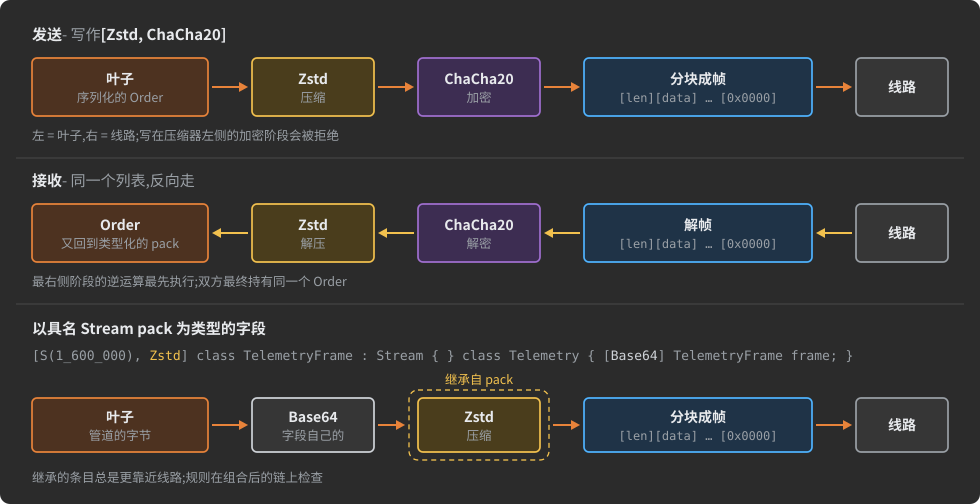

下面这些来自一个真实测试描述的声明,在每种目标上各放了一条链:

```csharp
[Zstd]                                       // 一个 pack:每次传输都被压缩
class Archive {
    public ulong         sequence;
    [D(+200_000)] string text;
    [D(65_536)]   byte[] data;
}

class Vault {
    public ulong sequence;
    [Zstd(6), ChaCha20] Order  secured;      // 以 pack 为类型的字段:以 6 级压缩,再加密
    [Zstd, D(+100_000)] string notes;        // 单个字符串:它的字节就是叶子
    [S(500_000), Zstd]  Stream packed_feed;  // 裸 Stream:管道的字节就是叶子
}

[Zstd(6)]                                    // 一个连接:A 和 B 交换的一切
interface AtoB : Connects<A, B> { /* actors and states */ }
```

AdHoc 自己的协议通过一条只写一次的链([flow](#flows---a-chain-declared-once))压缩它交付的文件,并把它应用到每个携带归档的字段:

```csharp
[Zstd]
public class SrcZip : StreamFlowAttribute { }

public class Result {
    string task;
    [SrcZip] FileEntry.List result;          // 两端仍是 FileEntry.List
}
```

<a id="what-the-generator-produces-for-a-chain"></a>
#### 生成器为链生成什么

字段在生成的代码中保留自己的类型——`Result.result` 是一个 `FileEntry.List?` 属性——它的序列化代码按编号把值交给链:`__src.datatype(2, result_new_item(__src), 4)`。每个连接生成的 `Transmitter` 和 `Receiver` 拥有一个 `Chain` 类,它为连接携带的每条链构建阶段,每条不同的链一个 `case`,设计期参数直接固化其中(节略的 C#):

```csharp
public class Chain : Chunked
{
    // 注入点:池中最多保留 2^5 = 32 条备用的变换阶段发送链。
    public static readonly Pool<Chain> pool = new Pool<Chain>(5, () => new Chain());

    readonly Zstd.Transmitter.Stage Zstd = new Zstd.Transmitter.Stage();

    public AdHoc.Connection.Transmitter.Chunked chain(int _id, Transmitter.BytesSrc _src, Transmitter.BytesSrc datatype)
    {
        switch (_id)
        {
            case 0:                          // [Zstd]
            {
                int level = 3;               // 设计期参数,已固化
                Zstd.Init(_src, level);
                return Init(Zstd, datatype);
            }
            // …此连接每条不同的链一个 case
        }
        return Init(_src, datatype);         // 无阶段:仅分块成帧
    }
}
```

Chain 对象被池化并按流重新就绪:链一次性分配它的阶段,而不是每条消息分配一次。阶段确实自带内存开销:一个 `Zstd` 阶段(发送或接收)和一个接收 `ChaCha20` 阶段各自暂存最多 64 KiB 明文,`Zstd` 阶段还持有一个 zstd 编解码上下文。连接的发送器和接收器在首次需要时从池中取链并一直持有,为每个流重新就绪,直到被关闭。因此已挂起的会话不为它的接收器保留链——会话挂起时接收器已关闭。它的发送器也以同样方式关闭,除非该侧写日志:写日志的一侧保留发送器,包括链,保持丢失发生时的状态(见[会话、保证送达、UDP](#sessions-guaranteed-delivery-udp))。

<a id="where-a-chain-may-sit"></a>
### 链可以放在哪里

| 目标                                                                                    | 可以有链?                                                                                                                                         |
|:----------------------------------------------------------------------------------------|:--------------------------------------------------------------------------------------------------------------------------------------------------|
| 普通 pack                                                                               | 可以:每次传输都被压缩和/或加密,无论独立发送还是作为字段的值                                                                                       |
| 具名 `Stream` pack                                                                      | 可以:以它为类型的字段继承这条链,并与自己的链[组合](#composing-a-conduit-packs-chain-with-the-fields)                                              |
| 以普通 pack 为类型的字段                                                                | 可以                                                                                                                                              |
| 裸 `Stream` 字段,或以具名 `Stream` pack 为类型的字段                                    | 可以;对具名 pack,字段的链与 pack 的链组合                                                                                                         |
| 单个 `string` 字段,普通的或 trim 过的                                                   | 可以:普通字符串自己的编码是叶子;被 trim 的字符串的 UTF-8 形式是切点链路上的叶子(见 [Trims](#trims))                                               |
| 任何连接,物理 `Connects<>` 或虚拟 `VirtuallyConnects<>`                                 | 可以——见[连接上的链](#chains-on-a-connection)                                                                                                     |
| pack 的 `Modify<>` 修饰器                                                               | 可以:它替换目标的链——见[复用描述](#reusing-descriptions)。连接不能被修改                                                                          |
| `File` 字段或 `File` pack,包括以具名 `File` pack 为类型的字段                           | **不可以**——阶段和 trim 一样都不行                                                                                                                |
| pack 或字符串的集合字段:数组、`Map`、`Set`                                              | 可以,阶段:整个集合作为**一个**流经过链,其中的元素没有自己的链(见下文)。不可以 trim                                                               |
| 集合内的 `string` 或 pack:元素、`Map` 键或值、`Set` 元素                                | 只能经由集合字段的链;元素没有自己的链                                                                                                            |
| 基元类型、枚举或 Value Pack 字段                                                        | **不可以**——值就地写入:没有供阶段依附的成帧,也没有供切点移交的边界                                                                                |
| 基元类型、枚举或 Value Pack 的集合                                                      | **不可以**——把集合放进一个 pack,把链放在那个 pack 上                                                                                              |
| `TYPEDEF`                                                                               | **被静默丢弃**——把链写在字段上、提升到 flow 中,或使用具名 `Stream` pack(见[字段与类型](#fields-and-types))                                         |

写在不允许位置的链会让构建停止,并给出原因和出路:

```
A stream transform chain (or a trim) on field '…' is allowed only on a pack-typed field, a bare Stream field,
a string field, or a collection of packs or strings - not on a File / primitive / value-pack field or a
collection of them. Group the data inside a pack and put the chain on the pack.
```

集合字段上的链对整个集合做压缩或加密,而不是逐个元素:只有一个流,压缩器能看到所有元素并找出它们之间的重复,线路上该字段也只有一份
成帧,而不是每个元素一份。持有该字段的 pack 就是这个流的叶子——它从字段开始处把字段写入链,并以同样方式读回,不会为此创建任何
pack。字段的上限仍是集合的上限:`[D(…)]` 限制的是元素,而不是流。

```csharp
class Job {
    [Zstd, D(0xFFFF)] SrcFile[,] files;       // 作业的所有文件在一个 Zstd 流中
    [Zstd, D(+60)] Map<string, Entry> index;  // 键和值在一个流中
}
```

元素在流中没有自己的链。元素所属 pack 上声明的链会被字段的链替换,与以该 pack 为类型的单个字段相同(见下文)。没有自己链的集合
字段,若元素的 pack 有链,则每个元素都经过该 pack 的链。trim 移交的是单个值,因此集合字段上不允许 trim。

以 Value Pack 或枚举为类型的字段会得到专门的消息:这样的值在每种语言中都是就地写入的。要压缩或加密小值,把它们和更多数据一起放进一个普通 pack,把链放在那个 pack 上。(对一个本可成为 Value Pack、只因空值位而不符合条件的 pack 的字段做 trim 是合法的,但会收到警告:流式传输它比直接发送更贵——见 [Trims](#trims)。)

**普通 pack 上的链和以它为类型的字段上的链不会合并。** pack 的链是这个 pack 无论发往哪里的默认链;写在以该 pack 为类型的字段上的链则是那个字段的链。只有管道 pack 会把自己的链合并进字段,因为在那里字段*就是* pack 的成帧——见下一节。普通 pack 确实会交给以它为类型的字段的东西,是它的 trim 的链路(见 [Trims](#trims))。

<a id="composing-a-conduit-packs-chain-with-the-fields"></a>
### 组合管道 pack 的链与字段的链

具名 `Stream` pack 可以携带一条链,以它为类型的字段也可以声明更多。两者作为**一条**链生效:字段的条目更靠近叶子,pack 的条目更靠近线路。这正是两个声明所描述的嵌套——pack 说明它的类型如何到达线路,字段在其中再加一层变换。

```csharp
public class Base64Attribute : StreamStageAttribute { }   // 无角色的自定义阶段

[S(1_600_000), Zstd] class TelemetryFrame : Stream { }

class Telemetry {
    [Base64] TelemetryFrame frame;   // leaf → Base64 → Zstd → wire
}
```

每条链规则都在组合后的结果上检查,所以冲突可能涉及一个在字段自己的声明中根本没出现的阶段。诊断信息会指出另一个阶段来自哪里:

```csharp
class Telemetry {
    [ChaCha20] TelemetryFrame frame;
    // ERROR: The stream chain on …Telemetry.frame encrypts before it compresses: the cipher 'ChaCha20' stands to the
    //        left of the compressor 'Zstd' (inherited from the conduit pack `…TelemetryFrame`).
}
```

继承的条目总是落在字段自己条目的右边。组合无法产生的顺序必须写在一处:把阶段移到 pack 上,或者把它从 pack 上拿掉、把整条链写在字段上。应用到 pack 的 flow 在 pack 处展开,并被整体继承。pack 条目中的 trim 会按 pack 给它的位置传到字段——见 [Trims](#trims)。

**`File` pack 什么都不下传**,因为它什么都不能携带。`File` 是一条单一的长度前缀管道,带一个已提交的总长,没有逐块成帧:阶段没有可依附的东西,改变长度的阶段没有可增长的长度字段,切点没有可以移交字节的块边界。`File` pack 上的阶段或 trim 会在书写处让构建停止:

```csharp
[S(1_110_000), Zstd] class Report : File { }
// ERROR: A transform chain on File pack '…Report' is not allowed - a File is a single length-prefixed conduit with
//        no room for a byte-transform stage, nor a boundary at which a trim could hand bytes over. Inherit `Stream`
//        (chunked), or apply the chain to an ordinary or Stream pack.
```

因此,以具名 `File` pack 为类型的字段始终是 pack 所声明的那条朴素管道,该字段上的链也会被拒绝。要变换或切断一条管道,继承 `Stream`。

<a id="roles-and-the-rules-of-a-chain"></a>
### 角色与链的规则

阶段的**角色**是它派生自的基类。角色让 agent 能认出压缩器和加密算法,并检查它们如何组合:

```
StreamStageAttribute                     any byte transform, no role
├─ StreamCompressionStageAttribute       compression role  →  ZstdAttribute      [Zstd]
└─ StreamCipherStageAttribute            cipher role       →  ChaCha20Attribute  [ChaCha20]
```

新算法原样插入:`Lz4` 压缩器或 `AesCtr` 加密算法派生自角色基类,受到与内置者完全相同的检查。trim 不是阶段:它没有角色,也不计入这些限额(见 [Trims](#trims))。agent 在 flow 展开、继承的条目组合之后,检查每一条链:

| 规则                                                                  | agent 的行为                                                                     |
|:----------------------------------------------------------------------|:----------------------------------------------------------------------------------|
| 每条链至多一个压缩器和一个加密算法                                    | 报错,点名两个阶段及各自的来源                                                   |
| 压缩器站在加密算法的左边                                              | 报错:"encrypts before it compresses"——压缩密文一无所获                            |
| 没有角色的阶段(如 `Base64` 阶段)                                      | 允许出现在链中任何位置                                                            |
| 每个阶段在一条链中至多出现一次                                        | 报错:移除重复项                                                                  |
| 两个同名但类型不同的阶段(`a.Foo` 和 `b.Foo`)                          | 报错:重命名其一——名字是阶段在生成的链中的句柄                                     |
| 含 trim 的链中,不得有名为 `ToStream` 或 `FromStream` 的阶段           | 报错:这两个名字被 trim 占用                                                       |
| 参数名在整条链中唯一                                                  | 报错:所有阶段的参数共享一个扁平作用域                                             |
| 一个参数名,一个类型,跨一个阶段的所有构造函数                          | 报错:重命名其一                                                                  |
| `Zstd` 级别                                                           | 1 到 22 之外报错;高于 12 警告                                                    |
| 连接的链中的 trim                                                     | 报错——见 [Trims](#trims)                                                          |

agent 把它构建的每条链以 Information 级别报告,按数据流顺序,带参数和角色——当链的行为与你的意图不符时,先看这里:

```
stream chain on …Vault.secured (line 12): leaf -> Zstd(level=6)[compression] -> ChaCha20(key=runtime,iv=runtime)[cipher] -> wire  =>  container #3
```

<a id="stage-parameters---design-time-or-runtime-injected"></a>
### 阶段参数——设计期或运行时注入

阶段的构造函数**声明**它需要的参数;agent 读取它们,但从不运行它们。用 AdHoc 类型声明:`Binary` 而不是 `byte`,因为 `byte` 在 Java 中是有符号的,在 C# 中是无符号的,在 TypeScript 中不存在。

区分参数种类的是**它是否得到值**,而不是它的类型:

| 参数           | 你如何声明它                                                                                 | 它的值来自哪里                                                  |
|:---------------|:---------------------------------------------------------------------------------------------|:----------------------------------------------------------------|
| 设计期         | 构造函数默认值(`int level = 3`),或在应用阶段处给出的值(`[Zstd(6)]`)                        | 固化在描述中,由该链的每次使用共享                             |
| 运行时注入     | 已声明,但从不赋值(例如 `Binary[,] key`)                                                    | 由你的代码在运行时通过生成的代码提供                            |

- **任何已声明却没有值的参数都成为运行时钩子,无论它的类型是什么。** 你可以用普通的非空类型声明它,然后干脆不赋值;生成器会把它变成可为空。
- **agent 读取所有构造函数的并集。** 缓冲区形状的运行时参数(`Binary[,]` 密钥或 nonce)不能作为特性实参,所以把它放进一个单独的构造函数重载:你应用的形式保持简短,重载声明形状。
- **每个已声明的参数都到达两侧。** 每个参数都成为生成的阶段的常量,在发送方和接收方都是;阶段的实现决定它使用什么。`Zstd` 的 `level` 只对编码器重要——zstd 流是自我描述的——解码器忽略它。

```csharp
public class Lz4Attribute : StreamCompressionStageAttribute {
    public Lz4Attribute(int level = 1) { }                    // 设计期:1,或 [Lz4(3)]
}

public class AesCtrAttribute : StreamCipherStageAttribute {
    public AesCtrAttribute() { }                              // 你应用的形式:[AesCtr]
    public AesCtrAttribute(Binary[,] key, Binary[,] iv) { }   // 声明运行时注入的密钥和 iv
}
```

密钥和 nonce 是秘密:把它们声明为运行时注入的形状,绝不要作为描述中的值。

<a id="flows---a-chain-declared-once"></a>
### Flow——只声明一次的链

**flow**(命名链)是一条有名字的链:一个派生自 `StreamFlowAttribute` 的类,其特性就是各阶段,按数据流顺序排列。使用时按名字把它当作一个特性来应用;目标的类型不变。

```csharp
[Zstd(6), ChaCha20]
public class CipherAndFastCompress : StreamFlowAttribute { }

class Orders {
    [CipherAndFastCompress] Order payload;   // 仍是 Order:叶子 → Zstd(6) → ChaCha20 → 线路
}
```

- **flow 就地展开**,无论应用在哪里——字段、pack、连接,或以命名 `Stream` pack 为类型的字段整体继承该 pack 各条目时。链规则在展开后的结果上检查。
- **flow 列出的是阶段,而不是其他 flow。** 代理不会展开列在另一个 flow 里的 flow,因此它的阶段会从链中缺失。要列出阶段本身。
- **flow 可以包含一个 trim**,这会把 flow 的每次使用都固定到该 trim 命名的端点上。只有当 flow 本身就是一条存储并回放的管线时才这样做;对于通用链,把 trim 写在链被应用的地方——见 [Trims](#trims)。
- **flow 命名一种格式。** AdHoc 自己的 `SrcZip` 的文档写的就是"文件归档的线上格式,以及定义它的唯一位置":改动它,之前存储的每个归档会同时全部无法解码。只要已存储的数据还必须保持可读,就在旧 flow 旁边声明一个新 flow,而不是去编辑它。

相同的链只生成一次:同一组阶段、同样的参数值、同种类型的目标,无论用多少次,都共享一个生成的链(上文 `Chain` 类的一个 `case`)。内联写了不止一次的一条链,会以 Information 级别的建议报告出来,建议你把它命名为 flow。

<a id="built-in-stages---zstd-and-chacha20"></a>
### 内置阶段——Zstd 与 ChaCha20

两个内置阶段都在运行时库中完整实现:你不需要编写任何编解码器。加密算法仍然需要它的密钥——见[加密算法的密钥](#keys-of-a-cipher)。

| 阶段                      | 角色   | 声明                                                                                                                                                            | 作用                                                                                                                                                                                                                      |
|:--------------------------|:-------|:----------------------------------------------------------------------------------------------------------------------------------------------------------------|:--------------------------------------------------------------------------------------------------------------------------------------------------------------------------------------------------------------------------|
| `[Zstd]`, `[Zstd(level)]` | 压缩   | `ZstdAttribute(int level = 3)`,可用于字段、类或接口,一次                                                                                                       | Zstandard;`level` 取 1 到 22,默认 3(zstd 自己的默认值);只编码;绝不用于 `File` 之上。C# 阶段使用 ZstdSharp.Port 包。                                                                                                  |
| `[ChaCha20]`              | 加密   | `ChaCha20Attribute()` 和 `ChaCha20Attribute(Binary[,] key, Binary[,] iv)`,可用于任何目标,一次;第二个构造函数声明密钥和 nonce 的形状                            | ChaCha20(RFC 8439):256 位密钥、96 位 nonce、20 轮;密钥流 XOR——逐字节推进,可跨块和套接字填充恢复,无填充、无块对齐,两个方向是同一个操作。在各目标语言的运行时中实现。                                                  |

*流*加密算法适合分块阶段,因为它是密钥流 XOR:任意块大小、无块对齐、可恢复,两个方向操作相同。

<a id="what-zstd-and-chacha20-guarantee"></a>
#### Zstd 与 ChaCha20 的保证

- **`[Zstd]` 是无损的。** 接收方拿回的正是发送方叶子产出的字节;zstd 流自带解码器所需的一切,因此接收方不需要任何配置。
- **`[ChaCha20]` 只提供机密性——没有完整性,没有认证。** 没有密钥,字节就不可读。但被改动的密文会解密成不同的字节,而阶段不会报告任何异常:篡改不会被发现。如果你需要完整性,自己加一个对字节做认证的阶段(例如对整条流计算 MAC),或者依赖[加密算法的密钥](#keys-of-a-cipher)中描述的加密传输层:它的 ChaCha20-Poly1305 记录是带认证的,但只在每条物理连接上。因此,一条穿过中继的端到端 `[ChaCha20]` 链能阻止中继**读取**负载;却不能阻止中继**篡改**它而不被发现。
- **一个(密钥, nonce)对绝不能加密两条流。** 在同一密钥下复用 nonce 会泄露两个明文的 XOR。逐 pack 形式会为每个 pack 自行取一个新 nonce;而对于连接流上的链,你注入的密钥和 nonce 必须对每条流都是新的。

<a id="when-to-compress-and-at-which-level"></a>
#### 何时压缩、用哪个级别

把压缩器放在字节**已知存在冗余**的地方——文本、元数据、重复的标识符、日志——而不要放在负载是不透明应用数据的 pack 上:blob、密钥、UUID、计数器、应用已经压缩过的文档。链对穿过它的每条消息都有开销——一个编解码上下文、一个帧头、一次刷新、每侧各两次编解码调用——而节省取决于数据,不透明字节什么也给不了。负载不透明的协议更适合把链放在**连接**上:部署方在了解数据时才添加它,开销是每条连接一帧,而不是每条消息一帧。

为线路而不是为归档挑选 `Zstd` 级别:

| 级别     | 用途                                                                                                                                                                                     |
|:---------|:-----------------------------------------------------------------------------------------------------------------------------------------------------------------------------------------|
| 1 到 6   | 线路级别;1 到 3 以每秒数百 MB 运行,已经能把一页行数据压到约五分之一大小;单独的 `[Zstd]` 就是 3                                                                                        |
| 7 到 12  | 压缩比再提高几个百分点,CPU 消耗却翻几倍                                                                                                                                                 |
| 13 到 22 | 静止文件的归档设置:20 级压缩速度约 10 MB/s,在一次实测基准中,它后面一条 256 KiB 的回复花了发送线程 25 ms;超过 12 时代理会警告                                                          |

<a id="short-packs-go-uncompressed"></a>
### 短 pack 不压缩

压缩器对一帧无论多短都要花微秒级的时间,而短 pack 几乎压不小。因此代理会把压缩阶段**从不可能变长的 pack 的链上取下**,并在警告中说明,指出该 pack 及其上界。其他阶段保留:这样的 pack 上的 `[Zstd, ChaCha20]` 变成 `[ChaCha20]`。两端得到同一条链——一个 pack 只有一条。

```
The pack …Ping (line 40) is 23 bytes at most: the compression Zstd is taken off it, the rest of its chain stays.
```

上界按序列化后 pack 可能达到的最长长度计算,口径宽松:每个字段按其声明宽度,另加空值位和长度的空间;字符串按每字符三字节;集合按其声明的或[默认](#fields-and-types)最大长度;嵌套 pack 按其自身的上界。没有上界的 pack 保留压缩:本身是或包含 `Stream` 或 `File` 的 pack、有字段自带链或被 trim 切断的 pack、包含自身的 pack。包含 trim 的链也保留压缩——切点交出的内容由其周围的阶段定义。

1024 字节及以下的 pack 不压缩。用 `_DefaultMaxLengthOf.Uncompressed` 设置其他长度;`0` 表示压缩所有 pack:

```csharp
enum _DefaultMaxLengthOf {
    Uncompressed = 4096,   // 不可能长于 4096 字节的 pack 不压缩
}
```

该规则适用于 pack,包括采用[保证送达 pack 的连接](#per-pack-chains-on-connections-that-guarantee-packs)的链的 pack。字段上的链,以及连接在其流上运行的链,保持原样。

<a id="keys-of-a-cipher"></a>
### 加密算法的密钥

`[ChaCha20]` 的密钥来自哪里,取决于链包裹的是什么:

| 链所在的位置                                                                              | 密钥与 nonce                                                                                                                                                                                                                 |
|:------------------------------------------------------------------------------------------|:-----------------------------------------------------------------------------------------------------------------------------------------------------------------------------------------------------------------------------|
| pack 或字段,或保证送达 pack 的连接(其链逐 pack 应用)                                   | **会话**的密钥:阶段在每个 pack 前面明文写入 12 字节——4 字节的密钥 id 和 8 字节的序号;pack 的 nonce 是密钥的基础 nonce 与序号的 XOR,因此每个 pack 都能独立解密                                                              |
| 连接的流                                                                                  | 由你的代码在两个端点于运行时注入,每条流一次                                                                                                                                                                                  |

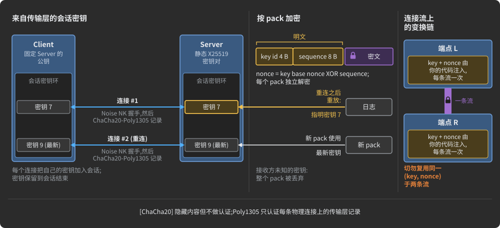

**会话的密钥来自其传输层的握手**,因此 pack 要加密的连接需要加密的传输层。拥有静态 X25519 密钥对的监听主机会加密它接受的每条连接——TCP 或 WebSocket,`ws://` 或 `wss://` 都一样:先 Noise NK 握手,然后对每条记录或数据报做 ChaCha20-Poly1305。客户端连接时固定服务器的公钥。没有服务器密钥,传输层就不加密,也没有任何开销。这类连接的生成示例使用为它们制作的密钥对:换成你自己的,并把私钥留在代码之外。

| 运行时     | 服务器                                  | 客户端                          | 密钥对                               |
|:-----------|:----------------------------------------|:--------------------------------|:-------------------------------------|
| C#         | 监听前 `server.key = secret;`           | `ConnectAsync` 的最后一个实参   | `X25519.KeyPair(secret, pub)`        |
| Java       | 监听前 `server.key = secret;`           | `connect` 的最后一个实参        | `X25519.keyPair(secret, pub)`        |
| TypeScript | -                                       | `connect` 的最后一个实参        | `Crypto.X25519.keyPair(secret, pub)` |

**会话的每条连接都把自己的密钥加入会话**,pack 指明它加密所用的密钥。新 pack 使用最新的密钥;重连后从日志回放的 pack 用它写入时所在连接的密钥解密。密钥一直保留到会话结束。接收方没有某 pack 的密钥——即接收方已丢失会话——则整个丢弃该 pack,而 [Resumable](#sessions-guaranteed-delivery-udp) 无论如何都会把它计为丢失。

**没有加密传输层,会话就没有密钥**,pack 加密算法拒绝工作:发送这样的 pack 会抛出 "A pack chain with ChaCha20 on a connection without keys: encrypt the connection (a host key, a pinned server key), or add a key to its Transmitter's and Receiver's keys." 自己给会话一个密钥,两边相同,id 不为 0:

```csharp
AdHoc.Connection.Keyring.Seat(connection, new AdHoc.Connection.Keyring.Key(id, key32, nonce12));   // C#
```

Java 和 TypeScript 使用 `Keyring.seat(…)`。

<a id="custom-transform-stages"></a>
### 自定义变换阶段

要加入自己的字节变换,声明一个派生自角色基类——`StreamCompressionStageAttribute` 或 `StreamCipherStageAttribute`——的特性类;无角色的阶段则直接派生自 `StreamStageAttribute`。给它的构造函数加上阶段所需的参数,用 AdHoc 类型,然后像内置阶段一样应用。

```csharp
public class Lz4Attribute : StreamCompressionStageAttribute    // 自定义压缩器,一个设计期参数
{
    public Lz4Attribute(int level = 1) { }
}

public class AesCtrAttribute : StreamCipherStageAttribute      // 自定义加密算法,运行时密钥和 iv
{
    public AesCtrAttribute() { }
    public AesCtrAttribute(Binary[,] key, Binary[,] iv) { }
}

public class Base64Attribute : StreamStageAttribute { }        // 无角色:可位于链中任意位置

class Secured {
    [Lz4(3)]         Order p;   // 设计期:level = 3
    [AesCtr]         Order q;   // 密钥和 iv 在运行时提供
    [Lz4(3), AesCtr] Order r;   // 先压缩,再加密
}
```

生成器为每种阶段类型生成**一个**文件,以特性命名(`Lz4.cs`、`Lz4.java`、`Lz4.ts`):一个带注入点的直通实现,你在注入点放入编码和解码变换——手写或库调用。该文件由使用该阶段的每条链共享,重新生成会保留你的代码(见[部署与智能合并](#deployment-and-smart-merge))。自定义阶段是自定义特性类,但它构成链并改变线路上的字节,这是其他自定义特性不具备的;阶段、flow 和 trim 特性绝不会作为生成的常量发出(见[特性](#attributes))。

<a id="chains-on-a-connection"></a>
### 连接上的链

连接上的链是**传输层级别**的:它不包裹一个字段或一个 pack,而是包裹连接承载的一切——每个 pack、每条流,双向。声明的写法相同,就是写在连接接口上的特性列表。不同的是链能到达多远,而这取决于连接的两个端点在哪里:

| 声明位置                                  | 链的范围                       | 运行于                                                                                       |
|:------------------------------------------|:-------------------------------|:---------------------------------------------------------------------------------------------|
| 物理 `Connects<L, R>`                     | **本跳**:这一条链路            | `L` 和 `R`,两个直接相连的主机;多跳路由的每一跳都需要自己的链                               |
| 虚拟 `VirtuallyConnects<L, R, PATH>`      | **端到端**:整条隧道            | 仅 `L` 和 `R`;`PATH` 上的每个中继都原样转发变换后的字节,不触碰它们                         |

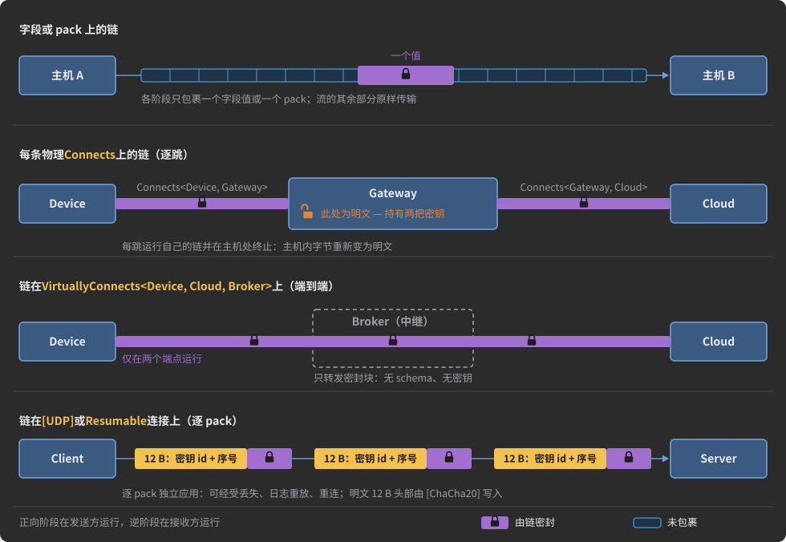

```csharp
public class Base64Attribute : StreamStageAttribute { }

[Base64, Zstd(6), ChaCha20]
interface DirectProducerToConsumerChannel : Connects<XProducer, Consumer> {
    [_____lr_____<(SmallNamedFile, EmptyPayloadStream, Pack1, NestedFramingPack)>]
    struct Direct { }
}
```

`XProducer` 和 `Consumer` 经此链路交换的每个字节都经过自定义 `Base64` 阶段,然后压缩、再加密,到达时还原;其上层的 pack、Actor 和状态机对此毫无察觉。该连接毫无障碍地承载一个 `File` pack(`SmallNamedFile`):流链包裹的是传输层,而不是逐个 pack。

- **跳链在每一跳终止。** 在链路另一端的主机内部,字节又变回明文。这是保护单条链路——设备的无线电段、LAN 网段——的正确工具,却不是把中间层挡在负载之外的工具。要做到后者,把链放在虚拟连接上,其端点才是重要的两台主机;两种链可以叠加。中继的情形见[虚拟连接与中继](#virtual-connections-and-relays)。
- **链作用于连接的传输层,而不是它的内容**,因此带 Actor 和 pack 的结构化连接接受链的方式,与无主体、仅隧道的虚拟连接完全一样:

  ```csharp
  [Zstd(6), ChaCha20] interface DeviceToCloud : VirtuallyConnects<Device, Cloud, Broker> { }   // 穿过 Broker 端到端密封
  ```
- **普通规则仍然成立:** 左是叶子,右是线路;至多一个压缩器和一个加密算法;连接链不得包含 trim。流上加密算法的密钥和 nonce 在两个端点于运行时注入(见[加密算法的密钥](#keys-of-a-cipher))。

<a id="per-pack-chains-on-connections-that-guarantee-packs"></a>
#### 保证送达 pack 的连接上的逐 pack 链

**保证送达 pack 的连接把它的链应用于每个 pack,而不是流。** 这指 `[UDP]` 连接,以及任何带 `Resumable<HOST, PACKS>` 的连接(见[会话、保证送达、UDP](#sessions-guaranteed-delivery-udp))。阶段会跨 pack 保持状态,而该状态经不起丢失的数据报、来自日志的回放——日志保存的是 pack 发出时的样子,已压缩、已加密——或重连。因此代理把连接的链交给它承载的每个 pack,就像写在 pack 上一样,包括未加保护的 pack,并记录哪些 pack 接受了它。

```csharp
[UDP(30 * 60), Zstd(3), ChaCha20]            // GameLink 的每个 pack:各自先压缩,再加密
interface GameLink : Connects<Client, Server> { /* actors and states */ }
```

- **自带链的 pack 保留自己的链。** 当该链缺少连接链的某个阶段时,代理会警告,并指出缺少的阶段。
- **连接的链变成 pack 的链,随 pack 同行。** 一个 pack 若也经由不按 pack 应用链的连接传输,则是错误:把链写在 pack 本身上,或让每条连接各有自己的 pack。一个 pack 被两条逐 pack 链不同的连接承载也是错误:一个 pack 只有一条链。
- **`File` pack 不接受链**,因此这样的连接无法承载它:改成 `Stream` pack,或把链从连接上取下、写在各 pack 上。
- **确定很短的 pack 会被取下压缩阶段**,与[任何 pack](#short-packs-go-uncompressed)一样。
- **加密算法使用会话的密钥**,每个 pack 带 12 字节明文前缀(见[加密算法的密钥](#keys-of-a-cipher))。

<a id="chaining-a-pack-or-a-connection-you-do-not-own"></a>
#### 给不属于你的 pack 或连接加链

从另一个项目导入的 pack,或你不愿改动的 pack,通过修改器获得链:

```csharp
[Zstd] class CompressedLog : Modify<ImportedLogEntry> { }
```

此后该 pack 无论在哪里发送都携带这条链。代理针对目标报告这次替换,给出被移除的特性集和安装的特性集:

```
The attributes of …ImportedLogEntry are replaced by the modifier …CompressedLog (line 31): [] -> [Zstd]
```

修改器的特性替换目标的整个特性集,因此目标必须保留的其他每个特性都要写在同一个修改器上。被替换的链是线路格式的一部分,按旧链存储的数据仍然绑定于它。见[复用描述](#reusing-descriptions)。

不属于你的连接不能用这种方式加链:AdHocAgent 拒绝连接修改器(`interface M : Modify<ImportedConnection>`),因此导入的连接保留其项目声明的链。要压缩或加密穿过它的内容,如上所述,用 pack 修改器给它承载的 pack 加链。

<a id="transform-chain-rules-at-a-glance"></a>
### 变换链规则一览

| 规则     | 细节                                                                                                                                                                                                                                                                                                          |
|:---------|:--------------------------------------------------------------------------------------------------------------------------------------------------------------------------------------------------------------------------------------------------------------------------------------------------------------|
| 方向     | 数据流顺序:左是叶子,右是线路;`[Zstd, ChaCha20]` 即 `leaf → Zstd → ChaCha20 → wire`,先压缩后加密。压缩器左侧的加密算法会被拒绝。                                                                                                                                                                            |
| 目标     | 普通 pack、命名的 `Stream` pack、pack 类型的字段、裸 `Stream` 字段、`string` 字段、pack 或字符串的集合字段(整个集合一个流)、任何连接、pack 的 `Modify<>` 修改器。绝不能是 `File` 字段或 pack、基元类型、枚举或 Value Pack 字段及它们的集合;`TYPEDEF` 上的链会被丢弃。                                                                    |
| 角色     | 至多一个压缩器和一个加密算法;无角色阶段可位于任意位置;每个阶段一次;阶段名唯一;参数名在整条链上唯一。                                                                                                                                                                                                      |
| 组合     | 以命名 `Stream` pack 为类型的字段:字段的阶段靠近叶子,pack 的阶段靠近线路,作为一条链检查。普通 pack 的链不并入字段的链。                                                                                                                                                                                    |
| 参数     | 带值(默认或应用时给出)的参数是设计期的;不带值的参数在端点于运行时注入,无论其类型;每个参数都到达两端。                                                                                                                                                                                                    |
| Flows    | 一条命名链,作为一个特性应用;就地展开;列出阶段而非 flow。相同的链共享一个生成的链。                                                                                                                                                                                                                          |
| 短 pack  | 上界不超过 `_DefaultMaxLengthOf.Uncompressed`(默认 1024 字节;0 = 关闭)的 pack 失去其压缩阶段,并给出警告。                                                                                                                                                                                                  |
| 密钥     | 逐 pack 链使用会话密钥,带 12 字节明文前缀;连接上的流链使用运行时注入的密钥和 nonce。`[ChaCha20]` 隐藏内容;不做认证。                                                                                                                                                                                       |
| 连接尺度 | 物理 `Connects<>` 上的链包裹该跳承载的一切;`VirtuallyConnects<>` 上的链穿过中继端到端运行;`[UDP]` 或 `Resumable` 连接上的链应用于每个 pack。                                                                                                                                                                  |
| Trims    | 见 [Trims](#trims) 的规则。                                                                                                                                                                                                                                                                                   |

---

<a id="trims"></a>
## Trims

*模型:项目 → 主机 → **连接链路**(一个发送主机经一条连接)→ pack → **字段 → 变换链 → 切点** → 线路字节*

**trim** 是一个特性——`[ToStream<E>]`、`[FromStream<E>]` 或 `[Stream<To, From>]`——它让一条链路的一侧把负载以**原始字节**而非类型化对象的形式持有。存储、转发或回放负载的主机借此完成工作:不解析负载,不重新序列化,也不需要它的 schema。

本章使用四个术语,每个概念一个名字:

| 术语             | 含义                                                                                                                            |
|:-----------------|:--------------------------------------------------------------------------------------------------------------------------------|
| **leg(链路)** | 一条连接的一个方向:一个发送主机和它发送所用的连接                                                                              |
| **endpoint(端点)** | 命名一条链路的声明:`IfSendingFrom<Host, Connection>`                                                                          |
| **trim**         | 该特性(`ToStream`、`FromStream`、`Stream<To, From>`)                                                                          |
| **cut(切点)** | trim 在负载变换链中所处的位置;在它命名的链路上,解包在那里停止(或开始)                                                        |

<a id="why-a-stored-payload-needs-a-trim"></a>
### 为什么存储的负载需要 trim

序列化的 pack 是它的 pack id 后跟首尾相接的各字段(见[值如何变成字节](#how-values-become-bytes))。没有头部说明它有多长:只有逐字段走一遍的解析器才能找到 pack 的结尾。因此中间的主机——消息代理、缓存、归档——无法保存、转发或跳过它未解析的 pack。而当负载带有[变换链](#transform-chains)时,链是对称的:发送方压缩和加密什么,接收方就完整解密和解压什么,两端持有同一个对象。对于职责是**保存**负载的主机,这错了两层:它要对每条消息解密、解压、之后再重新编码——结果却被丢弃——而且它需要一套自己根本用不上的密钥和 schema。

trim 在存在这些问题的链路上同时解决两个问题:

- 它为负载成帧,无需解析即可找到结尾——与流相同的分块 `[len][data]…[0]` 成帧(见[流](#streams)),或对字符串加长度前缀;
- 在它命名的链路上,它在你选择的链深度处把负载作为不透明字节交出。

其他所有地方,该字段仍是两端带类型化值的普通字段。

<a id="naming-the-leg-endpoints"></a>
### 命名链路:端点

端点是一个经由连接的源主机:

```csharp
// IfSendingFrom<fromHost, viaConnection>
interface FromCamera   : IfSendingFrom<Camera, CameraToRecorder> { }   // 命名端点
interface FromRecorder : IfSendingFrom<Recorder, RecorderToViewer> { }
```

`fromHost` 必须是主机(`struct : Host`);`viaConnection` 必须是连接——`Connects<L, R>` 或 `VirtuallyConnects<L, R, PATH>`。因为虚拟连接也是连接,切点可以在隧道链路上触发,与在物理链路上完全一样;隧道的中继无论哪种情况都看不到负载(见[虚拟连接与中继](#virtual-connections-and-relays))。

多个端点组成**端点集**:一个派生自 `_<…>` 的接口,其元素是端点——裸 `IfSendingFrom<…>`、命名端点或另一个端点集,单独或组成元组。元素是 pack 的 `_<…>` 是 [Pack Set](#pack-sets);代理按元素区分两者。

trim 的实参接受四种写法,它们都解析为同一个链路列表:

| 写法             | 示例                                                                                                                                                            |
|:-----------------|:----------------------------------------------------------------------------------------------------------------------------------------------------------------|
| 内联端点         | `[ToStream<IfSendingFrom<Camera, CameraToRecorder>>]`                                                                                                           |
| 命名端点         | `[ToStream<FromCamera>]`,配合 `interface FromCamera : IfSendingFrom<Camera, CameraToRecorder> { }`                                                              |
| 命名端点集       | `[ToStream<AnySource>]`,配合 `interface AnySource : _<(FromCamera, FromRecorder)> { }` 或 `interface CameraOnly : _<IfSendingFrom<Camera, CameraToRecorder>> { }` |
| 使用处的元组     | `[ToStream<(FromCamera, FromRecorder)>]`                                                                                                                        |

trim 特性不约束其类型实参(C# 元组无法满足约束),因此由代理检查。任何不属于这些形式的内容都会停止运行:

```
The ToStream trim on … names '…', which is not an Endpoint. Expected `IfSendingFrom<Host, Connection>`, an interface declaring one,
a named Endpoint Set, or a tuple of those — e.g. `(FromProducer, FromBackup)`.
```

**端点命名一条链路,绝不是通道。** `IfSendingFrom<Camera, CameraToRecorder>` 只覆盖 Camera → Recorder。同一连接的反向链路 Recorder → Camera 未被命名,保持普通的类型化形式。因此被 trim 的字段在一台主机上通常是不对称的:Recorder 以原始字节接收该字段;若它把同一个 pack 发回 Camera,则以类型化形式发送。

**连接到自身的主机。** 在 `interface Mesh : Connects<Node, Node>` 上,主机在两条链路上都发送——既作为呼叫方(Left,拨号的一侧),也作为接受方(Right)(见[连接](#connections))。`IfSendingFrom<Node, Mesh>` 命名**两条**链路;代理把它们记录为两个端点:`Node_via_Mesh`(Left)和 `Node_via_Mesh_R`(Right)。没有只命名其中一条的写法。

**端点必须能够触发。** 每个端点的主机必须是其连接的一方。不满足的元素被跳过并给出警告;当没有可用端点剩下时,运行停止——永远不可能发生的切点是错误,而不是静默的空操作:

```
WARN   The ToStream trim on … (line …) names IfSendingFrom<Viewer, CameraToRecorder>, but Viewer is not a participant of
       CameraToRecorder; that endpoint is skipped.
ERROR  The ToStream trim on … (line …) resolves to no usable endpoint, so the cut could never happen. Name an endpoint whose host
       actually participates in its connection.
```

<a id="the-three-trims-and-who-holds-what"></a>
### 三个 trim 与谁持有什么

| Trim                 | 当命名的端点发送时……                                                                                                        |
|:---------------------|:----------------------------------------------------------------------------------------------------------------------------|
| `[ToStream<E>]`      | **发送方**序列化一个类型化值;**接收方**在切点处停止解包,拿到原始字节                                                    |
| `[FromStream<E>]`    | **发送方**在切点处提供原始字节(来自存储,来自另一个套接字);**接收方**重建出类型化值                                      |
| `[Stream<To, From>]` | 在链的**同一**位置上,对 `To` 的链路施加 `ToStream`,对 `From` 的链路施加 `FromStream`                                     |

三者都声明为 `[AttributeUsage(Field | Class, AllowMultiple = false)]`:trim 写在字段或 pack 上。

以 `E = IfSendingFrom<HostA, ConnectionAB>` 为例,逐链路看:

| 声明                        | 在 `E` 命名的链路上:发送方持有           | 接收方持有                              | 在其他每条链路上     |
|:----------------------------|:-----------------------------------------|:----------------------------------------|:---------------------|
| `MyPack p;`                 | `MyPack`                                 | `MyPack`                                | 两端都是 `MyPack`    |
| `[ToStream<E>] MyPack p;`   | `MyPack`                                 | 原始字节                                | 两端都是 `MyPack`    |
| `[FromStream<E>] MyPack p;` | 原始字节                                 | `MyPack`                                | 两端都是 `MyPack`    |
| `[Stream<E, E2>] MyPack p;` | `MyPack`(链路 `E`)、原始字节(链路 `E2`) | 原始字节(链路 `E`)、`MyPack`(链路 `E2`) | 两端都是 `MyPack`    |


**每条链路上的线路都相同。** 对 pack 负载来说,trim 是逐链路的代码生成决策,而不是线路格式决策:`[ToStream<E>] MyPack p;` 的字节在命名的链路上和其他每条链路上完全相同。改变的是哪一侧物化出对象——也即哪一侧需要负载的 schema。生成器只在主机物化负载之处把负载的类型给该主机:在原始字节一侧,字段不引入负载类型的任何代码(如果主机处理的其他内容用到该类型,它仍会得到该类型)。被 trim 的 `string` 是唯一的例外:它在被切断的链路上改变编码(见[被 trim 的字符串](#trimmed-strings))。

**被 trim 的负载不可中断。** 穿过切点的是一个完整的序列化值;被截断的值会给之后解码它的人留下一个破碎的对象。

**trim 与链正交。** 写在同一声明上的阶段在**每条**链路上运行;trim 只决定在它命名的链路上解包在哪里停止(见[在选定深度切断链](#cutting-a-chain-at-a-chosen-depth))。

<a id="writing-a-trim-on-a-field-or-on-a-pack"></a>
### 在字段或 pack 上书写 trim

写在**字段**上时,trim 只作用于该字段:

```csharp
public class RecordSnapshot {
    [ToStream<FromCamera>] public Snapshot snapshot;   // 在 FromCamera 未命名的每条链路上仍是 Snapshot
}
```

写在 **pack** 上时,切点随类型一起走。它作用于 pack 到达的每一处:每个以它为类型的字段、单独发送的 pack 本身,
在本项目中如此,在每个导入它的项目中也是如此。当负载从不单独发送、且没有任何单个字段能承载这个切点时,就写在这里——
例如许多字段都以它为类型,或者字段属于你不拥有的 pack:

```csharp
[Zstd, ToStream<FromRouter>]        // FromRouter : IfSendingFrom<Router, RouterToLogger>
public class LogEntry {
    long   at;
    string note;
}

public class ToLogger   { string tag; LogEntry entry; }   // 列在 RouterToLogger 上
public class ToConsumer { string tag; LogEntry entry; }   // 列在 RouterToConsumer 上
```

**决定权在链路,不在类型。** agent 会把 pack 级切点记录在每个以该 pack 为类型的字段上,然后逐链路地询问每个字段。
`ToLogger.entry` 以原始的、仍是压缩字节的形态穿过 Router → Logger。`ToConsumer.entry` 在 `RouterToConsumer`
的两段链路两端都是有类型的 `LogEntry`——照常压缩与解压——尽管同一台主机在那里发送了同样的负载:切点命名的是
logger 链路,而不是 Router。

当一个类型要走过多条需求不同的链路时,保持类型干净,把 trim 写在每个承载它的字段上。AdHoc 自己的协议就是这样处理
其文件归档的:`FileEntry.List` 不携带任何链和 trim,每个承载它的 pack 都在自己的字段上声明该链路需要什么。

**trim 可以写在哪里。** trim 可接受的位置与[阶段](#transform-chains)相同,因为两者都是同一个列表的条目。
唯一分道扬镳的目标是连接:连接可以携带链,永远不能携带 trim。

| 目标                                                            | 允许 trim?                                                                                                                     |
|:----------------------------------------------------------------|:------------------------------------------------------------------------------------------------------------------------------|
| 以 pack 为类型的字段                                             | 允许                                                                                                                           |
| 裸 `Stream` 字段、以具名 `Stream` pack 为类型的字段               | 允许([具名 Stream pack 上的 trim](#trims-on-named-stream-packs))                                                               |
| 单个 `string` 字段                                               | 允许([被 trim 的字符串](#trimmed-strings))                                                                                     |
| 除 `File` pack 之外的任何 pack                                   | 允许                                                                                                                           |
| `File` 字段或 `File` pack                                        | 不允许——一个已提交的长度前缀不留下任何可以移交字节的块边界,而且 `File` 负载在两端反正都是原始字节                                |
| 基元类型、枚举或 Value Pack 字段                                  | 不允许——每种语言都就地写入它:没有供阶段使用的成帧,也没有供切点使用的边界                                                          |
| 数组、列表、`Map` 或 `Set`,以及其中的字符串                        | 不允许——把数据组织进一个 pack,再 trim 这个 pack                                                                                 |
| 连接,物理的或虚拟的                                               | 不允许——见下文                                                                                                                  |
| 一个 `TYPEDEF`                                                   | 被静默丢弃——见 [trim 的陷阱](#trim-pitfalls)                                                                                    |

**永远不写在连接上。** 写在 `Connects<>` 或 `VirtuallyConnects<>` 上的链会包裹链路承载的一切,而"端点持有原始字节而不是
对象"恰恰就是中继本身。写在连接接口上时,trim 甚至无法编译:三个 trim 特性只为字段和类声明。包含 trim 的
[flow](#trims-inside-flows) 仍然可能被应用到连接上;此时 agent 会中止本次运行:

```
The chain on connection '…' carries a trim. A trim cuts the chain of one field or one pack; a connection chain wraps everything the link
carries, where an endpoint holding raw bytes is simply a relay. Move the trim onto the pack (or field) whose payload the endpoint should keep opaque.
```

<a id="what-the-generator-produces-on-a-cut-leg"></a>
### 生成器在切点链路上产出什么

切点链路的有类型一侧,生成就如同普通字段。原始字节一侧得到的是 `Stream` 通道字段所得到的东西([流](#streams)):
一个以字段命名的方法,它接受正在被服务的连接的 `Transmitter` 或 `Receiver`(即 `scope`),并返回字节数据源或数据汇。
数据汇随着字节到达而被喂入,数据源随着套接字排空而被读取,因此任何一侧都不会把整个负载留在内存中。

在 `FromStream` 端点处**发送**的主机上,pack 变成抽象的,由你提供字节。AdHoc 的监控后端在其 `BytesTime` pack 中声明了
`[FromStream<TelemetrySenders>] public CPU bytes;`;为其发送方生成的 C# 代码是:

```csharp
public abstract partial class BytesTime : AdHoc.Connection.Transmitter.BytesSrc
{
    public Monitoring.SecondsADay time { get; set; }

    protected abstract System.IO.Stream bytes_(AdHoc.Connection.Transmitter scope);   // 一个 CPU 样本存储的字节
    protected abstract bool _bytes_hasValue(AdHoc.Connection.Transmitter scope);       // false:字段为 null
    …
}
```

在 `ToStream` 端点处**接收**的主机上,由你提供数据汇。对于 AdHoc 自己的 `Project.source`
(`[SrcZip, ToStream<IfSendingFrom<Agent, Communication>>] FileEntry.List source;`),为 Server 生成的 Java 代码
(Server 把它的 pack 实现为接口)是:

```java
public interface AdHocProtocol_Agent_Project extends AdHoc.Connection.Receiver.BytesDst, … {
    // 压缩归档的去处:Server 存储它,从不解析它
    java.nio.channels.WritableByteChannel _source_(AdHoc.Connection.Receiver scope);
    …
}
```

在 Java 中,数据源是 `ReadableByteChannel`,数据汇是 `WritableByteChannel`;在 C# 中,两者都是 `System.IO.Stream`。

<a id="one-wire-form-per-host-and-direction"></a>
#### 每台主机、每个方向只有一种线上形态

一个 pack 在每台主机上有一个序列化器和一个解析器,由该主机发言的每条连接共享。而 trim 命名的是一条链路,粒度更细。
只要主机在它走过的每条链路上都以同一种形态接收某个被 trim 的字段,两者就相安无事。当它们发生冲突——同一台主机、同一个
方向、在一条连接上被切、在另一条连接上是普通形态——就只能生成一种形态,另一条链路会静默地读或写错误的字节。agent
拒绝这种情况,并逐链路地画出每一处冲突:

```
The protocol description is refused: 1 trimmed field of 1 pack would need TWO different wire forms on the same host ( 1 conflict ).
```

报告末尾为每个 pack 给出三种修复办法,名字取自你自己的 pack 和链路:

1. 只在被 trim 的地方发送这个 pack——把它从在普通链路上列出它的集合中拿掉;
2. 给每条链路配自己的载体 pack——被 trim 的链路用带 trim 的那个,其余链路用不带 trim 的副本;
3. 在主机走过这个字段的每条链路上都 trim 它——扩大端点集合。

对于非字符串负载,只有持有原始字节的一侧可能发生冲突:`ToStream` 的接收方、`FromStream` 的发送方。
`string` 在其切点链路的**两端**都会改变形态,因此对字符串来说,任何切点对发送方和接收方都算数。
两个端点命名**不同**发送主机的"存储并回放"组合本身并不冲突:存储在一条链路上是接收方,在另一条链路上是发送方。

<a id="trimmed-strings"></a>
### 被 trim 的字符串

被 trim 的负载可以是 `string`,带有同样的逐链路不对称性。文本会改变两件事:

- **成帧。** 字符串在内存中是完整的,因此它的长度在第一个字节发出之前就已知。在切点链路上,字符串以 `File`
  成帧方式传输:一个 varint 总长度,然后是字节。原始字节一侧在第一个负载字节之前就知道总量,可以立即拒绝过大的负载。
  与任何 `File` 成帧的负载一样,这个传输不可中断。
- **编码。** 在 pack 内部,字符串以 varint 编码的字符传输,因为两端都是生成的代码。在切点链路上,它以 **UTF-8**
  传输,在该链路的两端都是如此,因为原始一侧会把它交给不是 AdHoc 代码的东西:存储可以把它落盘为 `.txt` 文件,
  生成器输出的源文本也可以随着流入直接写到磁盘。

| 声明                        | 在 `E` 命名的链路上:发送方持有 | 该链路上的线上形态 | 接收方持有                 | 其余每条链路      |
|:----------------------------|:-------------------------------|:-------------------|:---------------------------|:------------------|
| `[ToStream<E>] string s;`   | `string`                       | `[totalLen][UTF-8]` | 原始 UTF-8,总量预先已知    | 普通字符串        |
| `[FromStream<E>] string s;` | 原始 UTF-8                     | `[totalLen][UTF-8]` | 解码后的 `string`          | 普通字符串        |
| `[Stream<E, E2>] string s;` | 按链路,如上                    | `[totalLen][UTF-8]` | 按链路,如上                | 普通字符串        |

```csharp
public class RecordSubtitles {   // Camera → Recorder:存储归档它从不解码的 UTF-8 文本
    [D(+100_000), ToStream<IfSendingFrom<Camera, CameraToRecorder>>] public string subtitles;
}

public class ReplayLog {         // Recorder → Viewer:从磁盘流式读取,接收为字符串
    [D(+5_000_000), FromStream<IfSendingFrom<Recorder, RecorderToViewer>>] public string log;
}
```

AdHoc 的代码生成服务以同样的方式把每个生成的源文件发给它的测试主机:文件的文本是一个
`[D(+5_000_000), ToStream<…>] string`,于是接收主机把 UTF-8 字节随到达随写盘。

被 trim 字符串的规则:

- 字符串的普通长度上限约束每一条链路:默认 255 个字符,逐字段用 `[D(+N)]`,整个项目用 `_DefaultMaxLengthOf.Strings`
  ([字段与类型](#fields-and-types))。`[S(N)]` 不适用。
- `FromStream` 字符串的接收方会校验字节:非法 UTF-8(过长形式、被编码的代理项、超出 U+10FFFF 的码点)会抛出异常,
  如同违反 `[S(N)]` 一样。
- `null` 字符串在任何链路上都不会被传输。
- 链可以叠在被 trim 的字符串上。`[ToStream<E>, Zstd] string s;` 会在切点链路上压缩 UTF-8 字节;因为链的输出长度无法
  预先知道,链的分块成帧在那里取代 `File` 成帧。其余每条链路都运行同一条 Zstd 链,两端都是 `string`。

<a id="cutting-a-chain-at-a-chosen-depth"></a>
### 在选定的深度切开一条链

写在链的[阶段](#transform-chains)之间时,trim 是一个标记,用来挑选切点的深度。这个列表按数据流顺序读,
叶子在左,线上在右:

```csharp
[Zstd, ToStream<FromProducer>, ChaCha20] public class Event { long at; string topic; }
```

在标记所命名的链路上,它**右边**的一切——朝向线上的方向——照常运行;它**左边**的一切——剩下的阶段和 pack 自身的
序列化——被跳过,负载以不透明字节的形态跨过这个边界:

- `[ToStream<E>]` —— 当 `E` 发送时,接收方逆序运行标记右边的阶段(这里是 `ChaCha20⁻¹`),然后停下;它持有压缩后的字节。
- `[FromStream<E>]` —— 当 `E` 发送时,发送方在标记处注入字节,只有它右边的阶段运行。
- `[Stream<To, From>]` —— 两者皆是,在同一深度。

链本身不依赖切点:在标记未命名的每条链路上,它完整运行,两端都是有类型的值。移动链内标记的位置,改变的是被切主机
要运行链的多大一部分,永远不改变其他链路做什么。

**位置 0 是叶子。** 位于所有阶段之前的标记,在负载本身处切开:在被命名的链路上,接收方运行整条逆链,恰在物化之前
停下,持有普通序列化的 pack。阶段列表也可以为空:`[ToStream<E>] Payload p;` 是在没有链的位置 0 处的切点——普通
序列化的负载以不透明字节跨过。这是日常形态,也是本章前半部分使用的形态。

**trim 不是变换。** 它没有角色、没有参数,也不为它生成任何东西。它不计入一个压缩器/一个加密算法的上限,不参与
"压缩器先于加密算法"的规则,可以站在任何位置:两个阶段之间,或者任一端。

<a id="the-depth-decides-what-the-store-must-run"></a>
#### 深度决定存储必须运行什么

标记的位置决定切点处的主机必须实现流程的多大一部分。对于链为 `[Zstd, ChaCha20]` 的 pack,以及只有压缩器的链:

| 声明                                | 存储保留下什么                 | 它运行什么              | 它必须持有什么       |
|:------------------------------------|:-------------------------------|:------------------------|:---------------------|
| `[Stream<To,From>, Zstd, ChaCha20]` | 普通序列化的 pack              | 整条逆链                | 密钥和每个阶段       |
| `[Zstd, Stream<To,From>, ChaCha20]` | 压缩后的 blob                  | 仅 `ChaCha20⁻¹`         | 密钥                 |
| `[Zstd, ToStream<E>]`               | 恰是线上字节,仍是压缩的        | 什么都不运行            | 什么都不持有         |

没有任何一行需要负载的 schema;各行的差别只在于存储要运行链的多大一部分。第一行就是本章前半部分那个普通切点,
只是写在一条链旁边。

第二行是日志代理的做法:生产者压缩一次,代理存储并提供这个压缩后的批次,永远不再重新压缩——扇出时也是如此,
N 个消费者只花一次压缩的代价,而不是 N 次。代理内部既没有压缩器也没有 schema,磁盘占用依然很小。

第三行是 AdHoc 自己的上传。agent 把用户的描述文件作为
`[SrcZip, ToStream<IfSendingFrom<Agent, Communication>>] FileEntry.List source;` 发送,其中 `SrcZip` 是 flow `[Zstd]`。
agent 负责压缩;Server 的接收方什么都不运行,把归档按线上到达的样子存起来。回程时,`[SrcZip] FileEntry.List result;`
不携带 trim,于是 agent 解压生成的代码并持有有类型的文件条目。

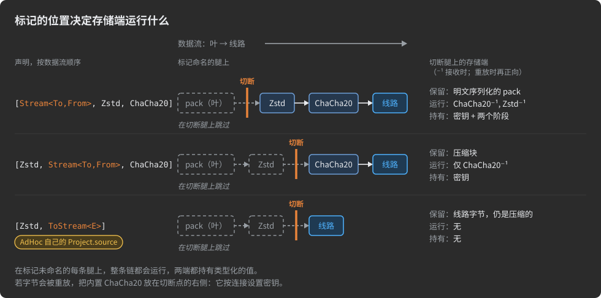

为什么存储不用隧道或连接链?连接上的链到存储为止就结束了:存储会拆开链路承载的一切。
[隧道](#virtual-connections-and-relays)穿过它的中继,身后什么都不留下。只有 trim 能让一台作为对话端点的主机
以你选择的形态留下负载。

> [!WARNING]
> 让内置的 `[ChaCha20]` 留在"字节被保留、日后回放"的切点的右侧。写在 pack 或字段上时,内置加密算法用该 pack 所发连接的
> 最新会话密钥加密,并把该密钥的 id 写在密文之前;会话中没有这个密钥的接收方会把整个 pack 丢弃。带着 `ChaCha20` 存下的
> 字节是为生产者的连接密封的,另一条连接上的消费者打不开它们。pack 级的 `ChaCha20` 还需要一条带密钥的连接——一条加密的
> 连接,或者把密钥加到它的发送器和接收器上([变换链](#transform-chains))。

同理,内置加密算法也无法给存储提供它没有密钥的密文。在 `ChaCha20` 右侧的切点——存储按原样保留加密字节——存下的是为
生产者的连接密封的字节,另一条连接上的消费者会丢弃它们。必须保留自己读不了的负载的存储,需要你自己的加密阶段
([变换链](#transform-chains)),其密钥由生产者和消费者作为运行时注入的参数共享,位于各连接的会话密钥之外;有了它,
线上一端的切点——`[Zstd, MyCipher, Stream<To, From>]`——恰好保留线上字节,什么都不运行,也不持有任何密钥。

**在 `FromStream` 处注入的字节,必须恰好是被跳过的阶段本会产出的东西。** 生成器无法检查这一点;不匹配会在远端表现为
解码失败。

**被 trim 的字节被钉死在切点左侧的配置上**——那些阶段、它们的顺序以及它们的设计期参数。改动一个级别、加一个阶段或
重新排序,之前存储的一切都会静默地停止解码,因为线上没有任何东西宣告这个差异。把切点左侧的链当作一种持久化格式对待:
像 AdHoc 的协议对 `SrcZip` 那样,在一个 flow 中只命名一次;当旧归档必须保持可读时,在旧 flow 旁边声明一个新 flow,
而不是去编辑它([演进协议](#evolving-a-protocol))。

<a id="store-and-replay-with-trims"></a>
### 用 trim 存储与回放

存储在一条链路上接收负载,在另一条链路上回放。`[Stream<To, From>]` 用一个标记声明两个切点,因此它们站在同一深度,
存储收到的字节与它回放的字节完全一致:`store(bytes)` 和 `replay(bytes)`,热路径上没有解码、没有重新编码、没有转码。
两个方向若在不同深度,存储就得拿着一种形态、欠着另一种形态,就不得不运行两者之间的阶段——恰恰把更深的切点去掉的东西
又加了回来。agent 拒绝这种情况,而且两个分开的标记永远是两个位置,即使并排书写:

```csharp
[S(65_536), ToStream<FromProducer>, FromStream<FromBroker>, Zstd] Stream feed;
// ERROR: The stream chain on … puts its ToStream and FromStream trims at different depths. A store that receives one form and must
//        send another has to transform between them — which re-adds the very stages the cut removed. Put both at one depth, written as
//        a single `Stream<To, From>` marker.
```

<a id="worked-example---a-schema-blind-recorder"></a>
#### 完整示例——一个无 schema 的录制器

三台主机:`Camera` 产生快照,`Recorder` 存储快照,`Viewer` 显示快照。Recorder 永远不需要 `Snapshot` 的 schema:

```csharp
using org.unirail.Meta;

namespace com.example.recording
{
    public interface Recording
    {
        /// <see cref="InCS"/>
        struct Camera : Host { }

        /// <see cref="InCS"/>
        struct Recorder : Host { }

        /// <see cref="InJAVA"/>
        struct Viewer : Host { }

        public class Snapshot
        {
            long                      taken;
            [D(65_000)] Binary[,]     jpeg;
        }

        // Camera → Recorder:源头带类型,存储处是原始字节
        public class RecordSnapshot
        {
            [ToStream<IfSendingFrom<Camera, CameraToRecorder>>] public Snapshot snapshot;
        }

        // Recorder → Viewer:从存储回放,在查看器处恢复类型
        public class ReplaySnapshot
        {
            DateTime recordedAt;
            [FromStream<IfSendingFrom<Recorder, RecorderToViewer>>] public Snapshot snapshot;
        }

        interface CameraToRecorder : Connects<Camera, Recorder>
        {
            [l____________<RecordSnapshot>]
            struct Start { }
        }

        interface RecorderToViewer : Connects<Recorder, Viewer>
        {
            [l____________<ReplaySnapshot>]
            struct Start { }
        }
    }
}
```

Camera 把一个类型化的 `Snapshot` 序列化一次。Recorder 把成帧的字节接收到自己的代码提供的数据汇中,不做解析就落盘,
之后从它的数据源回放,不做重新序列化。Viewer 重建出类型化的对象。因为存储从不依赖负载的 schema,`Snapshot` 可以增加
字段,而 Recorder 不需要任何改动或重新构建。

AdHoc 的监控后端就是这样工作的:它把 CPU、进程、网络和磁盘的遥测样本保存为序列化字节,并用 `[FromStream<…>]`
提供它们。它的内存和文件存储样本是 Value Pack;它们就地传输,因为对 Value Pack 字段做 trim 是错误。

这里存储保留的是普通序列化的 pack。要让它保留仍处压缩状态的负载,把同一个切点移向链的更深处,如下一个示例所示。

<a id="worked-example---a-schema-blind-log-broker"></a>
#### 完整示例——一个无 schema 的日志代理

`Producer` 发布事件,`Broker` 存储事件,`Consumer` 回放事件。代理在两条链路上都是端点——永远不是中继:

```csharp
interface FromProducer : IfSendingFrom<Producer, ProducerToBroker> { }
interface FromBroker   : IfSendingFrom<Broker,   BrokerToConsumer> { }

// 压缩存储:代理解密链路,保留 Zstd blob,永远看不到 Event
[Zstd, Stream<FromProducer, FromBroker>, ChaCha20]
public class Event
{
    long                   at;
    string                 topic;
    [D(65_000)] Binary[,]  body;
}

interface ProducerToBroker : Connects<Producer, Broker>
{
    [l____________<Event>]
    struct Start { }
}

interface BrokerToConsumer : Connects<Broker, Consumer>
{
    [l____________<Event>]
    struct Start { }
}
```

- **Producer → Broker。** 生产者序列化并压缩,然后为本连接加密。代理解密,把压缩字节追加到它的日志中。
- **Broker → Consumer。** 代理交还同样的字节;它们为本连接加密,消费者解密、解压并重建出类型化的 `Event`。
- **其余任何链路。** 完整的链,两端都是类型化的 `Event`。

`ChaCha20` 站在切点右侧,因此每条链路用自己连接的会话密钥加密;两条连接都需要密钥(见上面的警告)。把标记移到最前,
`[Stream<FromProducer, FromBroker>, Zstd, ChaCha20]`,就回到了录制器的情形:代理保留普通序列化的 pack,并运行整条逆链。

两个端点命名的是**不同的**发送主机:Producer 和 Broker。正是这一点,让一个 pack 可以在它的两条链路上都被切,
而不要求任何主机提供[两种线上形态](#one-wire-form-per-host-and-direction)。

<a id="a-host-that-passes-bytes-straight-on"></a>
#### 一台把字节原样转发的主机

`[Stream<To, From>]` 的两半可以命名**同一条**链路。在那条链路上,发送方提供字节,接收方接收字节:两端都不物化负载。
这是这样一种主机的形态:它把负载作为字节接收,再仍以字节的形态经由另一条连接转发给存储:

```csharp
interface FromProducer : IfSendingFrom<Producer, ProducerToBroker> { }
interface FromBroker   : IfSendingFrom<Broker,   BrokerToArchive> { }

public class Upload    { [Zstd, ToStream<FromProducer>]           Payload payload; }   // 代理接收压缩后的字节
public class ToArchive { [Zstd, Stream<FromBroker, FromBroker>]   Payload payload; }   // 并原样交出:字节进,字节出
```

两个切点都站在 `Zstd` 右侧,因此代理收到的字节恰好就是它转发的字节。AdHoc 的代码生成服务正是这样把 agent 上传的归档
转交给测试主机的:从一个套接字缓冲区到另一个套接字缓冲区,而 agent 还在发送。

<a id="trims-on-named-stream-packs"></a>
### 具名 Stream pack 上的 trim

具名 `Stream` pack([流](#streams))可以携带自己的链和 trim,以它为类型的字段也可以追加阶段。两者组合成一条链:
字段的条目更靠近叶子,pack 的更靠近线上([变换链](#transform-chains))。pack 上的 trim 传到字段时,**保持 pack 给它的
位置**——pack 选定的深度就是字段被切开的深度。通道两端反正都持有原始字节,所以切点决定的是接收方还要运行链的多大
一部分:

| pack 声明                                                               | `Frame frame;`             | `[MyStage] Frame frame;`             | 被切的主机                                                                   |
|:-----------------------------------------------------------------------|:---------------------------|:-------------------------------------|:-----------------------------------------------------------------------------|
| `[S(16_000_000), ToStream<FromRouter>, Zstd] class Frame : Stream { }` | `leaf → cut → Zstd → wire` | `leaf → MyStage → cut → Zstd → wire` | 运行 `Zstd⁻¹`,然后停下,字节保持字段的阶段留下的样子                          |
| `[S(16_000_000), Zstd, ToStream<FromRouter>] class Frame : Stream { }` | `leaf → Zstd → cut → wire` | `leaf → MyStage → Zstd → cut → wire` | 什么都不运行,保留压缩后的线上字节                                            |

(`MyStage` 代表你声明的任何自定义阶段——[变换链](#transform-chains)。)

三个推论:

- **在 pack 叶子处的切点对普通通道来说是无操作。** 第 1 行若没有字段阶段,主机持有的字节与完全没有 trim 时相同:
  反正都要运行整条逆链。在通道上,trim 只有在留下未运行的阶段时才有价值,如第 2 行。
- **字段上的阶段永远不会越过继承来的切点运行。** 字段的条目排在整个继承块的左侧,所以它们总是落在被跳过的一侧。
  必须在切点之后运行的阶段,属于 pack,写在标记右侧。
- **被切使字段变得有方向性**,在 trim 命名的链路上,效果与标记直接写在字段上完全相同。

`File` pack 什么都不向下传递:它既不能携带阶段,也不能携带 trim。要切或变换一个通道,就继承 `Stream`。

<a id="trims-inside-flows"></a>
### flow 内部的 trim

一个 [flow](#transform-chains)——声明为 `StreamFlowAttribute` 的可复用链——可以包含一个 trim。它就地展开,保持
flow 给它的位置,因此应用这个 flow 等同于手写它的条目:

```csharp
[Zstd(6), ToStream<FromProducer>, ChaCha20]
public class StoreCompressed : StreamFlowAttribute { }

[StoreCompressed] Payload payload;
//  →  leaf → Zstd(6) → |cut ToStream(Producer@ProducerToBroker)| → ChaCha20 → wire
```

一个只含阶段的 flow 是中性的局部变换,可以用在任何地方。含 trim 的 flow 还携带一个路由决定:每次应用都在 flow 命名的
端点上被切,每个使用它的字段或 pack 都在那些链路上变得有方向性。当这个 flow *正是*某条存储-回放路径的流程时,这是对的;
把它当作通用链来用,就会把不相关的负载钉死在那些端点上。更好的做法是在应用点书写 trim,让 flow 只装阶段。

链的规则在展开之后、在扁平化的列表上检查,因此 flow 的 trim 会与写在它旁边的 trim 冲突:

```csharp
[StoreCompressed, ToStream<FromProducer>] Payload payload;
// ERROR: The stream chain on '…payload' cuts the receiving side twice. At most one ToStream trim per chain — one payload cannot be
//        handed over at two depths at once.
```

具名 `Stream` pack 上发生同样的展开:以它为类型的字段整体继承 flow 的条目,包括 trim 和它的位置。

<a id="trims-across-imported-projects"></a>
### 跨导入项目的 trim

trim 是它所写在的声明的一部分,因此[导入项目](#reusing-descriptions)会把它随 pack 或字段一起带来——无需再次声明。导入可能改变的是:它所命名的链路是否仍然存在。

`IfSendingFrom<host, connection>` 的两半都在**组合后的**项目中解析:根描述加上它所扩展的一切。因此 trim 可以在扩展自己声明的连接上命名一个导入的主机:

```csharp
// Recording.cs - 上面记录仪示例的项目
// RecordingWithArchive.cs
public interface RecordingWithArchive : Recording
{
    /// <see cref="InJAVA"/>
    struct Archive : Host { }                                    // 一台新主机

    interface CameraToArchive : Connects<Camera, Archive>       // Camera 是导入的
    {
        [l____________<ArchiveSnapshot>]
        struct Start { }
    }

    public class ArchiveSnapshot
    {
        [ToStream<IfSendingFrom<Camera, CameraToArchive>>] public Snapshot snapshot;
    }
}
```

AdHoc 的监控后端就是这样构建的:它是对 AdHoc 自身协议的扩展,其 trim 通过一个命名端点集,在扩展声明的虚拟连接上命名导入的 `Server` 主机。

由于永远不会触发的切点是错误,若导入 pack 的 trim 命名的连接被导入项目排除在外,该 pack 必须从组合中丢弃——而不仅仅是被忽略。

**修饰符会重新声明你不拥有的 pack 的切点。** 携带特性的 `Modify<TargetPack>` 会整体替换目标的整个特性集、链和 trim,因此扩展在同一处声明深度和链路。这是在作者无法预知的链路上切分导入 pack 的预期方式;当多个修饰符修改同一目标时哪个生效,见[复用描述](#reusing-descriptions)。替换之后,存储仍会注入它未解析、未重新压缩而保留下来的字节,因此替换后的链重申了你的存储已经持有的格式:保持切点左侧的阶段不变,因为不匹配不会在线上被告知。连接没有这种修饰符:AdHocAgent 拒绝针对连接的 `Modify<>`。

<a id="what-the-agent-reports-about-trims"></a>
### 代理报告的 trim 信息

代理为每个被切分的字段记录一行日志,以 `Host@Connection` 的形式命名它被切开的链路:

```
cut field com.example.recording.Recording.RecordSnapshot.snapshot: ToStream[Camera@CameraToRecorder] FromStream[]
```

并为每条链记录一行,按声明顺序,切点位于你所写的位置:

```
stream chain on …payload (line 42): leaf -> Zstd(level=6)[compression] -> |cut ToStream(Producer@ProducerToBroker)| -> wire  =>  container #3
```

这些行是切点在错误链路上触发时最早暴露的地方。内部每个端点记录为其连接的索引:当发送方是连接的 Left 主机时记录索引本身,是 Right 主机时记录按位取反(`~idx`)。

另有两条仅与 trim 有关的诊断:

- 若被 trim 的字段的负载小到除去空值位后足以成为 Value pack,会得到一条警告——对它成帧比直接发送更昂贵:
  `The trimmed field '…' (line: …) hands over '…', which is small enough to be a Value pack — streaming it costs more than transmitting it.`
- 派生自 `StreamTrimAttribute` 的类会被拒绝——不支持自定义 trim:
  `'…' derives from StreamTrimAttribute but is not one of the recognized trim markers (ToStream<E>, FromStream<E>, Stream<To, From>) … Custom trims are not supported.`

有两条链规则与 trim 相互作用,在链的章节([变换链](#transform-chains))中描述:当链包含 trim 时,其中任何阶段都不得命名为 `ToStream` 或 `FromStream`;且包含 trim 的链即使在短 pack 上也保留其压缩。

<a id="trim-pitfalls"></a>
### trim 的陷阱

- **`TYPEDEF` 会静默丢弃 trim。** `TYPEDEF` 传播其类型和上限,但既不传播 trim 也不传播链;该字段最终成为普通的嵌套 pack。复用切点请通过流(flow)或命名的 `Stream` pack,绝不要通过别名([字段与类型](#fields-and-types))。
- **改变切点左侧的阶段会静默破坏已存储的数据**——见[深度决定存储必须运行什么](#the-depth-decides-what-the-store-must-run)。
- **在 `FromStream` 处注入的字节不受检查。** 与被跳过阶段的不匹配会在远端造成解码失败。
- **重放切点左侧的内置 `ChaCha20`** 会把存储的字节密封给单个连接。
- **带 trim 的流(flow)会把每次使用**固定到它的端点上。

<a id="trim-rules-at-a-glance"></a>
### trim 规则一览

| 规则              | 细节                                                                                                                                                                                                     |
|:------------------|:-----------------------------------------------------------------------------------------------------------------------------------------------------------------------------------------------|
| 形式              | 字段或 pack 上的 `[ToStream<E>]`、`[FromStream<E>]`、`[Stream<To, From>]`;不支持自定义 trim                                                                                                 |
| 端点参数          | `IfSendingFrom<Host, Connection>`、命名端点、命名端点集,或它们的元组;其他都是错误                                                                                                          |
| 链路              | 一个端点命名一条链路;反向链路和所有其他链路保留类型化形式;在连接自身的主机上,一个端点命名两条链路                                                                                          |
| 解析              | 在组合后的项目中解析;主机不是其连接一方的元素会被跳过并给出警告;没有可用端点是错误                                                                                                          |
| 位置              | 标记右侧的阶段运行,左侧在被命名的链路上跳过;列表可以为空(叶子处的切点);链在每条其他链路上完整运行                                                                                        |
| 数量              | 流(flow)展开后,每条链至多一个 `ToStream` 和一个 `FromStream`;两者在同一深度时写成一个 `Stream<To, From>`                                                                                |
| 角色              | 无:没有参数,不生成任何东西,不受"一个压缩器 / 一个密码"限制和"压缩器在密码之前"规则约束                                                                                                     |
| 目标              | pack 类型的字段、`Stream` 字段、单个 `string` 字段、除 `File` 外的任何 pack;绝不用于 `File`、基元类型、枚举、Value Pack 或集合字段;绝不用于连接——无论物理还是虚拟、无论是否经修饰符 |
| pack 级 trim      | 作用于每个以该 pack 为类型的字段以及单独发送的该 pack;每个字段只在被命名的链路上被切开                                                                                                        |
| 线上              | pack 负载在每条链路上是相同的字节;被 trim 的 `string` 在其切开的链路上以 `File` 成帧的 UTF-8 传输,在其他地方以普通字符串传输                                                               |
| 字符串            | 每条链路上都受字符串自身的上限(`[D(+N)]`,默认 255)约束;不用 `[S(N)]`;无效 UTF-8 抛出异常;`null` 不传输                                                                              |
| 可中断性          | 被 trim 的传输不可中断                                                                                                                                                                         |
| 主机              | 每个被 trim 的字段在每个主机和方向上只有一种线上形式;冲突即错误                                                                                                                              |
| 流(flow)          | 一个流(flow)可以包含一个 trim;它就地展开,并把每次应用固定到其端点                                                                                                                          |
| `TYPEDEF`         | 既不携带 trim 也不携带链——两者都被静默丢弃                                                                                                                                                     |
| 导入              | trim 随其声明一起迁移;带特性的 `Modify<Pack>` 替换该 pack 的链和 trim                                                                                                                        |
| 持久化格式        | 存储的 trim 字节只对切点左侧精确的阶段、顺序和设计时参数有效                                                                                                                                  |

---

<a id="virtual-connections-and-relays"></a>
## 虚拟连接与中继

*模型:项目 → 主机 → **连接——虚拟的,由 PATH 上的中继主机承载** → Actor → 状态 → pack → 分块隧道中的字节*

**虚拟连接**连接两台没有直接链路的主机。这两台主机表现得如同直接相连——pack、Actor 和状态机与任何[连接](#connections)上相同——而它们的字节实际上穿过一台或多台**中继主机**。一条虚拟连接在其两台主机之间的字节构成一条**隧道**;每台中继主机上生成的 **Relay** 转发隧道而不解码它。

典型场景:只能通过网关访问的浏览器仪表盘与后端服务器;位于 NAT 之后、只能通过会合代理访问的设备;字节必须经过汇聚层的传感器。

直观的桥接做法让中间主机反序列化每个入站 pack,再把它序列化到出站连接上。这要对数据做两次完整遍历,还需要一个与消息一样大的堆对象,并且把中间主机绑到它不拥有的 schema 上:pack 的每次变更都意味着重建它。中继不做这些。它转发隧道字节时**不解码、不缓冲、也不知晓其结构**,它以**恒定内存**在两条连接之间搬运任意大小的负载,并且当穿过它的 pack 变化时无需重建。

> [!NOTE]
> 本章建立在[流](#streams)的分块成帧——`[len][data]…[0]`、2 字节块长度、以 `0xFFFF`(`ABORT`)将流作为 void 结束、每块至多 `0xFFFE` 字节——之上,建立在[变换链](#transform-chains)(压缩与加密)之上,也建立在[连接](#connections)(`External`/`Internal`、连接事件与关闭种类)之上。

<a id="declaring-a-virtual-connection"></a>
### 声明虚拟连接

声明虚拟连接与普通连接一样,只是用 `VirtuallyConnects` 代替 `Connects`。Meta.cs 中的声明为:

```csharp
public interface VirtuallyConnects<L, R, PATH> : Connects<L, R>
    where L : struct, Host
    where R : struct, Host
{
    int  MaxTunnels          => 256;            // 路径上一次可同时多路复用多少条隧道
    uint MaxStream_KiloBytes => uint.MaxValue;  // 一条隧道可承载的最大流,以 KiB 计
}
```

- **`L`、`R`**——两个逻辑端点:表现得如同直接相连的主机。它们必须是不同的主机。
- **`PATH`**——字节实际经过的中继主机:单跳为一台主机,多跳为一个 C# 元组 `(H1, H2, …)`。`PATH` 在 C# 中没有约束;由代理检查它([代理如何找到路由](#how-the-agent-finds-the-route))。

由于 `VirtuallyConnects<L, R, PATH>` 扩展了 `Connects<L, R>`,凡是接受连接的地方都接受虚拟连接:它可以作为连接接口的第一个基接口,可以被 [trim](#trims) 的端点 `IfSendingFrom<Host, Connection>` 命名,也计入[一对主机至多由一条连接相连](#connections)的规则。

一个实际示例——观看端在一台只能通过中枢访问的服务器上订阅事件:

```csharp
///<see cref = 'InJAVA'/>
///<see cref = 'InCS'/>
///<see cref = 'InTS'/>
struct Server : Host { }

/// Viewer 与 Server 之间的中继。
///<see cref = 'InJAVA'/>
///<see cref = 'InCS'/>
///<see cref = 'InTS'/>
struct Hub : Host { }

///<see cref = 'InJAVA'/>
///<see cref = 'InCS'/>
///<see cref = 'InTS'/>
struct Viewer : Host { }

class Beat       { long stamp; }
class WatchSub   { int what; }
class WatchEvent { int what; long value; }
class WatchUnsub { int what; }

interface HubToServer : Connects<Hub, Server>      // 物理链路
{
    [_____lr_____<Beat>]
    struct One { }
}

interface ViewerToHub : Connects<Viewer, Hub>      // 物理链路
{
    [_____lr_____<Beat>]
    struct One { }
}

// 一条骑在穿过 Hub 的隧道上的连接:Viewer 在 Server 上订阅
interface ViewerToServer : VirtuallyConnects<Viewer, Server, Hub>
{
    [Idle(120)] // 一个租约:Viewer 用 WatchSub 续租;不告而别的 Viewer 会被放行
    [Grouped]   // Server 收集它所有 Hub 下所有 Viewer 的订阅,把一个事件发给它们全部
    interface Watch : Actor
    {
        int Actor.MaxActiveInstances => 4;

        [ReceiveTimeout(60)]
        [L____________<Live, WatchSub>]
        struct Start { }

        [____________r<WatchEvent>]
        [l____________<WatchSub>]
        [L____________<End, WatchUnsub>]
        struct Live { }
    }
}
```

`Viewer` 与 `Server` 现在共享一条连接,尽管每个字节都经由 `ViewerToHub` 和 `HubToServer` 这两条物理链路、由 `Hub` 中继。该 Actor、它的状态、截止时间和分组的工作方式与物理连接上完全一致([Actor 种类与运行时的 Actor](#actor-kinds-and-the-actor-at-runtime))。虚拟连接的主体也可以声明 `Resumable<HOST, PACKS>` 以获得保证送达([会话、保证送达、UDP](#sessions-guaranteed-delivery-udp))。


<a id="tunnel-only-and-structured-virtual-connections"></a>
### 纯隧道与结构化虚拟连接

生成器产出什么取决于 `VirtuallyConnects` 接口是否有主体:

| 主体                                                  | 在 `L` 和 `R` 上生成                                             | 在每台 `PATH` 主机上生成      | 穿过隧道的内容                                                             |
|:------------------------------------------------------|:-----------------------------------------------------------------|:------------------------------|:---------------------------------------------------------------------------|
| 空 `{ }`                                              | 隧道端点 API:端点交换原始的不透明字节                            | 一个 `Relay`                  | 中继和生成的代码都不知晓其结构的原始字节                                   |
| Actor、分支、pack——如同在 `Connects` 中声明           | 完整连接:pack、Actor、状态机                                     | 一个 `Relay`                  | 该连接序列化后的 pack                                                      |

**空主体只有隧道。** 生成器只产出传输层。当 `L` 和 `R` 约定自己的成帧、或承载外部协议、只需要 AdHoc 搬运字节时使用它:

```csharp
/// <see cref="InCS"/>
struct Device : Host { }

/// <see cref="InJAVA"/>
struct Broker : Host { }

/// <see cref="InJAVA"/>
struct Cloud : Host { }

class Ping { long stamp; }

interface DeviceToBroker : Connects<Device, Broker> { [_____lr_____<Ping>] struct One { } }
interface BrokerToCloud  : Connects<Broker, Cloud>  { [_____lr_____<Ping>] struct One { } }

interface DeviceTunnel : VirtuallyConnects<Device, Cloud, Broker> { }   // Device ↔ Cloud 之间的原始字节管道
```

"连接至少需要一个 Actor、该 Actor 至少需要一个状态"的规则只适用于物理连接,因此空主体是合法的。

**非空主体是一条骑在隧道上的普通端到端连接。** 隧道是它下面的传输层:端点讲完整协议,中继把它作为不透明字节搬运、从不解析,与纯隧道连接完全一样。上面的 `ViewerToServer` 就是这一种。

<a id="how-the-agent-finds-the-route"></a>
### 代理如何找到路由

`PATH` 以**任意顺序**列出中间主机。代理通过遍历物理 `Connects<>` 连接的图来重建严格路由 `L → … → R`:它寻找那条从 `L` 出发、到 `R` 结束、沿物理链路恰好访问每台列出主机一次的链。因此当 `A → B → C → D` 是经过这些主机的唯一物理链时,`VirtuallyConnects<A, D, (C, B)>` 和 `VirtuallyConnects<A, D, (B, C)>` 声明的是同一条隧道。

一个实际的双跳示例,带结构化主体和单条隧道:

```csharp
// 物理链路:Connects<XProducer, ZRouter>, Connects<ZRouter, ZAuditor>, Connects<ZAuditor, WSink>
[Zstd(6), ChaCha20]
interface Producer__Sink_Structured : VirtuallyConnects<XProducer, WSink, (ZRouter, ZAuditor)>
{
    int VirtuallyConnects<XProducer, WSink, (ZRouter, ZAuditor)>.MaxTunnels          => 1;       // 线上没有 tunnel_id
    uint VirtuallyConnects<XProducer, WSink, (ZRouter, ZAuditor)>.MaxStream_KiloBytes => 64000;

    [_____lr_____<(EndpointFormsPack, DateTimeOptimizationPack)>]
    struct Exchange { }
}
```

写成 `(ZAuditor, ZRouter)` 声明的是完全相同的隧道。`ZRouter` 和 `ZAuditor` 各得到一个 Relay,前后串接;两者都对内部的连接一无所知。

路由只使用**物理**链路:虚拟连接不能骑在另一条虚拟连接上。被排除在 `PATH` 之外的主机不会被路由经过,即使有物理链路穿过它。作为主机修饰符(`Modify<Host>`)的 `PATH` 项代表它所修饰的主机。任何规则失败时代理都会停止本次运行:

| 规则                                                                         | 代理的提示                                                                                                                                                                             |
|:-----------------------------------------------------------------------------|:---------------------------------------------------------------------------------------------------------------------------------------------------------------------------------------|
| 每一跳 `L → PATH₁ → … → R` 都是真实存在的物理 `Connects<>`                   | `The virtual connection … cannot be routed`, followed by the physical legs that do exist among the listed hosts                                                                        |
| 至少一台中间主机                                                             | `… has an empty PATH. At least one intermediate host is required.`                                                                                                                     |
| 每个 `PATH` 元素都是项目中声明的主机                                         | `… lists … in PATH, but that is not a host. PATH names the relay hosts the tunnelled bytes physically pass through: every element has to be a struct : Host declared in this project.` |
| `L`、`R` 和每台 `PATH` 主机只出现一次                                        | `The virtual connection … visits the host … twice`——重复的主机是一个路由环,会在该主机上争抢同一个 `tunnel_id` 解复用状态                                                               |
| `L ≠ R`                                                                      | `The virtual connection … should connect two distinct hosts.`(物理的 `Connects<A, A>` 是允许的;虚拟的不允许)                                                                         |
| 路由唯一                                                                     | `The virtual connection … is ambiguous`,随后列出两条路由;请调整 `PATH` 或拓扑                                                                                                        |
| 没有其他物理或虚拟连接以任一顺序连接 `L` 和 `R`                              | `The hosts … and … are joined by more than one connection: …`([连接](#connections))                                                                                                  |

同一对主机之间的并行对话走同一条虚拟连接:提高 `MaxTunnels`,而不是再声明一条或在 `PATH` 中重复主机。

<a id="maxtunnels-and-maxstream_kilobytes"></a>
### MaxTunnels 与 MaxStream_KiloBytes

| 属性                  | 默认值                      | 含义                                                                                                                                                                                                                                                                                                                                                                     |
|:----------------------|:----------------------------|:-----------------------------------------------------------------------------------------------------------------------------------------------------------------------------------------------------------------------------------------------------------------------------------------------------------------------|
| `MaxTunnels`          | `256`                       | 路径上可同时多路复用多少条独立隧道。它决定线上 `tunnel_id` 路由键的宽度:`1` 表示完全没有 `tunnel_id`(一条隧道);更大的值给出 1 到 4 字节的小端键,长度按 `MaxTunnels - 1` 的需要——256 用 1 字节,65 536 用 2 字节。必须至少为 1。                                                                   |
| `MaxStream_KiloBytes` | `uint.MaxValue`(无上限)   | 一条隧道可承载的最大流,以 KiB 计——相当于流字段上 `[S(N)]` 的隧道对应物                                                                                                                                                                                                                                               |

在接口主体中再次声明即可覆盖其中任意一个,可以用简写形式,也可以用显式接口实现:

```csharp
// 两者取其一,不可兼得:一对主机只能由一条连接相连
interface DeviceLink : VirtuallyConnects<Device, Cloud, Broker>
{
    int  MaxTunnels          => 1;       // 一条专用隧道:线上没有 tunnel_id
    uint MaxStream_KiloBytes => 4_096;   // 每个经隧道的流最大 4 MiB
}

interface DeviceLinks : VirtuallyConnects<Device, Cloud, Broker>
{
    int  VirtuallyConnects<Device, Cloud, Broker>.MaxTunnels          => 512;
    uint VirtuallyConnects<Device, Cloud, Broker>.MaxStream_KiloBytes => 100_000;
}
```

代理按名称读取该属性,且只有在其值为编译期常量时才采用。非常量表达式会被静默跳过,默认值保留——当某个开关看似无效时,这是一个值得检查的陷阱。`MaxTunnels` 小于 1 会停止运行:
`The virtual connection … sets MaxTunnels to …; MaxTunnels must be a positive value (>= 1).`

<a id="the-tunnel-on-the-wire"></a>
### 线上的隧道

隧道的两个端点不为每个 pack 交换一帧。当虚拟连接有 pack 要发送时,它的端点在物理连接的发送器上排队一次;轮到它时,它把虚拟连接的 pack 序列化为一个**突发**——一个隧道帧——并在虚拟连接没有更多在途内容时结束该帧。突发只在两个 pack 之间结束。接下来的 pack 构成新帧,其他隧道的帧和物理连接的普通 pack 穿插在它们之间。

隧道帧为:

```
[pack-id][tunnel_id?]   [len₁][data₁]  [len₂][data₂] … [0]
```

- **`pack-id`** 是虚拟连接的线路 ID。虚拟连接从与可传输 pack 相同的池中取一个持久 ID,记录在[编号表](#numbers-tables) `connections` 一节中其名称之后(例如 `<see cref='Server__MonitoringObserver'/>ā 124`);因此隧道帧像任何 pack 一样凭其 ID 与 pack 区分。编号表还描述了这种 ID 与 pack 的 ID 冲突时会发生什么(它会带警告重新编号),以及为什么手工重命名虚拟连接(而不是通过 IDE 重命名)会停止运行,直到名称被改正。
- **`tunnel_id`** 是紧跟在 pack id 之后、分块主体之前的定宽小端字段。其宽度取决于 `MaxTunnels`;当 `MaxTunnels => 1` 时它不存在。
- 主体是分块的:每块前有 2 字节长度,每块至多 `0xFFFE` 字节,末尾为 `0x0000`。

结束隧道的帧用 `ABORT`(`0xFFFF`)代替 `[0]` 终止符——放在一个突发的最后若干块之后,或单独出现:

```
[pack-id][tunnel_id?]   [len₁][data₁] … [ABORT]          or just          [pack-id][tunnel_id?][ABORT]
```


<a id="what-the-generator-produces-for-a-tunnel"></a>
### 生成器为隧道产出什么

一个 `VirtuallyConnects` 声明产生三样东西:生成器在每台 `PATH` 主机上放置一个中继、在 `L` 和 `R` 上放置端点代码,代理在编号表中为虚拟连接分配线路 ID。

<a id="on-a-relay-host-the-relay-and-its-router"></a>
#### 中继主机上:Relay 及其路由器

在隧道可能到达的每条物理链路的接收器上,中继主机为它中继的每条虚拟连接得到一个 `Relay`,放在以该虚拟连接的线路 ID 命名的字段中,另有一个以该虚拟连接命名的路由器类。接收器按 pack id 把每个隧道帧交给中继,而不是交给反序列化器。以下是为 `Monitoring`(AdHoc 监控后端的中继主机)中线路 ID 为 124 的虚拟连接生成的 C#(节选):

```csharp
class Provider_Server__MonitoringObserver_External : Connection.Tunnel.Relay.OutboundSrc
{
    public Connection.External? outbound(Connection.Tunnel.Relay dst, int tunnel_id)
    {
        Connection.External? ret =

        //在 #region 内提供逻辑,返回服务于隧道 'Server__MonitoringObserver' 的 'ServerToMonitoring' 的 `External` 部分,
        //当没有活跃连接服务它时返回 null —— 中继随后丢弃该数据包。
        //必要时使用 org.unirail.Network.TCP.GetConnection()。
        //重要:以 'if(false)' 行结束你的代码,以解除陷阱。
#region> Tunneling
            ServerToMonitoring.Connection.one.ext_connection;        // 你的代码:服务于 tunnel_id 的连接
        if( false )
#endregion> ÿā.Tunneling
            noCustomCodeAlarm();
        return ret?.Internal is org.unirail.ServerToMonitoring.Connection __internal && __internal.transmitter.sending_put(dst) ? ret : null;
    }
    private Connection.External? noCustomCodeAlarm() => throw new NotImplementedException("Provide logic returning the `External` part of the 'ServerToMonitoring' that serves tunnel 'Server__MonitoringObserver' (or null) inside #region");
    public static readonly Provider_Server__MonitoringObserver_External one = new();
}

internal Connection.Tunnel.Relay? relay124 = new Connection.Tunnel.Relay();

// 在接收器按 pack id 的分发中:
case 124:
    return relay124.Init(_id, 1, 1, connection.ext_connection, Provider_Server__MonitoringObserver_External.one);
```

`outbound` 的契约:

- 你在 **`Tunneling`** 区域中的代码返回服务于 `tunnel_id` 的连接的 `External`——隧道的对侧链路——或在没有活跃连接服务它时(已关闭、正在关闭、从未连接)返回 `null`。它还可以改写 `dst.tunnel_id` 来为出站流重新设置键。
- 生成的尾部代码把中继排入该连接的发送器(`sending_put`)。当返回 `null` 或入队被拒绝(队列已满、连接正在关闭)时,中继消费该数据包的主体并丢弃它;入站连接继续运行。
- 未填写的区域会抛出上面的 `NotImplementedException`。按生成的注释所说,以 `if( false )` 结束你的代码即可解除它([部署与智能合并](#deployment-and-smart-merge)描述了这些区域)。
- 路由器是无状态的:一个实例 `one` 服务该方向的所有中继。

物理连接的 `OnClose` 对它的每个中继调用 `Gone()`,从而通知它所供养的隧道的远端([关闭隧道](#closing-a-tunnel))。多跳 `PATH` 在每台中继主机上得到一个 Relay,前后串接。

<a id="on-an-endpoint-host-the-carrier"></a>
#### 端点主机上:承载连接

在端点上,隧道帧到达所经过的物理连接就是**承载连接(carrier)**。承载连接自己保存其各隧道的虚拟连接;其他任何东西都不需要隧道表。在 Java 和 C# 中,生成器向承载连接添加以下内容(此处为 `ServerToMonitoring`,承载 `Server__MonitoringObserver`;Java,有删减):

```java
// 该承载连接承载的各虚拟连接,按隧道 id 索引:在隧道的首帧创建,随该承载连接关闭
public final IntObjectMap.RW<Server__MonitoringObserver.Connection> tunnels_Server__MonitoringObserver = …;

public final Server__MonitoringObserver.Connection.Tunnel.Rx rx_Server__MonitoringObserver = …; // 该承载连接的入站解复用
public final Server__MonitoringObserver.Connection.Tunnel.Tx tx_Server__MonitoringObserver = …; // 把回复装到该承载连接上

public static boolean send_Server__MonitoringObserver(Server__MonitoringObserver.Connection.Tunnel src, int tunnel_id, Connection conn) { … }

public void close_tunnels_Server__MonitoringObserver() { … }  // 对每个连接发送 THIS_CLOSE_ABRUPTLY + OnClose,然后遗忘它们
```

每个名字的后缀都是**虚拟**连接的名字。`rx_<VirtualConnection>` 是每个承载连接一个解复用器:两个承载连接从不共享一个。
`tx_<VirtualConnection>` 由一个承载连接的所有隧道共享,因为承载连接的发送器一次只写一个 pack。

虚拟连接自己的类构建在隧道端点上:`<VirtualConnection>.Connection.Tunnel` 扩展
`AdHoc.Connection.Tunnel.EndPoint`,持有 `tunnel_id` 和它所搭乘的承载连接(`tunneling_via`),并提供两个静态方法:

- `Tunnel.of(tunnel_id, carrier)` —— 该承载连接上隧道 `tunnel_id` 的虚拟连接,首次使用时创建,保存在承载连接的表中;
- `Tunnel.ended(tunnel_id, carrier, whole)` —— 在对端结束隧道之后将其关闭。

在虚拟连接上,对端的身份就是隧道 id:端点的 `id` 就是它的 `tunnel_id`。

承载连接的解复用器有两个区域,都带有生成的默认代码:

```java
public void accept(int tunnel_id)          // 隧道 `tunnel_id` 的一个帧到达
{
    Tunnel current_by_tunnel_id = null;
//#region > Tunnel
    current_by_tunnel_id = Tunnel.of(tunnel_id, carrier);
//#endregion > ÿā.Tunnel
    …
}

public void ended(int tunnel_id, boolean whole)   // 远端结束了隧道 `tunnel_id`
{
//#region > Tunnel end
    Tunnel.ended(tunnel_id, carrier, whole);
//#endregion > ÿā.Tunnel.end
}
```

当你的代码自己解析隧道 id 时,替换 `Tunnel` 中的默认代码;让 `current_by_tunnel_id` 保持为 null 的解析器会以如下错误失败:
`A custom resolver that maps tunnel_id to a Tunnel instance current_by_tunnel_id must be provided.`

因为承载连接拥有它的隧道:

- **承载连接的关闭会结束它的隧道** —— 它的 `OnClose` 调用 `close_tunnels_<VirtualConnection>()`:每个虚拟连接收到
  `THIS_CLOSE_ABRUPTLY`,然后是 `OnClose()`,其 Actor 像在任何连接上一样被释放;
- **截止时间可以穿过隧道起作用** —— 虚拟连接的 Actor 实例在承载连接上保留其 `[Deadline]` 和 `[Idle]`,承载连接的循环用自己的循环为其计时(见
  [Actor 的种类与运行时的 Actor](#actor-kinds-and-the-actor-at-runtime));
- **回复沿帧来时的路返回** —— 虚拟连接知道自己的承载连接。

当承载连接上的帧开始来自其他来源时 —— 即承载连接接了另一个套接字 —— 自己在承载连接的循环上调用
`close_tunnels_<VirtualConnection>()`。来自较早来源的虚拟连接被关闭并被遗忘;下一个帧会打开一个新隧道。

在端点上,当 `MaxTunnels > 1` 时,虚拟连接按 `tunnel_id` 寻址。

<a id="typescript-tunnel-endpoints"></a>
#### TypeScript 隧道端点

TypeScript 端点会得到隧道端点类(`Tunnel extends AdHoc.Connection.Tunnel.EndPoint`)、承载连接上的
`send_<VirtualConnection>`,以及同样的 `Tunnel` 和 `Tunnel end` 区域,但没有隧道表,区域里也没有默认代码:你在 `Tunnel` 中的代码为一个
`tunnel_id` 返回端点 —— 浏览器端点通常只持有一个隧道 —— 你在 `Tunnel end` 中的代码用它的
`closed(event)` 将其关闭。

<a id="relay-the-runtime-primitive-on-a-relay-host"></a>
### Relay:中继主机上的运行时原语

`Relay`(C# 中为 `AdHoc.Connection.Tunnel.Relay`,Java 中为 `org.unirail.AdHoc.Connection.Tunnel.Relay`)是生成器放在每个中继主机上的东西。它接收到达入站链路的隧道帧,并在出站链路上重新发出,不解码帧体,不组装帧体,无论隧道多大都只用常量状态。

对每个帧,它:

1. 读取 pack id 和 `tunnel_id`(如果帧带有的话);
2. 询问路由器 —— 你的 `Tunneling` 代码 —— 哪条出站连接服务这个 `tunnel_id`,然后排队到该连接的发送器上;
3. 重新写出站前缀 `[pack-id][tunnel_id?]`,`tunnel_id` 取你的路由器留在 `dst.tunnel_id` 中的值 —— 可能是不同的值,以便在远端为隧道重新寻址;
4. 一个区域一个区域地把帧体搬过去,直到来源的 `[0]` —— 或 `ABORT` —— 结束这个帧。

**中继自己给帧体成帧。** 一个区域就是一次套接字读取交付的内容,它通常在来源块的内部结束。中继不把来源的块头和终止符透传过去:它记下它们在每个区域中的位置(即"空洞"),发送侧把每个区域写成自己的一个块,`[len][payload]`,跨过空洞。这每个区域花费 2 字节;载荷仍然只被复制一次。原因在于故障:每经过一个区域,中继都站在一个块边界上,所以当隧道的来源消失时,它可以用 `ABORT` 只结束那一个帧,对端只重置那一个虚拟连接 —— 而不是因为一个块发了一半就让整条共享的物理连接被关闭。

持有帧尾的区域会被复制。不持有帧尾的区域在裸 TCP 上会被整体接管,因为传输层可以把它的接收缓冲区交给中继。在缓冲区内部解码帧的传输层,比如 WebSocket,无法交出缓冲区,这时每个区域都要复制。

**一次一个帧。** 一个 `Relay` 实例一次转发一个帧。当出站 pack 被序列化后,`OnSerialized` 释放排队闸门,并唤醒入站接收以处理下一个帧。

**故障。**

| 故障点 | 后果 |
|:--|:--|
| 没有目标,或目标拒绝入队 | 该帧被消费并整体丢弃;由于帧只在 pack 之间结束,对端只会错过完整的 pack |
| 目标连接在持有该帧时死亡 | 接收方丢弃该帧的其余部分 |
| 来源在帧中途死亡 | 发送方写完它持有的区域并写入 `ABORT`;如果该帧还什么都没到线上,该帧就此消失 |
| 来源连接关闭 | 它的 `OnClose` 调用 `Gone()`:为它喂过的每条隧道,在它之前排队的数据之后,排入一个 `[pack-id][tunnel_id][ABORT]` 帧 |

**`tunnel_id` —— 多路复用与解复用。** 在 `MaxTunnels > 1` 时,这个键让一条物理连接承载许多条独立的隧道,每条路由到各自的对端。这个键纯粹是应用层地址 —— 不是连接 id,也不是注册表槽位 —— 键如何映射到连接完全由你的路由器决定:每条连接一个键、每条连接一段键,或任何你在对端连入时填充的查找方式。

AdHoc 的监控后端把两个键装进两字节。它的声明
`interface Tester__MonitoringObserver : VirtuallyConnects<MonitoringObserver, Tester, (Monitoring, Server)>` 设置了 `int MaxTunnels => 65536;`,所以生成的中继读取 2 字节的 `tunnel_id`。仪表盘自己组合这个键:高字节放 `Monitoring` 分配给它的 id,低字节放测试器的槽位。`Monitoring` 原样转发入站帧,并按高字节找到回复所属的仪表盘;`Server` 按低字节找到测试器,并把键原样传下去。`Server` 既是这条隧道的中继,同时又是它自己的 `Server__MonitoringObserver` 的端点 —— 生成器给前者一个 Relay,给后者端点代码。

**性质。**

- **常量内存** —— 中继在入站与出站套接字缓冲区之间至多持有一个区域。1 GB 的隧道和 64 字节的隧道占用相同的常驻内存。
- **端到端背压** —— 当出站变慢时,中继停止接收入站区域;内核缓冲区填满,TCP 背压沿上游传回最初的生产者。没有用户态队列,也没有无界增长。中继等待期间,它的入站连接收不到任何其他数据:它承载的其他隧道和 pack 与它一起等待。
- **可中断、可无终结** —— 被中继的隧道可以在传输中途用 `ABORT` 结束,也可以永不结束地运行。
- **与 schema 解耦** —— 中继只依赖成帧,从不依赖内部 pack 的字段,所以 pack 可以改动而不触碰中继主机。

<a id="closing-a-tunnel"></a>
### 关闭隧道

隧道以一个以 `ABORT` 结尾的帧结束。没有为它保留任何 pack id,说出它也不需要隧道自身协议里的任何东西,所以中继说它和端点说一样容易。

| 谁来结束 | 如何结束 | 对端听到什么 |
|:--|:--|:--|
| 端点 | 在虚拟连接的 `ext_connection` 上调用 `close()`(C# 中为 `Close()`)。此前排队的 pack 先走,最后一串突发以 `ABORT` 结尾;发完之后,本侧听到 `THIS_CLOSE_GRACEFUL` 和 `OnClose()`。`abort()`(`Abort()`)效果相同:隧道没有什么可截断的。 | `REMOTE_CLOSE_GRACEFUL`,然后 `OnClose()` |
| 丢失了隧道来源的中继 | 它正在转发的帧(如果有)以 `ABORT` 结尾;当来源连接关闭时,中继为该连接喂过的每条其他隧道发送 `[pack-id][tunnel_id][ABORT]` | 有 pack 被切断时为 `REMOTE_CLOSE_ABRUPTLY`,否则为 `REMOTE_CLOSE_GRACEFUL` |
| 端点的承载连接关闭 | 承载连接的 `OnClose` 中的 `close_tunnels_<VirtualConnection>()` | (本侧)对每个虚拟连接:`THIS_CLOSE_ABRUPTLY`,然后 `OnClose()` |

在对端,承载连接的 `Tunnel end` 区域收到 `(tunnel_id, whole)`。当有 pack 被切断时 `whole` 为 false;被切断的 pack 已经被丢弃。默认代码用 `REMOTE_CLOSE_GRACEFUL` 或 `REMOTE_CLOSE_ABRUPTLY` 关闭虚拟连接,运行 `OnClose()`,然后承载连接将它遗忘。此后带有相同 `tunnel_id` 的帧会开始一条新隧道。

当物理链路在端点的突发已排队或在途中时死亡,虚拟连接在途的 pack 被抛弃:对端已经丢掉了它收到的部分,序列化又无法倒回,所以下一串突发从一个 pack 边界开始。

因此虚拟连接的结束方式与物理连接一样:它的 Actor 在 `OnClose` 时被释放,`[Grouped]` 实例离开其组(见
[Actor 的种类与运行时的 Actor](#actor-kinds-and-the-actor-at-runtime)。不需要任何租约或清扫来猜测隧道背后的对端已经消失。

<a id="transform-chains-over-a-tunnel"></a>
### 隧道上的变换链

隧道是分块的流,所以它像任何流一样承载[变换链](#transform-chains):把各阶段写在 `VirtuallyConnects` 接口上。分块隧道是链的隐含根;各阶段包裹穿过它的字节。

```csharp
[Zstd(6), ChaCha20]
interface Producer__Auditor_Chained : VirtuallyConnects<XProducer, ZAuditor, ZRouter> { }
```

这条链作用于隧道传输本身,所以它在纯隧道连接上(如此例)和在结构化连接上行为相同。所有链的规则原样成立:列表按数据流顺序,所以 `[Zstd, ChaCha20]` 先压缩再加密;至多一个压缩器和一个密码;密钥和 nonce 在端点上由运行时提供(见[变换链](#transform-chains))。

**这条链是端到端的。** 哪一端发送,哪一端就运行各阶段,接收端点运行逆阶段;每个 `PATH` 主机只转发已压缩、已加密的块,不解码其中任何一个 —— Relay 完全没有任何阶段代码。压缩在来源处发生一次,并穿过每一跳幸存,所以中继转发的是更小的形态。

> [!IMPORTANT]
> 路径上的中继无法**读取**用 `[ChaCha20]` 加了链的隧道,但该阶段只提供机密性:它不检测被改动的密文,被改动的密文会解密成垃圾而不报错。要完整性,加一个你自己的 MAC 阶段(见[变换链](#transform-chains))。

**逐跳链与隧道链。** 给两条物理链路加链也会加密每条线上的每个字节,但中继主机持有两条链路的密钥,能在两者之间看到明文。给虚拟连接加链则让载荷径直穿过中继保持密封。逐跳链保护链路;隧道链保护对话。两者可以叠加:一条隧道可以端到端加密,同时每条物理链路为自己的介质单独压缩。

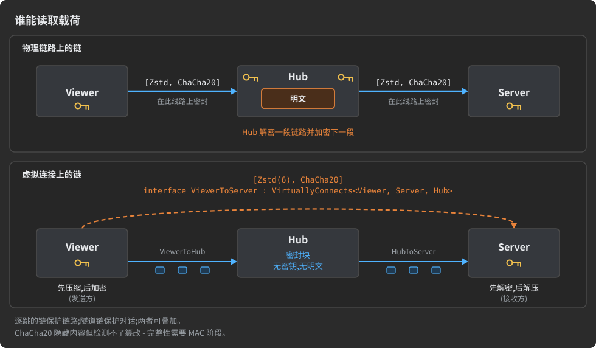

[trim](#trims) 从不出现在连接链中,虚拟连接也不例外:链加在链路上,包裹该链路承载的一切。被 trim 的字段仍然可以在隧道段上被切掉 —— 它的端点 `IfSendingFrom<XProducer, Producer__Sink_Structured>` 命名的就是一条虚拟连接。隧道链和切点是独立的层,中继两者都看不到。

<a id="choosing-what-the-middle-tier-does"></a>
### 选择中间层做什么

位于生产者和其消费者之间的主机扮演几种角色之一,每种角色需要不同的机制。先判断你手上是哪一种:

| 中间主机必须…… | 使用 | 参见 |
|:--|:--|:--|
| 在连接之间路由字节且从不读取它们 | 虚拟连接:生成的 Relay | 本章 |
| 保存一份载荷并在没有其 schema 的情况下稍后重放 | trim:该主机是持有原始字节的端点 | [trim](#trims) |
| 检查、变换、过滤,或把一条流扇出给多个消费者 | 智能中间层(Smart middle) | 下文 |
| 通过继续向下游调用来应答一个调用 | 级联 RPC:每跳一对 Actor,中间主机重新发起调用 | [Actor 的种类与运行时的 Actor](#actor-kinds-and-the-actor-at-runtime) |

只有当中间主机对内容无感知时,Relay 才是对的。它从不物化自己承载的字节,所以无法测量、转码、过滤或复制它们。

**智能中间层**不做转发。它作为普通的流消费者消费这条流 —— 一个 `Receiver.BytesDst` 处理器(见[流](#streams))—— 并在同一趟处理中在内存里维护字节的**镜像**,再把它重新发给 N 个在线订阅者,而不再读任何持久存储。AdHoc 不生成智能中间层;你用流 API 自己搭建:

1. **空闲时捕获零成本** —— 只在至少有一个订阅者附着时,才把每个入站块追加到镜像;没有订阅者时跳过捕获,中间主机就是个普通消费者。
2. **一个镜像缓冲区** —— 一个共享缓冲区持有正在扇出的字节;一份副本喂给全部 N 个订阅者,而不是 N 个独立的中继。
3. **每个订阅者一个切片器** —— 一个 `Transmitter.BytesSrc` 随着订阅者的套接字排空,把镜像的连续切片交给它。慢的订阅者从不拖累其他订阅者,中间主机缓冲的数据也从不超过在途窗口。

当中间主机拥有 schema 且必须对内容采取行动时使用智能中间层 —— 测量、转码、过滤、把一个来源复制到多个数据汇。纯路由跳用 Relay:成本恒定,且不需要 schema。

[多路复用器](#multiplexing)是另一种工具:它让若干条物理连接共享一个监听端口。多路复用器不能列出虚拟连接 —— 隧道从不在自己的端口上到达。反向是存在的:多路复用器可以在一条物理承载连接上以隧道方式承载一条*被中继的*物理连接 —— 即共享主机不是其参与方的连接;这样的连接从 pack 池中取一个线路 ID,和虚拟连接一样(见[多路复用](#multiplexing))。

<a id="virtual-connection-rules-at-a-glance"></a>
### 虚拟连接规则一览

| 规则 | 细节 |
|:--|:--|
| 声明 | `interface X : VirtuallyConnects<L, R, PATH>`;任何接受 `Connects<L, R>` 的地方都可用的连接 |
| 端点 | `L ≠ R`;`L`、`R` 和每个 `PATH` 主机各出现一次 |
| `PATH` | 一台主机或主机元组,顺序任意;至少一台;每个元素都是已声明的主机(主机修饰符代表其主机) |
| 路由 | 只由物理 `Connects<>` 链路重建;它必须存在、恰好经过每台列出的主机一次且唯一 |
| 主机对 | `L` 与 `R` 之间任意方向不得有其他物理或虚拟连接;并行对话走 `MaxTunnels` |
| 体 | 空:纯隧道,原始字节;非空:通过隧道承载的完整结构化连接;Actor/状态要求只适用于物理连接 |
| `MaxTunnels` | 默认 256;至少 1;1 = 没有 `tunnel_id`;否则为 1–4 字节的小端键;编译期常量 |
| `MaxStream_KiloBytes` | 默认无界;一条隧道可承载的最大流,单位 KiB;编译期常量 |
| 线上格式 | `[虚拟连接的线路 ID][tunnel_id?][len][data]…[0]`,每串突发一个帧;`ABORT` 取代 `[0]` 即结束隧道 |
| 中继主机 | 每条入站链路的接收器上每个虚拟连接一个 `Relay`;你的 `Tunneling` 区域把 `tunnel_id` 映射到出站连接或 `null` |
| 端点主机(Java、C#) | 承载连接保存 `tunnels_<VirtualConnection>`、`rx_`/`tx_<VirtualConnection>`、`send_<VirtualConnection>`、`close_tunnels_<VirtualConnection>()`;`Tunnel` 和 `Tunnel end` 区域带默认代码 |
| 链 | 写在 `VirtuallyConnects` 接口上:在 `L` 与 `R` 之间端到端;中继转发密封的块;不允许 trim |
| 编号表 | 虚拟连接从可传输 pack 池中持有一个持久的线路 ID(见[编号表](#numbers-tables)) |
| 多路复用 | 多路复用器不能列出虚拟连接(见[多路复用](#multiplexing)) |

---

<a id="multiplexing"></a>
## 多路复用

*部署:监听主机 → **一个端口服务多条连接** → 首字节指出拨号主机 → 普通连接*

**多路复用器(multiplexer)**是主机在其上服务自己多条连接的一个端口。到达该端口的每个套接字都以一个字节开头 —— 拨号主机的 `uid`,从这个字节起,该套接字就属于拨号主机与监听主机之间的那条连接:它的 pack、它的 Actor、它的状态,与声明完全一致。同一端口上的下一个套接字可能属于另一条连接。

[连接](#connections)本身不涉及套接字。它是得到自己的端口还是与主机的其他连接共享一个端口,是部署决策,而多路复用器就是描述文件提供第二种选项的方式。它只涉及**监听**侧:拨号主机仍然是自己那条连接的普通客户端,它增加的全部内容就是那个字节。

没有多路复用器时,终结多条连接的主机需要每条连接一个端口。监听套接字收到的是原始字节,它必须预先知道将由哪个生成的连接来读。首字节在运行时给了它这个知识。

<a id="declaring-a-multiplexer"></a>
### 声明多路复用器

多路复用器是一个扩展 `Multiplex<CONNECTIONS>` 的接口,其中 `CONNECTIONS` 是两条或更多连接的元组:

```csharp
struct Vehicle       : Host{ }   // 固件 3.x
struct VehicleLegacy : Host{ }   // 固件 2.x,仍在现场
struct Dashboard     : Host{ }   // 操作员控制台
struct Service       : Host{ }   // 诊断工具
struct Fleet         : Host{ }   // 后端

interface Telemetry       : Connects<Vehicle,       Fleet>{ /* states and branches */ }
interface TelemetryLegacy : Connects<VehicleLegacy, Fleet>{ /* states and branches */ }
interface Console         : Connects<Dashboard,     Fleet>{ /* states and branches */ }
interface Diagnostics     : Connects<Service,       Fleet>{ /* states and branches */ }

interface FleetPort : Multiplex<(Telemetry, TelemetryLegacy, Console, Diagnostics)>{ }
```

`Fleet` 是全部四条连接共享的那台主机,所以 `Fleet` 拥有这个端口。多路复用器的体通常为空。它可以持有常量,代理会把这些常量随多路复用器一起带给生成器(见[自定义元数据作为常量](#custom-metadata-as-constants));写在多路复用器上的特性不会被读取。

AdHoc 生成器的多路复用器测试台声明了最小可用的形态,并有意让第三条连接留在多路复用器之外:

```csharp
// struct Hub, Alpha, Beta, Gamma : Host{ ... } - 各自声明自己的 ping 或 pong pack

interface AlphaHub : Connects<Alpha, Hub>{
    [l____________<Alpha.AlphaPing>]
    [____________r<Hub.AlphaPong>]
    struct Start{ }
}

interface BetaHub : Connects<Beta, Hub>{
    [l____________<Beta.BetaPing>]
    [____________r<Hub.BetaPong>]
    struct Start{ }
}

interface GammaHub : Connects<Gamma, Hub>{
    [l____________<Gamma.GammaPing>]
    [____________r<Hub.GammaPong>]
    struct Start{ }
}

/// <summary>Hub 为 Alpha 和 Beta 提供的一个端口。</summary>
interface HubPort : Multiplex<(AlphaHub, BetaHub)>{ }
```

`Alpha` 和 `Beta` 拨号 `Hub` 的同一个端口;`Gamma` 拨自己的端口,它的线上格式与没有 `HubPort` 时完全相同。


<a id="the-first-byte-of-a-multiplexed-socket"></a>
### 被多路复用套接字的首字节

到达多路复用端口的每个套接字都以**一个字节开头:拨号主机的 `uid`**。主机的 `uid` 是它在[编号表](#numbers-tables) `hosts` 区段中的编号,由代理写入描述文件:

- **它是一个字节,0..255。** 遇到 uid 超出此范围的主机时,代理以错误停止,所以一个项目连同它扩展的项目至多容纳 256 台主机,一个多路复用器至多代表 256 条连接。
- **它是稳定的。** 主机在整个项目范围内编号,包括被扩展项目的主机,而那些主机保留自己的编号。新增主机从不对现有主机重新编号,所以现场设备一直发送它出厂时的那个字节。一个例外:当被扩展的项目新增了编号已被你的主机占用的主机时,你的主机会在警告下被重新编号,它们的首字节也随之改变。对拨号多路复用器的对端来说,这是线上变更(见[编号表](#numbers-tables))。
- **它在一个端口上唯一。** 两台主机用相同的 uid 拨同一个多路复用器是错误("在 hosts 表中删除这些主机中除一台外的所有行,下次运行会给他们分配空闲的 uid")。

为什么一个字节足以指出一条连接:共享主机是每条列出连接的参与方,一对主机之间至多由一条连接相连(见[连接](#connections)),且解析器只允许一台主机为一条连接拨某个多路复用器。所以每条列出连接的远端都是不同的主机,拨号主机的 uid 恰好指出一条连接。

[主机到自身的连接](#connections)遵循同样的规则。它的拨号主机就是共享主机,所以它的字节是共享主机自己的 uid。一个消息代理端口可以让客户端和其他代理并肩得到服务:

```csharp
struct Client : Host{ }
struct Broker : Host{ }

interface ClientBroker : Connects<Client, Broker>{ /* ... */ }
interface InterBroker  : Connects<Broker, Broker>{ /* ... */ }

interface BrokerPort : Multiplex<(ClientBroker, InterBroker)>{ }   // 字节 Client.uid -> ClientBroker,字节 Broker.uid -> InterBroker
```

字节之后,套接字就是它指出的那条连接的普通链路。这个字节**每个套接字只付一次,从不按 pack 计**。首字节之后,列出的连接在线上没有任何不同,连接声明中也没有任何内容引用多路复用器:多路复用器改变的是连接的**部署方式**,而不是它们的本质。

当运行时加密传输层时([变换链](#transform-chains)中描述的握手),该字节是握手之后加密流的第一个字节;它从不以明文发送。

<a id="declared-once-chosen-at-deployment"></a>
### 声明一次,部署时选择

多路复用器声明哪些连接*可以*共享一个端口;它不强制任何事。每条列出连接的生成代码在独立端口和多路复用端口上都一样工作,每一侧在搭建时自行选择:

- **监听主机**把多路复用器交给它的服务器,或者不交,像没有这个声明一样在独立端口上服务某条连接。
- **拨号主机**被告知它拨的端口是否多路复用。如果是,它的连接在一切之前先发送那个字节。


| 部署形态 | 代价与适用场景 |
|:--|:--|
| **每条连接一个端口** | 每条连接一个监听器、一个端口、一条防火墙规则和一张证书;适用于某条连接必须被独立触达、独立保护或独立重启时 |
| **一个多路复用端口** | 一个监听器、一个要发布的地址、一张要续期的证书、一个要在 NAT 上打的洞 |
| **混合** | 公开的连接共享一个端口;`Diagnostics` 保留自己的端口,只有服务 LAN 可达 |

一台主机可以拥有多个多路复用器,每个端口一个。一条连接至多属于其中一个,因为一条连接恰好到达一个端口。

> [!WARNING]
> 两侧必须一致。向直连端口发送该字节的呼叫方,或拨多路复用端口却不发该字节的呼叫方,与拨错端口的呼叫方错得一样离谱:直连端口会把该字节当作第一个 pack 的开头,多路复用端口会把第一个 pack 的第一个字节当作 uid。

因为多路复用器是端口所在主机的事务,[`.cs~` 影响报告](#evolving-a-protocol)把对多路复用器的编辑显示为只波及那台主机。拨该端口的主机用自己的 uid 开启套接字,无论该端口还服务什么。

<a id="several-kinds-of-peer-several-generations-behind-one-port"></a>
### 一个端口之后的多种对端、多个世代

同一个后端的各个对端往往除了所拨的地址之外毫无共同点:车辆、操作员控制台、技术员的诊断工具。每种是一台主机,各有自己的连接,多路复用器把它们放在一个端口之后。

车辆的第二代固件也以同样方式处理。在 AdHoc 中,新世代是一台带有自己连接的新主机,而不是 pack 内部的版本字段(原因以及什么算线上变更,见[演进协议](#evolving-a-protocol))。`Vehicle` 和 `VehicleLegacy` 有不同的 uid,所以两者拨同一个端口,各自落在自己的连接上:

- `TelemetryLegacy` 保留已部署固件构建时所针对的 pack 和状态机;没有任何东西编辑它。
- `Telemetry` 自由变化。
- 处理器从不需要询问自己在和哪一代固件说话。每个世代有自己的生成代码,首字节在第一个 pack 到达之前就已经回答了这个问题。
- 退役就是删除:把 `VehicleLegacy` 和 `TelemetryLegacy` 连同它们在编号表中的行一起删除(遗留的行会让下次运行停止),并把 `TelemetryLegacy` 从 `FleetPort` 的元组中移除,元组中仍列出三条连接。多路复用器至少列出两条连接:当一次退役会让端口上只剩一条连接时,把已退役的连接留在元组里(见[演进协议](#evolving-a-protocol))。

> [!WARNING]
> 只在其设备无一再拨号时才让一个世代退役。删除 `VehicleLegacy` 会释放它的 uid,下一台新主机可能得到它(见[编号表](#numbers-tables))。仍在现场的老设备会一直发送旧字节:如果新主机拨同一个端口,该设备会落到新主机的连接上。

当两个世代的 pack 并存于同一作用域时,用 `[KeepName]` 或 `[SkipName]` 过滤的[命名 Pack Set](#pack-sets)可以为其连接挑选一个世代的 pack。模式匹配的是 pack 在项目之下的路径,不含命名空间,所以把它锚定在名字段上:`(^|\.)V2\.` 保留任何名为 `V2` 的容器内的 pack。

<a id="server-generations-behind-one-port"></a>
#### 一个端口背后的多个服务器世代

后端也可以走同样的路。`FleetV2` 是一个新主机，是 `Fleet` 加上新增内容和修正后的副本，而新的对端
`VehicleV2` 和 `DashboardV2` 是与它对话的新主机。一个多路复用器只有一个共享主机，所以 `FleetV2` 得到自己的多路复用器：

```csharp
interface FleetPort   : Multiplex<(Telemetry,   Console)>{ }     // Fleet   - 第 1 世代,已冻结
interface FleetV2Port : Multiplex<(TelemetryV2, ConsoleV2)>{ }   // FleetV2 - 第 2 世代
```

两个世代仍然在一个进程里、一个端口后面运行：服务器把两个多路复用器组合成一个函数（Java）：

```java
IntFunction< AdHoc.Connection.Internal > both = uid -> {
    AdHoc.Connection.Internal in = Fleet.FleetPort.DEFAULT.apply( uid );
    return in != null ? in : FleetV2.FleetV2Port.DEFAULT.apply( uid );
};
```

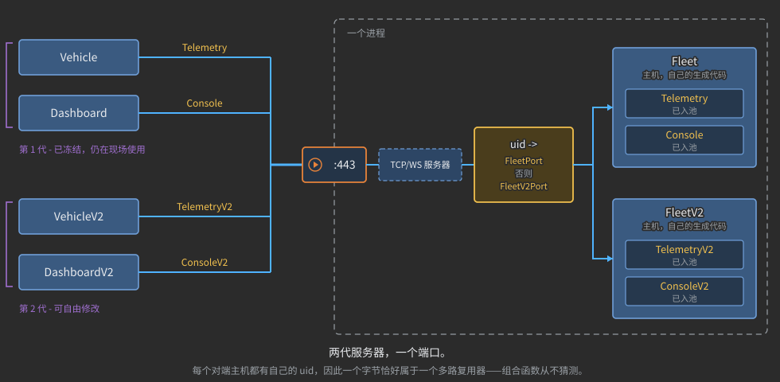

生成的多路复用器对它不服务的 uid 返回 `null`，而一个 uid 在一个项目内恰好命名一个主机，包括它所扩展的各项目的主机。
所以只要没有主机同时拨号两个多路复用器，组合就永远不需要猜测——这里成立，因为每个第二世代的对端都是新主机。
解析器单独检查每个多路复用器；让组合在一起的多路复用器的拨号主机互不重叠，是你的职责。当世代 1 退役时，把
`Fleet.FleetPort` 从组合中去掉。

<a id="the-life-of-a-multiplexed-socket"></a>
### 一个多路复用套接字的一生

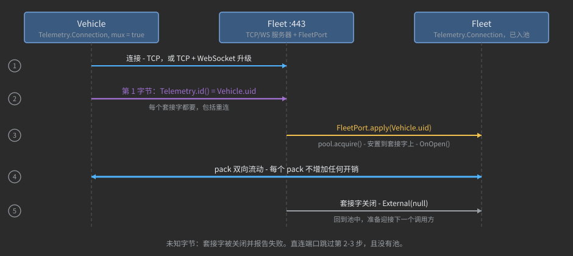

1. 呼叫方连接：TCP，或 TCP 加 WebSocket 升级。
2. 呼叫方的连接发送一个字节，`Telemetry.id`，即 `Vehicle.uid`。它在**每个**新套接字上都这样做，重连也不例外，
   并且在它发送的任何其他东西之前。当已有数据在等待时，这个字节与那些数据在同一次发送中发出。
3. 监听方调用 `FleetPort.apply(Vehicle.uid)`，它从池中取出一个 `Telemetry` 连接对象并安置在套接字上。
   随后这个连接听到的 connect 事件和 `OnOpen()` 与它在自有端口上听到的完全一样。未知的字节会关闭套接字，
   并把失败（"A multiplexed port has no connection for the host uid N"）报告给服务器的 `onFailure`。
4. pack 双向流动。不给它们加任何东西。
5. 当套接字消失时，传输槽位把连接对象留在手边。如果该槽位上的下一个套接字命名的是**同一个**连接，
   它直接取回该对象。如果它命名的是另一个连接，留下的对象以 `External(null)` 被释放，运行它的
   `Connection Release` 区域并回到池中。

直连端口跳过第 2、3 步：字节从不发送，连接就是端口工厂建出的那一个。

<a id="what-the-generator-produces-for-a-multiplexer"></a>
### 生成器为多路复用器生成什么

| 位置                                   | 内容                                                                                                                                                                                          |
|:----------------------------------------|:-----------------------------------------------------------------------------------------------------------------------------------------------------------------------------------------------|
| 每个列出的连接，**两侧** | `id`（Java 中为 `id()`）：共享主机对面那侧主机的 uid；`Telemetry.id` 就是 `Vehicle.uid`。两侧是同一个数：呼叫方发送它，多路复用器读取它 |
| 共享主机，每个列出的连接  | `Connection.pool`：等待呼叫方的连接对象。`External(null)` 把一个对象归还池中                                                                                                |
| 共享主机，每个列出的连接  | 注入点 `Connection pool size: a power of two`：你写在那里的内容加到指数上；默认的 `2` 保留至多 4 个空闲对象                                         |
| 共享主机，每个列出的连接  | 注入点 `Connection Release`，在对象回到池中时运行                                                                                                             |
| 共享主机                         | 一个以声明命名的类，`Fleet.FleetPort`：每个连接一个工厂字段（`new_Telemetry`、`new_Console`……）、`apply(uid)`，以及一个就绪实例 `DEFAULT`                  |

对于 Fleet 的例子，生成的 Java 多路复用器是这个形状（uid 来自编号表的 `hosts` 一节）：

```java
class FleetPort implements java.util.function.IntFunction< AdHoc.Connection.Internal > {
    public java.util.function.Supplier< AdHoc.Connection.Internal > new_Telemetry       = Telemetry.Connection.pool::acquire;
    public java.util.function.Supplier< AdHoc.Connection.Internal > new_TelemetryLegacy = TelemetryLegacy.Connection.pool::acquire;
    public java.util.function.Supplier< AdHoc.Connection.Internal > new_Console         = Console.Connection.pool::acquire;
    public java.util.function.Supplier< AdHoc.Connection.Internal > new_Diagnostics     = Diagnostics.Connection.pool::acquire;

    @Override
    public AdHoc.Connection.Internal apply( int uid ) {
        switch( uid ) {
            case 1: return new_Telemetry.get();       //Vehicle.uid
            case 2: return new_TelemetryLegacy.get(); //VehicleLegacy.uid
            case 3: return new_Console.get();         //Dashboard.uid
            case 4: return new_Diagnostics.get();     //Service.uid
            default: return null;
        }
    }

    public static final FleetPort DEFAULT = new FleetPort();
}
```

池有界且从不阻塞。空池就新建一个连接对象；满池就丢弃被释放进来的对象。池的大小是为下一批呼叫方保留的空闲对象数量，
而不是并发呼叫方的上限。要保留 32 个空闲对象而不是 4 个，在 `Connection pool size: a power of two` 区域写 `+ 3`（2² × 2³ = 2⁵）。

`FleetPort` 就是一个从字节到连接对象的普通函数，服务器只调用它。你可以给任何 `new_...` 字段指派自己的工厂，
像上面那样组合多个多路复用器，或者从零写出这个函数。

> [!IMPORTANT]
> 池化的连接对象一个接一个地服务呼叫方。生成的代码在每次关闭时重置它自己保存的东西。你在连接自己的字段里保存的状态
> 必须由你的代码清除：在 `Connection Release` 区域里，也要在连接关闭时清除——因为在同一传输槽位上命名同一连接的
> 套接字会不经过 `Connection Release` 直接取回该对象（上面第 5 步）。

<a id="wiring-a-multiplexed-port"></a>
### 接线一个多路复用端口

监听主机把多路复用器传给它的服务器，作为把第一个字节变成连接的函数。随后传输层工厂只制作裸传输层。
Java，一个用于公共连接的多路复用端口，旁边一个用于 `Diagnostics` 的直连端口：

```java
var engine = new Network.TCP.Engine( "Fleet", Runtime.getRuntime().availableProcessors(), 1024 );

var pub = new Network.TCP.Server( "Fleet",
                                  Network.TCP.WebSocket::new,            // 裸传输层……
                                  Fleet.FleetPort.DEFAULT,               // ……首字节挑选连接
                                  Network.TCP.onFailurePrintConsole,
                                  engine,
                                  new InetSocketAddress( 443 ) );

var lan = new Network.TCP.Server( "Fleet diagnostics",                   // 一个直连端口:一条连接,没有首字节
                                  host -> {
                                      var ext = new Network.TCP.WebSocket( host );
                                      new Diagnostics.Connection().External( ext );
                                      return ext;
                                  },
                                  new InetSocketAddress( 8443 ) );
```

同一个多路复用端口的 C# 版本：

```csharp
var pub = new Network.TCP.Server( "Fleet",
                                  host => new Network.TCP.WebSocket( host ),
                                  Fleet.FleetPort.DEFAULT.apply,
                                  Network.TCP.onFailurePrintConsole,
                                  1024, 0, null,
                                  new IPEndPoint( IPAddress.Any, 443 ) );
```

拨号主机传 `mux`。Java、C#、TypeScript：

```java
var vehicle = new Network.TCP.WebSocket.Client< Telemetry.Connection >( "vehicle", ext -> new Telemetry.Connection(),
                                                                        Network.TCP.onFailurePrintConsole,
                                                                        new Network.TCP.Engine( "vehicle", 1, 1024 ),
                                                                        true );   // mux
```

```csharp
var vehicle = new Network.TCP.WebSocket.Client< Telemetry.Connection >( "vehicle", ext => new Telemetry.Connection(),
                                                                        Network.TCP.onFailurePrintConsole, 1024, mux: true );
```

```typescript
const dashboard = new Network.WebSocketClient( "dashboard", ext => new Console.Connection(),
                                               Network.Host.onFailurePrintConsole, 1024, true );   // mux
```

裸 TCP 客户端（`Network.TCP.Client`）接受同样的 `mux` 实参。AdHocAgent 本身就是这样一个呼叫方：它通过
WebSocket 或裸 TCP 拨号 AdHoc 服务器的多路复用端口，取决于地址：

```csharp
connection = await new Network.TCP.Client< Connection >( "tcp_client", ( ext ) => new Connection(), Network.TCP.onFailurePrintConsole, 1024, mux: true )
                       .ConnectAsync( new IPEndPoint( ipAddress, uri.Port ), TimeSpan.FromSeconds( 10 ) );
```

生成的连接有一个无参构造函数；服务器或客户端用 `External(ext)` 把它安置在自己的套接字上。

| 侧                       | Java | C# | TypeScript                                    |
|:---------------------------|:----:|:--:|:----------------------------------------------|
| 监听，多路复用     |  ✓  | ✓ | -                                             |
| 拨号一个多路复用端口 |  ✓  | ✓ | ✓——字节位于第一个 WebSocket 帧的开头 |

TypeScript 主机没有服务器，所以它在多路复用连接中永远是拨号侧。

<a id="relayed-connections-in-a-multiplexer"></a>
### 多路复用器中的中继连接

多路复用器也可以列出共享主机**并非**当事方的连接。这样的连接是**中继的**：共享主机接受该连接中拨号端口那台主机的
套接字，并在一条隧道中承载该连接的字节——这条隧道运行在连接共享主机与该连接另一台主机（**承载连接**）的物理连接之上。
中继连接的两台主机都不需要到对方的直接链路。

```csharp
struct Browser : Host{ }
struct Admin   : Host{ }
struct Mobile  : Host{ }
struct Edge    : Host{ }   // 拥有公开端口
struct Backend : Host{ }   // 只能从 Edge 到达

interface Console     : Connects<Browser, Edge>{ /* ... */ }
interface AdminLink   : Connects<Admin,   Edge>{ /* ... */ }
interface EdgeBackend : Connects<Edge,    Backend>{ /* ... */ }   // 承载连接
interface Query       : Connects<Mobile,  Backend>{ /* ... */ }   // Edge 不是它的当事方

interface EdgePort : Multiplex<(Console, AdminLink, Query)>{ }
```


解析器如何读取 `EdgePort`：

1. **共享主机**是至少两个列出连接的当事方、且作为当事方的连接数多于任何其他主机的主机。
   `Edge` 是 `Console` 和 `AdminLink` 的当事方；其他每台主机只是一个连接的当事方。所以 `Edge` 拥有该端口。
2. **共享主机是当事方的列出连接**被直接服务，与本章其余部分相同。
3. **它不是当事方的列出连接**（`Query`）需要恰好一条承载连接：共享主机与其两台主机之一之间的一条物理连接
   （不是虚拟的，不是修饰器）。这里 `EdgeBackend` 把 `Edge` 与 `Backend` 相连。另一台主机 `Mobile` 是拨号端口的那台，
   所以 `Query` 的字节是 `Mobile.uid`。
4. 承载连接不必列在多路复用器中。

规则 3 的两种失败都是错误，各有自己的消息：

| 情形                                                                             | 消息（节选）                                                                                                                                            |
|:--------------------------------------------------------------------------------------|:---------------------------------------------------------------------------------------------------------------------------------------------------------------|
| 中继连接的两台主机都没有与共享主机的物理连接 | "... can relay it only in a tunnel over a physical connection with one of its hosts, and there is none. Declare one, or take `Query` out of the multiplexer." |
| 两台主机都有一条                                                                   | "... both its hosts have a physical connection with `Edge` ... It is not clear which of them dials the port. Take `Query` out of the multiplexer."            |

中继连接从 pack 的池中取一个线路 ID，即它的隧道在承载连接上的 id，与
[虚拟连接](#virtual-connections-and-relays)完全一样；agent 把它写在
[编号表](#numbers-tables)中该连接编号的后面。一个连接至多只能被一个多路复用器中继。

<a id="what-the-parser-checks-for-a-multiplexer"></a>
### 解析器为多路复用器检查什么

| 检查                                   | 规则                                                                                                                                                                                                         |
|:----------------------------------------|:---------------------------------------------------------------------------------------------------------------------------------------------------------------------------------------------------------------|
| **至少两个连接的元组** | `Multiplex<(A, B)>`；单个连接没有可与之共享端口的对象                                                                                                                                                                                                   |
| **只能是连接**                    | 每个元素都是用 `Connects<L, R>` 声明的连接；主机、pack、`Modify<>` 修饰器或 `VirtuallyConnects<…>` 都被拒绝                                                                                                                                 |
| **每个连接一次**                | 没有连接在一个多路复用器中列出两次                                                                                                                                                                                                         |
| **一个共享主机**                     | 一台主机是至少两个连接的当事方、且多于任何其他主机；在左侧还是右侧无所谓；它拥有该端口                                                                                                                             |
| **中继连接**                 | 共享主机不是当事方的列出连接需要恰好一条承载连接，见[多路复用器中的中继连接](#relayed-connections-in-a-multiplexer)                                                                                                          |
| **每个拨号主机一个连接**     | 一台主机至多只为一个连接拨号一个给定的多路复用器：套接字用拨号主机的 uid 命名它的连接                                                                                                                                                        |
| **uid 放得下且不重复**                 | 每个主机 uid 都在 0..255；拨号同一多路复用器的任意两台主机不共享 uid                                                                                                                                                                                                |
| **每个连接一个多路复用器**      | 一个连接至多属于一个多路复用器；同一组连接上的两个多路复用器会被如实报告（"Keep one of them"）                                                                                                                                |
| **不能有 `[UDP]` 连接**               | 多路复用端口是 TCP 端口；[UDP 连接](#sessions-guaranteed-delivery-udp)有自己的端口                                                                                                                                                               |
| **像连接一样放置**            | 直接声明在项目作用域中；它的名字与连接共享命名空间，所以多路复用器和连接不能同名，导入之后也不行（[复用描述](#reusing-descriptions)）；它可以列出从其他项目导入的连接 |

<a id="multiplexers-and-tunnels"></a>
### 多路复用器与隧道

[`VirtuallyConnects`](#virtual-connections-and-relays) 链路经由隧道穿过中继主机。它从不到达自己的端口，
所以多路复用器没有要为它分拣的东西，解析器也拒绝元组中的它。上面的中继连接是相反的情形：物理 `Connects`
连接，其拨号侧确实到达端口，而共享主机自己把它放进隧道。

相关：[连接](#connections)（每对主机一个连接，主机连接到自身）、[编号表](#numbers-tables)（主机
uid、线路 ID）、[协议演进](#evolving-a-protocol)（作为主机的世代、`.cs~` 报告）、
[虚拟连接与中继](#virtual-connections-and-relays)（承载连接与隧道）、
[会话、保证送达、UDP](#sessions-guaranteed-delivery-udp)。

---

<a id="numbers-tables"></a>
## 编号表

*模型：**project → host → connection → actor → state → branch → pack**——身份 · 流程：描述 → **AdHocAgent 维护编号** →
生成器服务器*

描述中的一个实体从 AdHocAgent 的一次运行到下一次运行必须保持是同一个实体，即使你重命名它、移动它或重排文件。
AdHoc 给每个这样的实体一个**编号**，并把所有编号保存在描述文件顶部的两个文档注释里：**编号表**。AdHocAgent 写出并维护它们；
它们下面的声明不带任何编号。本章解释哪些东西被编号、表如何布局、编号在线上用来做什么，以及描述变化时它们如何保持正确。

<a id="identity-in-a-table-position-in-a-pack"></a>
### 表中的身份，pack 中的位置

描述中的两类东西用两种不同方式区分：

- **实体**——项目、它的主机、连接、Actor、状态、分支和 pack——靠**编号**区分。编号只分配一次，
  从不依赖名字或声明的位置。在 IDE 里重命名一个 pack、把一台主机移到文件末尾、给连接排序，
  都不改变线上的任何东西，也不改变生成的代码按编号索引的任何东西，比如你自己的代码所在的
  [自定义代码区域](#deployment-and-smart-merge)。
- **字段**不编号。字段靠位置区分：字段按声明的顺序传输，基元类型字段也一样。重排一个 pack 的字段，
  在线上就是另一个 pack。布局在[值如何变成字节](#how-values-become-bytes)中解释；这对已部署协议意味着什么见
  [协议演进](#evolving-a-protocol)。


| 实体                                                                                                               | 是否编号                     | 编号保存在哪里                                                        | 在什么范围内编号                                                                         |
|:---------------------------------------------------------------------------------------------------------------------|:-----------------------------|:------------------------------------------------|:----------------------------------------------------------------------------------------|
| 项目                                                                                                              | 是                          | 项目表的第一行                                                 | —（它的编号是它第一次被编号的时刻）                                      |
| 主机                                                                                                                 | 是                          | `hosts` 一节                                                                 | 项目**以及它扩展的每个项目**——编号同时也是主机的 `uid` 字节 |
| 连接（物理、虚拟、多路复用器中继）                                                                  | 是                          | `connections` 一节；虚拟或中继连接在那里还有一个线路 ID | 项目                                                                             |
| 命名 Actor、RPC 方法                                                                                              | 是                          | `actors` 一节；双向调用的方法有两个编号                     | 项目                                                                             |
| `Actor0`（连接自己的 Actor）                                                                                | 固定编号，从不写出  | —                                                                               | —                                                                                       |
| 命名 Actor 的状态                                                                                               | 是                          | `states` 一节                                                                | 它的 Actor                                                                               |
| `Actor0` 的状态（直接声明在连接中）                                                                | 是                          | 状态名后面的一个记号：`struct Start /*ÿ*/{ }`                          | 它的 Actor                                                                               |
| 分支                                                                                                               | 是                          | 路由特性内的一个记号：`[l____________<Login>/*Ā*/]`              | 它的状态                                                                                   |
| pack、枚举、常量集（以及其他类 pack 声明，如 `Modify<>` 修饰器或命名变换流） | 是                          | packs 表；pack 被传输时带线路 ID                      | 项目                                                                             |
| `TYPEDEF` 类                                                                                                      | 否                           | —                                                                               | —                                                                                       |
| 字段                                                                                                                | 否——按位置              | —                                                                               | —                                                                                       |
| 解析器创建的状态（RPC 方法的 `Call` 和 `Reply` 状态、`End`、`Close`）                          | 固定编号，从不写出 | —                                                                               | —                                                                                       |

<a id="where-the-numbers-tables-live"></a>
### 编号表放在哪里

编号表是两个文档注释，紧放在项目接口之前，各以命名自己的词开头。一个已编号描述文件的顶部看起来像这样（已缩短）：

```csharp
using org.unirail.Meta;

namespace com.my.company2
{
    /** packs
        <see cref='Point3'/>Ā                                       1 common | geo | 📍
        <see cref='Root'/>ÿ                                         0 common | base
    */
    /** project
        <see cref='MyProject'/>ǍŦƈŗč

        hosts
        <see cref='FrontendServer'/>ÿ

        connections
        <see cref='TrialConnection'/>ÿ
    */
    public interface MyProject{
        // 各声明——完整描述在本章末尾
    }
}
```

- **它们属于 AdHocAgent。** 它在第一次运行时写出它们，让每行保持排序和对齐，并在编号变化时重写它们。
  唯一属于你的部分是 pack 编号之后的文本——它的**标签**，下面会讲。
- **`.cs` 任务维护它们。** 每次运行把它要写出的表与文件比较，只在有差异时才重写文件，所以未改动的描述保留它的时间戳。
  写出时它记录 `Updated persistent ids/uids in <file>`。[`.cs~` 影响报告](#evolving-a-protocol)读取这些表，从不写出。
- **被扩展的项目也被维护。** 描述所[扩展](#reusing-descriptions)的每个项目的表——直接扩展或通过另一个项目——都以同样方式维护，
  它们的文件在编号变化时被重写。
- **只读的描述不被更新。** AdHocAgent 记录一条警告（"... is read-only. As a result, the pack ID update process was
  skipped."），并用它已有的编号继续。一次死掉的运行可能把文件留成只读；见 [AdHocAgent](#adhocagent)。
- **只有项目自己的接口有表。** 一个文档注释在以下条件下才算表：它是顶层接口（项目）的前置注释，
  且第一个词是 `packs`、`imported`、`project`、`hosts`、`connections`、`actors` 或 `states` 之一。
  不要用这些小写词之一开头你自己为项目接口写的文档注释。项目体内带 `<see cref/>` 行的 `/** ... */`
  是它后面声明的普通文档注释，不是表。

<a id="the-packs-table"></a>
### packs 表

第一个注释，由 `/** packs` 开头，列出项目的每个 pack，按它相对于项目的路径字母序排列
（`BackendServer.ReplyInts`）。"每个 pack"包括从不上路的 pack——枚举、常量集、空 pack、`Modify<>` 修饰器——
因为对 AdHocAgent 来说它们也是 pack。`TYPEDEF` 类不列出：别名没有自己的身份。

![packs 表的一行被放大画出并拆成四个带标签的部分：cref "<see cref='Root'/>"，标注"which pack - renamed by the IDE together with the pack"；base256 字符"ÿ"，标注"number - identity, never changes, base256: byte + U+00FF, least significant first"；独立一列中的十进制"0"，标注"wire id - only while a branch sends the pack; compact"；以及"common | base"，标注"tags - yours; KeepDoc and SkipDoc filters read them"。下方是项目表的一行："<see cref='MyProject'/>ǍŦƈŗč ū"，其中"ǍŦƈŗč"标注"own number: milliseconds since 2024-10-14 08:42:55.710 UTC"，"ū"标注"one slot per imported project: zig-zag of (own - imported)"](docs/img/dev-20-table-line-anatomy.zh-CN.svg)

```csharp
    /** packs
        <see cref='BackendServer.ReplyInts'/>ă                      7 backend | 📊
        <see cref='Point3'/>Ā                                       1 common | geo | 📍
        <see cref='Root'/>ÿ                                         0 common | base
    */
```

在 `/>` 之后，每行最多放三样东西。

<a id="the-number-of-a-pack"></a>
#### pack 的编号

紧跟 `/>` 的字符是 pack 的**编号**，即它的身份。pack 存在期间它从不改变。编号用 **base256 字符**书写：
每个字符是编号的一个字节加 U+00FF，最低有效字节在前。所以 `ÿ` 是 0，`Ā` 是 1，`ā`
是 2，`ă` 是 4，`ĊĀ` 是 11 + 1 × 256 = 267。表中和记号里的每个编号都用同一编码。

<a id="the-wire-id-of-a-pack"></a>
#### pack 的线路 ID

独立一列中的十进制数（`7`）是 pack 的**线路 ID**：在线上位于 pack 之前的值，让接收器知道后面是哪个 pack。
只有**可直接传输**的 pack 才有：某个分支发送的 pack——无论分支把该 pack 列在它的
`PACKS` 泛型里、用 `KeepName` / `SkipName` / `KeepDoc` / `SkipDoc` 过滤器选中它，还是从 Pack Set 取得它
（[Pack Sets](#pack-sets)、[Actor、状态、分支](#actors-states-branches)）。只用作字段类型的 pack
在那个字段内部传输，没有线路 ID。

AdHoc 自己的协议描述 `AdhocProtocol.cs` 的 packs 表把两种并排展示（已缩短）：

```csharp
	/** packs
		<see cref='Agent.Login'/>Ď                                    5
		<see cref='Agent.Project'/>Ć                                  8
		<see cref='Agent.Project.Connection'/>ċ
		<see cref='Agent.Project.Host.Langs'/>Ę
	*/
```

它的 `Communication` 连接的分支发送 `Agent.Login` 和 `Agent.Project`，所以它们有线路 ID。
`Agent.Project.Connection` 只在 `Agent.Project` 的一个字段中传输，而 `Agent.Project.Host.Langs` 是枚举：
两者都被列出，都没有线路 ID。

编号和线路 ID 分开，因为它们服务不同的目的。编号是身份，可以是任意大小。线路 ID
保持紧凑：生成的接收器用同样固定的字节数读取一个连接的每个 pack id，字节数够装最大的 id，所以
小的 id 让这个字段保持短。

- 新的可传输 pack 取**最低的空闲线路 ID**。在扩展其他项目的项目中，新 id 从导入项目的最大 id 之上开始
  （[复用描述](#reusing-descriptions)）。虚拟连接和中继连接从同一个池中取线路 ID。
- 当没有分支再发送一个 pack 时，它**失去线路 ID，但保留它的行**、它的编号和它的标签。当分支再次发送它时，
  它重新得到线路 ID——最低的空闲 id，不一定是它原来的那个。线路 ID 变了，就是协议变了。

<a id="tags-of-a-pack"></a>
#### pack 的标签

编号之后的一切都是 pack 的**标签**：你写在那里的任何词、符号或 emoji。标签是你组织 pack 的方式，也是
分支选择它们的方式：`KeepDoc` 或 `SkipDoc` 过滤器在搜索 pack 的文档注释时连同它的标签一起搜索，每个项目的
packs 表的标签都参与（[Pack Sets](#pack-sets)）。AdHocAgent 重写表时保留你的标签，但有这些例外：

| 你写的                                        | AdHocAgent 保留的         | 原因                                                     |
|:-------------------------------------------------|:-------------------------|:--------------------------------------------------------|
| 编号之后到行尾的文本 | 同样的文本            | 它就是标签文本                                      |
| 文本中某处的 `<`                      | 只保留 `<` 之前的部分 | `<` 会开始文档注释的一个 XML 元素            |
| 前导或尾随空格、`/`、`*`             | 去掉它们后的文本    | 它们是注释填充物                                 |
| 连续多个空格                          | 一个空格                | 词被重新连接                                 |
| 以数字开头的标签（`2024 sensors`） | `sensors`                | pack 编号后面的数字会被读作它的线路 ID |

所以把标签写成不以数字开头、不含 `<` 的词：`sensors | 2024`、`client | auth | 🔑`。

<a id="imported-packs-sent-under-an-id-of-this-project"></a>
#### 在本项目的 id 下发送的导入 pack

扩展其他项目的项目通常用自己的项目给的线路 ID 发送导入的 pack。当它用另一个 id 发送导入的 pack 时——
典型情形是它自己的项目从不发送、因而在那里没有 id 的 pack——packs 表为它增加第三节：

```csharp
    /** packs
        <see cref='Sample'/>ÿ        3

        imported packs, sent under an id of this project
        <see cref='com.lib.Library.Trace'/>4
    */
```

这一节的行用全名命名导入的 pack，只放线路 ID（十进制），后面跟可选的标签。
pack 的编号留在它自己项目的表里。什么时候会发生这种情况，见[复用描述](#reusing-descriptions)。

<a id="the-project-table"></a>
### 项目表

第二个注释由 `/** project` 开头,容纳其余所有内容。它的第一行是项目本身;然后是 `hosts`、`connections`、`actors` 和 `states` 各节,每个名称在空行之后独占一行。没有内容的节会被省略。主机、连接和 Actor 按其编号的顺序列出,状态按其路径的顺序列出。

下面是 AdHocAgent 为现行描述 `ActorsDemo.cs` 写出的内容(一个默认 Actor、一个函数组 Actor `Notify`、一个单向 RPC 方法 `ping`、一个双向 RPC 方法 `lookup`、有状态的 Actor 和一个虚拟连接 `ViewerToServer`),已缩短:

```csharp
    /** project
        <see cref='ActorsDemo'/>ŵǢǣźč

        hosts
        <see cref='Client'/>ÿ
        <see cref='Server'/>Ā
        <see cref='Hub'/>ā
        <see cref='Viewer'/>Ă

        connections
        <see cref='Link'/>ÿ
        <see cref='HubToServer'/>Ā
        <see cref='ViewerToHub'/>ā
        <see cref='ViewerToServer'/>Ă 26

        actors
        <see cref='Link.Notify'/>Ā
        <see cref='Link.ping'/>ā
        <see cref='Link.lookup'/>Ă ă
        <see cref='Link.Job'/>ą
        <see cref='ViewerToServer.Watch'/>Ĉ

        states
        <see cref='Link.Job.Running'/>Ā
        <see cref='Link.Job.Start'/>ÿ
        <see cref='Link.Notify.Flags'/>Ā
        <see cref='Link.Notify.Messages'/>ÿ
        <see cref='ViewerToServer.Watch.Live'/>Ā
        <see cref='ViewerToServer.Watch.Start'/>ÿ
    */
```

<a id="the-projects-own-number"></a>
#### 项目自身的编号

项目所在行的编号是项目第一次被编号的时刻:自 2024-10-14 08:42:55.710 UTC 起的毫秒数。它把本项目与其他一切项目区分开,包括它扩展的项目。AdHocAgent 在给一个新项目编号时会连同日期一起打印它(`"MyProject" is a new project: its number is ..., born 2026-10-04 08:44:30.167`),它的消息也用该日期称呼项目("born ...")。

- **永远不要把一个项目的行复制到另一个项目里。** 两个项目共用一个编号会被拒绝:"The projects A, B have one number ... one is a copy of the other. Delete the number of the copy - its project line in the numbers table - and the next run gives it a new one."
- **只要还有其他行存在,项目自身的行就不能删除。** 新编号会让它对所有导入它的项目来说变成另一个项目,所以 AdHocAgent 会停下:"The numbers tables of X have no line for the project itself ... restore the line"。

<a id="slots-of-the-imported-projects"></a>
#### 导入项目的槽位

一个[扩展其他项目](#reusing-descriptions)的项目,会在自身编号之后为它导入的每个项目(直接导入,或通过另一个项目间接导入)再写一个编号,用空格分隔:`<see cref='MyProject'/>ƍǃǤźč ū`。每个编号是项目自身编号与导入项目编号之差,经 zig-zag 编码,因此相近的编号保持短小。它的位置就是这个导入的**槽位**:在生成的代码内部标识一个导入的是槽位,而不是导入项目自身的编号——例如在导入实体的自定义代码区域的键里。一个导入会保留自己的槽位。当一个导入消失、另一个导入出现时,新来者占据空出的槽位,AdHocAgent 会发出警告:如果新来者是旧导入换了一个新编号,那么它的身份已经丢失,你应当查明原因。

<a id="hosts-the-number-is-the-uid-byte"></a>
#### 主机:编号即 uid 字节

主机的编号同时就是它在线上的 **`uid`**:对端拨入一个[多路复用器](#multiplexing)时最先发送的那个字节,让多路复用器知道这个套接字属于哪条连接。这给了主机两条其他实体都没有的规则:

- **主机在本项目及它扩展的每个项目中统一编号。** 导入的主机保留自己的编号,本项目自己的主机从其中最大者之后继续。AdHoc 自己的协议有主机 0 到 3;扩展它的项目从 `ă`(4)开始自己的主机。于是一个 `uid` 恰好属于组合后项目中的一台主机。
- **uid 是一个字节。** 编号超过 255 的主机是错误,这把一个项目限制在 256 台主机。两台主机用同一个 uid 拨入同一个多路复用器也是错误:"Delete the lines of every host but one in the hosts table, and the next run gives them free uids."

新增主机从不对现有主机重新编号,所以现场的设备会一直发送它出厂时的那个字节——只有一个例外:当被扩展的项目增长到占用了你的主机已有的编号时(见[保持编号正确](#keeping-the-numbers-right))。

<a id="connections-actors-and-states-in-the-project-table"></a>
#### 项目表中的连接、Actor 和状态

- **连接**按项目编号。[虚拟连接](#virtual-connections-and-relays)还带有一个线路 ID,以十进制写在其编号之后(`<see cref='ViewerToServer'/>Ă 26`),与 pack 的线路 ID 来自同一个池:它是引领其隧道每一帧的 ID。由多路复用器中继的连接也会得到一个线路 ID,作为它在承载连接上的隧道 ID([多路复用](#multiplexing))。
- **Actor** 按项目编号。具名 Actor 和 RPC 方法在这里占一行;`Actor0` 有固定编号,不占行。双向调用的 RPC 方法是两个 Actor,每个调用方向一个,它的一行携带两个编号(`<see cref='Link.lookup'/>Ă ă`)。编号个数不对的行是错误。
- 具名 Actor 的**状态**按 Actor 编号:每个 Actor 都从 `ÿ` 重新开始。

<a id="branch-marks-and-state-marks"></a>
### 分支标记和状态标记

有两类实体没有表格行可以引用的名称,所以它们的编号以短块注释的形式留在代码里——**标记**(mark):

- **分支**在它的路由特性内部编号,位于特性主体的末尾,在 `>` 和 `)` 之后:`[____________r<(PackA, PackB)>/*ÿ*/]`、`[l____________("📍|trial")/*Ā*/]`。分支按状态编号;在一个新状态中,右侧的分支先编号,所以一个每侧各有一个分支的状态,r 分支得到 `ÿ`,l 分支得到 `Ā`。`_____lr_____` 特性只携带一个标记:它的右半部分由此派生。
- **`Actor0` 的状态**——直接声明在连接主体中的状态——用其名称之后的标记编号:`struct Start /*ÿ*/{ }`。具名 Actor 的状态则在 `states` 节里。

```csharp
        interface TrialConnection : Connects<FrontendServer, TrialClient>{

            [l____________("📍|base|trial")/*Ā*/]
            [____________r("📍|trial")/*ÿ*/]
            struct Start /*ÿ*/{ }
        }
```

> [!WARNING]
> 标记就是身份。**永远不要编辑、移动或复制它们。** 复制的标记让两个分支共用一个身份,编辑过的标记会把一个分支变成另一个分支。当你复制一个状态或分支来创建新实体时,删掉副本里的标记:下一次运行会给它一个编号。

<a id="keeping-the-numbers-right"></a>
### 保持编号正确

| 发生了什么 | AdHocAgent 怎么做 |
|:--|:--|
| 出现一个新实体 | 它取得其类别的**最小未用编号**,从 0 数起(自己的主机:从最大的导入主机之上数起)。现有编号从不动位置让位。因此被删除实体释放的编号会被该类别下一个新实体复用,而以旧编号为键的东西——比如你在自定义代码区域里的代码——可能遇上这个新实体。 |
| 你在 IDE 里重命名一个实体 | IDE 会同时重命名表里的 `cref`,编号随实体走。 |
| 你手工重命名一个实体,或删除它的声明 | 表格行现在指向一个不存在的名称,运行停止:"... refers to `X`, which is not there. Renamed by hand? Rename it in the line too, or its number - its identity - is lost. Deleted? Delete the line." 所以删除实体声明时连同它的行一起删;分支和状态的标记会随声明自行消失。 |
| 你删除一行 | 该实体得到一个新编号,如同它是新实体。只要还有其他行存在,项目自身的行就不能删除。 |
| 被扩展的项目新增了主机,占用了你的主机已有的编号 | 由导入的项目决定:你的主机得到新编号,如同它们是新主机,AdHocAgent 发出警告。旧编号不在任何地方保留。 |
| 两个 pack 或虚拟连接共用一个线路 ID(复制的行、合并) | AdHocAgent 发出警告,保留一个——导入项目的 ID 优先——并给其余的分配新 ID。 |
| 同一项目中同一类别的两个实体共用一个编号(复制的标记) | 运行停止(退出码 66):"This may have been accidentally copied. Please delete the duplicate assignment." |

当你的主机因为被扩展的项目增长而被重新编号时,你在旧主机编号的自定义代码区域里写的代码不会自动跟过去。下一次部署会把这些代码显示为失去所属区域,并在丢弃前询问;把它移进新编号的区域([部署与智能合并](#deployment-and-smart-merge))。

以下表格错误会停止一次运行:

| 错误 | 含义 |
|:--|:--|
| "The numbers table line ... has no number after `/>`." | 一行丢失了它的编号 |
| "The numbers table lists X ... more than once." | 一个实体有两行 |
| "... lists X, which is not numbered in a table. Remove the line." | 为不该有表格行的东西占了一行,比如 `TYPEDEF` 或 `Actor0` |
| "... lists X of the project Y: a project numbers only its own entities." | 为导入项目的实体占了一行 |
| "... gives X n number(s), but it has m to number." | 编号个数不对,常见于 RPC 方法的行 |
| "... gives X no number. Only a pack or a virtual connection of an imported project is listed by its id alone." | 本项目的实体所在行只有线路 ID、没有编号 |
| "X has the mark /\*...\*/ and the number ... in the numbers table ... Keep one of them." | 旧描述留下的标记与表格不一致 |
| "The project X has n numbers after its name ... keep the one it was born with and delete the others." | 有多个项目标记 |

旧形式会自动迁移。早期 AdHocAgent 写在 pack、主机、连接、具名 Actor 或具名 Actor 状态名称之后的标记会移入表格;RPC 方法名称之后的标记也是如此(`(L____________, Pong) ping /*Ā*/(Ping req);`,双向调用的方法有两个标记),它们进入 `actors` 节中该方法的行。接口之前的旧 "dashboard" 注释和写在接口右花括号之前的表格会被两张表格取代,`~number` 词(旧式编号)会被丢弃。

<a id="from-packs-to-wire-ids-the-workflow"></a>
### 从 pack 到线路 ID:工作流

pack 表同时是项目的清单。一个典型的周期:

1. **发现。** 写出 pack。下一次运行把它们全部列入 pack 表;还没有任何分支发送的 pack 没有线路 ID。
2. **打标签。** 在编号之后添加标签来分类:`client | auth | 🔑`。
3. **铺开。** 声明各状态的分支。在 `PACKS` 泛型参数里直接点名 pack(`[l____________<(PackA, PackB)>]`),按标签和文档注释选择它们(`[l____________("📈")]`),或两者并用([Actor、状态、分支](#actors-states-branches)、[Pack Sets](#pack-sets))。
4. **定稿。** 下一次运行在上传任何内容之前,在本地给每个可传输的 pack 一个线路 ID;然后生成器服务器生成代码。

下面这份完整的描述就是这个周期的结果:九个带标签的 pack、五台主机、四条连接,以及只按标签选择 pack 的分支。对它运行一次 AdHocAgent 不会改动文件:其中每个编号和线路 ID 都是 AdHocAgent 计算出来的那个。

<details>
<summary><b>一份完整的已编号描述:按标签路由的 pack</b></summary>

```csharp
using org.unirail.Meta;

namespace com.my.company2
{
    /** packs
        <see cref='BackendServer.ReplyInts'/>ă                      7 backend | 📊
        <see cref='BackendServer.ReplySet'/>Ą                       8 backend | 📊
        <see cref='FrontendServer.PackB'/>Ă                         6 frontend | 📦
        <see cref='FrontendServer.QueryDatabase'/>ā                 5 frontend | query | 🔍
        <see cref='FullFeaturedClient.FullFeaturedClientPack'/>Ć    4 client | full | 📝
        <see cref='FullFeaturedClient.Login'/>ą                     3 client | auth | 🔑
        <see cref='Point3'/>Ā                                       1 common | geo | 📍
        <see cref='Root'/>ÿ                                         0 common | base
        <see cref='TrialClient.TrialClientPack'/>ć                  2 client | trial | 📝
    */
    /** project
        <see cref='MyProject'/>ǍŦƈŗč

        hosts
        <see cref='FrontendServer'/>ÿ
        <see cref='BackendServer'/>Ā
        <see cref='FullFeaturedClient'/>ā
        <see cref='TrialClient'/>Ă
        <see cref='FreeClient'/>ă

        connections
        <see cref='TrialConnection'/>ÿ
        <see cref='MainConnection'/>Ā
        <see cref='TheConnection'/>ā
        <see cref='BackendConnection'/>Ă
    */
    public interface MyProject{

        public class Root{ // 基 pack:四个 pack 继承它的字段
            long id;
            long hash;
            long order;
        }

        class max_1_000_chars_string{ // 不可传输的类型别名
            [D(+1_000)] string? TYPEDEF;
        }

        class Point3{
            private float          x;
            private float          y;
            private float          z;
            max_1_000_chars_string label;
        }

        ///<see cref = 'InJAVA'/>
        struct FrontendServer : Host{
            public class QueryDatabase : Root{
                private string? question;
            }

            public  class PackB{ }
        }

        ///<see cref = 'InCS'/>
        struct BackendServer : Host{
            public class ReplyInts : Root{
                [D(300)] int[] reply;
            }

            public class ReplySet : Root{
                [D(+300)] Set<int> reply;
            }
        }

        ///<see cref = 'InTS'/>
        struct FullFeaturedClient : Host{
            public class Login : Root{
                private string? login;
                private string? password;
            }

            public class FullFeaturedClientPack{
                max_1_000_chars_string query;
            }
        }

        ///<see cref = 'InCS'/>
        struct TrialClient : Host{
            public class TrialClientPack{
                max_1_000_chars_string query;
            }
        }

        ///<see cref = 'InTS'/>
        struct FreeClient : Host{ }

        interface TrialConnection : Connects<FrontendServer, TrialClient>{

            [l____________("📍|base|trial")/*Ā*/]
            [____________r("📍|trial")/*ÿ*/]
            struct Start /*ÿ*/{ }
        }

        interface MainConnection : Connects<FrontendServer, FullFeaturedClient>{

            [l____________("📍|base|trial|🔑|full")/*Ā*/]
            [____________r("📍|trial|full")/*ÿ*/]
            struct Start /*ÿ*/{ }
        }

        interface TheConnection : Connects<FrontendServer, FreeClient>{

            [l____________("📍|base")/*Ā*/]
            [____________r("📍")/*ÿ*/]
            struct Start /*ÿ*/{ }
        }

        interface BackendConnection : Connects<FrontendServer, BackendServer>{

            [l____________("🔍|📍|📦")/*Ā*/]
            [____________r("📊")/*ÿ*/]
            struct Start /*ÿ*/{ }
        }
    }
}
```

</details>

如何读它:

- **路由在标签里。** 每个分支字符串是一个 `KeepDoc` 正则表达式,其中 `|` 表示"或"。没有 `PACKS` 泛型参数时,分支搜索项目的可传输 pack。在 `BackendConnection` 中,前端发送匹配 `🔍|📍|📦` 的 pack——`QueryDatabase`、`Point3`、`PackB`——后端用匹配 `📊` 的 pack 回应——`ReplyInts`、`ReplySet`。`Root` 也被发送:`base` 在三条连接中选中了它。正则表达式匹配的是子串,所以 `base` 也会匹配文档注释里写着 "database" 的 pack;这里没有这样的 pack([Pack Sets](#pack-sets))。
- **线路 ID 0 到 8** 覆盖这九个 pack,因为每个 pack 都有某个分支发送。只通过字段使用的 pack——这里是 `TYPEDEF` `max_1_000_chars_string`——根本没有行。
- **`Root` 是一个基 pack**,四个 pack 继承它的字段([用 pack 构建 pack](#building-packs-from-packs));它也被单独发送。
- **没有 `actors` 或 `states` 节。** 这里的每个状态都属于其连接的 `Actor0`,所以状态携带标记(`struct Start /*ÿ*/`),分支也各自携带标记。
- **`[D(300)] int[]`** 是恰好 300 个元素的数组,**`[D(+300)] Set<int>`** 是最多 300 个元素的集合([字段和类型](#fields-and-types))。

<a id="pitfalls-of-the-numbers-tables"></a>
### 编号表的陷阱

- **不要编辑编号。** 只有标签属于你。你手工改动的编号是另一个身份:线路 ID、uid 和自定义代码区域跟随的是编号,不是名称。
- **在 IDE 里重命名,不要手工改。** 手工重命名会让下一次运行停住,直到你把表格行也改名。
- **不要为了"清理"删除行。** 被删除的行让它的实体变成新实体:新编号、新主机 uid、不再匹配的自定义代码区域。
- **退役一个实体会释放它的编号。** 该类别下一个新实体可能取得它。对主机来说,这意味着新主机可能得到一个已退役设备世代仍在发送的 uid([协议的演进](#evolving-a-protocol))。
- **标签:不能有 `<`,不能以数字开头。** 见 [pack 的标签](#tags-of-a-pack)中的表格。
- **复制的标记。** 连同标记一起复制状态或分支,会让两个实体共用一个身份;删掉副本里的标记。

---

<a id="evolving-a-protocol"></a>
## 协议的演进

*流程:描述,已编辑 → **AdHocAgent `.cs~`:这次编辑波及哪些主机** → 生成器服务器 → 部署被波及的主机*

已部署的协议会不断变化:pack 增加字段,对话增加状态,新类型的对端出现。AdHoc 处理这一切,不需要 pack 里的版本字段,也不需要字段标签。两个事实支撑了整套做法:

- **线上传输的内容由描述固定。** 线上的 pack 是它的线路 ID 后接按声明顺序排列的字段——字节中没有任何东西说明它们是描述的哪一次编辑产生的。改变这些字节的编辑造出的是另一个协议,两端的主机要一起重新生成、一起部署。
- **已部署且无法更新的一代不会被编辑。** 对端的新一代是一个**新主机**,带自己的连接,声明在同一份描述中旧主机的旁边。旧一代保持原样,分毫不动。

`.cs~` 任务在生成任何内容之前,告诉你一次编辑波及哪些主机以及原因。本章解释一次编辑改变了什么、如何引入新一代,以及完整的影响报告。

<a id="how-packs-and-peers-are-told-apart-on-the-wire"></a>
### 在线上如何区分 pack 和对端

只有三样东西标识线上的数据,而且没有一样是名称:

| 什么 | 在线上 | 定义于 |
|:--|:--|:--|
| 接下来是哪个 pack | 它的**线路 ID**,每条连接固定的字节数 | [编号表](#numbers-tables) |
| 哪个字段是哪个 | 它的**位置**:字段按声明顺序传输,排成序列,每个字段没有标签 | [值如何变成字节](#how-values-become-bytes) |
| 哪个对端拨入了多路复用端口 | 拨入主机的 **uid**,一个字节,每个套接字一次 | [多路复用](#multiplexing) |

其他一切——pack、字段、主机、状态的名称,注释,声明在文件中的顺序——都留在描述和生成的代码里。实体的身份活在编号表中,所以重命名或移动一个声明会保留它的编号和线路 ID。

<a id="what-changes-the-wire-and-what-does-not"></a>
### 什么会改变线上字节,什么不会

| 编辑 | 在线上 | `.cs~` 报告说它波及 |
|:--|:--|:--|
| 增删一个字段(在任何位置) | **另一个 pack** | 每个发送或接收该 pack 的主机,以及每个处理由它构建的 pack 的主机 |
| 改变字段的类型、取值范围、长度限制、varint 编码、可为空性或字段上的变换链 | **另一个 pack** | 同样的主机 |
| 改变 pack 或字段的自定义特性 | 无变化——它变成生成的代码中的一个常量 | 同样的主机 |
| 同一序列中的两个字段交换位置 | **另一个 pack** | 同样的主机;报告页注明 "In N packs fields changed places" |
| 把一个基元类型字段移过字符串、集合、pack 类型或可为空字段 | 无变化——两个序列都没变 | 无人 |
| 改变 pack 的变换链 | 该 pack 的**另一些字节** | 同样的主机([变换链](#transform-chains)) |
| 一个分支开始或停止发送某个 pack,使它得到或失去线路 ID | **另一些 ID** | 发送它的那些连接的主机 |
| 改变枚举或常量集 | **另一些值** | 每个处理由它构建的 pack 的主机,以及把它作为常量携带的主机 |
| 改变连接及其 Actor 或状态:分支、转移、超时、分支的 pack | **另一些流程**——何时可以发送什么 | 连接的两台主机 |
| 改变主机的声明:它的语言、实现设置 | 无变化 | 该主机 |
| 改变多路复用器 | 第一个字节之后无变化 | 其端口所在的主机 |
| 用 IDE 重命名 pack、主机、连接、Actor 或状态(编号不变) | 无变化——名称不在线上传输 | 该实体的主机:它们生成的名称会改变 |
| 重命名字段 | 类型和位置不变时无变化 | 该 pack 的主机;报告显示一个字段被删除、一个被新增,因为字段没有编号 |
| 重新排列文件中的声明(pack、主机、连接) | 无变化 | 无人 |
| 编辑注释 | 无变化 | **无人**;被编辑的注释单独列出 |
| 编辑分支据以选择 pack 的注释或标签(`KeepDoc` / `SkipDoc`,[Pack Sets](#pack-sets)) | 当分支现在选中了另一些 pack 时,是**另一些 ID 和流程** | 状态发生变化的连接的主机;注释本身仍单独列出 |

"波及"的意思是:该主机生成的代码由那个实体构成,必须重新生成。它并不总是意味着线上字节变了:重命名会波及该实体的主机,尽管新旧对端仍然互相理解。当线上字节确实改变时,每个被波及的主机都必须与它的对端一起重新生成、一起部署。

<a id="the-order-of-fields-is-part-of-the-wire-format"></a>
#### 字段顺序是线上格式的一部分

字段不携带编号,也不携带标签:它凭位置辨认。生成器把一个 pack 的字段分成两个序列——字符串、pack 类型字段、集合和可为空字段在一个序列,单个基元类型字段(数字、布尔、枚举、Value Pack)在另一个

——并按它们在描述中的排列写出每个序列([值如何变成字节](#how-values-become-bytes)有确切的布局)。

> [!IMPORTANT]
> **基元类型字段也不例外。** 交换同一序列中的两个字段,每个发送或接收该 pack 的主机都会在各自的位置读到对方的值。在已部署的 pack 中交换 `float lat; float lon;`,连接的两端就会把纬度当经度交换。

由此得出:

- 同一序列中交换位置的两个字段造出**线上的另一个 pack**:每个发送或接收它的主机都要一起重新生成、一起部署。
- 把基元类型字段移过一个字符串,两个序列都不变,什么都不变。
- 新字段在任何位置都不安全:pack 一旦有了它就是另一个 pack。AdHoc 不原地演进 pack——必须保留旧布局的一代就保留旧 pack,见[新一代就是一个新主机](#a-new-generation-is-a-new-host)。
- 整理描述——按名称给字段排序、按含义分组——是对协议的改动,不是美化。编辑注释则相反:它改变的是生成的代码的文档,不改变主机的任何行为。

影响报告把序列内部的每一次顺序变化都当作 pack 的变化处理。它不试图证明某一次重排是无害的。

<a id="a-new-generation-is-a-new-host"></a>
### 新一代就是一个新主机

对端的第二代不是 pack 内部的版本字段。它是一个**第二个主机**,以及随之而来的**第二条连接**。现场固件 2.x 的车辆和固件 3.x 的车辆是同一份描述中的两台主机;各自有通往后端的连接和自己的 pack:

```csharp
using org.unirail.Meta;

namespace com.fleet
{
    public interface FleetProtocol
    {
        class PositionV2   // 固件 2.x 就是针对它构建的
        {
            float lat;
            float lon;
        }

        class Position
        {
            double lat;
            double lon;
            float  speed;
        }

        class Alarm
        {
            string text;
        }

        ///<see cref = 'InJAVA'/>
        struct Fleet : Host { }          // 后端

        ///<see cref = 'InCS'/>
        struct VehicleLegacy : Host { }  // 固件 2.x,仍在现场

        ///<see cref = 'InCS'/>
        struct Vehicle : Host { }        // 固件 3.x

        interface TelemetryLegacy : Connects<VehicleLegacy, Fleet>
        {
            [l____________<PositionV2>]
            struct Start { }
        }

        interface Telemetry : Connects<Vehicle, Fleet>
        {
            [l____________<(Position, Alarm)>]
            struct Start { }
        }

        interface FleetPort : Multiplex<(Telemetry, TelemetryLegacy)> { }
    }
}
```

`VehicleLegacy` 和 `Vehicle` 有不同的 uid,所以两代都拨入 `Fleet` 的同一个端口,多路复用器 `FleetPort` 把每个套接字交给它所属那一代的连接([多路复用](#multiplexing))。没有多路复用器时,每条连接简单地各用一个端口。


这带来了什么:

- **旧方言被冻结,新方言是自由的。** `TelemetryLegacy` 保留已部署固件所针对的 pack 和流程。`Telemetry` 的变化不必顾及仍在现场的东西:它可以删掉一个 pack、重命名一个状态、改变字段的类型。
- **处理器里没有版本分支。** 每一代有自己生成的代码和自己的状态机。处理器从不需要问它在和哪个固件对话:连接——或多路复用端口上的第一个字节——在第一个 pack 到达之前就定下了这件事。
- **退役就是删除。** 当最后一台旧车辆更新后,删除 `VehicleLegacy`、`TelemetryLegacy` 和 `PositionV2`,连同它们在编号表里的行(留下的行会停止下一次运行),并把 `TelemetryLegacy` 从多路复用器的元组中移除。其他一切不动——只有一个限制:多路复用器至少列出两条连接,单元素元组甚至无法编译。这里 `FleetPort` 会只剩 `Telemetry`,而这个多路复用器也不能简单地丢弃:现场的 `Vehicle` 设备用它们的 uid 字节打开套接字,没有多路复用器的端口会把那个字节当作 pack 的开头读取([多路复用](#multiplexing))。在这样的端口上,保留已退役的一代——它的主机、连接和 pack,原样冻结——留在元组里,直到另一条连接加入这个端口。

一代保持兼容,是因为没有任何东西编辑它,而不是因为每次编辑都做得小心。"没有任何东西"是字面意思:pack 没有字段标签保护它,所以添加字段、加宽类型或重排字段顺序都是对线上字节的改动。两条规则让一代保持冻结:

1. **冻结主机发送或接收的一切都随它一起冻结**——它的连接、状态、pack,以及这些 pack 由之构建的每个 pack、枚举或常量集。两代都发送的 pack 属于冻结的一代;当新一代需要改动它时,给新一代一个自己的 pack(这里的 `Position` 之于 `PositionV2`)。
2. **每次编辑在任何去处之前都要检查。** `AdHocAgent .\FleetProtocol.cs~` 列出一次编辑波及的主机。如果冻结的主机在其中,这次编辑就碰到了冻结的一代([在流水线中守护冻结的一代](#guarding-a-frozen-generation-in-a-pipeline))。

主机 uid 是稳定的:新增主机从不对现有主机重新编号,所以设备会一直发送它出厂时的那个字节([编号表](#numbers-tables))。删除主机及其行会释放它的 uid,下一台新主机取得最小的空闲 uid——可能正是那一个。如果已退役一代的设备仍可能拨入,就保留已退役主机的声明——没有连接的主机保留自己的编号——直到没有设备能发送它的 uid。

后端也可以用同样的方式分代:在旧服务器主机旁边放一个新的服务器主机,各自有自己的多路复用器,两者由同一个端口服务([多路复用](#multiplexing))。

<a id="when-separate-generations-fit"></a>
#### 何时适合分开的世代

把各世代作为独立的主机承载,意味着让它们的生成代码并肩存活:你仍在服务的每个世代,都是你要构建和部署的代码。这适合一个已知的群体——你已发货的设备、你能列出的对端、由你掌控的退役日期。它不适合一个开放的生态,其中大多数对端是未知的,且世代数量没有上限:每个世代一份声明会无休止地增长。

<a id="the-cs-impact-report"></a>
### `.cs~` 影响报告

`.cs~` 任务把一份描述与其上一个版本比较,并写出一个 HTML 页面,回答一个问题:**哪些主机必须更新,以及为什么**。不上传任何内容,不需要 UUID,两个版本都不会被写入——编号表只被读取,绝不重写。页面还以 JSON 形式携带同样的答案,供脚本使用。

![从左到右的流程。两个描述框——"current: FleetProtocol.cs plus its imports"(当前:FleetProtocol.cs 及其导入)和 "previous: a file, a folder or the .description folder of the newest differing deployment backup"(上一个:一个文件、一个文件夹,或最新的有差异的部署备份的 .description 文件夹)——都进入一个框 "AdHocAgent .cs~: the same parser as the .cs task, local, nothing uploaded"(与 .cs 任务相同的解析器,本地运行,不上传任何内容)。从它引出两个输出:一个控制台框,列出 "have to be updated (3): Fleet, Vehicle, VehicleLegacy";一个页面框 "FleetProtocol.changes.html",内有四个磁贴,分别标记 update、new、removed、not reached。页面框底部有一条隐藏的横条,标记为 "script id adhoc-impact: one line of JSON"(脚本 id adhoc-impact:一行 JSON),由箭头引向一个框 "CI script: jq / ConvertFrom-Json - fail when a frozen host is in update or removed"(CI 脚本:jq / ConvertFrom-Json——当冻结的主机出现在 update 或 removed 中时失败)。](docs/img/dev-21-impact-report.zh-CN.svg)

<a id="running-the-impact-report"></a>
#### 运行影响报告

```text
AdHocAgent .\FleetProtocol.cs~
AdHocAgent .\FleetProtocol.cs~ .\v1\FleetProtocol.cs~
AdHocAgent .\FleetProtocol.cs~ D:\Deploy\FleetProtocol_7~
AdHocAgent .\MyProject.cs~ .\Library.cs .\reports
```

第一个参数是追加了 `~` 的当前描述。其余参数与 `.cs` 任务的相同——导入的 `.cs` / `.csproj` 文件,以及一个成为输出文件夹的文件夹——另外,可选地,加上上一个版本:第一个以 `~` 结尾的其他参数。通用的参数规则见 [AdHocAgent](#adhocagent)。

页面写入 `<output folder>/<description stem>.changes.html`(未给输出文件夹时为工作目录)。控制台按判定列出各主机——只列非空的行——以及文件名:

```text
  have to be updated (3): Fleet, Vehicle, VehicleLegacy

[16:55:18 INF] The report is in ./FleetProtocol.changes.html
```

四种可能的行是 `new`、`have to be updated`、`removed` 和 `not reached`。随后页面在默认浏览器中打开,除非输出被重定向:脚本化的运行读取的是文件。

<a id="how-the-previous-version-is-found"></a>
#### 如何找到上一个版本

| 上一个版本给定为                              | AdHocAgent 取用                                                                                                                                                                                                                                          |
|:----------------------------------------------|:---------------------------------------------------------------------------------------------------------------------------------------------------------------------------------------------------------------------------------------------------------|
| 一个文件,`...\FleetProtocol.cs~`              | 该文件。它的导入:对当前描述的每个导入,上一个文件旁边同名的文件就是该导入的上一个版本;没有这种文件的导入视为未更改                                                                                                                                       |
| 一个文件夹,`...\v1~`                          | 该文件夹中以描述名命名的文件,其导入按文件的方式查找;如果文件夹中没有,则取其 `.description` 子文件夹中的文件——因此部署备份文件夹可以直接使用。文件夹必须持有两者之一,否则运行停止                                                                          |
| 一个 `.description` 文件夹(直接或位于备份内) | 该描述,以及作为其导入的该文件夹中其余每个 `.cs` 文件:保存下来的描述自身是完整的                                                                                                                                                                          |
| 什么都不给                                    | 最近一次部署保存的描述,见下文                                                                                                                                                                                                                            |

每次部署都会把描述及随它编译的文件复制到其备份的 `.description` 文件夹中([部署与智能合并](#deployment-and-smart-merge))。没有 `~` 参数时,AdHocAgent 在输出文件夹和工作目录中查找名为 `<description stem>_<n>` 且含有 `.description/<description file name>` 的备份文件夹,并按创建时间取最新者。刚部署完时,最新的备份恰好持有磁盘上的文件,与它比较不会有任何结论——因此取用的是其 `.description` 与当前描述及其导入**有差异**的最新备份;当没有差异者时,才取最新的那个。页面头部说明上一个版本来自何处:"named on the command line" 或 "saved by the deployment backed up in ..."。

当没有任何备份持有 `.description` 时——例如备份是由更早的 AdHocAgent 制作的——运行停止(退出码 1),并列出它搜索过的位置和一条提示:由你自己指明上一个版本,`AdHocAgent "<current>~" "<previous>~"`。

<a id="what-the-report-compares"></a>
#### 报告比较什么

两个版本都由 `.cs` 任务的解析器在本地读取,因此无法解析的版本会像阻止生成一样阻止报告。每个版本都被归约为交给生成器的内容:

- **主机**——语言、实现设置、常量;
- **pack**——线路 ID、变换链、每个字段及其类型、限制、编码和特性、按序的两条字段序列、常量;枚举和常量集及其成员;
- **连接**——它们的两台主机、Actor(`MaxActiveInstances`、多播)、状态(每一侧在那里发送什么、去向何处)、虚拟连接的隧道 ID 和路由、连接所在的多路复用器、链;
- **多路复用器**——其端口所在的主机,以及它们列出的连接。

引用按名字保持,绝不按索引,改名通过编号表识别:在另一个名字下保住了自己编号的实体被报告为改名,而不是删除加新增。在这个模型之外,每个声明的文本还逐 token 比较

- 空格、换行和注释不计入——因此模型解释不了的编辑仍会显示。注释单独比较,绝不会使一台主机成为需要更新的主机。

<a id="what-makes-a-host-one-to-update"></a>
#### 什么使一台主机成为需要更新的主机

当构成其生成代码的任何东西有差异时,这台主机就必须更新:

| 主机被波及的途径                     | 何时                                                                                                                                                                                                |
|:-------------------------------------|:----------------------------------------------------------------------------------------------------------------------------------------------------------------------------------------------------|
| 主机自身                             | 它的声明有差异:语言、实现设置、它的常量                                                                                                                                                            |
| 项目                                 | 项目声明有差异(其基类型列表、项目级常量)——这会波及每台主机                                                                                                                                        |
| 它作为一方参与的连接                 | 该连接、它的某个 Actor 或状态有差异                                                                                                                                                                 |
| 它发送或接收的 pack                  | 该 pack 有差异——在分支中直接发送、被携带在另一个 pack 内部,或被 [trim](#trims) 作为原始字节持有                                                                                                     |
| 其 pack 由之构建的类型               | 用作字段类型的枚举、常量集或 pack 有差异,无论多深                                                                                                                                                   |
| 其连接上的保证送达                   | `Resumable` 声明有差异([会话、保证送达、UDP](#sessions-guaranteed-delivery-udp))                                                                                                                    |
| 它中继的虚拟连接                     | 该主机在隧道的路由上,且该虚拟连接有差异                                                                                                                                                             |
| 其端口上的多路复用器                 | 该多路复用器有差异。拨该端口的主机不被波及:无论该端口还服务什么,它都用自己的 uid 开启套接字                                                                                                         |
| 它在一个未更改实体中的角色           | 一个分支、一个 Pack Set 或另一个 pack 的某个字段现在把该实体带给这台主机(`now handled`)、不再带给它(`no longer handled`),或这台主机现在序列化它过去只解析的东西(`another role`)                     |

注释波及不了任何人。自身不构成实体的声明——Pack Set、过滤器模板、修改器、类型别名——通过用它们构建的实体波及主机:编辑过的 Pack Set 显示为某个分支新增了 pack 的状态,编辑过的别名显示为某个限制移动了的字段。

每台主机得到一个**判定**:

| 判定          | 控制台行           | 含义                                                                                     |
|:--------------|:-------------------|:-----------------------------------------------------------------------------------------|
| `update`      | have to be updated | 一台既有主机被至少一条理由波及                                                           |
| `new`         | new                | 当前描述新增了这台主机;它的理由只列出随它一起改变的实体                                  |
| `removed`     | removed            | 当前描述不再有这台主机                                                                   |
| `not_reached` | not reached        | 没有任何理由波及这台主机                                                                 |

<a id="the-report-page"></a>
#### 报告页面

页面采用深色主题,开门见山给出答案;其余一切都是细节,并且是折叠的。

1. **头部**——项目、上一个和当前文件及它们的日期与上一个版本的来源,以及一份统计:需要更新的主机(含新增和移除)、未波及的主机、改变的实体、编辑过的注释。当构成主机的任何东西都没有差异时,页面会说明:"The two versions describe the same protocol"。
2. **需要更新的主机**——每台被波及的主机一个磁贴(先是需更新的,然后是新增的,再是移除的),带有它的语言、它的判定、理由的数量以及最先波及它的实体。当字段交换了位置时,一条备注会说明发生在多少个 pack 中。
3. **未波及**——变更波及不到的每台主机一个磁贴。
4. **如何判定**(折叠)——上面的规则,供怀疑某个判定的读者查阅。
5. **细节**(折叠):
	- *什么变了、波及谁*——改变的实体(标记为 new、removed、renamed 或 changed)对照被波及主机的矩阵;
	- *每台被波及的主机一节*,其理由分组在 "The host itself"、"Connection ... · with ..." 和 "Constants and types" 之下。
	  每条理由是一张卡片:哪种实体、它的名字(改名时为旧 → 新)、主机如何使用它("sends to Fleet over Telemetry"、
	  "receives from VehicleLegacy over TelemetryLegacy")、有差异的属性(一个值显示为旧 → 新,一个集合显示为 − / +,一个顺序显示为
	  旧顺序 → 新顺序),以及逐行引用的前后声明,变更部分有标记。当实体自身的文本没有变化时,卡片引用变更来自的声明——一个 Pack Set、一个类型别名、一个模板;
	- *变了,但波及不到任何主机*——有差异、但没有主机发送、接收或据以构建的实体;
	- *其他编辑过的声明*——Pack Set、模板、修改器、类型别名;
	- *编辑过的注释*(折叠)——每条编辑过的注释,标出有差异的词。没有主机会因为这些而必须更新。

页面上的每个名字和行号都是一个指向**当前**描述的 `vscode://file/<path>:<line>:<column>` 链接:它在该位置打开 VS Code。对已移除的实体,链接指向仍然存在的最近外层声明。

对于上文生成示例的那次编辑——`PositionV2` 中 `lat` 与 `lon` 交换、`Position` 新增字段 `ushort heading`、`Alarm` 新增一条注释——页面列出 `Fleet`、`Vehicle` 和 `VehicleLegacy` 为需更新,注明字段在一个 pack 中交换了位置,展示 `PositionV2` 的卡片,写有 "order of the primitive fields: lat, lon → lon, lat",并把 `Alarm` 的注释放入*编辑过的注释*。冻结的主机 `VehicleLegacy` 在列表中:这次编辑必须撤销。

<a id="the-report-for-scripts-the-adhoc-impact-json"></a>
#### 供脚本使用的报告:`adhoc-impact` JSON

同样的答案以一行 JSON 存在于页面中一个不显示的元素里:

```html

<script type = "application/json"
        id = "adhoc-impact">
	{"project":"FleetProtocol","previous":"…\\v1\\FleetProtocol.cs","current":"…\\FleetProtocol.cs","update":["Fleet","Vehicle","VehicleLegacy"],"new":[],"removed":[],"not_reached":[],"hosts":[{"name":"Fleet","languages":["InJAVA"],"verdict":"update","reasons":[{"kind":"Pack","name":"PositionV2","what":"changed"},{"kind":"Pack","name":"Position","what":"changed"}]},…]}
</script>
```

| 键                    | 它持有的内容                                                                                                                                                                                                                                                                                     |
|:----------------------|:------------------------------------------------------------------------------------------------------------------------------------------------------------------------------------------------------------------------------------------------------------------------------------------------|
| `project`             | 项目的名字                                                                                                                                                                                                                                                                                       |
| `previous`、`current` | 被比较的两个描述文件的路径                                                                                                                                                                                                                                                                       |
| `update`              | 必须更新的主机的名字                                                                                                                                                                                                                                                                             |
| `new`                 | 当前描述新增的主机                                                                                                                                                                                                                                                                               |
| `removed`             | 它不再拥有的主机                                                                                                                                                                                                                                                                                 |
| `not_reached`         | 变更波及不到的主机                                                                                                                                                                                                                                                                               |
| `hosts`               | 每台主机:`name`、`languages`(如 `"InCS"`)、`verdict`(`update`、`new`、`removed`、`not_reached`)和 `reasons`                                                                                                                                                                                     |
| `hosts[].reasons[]`   | `kind`(如 `Host`、`Pack`、`Enum`、`Constants`、`Connection`、`Virtual connection`、`Actor`、`State`、`Multiplexer`、`Project`)、`name`(实体的路径,如 `Telemetry.Start`),以及 `what`:`changed`、`new`、`removed`、`renamed`——或者,对未更改的实体,`now handled`、`no longer handled`、`another role` |

该元素独占一行,并且序列化器把 JSON 内部的 `<`、`>` 和 `&` 写成 `\u` 转义,因此其中没有任何内容能让元素提前结束。脚本无需 HTML 解析器即可取出它:

```shell
grep -o '<script type="application/json" id="adhoc-impact">.*</script>' FleetProtocol.changes.html | sed 's/<[^>]*>//g' | jq -r '.update[]'
```

```powershell
((Select-String -Path FleetProtocol.changes.html -Pattern '(?<=id="adhoc-impact">).*(?=</script>)').Matches[0].Value | ConvertFrom-Json).update
```

<a id="guarding-a-frozen-generation-in-a-pipeline"></a>
#### 在流水线中守护冻结的世代

在描述的每次变更上运行报告,并在冻结的主机被波及时让构建失败:

```shell
AdHocAgent ./FleetProtocol.cs~ > impact.log    # redirected: no browser
grep -o '<script type="application/json" id="adhoc-impact">.*</script>' FleetProtocol.changes.html \
  | sed 's/<[^>]*>//g' > impact.json
jq -e '(.update + .removed) | index("VehicleLegacy") | not' impact.json \
  || { echo "the frozen generation VehicleLegacy is reached"; exit 1; }
```

```powershell
AdHocAgent .\FleetProtocol.cs~ > impact.log
$impact = (Select-String -Path FleetProtocol.changes.html -Pattern '(?<=id="adhoc-impact">).*(?=</script>)').Matches[0].Value | ConvertFrom-Json
if ($impact.update + $impact.removed -contains 'VehicleLegacy')
{
    throw 'the frozen generation VehicleLegacy is reached'
}
```

没有 `~` 参数时,流水线需要带有其 `.description` 文件夹的部署备份;否则,把最近一次发布的描述保存在仓库中,并把它指明为上一个版本。

<a id="pitfalls-of-the-impact-report"></a>
#### 影响报告的陷阱

- **传入导入。** 报告解析两个版本;扩展了其他项目的描述需要它们的文件,与 `.cs` 任务相同([复用描述](#reusing-descriptions))。
- **改名依赖编号表。** 用 IDE 改名的实体保住自己的编号,被报告为改名。表行被删除的实体得到了新编号,被报告为删除加新增。字段没有编号:改名的字段总是显示为一个字段删除、一个字段新增。
- **波及不等于不兼容。** 一次改名波及线上格式未变的主机;一个变更的 pack 波及线上格式已变的主机。报告说明要重新生成哪些主机。新旧构建能否在一条连接上相遇,由[什么会改变线上格式,什么不会](#what-changes-the-wire-and-what-does-not)一表回答。
- **来自旧版 AdHocAgent 的备份**没有 `.description`,不能充当上一个版本;改为指明上一个文件。

---

<a id="reusing-descriptions"></a>
## 复用描述

*模型:**项目 ← 它扩展的项目** → 主机 → 连接 → Actor → 状态 → 分支 → pack → 字段*

描述不必从零开始。项目可以整体纳入其他项目,从中取单条连接或常量集,并在不触碰原始文件的情况下改变所纳入的东西。AdHocAgent 处理三种机制:

| 机制                     | 声明为                              | 它的作用                                                                                                                               |
|:-------------------------|:------------------------------------|:---------------------------------------------------------------------------------------------------------------------------------------|
| **扩展项目**             | `interface MyProject : Library { }` | 纳入 `Library` 及它所扩展的项目的每台主机、每条连接、每个多路复用器、每个 pack、每个枚举和每个常量集                                     |
| **导入单个声明**         | 项目基类型列表中的 `_<...>`         | 新增一条连接,或把一个枚举或常量集广播给每台主机                                                                                         |
| **修改导入的声明**       | `class M : Modify<Target> { }`      | 编辑 pack 的字段、移除枚举或常量集的成员、替换 pack 的特性、为主机新增语言和设置                                                         |

你的项目的连接也可以由导入的连接的状态构建,与由你自己的连接构建完全一样;见[连接](#connections)。

<a id="extending-a-project"></a>
### 扩展项目

<a id="declaring-an-extension"></a>
#### 声明扩展

扩展其他项目的项目,是一个扩展了它们的接口的 C# 接口:

```csharp
using org.unirail.Meta;

namespace com.my
{
    public interface MyProject : com.lib.Library
    {
        class Sample { long value; }

        ///<see cref = 'InJAVA'/>
        struct Metrics : Host { }

        interface ServerToMetrics : Connects<Server, Metrics>
        {
            [l____________<(Sample, Stamp)>]
            struct Start { }
        }
    }
}
```

- **导入的源与描述一起编译。** 把它们的文件作为额外参数传入——`.cs` 文件,或一个其 `<Compile Include>` 项会被收集的 `.csproj`:`AdHocAgent .\MyProject.cs .\Library.cs`。源缺失的项目会停止运行:"The
  source code for '...' could not be found. Have you remembered to include the source files of other imported projects?"
  ([AdHocAgent](#adhocagent))。
- **一切都会进来。** 被扩展项目的主机、连接、多路复用器、pack、枚举和常量集——以及它进而扩展的项目的这些——都成为你项目的一部分。你的连接可以把你的主机与导入的主机相连(上文的 `Connects<Server, Metrics>`,其中 `Server` 是 `Library` 的一台主机),你的分支可以发送导入的 pack(`Stamp`)。
- **名字在整个组合中唯一。** 导入后同名的两台主机、两条连接,或一条连接与一个多路复用器,会停止运行:"The following hosts have duplicate names after importing '...' ... This is not allowed. Please rename or remove the
  duplicates to resolve the conflict." pack 不按名字比较:`com.my.MyProject.Stamp` 和 `com.lib.Library.Stamp` 可以同时存在。在 `MyProject` 内部,简单名 `Stamp` 此时指项目自己的 pack(C# 名字隐藏);导入的那个用全名指称。
- **每对主机一条连接,在整个组合中成立。** 你的连接不得连接某条导入的连接已经连接的两台主机([连接](#connections))。
- **根是你运行的描述文件。** 它的第一个顶层接口就是为其生成代码的项目;其余的都是导入的([描述文件](#the-description-file))。

在扩展接口内部,凡是期望类型的位置,C# 都按简单名找到导入的类型——`Connects<Server, Metrics>`、`Modify<Stamp>`。文档注释中的 `<see cref="..."/>` 不会透视项目扩展的接口:在那里用全名指称导入的声明,`<see cref="com.lib.Library.Stamp.zone"/>`。

AdHocAgent 维护你运行的项目以及它直接或间接扩展的每个项目的[编号表](#numbers-tables)。因此,运行扩展项目时,当被扩展项目的编号发生变化,也可能重写被导入项目的文件。你不扩展的项目的文件——只为让指向它的引用能通过编译而传入——不受维护。

<a id="numbers-across-the-imported-projects"></a>
#### 跨导入项目的编号

导入的项目保有自己的编号:它过自己的生活,不知道谁扩展了它。扩展项目围绕这些编号为自己的实体编号。下面是本章各例子所扩展的库,以及 AdHocAgent 为它编的号:

```csharp
using org.unirail.Meta;

namespace com.lib
{
    /** packs
        <see cref='Client.Hello'/>Ă    0
        <see cref='Level'/>ă
        <see cref='Limits'/>Ą
        <see cref='Server.Info'/>ā     2
        <see cref='Stamp'/>ÿ           1
        <see cref='Trace'/>Ā
    */
    /** project
        <see cref='Library'/>ŤDžǥźč

        hosts
        <see cref='Server'/>ÿ
        <see cref='Client'/>Ā

        connections
        <see cref='Link'/>ÿ
    */
    public interface Library
    {
        enum Level { Low, High }

        struct Limits
        {
            const int MaxHops = 16;
            const int MaxZone = 24;
        }

        class Stamp
        {
            long time;
            int  zone;
        }

        [Zstd]
        class Trace
        {
            [D(+4_000)] string origin;
            int    hops;
        }

        ///<see cref = 'InCS'/>
        struct Server : Host
        {
            public class Info { string text; Level level; Trace trace; }
        }

        ///<see cref = 'InCS'/>
        struct Client : Host
        {
            public class Hello { string name; }
        }

        interface Link : Connects<Client, Server>
        {
            [L____________<Ready, Client.Hello>/*ÿ*/]
            struct Start { }

            [_____lr_____<Stamp>/*Ā*/]
            [____________r<Server.Info>/*ÿ*/]
            struct Ready { }
        }
    }
}
```

对于上面声明的扩展,AdHocAgent 写出这些表:

```csharp
namespace com.my
{
    /** packs
        <see cref='Sample'/>ÿ    3
    */
    /** project
        <see cref='MyProject'/>ƋDžǥźč ō

        hosts
        <see cref='Metrics'/>ā

        connections
        <see cref='ServerToMetrics'/>ÿ
    */
    public interface MyProject : com.lib.Library
```


| 什么                                             | 规则                                                                                                                                                                                                                                                                                        |
|:-------------------------------------------------|:--------------------------------------------------------------------------------------------------------------------------------------------------------------------------------------------------------------------------------------------------------------------------------------------|
| 主机编号(uid)                                   | 在整个组合中编号:导入的主机保有自己的编号,你的主机接在它们中最大者之后(`Metrics` 是 `ā`,即 2)。因此一个 uid 恰好指称组合项目的一台主机                                                                                                                                                       |
| 导入 pack 的线路 ID                              | 导入的 pack 保有它自己的项目给它的线路 ID(`ServerToMetrics` 发送 `Stamp` 时,它仍是 1)                                                                                                                                                                                                        |
| 你的 pack 的线路 ID                              | 新 id 从最大的导入 id 之上开始(`Sample` 取 3)                                                                                                                                                                                                                                                |
| 线路 ID 冲突                                     | 导入项目的 id 保持;你的 pack 或虚拟连接被重新编号,并给出警告                                                                                                                                                                                                                                 |
| 你以自己的 id 发送的导入 pack                    | 当它自己的项目没给它 id——它在那里从不发送它——你的项目给它一个,并且 packs 表把它列在 `imported packs, sent under an id of this project` 区段。如果 `ServerToMetrics` 也发送库只携带在 `Info` 内部的 `Trace`,`Trace` 会得到 id 4 和行 `<see cref='com.lib.Library.Trace'/>4`                          |
| 连接、Actor、状态、pack                          | 按项目编号:你的编号重新从 `ÿ` 开始                                                                                                                                                                                                                                                           |
| 项目行                                           | 你的项目自己的编号,后跟每个导入项目一个槽位([编号表](#numbers-tables))                                                                                                                                                                                                                        |

当库的拥有者后来新增了占用你的主机已有编号的主机时,库获胜:你的主机得到新编号,并给出警告,它们自定义代码区域中的代码必须移动([编号表](#numbers-tables))。

<a id="example-a-backend-extension-of-adhocs-own-protocol"></a>
#### 示例:对 AdHoc 自身协议的后端扩展

AdHoc 自己的协议 [`AdhocProtocol.cs`](https://github.com/AdHoc-Protocol/AdHoc-protocol/blob/main/AdhocProtocol.cs) 描述了代理和生成器服务器的公开连接。服务器一侧常常还需要一个内部协议

- 指标、授权、负载分配。有两种方式来描述它:

1. **一份单独的描述**——当外部协议与内部协议不共享 pack 时最合适。同一进程中的两个独立生成的项目,需要为它们的运行时库使用不同的命名空间([主机、语言、生成的代码](#hosts-languages-generated-code))。
2. **`AdHocProtocol` 的扩展**——当两个协议必须在一台 `Server` 主机中相遇时:扩展的连接把导入的 `Server` 与新主机相连,一台生成的 `Server` 同时服务两者。

```csharp
using org.unirail.Meta;

namespace org.unirail
{
    public interface AdHocProtocolWithBackend : AdHocProtocol
    {
        ///<see cref = "InCS"/>
        struct Metrics : Host { }

        class MetricsData
        {
            public string UserName;
            public long   LoginTime;
            public long   LogoutTime;
            public int    LoginAttempts;
            public int    FailedLoginAttempts;
            public string LastAccessedPage;
            public bool   IsSessionActive;
        }

        enum Role
        {
            Admin,
            User,
            Guest,
            Moderator
        }

        class AuthorisationRequest
        {
            public string UserName;
            public string Password;
            public string IPAddress;
            public string TwoFactorCode;
        }

        ///<see cref = "InJAVA"/>
        struct Authorizer : Host
        {
            public class AuthorisationConfirmed
            {
                public Role   Role;
                public string UserName;
                public long   LastLogin;
                public string ConfirmationToken;
            }

            public class AuthorisationRejected
            {
                public string UserName;
                public string Reason;
                public int    FailedAttempts;
            }
        }

        interface ConnectionToMetrics : Connects<Server, Metrics>
        {
            [l____________<MetricsData>]
            struct Start { }
        }

        interface ConnectionToAuthorizer : Connects<Server, Authorizer>
        {
            [l____________<AuthorisationRequest>]
            [____________r<(Authorizer.AuthorisationConfirmed, Authorizer.AuthorisationRejected)>]
            struct Start { }
        }
    }
}
```

这个扩展新增了两台主机——C# 的 `Metrics` 和 Java 的 `Authorizer`——以及从导入的 `Server` 出发的两条连接:`ConnectionToMetrics`,服务器在其上报告;`ConnectionToAuthorizer`,服务器在其上询问,授权方以两个 pack 之一回答。带着导入的文件运行它:`AdHocAgent .\AdHocProtocolWithBackend.cs .\AdhocProtocol.cs`。它的主机从 4 开始编号,接在 `AdHocProtocol` 的四台主机之后。

<a id="importing-single-declarations-with-_"></a>
### 用 `_<>` 导入单个声明

项目的基类列表可以在它所扩展的项目旁边携带 `_<...>` 项。每一项命名一个要纳入的声明;多个项放进一个 C# 元组。只写一个类型时不带括号——`_<(A)>` 是单元素元组,C# 不会编译它:

```csharp
	public interface AdHocProtocol :
        _<
            AdHocProtocol.Agent.Project.Host.Pack.Field.DataType //把 DataType 常量集合传播到所有主机
        >{
```

各项从左到右处理。项目级 `_<>` 的作用取决于它命名的是什么:

| `_<T>` 命名的是 | 效果 |
|:--|:--|
| 枚举或常量集合 | 它会被广播到项目的**每个**主机,即使 `T` 声明在某个主机内部。(声明在项目级的枚举和常量集合本来就到达每个主机;`_<>` 的意义在于声明在主机内部的那种,比如上面的 `DataType`。)参见[常量与枚举](#constants-and-enums) |
| 连接 | 该连接被加入项目。它的两个主机必须是项目的主机——你自己的,或你所扩展项目的主机:主机只能随声明它的项目一起进入项目。AdHocAgent 不会拒绝其主机来自你未扩展项目的连接,但不会为那个主机生成代码 |
| 主机 | 被忽略,并给出消息 “Only enums, constant sets, connections, or other projects can be imported into the project ... reference the host ... as the endpoint within the ... connections” |
| pack | 被忽略,并给出类似消息。另一个项目的 pack 无需导入:在你的某个状态的分支里点名它,它就会被发送 |

> [!NOTE]
> 从导入中**剔除**东西是不可用的。项目级 `X<...>` 能被编译器接受,但不会移除任何来自被扩展项目的内容:导入的主机、连接、pack 和枚举都保留。只有当你想要一个项目所包含的东西时才扩展它,并把两个项目共享的部分放进一个独立的项目。

<a id="modifying-imported-declarations-modify"></a>
### 修改已导入的声明:`Modify<>`

**修改器**是你自己声明的、实现 `org.unirail.Meta.Modify<Target>` 的声明。它原地改变 `Target`,就像改动写在 `Target` 自己的声明里一样,而不触碰声明它的文件。修改器本身不是协议的消息:在分支里点名目标,绝不点名修改器。它在 pack 表里占一行,和每个 pack 一样,但没有线路 ID。

| 目标 | 修改器 | 它能改变什么 |
|:--|:--|:--|
| pack | `class M : Modify<Pack> { }` | 字段:添加、移除、替换;特性:替换整个集合 |
| pack 头部 | `class M : Modify<Header> { }` | 它的字段以及它被放入的 pack——参见[用 pack 构建 pack](#building-packs-from-packs) |
| 枚举或常量集合 | `class M : Modify<Set> { }` | 移除成员 |
| 主机 | `struct M : Modify<Host> { }`,直接写在项目里 | 添加语言和实现设置——参见[主机、语言、生成的代码](#hosts-languages-generated-code) |

修改器为整个组合改变一个声明,用它构建的每个主机都会看到这个变化。对字段和特性的编辑会改变每个发送或接收该 pack 的主机的线上格式:部署前先运行[影响报告](#evolving-a-protocol)。

> [!NOTE]
> 已导入项目的连接和状态不能被修改。AdHocAgent 拒绝连接修改器 `interface M : Modify<Connection> { }`,也不处理三参数形式 `Modify<Connection, L, R>` 或连接内部的状态修改器:运行停止。因此已导入连接的特性——变换链、`[Resumable]`——也不能被替换。你在另一对主机之间声明的自己的连接仍然可以复制已导入连接的状态(参见[连接](#connections))。

<a id="modify-for-packs-fields"></a>
#### 用于 pack 的 `Modify<>`:字段

pack 修改器是一个类。它的文档注释和基类列表说明要向目标的字段添加什么、移除什么:

| 写在修改器上 | 对目标的效果 |
|:--|:--|
| `/// <see cref="Some.Pack.field"/>+`(或不带符号) | 添加该字段 |
| `/// <see cref="Some.Pack.field"/>-` | 移除该字段。要移除目标自己的字段,通过目标来命名:`<see cref="Target.field"/>-` |
| `/// <see cref="Some.Pack"/>+`,或基类列表中的 `_<Some.Pack>` | 添加 `Some.Pack` 的全部字段 |
| `/// <see cref="Some.Pack"/>-`,或基类列表中的 `X<Some.Pack>` | 移除目标从 `Some.Pack` 得来的字段——继承来的或更早添加的(参见[用 pack 构建 pack](#building-packs-from-packs)) |

`<see cref/>` 后面的 `+` 和 `-` 是**文档注释标记**;它们不是 pack 标签。添加的字段排到目标字段的末尾、在它自己的字段之后——而字段顺序就是线上顺序。名字与目标已有字段相同的字段会**替换**目标字段,位置不变。字段在每一层上累积:导入链中的每个项目都可以添加自己的字段。

```csharp
using org.unirail.Meta;

namespace com.my
{
    public interface MyProject : com.lib.Library
    {
        class Sample { long value; }

        class WideZone { long zone; }

        /// <see cref="com.lib.Library.Trace.origin"/>+
        class StampMore : Modify<Stamp>, _<Sample> { }   // 添加 origin,然后是 value

        /// <see cref="WideZone.zone"/>+
        class StampWide : Modify<Stamp> { }              // zone 变为 long,位置不变

        /// <see cref="com.lib.Library.Trace.hops"/>-
        class TraceCut : Modify<Trace> { }               // Trace 失去 hops

        ///<see cref = 'InJAVA'/>
        struct Metrics : Host { }

        interface ServerToMetrics : Connects<Server, Metrics>
        {
            [l____________<(Sample, Stamp)>]
            struct Start { }
        }
    }
}
```

有了这些修改器,库里的 `Stamp { long time; int zone; }` 以 `time`、`zone`(现在是 `long`)、`origin`、`value` 在线上走——对组合中的每个主机,包括库自己的 `Client` 和 `Server`——而 `Trace` 不带 `hops` 走。多个修改器可以编辑同一目标的字段。声明在 pack 修改器体内的字段不会加入目标:像上面那样通过引用把字段带进来。

<a id="modify-for-packs-replacing-the-attributes"></a>
#### 用于 pack 的 `Modify<>`:替换特性

[变换链](#transform-chains)和 [trim](#trims) 是写在它们所属声明上的特性。有了导入,基础项目的作者在你的项目还不存在时就已固定了它们,无法点名你即将添加的连接。修改器就是之后的层重述它们的方式。**字段合并,特性替换:**

| 修改器声明了 | 目标的特性变为 |
|:--|:--|
| 没有可替换特性 | 不变 |
| 一个或多个可替换特性 | 恰好是修改器的:整个集合被替换,绝不合并 |
| `[ClearAttributes]` | 空 |

在库里,`Trace` 声明为 `[Zstd]`。扩展把它压缩得更狠:

```csharp
        // 在 MyProject : com.lib.Library 中
        [Zstd(9)]
        class TraceChain : Modify<Trace> { }
```

整个集合被替换,因为特性列表是有序且带位置语义的:一条链只有作为整体才有它的含义,所以重新声明它的那一层要陈述它的全部——每个阶段、每个参数、每个 trim。重述也让生效的声明保持在一处,而不是散布在基础项目加每个扩展里。特性会**移动**:修改器自己事后一个也不保留。

AdHocAgent 记录每次替换,连同它移除的集合和安装的集合:

```text
INF  The attributes of "com.lib.Library.Trace" are replaced by the modifier "com.my.MyProject.TraceChain" (line 22): ["Zstd"] -> ["Zstd(9)"]
INF  stream chain on "com.lib.Library.Trace" (line 40): "leaf -> Zstd(level=9)[compression] -> wire"
```

第二行显示结果链。一个悄悄改了压缩级别的基础项目,会体现为日志里的一处差异,而不是解码失败的字节。这次编辑的影响报告波及 `Client` 和 `Server`——处理携带 `Trace` 的 `Info` 的主机。对你自己项目的 pack 做替换方式相同;在线的 `Stream.cs` 重切了一个:

```csharp
        [ToStream<LoggingEndpoints>, Zstd]
        class TrimByModify : Modify<ModifiedPayload>{ }
```

日志行为 `[""] -> ["ToStream<LoggingEndpoints>, Zstd"]`(目标未声明任何特性):链和切点落在 `ModifiedPayload` 上,而修改器两者都不保留。这样重切一个导入的 pack,就是扩展把存储的载荷转发到基础项目从不知道的一条连接上的方式:存储方保留它收到的字节,之后原样注入——不解析、不重新压缩——远端运行逆向阶段并重建出类型化的 pack。当替换是 `Stream<To, From>` 对时,两个切点位于同一深度,这正是存储与重放所需要的(参见 [Trims](#trims))。

**什么算可替换特性。** 变换阶段与流、trim(`ToStream`、`FromStream`、`Stream<To, From>`)、`[ClearAttributes]`,以及每一个非 AdHoc 内部的特性:`[TransmitTimeout]`、`[ReceiveTimeout]`、`[Deadline]`、`[Idle]`、`[Grouped]`、`[Resumable]` 和你自己的自定义特性(参见[特性](#attributes))。其他 `org.unirail.Meta` 特性——`[D]`、`[S]`、`[MinMax]` 之类——以及 `[Flags]` 这类 `System` 特性,不会单独触发替换。分支特性(`L____________`、`l____________`、`____________R`、`____________r`、`_____lr_____`)从不参与:它们拼写一个状态的转移,是它的本体而不是它的调优,所以替换既不计入它们也不丢弃它们。

**最顶层获胜。** 当多个项目修改同一目标时,直接或间接导入其他项目的那个项目的修改器作数;其余的被否决。两个项目互不导入的两次替换——并排的两个项目,或同一项目里的两个修改器——会让结果取决于组合顺序,运行因此停止(退出码 2):

```text
ERROR  Both 'A.ReChain' (project A) and 'B.ReChain' (project B) replace the attributes of Payload,
       and neither project imports the other, so which one wins would be decided by composition order.
       Keep one of them, or move the replacement into a project that imports both.
```

![三层项目的垂直堆叠:底层 Library 声明了带字段 origin 和 hops、特性为 [Zstd] 的 pack Trace;其上 Middle : Library 有一个修改器,添加一个字段并声明 [Zstd (3)];顶层 MyProject : Middle 有一个声明 [Zstd (9)] 的修改器。左侧蓝色列 “fields merge” 把所有层的字段贡献累积成最终的 Trace。右侧橙色列 “attributes replace” 显示只有最顶层声明的集合 [Zstd (9)] 到达最终的 Trace,下面的集合被划线删除。旁边,两个互不导入的兄弟项目 A 和 B 都拿着特性集合指向 Trace,被一个红色叉号连接,标注 “refused: neither imports the other - composition order would decide”。](docs/img/dev-22-modify-layers.zh-CN.svg)

> [!WARNING]
> 一次替换重述的是某个东西可能已经存储过的格式。固定在切点左侧的一切——各阶段、它们的顺序、它们的设计期参数——必须仍然与写入那些字节时一致(参见 [Trims](#trims))。线上没有任何东西宣告不匹配;读取方只会失败。把被替换的链当作已发布的格式对待,并让各层保持同步。

<a id="clearing-the-attributes-of-an-imported-pack-clearattributes"></a>
#### 清除已导入 pack 的特性:`[ClearAttributes]`

不声明任何特性的修改器意味着“别动目标的特性”——只编辑字段的修改器必然是这个含义。因此要剥除特性需要写点什么:

```csharp
[ClearAttributes]
class TracePlain : Modify<Trace> { }   // Trace:无链,无 trim
```

日志显示集合变空:`["Zstd"] -> [""]`。该标记移除目标自己的声明所携带的东西——它的链、它的 trim、它的可替换元数据。它不动字段声明的任何东西:字段靠引入同名字段来替换。这个标记本身没有含义,也从不到达目标;它只是让特性列表非空,而它所指的集合为空。与另一个可替换特性写在一起会被拒绝,因为两者对同一集合说了相反的话:“The modifier '...' carries `[ClearAttributes]` together with other attributes ...”(退出码 2)。与不可替换的特性写在一起则被接受。

<a id="modify-for-enums-and-constant-sets"></a>
#### 用于枚举和常量集合的 `Modify<>`

枚举或常量集合的修改器是一个类,它可以移除成员:

```csharp
/// <see cref="com.lib.Library.Limits.MaxZone"/>-
class LimitsEdit : Modify<Limits> { }
```

`struct` 或 `enum` 不能当修改器。通过修改器添加成员不会被处理:改为声明一个额外的常量集合。根项目包含的枚举和常量集合按[常量与枚举](#constants-and-enums)中的描述到达各主机。

<a id="modify-for-hosts"></a>
#### 用于主机的 `Modify<>`

主机修改器是直接写在项目里的 `struct`,其第一个基项是 `Modify<ImportedHost>`。它文档注释中的语言被添加到目标的语言上,它的配置被追加到目标的配置上:

```csharp
/// <see cref = 'InTS'/>
struct ServerTS : Modify<Server> { }   // Server:以 C# 生成,现在也以 TypeScript 生成
```

影响报告把效果显示为该主机上的 `languages InCS → InCS, InTS`。主机配置如何工作见[主机、语言、生成的代码](#hosts-languages-generated-code)。

<a id="pitfalls-of-reuse"></a>
### 复用的陷阱

- **导入不会被过滤。** 被扩展项目包含的一切都进来;项目级 `X<>` 不会移除已导入的声明。
- **在文档注释中用全名指称已导入的声明。** `<see cref/>` 不会穿过被扩展的接口查找类型;解析不了的那个会让运行停止,报 “... is unreachable”。
- **修改器体内的字段不会被合并。** 用 `<see cref/>` 或 `_<>` 把字段带进来。
- **添加的字段被追加。** 修改器添加的字段落在目标自己的字段之后,这对该 pack 的每个主机都是线上格式的变化。
- **每个目标每层一次替换。** 同一项目里对同一目标的两次特性替换,或在两个互不导入的项目中,都会让运行停止。
- **库的文件可能被重写。** 它的编号表由每个扩展它的项目的每次运行维护;保持它可写并置于版本控制之下。
- **连向一个你未扩展项目的主机的连接,不会为该主机生成任何东西。** 主机只能随声明它的项目一起进入项目;扩展那个项目才能得到这个主机。
- **不要在分支里点名修改器。** 修改器不是消息;点名它的目标。
- **会变大的库可能给你的主机重新编号。** 参见[编号表](#numbers-tables)。

---

<a id="attributes"></a>
## 特性

*参考:描述 → **特性:内置(由 agent 解释)或自定义(作为常量携带)** → 生成的代码*

特性是写在描述的某个实体上的 C# 特性:项目、主机、pack、字段、连接、Actor 或状态。特性分两族:

- **内置特性**声明在 `Meta.cs` 中,命名空间为 `org.unirail.Meta`。agent 和生成器解释它们:一个特性可以改变字段的编码方式、添加变换链、设置超时、让会话比它的套接字活得久、声明状态机的一个分支、过滤一个 Pack Set,或在修改器中剥除特性。多数改变生成的代码;只有一些改变线上的字节。
- **自定义特性**是你自己声明的类。agent 不解释它们;它把每个被应用的自定义特性变成它所写实体的常量,你的代码在运行时读取它们。自定义特性从不改变线上格式。

本章是两族的参考:内置特性的完整目录,每行链接到讲解它的章节;为完整起见列出 `Meta.cs` 的其他声明;以及自定义特性的全部规则。

<a id="where-attributes-attach"></a>
### 特性附加到哪里

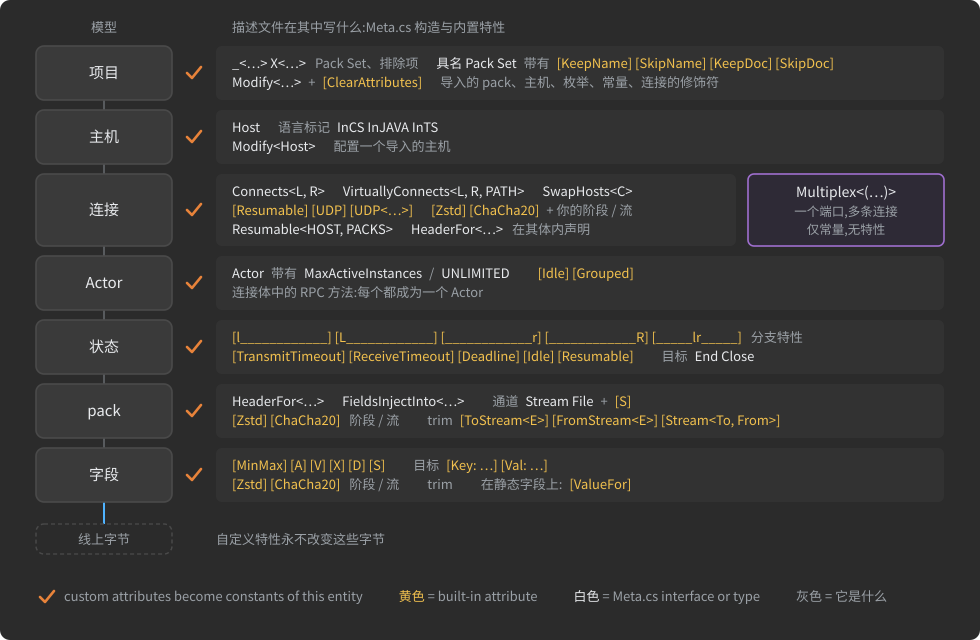

| 实体 | 它接受的内置特性 | 自定义特性 |
|:--|:--|:--|
| 项目(项目接口) | - | 可以,项目的常量 |
| 主机(`struct X : Host`) | - | 可以,主机的常量 |
| pack(一个类) | 变换阶段与流、trim、`Stream`/`File` pack 上的 `[S]` | 可以,pack 的常量 |
| pack 的字段 | `[MinMax]`、`[A]`、`[V]`、`[X]`、`[D]`、`[S]`、`[Key:]`/`[Val:]` 目标、变换阶段与流、trim | 可以,字段的常量 |
| `static` 字段 | `[ValueFor]` | - |
| 连接(`interface X : Connects<L, R>`) | `[Resumable]`、`[UDP]`、`[UDP<…>]`、变换阶段与流 | 可以,连接的常量 |
| 多路复用器(`interface X : Multiplex<(…)>`) | - | 不读取;把常量写在它体内 |
| Actor(`interface X : Actor`,或 RPC 方法) | `[Idle]`、`[Grouped]` | 可以,Actor 的常量 |
| 状态(连接或 Actor 里的空 struct) | 五个分支特性、`[TransmitTimeout]`、`[ReceiveTimeout]`、`[Deadline]`、`[Idle]`、`[Resumable]` | 可以,状态的常量 |
| 具名 Pack Set、过滤器模板 | `[KeepName]`、`[KeepDoc]`、`[SkipName]`、`[SkipDoc]` | - |
| `Modify<>` 修改器 | `[ClearAttributes]`;写在修改器上的链、trim 和计时特性替换目标的特性集合 | 可以,它们替换目标的集合 |

分支不是独立实体:它是状态上的分支特性,所以它的元数据写在状态上。分支特性从不参与修改器的特性替换;哪些特性参与在[复用描述](#reusing-descriptions)中解释。枚举接受一个特性:来自 `System` 的 `[Flags]`(见[来自 System 的特性](#attributes-from-system))。写在枚举或常量容器上的自定义特性不会被读取:把这类实体的元数据作为常量写在它体内。

<a id="built-in-attribute-catalog"></a>
### 内置特性目录

`Meta.cs` 为在描述中使用而声明的每个特性,按用途分组。签名是你要写的构造器;*附加到*是解析器接受它的实体。

<a id="built-in-field-encoding-attributes"></a>
#### 内置字段编码特性

| 特性 | 附加到 | 作用 | 讲解于 |
|:--|:--|:--|:--|
| `[MinMax(min, max)]` | 数值基元类型字段(或其元素) | 约束取值范围;字段以 `value - min` 存储,用该跨度所需的最少位或字节;有整型(`long`、`ulong`)和浮点(`double`)形式 | [值如何变成字节](#how-values-become-bytes) |
| `[A(minMostProbableValue, max)]` | 整型基元类型字段(或其元素) | 针对集中在最小值附近的值的 varint 编码;省略的界从字段类型推导 | [值如何变成字节](#how-values-become-bytes) |
| `[V(maxMostProbableValue, min)]` | 整型基元类型字段(或其元素) | 针对集中在最大值附近的值的 varint 编码 | [值如何变成字节](#how-values-become-bytes) |
| `[X(amplitude, zero)]` | 整型基元类型字段(或其元素) | 针对散布在 `zero` 周围的值的 zig-zag varint 编码 | [值如何变成字节](#how-values-become-bytes) |
| `[D(dims)]` | 数组、字符串、`Map`、`Set` 字段 | 长度与维度:`N` 数组长度,`+N` 字符串、map 或 set 的长度,`-N` 常量维度,`~N` 固定维度 | [字段与类型](#fields-and-types) |
| `[Key: …]`、`[Val: …]` | `Key:` 在 `Map` 或 `Set` 字段上,`Val:` 在 `Map` 字段上 | 特性目标:其后的字段编码特性应用于键或值,如 `[Key: D(+30)]`、`[Val: X]` | [字段与类型](#fields-and-types) |
| `[S(maxLength)]` | 裸 `Stream`/`File` 字段;扩展 `Stream` 或 `File` 的 pack | 原始管道的大小上限,单位字节;必须大于 8 | [流](#streams) |
| `[ValueFor(CONST)]` | `static` 字段 | 在生成时把 static 字段算出的值复制进指定的 `const`;有面向 `long`、`ulong`、`double`、`bool` 和 `string` 常量的重载 | [常量与枚举](#constants-and-enums) |

`[MinMax]`、`[A]`、`[V]`、`[X]` 中至多一个可作用于一个字段。`[A]`、`[V]`、`[X]` 和 `[D]` 在 pack 头部的字段上被拒绝;`[MinMax]` 在那里是允许的(见[用 pack 构建 pack](#building-packs-from-packs))。

<a id="built-in-transform-chain-and-trim-attributes"></a>
#### 内置变换链与 trim 特性

| 特性 | 附加到 | 作用 | 讲解于 |
|:--|:--|:--|:--|
| `[Zstd]`、`[Zstd(level)]` | 字段、pack、连接 | Zstandard 压缩阶段;`level` 为 1..22,默认 3,仅编码器使用 | [变换链](#transform-chains) |
| `[ChaCha20]`、`[ChaCha20(key, iv)]` | 字段、pack、连接 | ChaCha20 加密阶段;`(Binary[,] key, Binary[,] iv)` 形式声明运行时注入密钥的形状 | [变换链](#transform-chains) |
| 派生自 `StreamStageAttribute`、`StreamCompressionStageAttribute` 或 `StreamCipherStageAttribute` 的类 | 字段、pack、连接 | 你自己的阶段;基类给出它的角色:普通变换、链中唯一的压缩器、链中唯一的加密器 | [变换链](#transform-chains) |
| 派生自 `StreamFlowAttribute` 的类 | 字段、pack、连接 | 具名、可复用的链:写在类上的各阶段,由一个特性应用 | [变换链](#transform-chains) |
| `[ToStream<E>]` | 字段、pack | trim:端点 `E` 处的接收方在此停止解包并取原始字节 | [Trims](#trims) |
| `[FromStream<E>]` | 字段、pack | trim:端点 `E` 处的发送方在此提供原始字节 | [Trims](#trims) |
| `[Stream<To, From>]` | 字段、pack | 同一深度上的两个 trim:存储与重放对 | [Trims](#trims) |

链的各阶段按数据流顺序书写,从左(载荷)到右(线路)。trim 派生自 `StreamTrimAttribute`;从它派生你自己的 trim 是错误。

<a id="built-in-connection-and-session-attributes"></a>
#### 内置连接与会话特性

| 特性 | 附加到 | 作用 | 讲解于 |
|:--|:--|:--|:--|
| `[Resumable(seconds)]` | 连接、状态 | 会话比它的套接字多活多久,挂起并等待对端;在状态上它覆盖连接的值,`[Resumable(0)]` 在那里关闭它 | [会话、保证送达、UDP](#sessions-guaranteed-delivery-udp) |
| `[Resumable]` | 状态 | 在此状态按连接的秒数保留会话 | [会话、保证送达、UDP](#sessions-guaranteed-delivery-udp) |
| `[UDP(seconds)]`、`[UDP]` | 连接 | 连接走 UDP 承载,每个 pack 双向保证送达;`seconds` 含义同 `[Resumable(seconds)]` | [会话、保证送达、UDP](#sessions-guaranteed-delivery-udp) |
| `[UDP<EXCLUDE_PACKS_SET>(seconds)]`、`[UDP<EXCLUDE_PACKS_SET>]` | 连接 | 同 `[UDP]`,但集合中的 pack 不受保护地传输 | [会话、保证送达、UDP](#sessions-guaranteed-delivery-udp) |

<a id="built-in-actor-and-state-timing-attributes"></a>
#### 内置 Actor 与状态计时特性

| 特性 | 附加到 | 作用 | 讲解于 |
|:--|:--|:--|:--|
| `[TransmitTimeout(seconds)]` | 状态 | 整个连接的发送超时,实例进入该状态时写到连接上 | [连接](#connections) |
| `[ReceiveTimeout(seconds)]` | 状态 | 整个连接的接收超时(对端的沉默),实例进入该状态时写到连接上 | [连接](#connections) |
| `[Deadline(seconds)]` | 状态 | 一个 Actor 实例可在该状态停留多久;到时 `OnDeadline` 触发,默认该对结束 | [Actor 种类与运行时的 Actor](#actor-kinds-and-the-actor-at-runtime) |
| `[Idle(seconds)]` | Actor、状态 | 一份租约:若对端这么久没有发来它的任何 pack,实例结束 | [Actor 种类与运行时的 Actor](#actor-kinds-and-the-actor-at-runtime) |
| `[Grouped]` | Actor | 该 Actor 的实例可以加入一个组,于是一次发送到达全部实例 | [Actor 种类与运行时的 Actor](#actor-kinds-and-the-actor-at-runtime) |

<a id="built-in-branch-attributes"></a>
#### 内置分支特性

| 特性 | 附加到 | 作用 | 讲解于 |
|:--|:--|:--|:--|
| `[l____________]`、`[l____________<PACKS>]` | 状态 | 左侧主机可发送的 pack;状态机留在该状态 | [Actor、状态、分支](#actors-states-branches) |
| `[L____________<TARGET_STATE>]`、`[L____________<TARGET_STATE, PACKS>]` | 状态 | 左侧主机发送的 pack,然后状态机转到 `TARGET_STATE`(包括 `End` 和 `Close`) | [Actor、状态、分支](#actors-states-branches) |
| `[____________r]`、`[____________r<PACKS>]` | 状态 | 右侧主机可发送的 pack;状态机留在原处 | [Actor、状态、分支](#actors-states-branches) |
| `[____________R<TARGET_STATE>]`、`[____________R<TARGET_STATE, PACKS>]` | 状态 | 右侧主机发送的 pack,然后状态机转到 `TARGET_STATE` | [Actor、状态、分支](#actors-states-branches) |
| `[_____lr_____]`、`[_____lr_____<PACKS>]` | 状态 | 任一主机可发送的 pack;状态机留在原处 | [Actor、状态、分支](#actors-states-branches) |

每个分支特性都可以在一个状态上重复,并接受四个可选的正则表达式参数 `(KeepDoc, SkipDoc, KeepName, SkipName)`,用来过滤它选中的 pack(匹配规则见 [Pack Sets](#pack-sets))。

<a id="built-in-pack-set-filter-attributes"></a>
#### 内置 Pack Set 过滤特性

| 特性 | 附加到 | 作用 | 讲解于 |
|:--|:--|:--|:--|
| `[KeepName(regexp)]` | 具名 Pack Set、过滤器模板 | 只保留名称路径匹配的 pack | [Pack Sets](#pack-sets) |
| `[SkipName(regexp)]` | 具名 Pack Set、过滤器模板 | 移除名称路径匹配的 pack | [Pack Sets](#pack-sets) |
| `[KeepDoc(regexp)]` | 具名 Pack Set、过滤器模板 | 只保留文档与标签匹配的 pack | [Pack Sets](#pack-sets) |
| `[SkipDoc(regexp)]` | 具名 Pack Set、过滤器模板 | 移除文档与标签匹配的 pack | [Pack Sets](#pack-sets) |

每个都可重复。它们匹配的名称是 pack 在项目之下的路径,不含命名空间。空模式或无效模式是错误。

<a id="built-in-modifier-attributes"></a>
#### 内置修改器特性

| 特性 | 附加到 | 作用 | 讲解于 |
|:--|:--|:--|:--|
| `[ClearAttributes]` | `Modify<>` 修改器 | 把目标的特性集合替换为空集合;与同一修改器上的任何其他特性写在一起会被拒绝 | [复用描述](#reusing-descriptions) |

<a id="attributes-from-system"></a>
#### 来自 System 的特性

| 特性 | 附加到 | 作用 | 讲解于 |
|:--|:--|:--|:--|
| `[Flags]` | 枚举 | 该枚举是一组位标志(`System.FlagsAttribute`) | [常量与枚举](#constants-and-enums) |
| `[AttributeUsage]` | 你自己的特性类 | 自定义特性可放在哪里、是否可重复;从不被发出 | [声明自定义特性](#declaring-a-custom-attribute) |

<a id="built-in-timing-attributes-as-generated-constants"></a>
#### 作为生成常量的内置计时特性

内置特性是被解释的,不被发出——除了一组例外:计时特性作为它们所写的状态、Actor 或连接的常量到达生成器,以特性命名。它们是 `[TransmitTimeout]`、`[ReceiveTimeout]`、`[Deadline]`、`[Idle]`、`[Grouped]` 和 `[Resumable]`。`[Resumable]` 变成名为 `resume_` 的常量。在状态上它保存秒数,无参数形式(保留连接的值)时为 `-1`。在连接上它是连接自己的 `resume_` 常量,值为连接的秒数;没有 `[Resumable]` 的 `[UDP(seconds)]` 连接从它的 `[UDP]` 秒数得到同样的常量。生成的会话代码由这些常量构建。在生成的 Java 中,一个带 `[ReceiveTimeout(60)]` 的状态和一个带 `[Grouped]`、`[Idle(60)]` 的 Actor 携带:

```java
public static final java.time.Duration ReceiveTimeout = java.time.Duration.ofSeconds(60);   // 在状态的类中

public static final boolean Grouped = true;                                                 // 在 Actor 的类中
public static final long    Idle    = 60;
```

你的代码可以像读任何其他常量一样读这些值。因为它们以特性命名的常量形式传递,同样的名字为自定义特性保留(见[保留特性名](#reserved-attribute-names))。

<a id="other-metacs-declarations"></a>
### Meta.cs 的其他声明

`Meta.cs` 声明的不止特性:还有标记接口、泛型接口,以及描述要扩展或用作字段类型的类型。这里列出它们,让目录覆盖整个文件。

| 声明 | 它是什么 | 讲解于 |
|:--|:--|:--|
| `Host` | 扩展它的 struct 是一个主机 | [主机、语言、生成的代码](#hosts-languages-generated-code) |
| `InCPP`、`InRS`、`InCS`、`InJAVA`、`InGO`、`InTS`、`InSwift`、`InC`、`InDart`、`InPy` | 主机的语言标记,在 `<see cref>` 文档注释中引用 | [主机、语言、生成的代码](#hosts-languages-generated-code) |
| `Connects<L, R>` | 两个主机之间的连接 | [连接](#connections) |
| `SwapHosts<Connection>` | 左右主机互换的另一个连接;只以 `<see cref='SwapHosts{Base}'/>` 写在连接的文档注释里 | [连接](#connections) |
| `VirtuallyConnects<L, R, PATH>` 及 `MaxTunnels`、`MaxStream_KiloBytes` | 跨中继主机的两个主机之间的隧道 | [虚拟连接与中继](#virtual-connections-and-relays) |
| `Multiplex<CONNECTIONS>` | 主机上供它的多个连接共用的一个端口 | [多路复用](#multiplexing) |
| `Actor` 及 `MaxActiveInstances`、`UNLIMITED` | 一个 Actor 及它可拥有的实例数 | [Actor、状态、分支](#actors-states-branches)、[Actor 种类与运行时的 Actor](#actor-kinds-and-the-actor-at-runtime) |
| `L____________`、`____________R`(接口) | RPC 方法返回元组中的标记:哪一侧发起调用 | [Actor 种类与运行时的 Actor](#actor-kinds-and-the-actor-at-runtime) |
| `End`、`Close` | 终止目标状态:结束该 Actor 对,或关闭连接 | [Actor、状态、分支](#actors-states-branches) |
| `Resumable<HOST, PACKS>` 及 `resumable_megabytes` | 主机经连接发送的 pack 的保证送达 | [会话、保证送达、UDP](#sessions-guaranteed-delivery-udp) |
| `IfSendingFrom<fromHost, viaConnection>` | 一个端点:经连接发送的主机,trim 的参数 | [Trims](#trims) |
| `FieldsInjectInto<PackSet>`、`HeaderFor<PackSet>` | 注入 pack 的字段;pack 头部 | [用 pack 构建 pack](#building-packs-from-packs) |
| `_<TYPES>`、`X<TYPES>` | 一个 Pack Set、一个排除 | [Pack Sets](#pack-sets) |
| `Modify<Target>`、`Modify<TargetConnection, L, R>` | 已导入 pack、pack 头部、枚举、常量集合或主机的修改器;任一形式的连接修改器都会让运行停止 | [复用描述](#reusing-descriptions) |
| `Stream`、`File` | 原始管道类型 | [流](#streams) |
| `Binary` | 字节类型;生成的代码在每种语言中处理它的有符号性 | [字段与类型](#fields-and-types) |
| `longJS`、`ulongJS` | 保持在 JavaScript `number` 精确表示范围内的 64 位整数 | [字段与类型](#fields-and-types) |
| `Set<K>`、`Map<K, V>` | 集合字段类型 | [字段与类型](#fields-and-types) |
| `DateTimeDef`、`Duration`、`TimeSpanDef` | 时间值编码 | [字段与类型](#fields-and-types) |
| `___IConnects`、`___IfSendingFrom` | 内部基接口;不要在描述中使用 | - |

<a id="custom-attributes"></a>
### 自定义特性

自定义特性就是你自己的元数据。你把它**声明**为一个普通的 C# 特性类，**应用**到描述的实体上，生成器会把每个应用的特性变成生成代码中该实体的常量。典型用途是路由标签、UI 标签、归属、保留期限，以及你的运行时读取的校验提示；有没有它们，线路格式完全相同。

<a id="declaring-a-custom-attribute"></a>
#### 声明自定义特性

自定义特性是一个直接派生自 `System.Attribute` 的类。把它和其他所有内容一起声明在项目接口里，通常集中放在接口末尾。下面这个来自一个真实描述，用在其中的一个状态和一个 Actor 上：

```csharp
/// <summary>自定义特性:生成器把它保留为它所应用到的实体的常量。</summary>
[AttributeUsage(AttributeTargets.Struct | AttributeTargets.Interface)]
class LeaseAttribute : Attribute
{
    public LeaseAttribute(int seconds) { }
}
```

标准的 C# 约定适用，生成器也依赖这些约定：

- 名为 `XxxAttribute` 的类以 `[Xxx]` 的形式应用；使用处省略后缀，生成的常量名字也不带后缀。
- 构造函数参数是位置参数；当一个特性有多个参数时，它们的名字成为生成的常量的名字。
- 公共属性是命名参数(`Name = value`);只有你设置的属性才会被输出。
- `[AttributeUsage(AttributeTargets....)]` 限制特性可以放在哪里,`AllowMultiple = true` 让它能在一个实体上重复出现。没有 `[AttributeUsage]` 时,特性允许出现在任何实体上一次。`[AttributeUsage]` 本身从不被输出。

声明的形态决定特性怎么写、生成什么:

| 写法 | 声明 | 应用形式 | 生成的常量 |
|:--|:--|:--|:--|
| **一个参数** | `class TitleAttribute : Attribute { public TitleAttribute(string text) { } }` | `[Title("Shop protocol")]` | 实体上的 `Title = "Shop protocol"` |
| **多个参数** | `class OwnerAttribute : Attribute { public OwnerAttribute(string name, string email) { } }` | `[Owner("Platform team", "platform@example.com")]` | 容器 `Owner`,保存 `name` 和 `email` |
| **重载的构造函数** | `DefaultAttribute(long value)`, `DefaultAttribute(double value)`, `DefaultAttribute(string value)`, `DefaultAttribute(bool value)` | `[Default(0)]`, `[Default("View")]`, `[Default(false)]` | `Default`,类型由编译器选中的重载决定 |
| **属性(命名参数)** | `class ValidateAttribute : Attribute { public string Regex { get; set; } = ""; public long MaxLength { get; set; } = -1; }` | `[Validate(Regex = @"^[a-z]+$")]` | 实体上的 `Regex = "^[a-z]+$"` |
| **位置参数和命名参数** | `class AuditAttribute : Attribute { public AuditAttribute(string journal) { } public int Retention { get; set; } = 7; }` | `[Audit("orders", Retention = 30)]` | 容器 `Audit`,保存 `journal` 和 `Retention` |
| **标记(无参数)** | `class ReadOnlyAttribute : Attribute { }` | `[ReadOnly]` | 实体上的 `ReadOnly = true` |
| **可重复** | `[AttributeUsage(AttributeTargets.All, AllowMultiple = true)] class TagAttribute : Attribute { public TagAttribute(string name, string note) { } }` | 同一实体上的两行 `[Tag(...)]` | 容器 `Tag`,带 `_0` 和 `_1`,各保存 `name` 和 `note` |

> [!TIP]
> 在使用处写出每一个构造函数参数。代理不会为可选的构造函数参数填默认值:完全不带参数写出的特性会变成 `true` 标记,而参数少于构造函数所需数量的写法会中止本次运行。对于可选的值,改为声明一个带默认值的属性:你不写的属性就不会被输出。列表要作为一个显式数组传递,`[Roles(new[] { "admin", "auditor" })]`:写出的参数个数决定生成内联常量还是容器,而写成多个独立值的 `params` 列表按多个参数计数。

参数会变成常量,所以它的类型必须是常量可以拥有的类型之一:`bool`、整数类型、`char`、`float`、`double`、`string`,或其中一种的数组。枚举值或 `typeof(X)` 参数会中止运行("Constant field ... cannot have ... type");把参数声明为整数并传枚举的数值,或者声明为 `string` 并传类型的名字。

<a id="applying-custom-attributes"></a>
#### 应用自定义特性

自定义特性可以写在项目、主机、pack、字段、连接、Actor、RPC 方法和状态上。位置值映射到构造函数参数;`Name = value` 映射到属性。自定义特性可以彼此随意堆叠,也可以和 `[D(...)]` 这样的内置特性堆叠。下面是一个用到所有位置的描述:

```csharp
using System;
using org.unirail.Meta;

namespace com.example.shop
{
    [Title("Shop protocol")]                                   // 项目:一个参数
    [Owner("Platform team", "platform@example.com")]           // 项目:两个参数
    public interface ShopProtocol
    {
        ///<see cref = 'InJAVA'/>
        [Region("eu-west")]                                    // 主机
        struct Backend : Host
        {
            [Audit("orders", Retention = 30)]                  // pack:位置参数和命名参数
            public class Order
            {
                [ReadOnly] long id;                            // 字段:标记
                [D(+64)] [Pattern(@"^[A-Z0-9-]+$")] string sku; // 字段:内置 [D] 与自定义特性堆叠
            }

            [Tag("billing", "issued once per order")]
            [Tag("audit", "kept for seven years")]             // pack:重复,需要 AllowMultiple = true
            public class Invoice
            {
                long order_id;
            }

            public class Price
            {
                long cents;
            }
        }

        ///<see cref = 'InTS'/>
        struct Client : Host
        {
            public class PriceQuery
            {
                long order_id;
            }
        }

        interface Orders : Connects<Client, Backend>
        {
            [Lease(30)]                                        // 状态
            [_____lr_____<(Backend.Order, Backend.Invoice)>]
            struct Ready { }

            [Tag("rpc", "price lookup")]                       // RPC 方法:由它生成的 Actor 的常量
            (L____________, Backend.Price) price(Client.PriceQuery query);
        }

        class TitleAttribute : Attribute { public TitleAttribute(string text) { } }
        class OwnerAttribute : Attribute { public OwnerAttribute(string name, string email) { } }
        class RegionAttribute : Attribute { public RegionAttribute(string name) { } }

        class AuditAttribute : Attribute
        {
            public AuditAttribute(string journal) { }
            public int Retention { get; set; } = 7;
        }

        class ReadOnlyAttribute : Attribute { }
        class PatternAttribute : Attribute { public PatternAttribute(string regex) { } }

        [AttributeUsage(AttributeTargets.All, AllowMultiple = true)]
        class TagAttribute : Attribute { public TagAttribute(string name, string note) { } }

        [AttributeUsage(AttributeTargets.Struct | AttributeTargets.Interface)]
        class LeaseAttribute : Attribute { public LeaseAttribute(int seconds) { } }
    }
}
```

三种位置需要说明:

- **Actor** 的自定义特性写在它的接口上(`[Lease(120)] interface Job : Actor { ... }`)。RPC 方法上的特性会成为生成器由该方法生成的 Actor 的常量。
- **用 TYPEDEF 定型的字段**还带着写在 TYPEDEF 自身字段上的自定义特性(TYPEDEF 见[字段和类型](#fields-and-types))。
- **携带自定义特性、变换阶段或 flow、trim、计时特性或 `[ClearAttributes]` 的 `Modify<>` 修饰符**会替换目标的整组特性,自定义特性也包括在内;分支特性和字段编码特性不参与(见[复用描述](#reusing-descriptions))。

<a id="what-the-generator-makes-of-a-custom-attribute"></a>
#### 生成器如何处理自定义特性

代理按类对一个实体的自定义特性分组,并按以下规则输出每组:

| 写在实体上的内容 | 在实体上生成的内容 |
|:--|:--|
| 一个带一个位置参数的特性 | 以特性命名的常量,保存该参数:`[Lease(30)]` → `Lease = 30` |
| 一个带一个命名参数的特性 | 以属性命名的常量:`[Validate(Regex = "…")]` → `Regex = "…"` |
| 一个标记特性 | 以特性命名的 `bool` 常量,值为 `true`:`[ReadOnly]` → `ReadOnly = true` |
| 一个带两个或更多参数的特性 | 以特性命名的容器,每个参数一个常量,按构造函数参数或属性命名 |
| 同一特性出现两次或更多次(`AllowMultiple`) | 以特性命名的容器,按书写顺序带 `_0`、`_1` 等子容器,各保存该次出现的参数 |
| 数组参数 | 数组常量(最多 255 个元素;字符串最长 1000 个字符;不允许 `null` 元素) |
| 枚举或 `typeof(X)` 参数 | 什么都不生成:运行中止,常量无法保存枚举值或类型 |

一个真实描述中的 pack `PlayerPosition` 带着 `[CriticalPacket(true)]`,一个带一个 `bool` 参数的特性。生成的 pack 类在每种语言中都有:

```csharp
public const bool CriticalPacket = true;                // C#
```

```java
public static final boolean CriticalPacket = true;      // Java
```

```typescript
const CriticalPacket = true;                            // TypeScript
```

参数值必须是编译期常量,任何 C# 特性都是如此,代理按 C# 编译器求值的结果采用它们。

自定义特性从不参与线路格式的解释。唯一一种会改变字节的用户声明特性类根本不是自定义元数据:派生自 `StreamStageAttribute` 或 `StreamFlowAttribute` 的类是变换阶段或 flow,会组成链,并且不产生常量(见[变换链](#transform-chains))。

<a id="custom-metadata-as-constants"></a>
#### 作为常量的自定义元数据

每个应用的自定义特性最终都成为其实体的常量,所以在主体可以容纳常量的实体上,你可以跳过特性,直接写常量。下面两种形式生成同一个常量:

```csharp
[CriticalPacket(true)]
class PlayerPosition
{
    public float x;
}
```

```csharp
class PlayerPosition
{
    const bool CriticalPacket = true;
    public float x;
}
```

| 实体 | 特性形式 | 常量形式 |
|:--|:--:|:--|
| 项目、主机、pack、连接 | ✓ | ✓(其主体中的 `const` 或 `static`) |
| 多路复用器 | - | ✓,唯一的形式 |
| 状态 | ✓,唯一的形式 | -(状态 struct 必须保持为空) |
| 字段 | ✓,唯一的形式 | -(字段没有主体) |
| Actor、RPC 方法 | ✓ | - |

必须计算才能得到的值不能作为特性参数。把它声明为实体的常量,并用标记了 [`[ValueFor]`](#constants-and-enums) 的 `static` 字段来计算。

<a id="how-the-agent-tells-built-in-from-custom"></a>
### 代理如何区分内置与自定义

代理按以下顺序对它读到的每个特性分类:

1. **变换阶段、flow 和 trim** 通过基类识别(`StreamStageAttribute` 和它的两个角色基类、`StreamFlowAttribute`、`StreamTrimAttribute`),内置的和你自己的都算。它们组成链,从不成为常量。
2. **字段编码特性**通过使用处写出的名字识别,如果你省略了 `Attribute` 后缀就补上:字段上的 `S`、`D`、`MinMax`、`A`、`V`、`X`,不管类来自哪个命名空间。`[Validate]` 和 `[ValidateAttribute]` 是同一个特性;`[X]` 解析为 `XAttribute`。`[ValueFor]` 通过写在 `static` 字段上的名字 `ValueFor` 识别,pack 上的 `[S]` 通过类名 `SAttribute` 识别。
3. **其余内置特性**按命名空间 `org.unirail.Meta` 的类识别:分支特性、Pack Set 过滤器、`[UDP]`、`[ClearAttributes]` 和计时特性。
4. **其他一切都是自定义的**并成为常量,命名空间 `System` 的特性(如 `[AttributeUsage]`)和 `[Flags]` 除外,它们被跳过。内置特性中,只有计时特性也会成为常量。

![代理如何给一个特性分类:阶段、flow 和 trim 类进入变换链;字段编码名称和其余的 org.unirail.Meta 特性被解释;计时特性被解释,并且也作为其状态、Actor 或连接的常量输出,[Resumable] 输出为 resume_;System 特性和 Flags 被跳过;其余每个特性都成为其实体的常量——一个参数时内联,多个参数时为容器,重复的特性用 _0 和 _1 子容器](docs/img/dev-23-attribute-paths.zh-CN.svg)

<a id="reserved-attribute-names"></a>
#### 保留的特性名

不要给自定义特性起内置特性的名字。有几个名字只凭名字就决定归属,代理会把你的特性当成内置的:

- 字段上写成 `[S]`、`[D]`、`[MinMax]`、`[A]`、`[V]` 或 `[X]`(带不带 `Attribute` 后缀都一样)的特性按内置特性读取,套用内置特性的参数规则,不管它解析到哪个类;
- `static` 字段上写成 `[ValueFor]` 的特性按内置特性读取;`Stream` 或 `File` pack 上任何名为 `SAttribute` 的类也是;
- 名为 `ResumableAttribute` 的类会变成会话代码赖以构建的 `resume_` 常量;
- 计时特性以按特性命名的常量传播,所以自定义的 `TransmitTimeout`、`ReceiveTimeout`、`Deadline`、`Idle` 或 `Grouped` 特性会生成与内置特性同名的常量。

对于其余内置名字(`Zstd`、`ChaCha20`、`ToStream`、`FromStream`、`Stream`、`UDP`、`KeepName`、`KeepDoc`、`SkipName`、`SkipDoc`、`ClearAttributes` 和五个分支名),其他命名空间里的同名类仍算自定义,但描述的读者无法区分两者。把整个列表都当作保留名。

<a id="pitfalls-of-custom-attributes"></a>
#### 自定义特性的陷阱

- **直接派生自 `Attribute`。** 代理通过直接基类识别特性类;派生自另一个自定义特性类的类会被当成继承它的 pack,运行以错误中止。
- **项目作用域会把特性类收进来。** 声明在项目里的特性类是项目的类,所以选择项目 packs 的分支或 Pack Set(`<MyProject>`、`<@MyProject>`)会把它当作可传输的 pack 收进来。改为从主机作用域选择,或者按名字把这些类过滤掉:`[l____________<@MyProject>(SkipName: @"Attribute$")]`。`X<...>` 只能从不用 `@` 写出的作用域中移除它们(见 [Pack Sets](#pack-sets))。
- **元数据不是线路的配置。** 看起来像编码提示的自定义特性(`[MaxLength(64)]`)只会生成一个常量;要在线路上约束字符串长度,用 `[D(+64)]`。
- **状态保持为空。** 状态的元数据只能是特性;状态 struct 里的 `const` 是错误,因为状态不能包含任何内容。

相关:[常量和枚举](#constants-and-enums)(常量、`[ValueFor]`)、[复用描述](#reusing-descriptions)(特性替换、`[ClearAttributes]`)、[变换链](#transform-chains)(自定义阶段),以及各目录行链接到的章节。

---

<a id="adhocagent"></a>
## AdHocAgent

*流程:描述 → **AdHocAgent** → 生成器服务器 → 生成的代码 → 智能合并与部署 → 运行时*

AdHocAgent 是你使用 AdHoc 所要经过的命令行工具。它是一个 .NET 程序,运行在你的机器上或构建流水线里,做五件事:

1. 在本地检查描述并上传到生成器服务器([`.cs` 任务](#the-cs-task-generating-code));
2. 把生成的代码接收到**接收文件夹**([接收文件夹](#the-received-folder));
3. 把收到的代码部署到你的项目中,并保留你写在生成文件里的代码([部署与智能合并](#deployment-and-smart-merge));
4. 报告描述的改动波及哪些主机([`.cs~` 任务](#the-cs-task-which-hosts-a-change-reaches));
5. 保存你的个人 UUID 和服务器签发的每个新 UUID([UUID](#uuid))。

访问生成器凭个人 UUID,而不是登录名和密码。一次运行不需要任何人守在键盘前,所以 AdHocAgent 可以作为交付流水线的一步([在流水线中运行 AdHocAgent](#running-adhocagent-in-a-pipeline))。

AdHocAgent 本身也是一个 AdHoc 应用。它通过 AdHoc 自己的描述 `AdhocProtocol.cs` 的 `Communication` 连接与服务器通信;它的 `Agent` 主机的生成代码在其仓库的 `protocol/gen` 中,运行时库在 `protocol/lib` 中。[Actor、状态、分支](#actors-states-branches)把这条连接用作演示状态机;本章展示 AdHocAgent 在它的每个状态上做什么。

<a id="how-adhocagent-chooses-the-task"></a>
### AdHocAgent 如何选择任务

第一个参数决定一次运行做什么。AdHocAgent 按固定顺序测试它,并采用第一个匹配的测试:

| # | 对第一个参数的测试 | 任务 | 需要 UUID |
|:--|:--|:--|:--|
| 1 | 没有任何参数 | 打印帮助并写出描述模板([不带参数的 AdHocAgent](#adhocagent-without-arguments)) | 否 |
| 2 | 以 `.cs~` 结尾 | 写出影响报告([`.cs~` 任务](#the-cs-task-which-hosts-a-change-reaches)) | 否 |
| 3 | 既不含 `\` 也不含 `/` | 把它存为你的 UUID([UUID](#uuid)) | 否 |
| 4 | 以 `.md` 结尾 | 重复已收到代码的部署([`.md` 任务](#the-md-task-redeploying-received-code)) | 否 |
| 5 | - | 从这里起,`AdHocAgent.toml` 必须有 `PersonalVolatileUUID` 键;没有它,运行退出(码 1)并打印注册说明 | - |
| 6 | 以 `.cs` 或 `.cs!` 结尾 | 生成代码;带 `!` 时还会在资源允许的范围内测试([`.cs` 任务](#the-cs-task-generating-code)) | 是 |
| 7 | 其他任何东西 | 拒绝:"Unsupported file type ...",附转换器链接;退出码 2 | - |

扩展名测试区分大小写:`.cs`、`.cs!`、`.cs~`、`.md` 要小写。

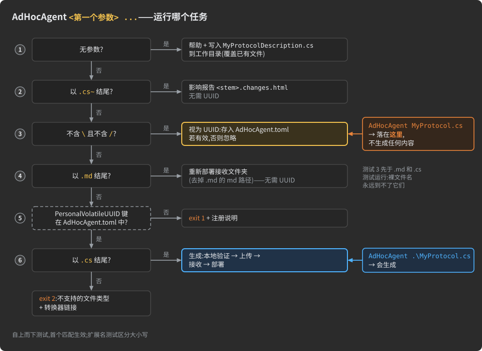

> [!WARNING]
> **不带目录部分的第一个参数会被当作 UUID。** 测试 3 排在 `.md` 和 `.cs` 测试之前,所以 `AdHocAgent MyProtocol.cs` 和 `AdHocAgent MyProtocol.md` 既不生成也不部署任何东西:这个参数不是有效的 UUID,它被忽略,运行结束——但同样会打印 "Volatile personal UUID updated successfully!"。任务文件一定要带目录部分传递——`AdHocAgent .\MyProtocol.cs`、`AdHocAgent ./MyProtocol.cs` 或完整路径。只有 `.cs~` 在 UUID 之前测试,可以用裸名。

<a id="the-cs-task-generating-code"></a>
### `.cs` 任务:生成代码

`.cs` 任务上传一个描述并带回由它生成的代码:

```text
AdHocAgent <description>.cs[!] [imported .cs files] [.csproj files] [output folder] [GitHub URL tag tag ...]
```

```text
AdHocAgent .\MyProtocol.cs
AdHocAgent .\MyProtocol.cs!
AdHocAgent .\MyProtocol.cs D:\Generated
AdHocAgent D:\Protocols\Extended.cs D:\Protocols\Base.cs D:\Generated
AdHocAgent D:\Protocols\Extended.cs D:\Protocols\Descriptions.csproj D:\Generated
```

第一个参数是**描述文件**——保存根项目的文件([描述文件](#the-description-file))。名字后加 `!` 时,代码还会在服务器资源允许的范围内经过测试([进度与服务器端测试](#progress-and-server-side-testing-of-generated-code))。它后面的参数无论位置如何,都逐一分类:

| 描述之后的参数 | 被当作 |
|:--|:--|
| 第一个看起来像 GitHub URL 的(`github.com/...`,带不带 `https://` 和 `www.` 都可以) | 开源模式的起点:该 URL,以及它之后的每个参数都是标签([开源](#open-source)) |
| 一个存在的 `.csproj` 文件 | 它的每个 `<Compile Include="...">` 项(相对该 `.csproj` 所在文件夹解析)加入编译 |
| 一个存在的 `.cs` 文件 | 加入编译 |
| 任何其他存在的文件 | 忽略,不给提示 |
| 任何不是已存在文件的东西 | **输出文件夹**:已存在的文件夹直接使用,不存在的会被创建。有多个这样的参数时每个都会创建,最后一个是输出文件夹 |

额外的 `.cs` 文件是扩展项目所需要的:它导入的项目的源文件([复用描述](#reusing-descriptions))。它们与描述文件一起编译。没有输出文件夹参数时,输出文件夹就是工作目录。

`.csproj` 只贡献写在其中的 `<Compile Include="...">` 项,以完整路径计。当它同时列出描述文件时,只有当第一个参数用同一个完整路径、同样的大小写指名描述文件,描述文件才会从额外文件中排除:`AdHocAgent .\MyProtocol.cs .\Descriptions.csproj` 而 `.csproj` 里有 `MyProtocol.cs` 会把该文件编译两次,编译因重复定义而失败。这时用完整路径传描述文件,或者把它留在那个 `.csproj` 之外。

生成的代码到达接收文件夹,即 `<output folder>/<description file name without .cs>`——对 `AdHocAgent .\MyProtocol.cs D:\Generated` 来说就是 `D:\Generated\MyProtocol`。首次运行时,AdHocAgent 还会在它旁边写出部署说明文件并停止;之后的每次运行在代码到达后立即部署([部署工作流](#the-deployment-workflow))。

<a id="what-a-cs-run-does-step-by-step"></a>
### 一次 `.cs` 运行逐步做什么

上传之前的一切都发生在你的机器上。有错误的描述永远到不了服务器。


1. **UUID 键。** `AdHocAgent.toml` 必须有 `PersonalVolatileUUID` 键;否则运行退出(码 1)并打印注册说明。这个值要到登录时才读取。
2. **编译并验证。** 所有描述文件作为一个 C# 库一起编译,关闭编译器警告,以 AdHocAgent 自身运行所依赖的程序集——.NET 运行时和携带 `org.unirail.Meta` 类型的 AdHocAgent——作为引用。编译错误打印编译器的诊断并退出(码 1,"Please fix the problem and rerun")。然后 AdHocAgent 的解析器检查描述声明的模型;每个描述错误都在这里中止运行,退出码见 [AdHocAgent 的退出码](#exit-codes-of-adhocagent)。这一步还会让描述文件中的编号表保持最新([编号表](#numbers-tables))。
3. **可选的停止。** 设 `ADHOC_DUMP_BRANCHES=1` 时 AdHocAgent 写出 `branches.dump.txt`;设 `ADHOC_PARSE_ONLY=1` 时它在这里停止,退出码 0([AdHocAgent 的环境变量](#environment-variables-of-adhocagent))。
4. **已发布的副本。** 开源模式下检查 GitHub 仓库和它的 `adhoc` 文件夹;任何不匹配都退出(码 1),什么都不发送([开源](#open-source))。
5. **清空接收文件夹。** `<output folder>/<description stem>` 被删除并做好接收准备,在连接打开之前:生成的文件到达时流式写入磁盘。
6. **连接。** 按顺序尝试 `server` 键的端点([生成器服务器端点](#generator-server-endpoints))。
7. **Version、登录、上传、结果**——下一节的交换过程。`Project` pack 发出时,描述文件被设为只读;`Result` 到达时,该标志被清除,服务器的 `info` 文本被打印,描述文件被复制到接收文件夹中的 `.description`,然后开始部署。

<a id="generator-server-endpoints"></a>
#### 生成器服务器端点

`AdHocAgent.toml` 的 `server` 键是一个端点数组,按顺序尝试,直到有一个连上:

| 端点 | AdHocAgent 如何连接 |
|:--|:--|
| 以 `ws:` 或 `wss:` 开头 | 作为 WebSocket 客户端连接该 URL |
| 其他任何形式 | TCP 连接到 `host[:port]`(不写端口时为 80);主机名经 DNS 查询,随机取它的一个地址;`localhost` 是回环地址 |

每次尝试有 10 秒连接时间。被拒绝或不可达的端点、超时、DNS 查询失败或格式错误的 URL 都会转向下一个端点;没有端点可试时运行退出(码 1),报 "There are no servers available."。一旦建立连接,之后的失败不再是尝试其他端点的理由。

<a id="the-exchange-with-the-generator-server"></a>
#### 与生成器服务器的交换

这个交换就是 `AdhocProtocol.cs` 的 `Communication` 连接,以 AdHocAgent 为 `Agent` 主机、生成器为 `Server` 主机运行:

| `Communication` 的状态 | AdHocAgent 发送 | 服务器应答 | AdHocAgent 如何处理应答 |
|:--|:--|:--|:--|
| `Start` | `Agent.Version`:UI 区域性 id 的低字节、本地时区的标准 UTC 偏移(以 15 分钟为单位)、协议版本 `1` | - | - |
| `VersionMatching` | - | `Server.Invitation`,或版本不匹配时的 `Server.Info` | `Info`:打印它并退出(码 1),报 "Resolve the issue and try again." |
| `Login` | `Agent.Login`:UUID 的两个 64 位半区 | - | - |
| `LoginResponse` | - | `Server.Invitation`;带新 UUID 的 `Server.InvitationUpdate`;或 UUID 被拒绝时的 `Server.Info` | `InvitationUpdate`:保存新 UUID,然后上传;`Info`:打印它,附恢复提示([UUID](#uuid)) |
| `TodoJobRequest` | `Agent.Project`:描述文件、序列化的模型,以及开源模式下的 URL 和标签 | - | 把描述文件设为只读,开始进度显示 |
| `Project` | - | 任意数量的 `Server.Progress`,然后 `Server.Result` 或 `Server.Info` | 显示进度;`Result`:接收文件并部署;`Info`:打印它 |

描述文件和生成的代码都压缩传输:`Agent.Project` 和 `Server.Result` 的文件列表经过 AdHoc 自己描述的 `SrcZip` flow,一条 Zstd 链([变换链](#transform-chains))。

在 `Result` 完整之前关闭的连接——远端关闭、异常关闭、接收超时、WebSocket 协议错误——以 "Connection closed before the result was complete ... Nothing was deployed; whatever arrived is in &lt;folder&gt;" 结束运行。服务器在 `Info` 之后关闭连接,所以被拒绝的登录和失败的任务以同样的方式结束。

<a id="progress-and-server-side-testing-of-generated-code"></a>
#### 进度与服务器端对生成的代码的测试

服务器处理任务时会发送 `Server.Progress` pack。在终端上,AdHocAgent 原地重绘一个区块:一行显示任务,含其测试级别、已耗时和进度;每种语言一行,显示正在运行的 pass、正在做什么以及该语言的进度:

```text
MyProtocol · testing level: full · 00:41 · 29%
  Java   pass 2 of 4   running tests     ███████░░░░░░░░░  43%
  C#     pass 2 of 4   compiling         █████░░░░░░░░░░░  31%
  TS     pass 1 of 4   compiling         ██░░░░░░░░░░░░░░  12%
```

当输出被重定向时——比如流水线的日志——它改为打印普通行,且只打印始终成立的行:任务已被接受(含其测试级别)、某语言的某个 pass 完成、结果正在路上。AdHocAgent 没有对应文本的编号(来自更新的服务器)按编号显示。

不加后缀时,服务器只生成代码。描述文件名后加 `!`——`AdHocAgent .\MyProtocol.cs!`——还会在资源允许的范围内测试代码。任务的测试级别是 `none`、`delivered code compiled`、`compiled`、`all stages compiled` 和 `full` 之一,从测试最少到最多;它显示在进度显示的第一行(或日志的"The task is accepted"行)。这是生成器提供的服务,不能替代你项目的测试。

<a id="the-received-folder"></a>
#### 接收文件夹

接收文件夹是 `<output folder>/<description file name without .cs>`。它的第一层是每种语言一个文件夹——`InCS`、`InJAVA`、`InTS`——每个语言文件夹下是该语言生成的每个主机一个文件夹([主机、语言、生成的代码](#hosts-languages-generated-code))。主机文件夹里有什么、各部分如何部署,见[主机文件夹里有什么](#what-a-host-folder-holds)。

- 文件在接收时直接流式写入磁盘。会落到接收文件夹之外的接收路径(绝对路径,或用 `..` 爬出的路径)被拒绝,运行退出(代码 2)。
- 当 `Result` 完整时,AdHocAgent 把描述文件和随它编译的每个文件复制到接收文件夹中的 `.description`。描述文件以裸文件名发往服务器,同名两个文件在扩展名前用计数器区分(`Common.cs`、`Common1.cs`);`.description` 使用同样的名字。每次部署都会把这个文件夹复制进备份,[`.cs~` 任务](#the-cs-task-which-hosts-a-change-reaches)在那里找到生成已部署代码所用的描述。
- 接收文件夹根目录下以点开头的名字,如 `.description`,是 AdHocAgent 自己的记录:它从不出现在说明文件中,不被处理,也不被部署。
- 接收文件夹在部署后保留,因此你可以改路由后再次部署,而无需重新生成([`.md` 任务](#the-md-task-redeploying-received-code))。

<a id="pitfalls-of-the-cs-task"></a>
### `.cs` 任务的陷阱

- **任务失败后描述文件保持只读。** `Project` pack 发出时设置的只读标志,只在 `Result` 到达时清除。当服务器发来的是 `Info` 而不是 `Result`、上传后连接丢失,或在等待 `Result` 时运行被停止,描述文件保持只读:你的编辑器无法保存它,下一次运行会跳过编号表更新,并给出警告 "... is read-only. As a result, the pack ID update process was skipped."。在下一次运行前手动清除该标志(`attrib -r MyProtocol.cs`、`chmod u+w MyProtocol.cs`,或用你的编辑器)。被服务器拒绝的登录发生在上传之前,文件保持可写。
- **输出文件夹中的两个文件夹会被删除。** 接收文件夹 `<output folder>/<description stem>` 在连接打开前被删除,`<output folder>/<project interface name>` 在上传开始时被删除。用一个临时文件夹作为输出文件夹,绝不要用其子文件夹属于你的文件夹。
- **输错的路径会变成输出文件夹。** 不是现有文件的参数被当作输出文件夹并创建。因此,输错的导入路径会创建一个多余的文件夹,而导入在编译中缺失,随后以编译错误或 "The source code for '...' could not be found" 失败([复用描述](#reusing-descriptions))。
- **`.csproj` 带来每个 `<Compile Include>` 项,且只带这些。** 链接的模板和无关源码会加入编译(在开源模式下,还会加入必须发布的文件集)。SDK 风格项目不列出就编译的文件不会被加入。元素带 XML 命名空间的 `.csproj`(SDK 之前的格式)什么都不加,且没有提示;没有 `Include` 的 `<Compile>` 元素(`Remove`、`Update`)或带通配符的 `Include` 会以异常停止运行。给描述文件一个自己的、列出每个文件的 `.csproj`,或者逐个传 `.cs` 文件。
- **同时也在 `.csproj` 里的描述文件会被编译两次**,除非你按 `.csproj` 解析出的完整路径传它([`.cs` 任务](#the-cs-task-generating-code))。
- **失败的生成以退出代码 0 结束。** 见 [AdHocAgent 的退出代码](#exit-codes-of-adhocagent)。

<a id="the-md-task-redeploying-received-code"></a>
### `.md` 任务:重新部署已接收的代码

```text
AdHocAgent .\MyProtocol.md
AdHocAgent "D:\Generated\MyProtocol.md"
```

参数是一个部署说明文件。AdHocAgent 只重复部署,针对已接收的文件:不上传任何内容,也不需要 UUID。在你改了路由之后,或调试部署时使用它。

接收文件夹是说明文件路径去掉 `.md`——对 `D:\Generated\MyProtocol.md` 来说就是文件夹 `MyProtocol`。先在说明文件旁边找,然后在工作目录里找;两处都没有时,运行退出(代码 1)并报 "Cannot find source folder ... redeploy process canceled"。从存放接收文件夹的文件夹运行该任务:说明文件中形如 `/InCS/...` 的命令路径,会相对 `<working directory>/<received folder name>` 解析([生命周期钩子](#lifecycle-hooks))。

部署做什么,是[部署与智能合并](#deployment-and-smart-merge)的主题。

<a id="the-cs-task-which-hosts-a-change-reaches"></a>
### `.cs~` 任务:变更波及哪些主机

```text
AdHocAgent .\MyProtocol.cs~ [<previous version>~] [imported .cs / .csproj files] [output folder]
```

`.cs~` 任务把描述与其先前版本比较,写出 `<output folder>/<description stem>.changes.html`:必须更新的主机,以及原因。不上传任何内容,不需要 UUID,两个版本都不会被写入。先前版本是第一个以 `~` 结尾的其他参数——一个描述文件、一个存放描述文件的文件夹,或一个部署备份文件夹;没有时,AdHocAgent 取上一次部署保存的描述。页面在默认浏览器中打开,除非输出被重定向。先前版本如何找到、什么让一个主机成为要更新的主机、脚本从页面读取的 JSON,见[演进协议](#evolving-a-protocol)。

<a id="adhocagent-without-arguments"></a>
### 不带参数运行 AdHocAgent

不带参数运行时,AdHocAgent 打印帮助,在**工作目录**写出描述模板 `MyProtocolDescription.cs`,并等待按 Enter。已存在的同名文件会被覆盖。该模板是[快速入门](#getting-started)的起点。

<a id="adhocagenttoml"></a>
### AdHocAgent.toml

AdHocAgent 从 `AdHocAgent.toml` 读取设置,且只在 AdHocAgent 可执行文件所在的文件夹里找它。文件不在时,AdHocAgent 用内置模板在那里写出它,警告 "its content may be outdated",然后继续用它。

| 键                     | 内容                                                                                              | 由谁写入                                    |
|:-----------------------|:--------------------------------------------------------------------------------------------------|:-------------------------------------------|
| `server`               | 生成器服务器端点,按顺序尝试的数组([生成器服务器端点](#generator-server-endpoints))               | 你;模板中是公共端点                          |
| `PersonalVolatileUUID` | 你的个人 UUID,登录时发送                                                                          | `AdHocAgent <uuid>`,以及每次 UUID 轮换       |
| `PreviousVolatileUUID` | 上一次更改所替换的 UUID                                                                             | AdHocAgent,在它存储新 UUID 时               |

```toml
server = ["wss://wss.unirail.org"]
# server = [ "wss://wss.unirail.org", "tcp.unirail.org" ]
PersonalVolatileUUID = "100b9fd2-e593-485b-a2fe-9b9c82bc1e3f"
```

AdHocAgent 为生成和部署不读其他键。模板里还有 `show_code_exe` 和 `show_code_args`,是一个辅助工具的设置,与两者都无关。源代码格式化工具不在这里配置:它们是部署说明文件的处理步骤([部署前的处理步骤](#processing-steps-before-deployment))。

> [!NOTE]
> 模板的 `PersonalVolatileUUID = ""` 能通过 `.cs` 运行的键检查,所以带它的运行会先连接服务器,然后才停止并报 "'PersonalVolatileUUID' in ... is not a valid UUID: ''. Re-apply your UUID: AdHocAgent &lt;uuid&gt;"。在第一次上传前应用你的 UUID。

<a id="uuid"></a>
### UUID

你访问生成器的凭据是一个个人**易失 UUID**:一个服务器会不时替换的 128 位标识符。它代替登录名和密码,因此运行不需要人登录。

<a id="getting-your-first-uuid"></a>
#### 获取你的第一个 UUID

1. 登录 GitHub。
2. 在 [Sign-Up Discussion](https://github.com/orgs/AdHoc-Protocol/discussions/categories/sign-up) 中发一条消息。

请求被处理后,帖子消失,一个机器人在 [AdHoc-Protocol projects](https://github.com/orgs/AdHoc-Protocol/projects) 中为你创建一个**私有**项目。该项目跟踪你的代码生成历史,并展示问题及其解决详情。其中有一个任务卡片,里面放着你的 UUID:


<a id="applying-a-uuid"></a>
#### 应用 UUID

```text
AdHocAgent 100b9fd2-e593-485b-a2fe-9b9c82bc1e3f
```

不含 `\` 或 `/` 的第一个参数是要存储的 UUID。接受任何形式的 GUID——带不带连字符、带不带大括号——并以带连字符的形式存入 `AdHocAgent.toml`。与已存值相等时,文件不动。否则被替换的值保留为 `PreviousVolatileUUID`,文件先写到 `AdHocAgent.toml.tmp` 再移动覆盖原文件,这样中断的写入不会留下截断的文件。

不是 UUID 的值被忽略,什么都不存,但运行仍以 "Volatile personal UUID updated successfully!" 结束。应用 UUID 之后,检查文件中的 `PersonalVolatileUUID`。

<a id="uuid-rotation-and-recovery"></a>
#### UUID 轮换与恢复

登录时服务器可能回复 `InvitationUpdate`,它携带一个新 UUID。AdHocAgent 按 `AdHocAgent <uuid>` 的方式存储它——

- 被替换的成为 `PreviousVolatileUUID`——然后上传任务。被替换过的 UUID 不能再用,因此要保管好 `AdHocAgent.toml`:它是唯一存放当前 UUID 的地方,旧值的任何其他副本都会失效。

当服务器拒绝一个 UUID 时,AdHocAgent 打印服务器的消息;当文件里有 `PreviousVolatileUUID` 时,还会打印重新应用它的命令:

```text
AdHocAgent <PreviousVolatileUUID>
```

服务器在新 UUID 被确认前保持旧 UUID 有效,因此重新应用它就能换发新 UUID,无需重新注册。只有这条路失败时才重新注册。

<a id="open-source"></a>
### 开源

代码生成免费。项目还可以被列入使用 AdHoc 的项目目录。要被列入,需要:

- 一个至少有 **500 star** 的公开 GitHub 仓库;
- 该仓库中名为 **`adhoc`** 的文件夹,以相同文件名存放任务上传的**每个**文件的副本:描述文件、每个导入的 `.cs` 文件、`.csproj` 参数带入的每个文件;
- 项目的主题标签。

把文件夹的 URL 放在文件参数之后,然后是标签,每个标签一个参数:

```text
AdHocAgent .\MyProtocol.cs https://github.com/owner/repo/tree/main/path/to/adhoc networking telemetry iot
AdHocAgent .\MyProtocol.cs .\Shared.cs D:\Generated https://github.com/owner/adhoc networking
```

URL 结束路径列表:它之后的每个参数都是标签,因此导入和输出文件夹要放在它前面。URL 可以有两种形式:

| URL                                                        | 指向                                                                                              |
|:-----------------------------------------------------------|:--------------------------------------------------------------------------------------------------|
| `https://github.com/owner/repo/tree/<branch>/<path>/adhoc` | 分支 `<branch>` 上 `<path>` 处的 `adhoc` 文件夹;`<path>` 可以为空(`.../tree/main/adhoc`)          |
| `https://github.com/owner/adhoc`                           | 仓库本身,名为 `adhoc`,在其默认分支上                                                             |

`https://` 和 `www.` 可选,仓库名的 `.git` 后缀被去掉,最后一段必须恰好是 `adhoc`。任何其他 URL——不带 `/tree/<branch>/` 且不是仓库根的,或不叫 `adhoc` 的文件夹——被拒绝(代码 1)。标签以字母开头,后接字母、数字、`-` 和 `_`,均为 ASCII;至少需要一个标签。

本地验证之后、上传任何内容之前,AdHocAgent 检查:

- 没有两个上传文件同名(忽略大小写)——一个 GitHub 文件夹里一个名字只能有一个文件;
- 仓库是公开的,且至少有 500 star;
- 该文件夹(在指定分支或默认分支上)存有与每个上传文件同名的文件——只算直接在其中的文件,里面也可以有其他文件;
- 每个副本在去掉 UTF-8 BOM、并把 CRLF 和 CR 行尾转为 LF 之后与上传文件相等,因为 git 在检出时会改写这两者。

任何不符都会拒绝任务,消息说明要改什么,什么都不发送(代码 1)。服务器在自己一侧重复检查,因此发布的副本必须与你用来生成的内容保持完全一致。

这些检查走 GitHub API,其匿名限制是每个地址每小时 60 次请求;被拒绝的请求(403 或 429)会说明这一点。设置 `GITHUB_TOKEN` 可以解除限制。404 表示仓库或文件夹不存在,或仓库是私有的。

URL 和标签通过 `AdhocProtocol.cs` 的 `Project.github` 和 `Project.tags` 字段发往服务器(各最多 1 000 字符;标签以单个空格连接)。不带 URL 的运行让两者都为空。

<a id="environment-variables-of-adhocagent"></a>
### AdHocAgent 的环境变量

| 变量                    | 效果                                                                                                                                                                                                             |
|:------------------------|:-----------------------------------------------------------------------------------------------------------------------------------------------------------------------------------------------------------------|
| `ADHOC_PARSE_ONLY=1`    | `.cs` 任务编译并校验描述,然后以退出代码 0 停止;不上传任何内容。`PersonalVolatileUUID` 键必须存在,其值不被使用                                                                                                  |
| `ADHOC_DUMP_BRANCHES=1` | `.cs` 任务在描述旁边写出 `branches.dump.txt`:每个连接、Actor、状态和分支及其 pack 和它们的 id、连接每侧发送和解析的 pack、pack 头部,以及每个主机的实现设置                                                        |
| `NO_COLOR`(任意值)    | AdHocAgent 的输出及它运行的工具的错误输出中不使用 ANSI 颜色。输出被重定向时颜色同样关闭                                                                                                                          |
| `GITHUB_TOKEN`          | 开源模式:用于 GitHub API 检查的令牌,可解除每小时 60 次请求的匿名限制                                                                                                                                           |

<a id="exit-codes-of-adhocagent"></a>
### AdHocAgent 的退出代码

当 AdHocAgent 有意停止时,它记录原因(除非代码为 0,否则按错误记录),打印 "Press ENTER to exit",等待一行输入,然后带代码退出。少数运行不带该提示、以代码 0 结束:应用 UUID、`ADHOC_PARSE_ONLY`、写出影响报告、首个说明文件,以及在结果之前关闭的连接。

| 代码                          | 何时                                                                                                                                                                                                                                                                                                                                                                                               |
|:------------------------------|:---------------------------------------------------------------------------------------------------------------------------------------------------------------------------------------------------------------------------------------------------------------------------------------------------------------------------------------------------------------------------------------------------|
| `0`                           | 任务完成:部署完成、UUID 已应用、报告已写出、`ADHOC_PARSE_ONLY` 停止了运行、首个说明文件已生成、对 "Deploy now?" 回答了 `n`。**也包括**在结果之前连接关闭的情形,含被拒绝的登录和服务器 `Info`                                                                                                                                                                                                         |
| `1`                           | 默认错误:配置、描述中的编译错误、开源检查、没有可到达的服务器、说明文件中没有路由、接收文件夹缺失、C# 处理步骤失败,以及许多描述错误                                                                                                                                                                                                                                                                |
| `2`                           | 不支持的文件类型;接收路径在接收文件夹之外;许多描述错误,比如互不导入的项目中出现两处特性替换([复用描述](#reusing-descriptions))                                                                                                                                                                                                                                                                     |
| `22`                          | 状态、常量容器或其他声明位于连接体的错误位置([描述文件](#the-description-file)、[常量与枚举](#constants-and-enums))                                                                                                                                                                                                                                                                               |
| `23`                          | 不支持类型的字段                                                                                                                                                                                                                                                                                                                                                                                   |
| `45`                          | 连接与主机:没有连接的根项目、没有语言标记的主机、类型错误的配置目标([主机、语言、生成的代码](#hosts-languages-generated-code))                                                                                                                                                                                                                                                                     |
| `56`                          | 常量:不支持类型的常量([常量与枚举](#constants-and-enums))                                                                                                                                                                                                                                                                                                                                         |
| `66`                          | 编号:一个项目中同类的两个实体共用一个编号,通常是复制来的标记([编号表](#numbers-tables))                                                                                                                                                                                                                                                                                                           |
| `77`                          | trim 与 `Resumable` 端点([Trims](#trims)、[会话、保证送达、UDP](#sessions-guaranteed-delivery-udp))                                                                                                                                                                                                                                                                                                |
| `88`                          | `Stream` 和 `File` pack 与字段([流](#streams))                                                                                                                                                                                                                                                                                                                                                     |
| `123`                         | 分配了保留标识符                                                                                                                                                                                                                                                                                                                                                                                   |
| `-1`(Linux 和 macOS 上为 255) | 你取消了:在孤儿代码提示处,或在工具错误输出后按 `N`;外部命令无法启动;以及少数描述错误——最小值等于最大值的取值范围、用在不接受 `[MinMax]` 的类型上的 `[MinMax]`、与字段不匹配的 `[D]` 参数(非数组字段上的数组长度、非字符串/Map/Set 字段上的 `+` 长度)                                                                                                                                                    |

把这些数字当作诊断信息,而不是接口:脚本只能依赖零与非零之分,而零并不总意味着代码已生成并部署。

<a id="running-adhocagent-in-a-pipeline"></a>
### 在流水线中运行 AdHocAgent

AdHocAgent 可以无人值守运行,有几条规则:

- **持久化 `AdHocAgent.toml`。** 服务器会轮换 UUID,被替换的 UUID 不能重用。每次运行前恢复该文件,运行后保存回去,让每次运行都用上一次运行收到的 UUID 开始。
- **只校验不生成。** `ADHOC_PARSE_ONLY=1` 在拉取请求中检查描述而不上传它。
- **读日志,而不只看退出代码。** 结果之前连接关闭的运行以代码 0 结束。完成的部署会记录 "✔ Deployment successful!"。
- **纯文本输出。** 重定向的输出没有颜色,进度以普通行显示;`NO_COLOR` 在终端上也关闭颜色。
- **开源模式**在流水线与其他 GitHub API 用户共享地址时需要 `GITHUB_TOKEN`。
- **通过输入回答提示。** 用管道给答案,例如 `echo y | AdHocAgent .\MyProtocol.cs`,或从空源重定向输入以回答 `n`。孤儿区域总是需要人:在交互式运行中解决它,并给流水线步骤设一个时间限制,因为重定向输入的 `.cs` 运行遇到孤儿区域时不会退出。

<a id="prompts-of-adhocagent-with-redirected-input"></a>
#### 重定向输入时 AdHocAgent 的提示

| 提示                                                                          | 何时                                                                                                                                                                        | 重定向输入时                                                                                                                                                                                                                                                                      |
|:------------------------------------------------------------------------------|:----------------------------------------------------------------------------------------------------------------------------------------------------------------------------|:----------------------------------------------------------------------------------------------------------------------------------------------------------------------------------------------------------------------------------------------------------------------------------|
| "Do you accept these changes and wish to continue? (yes/no)"                  | AdHocAgent 重命名了冲突的 pack 头部名([用 pack 构建 pack](#building-packs-from-packs))                                                                                      | 读一行;除 `yes` 外 anything——包括输入结束——都退出(代码 1)                                                                                                                                                                                                                         |
| "Deploy now? (y = deploy now / n = update the list and stop, deploy later)"   | 接收的文件与说明文件不再匹配,或目标位置有孤儿文件([一次部署运行,逐步](#one-deployment-run-step-by-step))                                                                     | 读一行;以 `y` 开头的行执行部署,其他任何内容(包括输入结束)刷新列表并以代码 0 退出                                                                                                                                                                                                   |
| "Proceed with the merge? (y/N)"                                               | 含有你的代码的区域在新代码中消失([孤儿代码保护](#orphaned-code-protection))                                                                                                  | 需要交互式控制台:读按键失败,部署在任何目标被写入之前停止。运行不会正常结束:`.md` 任务以未处理异常结束,`.cs` 运行打印异常并一直等待,直到被杀掉                                                                                                                                        |
| "Would you like to continue? Enter 'N' to stop."                              | 某个处理步骤或钩子写入了其错误输出                                                                                                                                           | 读一个字符;`N` 或 `n` 停止(代码 -1),其他任何字符继续                                                                                                                                                                                                                               |
| "Press ENTER to exit"                                                         | 有意停止([AdHocAgent 的退出代码](#exit-codes-of-adhocagent))                                                                                                                | 输入结束时立即返回                                                                                                                                                                                                                                                                 |

提示只在其条件出现时出现:说明文件与接收文件匹配、且没发现孤儿文件的部署不会询问。

<a id="descriptions-from-other-schema-languages"></a>
### 从其他 schema 语言得到描述

AdHocAgent 只读 AdHoc 描述。独立的转换器,每个一个仓库,把现有 schema 转成可作为起点的 AdHoc 描述——例如 union 变成一个由可选字段组成的 pack,每个备选一个字段([字段与类型](#fields-and-types));它们写出的内容要人工审阅:[converters to AdHoc protocol](https://github.com/AdHoc-Protocol#converters-to-adhoc-protocol)。

<a id="third-party-components-of-adhocagent"></a>
### AdHocAgent 的第三方组件

AdHocAgent 面向 .NET 10,使用这些包:

| 包                                                                                                                                        | 版本    | 用途                                                                                                  |
|:------------------------------------------------------------------------------------------------------------------------------------------|:--------|:------------------------------------------------------------------------------------------------------|
| [Microsoft.CodeAnalysis.CSharp](https://www.nuget.org/packages/Microsoft.CodeAnalysis.CSharp/) 和 Microsoft.CodeAnalysis.Common (Roslyn)  | 5.9.0   | 编译和读取描述;编译部署的 C# 处理步骤                                                                  |
| [Serilog.Sinks.Console](https://www.nuget.org/packages/Serilog.Sinks.Console/)                                                            | 6.1.1   | 控制台日志                                                                                            |
| [Tommy](https://www.nuget.org/packages/Tommy/)                                                                                            | 3.1.2   | 读写 `AdHocAgent.toml`                                                                                |
| [ZstdSharp.Port](https://www.nuget.org/packages/ZstdSharp.Port/)                                                                          | 0.8.8   | 运行时库的 Zstd 阶段,压缩发往服务器和从服务器接收的文件                                                |

---

<a id="deployment-and-smart-merge"></a>
## 部署与智能合并

*流程:描述 → AdHocAgent → 生成器服务器 → 生成的代码 → **智能合并与部署** → 运行时*

部署是 `.cs` 运行的最后一步:AdHocAgent 把它收到的代码复制进你的项目文件夹。每个文件去哪,写在**部署说明文件**里——一个 AdHocAgent 生成一次、由你编辑的 Markdown 文件。过程中,AdHocAgent 把你写在生成文件里的代码合并进这些文件的新版本(**智能合并**),并备份每个它覆盖或删除的文件,连同能把它们放回去的脚本。

一旦说明文件有了路由,部署在每次 `.cs` 运行之后紧接着执行;也可以单独执行,用 `.md` 任务针对已接收的代码([AdHocAgent](#adhocagent))。


<a id="the-deployment-workflow"></a>
### 部署工作流

1. **第一次运行。** 第一个 `.cs` 运行找不到说明文件。AdHocAgent 在接收文件夹旁边写出一个,记录一条说明如何重跑的警告,并以退出代码 0 结束。什么都不部署。
2. **写路由。** 打开说明文件。在你使用的每个主机文件夹的行尾,加一条指向只放生成的代码的文件夹的路由;在你不用的每个主机的行尾放 `⛔`。
3. **部署。** 从存放说明文件的文件夹运行 `AdHocAgent .\MyProtocol.md`:它部署已接收的代码,不重新生成任何内容。每次改路由后再运行它。
4. **重复。** 之后的每个 `.cs` 运行在结果到达后立即部署。你的路由、你在说明文件里的备注、你在生成文件里的代码,都从一次生成带到下一次。

<a id="the-deployment-instructions-file"></a>
### 部署说明文件

说明文件以接收文件夹命名:`<received folder name>.md`。由于接收文件夹以描述文件命名,`MyProtocol.cs` 给出接收文件夹 `MyProtocol` 和说明文件 `MyProtocol.md`。名字把文件与其接收文件夹配对,所以不要重命名它;要移动就两个一起移动。

<a id="where-the-instructions-file-is-looked-for"></a>
#### 说明文件的查找位置

| 任务  | AdHocAgent 在哪里找                                                                                                                        |
|:------|:-------------------------------------------------------------------------------------------------------------------------------------------|
| `.cs` | 接收文件夹旁边——即输出文件夹中——然后是工作目录。两处都没有时,在接收文件夹旁边生成一个新的                                                  |
| `.md` | 你指定的文件。接收文件夹是其路径去掉 `.md`,先在它旁边找,然后在工作目录里找                                                               |

描述文件所在的文件夹不被搜索,除非它是输出文件夹或工作目录。

<a id="what-a-generated-instructions-file-contains"></a>
#### 生成的说明文件包含什么

生成的说明文件自我解释,因此你可以不看本手册就为接收的文件写路由。它有一段简短的快速上手,然后是:

1. **接收的文件**——主机文件夹里有什么,以及语言文件夹和主机文件夹的树。
2. **如何写路由**——路由规则和安全的项目布局。
3. **运行部署**——命令行和会发生什么。
4. **生成文件里的你的代码**——注入点和生成的块。
5. **部署前处理接收的文件**——格式化接收文件的步骤,开箱即用。

文件中的解释用 ` ```text ` 围栏,示例钩子用全角括号 `［` 书写,示例行不以 `- ` 加图标开头,因为真正的步骤块、钩子链接或树行在文件任何位置都会被读取——在围栏里也一样([部署前的处理步骤](#processing-steps-before-deployment))。你自己加备注时也遵守这些。

<a id="the-tree-of-received-files"></a>
#### 接收文件的树

树是一个 Markdown 列表,列出接收文件夹的语言文件夹和其中的主机文件夹——路由就写在这些行上。对接收文件夹 `D:\Generated\MyProtocol`,加上路由后:

```markdown
- 📁[InCS](/D:/Generated/MyProtocol/InCS)
	- 📁[Server](/D:/Generated/MyProtocol/InCS/Server) [](/D:/Projects/server/protocol/)
- 📁[InJAVA](/D:/Generated/MyProtocol/InJAVA)
	- 📁[Device](/D:/Generated/MyProtocol/InJAVA/Device) ⛔ not used yet
- 📁[InTS](/D:/Generated/MyProtocol/InTS)
	- 📁[Browser](/D:/Generated/MyProtocol/InTS/Browser) [](/D:/Projects/web/src/protocol/)
```

AdHocAgent 如何读写这些行:

- **一行**是 `- <icon>[<name>](<path>)`,在文件任何位置都能识别。链接是文件夹或文件在接收文件夹中的路径。AdHocAgent 每级缩进两个空格,用正斜杠,盘符前加 `/`,含空格的路径放在尖括号里:`(</D:/My Out/MyProtocol/InCS>)`。
- **图标**按扩展名选择:`📁` 文件夹、`＃` `.cs`、`☕` `.java`、`🌀` `.ts`、`📜` `.js`、`🌐` `.html`、`🎨` `.css`、`{}` `.json`、`🧩` `.cpp`、`🧾` `.h`、`⚙️` `.rs`、`🐹` `.go`、`🟪` `.kt`、`🐦` `.swift`、`🔧` `.c`、`🎯` `.dart`、`🐍` `.py`、`📄` 其他。带其他图标的行不是树的行。
- **一行的身份**是其链接中从语言文件夹起的部分——上面的 `InCS/Server`。它前面的文件夹可以变化,这就是接收文件夹和说明文件能一起移动的原因。缩进只是装饰:哪行在哪行里面由路径决定,而不是列表的嵌套。语言文件夹的识别方式:链接中第一个名为 `InCPP`、`InRS`、`InCS`、`InJAVA`、`InGO`、`InTS`、`InSwift`、`InC`、`InDart` 或 `InPy` 的文件夹。因此它上面的任何文件夹都不能有这样的名字——输出文件夹路径上的文件夹不行,以描述文件命名的接收文件夹也不行:这样的行永远匹配不到实际到达的内容。
- **备注**是一行的链接与其路由之间的任何文本——上面的 `not used yet`。列表重建时保留它。备注不能含 `[`:行在那里结束,其后的文本(包括路由)不被读取,并在列表重建时丢失。
- **路由可以写到接下来的行上。** 换行和空行不会结束一行的路由,因此紧跟树下方某行开头的链接——比如钩子——会被读作最后一行的路由。在树和这样的链接之间放上其他文本。
- **列表被整体重写。** 你写在列表两行之间的文本在列表重建时丢失;把它写成某行的备注,或写在列表之外。

当接收的文件与列表不再匹配——主机新增了、主机没了、留下了名不副实的行——AdHocAgent 按实际到达的内容重建列表。仍匹配接收文件夹或文件的每一行保留其路由、`⛔` 和备注;写在列表周围的一切——解释、处理步骤、你的文字——原样保留。文件的先前版本先复制到旁边,名为 `<stem>.<n>.md`(`MyProtocol.1.md`、`MyProtocol.2.md`、……)。AdHocAgent 完全找不到列表的文件,会在顶部得到新列表,现有全部文本保留在下面。

<a id="what-a-host-folder-holds"></a>
#### 主机文件夹里有什么

主机文件夹装两类东西,它们的部署方式不同:

| 主机文件夹内                                                                                                                | 它是什么                                                               | 部署                           |
|:----------------------------------------------------------------------------------------------------------------------------|:-----------------------------------------------------------------------|:-------------------------------|
| `gen`                                                                                                                       | 生成的协议代码;其 `__` 文件夹放内部辅助代码                            | **总是**,随主机文件夹,原位     |
| `lib`                                                                                                                       | AdHoc 运行时库,含其 `LICENSE.md` 和 `NOTICE`                           | **总是**,随主机文件夹,原位     |
| `.md` 文件,如 `LICENSE-GRANT.md`                                                                                            | 代码所附带的条款                                                       | **总是**,随主机文件夹,原位     |
| `demo`——一个文件夹(Java)或一个文件(`demo.cs`、`demo.ts`)                                                                  | 主机的骨架:你要提供的每个方法,带注入点                                | 仅当列表有它的行               |
| 项目文件——`Project.csproj`、`package.json`、`tsconfig.json`,Java 主机文件夹里还有 `sources`,一份源文件列表                | 把主机文件夹构建为独立项目的东西                                       | 仅当列表有它们的行             |

精确地说:主机文件夹中除 `demo` 外的每个子文件夹总是随它部署;`demo` 文件夹和直接在主机文件夹中的每个文件,除 `.md` 文件外,都是可选的。

**你的项目运行所依赖的代码是固定的。** `gen`、`lib` 和许可证在列表中没有行,写在那里的任何东西都不会漏掉或移动它们的一部分。为 `gen`、`lib` 或它们内部任何东西写的行不会被保留:它从列表中删除;如果它带着路由、`⛔` 或备注,则报告为 REMOVED。

**代码运行不依赖的东西是可选的。** 要部署 demo 或项目文件,把它的一行加在其主机行之下,写法与其他行相同:

```markdown
  - 📁[Server](/D:/Generated/MyProtocol/InCS/Server) [](/D:/Projects/server/protocol/)
	- ＃[demo.cs](/D:/Generated/MyProtocol/InCS/Server/demo.cs)
	- 📄[Project.csproj](/D:/Generated/MyProtocol/InCS/Server/Project.csproj) [](/D:/Scratch/server-skeleton/)
```

- 链接后什么都没有时,该项随其主机去往之处,原位安放:上面的 `demo.cs` 落在 `D:\Projects\server\protocol`。
- 带自己的路由时,它**也**去那里:其主机上的路由仍然生效,因为路由是累加的([路由继承与过滤器](#route-inheritance-and-filters))。上面的 `Project.csproj` 落在 `D:\Scratch\server-skeleton` 和 `D:\Projects\server\protocol`。
- 删掉该行,该项就不再部署。每次部署的报告会列出它留下的可选项:`⛔ optional: deployed when the list has its line`。
- demo 或项目文件行上一个孤零零的 `⛔` 等同于没有这一行,且该行被移除。`⛔` 旁边有备注时该行保留,作为你对原因的记录。
- `demo` 文件夹内文件的行可以手写,方式相同。只要它带着路由、`⛔` 或备注,就留在列表里。

早期 AdHocAgent 写出的说明文件——它列出每个文件、部署所有未标 `⛔` 的东西——在下一次部署时被转成这种形式,且没有任何东西的部署方式改变:行上没有 `⛔` 的 demo 或项目文件保留其行,去它原来去的地方;这样的行上孤零零的 `⛔` 随该行一起消失;带备注的 `⛔` 保留;更深层文件的不带任何内容的行,不问一声就消失。

<a id="routes-where-received-files-go"></a>
### 路由：接收到的文件去哪里

**路由**是写在一行末尾、位于该行自身链接之后的一个 Markdown 链接：`[<filter>](<destination>)`。**filter** 是
可选的正则表达式；为空时，该路由适用于每个文件。**destination** 是你文件系统上的一个路径。

```markdown
  - 📁[Server](/D:/Generated/MyProtocol/InCS/Server) the code of the host [](/D:/Projects/server/protocol/)
```

<a id="destination-paths-and-the-trailing-separator"></a>
#### 目标路径与结尾分隔符

Windows 路径写作 `/D:/dir/`(开头的 `/` 是 Markdown 的）或 `D:\dir\`;含空格的路径要放在尖
括号里：`</D:/My Projects/dir/>`。目标要写绝对路径：相对路径会相对于工作目录解析。
目标不能包含 `)`，因为它会结束链接：像 `C:\Program Files (x86)\...` 这样的文件夹不能作为目标。

目标是否以 `/` 或 `\` 结尾，只在文件所在的行上有影响：

| 行              | 目标                                          | 文件落到哪里                                                                                                                          |
|:----------------|:---------------------------------------------|:-------------------------------------------------------------------------------------------------------------------------------------|
| 文件夹 `Server` | `/D:/Projects/server/protocol/`              | `gen\X.cs` → `D:\Projects\server\protocol\gen\X.cs`：该文件夹的**内容**进入目标；文件夹 `Server` 本身不会被创建                      |
| 文件夹 `Server` | `/D:/Projects/server/protocol`               | 相同：在文件夹行上，目标始终是接收内容的那个文件夹，所以也可以顺便给它起个新名字                                                       |
| 文件 `demo.cs`  | `/D:/Projects/server/demo/`                  | 进入该文件夹：`D:\Projects\server\demo\demo.cs`                                                                                       |
| 文件 `demo.cs`  | `/D:/Projects/server/demo/ServerSkeleton.cs` | 恰好是该路径：文件以此名称复制                                                                                                       |

文件行上的路由会追加到该文件从其文件夹继承的路由上：上面两行文件行也会把
`demo.cs` 部署到其主机路由所指向的任何地方。

<a id="route-inheritance-and-filters"></a>
#### 路由继承与过滤器

文件夹上的路由被其内部的一切继承，且每个文件保持其相对于携带该路由的文件夹的路径。
这就是主机文件夹只带一条路由就能部署整个 `gen` 和 `lib` 树的方式。文件夹内部某行上的路由会追加到
继承来的路由上；它不会替换它们。一行上的多条路由全部生效，所以一个文件可以去多个地方。

过滤器把文件夹的路由限制在路径与之匹配的文件上。被匹配的路径是文件在
接收文件夹中的**绝对路径**，按文件系统的写法——Windows 上文件夹之间用 `\`——且匹配区分大小写。在
文件行上过滤器没有效果。过滤器不能包含 `]`，因为它会结束过滤器，所以备选分支要用 `( | )` 来写，而不是
字符类：

```markdown
  - 📁[Browser](/D:/Generated/MyProtocol/InTS/Browser) ✅ all to src, images also to
    assets [\. (jpg|png|gif)$](/D:/Projects/web/assets/images/) [](/D:/Projects/web/src/protocol/)
	- 🌀[demo.ts](/D:/Generated/MyProtocol/InTS/Browser/demo.ts)
```

`Browser` 的每个文件都进入 `src/protocol`，保持其相对路径；图片同时匹配两条路由，两个地方都去。
`demo.ts` 行什么都不带，所以该文件随其主机部署：`D:\Projects\web\src\protocol\demo.ts`。

<a id="skipping-files-and-folders"></a>
#### 跳过文件与文件夹

行上的 `⛔`，或一条空路由 `[]()`，会把该项排除在部署之外——一个文件夹连同它内部的一切、它自己的路由和
继承来的路由都包括在内：

```markdown
  - 📁[Browser](/D:/Generated/MyProtocol/InTS/Browser) [](/D:/Projects/web/src/protocol/)
	- 🌀[demo.ts](/D:/Generated/MyProtocol/InTS/Browser/demo.ts) ⛔ we wrote our own entry point
- 📁[InJAVA](/D:/Generated/MyProtocol/InJAVA) [](/D:/Projects/all-java/)
	- 📁[Device](/D:/Generated/MyProtocol/InJAVA/Device) ⛔
```

`InJAVA` 上的路由本来会把每个 Java 主机部署到 `D:\Projects\all-java\<host>`;`Device` 上的 `⛔` 把该主机排除在外。这
就是生成的文件在快速入门部分要求你对每个不使用的主机写上 `⛔` 的原因。

<a id="a-destination-folder-belongs-to-the-generator"></a>
#### 目标文件夹属于生成器

> [!CAUTION]
> **部署写入的每个文件夹都是生成器的领地。** 其中已存在、而本次部署不写入的文件是一个
> **孤立文件**：它会被备份，然后被**删除**。这对每个目标文件所在的文件夹以及它下面的每个文件夹都成立。
> 只有名字以点开头的文件夹（`.git`、`.idea`、`.claude`、`.vs`）永远不会被查看，而被删除清空的
> 文件夹会被移除。
>
> 所以目标必须是一个只存放生成的代码、别无他物的文件夹——绝不能是项目根目录，绝不能是 `src`，绝不能是
> 存有你自己文件的文件夹。这包括单个被路由文件所在的文件夹：把 `demo.cs` 路由进你的 `src` 文件夹会让整个
> `src` 变成生成器的领地。孤立文件会在 "Deploy now?" 提问之前列在 ORPHANED 之下；回答之前请先读那份列表。

安全的布局是在你的代码旁边放一个专用的 `protocol` 文件夹：

```text
MyProject/
├─ MyProject.csproj   yours, outside the territory
├─ src/               your code
└─ protocol/          route the host folder here: generated content only
   ├─ gen/            rewritten by every deployment; stale files in it are pruned
   └─ lib/            the runtime library
```

把主机文件夹路由到 `.../MyProject/protocol/`，而不是 `.../MyProject/` 或 `.../MyProject/src/`，并把 `protocol/gen`、
`protocol/lib` 和 `src` 加入你构建的源文件夹。AdHocAgent 自己的仓库就遵循这个布局：它生成的代码在
`protocol/gen` 和 `protocol/lib`，它的项目文件在根部。

路由要指向主机文件夹本身，而不是它的 `gen`：主机文件夹装有 `gen` 和 `lib`，所以指向 `.../protocol/gen/` 的路由会写出
`.../protocol/gen/gen/` 和 `.../protocol/gen/lib/`。

<a id="processing-steps-before-deployment"></a>
### 部署前的处理步骤

**处理步骤**在任何复制发生之前，对接收到的文件运行一个工具——多数情况下是格式化器。一个步骤是两个围栏代码块，
前后紧挨、中间只有空白：一个 ` ```regexp ` 块，内含一行的正则表达式，按绝对路径选择
条目（同路由过滤器），然后是一个 ` ```shell ` 或 ` ```csharp ` 块。

````markdown
```regexp
\.(java|cs|cpp|h)$
```

```shell
clang-format -i -style="{ColumnLimit: 120, BreakBeforeBraces: Allman}" FILE_PATH
```
````

- 步骤按它们在文件中出现的顺序运行，shell 步骤与 C# 步骤交错执行。
- 步骤**在接收文件夹中原地**工作：它修改接收到的文件，部署的是改后的文件。它对每个
  完整路径匹配的接收条目运行——库文件和没有路由部署的文件也包括在内——但 `.md` 文件除外，它们
  从不被处理。shell 步骤也会对匹配的文件夹运行，所以像 `.*` 这样的过滤器也会把文件夹交给它的命令；C# 步骤
  只对文件运行。
- `FILE_PATH` 会被替换为所选条目的完整路径，含空格时加引号。
- 以 `/InCS/`、`/InJAVA/`、`/InTS/` 或其他语言文件夹开头、且不指名已存在文件或
  文件夹的参数，是接收文件夹内部的路径。这样的参数要写在它命令行的**最后**：后面还有别的参数的
  那种参数会与那个参数拼接成一个损坏的参数。
- 一个 ` ```regexp ` 块后面跟一个 ` ```shell ` 或 ` ```csharp ` 块，无论出现在哪里都是一个步骤。说明和示例
  请在指令文件中写在 ` ```text ` 块里。

<a id="shell-processing-steps"></a>
#### Shell 处理步骤

**每个 shell 块写一条命令**；长命令可以跨行续写，续行以空格或制表符开头。命令对
每个选中的条目运行一次，工作目录是接收文件夹。要写第二条命令就写第二个步骤：一个
块内的各行会拼接成一条命令行，所以一个块里的两条命令会作为一条命令运行，第二条命令的词
成为参数。

- 可执行文件按所写启动；失败时，AdHocAgent 在 Windows 上尝试加 `.exe` 和 `.cmd` 的名字，在其他系统上
  尝试 `.sh` 和 `.bash`。全部无法启动时，部署停止（退出码 -1)。删掉那些工具未安装的步骤。
- 含空格的可执行文件路径要加引号：`"C:\Program Files\LLVM\bin\clang-format.exe" -i FILE_PATH`。
- 当命令写错误输出时，AdHocAgent 会显示该命令行和那段输出，并询问 "Would you like to continue?
  Enter 'N' to stop." `N` 停止部署（退出码 -1)；其他任何输入继续。把警告打到错误输出的工具会
  对每个文件都问一次这个问题。

<a id="c-processing-steps"></a>
#### C# 处理步骤

一个 ` ```csharp ` 块装有一个 `Program` 类，位于任何命名空间之外，带 `public static void Main(string[] args)`。
AdHocAgent 每个步骤把它编译为控制台应用程序一次，并对每个选中的文件调用 `Main`，文件的完整路径在 `args[0]` 中。

- 编译引用 .NET 核心库、mscorlib、System、System.Core、System.Runtime、System.Console、
  System.Collections、System.Linq 和 System.Text.RegularExpressions。块顶部一行接一行、带引号的每一行
  添加一个引用：AdHocAgent 中已加载、且含有全名以该引号文本开头的类型的程序集。
- 编译错误会打印编译器的消息并停止部署（退出码 1);`Main` 抛出的异常也一样。

````markdown
```regexp
.*
```

```csharp
"System.Text.RegularExpressions"

using System.IO;
using System.Text;
using System.Text.RegularExpressions;

public class Program
{
    public static void Main(string[] args)
    {
        var content = File.ReadAllText(args[0], Encoding.UTF8);
        var updated = Regex.Replace(content, @"^\s+(?=//#region|#region)", "", RegexOptions.Multiline);
        File.WriteAllText(args[0], updated, new UTF8Encoding(false));
    }
}
```
````

<a id="the-default-steps-of-a-generated-instructions-file"></a>
#### 生成的指令文件的默认步骤

生成的指令文件自带这些步骤，可以直接运行：

| 文件                    | 步骤                                                                                                                                                                                                                    |
|:------------------------|:------------------------------------------------------------------------------------------------------------------------------------------------------------------------------------------------------------------------|
| `\.(java\|cs\|cpp\|h)$` | [clang-format](https://releases.llvm.org/download.html) `-i`,Allman 风格、4 空格缩进、无列宽限制；[Artistic Style](https://sourceforge.net/projects/astyle/files/) 被列为替代品                                         |
| `\.ts$`                 | [prettier](https://prettier.io/docs/en/install.html) `--write`（用 `npm install -g prettier` 安装）                                                                                                                      |
| `\.rs$`                 | `rustfmt`                                                                                                                                                                                                               |
| `\.go$`                 | `gofmt -w`                                                                                                                                                                                                              |
| `.*`                    | 一个 C# 步骤，移除 region 标记（`#region`、`#endregion`、`//#region`、`//#endregion` 以及 `//region` 形式）之前的缩进                                                                                                   |

这些工具按名字调用，所以它们必须在 `PATH` 上。删掉你不需要的步骤；工具缺失的步骤会停止
部署。

<a id="lifecycle-hooks"></a>
### 生命周期钩子

**生命周期钩子**每次部署运行一条命令一次，在部署之前或之后：

```markdown
[before deployment]("C:\Program Files\dotnet\dotnet.exe" format "/InCS/Server")
[after deployment](/path/to/logging_script.sh --status=success)
```

- 钩子是一个 Markdown 链接，其文本为 `before deployment` 或 `after deployment`，其目标是命令。它在
  文件中任何位置都能被找到，且找到的每个钩子都会运行。命令是 `(` 与该行的最后一个 `)` 之间的一切，所以每行
  写一个钩子。
- 命令是一个可执行文件加**至少一个参数**:`[after deployment](/path/script.sh)` 没有参数，无法
  启动，部署会在它那里停止（退出码 -1)，报 "Error executing ..."。含空格的可执行文件路径要加引号。
  可执行文件的查找以及错误输出的处理与 shell 步骤相同。
- 工作目录是接收文件夹，以 `/InCS/`、`/InJAVA/`、`/InTS/` ……开头的参数是它内部的路径；
  这种参数要写在最后。用 `.md` 任务重新部署时，要从装有接收文件夹的文件夹运行 AdHocAgent:
  这些路径相对于 `<working directory>/<received folder name>` 解析。
- 用全角 `［` 代替 `[` 书写的钩子是惰性文本——生成的文件为其示例采用的形式。

它们的运行时机：

| 钩子                  | 运行时机                                                                                                                 |
|:----------------------|:-------------------------------------------------------------------------------------------------------------------------|
| `[before deployment]` | 在列表已更新到最新之后、处理步骤之前                                                                                     |
| `[after deployment]`  | 在合并与逐文件报告之后，**在**备份、孤立文件删除和复制到目标**之前**                                                     |

> [!IMPORTANT]
> `[after deployment]` 钩子运行时，目标处仍是之前的文件。必须看到已部署代码的钩子——
> 构建、测试运行——不能是 `[after deployment]` 钩子；请在 AdHocAgent 退出后再运行它。

<a id="one-deployment-run-step-by-step"></a>
### 一次部署运行，逐步说明

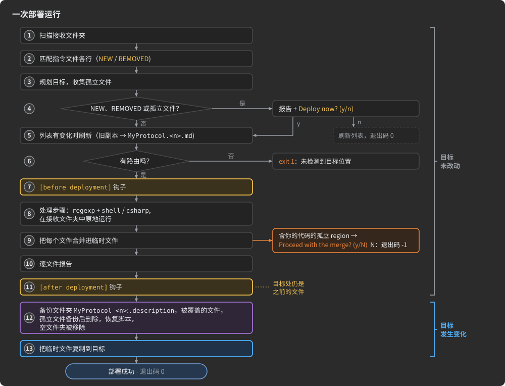

1. **扫描**接收文件夹；其根目录中以点开头的名字被跳过。
2. **匹配**指令文件的每一行与接收到的文件夹或文件，依据其链接中从语言文件夹开始的部分。
   文件夹或文件已消失的行，在它带有路由、`⛔` 或备注时被记为 REMOVED；什么都不带时则悄悄离开。
   没有对应行的接收主机文件夹是 NEW。
3. **规划**每个文件的目标，依据路由，并收集**孤立文件**：目标文件夹中
   规划不会写入的文件。
4. **询问。** 当有 NEW 或 REMOVED 行或孤立文件时，AdHocAgent 在任何写入之前报告它们：每个 NEW 文件附带
   继承的路由会把它写到的路径（或 "no rule matches it - it will NOT be deployed anywhere")，每个 REMOVED 行附带
   它携带的内容，每个 ORPHANED 文件，UNCHANGED 行的数量，以及列表副本和备份将去往何处。当列表至少有
   一条路由时，它问 "Deploy now? (y = deploy now / n = update the list and stop, deploy later)"——按单个键；输入
   被重定向时则输入一行。`n` 会把列表更新到最新，不部署、不删除任何东西，并以退出码 0 退出。
5. **刷新**列表，如果它有变化；旧文件先被复制为 `<stem>.<n>.md`。
6. **哪里都没有路由：** 本次运行退出（退出码 1)，报 "No `target locations` detected. Please add deployment targets to ... and rerun"。
7. **`[before deployment]` 钩子**运行。
8. **处理步骤**在接收文件夹上运行。
9. **合并。** 每个规划好的文件先在临时文件中准备：库文件（`lib`、`__` 文件夹）和 `.md` 文件按原样复制，
   其余每个文件与其目标处的文件合并（[智能合并](#smart-merge))。孤立代码提示出现在这里。
10. **报告**每个接收到的文件以及它的遭遇。
11. **`[after deployment]` 钩子**运行。
12. **备份。** 备份文件夹 `<received folder name>_<n>` 在指令文件旁边创建；`.description` 文件夹被
    复制进去；每个即将被覆盖的目标文件被复制进去；每个孤立文件被复制进去并删除；
    恢复脚本被写出；被删除清空的文件夹被移除
    ([自动备份与恢复](#automated-backups-and-restoration))。
13. **写入**临时文件到它们的目标。AdHocAgent 记录 "✔ Deployment successful!" 和备份文件夹，并以
    退出码 0 退出。

直到第 12 步之前，目标处都未被触碰。在那之前停止的运行——提示处按 `n`、某个步骤失败、孤立 region 被拒绝——
不会向目标写入任何东西；只有指令文件可能已被刷新，接收到的文件已被处理，钩子已运行。

<a id="the-deployment-report"></a>
#### 部署报告

第 10 步打印接收文件的树，每个文件附带它的遭遇——每个目标一行：

| 标记                                               | 含义                                                                     |
|:---------------------------------------------------|:-------------------------------------------------------------------------|
| `👉 <destination>`                                 | 新文件，或原样复制（`lib`、`__` 文件夹、`.md`)                           |
| `✅ <destination>`                                 | 与那里已有的文件合并                                                     |
| `✅⚠️ <destination>`                               | 在你确认丢弃孤立代码之后合并                                             |
| `✎ N edited block(s) kept`                        | 附加在合并的文件上：N 个生成的块保存有你的编辑并被保留                   |
| `, the generator has changed M: //todo 🔴`         | 再附在其后：其中 M 个块获得了更新说明                                    |
| `⛔`                                               | 未部署：被跳过，或没有路由到达它                                         |
| `⛔ optional: deployed when the list has its line` | 没有对应行的 demo 或项目文件                                             |

<a id="smart-merge"></a>
### 智能合并

**智能合并**让你写在生成的文件里的代码跨部署保留。生成的文件不是覆盖到其目标处的文件上：
AdHocAgent 以新版本为模板，把你写在旧版本里的内容逐 region 搬进去。
生成的文件中有两样东西使这成为可能——注入点（你的代码所在之处）和生成的块（其中
生成器的代码）。


<a id="injection-points"></a>
### 注入点

**注入点**是生成的文件中内容属于你的一段 region。每个注入点由写在
其结束行上的唯一 id(**UID**）标识。在 C# 中，region 写作 `#region>` / `#endregion>`；在 Java 和 TypeScript 中写作 `//#region >` /
`//#endregion >`。`>` 周围的空格无所谓。

```csharp
#region> Actor

    //🌭<ƍǷŞŘ
    public static global::org.unirail.collections.Pool<Actor0> pool = new(4, () => new Actor0());
    //🌭/>
#endregion> Āÿÿ.Actor
```

```typescript
        public
OnNewState( conn
:
Connection, state
:
ComplexQuery.State
):
void
	{
//#region > Actor OnNewState
//#endregion > ÿÿÿ.Actor.OnNewState
	this.state = state;
	this.epoch++;
}
```

- **UID** 是 `#endregion>` 之后的文本。`#region>` 之后的名字是给你读的；AdHocAgent 忽略它。一个
  实体的 region 的 UID 由它所属实体的编号构成——从 `ÿ` 起的字符，每字节一个，如同编号
  表中那样——后接 region 的种类（`Actor`、`Actor.OnNewState`、`OnReceivedEvent` ……)。名字不进入 UID，所以重命名
  一个 pack、主机或连接，你的代码原地不动；编号的改变则不然（[编号表](#numbers-tables))。
- **形式**:AdHocAgent 按目标文件的扩展名选择要寻找的形式：`.java` 和 `.ts` 文件中找 `//#region`,
  其余所有文件中找 `#region`。不带 `>` 的 `#region Name`——比如 demo 中的分组 region——是普通 region，不是注入
  点。
- **合并**：你的文件中某个 region 的内容进入新文件中 UID 相同的 region。你的文件中为空的
  region 不带入任何东西；你的文件没有的 region 只来自生成器。
- **位置**：在 `gen` 和 demo 的文件中——每个 pack 的代码（`<Pack> Code`、它的接收和序列化事件）、
  连接和 Actor 的代码（[Actor 的种类与运行时的 Actor](#actor-kinds-and-the-actor-at-runtime) 列出了它们），以及自定义
  变换阶段的代码（[变换链](#transform-chains))。
- **不在库里。** 库文件、`__` 文件夹的文件和 `.md` 文件按原样复制，从不合并。运行时库
  有同样形状的 region(`lib/Network.cs` 中的 `#region> TCP code`)，但你写在那里的代码会被下一次
  部署覆盖；你原有的文件只进入备份文件夹。

region 行的规则：

- **永远不要编辑、移动或复制 `#endregion>` 行或它的 UID。** 就合并而言，UID 不再匹配的 region 已经消失：
  其中你的代码要走孤立检查（[孤立代码保护](#orphaned-code-protection))。
- **一个文件里两个共用一个 UID 的 region 会悄悄丢失代码。** 只有最后一个的内容被搬过去。复制
  region 就会造成这种情况。
- **region 只按它的 UID 找到。** 当新实体接手了已删除实体的编号、且它的 region 落在同一个文件中时，
  你为旧实体写的代码会出现在新实体的 region 里。

<a id="generated-blocks-inside-injection-points"></a>
#### 注入点内部的生成的块

在注入点内部，`//🌭<` 行与 `//🌭/>` 行之间的代码是一个**生成的块**：生成器为你写
的代码，放在属于你的地方——上面的 Actor 池、通知你的处理器收到 pack 的那个调用。

在接收到的文件中，开始标记是光秃秃的 `//🌭<`。当 AdHocAgent 把文件写入你的项目时，它在
`<` 之后加上四个字符：生成器版本块的**指纹**——它的 CRC-32，计算时不计空白、不计
生成器自己的 `/*...*/` 标记，从 `ÿ` 起每字节一个字符。当块中保存有你的编辑时，指纹
后面跟一个 `✎`。`//` 之后的符号（`🌭`）在该 region 内命名这个块。

在下一次部署时，指纹把你的编辑和生成器的代码区分开：

| 你对一个块做什么                        | 下一次部署做什么                                                                                  |
|:------------------------------------------|:---------------------------------------------------------------------------------------------------|
| 原样保留                         | 用生成器的当前版本替换它                                                   |
| 重排版（缩进、换行）    | 相同：空白不算编辑                                                                |
| 编辑它——改动它、注释掉它       | 按你留下的样子保留,标记中带 `✎`;生成器版本有变化时附一条更新说明 |
| 在它之前、之后、周围写代码 | 你的代码原样保留                                                                          |
| 删除它                                 | 把生成器的版本放回来,放在你保留的最后一个块之后                                 |
| 重排各块                        | 保持你的顺序;生成器的新块放在你最后一个块之后                          |

别动那些标记：指纹和 `✎` 是下一次部署识别什么是你的代码的依据。由更早的
AdHocAgent 写入、标记中没有指纹的块，只有在被停用时才算你的——被注释掉，或标记前加 `//`;
否则生成器的版本会替换它。

<a id="update-notes-of-smart-merge"></a>
#### 智能合并的更新说明

当生成器改动了保存有你编辑的块时，部署保留你的版本，并把生成器的新版本放在
它下面，以 `//todo 🔴` 行的形式。块的标记带上新指纹，所以该说明只写一次：

```csharp
#region> Actor
    // 按我们的峰值负载设定的大小
    //🌭<ŀƼDžŭ✎
    public static global::org.unirail.collections.Pool<Actor0> pool = new(64, () => new Actor0());
    //🌭/>
//todo 🔴 The generator has changed this block. Its version now:
//todo 🔴     public static global::org.unirail.collections.Pool<Actor0> pool = new(8, () => new Actor0());
#endregion> Āÿÿ.Actor
```

(`<` 之后的四个字符代表一个指纹；在你的文件中，它们是 AdHocAgent 算出来的。）读说明，调整你的代码，
删掉说明。你留着的说明会被下一次部署移除。

当生成器丢弃了保存有你编辑的块时，你的代码留在原地，被注释掉，位于一条说明之下：

```csharp
//todo 🔴 The generator has dropped this block. What it held here:
    // public static global::org.unirail.collections.Pool<Actor0> pool = new(64, () => new Actor0());
```

没有你的编辑的被丢弃块会不带说明地消失。该文件的报告会说明有多少个编辑过的块被保留、
多少个获得了说明：`✎ 1 edited block(s) kept, the generator has changed 1: //todo 🔴`。

<a id="orphaned-code-protection"></a>
#### 孤立代码保护

注入点可能从生成的代码中消失：它所属的 Actor、pack 或状态被移除，某个实体换了
编号，它的 UID 被编辑过。对你的文件中每个新文件不再拥有的 region,AdHocAgent 剥掉你没有
编辑过的生成的块，再看剩下什么：

- **什么都不剩**——该 region 原本是空的，或只装有生成器的代码：它被悄悄丢弃。
- **你的代码**，包括编辑过的块：部署暂停。AdHocAgent 打印每个孤立 region 及其 UID，注明旧
  文件将被备份，并问 "Proceed with the merge? (y/N)"。`Y` 会不带那段代码合并文件，并在
  报告中把它标为 `✅⚠️`；你原有的文件在备份文件夹中。按其他任何键会以 "Operation cancelled by user to
  prevent data loss."（退出码 -1）取消整个部署；此时还没有任何东西被写入目标、被备份或被删除。

这个问题按单次按键读取，需要交互式控制台：输入被重定向时读键失败，
部署停在那里，运行不会正常结束——`.cs` 运行会打印异常并一直等待，直到被杀掉
([重定向输入时 AdHocAgent 的提示](#prompts-of-adhocagent-with-redirected-input))。
在你确认之前，把想保留的代码复制到它的新 region 里——对于重新编号的主机，是它新编号的那些 region。

<a id="automated-backups-and-restoration"></a>
### 自动备份与恢复

每次继续执行的部署都先做备份。**备份文件夹**是 `<received folder name>_<n>`，位于指令
文件旁边，编号比那里已有的最大编号大一：`MyProtocol_1`、`MyProtocol_2` ……。它装有：

| 备份文件夹中                       | 它是什么                                                                                                                                                                                                         |
|:-------------------------------------------|:-----------------------------------------------------------------------------------------------------------------------------------------------------------------------------------------------------------------------|
| `.description/`                            | 已部署代码所由生成的描述——描述文件以及随它编译的每个文件，按上传时的样子。[协议的演进](#evolving-a-protocol) 会把你的描述与它比较；恢复脚本从不把它写回 |
| 被覆盖的文件                      | 本次部署替换的每个目标文件，按去掉盘符的路径存放：`D:\Projects\server\protocol\gen\X.cs` 存为 `Projects\server\protocol\gen\X.cs`；两个文件落到同一名字时，扩展名前加 ` (1)`、` (2)`              |
| 孤立文件                                | 每个孤立文件，在被删除前以同样方式保存                                                                                                                                                                                              |
| `restore.bat`、`restore.ps1`、`restore.sh` | 撤销本次部署的脚本                                                                                                                                                                                                         |

指令文件旁边还有指令文件的副本 `<stem>.<n>.md`，列表每重建一次就有一份。

恢复脚本先切换到自己的文件夹，所以从任何地方都能运行。它们重建缺失的文件夹，把每个保存的文件
复制回原位——被覆盖的文件和被删除的孤立文件——然后列出本次部署新增的文件并询问
`Delete added files? [A]ll / [N]one / [S]elect per-file (default N)`。只有当你回答 `A`，或用 `S`
选中每个文件时，项目才会回到部署之前的确切状态。

备份文件夹会累积：AdHocAgent 从不删除它们。旧的自己删，最新的要留着：影响报告会在它们之中寻找
之前的描述。

<a id="how-to-restore-a-deployment"></a>
#### 如何恢复一次部署

1. 打开最新的备份文件夹，例如 `MyProtocol_5`。
2. 运行适用于你系统的脚本：
	- Windows：双击 `restore.bat`，或用 PowerShell 运行 `restore.ps1`;
	- Linux、macOS、WSL:
	  
	  ```shell
	  chmod +x restore.sh
	  ./restore.sh
	  ```

3. 回答关于新增文件的问题。

<a id="pitfalls-of-deployment"></a>
### 部署的陷阱

| 陷阱                                                                                                      | 会发生什么                                                                         | 怎么办                                                                                                                    |
|:-------------------------------------------------------------------------------------------------------------|:-------------------------------------------------------------------------------------|:------------------------------------------------------------------------------------------------------------------------------|
| 指向项目根目录、`src` 的路由,或文件被路由进你自己的文件夹                                 | 那里本次部署不写入的每个文件都被备份并删除         | 路由到专用文件夹([目标文件夹属于生成器](#a-destination-folder-belongs-to-the-generator)) |
| 主机文件夹被路由到 `.../protocol/gen/`                                                                  | 出现 `gen/gen/` 和 `gen/lib/`                                                            | 把主机文件夹路由到 `.../protocol/`                                                                                      |
| demo 或项目文件行上的路由,本意是把它送到别处                                    | 它也会去它的主机所去的地方                                                     | 预期两份副本;路由会累加                                                                                             |
| 包含 `[` 的备注                                                                                     | 其后的路由不会被读取,且列表重建时该行在那里被截断 | 备注里不要有 `[`                                                                                                         |
| 写在列表两行之间的文本                                                                   | 列表重建时丢失                                                        | 写成备注,或写在列表之外                                                                                       |
| 包含 `)` 的目标                                                                              | 路由被误读                                                                 | 选一个没有 `)` 的文件夹                                                                                                   |
| 语言文件夹之上、与语言文件夹同名的文件夹:`InCS`、`InJAVA`、`InTS`、`InPy` 等 | 任何行都匹配不上;每次运行都报告 NEW 和 REMOVED 行                        | 重命名那个文件夹,或重命名描述文件                                                                                   |
| 用真实围栏或括号写在指令文件里的示例步骤或钩子                        | 它会运行                                                                              | 使用 ` ```text ` 块和全角 `［`                                                                                |
| 一个 ` ```shell ` 块里写两条命令                                                                       | 它们作为一条命令行运行                                                         | 一条命令一个步骤                                                                                                          |
| 工具未安装的处理步骤                                                                | 部署停止                                                                 | 删掉该步骤,或把工具装到 `PATH` 上                                                                            |
| 把警告打到错误输出的工具                                                              | 每个文件都问一次 "Would you like to continue?"                                         | 消除警告,或通过输入作答                                                                             |
| 没有参数的钩子                                                                                   | 部署停止(退出码 -1)                                                       | 给它一个参数                                                                                                           |
| `/InCS/...` 参数后面还有别的参数                                                          | 两者作为一个损坏的参数传入                                            | 把它写在最后                                                                                                                 |
| 读取目标处的 `[after deployment]` 钩子                                                     | 它看到的是之前的文件                                                           | 在 AdHocAgent 退出后运行它                                                                                                 |
| 从别的文件夹运行 `.md` 任务                                                                       | 命令中的 `/InCS/...` 路径指向错误的文件夹                              | 从装有接收文件夹的文件夹运行它                                                                         |
| 流水线中的孤立 region                                                                             | 部署停在提问处;`.cs` 运行不会退出                      | 在交互式运行中解决它;给流水线步骤设时限                                                         |
| 复制的注入点                                                                                     | 只有最后一份副本的内容幸存                                                | 永远不要复制 region 行                                                                                                       |
| 恢复时按默认 `N` 作答                                                                      | 本次部署新增的文件会留下                                                  | 要精确还原就回答 `A`                                                                                                |

---

