# AdHoc Observer - manual

The AdHoc Observer draws a protocol description as diagrams: the hosts and the connections between them, the fields of every
pack, the states of every conversation. It shows what the generator will see, and every element leads back to its line in the
description. This manual walks through it on the description of AdHoc itself, [AdhocProtocol.cs](AdhocProtocol.cs): the hosts
`Server`, `Agent`, `Observer` and `LayoutFile`, and the connections `Communication`, `SaveLayout` and `ObserverCommunication`.

For the description language itself, see [MANUAL](MANUAL.md). For what AdHoc is, see [README](README.md).

## Contents

1. [Starting the Observer](#starting-the-observer)
2. [The three views](#the-three-views)
3. [Hosts: who talks to whom](#hosts-who-talks-to-whom)
4. [Packs: what each message carries](#packs-what-each-message-carries)
5. [Connections: how each conversation goes](#connections-how-each-conversation-goes)
6. [Tooltips: the declaration under the pointer](#tooltips-the-declaration-under-the-pointer)
7. [Finding things: the sidebar and Ctrl+K](#finding-things-the-sidebar-and-ctrlk)
8. [Notes on the diagrams](#notes-on-the-diagrams)
9. [Layout: what is kept, and where](#layout-what-is-kept-and-where)
10. [Live updates and the jump to the source](#live-updates-and-the-jump-to-the-source)
11. [Reference: every gesture](#reference-every-gesture)

---

## Starting the Observer

Give AdHocAgent the description with a `?` after its name:

```shell
AdHocAgent .\AdhocProtocol.cs?                       # Windows; ./AdhocProtocol.cs? elsewhere
AdHocAgent .\AdhocProtocol.cs? .\Library.cs .\work   # with imported files, and an output folder
```

Then open `http://localhost:4321/` in a browser. Everything runs on your machine: nothing is uploaded and no UUID is needed.

The output folder (the folder given last, or the current folder) keeps the shared layout and the notes, see
[Layout](#layout-what-is-kept-and-where).

## The three views

| View | Opens | Shows |
|:--|:--|:--|
| Hosts | in the page itself | every host, the connections it takes part in, the actors of each connection, and the packs the host sends and receives in each actor |
| Packs | in a window of its own, when you click a pack | every pack with its fields, nested packs inside the pack they are declared in, an arrow from a field to the pack it holds |
| Connections | in a window of its own, when you click a connection | every connection with its actors, the states of each actor, and the packs that move it from state to state |

The Packs and Connections windows are browser windows: allow pop-ups for `localhost:4321` the first time. Each view has the
same sidebar (☰ at the top left), the same search, notes and tooltips.

## Hosts: who talks to whom

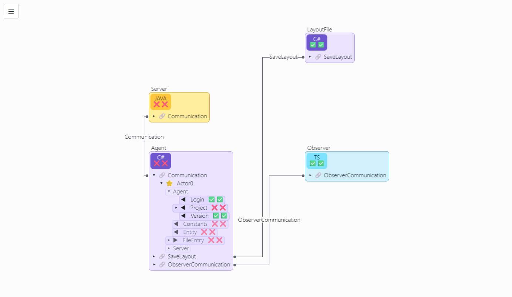

A host is declared as a `struct` that implements `Host`; the packs declared inside it are its own, and the doc comment above
it says in which language its code is generated and which of its packs come with an implementation:

```csharp
/**
<see cref = 'InJAVA'/> The following packs of the `Server` host are fully implemented and generated in JAVA.
<see cref = 'Result'/>
<see cref = 'Progress'/>
...
<see cref = 'InJAVA'/>-- The remaining packs are generated in JAVA as abstract (without implementation).
*/
struct Server : Host{
    public class Invitation { }
    public class InvitationUpdate { ... }
    public class Info { ... }
    public class Result { ... }
    public class Progress { ... }
}
```

On the diagram this is the box named `Server`:

- **The box** is in the colour of the host's language: Java amber, C# violet, TypeScript sky, C++ indigo, Rust tomato, Go cyan.
- **The language box** at its top names the language. The two marks under it are the host's defaults: the first says whether
  its packs are generated with an implementation (✅) or abstract (❌), the second whether they get hash and equals. The
  `Server` says ❌❌: what the comment does not list is abstract. The `Observer` says ✅✅: all of its packs are implemented.
- **The lines under it** form a tree, as in a file explorer:
  - 🔗 a connection the host takes part in (`Communication`); 🛤 a virtual one, carried through other hosts; 🔀 a multiplexed
    port, several connections on one port;
  - under a connection, its actors: ⭐ `Actor0`, the one every connection has, 🧵 a stateful actor, ↔ an RPC actor, 🔒 a
    singleton (functions only);
  - under an actor, the packs this host sends and receives in it, nested as they are declared. A name in grey in a dotted
    frame (`Agent`, `Server`) is a container: the host or pack the packs under it are declared in, not a pack that travels.
- **A pack line** says which way the pack goes and how it is generated:

  | Mark | Means |
  |:--|:--|
  | ◀ | this host sends the pack |
  | ▶ | this host receives it |
  | ◀ ▶ | both |
  | faded | not sent on its own: it travels inside a pack that is (`Constants` and `Entity` travel inside `Project`) |
  | ✅ / ❌ first | generated with an implementation / abstract, yours to write |
  | ✅ / ❌ second | hash and equals generated / not |
  | ⚡ | generated differently in the languages of this host: click one of its language boxes |
  | 🚩 | some fields are implemented only in some hosts or languages |

- **▸ and ▾** fold and unfold a line. Click the marker of a pack line, or anywhere on a connection or actor line. A
  double-click on a host unfolds everything in it; a second one folds it all again.
- **The lines between hosts** are the connections. A heavier orange line arrives on a multiplexed port; a dashed one is a
  virtual connection.

What you can do here:

- **Click a pack line**: the Packs window opens on that pack (see below), and the connections that carry it stand out; the rest
  fade.
- **Click a connection**, its line or its name: the Connections window opens on it. The pack lines of other connections in its
  two hosts fade.
- **Click a language box** of a host written in several languages: the pack lines show their marks for that language alone.
- **Drag** a host by any part of it: its connections are routed again, nothing else moves. The arrow keys move the selection
  one pixel.

## Packs: what each message carries

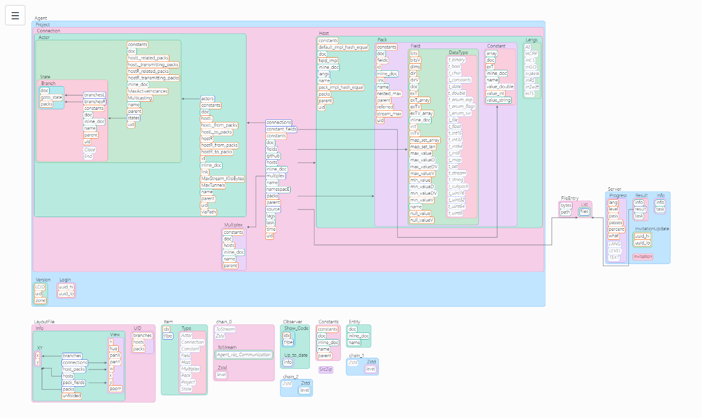

Here is a part of the same `Server` host, and `FileEntry`, declared at the project level:

```csharp
public class Result {
    string task;
    [SrcZip]
    FileEntry.List result;
    max_65_000_chars info;
}

public class Progress {
    [MinMax(0, 15)] byte what;
    [MinMax(0, 31)] byte lang;
    ...
    static string[] TEXT  = { "accepted", "generating code", ... };
    static string[] LANG  = { "C++", "Rust", "C#", "Java", "Go", "TS", "Swift" };
    static string[] LEVEL = { "none", "delivered code compiled", ... };
}

public class FileEntry {
    [D(+4096)] string path;
    [S(0x5_000_000)] Stream bytes;

    public class List {
        [D(0xFFFF)] FileEntry[,] files;
    }
}
```

And here it is drawn:

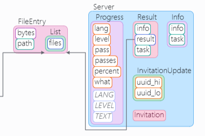

- **A pack is a box** with its name above it. A pack declared in another pack, or in a host, stands inside it: `List` inside
  `FileEntry`, the `Server` packs inside the `Server` box. The packs are coloured as countries on a map: never in the colour
  of the box they are in, nor of a box beside them. The colour itself means nothing; it only tells neighbours apart.
- **A field is a chip** inside its pack. Its border says what kind of type it holds:

  | Border | Type |
  |:--|:--|
  | orange | a number or a bool (`what`, `lang`) |
  | teal | text: a string, char, date, binary or file (`task`, `info`) |
  | green | an enum or flags |
  | plum | a collection: map, set, stream |
  | indigo | another pack of the project (`result`) |

- **A constant is in italics**, without a border: `TEXT`, `LANG`, `LEVEL` belong to `Progress` but are not sent.
- **An arrow** runs from a field to the pack it holds: `Result.result` to `FileEntry.List`, `List.files` to `FileEntry`. A field
  of its own pack's type has an arrow in the accent colour.
- **An empty pack** (`Invitation`) is a box with no chips.

What you can do here:

- **Select a pack**: only its arrows stay drawn, so the links of one pack can be followed in a crowded view. Click the empty
  canvas to see all of them again.
- **Drag a pack**, by its name or by a field: it moves with everything inside it, and only its own arrows are routed again.
- **Right-click the empty canvas** and choose **Auto layout** to arrange the whole view anew.

  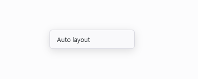

When the window opens on a pack, or flies to one you picked, the pack glows for a moment so the eye finds it.

## Connections: how each conversation goes

The connection between the Agent and the Server, with its states (abridged):

```csharp
interface Communication : Connects<Agent, Server>{
    [TransmitTimeout(12)]
    [L____________ <VersionMatching, Agent.Version>]
    struct Start{ }

    [TransmitTimeout(1)]
    [____________R <Login, Server.Invitation>]
    [____________R <Close, Server.Info>]
    struct VersionMatching{ }

    [L____________ <LoginResponse, Agent.Login>]
    struct Login{ }

    [TransmitTimeout(12)]
    [____________R <TodoJobRequest, (Server.Invitation, Server.InvitationUpdate)>]
    [____________R <Close, Server.Info>]
    struct LoginResponse{ }

    [TransmitTimeout(2)]
    [L____________ <Project, Agent.Project>]
    struct TodoJobRequest{ }

    [ReceiveTimeout(120)]
    [____________R <Close, Info_Result>]
    [____________r <Server.Progress>]
    struct Project{ }
}
```

And the same conversation in the Connections window:


Read it as a sequence diagram folded into states, time running down:

- **The box** is the connection: its name, and under it the two hosts, `Agent ⇄ Server`, the left one as in
  `Connects<Agent, Server>`. ♻ with the wait after it: the connection is resumable.
- **Inside it, a box per actor**: here only `Actor0` (⭐), whose states are those declared in the connection itself. Named
  actors carry their kind (🧵, ↔, 🔒) and how many of their conversations may run at once: `one at a time`,
  `up to 24 at once`, `unlimited`, `per call`. Actors declared in one interface are framed together, dashed, under its name.
- **Two columns**, named at the top by their hosts: the left host's on the left, the right host's on the right. A state stands in
  the column of the side that leads it, the side that sends the packs that move it on. `Start`, `Login` and `TodoJobRequest`
  are the Agent's; `VersionMatching`, `LoginResponse` and `Project` are the Server's.
- **A state** is its name, with its limits under it:

  | Mark | Attribute | Means |
  |:--|:--|:--|
  | ▶ in a green box | | the initial state, where every conversation starts |
  | ⏳ 12s | `[TransmitTimeout(12)]` | a pack may take 12 s to go out in this state; then the connection closes |
  | ⏱ 2m | `[ReceiveTimeout(120)]` | the peer may stay silent 2 min in this state; then the connection closes |
  | ⏰ | `[Deadline(…)]` | how long one conversation may stay in the state; then that one ends |
  | 💤 | `[Idle(…)]` | a conversation ends when nothing of its own comes from the peer for this long |
  | ♻ | `[Resumable(…)]` | a peer that lost the connection in this state may come back and go on from here |

- **Under a state, its packs**, the branches: amber for packs the left host sends, blue for the right host's. Several packs
  that lead the same way stand in one frame (`Invitation`, `InvitationUpdate`).
- **An arrow** goes from a pack to the state its sending leads to, in the colour of the sender. A dashed border means the state
  stays as it is (`Progress`: sent any number of times while the Server works).
- **A red frame** ends something: `⇛ ❌` after the name, the connection closes after the pack (`Info`, `Result`); `⛔`, the
  actor ends and the connection stays open.

What you can do here:

- **Hover a state or a pack**: its arrows stand out and the rest of the actor fades, so one step can be read alone.
- **Click a pack**: the Packs window flies to it and makes it glow.
- **Drag** a state by its name or its frame; drag a pack up or down to reorder the branches of its state, sideways to move the
  whole state. The arrows follow.
- **Right-click the empty canvas** for **Auto layout**.

## Tooltips: the declaration under the pointer

Rest the pointer on any host, language box, connection, actor, state, pack or field for half a second. The tooltip shows the
doc comment and the declaration as your IDE shows them, rebuilt from what the generator received, and below it what each mark
on the element means.

A state, with its branches:

![The tooltip of the state LoginResponse: its doc comment, then [TransmitTimeout(12)], the two branches and struct LoginResponse { }, then who leads the state, and what the ⏳ 12s mark means. The rest of the actor is faded.](docs/img/observer/connections-hover.png)

A field, with its attributes and what they cost on the wire:

![The tooltip of the field Progress.what: its doc comment, the declaration [MinMax(0, 15)] byte what; and the note that it takes 4 bits of the bit field of the pack.](docs/img/observer/packs-tooltip.png)

A pack line in the Hosts view:

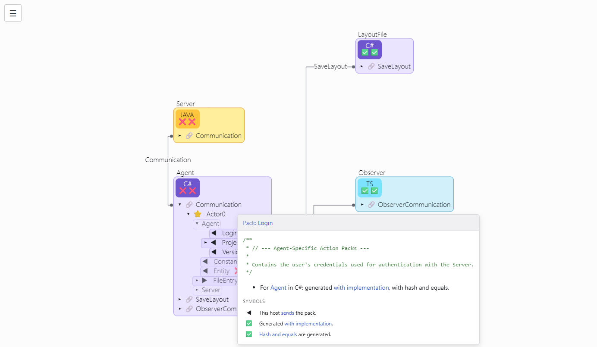

## Finding things: the sidebar and Ctrl+K

**☰** opens the sidebar of a view.

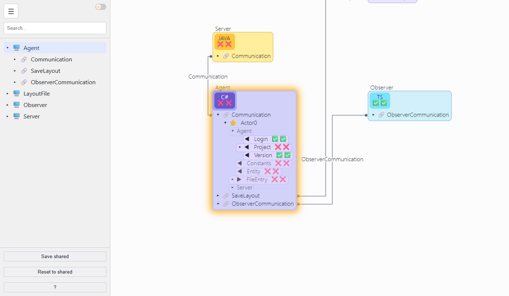

- **The search field** filters the tree as you type. You need not click it first: start typing with the pointer over a diagram
  and the sidebar opens with what you typed.
- **The tree** lists what the view shows: hosts, connections, actors and packs; packs, fields and constants; connections, actors,
  states and branches; and the notes of the view. A click on a line flies the view to its element, unfolds what hides it, and
  makes it glow.
- **The switch** at the top right turns the dark theme on and off, in all three windows at once.
- **Save shared**, **Reset to shared**: see [Layout](#layout-what-is-kept-and-where). **Auto layout** arranges the view
  anew.
- **?** opens the legend of every mark used on the diagrams.

**Ctrl+K** (Cmd+K on a Mac) asks for a name anywhere in the view. Arrows move through the results, Enter goes:

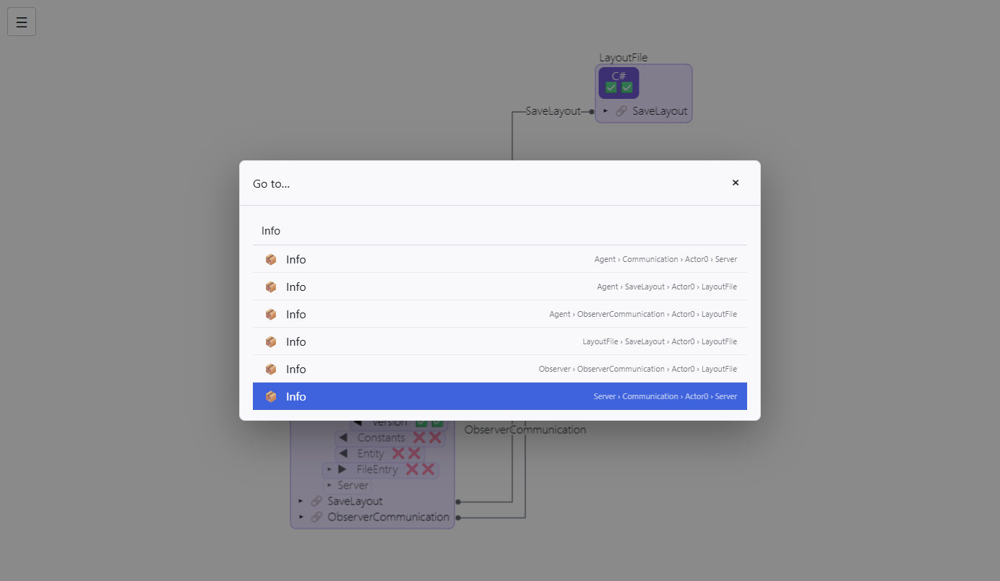

The view draws back far enough to show where the element is, then closes in on it with the element in the middle, and the
element glows:

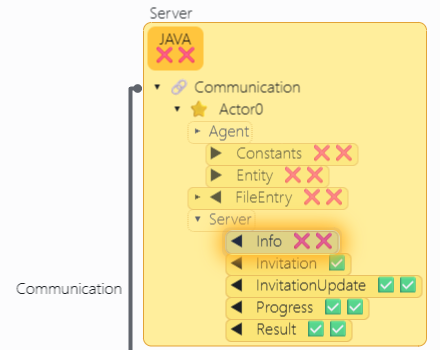

## Notes on the diagrams

A note is a small rich-text page pinned to a view: a remark for the team, a reminder, a picture.

**Double-click the empty canvas** of any view. A note appears there, and its editor opens:

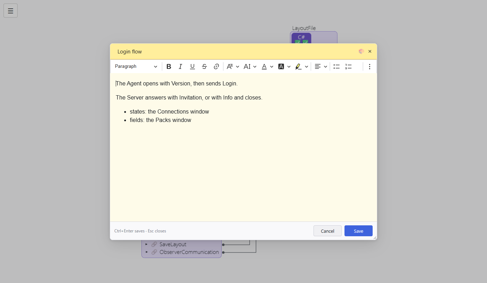

- **The name** is in the header: click it to change it. Every note of a view has a name of its own; a new one is called
  `Note 1`, `Note 2` and so on.
- **🎨** gives the note a colour.
- **The text** takes headings, lists, tables, links and pictures (pasted or uploaded; they are kept inside the note).
- **Save** or **Ctrl+Enter** keeps what you wrote. **Cancel** drops it. **Esc**, **×** or a click beside the editor close it, and
  ask first if something would be lost.

On the diagram the note moves and zooms with it:

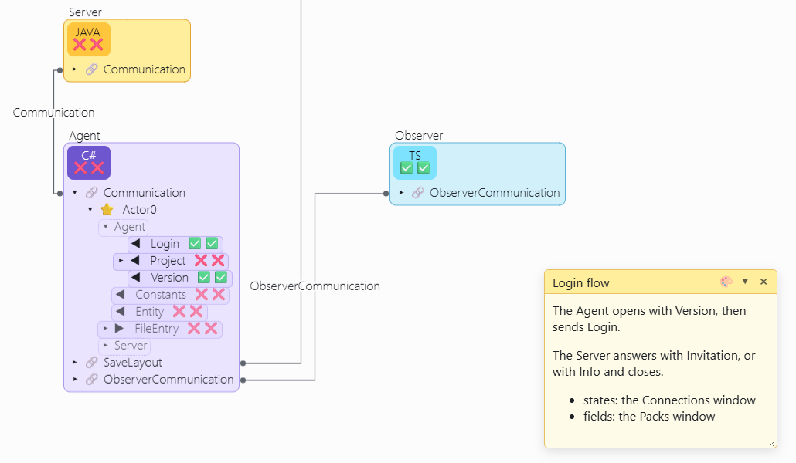

- **Drag** it by its header; **resize** it by its lower right corner.
- **▾** folds it to its name, **▸** unfolds it. Holding the mouse on the header of a folded note shows it while you hold.
- **Double-click** it to edit it again.
- **×** deletes it, after asking.
- **Find it** in the sidebar under 🏷️ Stickers, or with Ctrl+K: the view flies to the note and it glows.

Notes are kept in the output folder when you press **Save shared**, one HTML file per note. A browser closed before that leaves
them in `unsaved/` of the output folder: move them up one folder to get them back.

## Layout: what is kept, and where

The first time, every view arranges itself. From then on it opens as you left it.

- **Your layout** is kept by your browser, by itself: every move, fold, zoom and window size, a moment after you make it.
- **Save shared** writes the layout and the notes of all views to the output folder: the file `layout`, and the notes in
  `host_packs/`, `pack_fields/` and `connections/`. Commit them with the description, and everyone who opens it sees the
  same diagrams.
- **Reset to shared** forgets your own layout and opens the shared one again.
- **Auto layout** (a button in the sidebar, or a right click on the empty canvas, in every view) arranges the whole view
  anew; the result becomes your layout.

Positions are kept by the unchanging numbers of the entities, not by their names, so renaming or moving a declaration keeps
its place. An entity that is new since the layout was saved is placed beside what it is tied to; nothing else moves.

## Live updates and the jump to the source

- **Save the description** in your IDE and come back to the browser: the Observer asks AdHocAgent whether anything changed, and
  if so draws it again, keeping your layout. A description that does not parse shows its error at the top of the page.
- **Right-click** a host, connection, actor, state or pack: your IDE opens at its declaration. Tell AdHocAgent how to start your
  IDE in `AdHocAgent.toml`:

  ```toml
  show_code_exe  = "X:/VSCode/Code.exe"
  show_code_args = "--goto <path to file>:<line number>:<char number>"
  ```

The dark theme, for those who work in one:

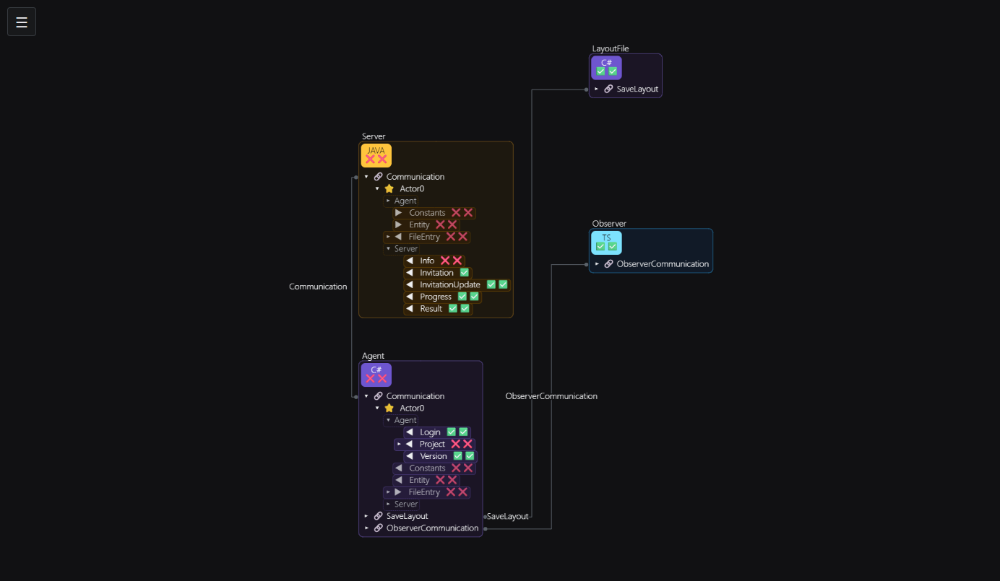

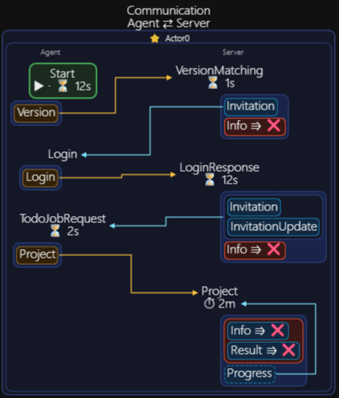

## Reference: every gesture

| Gesture | Where | Does |
|:--|:--|:--|
| click a pack line | Hosts | opens the Packs window on the pack; the connections carrying it stand out |
| click a connection, line or name | Hosts | opens the Connections window on it |
| click a language box | Hosts | shows the pack marks for that language |
| click ▸ / ▾, a connection or actor line | Hosts | folds or unfolds the line |
| double-click a host or line | Hosts | unfolds everything in it, or folds it all |
| select a pack | Packs | shows only its arrows |
| hover a state or pack | Connections | lights its arrows, fades the rest of the actor |
| click a pack | Connections | flies the Packs window to it |
| drag | all views | moves the element; only its own lines are routed again |
| arrow keys | Hosts | move the selection by one pixel |
| hover, half a second | all views | the tooltip: doc, declaration, marks |
| right-click an element | all views | opens the declaration in your IDE |
| right-click the empty canvas | all views | Auto layout |
| double-click the empty canvas | all views | a new note |
| wheel / drag the empty canvas | all views | zoom / pan |
| Shift + drag | all views | selects what the frame covers |
| typing over a diagram | all views | opens the search with what you typed |
| Ctrl+K / Cmd+K | all views | Go to…: ↑ ↓ to choose, Enter to go |
| Esc | dialogs, menus, note editor | closes; the note editor asks first if something would be lost |
| Ctrl+Enter | note editor | saves the note |

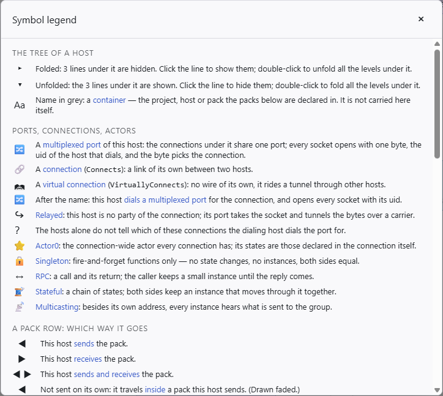
