[English](README.md) | 简体中文

<a id="adhoc"></a>
# AdHoc

**在一个 C# 文件中描述整个系统。获得其中每个程序的网络代码,各自使用自己的语言。**

AdHoc 是二进制协议的代码生成器,它描述的是系统,而不只是消息。在一份 C# 描述中,你声明程序之间交换的数据、程序本身及其语言、它们之间的连接、每条连接上以状态机表达的对话,以及送达规则:什么在套接字断开后存活、什么走 UDP、什么被压缩或加密、什么可以由中继或存储在不读取的情况下携带。AdHocAgent 在你的机器上检查描述。然后云端生成器写出每个程序的代码:C++、Rust、C#、Java、Go、TypeScript、Swift、C、Dart 和 Python。AdHocAgent 把这些代码部署到你的项目中,并在每个新版本里保留你自己的代码。

![基于一份 AdHoc 描述构建的车队平台。左侧,三个对端拨入一台用 C# 编写的 Gateway 的多路复用端口 :443:运行固件 3.x 的 Vehicle 和运行固件 2.x 的 VehicleLegacy(均为 Java),以及一台用 C# 编写的 Service 诊断笔记本。一个端口服务三条连接——Telemetry、TelemetryLegacy 和 Diagnostics——以及两代固件。Gateway 通过一条 [Resumable(60 * 60)] 连接与 Java 编写的 Fleet 后端通信:会话比套接字更长寿,声明为保证送达段的命令恰好一次、按序到达。Fleet 为每辆车运行一个带状态机、RPC 和截止时间的 Actor,并通过 Connects<Fleet, Fleet> 复制。一台 C# 编写的现场 Sensor 通过 [UDP<Samples>(10 * 60)] 与 Fleet 通信:除样本外每个 pack 都保证送达。浏览器中用 TypeScript 编写的 Operator 经由一台 Edge 主机到达 Fleet,其 Relay 只转发密封的字节:VirtuallyConnects<Operator, Fleet, Edge>,端到端 [Zstd, ChaCha20]。右侧,一个 Java 编写的 Archive 通过一条 trim 过的变换链保存压缩加密的事件:无模式,无密钥。图注:一个 C# 文件,9 种主机类型,3 种语言,10 条连接;这里每一行都是生成的代码;成帧、状态机、重连、重放、端口共享、中继和加密——没有一行是手写的。](docs/img/tldr-system.zh-CN.svg)

这张图上的每一条连线都是生成的,上面的每个标签都是描述中的一两行。下面是描述所包含的内容、生成器据此产出的东西,以及代码在运行时的行为:

| 描述 | 生成 | 运行 |
|:--|:--|:--|
| 你 IDE 中的一个 C# 文件:pack 与字段、主机与语言、连接、状态与分支、会话、流、变换链、中继、端口 | AdHocAgent 在本地检查每条规则,只上传通过检查的描述。生成器返回每台主机以其每种语言编写的代码;文件名后加 `!` 时,还会在资源允许的范围内测试代码。生成免费。 | pack 以两端都知晓布局的字节形式在线上传输。每条连接用两个固定缓冲区承载它们,无论大小,两端运行同一状态机。 |

**本页内容:** [AdHoc 解决什么问题](#what-adhoc-solves) · [AdHoc 的结构](#how-adhoc-is-organized) ·
[为什么是二进制协议而不是 HTTP](#why-a-binary-protocol-not-http) · [几乎零成本的 pack](#packs-that-cost-almost-nothing) · [虚拟连接](#virtual-connections-through-hosts-that-cannot-read) · [为什么从描述生成代码](#why-generate-code-from-a-description) ·
[现成方案](#ready-solutions) · [功能](#capabilities) · [AdHoc 不适用的情况](#when-adhoc-is-not-the-right-tool) ·
[快速入门](#getting-started) · [了解更多](#learn-more)

**完整手册:** [MANUAL.md](MANUAL.zh-CN.md)。它讲解描述如何编写、生成器从中产出什么,以及生成的代码在运行时如何表现。

**已有模式(schema)?** [现成的转换器](#start-from-a-schema-you-already-have) 把 OpenAPI、Protocol Buffers、Thrift、Avro、
FlatBuffers、ASN.1、FIX、ROS 2、MAVLink、DSDL、CRSF/MSP、CAN DBC、Matter 和 LwM2M 的模式转换为一份 AdHoc 描述,作为起点。

<a id="what-adhoc-solves"></a>
## AdHoc 解决什么问题

*联网系统除自身逻辑之外所需的代码,以及替代它的声明*

联网系统中的大部分代码不是业务逻辑。它搬运数据。每种语言里有序列化器和解析器,每条连接上有分发 switch,有"消息此刻可否到达"的检查。还有重连与重放、有损链路上的重传、端口前的路由器、版本分支、解析再重新编码的代理,以及对大到放不进内存的负载的分块。所有这些都要手写,每一侧、每种语言各写一份,只靠纪律保持同步。在 AdHoc 中,你声明需要什么,生成器就为每一侧、每种语言写出这些代码。

![手写管线代码与 AdHoc 声明的对比。左侧,标题"手写——每条消息、每一侧、每种语言各一份"之下,一摞十一个灰色方块,后面还有两个偏移的副本,每种语言一个标签:C++、Rust、C#、Java、Go、TypeScript、Swift、C、Dart 和 Python。方块自上而下:每条消息的编码器和解码器;分发 switch 和"此刻可以到达吗?"标志;关联 ID 和待处理调用表;重连、会话恢复和重发队列;序列号、确认和重传窗口;大负载的分块和临时文件;压缩与加密包装器;解密、解码再重新编码的存储;解析并持有密钥的代理;前置路由器,或每个服务一个端口;版本字段加 if (version >= 3) 分支。方块下的注释:乘以每条连接的两侧,靠手工保持同步。右侧,一张标题为"声明一次——描述中的一行"的橙色卡片,每个方块对应一行,方块与其行之间用箭头连接:class Order { [MinMax(1, 100)] byte quantity; };[L____________<Shopping, Login>] struct Start { };(L____________, Pong) ping(Ping req);[Resumable(30 * 60)] 加 Resumable<Client, Order>;[UDP<Samples>(10 * 60)];[S(200_000)] Stream feed;[Zstd, ChaCha20];[ToStream<FromCamera>] Snapshot snapshot;VirtuallyConnects<Operator, Fleet, Edge>;Multiplex<(Telemetry, TelemetryV2, Console)>;struct VehicleV2 : Host,新一代。从卡片指向底部黄色条带的箭头:为每台主机生成,以其每种语言——线上字节相同;你的代码说明一个 pack 意味着什么、一个状态启动什么,位于智能合并保留的注入点中。](docs/img/readme-hand-vs-declared.zh-CN.svg)

<a id="the-code-you-no-longer-write"></a>
### 你不再需要手写的代码

顶部[这张图](#adhoc)上的标签来自下面这些行。

| 系统需要什么 | 手写 | 在 AdHoc 中声明 | 更多 |
|:--|:--|:--|:--|
| **每种语言中、以字节表示的消息** | 每条消息、每种语言各一个编码器和一个解码器,靠测试保持同步 | `class Order { long item; [MinMax(1, 100)] byte quantity; }`——两端的代码,以每台主机的每种语言生成;`quantity` 以 7 位传输 | [精心设计的字节](#designed-bytes-encodings-that-follow-your-declarations) |
| **分发与消息的顺序** | 基于类型字段的 switch;每个处理器、两侧都检查的标志 | `[L____________<Shopping, Login>] struct Start { }`——一个状态机,为两端生成;状态不允许的 pack 被拒绝 | [对话](#conversations-connections-actors-states-rpc) |
| **请求与应答** | 关联 ID、待处理调用表、清理 | `(L____________, Pong) ping(Ping req);`——应答会按状态检查,并送达到发起请求的代码 | [对话](#conversations-connections-actors-states-rpc) |
| **断开的连接** | 重连、会话恢复、确认、重发队列、去重 | `[Resumable(30 * 60)]` 把丢失的会话挂起最长 30 分钟;`Resumable<Client, Client.Order>` 让订单恰好一次、按序到达 | [会话](#sessions-that-outlive-sockets-guaranteed-delivery-udp) |
| **有损无线链路** | 序列号、确认、重传窗口 | `[UDP<Samples>(10 * 60)]`——走 UDP,除样本外每个 pack 都保证送达 | [会话](#sessions-that-outlive-sockets-guaranteed-delivery-udp) |
| **大型与实时负载** | 整体放入内存、临时文件、手工分块 | `[S(200_000)] Stream feed;`——上限为你声明的值(此处 200 000 字节),从你的源到你的汇,经由连接的两个固定缓冲区,从不整体驻留 | [流](#streams-any-size-through-fixed-buffers) |
| **压缩与加密** | 每个调用点的包装代码 | `[Zstd, ChaCha20]`——可加在一个 pack、一个持有 pack 的字段、一个字符串或 `Stream` 上,或整条连接上 | [变换链](#transform-chains-compression-and-encryption-as-attributes) |
| **存储与归档** | 解密、解码、存储,输出时重新编码——因此存储需要模式和密钥 | `[ToStream<FromCamera>] Snapshot snapshot;`——存储接收它从不解析的原始字节;`[FromStream<…>]` 把字节发出去,远端得到 `Snapshot` | [trim](#trims-stores-that-keep-bytes-they-never-parse) |
| **网关与代理** | 解析再重新序列化、持有密钥、每次变更都要重建的代理 | `VirtuallyConnects<Operator, Fleet, Edge>`——`Edge` 上生成的中继转发字节而不解码 | [虚拟连接](#virtual-connections-and-relays-middle-tiers-that-cannot-read) |
| **一个端口上的多个服务** | 前置路由器,或每个服务一个端口 | `Multiplex<(Telemetry, TelemetryV2, Console)>`——套接字的第一个字节选定连接 | [多路复用](#multiplexing-one-port-many-peers-many-generations) |
| **现场的版本** | 版本字段,每个处理器里的 `if (version >= 3)` | 新一代是一台拥有自己连接的新主机;旧的保持冻结;两者共享一个端口 | [演进](#evolution-a-new-generation-is-a-new-host) |
| **集群自己的协议** | 为节点间流量准备的第二套内部协议 | `Connects<Fleet, Fleet>`——主机与自身相连,与其客户端并存 | [现成方案 R16](#r16-an-internal-cluster-protocol-and-a-server-mesh-on-the-same-port) |
| **再生成之后你的代码** | 复制粘贴进每个新版本;猜测一次改动会破坏哪些程序 | 注入点与智能合并保留你的代码,并带备份;`AdHocAgent .\MyProtocol.cs~` 列出一次改动会波及的主机 | [部署](#deployment-routes-smart-merge-backups) · [影响报告](#impact-report-which-hosts-an-edit-reaches) |

属于你的,是只有你能写的东西:收到的 pack 意味着什么、进入一个状态会启动什么、超时做什么,以及你自己的数据结构。AdHoc 甚至可以直接从这些结构序列化,无需复制进生成的对象([主机](#hosts-generated-objects-or-your-own-structures))。

pack 也不绑定于网络。把 pack 发到连接上的同一份生成代码,也能以你自己的存储格式读写它们。

<a id="where-adhoc-pays-off"></a>
### AdHoc 的价值所在

![同样的声明,三个世界:三列日常问题,每列标注对应现成方案的编号。设备与现场,设备上用 C、C++、Rust、Go、C# 或 Java:每个字节都占通话时间(R13);断连不丢事件(R4);命令可靠、样本新鲜(R5);跨代固件,无版本字段(R2);任意大小的 OTA 更新(R10);仅在解锁后移动(R14);视频为告警让路(R19);可重新同步的串行链路(R22)。后端与集群,除 TypeScript 外任何语言的服务器:一个公共端口,多个服务(R3);集群协议,同一端口(R16);存储无法读取的字节(R1);压缩一次,扇出(R11);不看负载的审计(R17);每个角色只见自己的(R12);摄取进你的结构(R15);一个 pack,多个接收者(R20);同时存储与广播(R21)。应用与浏览器,任何语言的客户端:实时仪表盘,双向推送(R7);带进度、取消和截止时间的任务(R8);带租约的订阅(R9);房间、在线状态、轮流(R18);经网关访问私有主机(R6);订单在不稳定网络下存活(R4);视频、命令永不等待(R19);一个节拍发给每个玩家(R20)。列下方,一条橙色条——一份描述,一个 C# 文件——馈入一条黄色条——十种语言的生成代码,一个协议,相同的字节——黄色条再馈入全部三列。脚注:设备——固件、网关、工控机、车载计算机——用 C、C++、Rust、Go、C# 或 Java;TypeScript 主机总是主动拨号。](docs/img/readme-domains.zh-CN.svg)

同样的几条声明,解决设备上、后端里和应用中的问题。下面每个问题都有一个[现成方案](#ready-solutions),带有它的声明、运行时行为和限制:

- **设备与现场。** [寥寥数字节的遥测](#r13-every-byte-costs-airtime-telemetry-in-a-handful-of-bytes) ·
  [蜂窝断连不丢事件](#r4-a-client-that-never-loses-an-order-or-an-event) ·
  [在关键处可靠的 UDP](#r5-reliable-where-it-matters-fresh-where-it-does-not) ·
  [没有版本字段的固件世代](#r2-versioning-without-version-fields) ·
  [任意大小的 OTA 更新](#r10-files-media-and-ota-updates-of-any-size-resumable) ·
  [命令不乱序](#r14-protocol-enforced-workflows-no-command-out-of-order)。设备侧主机是固件、网关、工控机、车载计算机或维修笔记本,
  用 C、C++、Rust、Go、C# 或 Java 编写。
- **后端与集群。** [一个公共端口](#r3-one-public-port-for-many-services) ·
  [同一端口上的集群网格](#r16-an-internal-cluster-protocol-and-a-server-mesh-on-the-same-port) ·
  [保存它无法读取的字节的对象存储](#r1-object-storage-that-keeps-bytes-it-cannot-read) ·
  [只压缩一次的日志代理](#r11-a-log-broker-that-compresses-once-and-fans-out) ·
  [不看负载的审计层](#r17-a-metadata-routed-payload-blind-middle-tier-audit-and-tracing) ·
  [最少知情的主机](#r12-least-knowledge-hosts-every-role-sees-only-its-own-messages) ·
  [摄取进你自己的结构](#r15-ingest-straight-into-your-own-data-structures)。
- **应用与浏览器。** [实时仪表盘](#r7-live-dashboards-and-consoles-in-the-browser) ·
  [长时间运行的任务](#r8-long-running-jobs-with-progress-cancel-and-deadlines) ·
  [扇出订阅](#r9-fan-out-subscriptions-with-leases) ·
  [聊天与协作](#r18-chat-and-collaboration-rooms-presence-turn-taking) ·
  [永远不需要更新模式的网关](#r6-a-gateway-that-never-needs-a-schema-update)。

AdHoc 面向数据密集型系统,其中的对端由你部署、可以列举。典型领域有交易与行情数据、游戏服务器、
遥测与物联网、工业与科学数据采集、实时分析、流媒体、电信、后台系统,以及相互通信的服务。AdHoc 自己的协议——
AdHocAgent 与生成器之间的链路——本身就是一份 AdHoc 描述:[`AdhocProtocol.cs`](AdhocProtocol.cs)。AdHoc 不适合的场合,在
[AdHoc 不适用的情况](#when-adhoc-is-not-the-right-tool) 中直言。

<a id="how-adhoc-is-organized"></a>
## AdHoc 的结构

*管线:**描述 → AdHocAgent → 生成器 → 每台主机的代码 → 部署 → 运行时** · 模型:**项目 → 主机 → 连接 →
Actor → 状态 → 分支 → pack → 字段 → 字节***

三幅图整体解释 AdHoc。管线把一个文件变成代码,模型是这个文件由什么构成,运行时是生成的代码运行其上的东西。之后是一份完整的描述,逐行讲解。

<a id="the-pipeline-one-file-in-code-for-every-host-out"></a>
### 管线:一个文件输入,产出每台主机的代码

![AdHoc 管线呈 U 形:左侧是你的机器,右侧是 AdHoc 云端。上排朝服务器方向:1,描述文件 MyProtocol.cs,.NET 项目中的普通 C#,由你的 IDE 检查;2,AdHocAgent,用 Roslyn 编译它,检查所有 AdHoc 规则,在第一个错误处停止,并把编号表写回文件;一支标有"上传:描述 + UUID"的箭头跨向云端,附注"在描述通过检查之前,任何东西都不会离开你的机器"。3,生成器,一项云服务,为每台主机以它的每种语言——十种语言,从 C 到 Python——生成代码,文件名后加 ! 时,还会在资源允许的范围内测试它。下排返回:4,接收到的文件夹,按语言和主机各一个文件夹,内含 gen、lib 和 demo;5,部署,由 MyProtocol.md 驱动,把文件路由到你的文件夹,通过智能合并保留你的代码,并制作带恢复脚本的备份;6,你的项目,每个都由 gen、lib 和你的代码构建。一条从你的项目指回描述的虚线箭头写着:描述改了?再跑一遍第 2–5 步。下方是运行时:一个 C# 的 Server 和一个 TypeScript 的 Client 通过连接以字节形式交换 pack。颜色标示归属:橙色是你的,灰色是 AdHocAgent,紫色是 AdHoc 服务,黄色是生成的。](docs/img/dev-01-pipeline.zh-CN.svg)

| 步骤 | 位置 | 发生了什么 |
|:--|:--|:--|
| **1. 描述** | 你的 IDE | .NET 项目中的普通 C#,用来自 [`Meta.cs`](src/Meta.cs) 的 AdHoc 词汇编写:`Host`、`Connects<L, R>`、分支特性和字段特性。你的 IDE 在你输入时编译并检查它。 |
| **2. AdHocAgent** | 你的机器 | 用 Roslyn 编译描述,并依据每一条 AdHoc 规则检查它。第一个错误就会停止本次运行,在描述通过检查之前,任何东西都不会离开你的机器。AdHocAgent 还会把**编号表**写回文件:pack、主机、连接、Actor 和状态的标识。 |
| **3. 生成器** | AdHoc 云端 | AdHocAgent 用你的个人 UUID 登录并上传描述。生成器为每台主机以它的每种语言写出代码;文件名后加 `!` 时,还会在资源允许的范围内测试代码。 |
| **4. 接收到的文件夹** | 你的机器 | 每种语言一个文件夹(`InCS`、`InJAVA`、`InTS`),内部每台主机一个文件夹:`gen/`(协议代码)、`lib/`(运行时库)、`LICENSE-GRANT.md`。 |
| **5. 部署** | 你的项目 | 一个 Markdown 指令文件把接收到的文件路由到你的项目中。**智能合并**把你在**注入点**中的代码带进新文件。部署要覆盖或删除的所有内容都会先备份,并附带恢复脚本。 |
| **6. 运行时** | 你的程序 | 每台主机都是你的程序,由生成的代码、运行时库和你的代码构建而成。 |

描述一有变化,第 2 到 5 步就会再跑一遍。在此之前,`AdHocAgent .\MyProtocol.cs~` 会告诉你这次改动会到达哪些主机
([影响报告](#impact-report-which-hosts-an-edit-reaches))。

→ MANUAL:[管线](MANUAL.zh-CN.md#the-pipeline-from-a-description-to-running-code) · [AdHocAgent](MANUAL.zh-CN.md#adhocagent) ·
[AdHoc 为每台主机生成什么](MANUAL.zh-CN.md#what-adhoc-generates-for-each-host) ·
[部署与智能合并](MANUAL.zh-CN.md#deployment-and-smart-merge)

<a id="the-model-nine-layers-from-the-project-down-to-the-bytes"></a>
### 模型:九层,从项目到字节

![AdHoc 模型是一架九层的梯子,从上到下,每层都附有声明它的 C# 构造:项目——interface Telemetry,整个系统;主机——struct Sensor : Host,一个程序和它的语言;连接——interface Link : Connects<Sensor, Collector>,两台主机之间的链路;Actor——interface Name : Actor,一场对话,许多场同时进行;状态——struct Idle { },一步:现在谁可以发送什么;分支——[L____________<Waiting, Sensor.Reading>],一方可以发送的 pack 和下一个状态;pack——class Reading,在线上行进的单元;字段——[MinMax(-40, 125)] short celsius,一个按位置识别的带类型的值;字节——一条线路 ID 后跟字段的字节带。括号把梯级分组为拓扑(谁存在、谁对话)、对话(什么时候可以发送什么)和数据(发送的是什么)。两条紫色虚线箭头指向 pack 梯级:一条来自分支梯级,标注"选择 pack";一条来自主机梯级,标注"声明 pack(或由项目声明)"。附注:分支不包含 pack;它只选择在项目中或在主机中声明的 pack,这些 pack 位于任何连接之外。](docs/img/dev-01-model-layers.zh-CN.svg)

| | 层 | 声明为 | 它是什么 |
|:--|:--|:--|:--|
| **拓扑** | 项目 | 命名空间中的顶层 `interface` | 整个系统,及其所有部分的协议 |
| | 主机 | `struct Server : Host`,语言写在文档注释中 | 系统中的一个程序 |
| | 连接 | `interface Link : Connects<Client, Server>` | 两台主机之间的链路,以及通过它所说的一切 |
| **对话** | Actor | 连接体中的各个状态,或 `interface Job : Actor` | 一场独立的对话;一条连接上同时进行许多场 |
| | 状态 | 一个空 `struct` | 对话的一步:现在每一方可以发送哪些 pack |
| | 分支 | 状态上的特性:`[L____________<Next, Packs>]`、`[____________r<Packs>]` | 一方在此可以发送的 pack,以及发送后进入的状态 |
| **数据** | Pack | 一个 `class` | 被发送、接收或存储的单元 |
| | 字段 | 一个实例字段:`[MinMax(-40, 125)] short celsius;` | pack 内一个带类型的值 |
| | 字节 | 生成 | pack 的线路 ID,然后是它的字段 |

这架梯子不只是嵌套关系:

- **Pack 是数据。**你在项目中或在主机中声明它们,位于任何连接之外,分支只是引用它们。被某个分支发送的 pack 会获得一个
  **线路 ID**,即在线上位于它前面的编号。没有任何分支发送的 pack 仍然可以作为字段的类型。
- **字段按位置传输,名字从不上线。**字段不携带标签:它凭位置被识别,所以改变同种字段的顺序就会改变格式。标识保存在
  编号表中,所以用 IDE 重命名一个 pack 或一台主机不会改变线上的任何内容。

→ MANUAL:[模型](MANUAL.zh-CN.md#the-model-from-the-project-down-to-the-bytes) ·
[从 C# 构造到 AdHoc 实体](MANUAL.zh-CN.md#from-c-constructs-to-adhoc-entities) ·
[什么会改变线上内容、什么不会](MANUAL.zh-CN.md#what-changes-the-wire-and-what-does-not) ·
[术语表](MANUAL.zh-CN.md#glossary-of-adhoc-terms)

<a id="the-runtime-generated-code-on-two-buffers-per-connection"></a>
### 运行时:生成的代码运行在每条连接两个缓冲区之上


- **发送由套接字拉动。**`send(pack)` 只是把 pack 排入队列。每当套接字能接收字节时,生成的发送器
  就把 pack 的 ID 和字段直接写入发送缓冲区。下一次填充从上一次停下的地方继续,必要时可以从
  字段中间继续。pack 从不以一个完整字节数组的形式存在。
- **接收从第一批字节开始。**接收器读取 pack ID,选择该 pack 生成的处理器,并在字段落入
  接收缓冲区的位置就地消费它们。被缓冲区末尾切断的值会在一小块解析器状态中等待。
- **内存不随消息增长。**一条连接持有一个发送缓冲区和一个接收缓冲区,大小由你的代码决定(C# 中默认
  1024 字节),外加少量状态。一条 64 字节的状态消息和一个 GB 级的 `Stream` 穿过同样这两个缓冲区。pack 对象、
  保证送达的日志,以及压缩和加密阶段的上下文单独计算。
- **两个循环,一次一个事件。**每个方向处理它的事件、pack 和超时,一次一个,每个都处理到完成。
  同一方向的处理器从不竞争,也不需要锁;两个方向共享的状态是唯一需要协调的地方。

一台主机的程序有四个部分。生成的代码每次生成都被替换,运行时库原样复制。
你在注入点中的代码由智能合并带过去,你在生成的代码周围的代码始终是你的
([你写的和生成的](#what-you-write-and-what-is-generated))。这种做法如何应对整个文本体,见
[就地读取、恒定内存](#read-in-place-constant-memory);时序和线程见
[运行时引擎](#the-runtime-engine-bytes-pulled-through-two-buffers)。

→ MANUAL:[运行时模型:每个方向一个缓冲区](MANUAL.zh-CN.md#the-runtime-model-one-buffer-per-direction) ·
[运行时中生成的代码和你的代码](MANUAL.zh-CN.md#generated-code-and-your-code-at-runtime)

<a id="what-a-description-looks-like"></a>
### 描述长什么样

一份能通过 AdHocAgent 全部检查的完整描述:一家商店,有一个以 TypeScript 和 C# 生成的客户端、一个 Java 的服务器、
一次登录、在套接字断开后仍能存活的订单,以及一个 RPC。

```csharp
using org.unirail.Meta;

namespace com.my.company
{
    public interface Shop                                  // 项目:一个系统
    {
        /// <see cref="InTS"/>
        /// <see cref="InCS"/>
        struct Client : Host                               // 一个程序,以 TypeScript 和 C# 生成
        {
            public class Login { string token; long session; } // session:首次为 0,之后用 Welcome 给的那个

            public class Order
            {
                long                  item;
                [MinMax(1, 100)] byte quantity;            // 100 个值:线上占 7 位
                string                note;                // 可选,每个字符串都如此
            }
        }

        /// <see cref="InJAVA"/>
        struct Server : Host                               // 一个程序,以 Java 生成
        {
            public class Welcome  { long session; }        // 套接字断开后要出示的 ID
            public class Accepted { long item; }
        }

        class Ping { long stamp; }
        class Pong { long stamp; }

        [Resumable(30 * 60)]                               // 掉线的客户端有 30 分钟时间回来
        interface Link : Connects<Client, Server>          // 连接:Client 在左,Server 在右
        {
            [L____________<Shopping, Client.Login>]        // Start:客户端登录;双方进入 Shopping
            struct Start { }

            [l____________<Client.Order>]                  // Shopping:订单,数量不限;状态不变
            [____________r<(Server.Welcome, Server.Accepted)>] // 服务器表示欢迎并确认
            struct Shopping { }

            (L____________, Pong) ping(Ping req);          // RPC:客户端提问,服务器回答

            interface Orders : Resumable<Client, Client.Order> { } // 订单只到达一次且按序到达,即使套接字断开
        }
    }
}
```

![Shop 描述变成了什么。左侧是浓缩后的描述——省略了花括号、文档注释和编号表——一张橙色代码卡片,标题为"Shop.cs——整个系统",带七个编号标记:1 struct Client : Host,InTS 和 InCS;2 struct Server : Host,InJAVA;3 class Order 中的 [MinMax(1, 100)] byte quantity;4 interface Link : Connects<Client, Server> 上的 [Resumable(30 * 60)];5 状态 Start 的分支特性 [L____________<Shopping, Client.Login>];6 RPC 行 (L____________, Pong) ping(Ping req);7 interface Orders : Resumable<Client, Client.Order>。右侧是生成的内容和运行时发生的事情。顶部:三张黄色主机卡片——TypeScript 的 Client、C# 的 Client、Java 的 Server——各带 pack、Link 连接、它的状态机和 ping Actor。中部:一个状态机,生成到两台主机中:从 Start 开始,客户端发送的 Login 进入 Shopping;在 Shopping 中,来自客户端的 Order 循环和来自服务器的 Welcome、Accepted 循环保持状态不变;除此之外的任何 pack 在发送前就被拒绝。旁边是 ping:每次调用一个 Actor,来自对象池,依次经过 Call、Ping、Reply、Pong、End;回复到达调用方。下方:线上的一条不带 note 的 Order 字节带——ID、8 字节的 item、1 字节(用了 7 位)的 quantity、1 字节空值位——ID 之后共 10 字节,没有名字也没有标签;缺席的 note 只花 1 位。底部:一条时间线。在套接字 1 上,订单 O1 和 O2 通过,O3 在途中丢失;会话连同它的 Actor、状态、你的对象和日志最多挂起 30 分钟;在套接字 2 上,客户端带着会话 ID 发送 Login,服务器调用 reclaim,对话回到 Shopping,O3 被重放一次。服务器的代码看到 O1、O2、O3——各一次,按顺序。](docs/img/readme-shop-walkthrough.zh-CN.svg)

- **项目和主机。**`Shop` 是项目。它的命名空间成为生成的代码的根命名空间(或包)。`Client` 和
  `Server` 是主机,即系统中的程序。它们的文档注释指明语言:客户端以 TypeScript 和
  C# 生成,服务器以 Java 生成。
- **Pack。**这里的每个类都是一个 pack。每个都声明在发送它的主机中,除了 `Ping` 和 `Pong`:它们声明在
  项目中,是任何主机都可以使用的公共 pack。`[MinMax(1, 100)]` 给 `quantity` 100 个可能值,所以它在线上
  占 7 位。和每个字符串一样,`note` 可以缺席,缺席时只花一个空值位。一个不带 note 的 `Order` 在其 pack ID 之后是 10 字节:
  `item` 8 字节,`quantity` 的位占 1 字节,空值位占 1 字节,没有字段名也没有标签。
- **连接和分支。**`Link` 连接左侧主机 `Client` 和右侧主机 `Server`。在分支名中,`L` 或 `l` 表示
  左侧主机发送,`R` 或 `r` 表示右侧主机发送。大写字母把对话推进到先命名的那个状态;小写字母保持
  状态不变。
- **状态。**`Start` 是第一个声明的状态,是对话开始的地方。在这里只有客户端可以发送,且只能发送 `Login`,
  它把双方都带入 `Shopping`。在 `Shopping` 中,客户端发送订单,服务器发送 `Welcome` 和 `Accepted`,次数
  不限。两台主机都得到这同一个状态机,当前状态不允许的 pack 在发送前就会被拒绝。
- **RPC。**`ping` 把一次请求和它的回复写在一行里。AdHocAgent 把它变成一个独立的 Actor,
  带 `Call` 和 `Reply` 两个状态。每次调用都是池中的一个实例,所以许多调用可以和商店对话同时进行,而每个 `Pong`
  都会到达发起调用的代码。
- **会话。**有了 `[Resumable(30 * 60)]`,套接字断开不会结束会话。一个已识别的会话最多挂起 30 分钟,
  连同它的 Actor、状态和你的代码挂接的对象一起保留。客户端重新连接并再次登录,出示 `Welcome`
  给它的会话 ID。服务器的 `Login` 处理器调用 `reclaim`,对话在 `Shopping` 中继续。
- **保证送达的订单。**`Resumable<Client, Client.Order>` 让客户端把每个 `Order` 保存在日志中,直到服务器确认
  它。认领之后,途中丢失的订单会被重新发送。服务器的代码看到每个订单一次,按顺序。
- **编号表。**AdHocAgent 的第一次运行会在 `interface Shop` 上方写入两张表。一张给 pack
  编号,并把分支发送的那六个 pack 赋予线路 ID;另一张给项目、它的主机、它的连接和它的 Actor 编号。上面的清单
  省略了这两张表,以及 AdHocAgent 加到分支特性上的短标记。

`AdHocAgent .\Shop.cs` 带回三个主机文件夹:`InTS/Client`、`InCS/Client` 和 `InJAVA/Server`,各含 `gen/`、`lib/` 和
`LICENSE-GRANT.md`。这个文件的每个部分在[功能](#capabilities)下都有对应的小节。第一次运行的逐步指引,见
[快速入门](#getting-started)。

→ MANUAL:[描述文件](MANUAL.zh-CN.md#the-description-file) · [Pack](MANUAL.zh-CN.md#packs) ·
[用 MinMax 收窄字段](MANUAL.zh-CN.md#narrowing-a-primitive-field-with-minmax) ·
[分支和路由特性](MANUAL.zh-CN.md#branches-and-the-routing-attributes) · [RPC 方法](MANUAL.zh-CN.md#rpc-methods) ·
[标识与认领](MANUAL.zh-CN.md#identity-and-reclaim) · [保证送达](MANUAL.zh-CN.md#guaranteed-delivery) ·
[编号表](MANUAL.zh-CN.md#numbers-tables)

<a id="why-a-binary-protocol-not-http"></a>
## 为什么是二进制协议而不是 HTTP

*两种范式的对比:带文本正文的请求/响应,以及 AdHoc 在长连接上的二进制 pack。下面每一个 AdHoc 数字
都按 [MANUAL.md](MANUAL.zh-CN.md) 中的规则推算出来。*

带文本正文的请求/响应易读、上手快。但每条消息都要为此付费:字段名随每条消息一起在线路上走,解析器把每个字节
碰好几遍,正文要整体留在内存里,服务器只能应答,连接一断,请求的命运就成了未知数。AdHoc 走另一条路。pack 是
二进制的,两端都已经知道它们的布局。一条连接承载整个会话。而让这一切像文本方式一样容易的代码,是为你生成的。

| | 请求/响应,文本正文 | AdHoc |
|:--|:--|:--|
| 线路上的一个字段 | 先字段名,再拼成文本的值 | 只有值,占其声明范围所需的位数 |
| 读取一条消息 | 缓冲正文、分词、按名匹配、转换数字、构建对象 | 每个字段在接收缓冲区中就地被消费 |
| 一条消息的内存 | 随消息增长 | 每条连接两个固定缓冲区,与大小无关 |
| 谁可以说话 | 客户端问,服务器答 | 任意一侧,且同时进行多个会话 |
| 交换的规则 | 在每个处理器里手工再查一遍 | 一个生成的状态机,两端相同 |
| 连接中断 | 请求命运未知,重试,重复 | 会话被挂起并继续;你选定的 pack 恰好送达一次、按序到达 |
| 大的或无尽的数据 | 整个正文;二进制内容要重新编码成文本 | `Stream` 字段分块传输,走的还是那两个缓冲区 |
| 路由与版本 | 每个请求都带主机、路径和版本 | 共享端口上每个套接字一个字节;独立端口上一个字节都不用 |

<a id="fewer-bytes-on-the-wire"></a>
### 线上字节更少

线路上的一个 pack 是它的 id 后面紧跟它的字段,一个挨一个。没有名字,没有标签,没有长度:字段凭位置识别,
它声明的范围决定它的宽度。以 MANUAL 中的完整示例 `Reading` pack 为例:

```csharp
class Reading
{
    string?                 label;
    ushort                  sensor;
    [MinMax(-11, 75)] short celsius;   // 87 个值:7 位
    bool                    alarm;     // 1 位
    [X(2_000, 20_000)] int  pressure;  // 从 20 000 起算的 varint
    uint?                   sequence;  // 缺失:一个空值位
    [D(16)] ushort[,]       samples;   // 最多 16 项:长度占 1 字节
}
```

设 `label = "ok"`、`sensor = 513`、`celsius = 20`、`alarm = true`、`pressure = 20 001`、`samples = [1, 2]`,
并省略 `sequence`。这个 pack 就是 **15 字节**,外加一个一字节的 pack id。同样的数据写成文本正文
`{"label":"ok","sensor":513,"celsius":20,"alarm":true,"pressure":20001,"samples":[1,2]}` 是 **86 字节**,
其中 56 字节用于拼写字段名及其引号和冒号。把它作为请求发出,你还要加上最简的请求行和头部(`POST /r HTTP/1.1`、
`Host: h`、`Content-Length: 86`:49 字节),以及每个请求都会得到的最简应答(`HTTP/1.1 204 No Content`:27 字节):
共 **162 字节**,是前者的十倍多。


这 15 字节背后的规则:

- **基元类型字段的宽度由它的范围决定,而不是它的类型。** `[MinMax]` 存的是 `value - min`。小于 128 的区间变成
  几位的位字段,与 pack 的其他位字段打包在一起。不超过 255 的区间占一个字节。更宽的区间恰好占用它所需的字节数:
  80 000 个值占 3 字节。
- **varint 从值聚集的位置起算。** `[A]`、`[V]` 和 `[X]` 指定下界、上界或中心,只有到该点的距离在线路上传输。
  `pressure = 20 001` 只花一个载荷字节加一个长度位;文本 `20001` 要花五个字节。
- **值保持它们的自然宽度。** 一个 `DateTime` 是 6 字节;文本 `2026-10-04T20:57:49.014Z` 是 24 字节。以一秒精度
  覆盖 50 年的 `DateTimeDef` 是 4 字节。`[D(32)] Binary[]` 中的 SHA-256 恰好是 32 字节;写成十六进制文本就是 64 字节。
  缺失的值只花一个空值位,或位字段内的一个空闲编码。
- **小 pack 变成一个整数。** 字段能装进 64 位的 pack 是 Value Pack。它生成为单个基元类型,背后没有对象
  (在 TypeScript 中,只要装得进 53 位),并且它在每种语言中写出相同的字节。

→ MANUAL:[pack 在线路上的布局](MANUAL.zh-CN.md#the-layout-of-a-pack-on-the-wire) ·
[用 MinMax 收窄字段](MANUAL.zh-CN.md#narrowing-a-primitive-field-with-minmax) ·
[Varint](MANUAL.zh-CN.md#varint-declaring-where-values-cluster) · [时间类型](MANUAL.zh-CN.md#time-types) · [Binary](MANUAL.zh-CN.md#binary) ·
[缺失的值](MANUAL.zh-CN.md#absent-values-on-the-wire) · [Value Pack](MANUAL.zh-CN.md#value-packs)

<a id="read-in-place-constant-memory"></a>
### 就地读取,恒定内存

文本正文通常要分多遍读取。接收方等整个正文到齐,分词,按名匹配键,转换数字,给字符串反转义,构建一棵通用树,
再复制进类型化对象。每一遍都把每个字节再碰一次,而且大多会分配内存。

AdHoc 接收器只走一遍。它读取 pack id,选出生成的处理器,处理器直接从接收缓冲区逐个取字段,位置由描述固定。
被缓冲区末尾截断的值会在一个很小的解析器状态里等待,所以解码从不需要等整个 pack。字符串以 UTF-16 码元传输,
每个码元是一个小 varint,所以途中从不转成 UTF-8 再转回来。

发送是它的镜像。`send` 只把 pack 排入队列。只要套接字能收字节,发送器就把 pack 写进发送缓冲区;如果缓冲区满了,
它稍后再从某个字段的中间继续。无论发送前还是接收后,都不会为整个序列化的 pack 造一个字节数组:两个方向都按
套接字缓冲区的份额工作,缓冲区可以小到 **128 字节**——一个 1 GB 的 pack 通过 128 字节的缓冲区,和一个 10 字节的
pack 一样。用抽象 pack 时连生成的对象都没有:生成的代码在发送时从你自己的结构读取每个字段,在接收时写回那里。

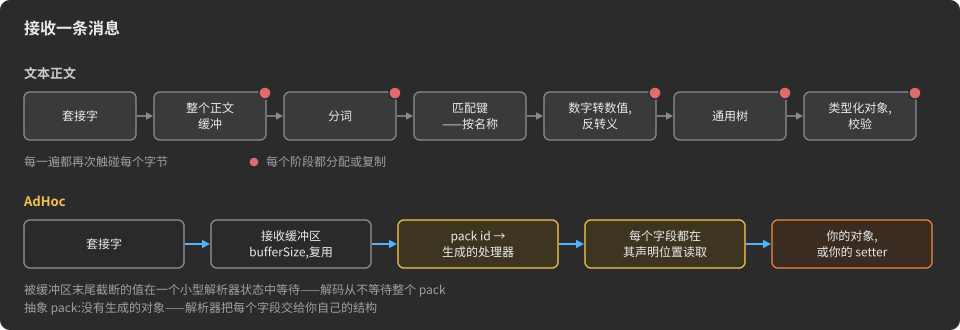

所以内存跟着连接走,而不是跟着消息走。一条连接有一个发送缓冲区和一个接收缓冲区,大小由你的代码选择
(C# 默认 1024 字节)。运行时从不为某个 pack 的大小分配缓冲区,无论哪个方向。一个 1 GB 的 `Stream` 字段
花的还是那两个缓冲区,和 15 字节的 `Reading` 一样。10 000 条连接各配 1 KB 缓冲区,在序列化路径上约占 20 MB。
pack 甚至可以比任一台主机的内存还大,只要它的主体走 `Stream` 字段,或走由你的代码逐段填充的抽象 pack。
当接收端再也吃不下时,传输层就停止读取套接字:未读的数据在网络里等,而不是在内存里等。

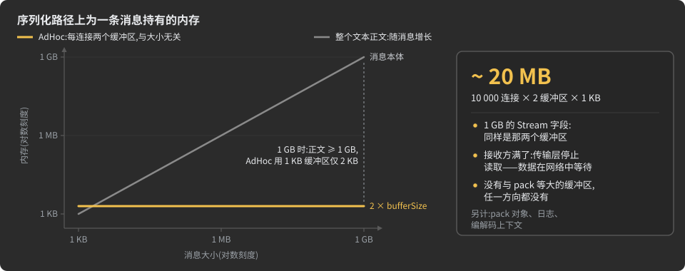

有些内存在这条路径之外,MANUAL 列了清单:具体 pack 的对象、保证送达的日志,以及压缩和加密阶段的上下文。

→ MANUAL:[运行时模型:每个方向一个缓冲区](MANUAL.zh-CN.md#the-runtime-model-one-buffer-per-direction) ·
[接收](MANUAL.zh-CN.md#receiving-bytes-are-consumed-where-they-land) · [发送](MANUAL.zh-CN.md#sending-the-transport-pulls-the-bytes) ·
[序列化路径上的内存](MANUAL.zh-CN.md#memory-on-the-serialization-path) ·
[线路上的字符串](MANUAL.zh-CN.md#strings-and-lengths-on-the-wire) ·
[抽象 pack](MANUAL.zh-CN.md#abstract---your-code-holds-the-data)

<a id="both-sides-speak-many-conversations-at-once"></a>
### 双方都能说,多个会话同时进行

请求/响应中只有客户端先开口。服务器事件要靠轮询、挂起的请求,或带自己协议和登录的第二通道。并行操作变成
并行请求,然后由你的代码手工对号入座。

在 AdHoc 连接上,每个分支指明发送的一侧:`l`/`L` 是左侧主机,`r`/`R` 是右侧主机,`_____lr_____` 是任一侧。
函数组 actor 给每一侧随时可用的单向函数,无需创建或跟踪 actor 实例:

```csharp
interface Notify : Actor
{
    [____________r<(Note, Alert)>]   // 服务器想推就推
    struct Messages { }

    [l____________<Flag>]            // 设备想发就发
    struct Flags { }
}
```

一条连接上的多个 actor 是相互独立的会话:文件传输可以在一个 actor 里跑,聊天在另一个里跑,共用同一个套接字。
请求/响应在合适的地方仍然存在。`(L____________, Pong) ping(Ping req);` 就是一个 RPC 方法,而且有了热池,
任何一侧都不必为每次调用分配 actor 对象。服务器也可以是发问的一方。


→ MANUAL:[分支与路由特性](MANUAL.zh-CN.md#branches-and-the-routing-attributes) ·
[函数组 actor](MANUAL.zh-CN.md#function-group-actor) ·
[Actor:独立的会话](MANUAL.zh-CN.md#actors-independent-conversations-on-one-connection) ·
[RPC 方法](MANUAL.zh-CN.md#rpc-methods) · [四种 actor](MANUAL.zh-CN.md#four-kinds-of-actor)

<a id="a-conversation-with-rules-not-stateless-calls"></a>
### 有规则的会话,而不是无状态调用

无状态调用自带上下文,所以每个处理器都要手工再查一遍。这个客户端登录了吗?这一步现在允许吗?这是不是
早前某一步迟到的副本?

在 AdHoc 中,规则是描述的一部分。状态是空结构,分支说明每一侧可以发送哪些 pack、以及由此进入哪个状态。
两台主机拿到同一个生成的状态机,并且在同一个 pack 上同步前进,不需要额外的消息:

```csharp
interface Work : Actor
{
    int Actor.MaxActiveInstances => 4;   // 一条连接上最多同时四个作业

    [____________R<Running, Job>]        // 服务器启动一个作业
    struct Start { }

    [l____________<Progress>]            // 设备报告进度,次数不限
    [L____________<End, Done>]           // ……然后结束作业
    struct Running { }
}
```

pack 在发送前先由当前状态检查。状态不允许的 pack 会以 `DISCARDED_BYSTATE` 被拒绝,接收侧收到意外的 id 会进入
接收器的错误处理器。只有主导某个状态的一侧才能推进它。在带实例的 actor 中,每个 pack 上的 4 位 epoch 会丢掉
来自更早状态的迟到 pack。处理器拿到的是下一个状态的发送器,所以它只能用该状态允许的 pack 应答。`[Deadline]`
和 `[Idle]` 可以在不碰连接的情况下结束一个停滞的实例。


→ MANUAL:[状态](MANUAL.zh-CN.md#states-the-phases-of-a-conversation) ·
[主导状态的一侧](MANUAL.zh-CN.md#the-side-that-leads-a-state) ·
[生成器为 actor 和状态产出什么](MANUAL.zh-CN.md#what-the-generator-produces-for-actors-and-states) ·
[Deadline 和 Idle](MANUAL.zh-CN.md#per-instance-timers-deadline-and-idle)

<a id="sessions-and-delivery-that-survive-a-lost-socket"></a>
### 会话与送达:扛得住套接字丢失

请求/响应连接一断,就有些请求命运成谜:收到了吗?生效了吗?每次重试都可能造成重复,所以服务要加幂等键、
去重表,每次重连还要重新登录。

`[Resumable(seconds)]` 把会话和它的套接字分开。如果已识别对端的套接字是丢失而不是被你的代码关闭,会话就被
挂起:它的 actor、actor 的状态以及你的代码挂在上面的一切都保留下来,只是没有套接字和缓冲区。对端回来后照常
登录,认领会话,并在原来的状态上继续。`Resumable<HOST, PACKS>` 为你点名的 pack 增加保证送达:即使跨过套接字
丢失,它们也恰好到达一次、按序到达。在 `[UDP(seconds)]` 连接上,每个 pack 都是保证送达的,双向如此,你只需
列出允许丢失的 pack。

```csharp
[Resumable(30 * 60)]                                                // 丢失的会话为它的对端等待 30 分钟
interface Link : Connects<Device, Server>
{
    // ... 状态和 actor ...
    interface FromDevice : Resumable<Device, (Reading, Done)> { }   // 这些恰好到达一次、按序到达
}
```

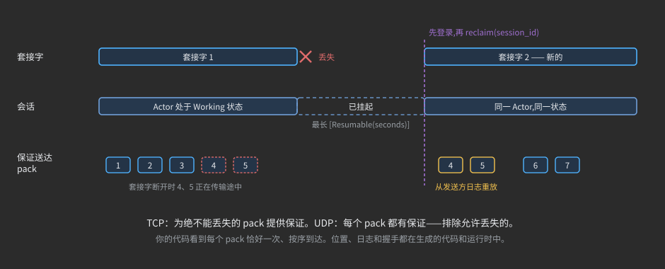

这个保证有标明的代价。发送方把每个保证送达的 pack 复制进一份日志:最新的字节留在内存,其余写入 4 MB 的文件,
上限为 `resumable_megabytes`(默认 100 MB)。接收方每收到 64 KiB 保证送达的 pack 就用一个 `Confirm_` 确认:
这是一个只有 id 的服务 pack,id 为一字节时只有 1 字节,约 0.002%。服务 pack 由生成器自动为项目生成——你一个都不用声明。
pack 自身不为这个保证携带任何东西。换成请求/响应,同样 64 KiB 的 15 字节读数将是 4 369 个请求,每个都要等自己的应答。

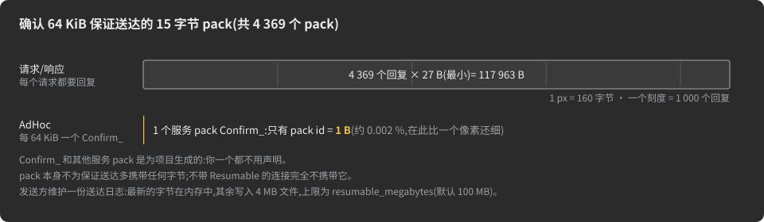

→ MANUAL:[什么是会话](MANUAL.zh-CN.md#what-a-session-is) · [挂起会话](MANUAL.zh-CN.md#parking-a-session) ·
[身份与认领](MANUAL.zh-CN.md#identity-and-reclaim) · [保证送达](MANUAL.zh-CN.md#guaranteed-delivery) ·
[保证的代价](MANUAL.zh-CN.md#what-the-guarantee-costs) · [UDP 连接](MANUAL.zh-CN.md#udp-connections)

<a id="streams-instead-of-whole-bodies"></a>
### 用流代替整个正文

请求/响应的正文是一个整体。文本正文里的二进制内容必须重新编码,base64 会把 1 GiB 变成约 1.33 GiB。
没有终点的实时流根本塞不进一个请求。

`Stream` 字段以块的形式传输:`[len][data] … [0x0000]`。开头不需要总量,流可以在它的源头结束时结束。
仅从成帧就能看出流的结束,所以中继可以转发它,存储可以保存它,都不用解码任何内容。运行时把你的源头直接读进
套接字缓冲区,并写进你的接收端。成帧的代价是每块 2 字节,配 1 KB 缓冲区时约 0.2%。`[S(N)]` 给流设上限,
上限在两侧都强制执行。

```csharp
class Upload
{
    [D(+255)]          string name;
    [S(1_000_000_000)] Stream bytes;   // 最多 1 GB,走的还是那两个套接字缓冲区
}
```

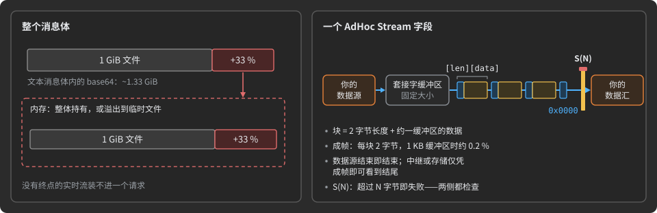

→ MANUAL:[Stream 成帧](MANUAL.zh-CN.md#stream-framing---chunked-and-interruptible) ·
[大小上限](MANUAL.zh-CN.md#the-size-cap-of-a-conduit---sn) ·
[完整示例:任意大小的归档](MANUAL.zh-CN.md#worked-example---delivering-an-archive-of-any-size)

<a id="the-checks-a-server-would-write-by-hand"></a>
### 服务器本该手写的检查

文本端点接受任何字符。它的处理器要检查消息的种类、字段是否存在且类型正确、字符串和列表的长度、正文大小、
这个调用现在是否允许、一个客户端同时跑多少操作,以及超时。客户端还要把其中一半再查一遍。

在 AdHoc 中,声明变成检查,并且在你的处理器看到 pack 之前就运行:

| 检查 | 来自 |
|:--|:--|
| 这是哪种消息 | pack id;接收器无法分发的 id 会按失步断开通道 |
| 字段存在且类型正确 | 布局本身:位置、类型和空值位由描述固定 |
| 字符串和集合长度 | `[D(+N)]` 和 `[D(N)]`,默认 255;C# 运行时在分配超长字符串之前就拒绝它 |
| 原始流的大小 | `[S(N)]`,两侧都查 |
| 现在允许,不是过期的 | 状态守卫(发送时记为 `DISCARDED_BYSTATE`)和 epoch |
| 并发 | `MaxActiveInstances`:多开一个实例的对端被视为敌意,连接被中止 |
| 停滞的对端或步骤 | `[ReceiveTimeout]`、`[TransmitTimeout]`、`[Deadline]`、`[Idle]` |
| 值的范围 | 以 `MIN` / `MAX` 常量发布;在 setter 之前检查输入仍是你的代码 |


→ MANUAL:[pack id 分发](MANUAL.zh-CN.md#pack-id-dispatch-and-uniqueness) · [字符串](MANUAL.zh-CN.md#strings) ·
[集合上限](MANUAL.zh-CN.md#collection-limits-_defaultmaxlengthof) ·
[打开 actor 实例及其上限](MANUAL.zh-CN.md#opening-an-actor-instance-and-its-limit) ·
[连接超时](MANUAL.zh-CN.md#connection-timeouts-transmittimeout-and-receivetimeout) ·
[范围常量](MANUAL.zh-CN.md#range-constants-in-the-generated-code)

<a id="routing-paid-once-per-socket"></a>
### 路由每个套接字只付一次

请求/响应按主机和路径路由每一个请求。版本进了路径段或头部,服务两个版本的处理器就要按版本分支。

AdHoc 多路复用器在一个端口上服务一台主机的多条连接。每个套接字以一个字节开场,即拨入主机的 uid。这个字节
每个套接字只付一次,从不按 pack 付,从那以后这个套接字就是它所属连接的一条普通链路。对端的新一代是一台新主机,
有自己的连接。旧的一代保持冻结,两代在同一端口后服务,没有任何处理器需要问自己在和哪个版本说话。

```csharp
interface Port : Multiplex<(Link, LinkV1)> { }   // Device 和 DeviceV1 拨入同一个端口
```

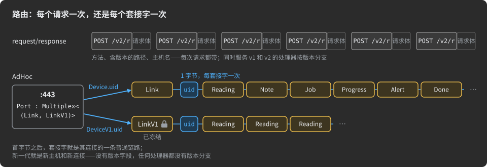

→ MANUAL:[多路复用套接字的第一个字节](MANUAL.zh-CN.md#the-first-byte-of-a-multiplexed-socket) ·
[同一端口后的多个世代](MANUAL.zh-CN.md#several-kinds-of-peer-several-generations-behind-one-port) ·
[新一代是一台新主机](MANUAL.zh-CN.md#a-new-generation-is-a-new-host)

<a id="middle-tiers-that-carry-what-they-cannot-read"></a>
### 中间层:搬运它读不懂的东西

在请求/响应中,中间的代理通常终结加密,读走经过的一切。保存消息的存储要解析它们,或者按文本保存、每次读取时
再解析一遍。

在 AdHoc 中:

- **传输层用一把密钥加密。** 监听主机拿到一个静态 X25519 密钥后,会加密它接受的每条连接:一次 Noise NK 握手,
  然后每条记录都过 ChaCha20-Poly1305。不给密钥,传输层就没有任何额外开销。
- **内容的压缩和加密是声明。** `[Zstd]`、`[ChaCha20]` 和你自己的阶段是字段、pack 或连接上的特性。一个永远
  不会超过 1024 字节的 pack 会自己丢掉压缩阶段。
- **中继转发封好的字节。** 在虚拟连接上,链端到端运行,生成的中继在没有 schema、没有密钥、恒定内存的情况下
  转发字节。
- **存储保存它读不懂的东西。** trim 让存储把载荷按原始字节保存——即使压缩过、加密过——而远端仍然收到
  类型化的对象。
- **代价是标明的。** 按 pack 的加密为每个 pack 增加 12 个明文字节,而单独的 `[ChaCha20]` 给的是机密性,不是完整性。

→ MANUAL:[加密的密钥](MANUAL.zh-CN.md#keys-of-a-cipher) · [内置阶段](MANUAL.zh-CN.md#built-in-stages---zstd-and-chacha20) ·
[Zstd 和 ChaCha20 保证什么](MANUAL.zh-CN.md#what-zstd-and-chacha20-guarantee) ·
[虚拟连接与中继](MANUAL.zh-CN.md#virtual-connections-and-relays) · [Trim](MANUAL.zh-CN.md#trims)

<a id="where-text-and-requestresponse-still-win"></a>
### 文本和请求/响应仍然胜出的地方

二进制的位置协议有真实的代价:

- **字节不自描述。** 在线路上,数据只凭 pack id、字段位置以及(在多路复用端口上)一个 uid 字节来识别。
  没有描述,抓到的包就读不懂。
- **字段不能就地添加。** 增、删或重排一个字段就造出了另一个 pack,两端要一起重新生成、一起部署。你无法更新的
  对端只能留在冻结的一代。这适合你能列出名单的对端,不适合世代数量不限的开放生态。
- **varint 需要放对位置的基准。** 基准放得不好的 varint 可能比定宽字段更贵。

对于你永远不会谋面的客户端使用的公共 API,对于人们用通用工具检查的流量,以及对于偶发的小调用,文本的
请求/响应是更简单的选择。详见 [AdHoc 不适用的情况](#when-adhoc-is-not-the-right-tool)。

→ MANUAL:[pack 与对端如何区分](MANUAL.zh-CN.md#how-packs-and-peers-are-told-apart-on-the-wire) ·
[字段顺序是线路格式的一部分](MANUAL.zh-CN.md#the-order-of-fields-is-part-of-the-wire-format) ·
[何时适合分世代](MANUAL.zh-CN.md#when-separate-generations-fit) · [何时 varint 吃亏](MANUAL.zh-CN.md#when-varint-loses)

<a id="packs-that-cost-almost-nothing"></a>
## 几乎零成本的 pack

*AdHoc 自己让 pack 更省的办法:只有 id 的消息、共享位存储的值、本身就是一个数字的 pack,以及完全没有对象的 pack*

pack 通常是一个对象:分配、填充、序列化,再在对端解析成另一个对象。只要数据允许,AdHoc 就免去这些成本——而且大部分由生成器替你决定。

| 名称 | 它是什么 | 在线上 | 在内存中 |
|:--|:--|:--|:--|
| [空 pack](#empty-packs-a-message-that-is-only-its-id) | 分支发送的、没有字段的 pack | 只有它的 pack id | 每条消息零分配 |
| [位字段](#bit-fields-small-values-share-the-packs-bits) | 所有编码能装进 7 位的字段:`bool`、`bool?`、小枚举和小范围 | 每个 1 到 7 位,紧凑排在一起 | 在 pack 内部,按普通值读取 |
| [Value Pack](#value-packs-a-pack-that-is-a-number) | 字段合计能装进 64 位的 pack | 它的 id 和它的位,向上取整到整字节 | 一个整数:没有对象,没有指针 |
| [带头部的空 pack](#beyond-64-bits-an-empty-pack-with-a-header) | 对 Value Pack 来说太宽、单独发送的值:空 pack 的头部字段 | 它的 id 和头部位 | 没有对象:值在队列中,是接收缓冲区上的视图 |
| [无实现的 pack](#packs-without-implementation-straight-into-your-own-structures) | 覆盖在你自己对象之上的接口 | 与任何 pack 相同的字节 | 没有生成的对象:字节直接进入你的结构 |

<a id="empty-packs-a-message-that-is-only-its-id"></a>
### 空 pack:只有 id 的消息

事件、命令、确认、状态转换——"发生了"往往就是整条消息。**空 pack** 是一个没有字段的类,由分支发送:

```csharp
/// <see cref="InCS"/>
struct Server : Host
{
    public class Shipped { }        // 空 pack:事件本身
}

interface Link : Connects<Client, Server>
{
    [L____________<Waiting, Client.Order>]
    struct Start { }

    [____________R<Start, Server.Shipped>]      // 空 pack 让对话继续推进
    struct Waiting { }
}
```

![三个面板。你声明 public class Shipped { },没有任何字段,并在状态 Waiting 上写分支 [____________R<Start, Server.Shipped>]——一个不带数据的转换。在线上,普通 pack 是 id 后面跟着它的字段,而空 pack 只有 id:只要连接的 id 装得进一个字节,它就是一个字节。生成的接收方是 Shipped.Handler.ONE,唯一的实例,没有任何东西可读;这个 pack 把状态机从 Waiting 推进到 Start,每条消息零分配。下方:一百万个 Shipped pack 在线上只值一百万个 id,没有对象;作为字段类型,空 pack 变成 bool,存在或缺席;没有任何分支发送的空类是常量的容器,不是 pack。](docs/img/readme-empty-pack.zh-CN.svg)

- **只有 id 在线上走。** 接收器用相同的固定字节数读取连接中每个 pack id——只要该连接最大的 id 装得进一个字节,就是一字节——空 pack 在它后面什么都不加。
- **零分配。** 接收侧是一个静态处理器,也是唯一的实例,它不消耗任何载荷字节。一百万个 `Shipped` pack 在线上只值一百万个 id,内存中没有对象。
- **它驱动状态机。** 分支中的空 pack 是一次不带数据的转换——上面的 `Waiting` → `Start`——由两端的生成代码像检查任何其他 pack 一样检查。
- **作为字段类型,它变成 `bool`。** 以空 pack 为类型的字段只能存在或缺席,所以 agent 会把它替换成 `bool`(并给出警告)。没有任何分支发送的空类根本不是 pack:它变成常量和嵌套声明的容器。

→ MANUAL:[空 pack](MANUAL.zh-CN.md#empty-packs) · [空 pack 作为字段类型](MANUAL.zh-CN.md#an-empty-pack-as-a-field-type)

<a id="bit-fields-small-values-share-the-packs-bits"></a>
### 位字段:小值共享 pack 的位

在**任何** pack 中,值(如果是可选的,连同"无"一起)能装进 7 位的字段不会独占一个字节。它进入 pack 的**位存储**:所有这类字段的位紧凑排在一起,低位在前,然后为整个 pack 一次性向上取整到整字节。

```csharp
enum Gear { Park, Drive, Reverse }

public class Status
{
    long                    at;         // 8 字节,固定
    bool                    ignition;   // 1 位
    bool?                   door_open;  // 2 位:false、true、无
    Gear                    gear;       // 2 位:3 个值
    Gear?                   wanted;     // 2 位:3 个值 + 无
    [MinMax(0, 100)] byte   fuel_pct;   // 7 位:101 个值
    [MinMax(-20, 20)] sbyte tilt;       // 6 位:41 个值
    [D(+32)] string         driver;     // 字符串:不是位字段
}
```


- **什么会成为位字段。** `bool`(1 位);`bool?`(2 位:false、true、无);编码(可选时再加一个"无")不超过 128 个的枚举;`[MinMax]` 跨度(再加一个"无")小于 128 的数字。字段取能容纳其最大编码的最少位数。
- **"无"花的是一个编码,不是一个字节。** 可选位字段把缺席存为自己位内多出来的一个编码:有三个值的 `Gear?` 仍然只占 2 位。
- **字节数由 pack 决定,不由字段决定。** 上面六个小字段共占 20 位——在线上它们合在一起是 3 字节。
- **你的代码看到的是普通类型。** getter 和 setter 接受 `bool`、`bool?`、`Gear` 和 `byte`;位只存在于生成的代码中和线上。

→ MANUAL:[位字段](MANUAL.zh-CN.md#bit-fields-small-values-share-the-packs-bits) ·
[用 MinMax 收窄基元字段](MANUAL.zh-CN.md#narrowing-a-primitive-field-with-minmax) ·
[线上的缺席值](MANUAL.zh-CN.md#absent-values-on-the-wire) ·
[pack 在线上的布局](MANUAL.zh-CN.md#the-layout-of-a-pack-on-the-wire)

<a id="value-packs-a-pack-that-is-a-number"></a>
### Value Pack:本身就是一个数字的 pack

字段合计能装进 64 位的 pack 是 **Value Pack**。生成器把它折叠成单个整数——没有对象、没有堆分配、没有间接寻址;在 C# 和 Java 中总是如此,在 TypeScript 中只要装得进 53 位。不需要写任何标记:生成器自己会认出它。

```csharp
class Position                      // 48 位:一个 Value Pack
{
    float x;
    byte  layer;
    byte  flags;
}

class Status                        // 6 位:一个 Value Pack
{
    [MinMax(0, 7)] byte priority;   // 3 位
    bool                is_leader;  // 1 位
    [MinMax(0, 3)] byte mode;       // 2 位
}

public class Order
{
    ulong              id;
    Status             status;      // 订单内部的 6 位
    Position           at;
    [D(16)] Position[] route;       // 最多 16 个 Value Pack:16 个数字,没有对象
}
```


- **什么算数。** `bool` 是 1 位;整数、`float` 和 `double` 占自身宽度,有 `[MinMax]` 时更少;`char` 16 位;枚举占其编码的宽度;`DateTime` 64 位;另一个 Value Pack 占它自己的宽度。仅靠 `[MinMax]` 范围压到 65 位以下的 pack 同样是 Value Pack。字符串、集合、`Binary` 和流永远不是。
- **固定槽位。** 每个字段把编码放在固定的位槽中,最宽的在前。单独发送时,Value Pack 是它的 id 加上向上取整到整字节的位:AdHoc 自己 23 位的 `Progress` pack 在线上就是一个 id 加 3 字节。
- **每种语言中的同一个 pack,线上字节相同。** 以其中三种为例。C#:覆盖在一个无符号整数上的 `partial struct`,每个字段一个属性。Java:永远不创建对象——pack 是基元上的注解 `@Position long`,配静态访问器。TypeScript:pack *就是* `number`(超过 53 位才是类)。Java 和 TypeScript 的写法相同:

  ```java
  @Position long pos = Position.New.of( 1.5f, (char) 3, (char) 4 );   // 字段按声明顺序
  pos = Position.set.x( pos, 2.5f );                                   // 一个值:setter 返回新的 pack
  float x = Position.get.x( pos );
  ```

- **类型能去的地方它都能去。** Value Pack 可以做字段、数组元素、Map 的键或值、Set 的元素:它们的数组就是数字的数组。可为空的 Value Pack 会得到一个越界的 `NULL` 编码。
- **智能扁平化。** 只有一个字段、且该字段是 Value Pack 的 pack 会消失在使用它的字段里:
  `class Temperature { float celsius; }` 用作 `Temperature measurement;` 时,生成为 `float measurement`——可空性保留。

→ MANUAL:[Value Pack](MANUAL.zh-CN.md#value-packs) · [Value Pack 的布局方式](MANUAL.zh-CN.md#how-a-value-pack-is-laid-out) ·
[智能扁平化](MANUAL.zh-CN.md#smart-flattening) ·
[C#、Java 和 TypeScript 中生成的 Value Pack](MANUAL.zh-CN.md#the-generated-value-pack-in-c-java-and-typescript) ·
[在 Java 和 TypeScript 中使用 Value Pack](MANUAL.zh-CN.md#working-with-a-value-pack-in-java-and-typescript)

<a id="beyond-64-bits-an-empty-pack-with-a-header"></a>
### 超过 64 位:带头部的空 pack

Value Pack 到 64 位为止。三个坐标——`float x, y, z`,12 字节——构成的是普通 pack,而普通 pack 意味着每条消息一个对象。绕开它的办法:用**空 pack** 把值装进**头部**携带。

```csharp
class Position { }                              // 空 pack:只有它的 id 在线上走

interface Link : Connects<Station, Drone>
{
    class XYZ : HeaderFor<Position>             // 坐标搭在头部里
    {
        public float x;
        public float y;
        public float z;
    }

    [____________r<Position>]
    struct Live { }
}
```


- **作为数字发送。** 生成的 `Position` 的 `send` 以 `x`、`y` 和 `z` 为参数;它们作为值进入连接的发送队列。不创建任何 pack 对象——空 pack 没有对象。
- **作为视图接收。** 接收处理器拿到的是接收缓冲区上的头部视图,直接从中读取 `x()`、`y()` 和 `z()`。这一侧同样不创建对象;要在处理器里读值,因为下一个 pack 会覆盖它们。
- **同样的字节。** 在线上:pack id 加 12 字节——正好是 pack `{ float x, y, z; }` 的开销。头部字段可以像任何字段一样用 `[MinMax]` 收窄。
- **适用头部的规则。** 头部字段是单个、不可为空的基元——`bool`、整数、`float`、`double`——可选 `[MinMax]`;不能有字符串、数组或嵌套 pack。头部声明在连接中,就在该连接上双向传送。

→ MANUAL:[带头部的空 pack](MANUAL.zh-CN.md#an-empty-pack-with-a-header-values-without-an-object) ·
[pack 头部](MANUAL.zh-CN.md#pack-headers-headerfor) · [空 pack](MANUAL.zh-CN.md#empty-packs)

<a id="packs-without-implementation-straight-into-your-own-structures"></a>
### 无实现的 pack:直接进入你自己的结构

每个 pack 都可以要求**带**实现或**不带**实现——按主机、按语言、按 pack,甚至按字段。带实现(`+`,默认)时,生成器产出一个持有数据的类。不带实现(`-`)时,它只产出一个接口,由你自己的对象来实现:

- 接收时,解析器每从套接字缓冲区解码出一个字段,就调用你的一个 **setter**;
- 发送时,序列化器每把一个字段写入套接字缓冲区,就调用你的一个 **getter**。

两侧都不分配生成的对象,也不存在 pack 的副本:数据从套接字缓冲区直接进入你的结构——你的记录、列、环形缓冲区、集合——再从它们直接回到套接字缓冲区。

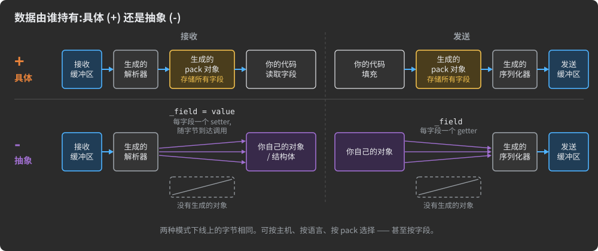

```csharp
/// <see cref='InJAVA'/>--          // Java:该主机的每个 pack 都不带实现
struct Broker : Host { }
```

```java
Broker._Allocator.DEFAULT.new_Producer_Append = receiver -> myLog.nextSlot();   // 收到的 Producer.Append 落入你的对象
```

- **数组按窗口送达。** 单字节元素的数组(`Binary`、`byte`、单字节枚举)以接收缓冲区本身的窗口交给你的代码,你的代码可以一次把整块复制进自己的环形缓冲区、列或文件;按存储方式原样传送的更宽元素数组以整元素的窗口送达,位压缩的元素则以每八个一组送达。
- **一个模型,不是两个。** 数据库节点、消息代理或客户端库保留自己的结构,得到一个网络层,而不需要维护第二个模型来保持同步,也不需要每个方向每条消息做一次转换。
- **按主机,而不是按协议。** 同一个 pack 可以在把它绑定到既有系统的主机上是抽象的,在新客户端上是具体的:两种情况线上的字节相同。

→ MANUAL:[实现修饰符](MANUAL.zh-CN.md#implementation-modifiers-who-holds-the-data) ·
[选择 + 还是 -](MANUAL.zh-CN.md#choosing--or---generated-objects-or-your-own-structures) ·
[实现管理](MANUAL.zh-CN.md#implementation-management-host-pack-and-field-rules) ·
方案 [R15. 直接采集到你自己的数据结构中](#r15-ingest-straight-into-your-own-data-structures)

<a id="virtual-connections-through-hosts-that-cannot-read"></a>
## 虚拟连接:穿过无法读取的主机

*两台主机像直连一样对话,而它们的字节经由既不解析字节、也不持有密钥的中继传送*

浏览器只能经网关到达服务器;技术员只能经后端到达车辆;NAT 后面的设备只能经消息代理到达。通常中间主机会解码每条消息再重新编码——所以它需要每个模式、每个密钥、装得下最大消息的内存,还要随每次协议变更重新构建。在 AdHoc 中,你声明两端和中间的主机,中间主机会得到一个生成的 **Relay**,只转发字节而不读取:

```csharp
interface ViewerToEdge : Connects<Viewer, Edge> { [_____lr_____<Beat>] struct One { } }   // 物理链路
interface EdgeToHub    : Connects<Edge, Hub>    { [_____lr_____<Beat>] struct One { } }
interface HubToServer  : Connects<Hub, Server>  { [_____lr_____<Beat>] struct One { } }

[Zstd, ChaCha20]                                                        // 端到端:中继运送密文
interface ViewerToServer : VirtuallyConnects<Viewer, Server, (Edge, Hub)>
{
    [L____________<Live, WatchSub>]
    struct Start { }

    [____________r<WatchEvent>]
    [L____________<Start, WatchUnsub>]
    struct Live { }
}
```

agent 自己找到路由并说明:`The virtual connection "ViewerToServer" is routed "Viewer → Edge → Hub → Server" over
"ViewerToEdge + EdgeToHub + HubToServer"`。


- **一条端到端的普通连接。** `Viewer` 和 `Server` 得到与直连相同的 pack、Actor、状态机、RPC、截止时间、分组和保证送达。中间主机不参与对话。
- **无法读取的中继。** `PATH` 上的每台主机得到一个生成的 `Relay`,把隧道的块从一条连接搬到另一条,而不解码:不知道内部 pack 的模式,没有密钥,没有消息大小的缓冲区——任意大小的载荷以恒定内存穿过,远端慢时变慢的是近端,而不是堆积在中间。
- **协议变更只重新构建端点。** 中继对穿过自己的 pack 一无所知,所以这些 pack 变更时,中继既不重新生成也不重新部署。
- **端到端的压缩和加密。** 虚拟连接上的变换链只在其两端运行:上面的 `[Zstd, ChaCha20]` 意味着中继运送的是压缩后的密文。`ChaCha20` 隐藏内容但不做认证——加上你自己的 MAC 阶段来提供完整性。
- **一条载体上的多个隧道。** 一条虚拟连接在其两台主机之间的字节构成一个**隧道**;许多隧道共享物理链路。`MaxTunnels` 设定可同时打开多少隧道,也决定线上隧道 ID 的宽度:1——完全没有 id,256(默认)——一字节,65 536——两字节。
- **多个跳点,任意顺序。** `PATH` 是一台主机或它们的元组;agent 从中重建出从 `L` 到 `R` 的唯一物理链,若链不存在、有歧义或重复经过某台主机,就中止运行。
- **或者只当管道用。** 空体的 `VirtuallyConnects` 是为你自己的协议准备的原始字节隧道。

它在哪里划算:[R6. 永远不需要更新模式的网关](#r6-a-gateway-that-never-needs-a-schema-update) ·
[R3. 一个公共端口服务多个服务](#r3-one-public-port-for-many-services) ·
[R17. 对载荷无知的中间层](#r17-a-metadata-routed-payload-blind-middle-tier-audit-and-tracing)。

→ MANUAL:[虚拟连接与中继](MANUAL.zh-CN.md#virtual-connections-and-relays) ·
[声明虚拟连接](MANUAL.zh-CN.md#declaring-a-virtual-connection) ·
[agent 如何找到路由](MANUAL.zh-CN.md#how-the-agent-finds-the-route) ·
[MaxTunnels 和 MaxStream_KiloBytes](MANUAL.zh-CN.md#maxtunnels-and-maxstream_kilobytes) ·
[Relay:中继主机上的运行时基元](MANUAL.zh-CN.md#relay-the-runtime-primitive-on-a-relay-host) ·
[隧道上的变换链](MANUAL.zh-CN.md#transform-chains-over-a-tunnel)

<a id="why-generate-code-from-a-description"></a>
## 为什么从描述生成代码

*AdHoc 同样从用领域特定语言(DSL)编写的描述生成代码。这种做法的公认好处在这里同样适用——而且,由于一份 AdHoc
描述覆盖整个系统而不只是它的消息,这些好处走得更远。*

手写时,一个协议要写很多遍。每种语言里每条消息都有一个编码器和一个解码器,每条连接有一个分发 switch,每端各有一台
状态机,再加上重连和重传——而且所有这些必须保持同步。有了描述,你只需声明一次,由生成器来写代码。从 DSL 描述生成代码
有四个经典好处。下面是每一个在 AdHoc 中的含义:

| 经典好处 | 在 AdHoc 中 |
|:--|:--|
| 更少的手写代码 | 序列化器、解析器、分发、状态机和会话处理都不再手写。你的代码放进标记好的注入点。 |
| 更少的 bug | 任何东西离开你的机器之前,描述都会被编译并按每一条 AdHoc 规则检查;而且一条连接的两端由同一份声明生成。 |
| 处处相同的实现 | 一份描述为每台主机、以它的每种语言(C++、Rust、C#、Java、Go、TypeScript、Swift、C、Dart 和 Python)生成代码,而且它们写出的字节完全相同。 |
| 只需改一处 | 你编辑描述,看到这次编辑波及哪些主机,重新生成并部署。你自己的代码会被带过去。 |


<a id="what-you-write-and-what-is-generated"></a>
### 你写什么,生成什么

生成的代码包含 pack 及其序列化器和解析器、连接类及其发送器和接收器、Actor 及其状态和 pack 的分发,以及常量。
运行时库包含传输层(TCP、WebSocket、UDP)、缓冲区、集合、压缩和加密算法。你的代码住在两个地方。在生成文件内部的
注入点里,它说明收到一个 pack 意味着什么、进入一个状态会启动什么、一次超时做什么。在生成的代码周围,它创建传输层、
建立连接、发送 pack 并持有你的数据结构。一个来自 AdHoc 自身协议的生成 C# 代码的注入点:

```csharp
case Agent.AdHocProtocol.Server_.Info.__id_:
    actor.OnNewState(conn, CLOSE_.ONE);     // 生成的:状态机已向前推进
#region> Info OnReceived Event
    // 你的代码:在这里收到 Info 意味着什么
#endregion> ĀĄÿĀĄ.OnReceivedEvent
```

你甚至可能不需要生成的对象。对每台主机、每种语言、每个 pack 和每个字段,你选择具体或抽象。具体的 pack 是一个持有
数据的类。抽象的 pack 是一个由你自己的结构去实现的接口,这样生成的代码就直接从你的对象读出、写入你的对象。线上
的字节两种方式完全相同。


→ 手册:[生成的代码与运行时的你的代码](MANUAL.zh-CN.md#generated-code-and-your-code-at-runtime) ·
[AdHoc 为每台主机生成什么](MANUAL.zh-CN.md#what-adhoc-generates-for-each-host) · [注入点](MANUAL.zh-CN.md#injection-points) ·
[生成的对象还是你自己的结构](MANUAL.zh-CN.md#choosing--or---generated-objects-or-your-own-structures)

<a id="errors-stopped-before-any-code-exists"></a>
### 在任何代码存在之前拦下错误

一份描述在生成的代码到达你的项目之前要通过三道关卡:

1. **C# 编译器。** 描述就是普通的 C#,所以你的 IDE 会在你输入时显示编译错误,而 AdHocAgent 用 Roslyn 编译它。
2. **AdHoc 规则**,由 AdHocAgent 在你的机器上检查。第一个错误即中止运行,在描述通过之前,什么都不离开你的机器。
   其中一些规则:一个状态只能由一端主导;一个 pack 在每个状态和每端只能被认领一次;单个值的区间会被拒绝;跨度
   能放进一个字节的 varint 会被拒绝,并提示改用 `[MinMax]`;保证送达的路段需要一条保持其会话的连接。
3. **生成器服务器上的测试。** 文件名后加 `!`——`AdHocAgent .\MyProtocol.cs!`——服务器还会在资源允许的范围内测试代码;
   不加则只生成代码。你自己的测试也要保留。

每条连接的两端都由同一份声明生成。一个字段在一台主机上是一种类型、在它的对端是另一种类型——这样的代码根本
写不出来。


→ 手册:[流水线](MANUAL.zh-CN.md#the-pipeline-from-a-description-to-running-code) ·
[描述是被编译的 C#](MANUAL.zh-CN.md#a-description-is-compiled-c) ·
[Actor、状态和分支规则](MANUAL.zh-CN.md#actor-state-and-branch-rules-at-a-glance) · [一字节规则](MANUAL.zh-CN.md#the-one-byte-rule) ·
[服务器端测试](MANUAL.zh-CN.md#progress-and-server-side-testing-of-generated-code)

<a id="one-description-every-language-the-same-bytes"></a>
### 一份描述,每种语言,相同的字节

主机在它的文档注释里声明自己的语言,一份描述就为每台主机以它的每种语言生成代码:

```csharp
/// <see cref="InCS"/>
struct Device : Host { }    // 以 C# 生成

/// <see cref="InJAVA"/>
struct Server : Host { }    // 以 Java 生成

/// <see cref="InTS"/>
struct Browser : Host { }   // 以 TypeScript 生成
```

于是,一台 C# 设备、一个 Java 后端和一个 TypeScript 浏览器客户端说的是同一个协议,而不是它的三个实现。区间和
限制在各处变成相同的生成常量(`MIN`、`MAX`、`NULL`、`ZERO`、`STR_LEN_MAX`),Value Pack 在每种语言里写出完全相同
的字节,你的文档注释变成生成代码的文档。C++、Rust、Go、Swift、C、Dart 或 Python 主机也是如此:`InCPP`、`InRS`、`InGO`、`InSwift`、`InC`、`InDart`、`InPy`。

→ 手册:[目标语言](MANUAL.zh-CN.md#target-languages-of-adhoc) ·
[区间常量](MANUAL.zh-CN.md#range-constants-in-the-generated-code) ·
[C#、Java 和 TypeScript 中生成的 Value Pack](MANUAL.zh-CN.md#the-generated-value-pack-in-c-java-and-typescript) ·
[生成代码中的文档](MANUAL.zh-CN.md#documentation-in-the-generated-code)

<a id="one-place-to-change-with-a-report-of-its-reach"></a>
### 只需改一处,并附上波及范围的报告

手写时,协议的一次修改意味着每个说它的程序都要改——设备固件、后端、浏览器客户端——还要再搜一遍,确保没有
遗漏。有了描述,这就是一次编辑。在生成任何东西之前,`AdHocAgent MyProtocol.cs~` 会把描述与它的上一个版本比较,
默认是你上次部署保存的那个版本。它会列出这次编辑波及的每一台主机以及原因,既给你看一个页面,也以 JSON 输出给
流水线,流水线可以据此拒绝触及冻结生成版本的编辑。

随后,与第一次相同的步骤重新生成代码并部署到你的项目中。智能合并把注入点里你的代码带进新文件,部署覆盖的
所有内容都会先备份,并附带恢复脚本。

重命名或移动一个 pack、主机、连接、Actor 或状态不会改变线上的任何东西,因为标识住在编号表里,而不是名字里。
添加、删除或重排字段确实会改变线上的字节,报告会说明这波及哪些主机。


→ 手册:[.cs~ 影响报告](MANUAL.zh-CN.md#the-cs-impact-report) ·
[在流水线中守护一个冻结的生成版本](MANUAL.zh-CN.md#guarding-a-frozen-generation-in-a-pipeline) ·
[什么会改变线上的字节,什么不会](MANUAL.zh-CN.md#what-changes-the-wire-and-what-does-not) · [智能合并](MANUAL.zh-CN.md#smart-merge) ·
[自动备份](MANUAL.zh-CN.md#automated-backups-and-restoration) ·
[标识在表里,位置在 pack 里](MANUAL.zh-CN.md#identity-in-a-table-position-in-a-pack)

<a id="the-description-is-c-and-describes-the-whole-system"></a>
### 描述是 C#,并且描述整个系统

描述是 .NET 项目中的一个 C# 文件,所以你已经在用的工具对它都有效:IDE 编译它、在其中导航、跨文件重命名,而且
IDE 的重命名会保留线路 ID,因为编号留在编号表里。一个独立的 schema 语言则需要自己的一套工具。

而且描述装的不只是消息:pack 和字段、主机和它们的语言、连接、Actor、状态和分支、会话和保证送达的路段、流、
变换链、trim、虚拟连接和多路复用器。谁和谁说话、按什么顺序、套接字断开时发生什么,都是声明,而不是设计文档
里的散文。设计就是生成器的输入,所以它不可能过期。AdHoc 自己的 Agent 和生成器服务器之间,就是用这样描述并
生成的协议在对话。见 [AdHoc 的结构](#how-adhoc-is-organized)。

代码生成是免费的。它作为一项云服务运行,你用一个个人 UUID 来访问。检查描述(`ADHOC_PARSE_ONLY=1`)和 `.cs~`
影响报告都在本地运行,什么都不上传。

→ 手册:[描述是被编译的 C#](MANUAL.zh-CN.md#a-description-is-compiled-c) ·
[模型:从项目一路向下到字节](MANUAL.zh-CN.md#the-model-from-the-project-down-to-the-bytes) ·
[UUID](MANUAL.zh-CN.md#uuid) · [AdHocAgent 的环境变量](MANUAL.zh-CN.md#environment-variables-of-adhocagent)

<a id="ready-solutions"></a>
## 现成方案

真实问题往往需要同时用上多项能力。下面的每个方案都针对一个团队反复手工解决的问题——在设备上、在后端、在应用里——并用几条声明解决它:问题本身、通常手工搭建的东西、AdHoc 声明、之后运行时的行为,以及诚实的限制。地图展示了每个方案在一个系统中的位置;表格列出每个方案组合的能力。

![一个系统画在三个区域中——现场与互联网、边缘、私有网络——橙色方案标签 R1 到 R22 钉在它们涉及的主机和链路上。两代固件(3.x 和冻结的 2.x)的车辆以及一个手机应用拨入 Edge 主机的 443 端口,每个套接字都以拨号主机的 uid 字节开头;Edge 内部有一个多路复用器,其首字节是拨号主机的 uid,持有 Telemetry、TelemetryLegacy 和 Shop 连接(R2、R3、R4、R10、R13、R18)。浏览器控制台通过一个中继枢纽到达后端,物理链路旁的紫色虚线标出它的虚拟连接(R6、R7、R14)。同一个控制台(操作员的)还拨入它正下方的一架无人机,一台有实时视频的 C# 主机:在那一条链路上视频上行、命令下行(R19)。传感器经过一个只中继的网关、再经过枢纽到达后端:穿过两个中继的虚拟连接(R6、R13)。那个网关的正上方,一个 C# 或 Java 的现场控制器通过一条串行线挂在网关上,RS-485 画成一对导线,带成帧,使链路在一个字节损坏后能恢复(R22)。机器人或游戏客户端与拥有自己端口的游戏服务器进行 UDP 通信(R5)。在私有网络中,后端节点通过 Connects<Node, Node> 彼此互连(R16),运行作业、订阅、受限角色的对话、工作流和聊天室,并把一个 pack 发给众多订阅者而不复制它(R8、R9、R12、R14、R18、R20),旁边是一个保存自己无法读取的字节的对象存储(R1)、一个向消费者扇出的日志代理(R11)、一个直接写入你自己的数据结构的采集主机(R15),以及一个只读头部、不读负载的审计层(R17)。游戏服务器的链路也延伸进私有网络,到达一个监控主机,它存储收到的内容,并在同一趟中广播给三个观察端(R21)。图例说明:实线是 TCP 或 WebSocket 连接,点线是 UDP,紫色虚线是穿过中继的虚拟连接,双线是串行线(UART 或 RS-485),橙色标签是方案,黄色方块是拨号主机的 uid 字节。](docs/img/readme-recipes-map.zh-CN.svg)

| 方案 | 组合的能力 | 应用场景 |
|:--|:--|:--|
| [R1. 保存自己无法读取的字节的对象存储](#r1-object-storage-that-keeps-bytes-it-cannot-read) | 同样的分块流、按字段的 trim:整个对象或其一部分,原样保存、压缩保存(`Zstd`)、或压缩并加密保存(你自己的密码);flow | 黑匣子记录仪、档案、消息和附件存储、录制的媒体 |
| [R2. 无版本字段的版本管理](#r2-versioning-without-version-fields) | 代际作为主机、多路复用、CI 中的 `.cs~` 影响报告 | 现场固件、应用版本、服务器代际 |
| [R3. 一个公共端口承载多个服务](#r3-one-public-port-for-many-services) | 多路复用、中继连接、加密传输层 | 边缘服务器、Web 和移动客户端、管理工具 |
| [R4. 永不丢失订单或事件的客户端](#r4-a-client-that-never-loses-an-order-or-an-event) | 会话(`[Resumable]`)、保证送达、身份与认领 | 手机、蜂窝追踪器、现场服务应用 |
| [R5. 关键处可靠,无关处求新](#r5-reliable-where-it-matters-fresh-where-it-does-not) | `[UDP<…>]`、保证送达、按 pack 的链、Value Pack | 多人游戏、无线电链路上的机器人和无人机 |
| [R6. 永不需要更新 schema 的网关](#r6-a-gateway-that-never-needs-a-schema-update) | 虚拟连接、生成的 Relay、端到端链 | IoT 网关、NAT 代理、要触及私有主机的浏览器和工具 |
| [R7. 浏览器中的实时仪表盘和控制台](#r7-live-dashboards-and-consoles-in-the-browser) | 函数分组 Actor、双向 RPC、有状态 Actor、WebSocket 上的 TypeScript | 操作员控制台、管理 UI、监控 |
| [R8. 带进度、取消和截止时间的长时作业](#r8-long-running-jobs-with-progress-cancel-and-deadlines) | 有状态 Actor、`MaxActiveInstances`、状态、`[Deadline]` | 导出、构建、批处理 |
| [R9. 带租约的扇出订阅](#r9-fan-out-subscriptions-with-leases) | `[Grouped]` Actor、`[Idle]` 租约、跨连接和隧道的组 | 行情数据、车队级配置和告警 |
| [R10. 任意大小、可续传的文件、媒体和 OTA 更新](#r10-files-media-and-ota-updates-of-any-size-resumable) | `Stream` 和 `File` 字段、`[S(N)]` 上限、每方向一个缓冲区、保证送达 | 附件、固件更新、档案 |
| [R11. 只压缩一次再扇出的日志代理](#r11-a-log-broker-that-compresses-once-and-fans-out) | 在链的选定深度做 trim、`[Zstd]`、`[ChaCha20]` | 事件日志、分析流水线 |
| [R12. 所知最少的主机](#r12-least-knowledge-hosts-every-role-sees-only-its-own-messages) | 带名称和标签过滤器的 Pack Set、按状态的分支、trim | 多角色系统、合作方集成 |
| [R13. 每个字节都花话费](#r13-every-byte-costs-airtime-telemetry-in-a-handful-of-bytes) | `[MinMax]`、varint、时间类型、Value Pack、自定义特性 | 蜂窝、卫星、低功耗无线电上的遥测 |
| [R14. 协议强制的工作流](#r14-protocol-enforced-workflows-no-command-out-of-order) | 状态和分支、主导方、`[Deadline]`、`[Idle]` | 机器人、阀门、操作员控制台 |
| [R15. 直接采集到你自己的数据结构](#r15-ingest-straight-into-your-own-data-structures) | 抽象(`-`)pack、每方向一个缓冲区、紧凑编码 | 数据采集、负载很大的小网关 |
| [R16. 同一端口上的内部集群协议和服务器网状网络](#r16-an-internal-cluster-protocol-and-a-server-mesh-on-the-same-port) | `Connects<Node, Node>`、多路复用、连接超时 | 代理、聊天和游戏服务器网状网络 |
| [R17. 按元数据路由、看不见负载的中间层](#r17-a-metadata-routed-payload-blind-middle-tier-audit-and-tracing) | pack 头部(`HeaderFor`)、trim、时间类型 | 审计追踪、调用链跟踪 |
| [R18. 聊天与协作](#r18-chat-and-collaboration-rooms-presence-turn-taking) | `[Grouped]` 房间 Actor、`[Idle]` 在线状态、轮流状态 | 聊天、协同编辑、机器人 |
| [R19. 为紧急命令让路的实时视频和音频](#r19-live-video-and-audio-that-stop-for-an-urgent-command) | 作为分段的命名 `Stream` pack、可中断成帧、每次一个 pack 的发送器、独立方向 | 流式传输视频的无人机和机器人、对讲机、现场摄像机 |
| [R20. 一个 pack,多个接收者,零复制](#r20-one-pack-many-recipients-no-copies) | `send` 将引用入队;每个连接用自己的游标序列化同一个对象 | 面向所有订阅者的事件、车队级设置、游戏 tick |
| [R21. 一趟完成接收、存储和广播](#r21-receive-store-and-broadcast-in-one-pass) | 无实现的 pack、`Receiver.BytesCopy`、`Transmitter.Broadcaster`、一个保证送达的入向链路段 | 监控后端、行情枢纽、做持久化的聊天服务器 |
| [R22. 字节损坏后能恢复的串行链路](#r22-serial-links-that-recover-after-a-damaged-byte) | `Receiver.Framing` 和 `Transmitter.Framing`:每个 pack 一帧、一个 CRC-16、在下一个标记处重新同步 | UART 和 RS-485 链路、无线电调制解调器 |

<a id="r1-object-storage-that-keeps-bytes-it-cannot-read"></a>
### R1. 保存自己无法读取的字节的对象存储

*场景:车辆行程日志的存档 · 媒体存储中的聊天消息和附件 · 监控后端中的遥测样本 · 录制的视频 · 保存在数据库列中的任何对象。*

**问题。** 位于生产者和消费者之间的存储为以后保存对象。要么它理解每种对象类型——于是每次 schema 变更都要重建,并且因为必须解密而持有密钥——要么它收到的是手工在协议之外序列化、压缩和加密的 blob。

**手工搭建。** 一个带长度、类型和版本的信封;压缩和应用层加密,自带密钥分发;一个会解析的存储,或一个无人能校验其 blob 的存储;然后在消费者一侧、用每一种语言,把这一切反向再做一遍。

**AdHoc:存储保存自己不读取的流。** 这些就是 AdHoc 中到处使用的同一种流。字段上的 **trim** 告诉某一段链路的生成代码在选定点停下,把负载作为原始字节交出,像任何 `Stream` 一样成帧:`[len][data] … [0]`。存储的代码把这些字节一边到达一边倒入你提供的 sink(接收端),之后又在其套接字排空时从你提供的 source(来源)拉出——任意大小的 blob,恒定内存,与 [R19](#r19-live-video-and-audio-that-stop-for-an-urgent-command) 中的视频、[R10](#r10-files-media-and-ota-updates-of-any-size-resumable) 中的文件移动方式完全相同。

![三个主机排成一行:Producer、画成圆柱的 Store、Consumer。Producer 和 Consumer 各持有一张带类型的 Document 卡片和自定义 AesCtr 阶段的密钥;Store 持有一摞按 object_id 索引的字节砖块和三块被划掉的芯片:没有 schema、没有密钥、不运行任何阶段。两条线路车道载着同样的斜纹密封块,采用分块成帧——Put,从 Producer 到 Store;Found,从 Store 到 Consumer——存储上方两块斜纹色样之间的等号表示:逐字节相同,存进去的是什么,回放出来的就是什么。存储旁边:sink,字节边到达边写入,负载从不完整驻留;source,字节随套接字排空而流出,不解码也不重新编码。每个主机下方是它的链:Producer 运行整条链,Document、Zstd、AesCtr、线路;Store 的链在紧挨线路的那个切口之前都是灰色的,因为在它的链路段上它什么都不运行;Consumer 运行从线路回到带类型 Document 的逆链。页脚:Document 增加一个字段,存储无需重建;存储的字节始终绑定在切口左侧的阶段上。](docs/img/readme-object-store.zh-CN.svg)

两个选择描述每一个存储对象:

| | 原样保存 | 压缩保存 | 压缩并加密保存 |
|:--|:--|:--|:--|
| **整个对象是一个 blob** | `[Stream<In, Out>] Body doc;` | `[Zstd, Stream<In, Out>] Body doc;` | `[Zstd, AesCtr, Stream<In, Out>] Body doc;` |
| **对象的一部分是 blob**——存储读取其余字段 | 对对象的某些字段做同样的 trim | 相同 | 相同 |

每个被 trim 的字段携带自己的链,所以一个对象可以混合全部三种形式——而存储仍能读取它的普通字段,并按它们索引和过滤:

```csharp
public class AesCtrAttribute : StreamCipherStageAttribute {    // 你自己的加密阶段
    public AesCtrAttribute() { }
    public AesCtrAttribute(Binary[,] key, Binary[,] iv) { }     // 运行时由生产者和消费者注入
}

interface FromProducer : IfSendingFrom<Producer, ProducerToStore> { }   // 进入存储的链路段
interface FromStore    : IfSendingFrom<Store,    StoreToConsumer> { }   // 离开存储的链路段

public class Body      { [D(+4096)] string title; [D(1_000_000)] Binary[,] text; }
public class Thumbnail { [D(200_000)] Binary[,] png; }
public class Secret    { [D(+256)] string iban; [D(+256)] string passport; }

// 整个对象作为一个 blob 保存,三种形式各一
public class PutPlain      { ulong object_id; [Stream<FromProducer, FromStore>]               Body doc; }
public class PutCompressed { ulong object_id; [Zstd, Stream<FromProducer, FromStore>]         Body doc; }
public class PutSealed     { ulong object_id; [Zstd, AesCtr, Stream<FromProducer, FromStore>] Body doc; }

// 对象一部分保存为存储可读的字段,一部分保存为 blob
public class Record
{
    ulong           object_id;                                           // 存储读取这些字段:
    long            created;                                             // 它按它们索引和过滤
    [D(+64)] string owner;
    [Stream<FromProducer, FromStore>]               Thumbnail thumbnail; // 原样保存的 blob
    [Zstd, Stream<FromProducer, FromStore>]         Body      body;      // 压缩保存的 blob
    [Zstd, AesCtr, Stream<FromProducer, FromStore>] Secret    secret;    // 压缩并加密保存的 blob
}
```

代理会按它的理解打印每条链——对 `Record.secret`:
`leaf -> Zstd -> AesCtr -> |cut ToStream(Producer@ProducerToStore) FromStream(Store@StoreToConsumer)| -> wire`。

![AdHoc 存储保存的内容,以网格呈现。三列:原样([Stream<In, Out>])、压缩([Zstd, Stream<In, Out>])、压缩并加密([Zstd, AesCtr, Stream<In, Out>])。第一行,整个对象是一个 blob:带类型的 object_id 旁边是 doc blob——原样时宽而带条纹,压缩时较窄且为黄色,密封时同样窄、带斜纹并上锁。第二行,对象的一部分是 blob:一个 Record 横跨各列,带类型的 object_id、created 和 owner 供存储读取、索引和过滤,然后是原样保存的 thumbnail、压缩保存的 body、压缩并加密保存的 secret——一个对象,三种形式。各列下方:谁能解码存储的 blob——任何拥有 schema 的主机;拥有 schema 和解压器的主机;只有持有密钥的生产者和消费者——存储无法读取它。底部一条横幅:同样的流——每个 blob 都以块的形式穿越,len data len data 加一个零终止符,进入你的 sink、出自你的 source,任意大小恒定内存,接收到的与回放出的逐字节相等;在每一列中,存储不运行任何阶段、不持有密钥。](docs/img/readme-object-store-forms.zh-CN.svg)

运行时:

- 生产者序列化带类型的对象;每个被 trim 的字段运行自己的链——什么都不做、`Zstd`、或 `Zstd` 然后接你自己的密码。
- 切口位于每条链的线路端,所以存储在三种形式中都不运行任何阶段,也不持有密钥。它把每个 blob 作为线路上下来的字节收下,之后精确回放那些字节:它收到的与它发出的逐字节相同。
- 消费者运行逆链,拿到的正是被发送的那个 `Record`:`Thumbnail` 原样、`Body` 已解压、`Secret` 已解密并解压。
- 存储拿不到任何 blob 的代码:`Body`、`Thumbnail` 和 `Secret` 增加字段,存储既不用改动也不用重建。它只需要它读取的那些字段。
- AdHoc 自己就是这样工作的:它的服务器把代理上传的描述归档按线路上下来的原样存储,它的监控后端把遥测样本保存为字节,并用 `[FromStream<…>]` 提供它们。

**三种形式对比。**

| 存储保存 | 静态大小 | 谁能解码存储的 blob | 存储运行什么、持有什么 |
|:--|:--|:--|:--|
| 原样 | 序列化后的对象 | 任何拥有其 schema 的主机 | 什么都不运行 |
| 压缩 | 更小:由生产者压缩一次 | 拥有 schema 和解压器的主机 | 什么都不运行 |
| 压缩并加密 | 压缩后的大小,已密封 | 只有生产者和消费者——它们持有密钥 | 什么都不运行,没有密钥 |

切口也是一个旋钮:写在链的中间,它能让存储保存压缩字节,而链路本身是加密的——`[Zstd, Stream<In, Out>, ChaCha20]`:在线路上用连接的密钥加密,静态保存为压缩。此时存储运行切口右侧阶段的逆变换。任何位置都不需要 blob 的 schema。

**为什么有效。**

- 存储只依赖它读取的字段,从不依赖 blob 的 schema。
- 存储路径上不解码、不重新编码、不重新压缩;blob 从不完整驻留在存储的内存中。
- 用上你自己的密码,存储无法读取它保存的内容;只有生产者和消费者持有密钥。
- 整个对象或其一部分,原样、压缩或密封:每字段一条声明,而不是换一个存储。

**限制。** trim 位于以 pack 为类型的字段上、`Stream` 字段或命名 `Stream` pack 上、或单个 `string` 上——不能位于基元类型或集合上:把这类数据归组到一个 pack 中,再 trim 这个 pack。存储的字节被钉在切口左侧的阶段和负载的布局上:在一个 [flow](MANUAL.zh-CN.md#flows---a-chain-declared-once) 中为存储的链命名一次,把它和归档的 pack 一起冻结,并在旁边为新格式声明新的链。密钥流密码只隐藏不认证——要完整性,添加一个你自己的、对字节做认证的阶段(MAC)。让内置的 `[ChaCha20]` 位于被回放切口的右侧:它用一个连接的会话密钥密封字节,这就是为什么必须读不到负载的存储要用你自己的密码。

**MANUAL:** [trim](MANUAL.zh-CN.md#trims) · [为什么存储的负载需要 trim](MANUAL.zh-CN.md#why-a-stored-payload-needs-a-trim) ·
[三种 trim 以及谁持有什么](MANUAL.zh-CN.md#the-three-trims-and-who-holds-what) ·
[在字段或 pack 上书写 trim](MANUAL.zh-CN.md#writing-a-trim-on-a-field-or-on-a-pack) ·
[在选定深度切断一条链](MANUAL.zh-CN.md#cutting-a-chain-at-a-chosen-depth) ·
[深度决定存储必须运行什么](MANUAL.zh-CN.md#the-depth-decides-what-the-store-must-run) ·
[用 trim 存储与回放](MANUAL.zh-CN.md#store-and-replay-with-trims) · [命名 Stream pack 上的 trim](MANUAL.zh-CN.md#trims-on-named-stream-packs) ·
[Stream 成帧](MANUAL.zh-CN.md#stream-framing---chunked-and-interruptible) · [自定义变换阶段](MANUAL.zh-CN.md#custom-transform-stages) ·
[flow](MANUAL.zh-CN.md#flows---a-chain-declared-once)

<a id="r2-versioning-without-version-fields"></a>
### R2. 无版本字段的版本管理

*场景:现场的固件代际 · 用户从不更新的应用版本 · 与旧代际并存的新后端代际。*

**问题。** 旧固件和旧应用会服役多年。每条消息都携带版本号,每个处理器都按版本分支,没人敢删字段,而新的服务器版本意味着新的端口和迁移窗口。

**手工搭建。** 每条消息一个版本字段,每个处理器一个 `switch (version)`;字段永远"为兼容而可选";带负载均衡规则的版本化端口或路径;兼容性测试矩阵。

**AdHoc。** 已部署且无法更新的代际**不做编辑**。新代际是一个**新主机**,拥有自己的连接,声明在旧代际旁边,多路复用器把两者放在同一个端口后面:

```csharp
class PositionV2 { float lat; float lon; }                // 固件 2.x 构建时面向的 pack
class Position   { double lat; double lon; float speed; }

/// <see cref="InJAVA"/>
struct Fleet : Host { }                                    // 后端
/// <see cref="InCS"/>
struct VehicleLegacy : Host { }                            // 固件 2.x,仍在现场
/// <see cref="InCS"/>
struct Vehicle : Host { }                                  // 固件 3.x

interface TelemetryLegacy : Connects<VehicleLegacy, Fleet> { [l____________<PositionV2>] struct Start { } }   // 已冻结
interface Telemetry       : Connects<Vehicle, Fleet>       { [l____________<Position>]   struct Start { } }   // 可自由修改

interface FleetPort : Multiplex<(Telemetry, TelemetryLegacy)> { }   // 两个代际,一个端口
```

运行时:

- 端口上的每个套接字都以一个字节开头:拨号主机的 uid。生成的 `FleetPort.apply(uid)` 在第一个 pack 到达之前把套接字交给该代际的连接;这个字节之后,任何 pack 都不再附加任何东西。
- 旧设备保留它们构建时面向的 pack 和状态机;新设备得到 `Telemetry` 变成的任何样子。处理器永远不需要问自己在和哪个版本通话。
- CI 让旧代际保持冻结。`AdHocAgent ./FleetProtocol.cs~` 列出一处编辑会波及的主机,并把答案以 `adhoc-impact` JSON 放进报告页;提取到 `impact.json` 后,当冻结的主机位列其中时,一行命令就能让构建失败:

  ```shell
  jq -e '(.update + .removed) | index("VehicleLegacy") | not' impact.json || exit 1
  ```

- 服务器以同样方式获得代际:`FleetV2` 配一个自己的多路复用器,两个生成的多路复用器组合成同一端口后面的一个函数。

![一条时间线,分三个阶段,以虚线分隔。阶段 1:2.x 设备(主机 Vehicle)拨入 Fleet 的 443 端口,画成旋转开关的多路复用器 FleetPort.apply(uid) 把它们交给连接 Telemetry;Console 共享该端口,所以端口从第一天起就是多路复用的,每台设备都以首字节——拨号主机的 uid——打开自己的套接字。阶段 2:2.x 设备现在是 VehicleLegacy——在 IDE 中改了名,uid 相同——带着一把挂锁:已冻结,永不编辑——旁边是自由的 3.x Vehicle 设备;两者拨入同一端口,uid 字节把每个套接字路由到 Fleet 内部带 PositionV2 的 TelemetryLegacy 或带 Position 的 Telemetry;下方,一道 CI 门禁运行 AdHocAgent FleetProtocol.cs~,读取 adhoc-impact JSON,当 VehicleLegacy 出现在 update 或 removed 中时失败。阶段 3:3.x Vehicle 成为冻结代际,4.x 设备(新主机 VehicleV4)经新连接 TelemetryV4 到来,2.x 那一列淡出并带垃圾桶图标——退役:删除主机、连接和 pack——TelemetryLegacy 从端口中被划掉,CI 现在守护 Vehicle。底部一条横幅:任何 pack 中没有版本字段,任何处理器中没有按版本的 switch,每个套接字一个字节,永远不按 pack 收取。](docs/img/readme-generations-timeline.zh-CN.svg)

**为什么有效。**

- 线路上没有版本字段,代码中没有版本分支:首字节已经回答了这个问题,每个套接字一次。
- 旧方言被冻结,新方言可以自由地丢弃 pack、重命名状态、修改类型。
- 退役一个代际意味着删除它的主机、连接和 pack,以及它们在编号表中的行。
- 一项由机器检查的保证:每次变更都没有任何编辑触及冻结的代际。
- 客户端和服务器的每一代共享一个监听器、一张证书和一个 NAT 洞。

**限制。** 这适合已知的群体——你发货的设备、你掌控的退役日期——而不适合代际数量无上限的开放生态。"冻结"是字面意思:pack 没有字段标签,所以在任何地方加一个字段、加宽一个类型或调整字段顺序,得到的都是另一个 pack。删除主机会把它的 uid 释放给下一个新主机,所以只要退役主机的设备还可能拨入,就保持它的声明。多路复用器至少列出两个连接:会导致只剩一个连接的退役,要把已退役的连接保留在元组中。

**MANUAL:** [演进协议](MANUAL.zh-CN.md#evolving-a-protocol) ·
[新代际即新主机](MANUAL.zh-CN.md#a-new-generation-is-a-new-host) ·
[什么会改变线路、什么不会](MANUAL.zh-CN.md#what-changes-the-wire-and-what-does-not) ·
[何时适合分离的代际](MANUAL.zh-CN.md#when-separate-generations-fit) ·
[同一端口后面的多个代际](MANUAL.zh-CN.md#several-kinds-of-peer-several-generations-behind-one-port) ·
[同一端口后面的服务器代际](MANUAL.zh-CN.md#server-generations-behind-one-port) ·
[在流水线中守护冻结的代际](MANUAL.zh-CN.md#guarding-a-frozen-generation-in-a-pipeline)

<a id="r3-one-public-port-for-many-services"></a>
### R3. 一个公共端口承载多个服务

*场景:面向浏览器、移动应用和管理工具的边缘服务器 · 一个绝不允许上互联网的后端。*

**问题。** 每个服务都想要自己的端口、防火墙规则和证书。移动客户端必须到达一个不应暴露的后端,于是前置的代理把所有东西解码再重新编码。

**手工搭建。** 每个服务一个端口,或一个检查每个请求以路由它的代理;一个终止客户端协议并重新发起调用的网关;每个端点各自的证书和防火墙规则。

**AdHoc。** 把共享该端口的连接列进一个多路复用器——包括一条边缘主机并非参与方的连接:

```csharp
// 主机的语言标记已省略
struct Browser : Host { }  struct Admin : Host { }  struct Mobile : Host { }
struct Edge    : Host { }   // 拥有公共端口
struct Backend : Host { }   // 只能从 Edge 到达

interface Console     : Connects<Browser, Edge>    { /* 状态和分支 */ }
interface AdminLink   : Connects<Admin,   Edge>    { /* ... */ }
interface EdgeBackend : Connects<Edge,    Backend> { /* ... */ }   // 承载者
interface Query       : Connects<Mobile,  Backend> { /* ... */ }   // Edge 不是它的参与方

interface EdgePort : Multiplex<(Console, AdminLink, Query)> { }
```

运行时:

- 每个套接字的首字节指明拨号主机。Browser 和 Admin 落在 Edge 自己服务的连接上。
- Mobile 拨入同一端口,但 `Query` 连接的是 Mobile 和 Backend。Edge 把它的字节放在 `EdgeBackend` 之上的隧道中搬运而不解码:Backend 从不暴露,Mobile 和 Backend 也都不需要到对方的链路。
- 在 Edge 上配置静态 X25519 密钥后,每条被接受的连接都是加密的——一次 Noise NK 握手,然后是 ChaCha20-Poly1305 记录——uid 字节在加密流内部传输,从不明文出现。
- 一个端口还是每连接一个端口,在部署时选择:同一份生成的代码服务两种形态,混合形态可以把管理连接保留在只有 LAN 能到达的端口上。

![两个面板。左侧(暗淡),每个服务一个端口:Browser 和 Admin 拨入 Edge 的两个端口,Mobile 拨入 Backend 的一个端口——三个端口、三枚证书徽章和三个防火墙标签——Backend 在红色警告三角下暴露于互联网。右侧,一个端口:Browser、Admin 和 Mobile 各自拨入 Edge 唯一的 443 端口,每个箭头末端带一个表示 uid 字节的小黄方块:Browser.uid、Admin.uid、Mobile.uid;端口上的锁和一条注释——Edge 上的 X25519 密钥:Noise NK 握手,然后每条连接上都是 ChaCha20-Poly1305 记录——表明 uid 字节加密传输。Edge 内部,画成旋转开关的多路复用器 EdgePort.apply(uid) 把 Browser 和 Admin 交给 Edge 自己服务的连接 Console 和 AdminLink,而 Mobile 的 Query 作为紫色虚线隧道沿物理链路段 EdgeBackend 延伸到 Backend,Backend 位于标有"私有网络,未暴露"的墙后;Edge 不解码 Query。页脚:一个监听器、一个地址、一张证书、一个 NAT 洞;共享端口还是独立端口,在部署时用同一份生成的代码选择。](docs/img/readme-edge-port.zh-CN.svg)

**为什么有效。**

- 一个监听器、一个要公布的地址、一张要续期的证书、一个要穿透的 NAT 洞。
- 后端保持私有,边缘中继 `Query` 而不是重新实现它。
- 除了拨入的地址之外毫无共同点的对端,各自保留自己的连接、pack 和状态机。
- 不按 pack 附加任何东西:这个字节每个套接字只付一次。

**限制。** 一条中继连接恰好需要一个承载者;两种失败情形都是带具名修复方法的解析器错误。多路复用端口是 TCP 或 WebSocket:列表中不能有 `[UDP]` 连接,也不能有虚拟连接。双方必须约定该端口是多路复用的。池化的连接对象服务一个又一个调用方,所以要在它的 `Connection Release` 区域和关闭时清理你自己的字段。

**MANUAL:** [多路复用](MANUAL.zh-CN.md#multiplexing) · [声明多路复用器](MANUAL.zh-CN.md#declaring-a-multiplexer) ·
[多路复用套接字的首字节](MANUAL.zh-CN.md#the-first-byte-of-a-multiplexed-socket) ·
[声明一次,部署时选择](MANUAL.zh-CN.md#declared-once-chosen-at-deployment) ·
[多路复用器中的中继连接](MANUAL.zh-CN.md#relayed-connections-in-a-multiplexer) ·
[为多路复用端口接线](MANUAL.zh-CN.md#wiring-a-multiplexed-port) · [密码的密钥](MANUAL.zh-CN.md#keys-of-a-cipher)

<a id="r4-a-client-that-never-loses-an-order-or-an-event"></a>
### R4. 永不丢失订单或事件的客户端

*场景:电梯里付款的手机 · 走几分钟就断一次的蜂窝链路追踪器 · 地下室里的现场服务应用。*

**问题。** 套接字在订单或告警发到一半时死掉。重试可能造成重复,不重试就会丢失;重连之后,双方还要重新登录,重建各自进行到的位置。

**手工构建。** 一个发件箱,序号和确认,一个重试循环,幂等键和一张服务端去重表,再加一台带"我刚才到哪了"握手的重连状态机。

**AdHoc。** 声明会话在套接字死亡后还能存活多久,以及每一侧以保证送达的方式发送哪些 pack:

```csharp
[Resumable(30 * 60)]
interface Shop : Connects<App, Backend> {
    [Resumable(0)] [L____________<Authorizing, App.Login>] struct Start { }       // 登录之前没有什么要保留的
    [Resumable(0)] [____________R<Working, Backend.Welcome>]
                   [____________R<Close, Backend.Denied>]  struct Authorizing { }

    [Resumable(60 * 60 * 24)]                                // 工作会话为它的手机等待一天
    [l____________<(App.Order, App.Location)>]               // Location:快照,下一条会替换它
    [____________r<(Backend.Receipt, Backend.Welcome)>]      // Welcome 也一样:被认领的会话回复新的登录
    struct Working { }

    interface FromApp     : Resumable<App, App.Order>         { int resumable_megabytes => 10; }   // 一次,按序
    interface FromBackend : Resumable<Backend, Backend.Receipt> { int resumable_megabytes => 4; }
}
```

在后端,恢复就是普通登录处理器里的一次调用(C#):

```csharp
var ext = conn.ext_connection;
long session_id = pack.resume_token != 0 ? ext.reclaim(pack.resume_token)   // 已挂起的会话迁移到这个套接字上
                                         : ext.identify(account_id);         // 首次登录
// 通过 ext.Internal 回复 Welcome(session_id):认领之后,这就是那个已挂起的会话
```

运行时:

1. 断线时,已标识的会话被**挂起**:它的 Actor、它们的状态、你的对象和送达日志都保留;套接字和缓冲区归还给各自的池。
2. 离线时,应用可以继续发送订单:每一条都立即记入日志(上限 10 MB),并在重连后发出。在此期间发送的 `Location` 会被丢弃。
3. 在新套接字上照常执行登录。在后端,`reclaim` 把已挂起的会话迁移过来,它仍处于 `Working`,两端都会触发 `resume`。
4. 接收器报出自己的位置,发送器从那里重放:每个订单**一次、按序**到达;发到一半的那个从套接字切断它的那个字节继续。

代价:每次发送时为每个保证送达的 pack 复制一份到日志;每接收 64 KiB 保证送达的 pack 产生一个 `Confirm_`——只有 pack id 的服务 pack。pack 本身不携带任何额外字节,保证送达集合之外的 pack 不会被复制,服务 pack 由生成器替你生成:无需声明。

![一条三泳道的时间线——App 在顶部,线路在中间,Backend 在底部——以及三个区段:套接字 1、无网络、套接字 2。在套接字 1 上,Order 41 带着对勾到达,Receipt 41 返回,一张 Location 快照通过,而 Order 42 在套接字死亡处被红色标记切断:丢失。在中断区,App 泳道下方,日志保存着 42 和 43——离线发出的 43 被记入日志——41 在收到确认后被释放,离线发出的 Location 被丢弃。在中断区,Backend 泳道显示一个已挂起会话的方框:Actor 仍处于 Working,你的对象、它的日志都在,没有套接字和缓冲区,最长等待 Resumable(60 * 60 * 24) 秒。在套接字 2 上:带着令牌登录,Backend 上执行 reclaim——已挂起的会话迁移到套接字 2——两端触发 resume,Backend 回发一个服务 pack Continue_,然后 Order 42 和 43 从日志重放并按序打勾一次。页脚:你声明 Resumable 和 Resumable<App, App.Order>,写一次 reclaim 调用;不覆盖的场景:发送进程被杀死,这会导致 resume(null) 和重新同步。](docs/img/readme-never-lose.zh-CN.svg)

**为什么可行。**

- 两种声明加一次调用,取代发件箱、重传协议、去重器和重连状态机。
- 恢复不是第二套协议:同样的登录加一次 `reclaim` 调用,服务端的对话就在原来的那些对象里继续。
- 可靠性按 pack 选择:快照不进日志。
- 到达日志上限时发送队列停止——背压,而不是无界增长。

**限制。** 保证只在发送方的会话和日志存活期间有效。被杀死的进程恢复时已没有它们:接收器听到 `resume(null)` 并重新同步。必须在此之后幸存的状态要描述为 pack 并存储起来——在文件或数据库行中,pack 就是线上同样的字节——并在启动时由它们重建。每一侧在发送保证送达的 pack 之前都要先标识自己的连接——应用也一样。会话 id 不是秘密:在 `reclaim` 之前先认证对端。

**手册:** [会话、保证送达、UDP](MANUAL.zh-CN.md#sessions-guaranteed-delivery-udp) ·
[挂起会话](MANUAL.zh-CN.md#parking-a-session) · [断线瞬间在途的 pack](MANUAL.zh-CN.md#packs-in-flight-at-the-moment-of-loss) ·
[在接受方继续:reclaim](MANUAL.zh-CN.md#continuing-on-the-accepting-side-reclaim) ·
[保证送达](MANUAL.zh-CN.md#guaranteed-delivery) · [日志的工作原理](MANUAL.zh-CN.md#how-the-journal-works) ·
[保证的代价](MANUAL.zh-CN.md#what-the-guarantee-costs) ·
[当发送方丢失了日志](MANUAL.zh-CN.md#when-the-sender-has-lost-its-journal) ·
[会话身份的陷阱](MANUAL.zh-CN.md#pitfalls-of-session-identity)

<a id="r5-reliable-where-it-matters-fresh-where-it-does-not"></a>
### R5. 该可靠的地方可靠,该新鲜的地方新鲜

*场景:多人游戏 · 无线电或移动链路上真实丢包的机器人、无人机和农机。*

**问题。** 输入、命令和聊天必须一次、按序到达;位置和电量读数必须新鲜,而不是可靠。TCP 在每次丢包时都会停滞,去重发已经过时的数据;裸 UDP 会丢命令;链路还要穿过 NAT 并且必须加密。

**手工构建。** 在数据报之上的一层可靠性——序号、确认、重发窗口、重排缓冲区、重复过滤——再加一条样本通道、NAT 保活、拥塞节奏控制、密钥握手和一条重连路径。

**AdHoc。** 在 UDP 上,每个 pack 默认都有保证;你点名那些允许丢失的:

```csharp
interface Volatile : _<(Client.PlayerPosition, Server.Telemetry)> { }   // 快照:下一条替换上一条

[UDP<Volatile>(30 * 60)]                          // 走 UDP;已挂起的会话最长等待 30 分钟
interface GameLink : Connects<Client, Server> {   // 这里没有 Resumable<...>:其余一切都已有保证
    [l____________<(Client.Input, Client.PlayerPosition, Chat)>]
    [____________r<(Server.Score, Server.Telemetry, Chat)>]
    struct Play { }
}
```

运行时:

- 代理为每台主机声明一条保证送达的路段,覆盖它发送的除 `Volatile` 之外的一切。丢失的数据报表现为数据报编号中的缺口;接收器请求继续,发送器从日志重放保证送达的 pack。丢失的位置就这样没了——下一条已经在路上。
- 每个数据报以 9 字节头部开始——标志、连接 id、序列、数据报编号——它同时携带日志的确认。
- 运行时保持 NAT 绑定的热度(15 秒未发送就发一次 ping),用拥塞控制调节节奏,发送的数据报负载最大 1200 字节。服务器上有静态 X25519 密钥时,每个数据报都经过加密和认证(16 字节标签)。写在连接上的变换链(`[Zstd]`、`[ChaCha20]`)逐 pack 应用,所以一个丢失的数据报不会破坏后续数据的压缩器或密码。
- 沉默的对端会像在 TCP 上一样挂起其已标识的会话,掉线的玩家可以回到同一个会话。
- `PlayerPosition`——两个浮点数,64 位——是一个 Value Pack:在 C# 和 Java 中就是一个 64 位数字,每个样本不产生对象。

![Client 在左,Server 在右,中间是虚线 UDP 线路上一排六个数据报,每个都以一小段携带编号的头部开头,标注一次:9 字节头部——标志、连接 id、序列、编号。数据报内部,实心橙色的 Input 和 Chat pack 编号 1 到 5,带小小的日志符号,是有保证的;灰色虚线的 Position pack 没有。第三个数据报带着 Input 3、Chat 4 和一个 Position,被红色标记击中:丢失;第四个只有 Position,显示出编号缺口,接收器请求继续。第一行,有保证的,Server 收到的:Input 3 和 Chat 4 在第五个数据报中重现,标注为从日志重放,pack 一次、按序到达:1 2 3 4 5。第二行,无保证的:丢失的 Position 被划掉,下一个 Position 到达——下一条替换它,不重放。左下角橙色字 UDP<Volatile>(30 * 60),附注:在 TCP 上你点名不允许丢失的 pack;在 UDP 上你点名允许丢失的;另注:Position 就是 PlayerPosition { float x; float y; }——64 位,一个数字:一个 Value Pack。一张设置卡片:NAT 保活 15 秒,空闲 30 秒,mtu 1200 字节,窗口 256 KiB,拥塞控制开启,X25519 密钥——每个数据报都加密并用 16 字节标签认证。](docs/img/readme-udp-selective.zh-CN.svg)

**为什么可行。** 可靠性是按 pack 的具名声明:*在 TCP 上你选择不允许丢失的 pack;在 UDP 上你选择允许丢失的。* 一个套接字、一台状态机和一套处理器同时承载两种。丢包恢复、NAT 保活、拥塞控制和加密都随运行时而来,由其设置调节——不是你要维护的一层。

**限制。** TypeScript 和 Dart 中没有:浏览器无法打开 UDP 套接字,所以浏览器玩家是 WebSocket 连接上的独立主机。`[UDP]` 连接有自己的端口,不能加入多路复用器。其日志固定为每个发送主机 100 MB。发送保证送达的 pack 之前先标识连接。

**手册:** [UDP 连接](MANUAL.zh-CN.md#udp-connections) · [每个 pack 双向都有保证](MANUAL.zh-CN.md#every-pack-guaranteed-both-ways) ·
[在 UDP 上让 pack 不受保护](MANUAL.zh-CN.md#leaving-packs-unguarded-on-udp) · [UDP 连接的规则](MANUAL.zh-CN.md#rules-for-udp-connections) ·
[保证送达连接上的逐 pack 变换链](MANUAL.zh-CN.md#per-pack-chains-on-connections-that-guarantee-packs) ·
[Value Pack](MANUAL.zh-CN.md#value-packs)

<a id="r6-a-gateway-that-never-needs-a-schema-update"></a>
### R6. 永远不需要更新模式的网关

*场景:网关后面的传感器 · NAT 后面经由会合消息代理接入云的设备 · 经由集线器访问私有服务的浏览器仪表盘 · 经由车辆拨入的后端访问某一辆车的技师工具。*

**问题。** 中间主机解码每条消息再重新编码:每条消息两次编解码加一个堆对象,中间环节是明文,而且每当消息新增一个字段,每个网关都要重新构建和发布。

**手工构建。** 一座自带每种消息类型副本的桥;一套自制的方案把多台设备复用到一条上行链路;到网关为止的加密;没有端到端背压的队列。

**AdHoc。** 在重要的两台主机之间声明一条**虚拟连接**;网关只是坐在它的路径上:

```csharp
interface SensorToGateway : Connects<Sensor, Gateway> { [_____lr_____<Ping>] struct One { } }   // 物理路段
interface GatewayToCloud  : Connects<Gateway, Cloud>  { [_____lr_____<Ping>] struct One { } }

[Zstd(6), ChaCha20]                                   // 端到端:只压缩一次,越过网关保持密封
interface SensorToCloud : VirtuallyConnects<Sensor, Cloud, Gateway> {
    int VirtuallyConnects<Sensor, Cloud, Gateway>.MaxTunnels => 65536;   // 许多传感器,一条上行链路:2 字节 tunnel_id
    [l____________<(Sensor.Reading, Sensor.Alarm)>]
    [____________r<Cloud.Config>]
    struct Run { }
}
```

运行时:

- Sensor 和 Cloud 获得完整的连接——pack、Actor、状态机——建立在隧道之上。网关获得生成的 **Relay** 和一个路由器,其 `Tunneling` 区域(你的代码)把 `tunnel_id` 映射到出站连接。
- 中继读取 pack id 和 `tunnel_id`,写入新的前缀,逐区域搬运主体:不解码、不组装、无模式。1 GB 的隧道和 64 字节的隧道占用同样的内存。
- 上行链路变慢时,中继停止读取,TCP 背压一直传到最初的发送方:网关里不会有队列增长。
- 在帧中途消失的传感器只以 `ABORT` 结束自己的隧道;上行链路和其他隧道继续。Actor、截止时间、`[Grouped]` 和保证送达穿过隧道工作,与直连链路无异。
- 变换链只在两个端点运行:网关转发压缩、加密的块,不持有密钥。无线电路段上的链可以叠加其上——逐跳链保护链路,隧道链保护对话。

![左侧四个传感器,隧道 1 到 4,中间是 Gateway,右侧是 Cloud。短的蓝色无线电路段从传感器连到网关,每段包在薄套管内,其中一段两端有钥匙符号,标注:每条无线电路段可选的逐跳链:只保护链路。一条粗的蓝色上行链路从网关连到 Cloud,交错承载所有传感器的隧道帧,标注:frame = [id][tid][len][data]…[0],每帧的 tunnel_id 标为紫色,数据部分以斜线阴影表示密封。上方,一捆嵌套的紫色虚线从每个传感器越过网关直插入 Cloud,标注:SensorToCloud:VirtuallyConnects<Sensor, Cloud, Gateway>,[Zstd(6), ChaCha20] 端到端,一个密封信封骑在这捆线上,附注:密封的块,网关不持有密钥。网关内部只有一个漏斗——Relay:读取 pack id 和 tunnel_id,转发区域——一张小的路由表,Tunneling(你的代码):tunnel_id 到上行链路,以及三枚标签:无模式、无密钥、内存中只有一个区域。一条橙色标注:Sensor.Reading 新增字段,网关不需要重建。传感器 3 的无线电路段被切断——没了——它在上行链路上的帧以红色 ABORT 代替终止符结束:只有隧道 3 结束;上行链路和其他隧道继续。底部,一条暗淡的橙色背压箭头从上行链路穿回网关下方指向一个传感器:上行链路变慢,中继停止读取,TCP 窗口关闭,发送方放慢——端到端背压,网关里不会有队列增长。](docs/img/readme-gateway-relay.zh-CN.svg)

**为什么可行。**

- 网关对模式无感:传感器 pack 的变化不需要触碰或重新部署它。
- 恒定内存和端到端背压取代不断增长的队列。
- 负载在逐跳过程中保持机密:中继没有阶段代码,看不到明文。
- 一份声明同时产生网关代码和端点代码,代理会拿路由对照物理路段做检查。

中继只在中间主机不允许读取所承载内容时才合适。按中间主机需要做的事来选择:

| 中间主机必须…… | 使用 | 方案 |
|:--|:--|:--|
| 在连接之间路由字节且永不读取 | 虚拟连接及其生成的 Relay | 本方案 |
| 充当隐藏主机之前唯一的公开端口 | 多路复用器中的中继连接 | [R3](#r3-one-public-port-for-many-services) |
| 保存负载并稍后重放,而不需要其模式 | trim | [R1](#r1-object-storage-that-keeps-bytes-it-cannot-read)、[R11](#r11-a-log-broker-that-compresses-once-and-fans-out) |
| 按元数据路由且保持负载不透明 | pack 头部加 trim | [R17](#r17-a-metadata-routed-payload-blind-middle-tier-audit-and-tracing) |
| 应答一个调用时继续向下调用 | 级联 RPC | [手册](MANUAL.zh-CN.md#cascading-rpc-multi-hop-relay) |
| 检查、变换或扇出内容 | 你用流 API 自行构建的智能中间层(AdHoc 不生成) | [手册](MANUAL.zh-CN.md#choosing-what-the-middle-tier-does) |

**限制。** `[ChaCha20]` 隐藏内容但不认证:中继读不了隧道,却可能不被察觉地篡改它,所以为完整性再加一个 MAC 阶段。隧道上的链密钥由你的代码在两个端点注入,每个流都是新的。中继等待缓慢的出站连接时,其入站连接收不到任何其他数据。虚拟连接只骑在物理路段上,永远不会列入多路复用器。

**手册:** [虚拟连接与中继](MANUAL.zh-CN.md#virtual-connections-and-relays) ·
[声明虚拟连接](MANUAL.zh-CN.md#declaring-a-virtual-connection) ·
[仅隧道和结构化虚拟连接](MANUAL.zh-CN.md#tunnel-only-and-structured-virtual-connections) ·
[MaxTunnels](MANUAL.zh-CN.md#maxtunnels-and-maxstream_kilobytes) ·
[Relay:运行时基元](MANUAL.zh-CN.md#relay-the-runtime-primitive-on-a-relay-host) · [关闭隧道](MANUAL.zh-CN.md#closing-a-tunnel) ·
[隧道上的变换链](MANUAL.zh-CN.md#transform-chains-over-a-tunnel) ·
[选择中间层做什么](MANUAL.zh-CN.md#choosing-what-the-middle-tier-does)

<a id="r7-live-dashboards-and-consoles-in-the-browser"></a>
### R7. 浏览器中的实时仪表盘与控制台

*Web 应用 · 操作员控制台 · 车队与监控仪表盘*

**问题。** 浏览器仪表盘需要推送给它的实时数据、对服务器的类型化调用、有时还需要服务器反过来向浏览器提问,以及随标签页死亡的订阅——全部走一条连接,用 TypeScript。

**手工做法。** 一个查询端点加一条独立的推送通道,一个带类型字符串和请求 id 的文本信封,一张带超时的待处理请求表,一张带清扫器的订阅者表,从服务器类抄来的 TypeScript 接口,以字符串发送的 64 位 id。

![一个用 TypeScript 写的浏览器仪表盘和一个 Java 服务器由一条 WebSocket 连接,三条泳道对应三种对话形态;橙色标记浏览器发送的 pack,蓝色是服务器发送的 pack,黄色是生成的内容。Notify,一个函数组:服务器推送 Note 和 Alert,浏览器发送 Flag,每台主机上一个共享对象为它们服务——没有要获取、跟踪或释放的东西。getCpu,一个 RPC:浏览器的调用方实例搬运 Call、Reply、End,ForPeriod 发出,CpuList 返回,服务器通过一个未注册的池化上下文应答;status 是镜像的同样形态,服务器提问,浏览器应答。Feed,Idle 120 下最多十六个有状态订阅:每个实例对有自己的地址;Subscribe 打开一个,服务器推送 Sample pack,浏览器的续期让它存活,在服务器上,一个沙漏结束浏览器停止续期的实例——服务器自己的 Sample 不算数。套接字按 pack id 和 Actor 地址分发;一把挂锁表示服务器密钥密封每条记录(Noise NK,ChaCha20-Poly1305),浏览器固定该密钥。一枚标签写着:无类型字符串、无关联 id、无 switch、无清扫器。](docs/img/readme-recipe-dashboard.zh-CN.svg)

**AdHoc 的做法。** 一条连接,三种 Actor 形态,各付各的代价(`Dashboard` 是 `InTS` 主机,`Server` 是 `InJAVA` 主机):

```csharp
class Sample { int metric; longJS at; float value; }   // longJS:64 位字段保持在 ±(2⁵³ − 1) 以内,在 TypeScript number 中精确

interface Console : Connects<Dashboard, Server>
{
    interface Notify : Actor                            // 函数组:即发即弃,双向
    {
        [____________r<(Note, Alert)>] struct Messages { }
        [l____________<Flag>]          struct Flags    { }
    }

    (L____________, CpuList) getCpu(ForPeriod req);     // RPC:浏览器问服务器
    (____________R, Status)  status(NoArg _);           // RPC:服务器问浏览器

    [Idle(120)]                                         // 停止续期的标签页会被放行
    interface Feed : Actor                              // 有状态:每个标签页最多 16 个存活订阅
    {
        int Actor.MaxActiveInstances => 16;

        [L____________<Live, Subscribe>]
        struct Start { }

        [____________r<Sample>]                         // 由服务器推送
        [l____________<Subscribe>]                      // 续期租约
        [L____________<End, Unsubscribe>]
        struct Live { }
    }
}
```

**运行时**

- 一切都走浏览器拨入的一条 WebSocket。接收器按 pack id 和 Actor 地址分发——从不按类型字符串。
- `Notify` 是每台主机上的一个共享对象:浏览器随时调用 `Notify.Flags.send_Flag(flag, conn)`,没有任何东西被获取、跟踪或释放。
- `getCpu`:调用方的实例持有回调上下文,回复会到达发问的代码;服务器通过一个池化的、未注册的上下文应答。池是热的时候,双方都不为一次调用分配 Actor 对象。
- `Feed`:每个订阅是一个有独立地址的实例对。只有来自浏览器的 pack 会续期 `[Idle(120)]`——服务器自己的 `Sample` 推送不算——所以冻结标签页的订阅会自行结束。关闭标签页就关闭连接及其所有实例。
- 给服务器一个静态 X25519 密钥,它接受的每条连接都会加密(先 Noise NK 握手,然后逐记录 ChaCha20-Poly1305,`ws://` 或 `wss://` 都一样)。TypeScript 客户端在 `connect` 的最后一个参数固定该密钥。

**为什么好。** 一份描述就是 TypeScript 与 Java 之间的契约——类型、推送、双向调用和订阅生命周期——两端一致生成,只在一处修改。每种形态只为自己需要的付费:函数组不创建也不跟踪任何东西,RPC 不需要请求 id 表且其应答方不注册任何东西,订阅就是一个池化的实例对。`longJS` 让最大 2⁵³ − 1 的 id 在普通 TypeScript `number` 中保持精确,并像任何 `[MinMax]` 字段一样在线上收窄。

**限制。** TypeScript 主机只能拨出;它没有服务器。RPC 简写是无界的——用 `MaxActiveInstances` 把 Actor 写全来给它设界。处理器运行在连接的循环上:慢处理器会堵住它的方向,把长任务交给另一个线程。

→ 手册: [四种 Actor](MANUAL.zh-CN.md#four-kinds-of-actor) · [函数组 Actor](MANUAL.zh-CN.md#function-group-actor) ·
[RPC 方法](MANUAL.zh-CN.md#rpc-methods) · [\[Deadline\] 和 \[Idle\]](MANUAL.zh-CN.md#per-instance-timers-deadline-and-idle) ·
[longJS](MANUAL.zh-CN.md#longjs-and-ulongjs) · [密码的密钥](MANUAL.zh-CN.md#keys-of-a-cipher) ·
[两个循环](MANUAL.zh-CN.md#the-two-loops-threads-and-actor-handlers)

<a id="r8-long-running-jobs-with-progress-cancel-and-deadlines"></a>
### R8. 带进度、取消和截止时间的长时任务

*应用中的导出、渲染和报表 · 后端的批量导入 · 现场控制器上的测试例程*

**问题。** 一个任务要跑几分钟。用户想要进度、取消按钮和多个并发任务;服务器必须限制每个客户端的任务数、终结卡死的任务,
并且绝不让迟到的消息把一个已结束的任务复活。

**手工做法。** 一个返回任务 id 的启动端点、一个轮询端点或推送进度通道、一张带状态列的任务表、一个取消端点、每个任务一个
定时器、按客户端的计数器,以及逐个处理的每一种竞态。

![左侧:两台主机都运行的 Export 状态机,画成四个方框 Call、Reply、Running 和 End,箭头按发送方着色——来自客户端的 ExportRequest、来自服务器的 ExportAccepted 或 ExportRejected、来自服务器的 ExportProgress 和来自客户端的 ExportCancel 是停留在 Running 内的自环箭头,来自服务器的 ExportResult 或 ExportCancelled 指向 End;Running 里的沙漏标记 600 秒的 Deadline,说明文字表示由服务器主导 Running,客户端只能请求。右侧:一条连接在 3/8 的计数器(MaxActiveInstances)下持有三个任务实例对,每个实例对有自己的地址和状态——两个处于 Running,各自的沙漏填充程度不同,一个仍在 Reply;第九次 Acquire 落在一个灰色方框里:null、被拒绝、没有发送任何内容;打开第九个的对端会被中止连接。底部:epoch 关闭的竞态——客户端 epoch 为 2 的 ExportCancel 与服务器的 ExportResult 交错而过;服务器实例已被释放,因此这个取消到达了一个未知实例、epoch 不为 0,于是被丢弃,而客户端收到结果,任务完成。](docs/img/readme-recipe-long-jobs.zh-CN.svg)

**AdHoc 的答案。** 任务是一个有状态的 Actor:一台两台主机都运行的小型状态机。

```csharp
interface Export : Actor
{
    int Actor.MaxActiveInstances => 8;                    // 每个客户端同时最多八个任务

    [L____________<Reply, ExportRequest>]
    struct Call { }

    [____________R<Running, ExportAccepted>]
    [____________R<End, ExportRejected>]
    struct Reply { }

    [Deadline(600)]                                       // 每个任务自己的十分钟
    [____________r<ExportProgress>]                       // 服务器汇报,状态保持不变
    [l____________<ExportCancel>]                         // 客户端请求停止
    [____________R<End, (ExportResult, ExportCancelled)>]
    struct Running { }
}
```

**运行时**

- `Export.Acquire(conn)`(TypeScript 中为 `acquire`)打开一个任务。每个任务是一个拥有自己地址的实例对,所以八个任务在
  一个套接字上并行运行。
  第九次 `Acquire` 返回 `null`(TypeScript 中为 `undefined`),不发送任何内容;打开第九个的对端被视为恶意,其连接
  被中止。你自己的准入规则——按账户的配额——写进 `Check limit` 注入点。
- 只有服务器主导 `Running`:客户端只能请求(`ExportCancel` 是一个停留型 pack),由服务器用 `ExportCancelled` 或
  `ExportResult` 来决定。生成的代码会拒绝发送当前状态不允许的 pack。
- 每次迁移都会递增实例的 4 位 epoch,每个 pack 都携带它。一个与结果交错而过的取消,到达的是已经消失的服务器实例、
  epoch 不为 0,于是被丢弃——客户端只是收到结果。
- `[Deadline(600)]` 每个实例只花一个字段;连接只保留最近的截止时间,放在传输层现有的截止时间列表里——没有按任务的
  定时器对象。到时后,`OnDeadline` 只释放那一个任务;连接和其他任务继续运行。
- 在 `END OnActivate` 里,你把结果交给一个比对话活得更久的对象,实例回到池中等待下一个任务。

**好在哪里。** 任务生命周期是一台声明出来的状态机,在两台主机上完全一致、并由双方强制执行。经典竞态在构造上就被关闭:
每个状态只有一个主导方,epoch 丢弃过期的 pack。一个任务的成本是一个池化实例加一个截止时间字段——没有任务表、没有轮询、
没有清扫。

**限制。** 在服务器主导的状态里,取消是一个由服务器回答的请求,描述里就是这么写的。`[Deadline]` 和 `[Idle]` 终结单个
实例;`[ReceiveTimeout]` 和 `[TransmitTimeout]` 终结整条连接。

→ MANUAL:[当 RPC 简写不够用时](MANUAL.zh-CN.md#when-the-rpc-shorthand-is-not-enough) ·
[主导状态的一方](MANUAL.zh-CN.md#the-side-that-leads-a-state) ·
[打开实例及其上限](MANUAL.zh-CN.md#opening-an-actor-instance-and-its-limit) ·
[实例如何结束](MANUAL.zh-CN.md#how-an-actor-instance-ends) ·
[\[Deadline\] 和 \[Idle\]](MANUAL.zh-CN.md#per-instance-timers-deadline-and-idle) ·
[你的代码住在 Actor 里](MANUAL.zh-CN.md#your-code-lives-in-the-actor)

<a id="r9-fan-out-subscriptions-with-leases"></a>
### R9. 带租约的扇出订阅

*给交易员的行情数据 · 给某一型号每辆车的新配置或告警 · 聊天室 · 实时列表的观察者*

**问题。** 一个事件必须到达某个信息源的每一位订阅者,无论它来自哪条连接——或哪个中继——而订阅者会来来去去、还会不
取消订阅就消失。

**手工做法。** 在锁保护下按连接 id 建订阅者映射表、租约时间戳加一个清扫线程、每条关闭路径上的清理钩子,以及一条专门
处理经由网关到达的订阅者的路径。


**AdHoc 的答案。** 订阅是一个标记了 `[Grouped]` 的有状态 Actor,`[Idle]` 就是它的租约:

```csharp
interface Telemetry : Connects<Vehicle, Backend>
{
    [Idle(300)]                                   // 停止续约的车辆会被放行离开
    [Grouped]                                     // Backend 把所有连接的实例收集进分组
    interface Subscription : Actor
    {
        int Actor.MaxActiveInstances => 4;

        [L____________<Live, Vehicle.Subscribe>] // "型号 X,区域 Y"
        struct Start { }

        [____________r<(Backend.ConfigUpdate, Backend.RegionAlert)>]
        [l____________<Vehicle.Subscribe>]        // 续约会推迟租约
        [L____________<End, Vehicle.Unsubscribe>]
        struct Live { }
    }
}
```

你在后端的代码(Java)——订阅时加入,推送时遍历:

```java
// 一个订阅到达:实例加入其型号和区域对应的分组(groupFor 由你实现)
Subscription.State.Start.OnReceived.Vehicle_Subscribe.handlers.add(
        (pack, conn, actor, transmitter) -> actor.join(conn, groupFor(pack)));

// 向一个分组推送:在它自己的锁下遍历——每次发送只是入队
g.acquire();
try { for (Subscription s = g.head; s != null; s = s.next) Subscription.State.Live.ONE.transmitter.send(update, s.connection, s); }
finally { g.release(); }
```

**运行时**

- 实例本身就是列表:每个实例携带 `prev`、`next` 和 `group`,所以加入和离开都是 O(1) 且不分配任何东西。分组就是它
  自己的可重入自旋锁;单线程的 TypeScript 不用锁直接遍历。
- 遍历只在入队期间持锁:一次发送只是把 pack 放进那条连接的队列(队列满了会以 `false` 拒绝),所以一辆慢车永远不会
  拖累其余车辆。
- 实例在自己的 `Release` 里自行离开分组——在 `Unsubscribe` 之后、`[Idle]` 或 `[Deadline]` 到期时、或其连接或隧道
  关闭时。分组里永远不会留着一个已消失的订阅者。
- `[Idle]` 只统计从车辆收到的 pack:向一个已消失的订阅者推送更新并不会让它续命。
- `Connection.Groups` 以同样的方式保存分组列表——标的、型号、区域、房间。
- 中继主机后面的订阅者同样工作:在虚拟连接上声明这个 Actor,服务器会把经由其所有中继到达的实例收集进分组;隧道关闭
  时,其成员随之移出。
- 在一条连接内部,组播 Actor(`MaxActiveInstances => +4`)在线上增加一个组地址:`cast(pack, connection)` 只发送
  一次 pack,由对端分发给每个成员。

**好在哪里。** 没有订阅者表、没有清扫线程、没有租约簿记:成员资格随对话结束而结束,对每一种结束方式都成立。你按订阅者
保存的东西住在实例里,而每个处理器本来就能拿到实例。对行情数据,tick 本身可以用 `[MinMax]`、varint 和表示近时刻的
`TimeSpanDef` 来缩小([R13](#r13-every-byte-costs-airtime-telemetry-in-a-handful-of-bytes)),订单则走同一条连接上的
保证送达段([R4](#r4-a-client-that-never-loses-an-order-or-an-event))。

**限制。** 分组是单个主机进程内存中的列表:跨多个进程的后端要自己完成进程间路由。`UNLIMITED` 的群体会让对端可打开的
实例数没有上限——只在可信主机之间使用。

→ MANUAL:[多连接的 Actor:\[Grouped\]](MANUAL.zh-CN.md#actors-of-many-connections-grouped) ·
[\[Deadline\] 和 \[Idle\]](MANUAL.zh-CN.md#per-instance-timers-deadline-and-idle) · [组地址](MANUAL.zh-CN.md#the-group-address) ·
[实例如何结束](MANUAL.zh-CN.md#how-an-actor-instance-ends) · [并发模式](MANUAL.zh-CN.md#concurrency-modes)

<a id="r10-files-media-and-ota-updates-of-any-size-resumable"></a>
### R10. 任意大小、可续传的文件、媒体和 OTA 更新

*车辆和现场控制器的固件 · 聊天或现场服务应用里的视频附件 · 服务之间的归档*

**问题。** 数百兆字节要穿过一条会断的链路,进入一台无法把它们放进内存的主机。传输不能每次断线都从零重来,不能永远挂起,
使用前还必须经过校验。

**手工做法。** multipart 或分段下载端点、一套按块加偏移量续传的协议、每一跳上的临时文件、校验和步骤、按传输的超时设置,
以及事后的大小检查。

![顶部横带:后端把 100 MB 的镜像分块从磁盘读入一个小的套接字缓冲区;一列 FirmwareChunk pack 穿过线路,每个包含一个偏移量和至多 64 KiB 数据;在车辆上,每个块的数据以接收缓冲区窗口的形式移交,直接写入闪存,没有 64 KiB 数组。每台主机上一条平直的内存仪表:每个方向一个缓冲区,与大小无关。中部横带:Update 状态机——Start、Offered、Downloading、End——来自后端的 FirmwareOffer(一个 32 字节 sha256 和一个 64 字节签名)、来自车辆的带 from_offset 的 Accept 或 Decline、作为 Downloading 自环的 FirmwareChunk 和 Progress、指向 End 的 Installed 或 Rejected、Downloading 上一个六小时 Deadline 的沙漏,以及一枚 MaxActiveInstances 1 的徽章,一次一个更新。底部横带:一条进度条,每格一个块。闪电符号处套接字丢失,后端挂起会话;重连、登录并认领后,车辆报出自己的位置,其后的两格被描边标出,表示从日志重放,一次且按序——被丢失切断的那一块从它停下的字节继续。电源符号处车辆重启,其会话已消失;一个橙色标记——带 from_offset 的 Accept——表示新会话从持久化的偏移量继续。](docs/img/readme-recipe-big-transfers.zh-CN.svg)

**AdHoc 的答案。** 按传输的形态选工具:

| 传输 | 声明 | 得到什么 |
|:--|:--|:--|
| 长度已知的文件或归档 | 一个 `[S(N)] File` 字段 | 一个 varint 长度,随后字节从你的数据源管道式流向套接字、再从套接字流入你的接收端;总量超过 `N` 会在读取任何负载字节之前被拒绝 |
| 实时数据流,或事先不知道长度 | 一个 `[S(N)] Stream` 字段 | 形如 `[len][data] … [0x0000]` 的块,每个长度两字节;数据源可以提前停止,也可以永不停止;`[S(N)]` 在两侧都强制执行 |
| 数百 MB、链路会断 | 有状态 Actor 里的分块 pack + `Resumable<Sender, Chunk>` | 套接字丢失时会话挂起;重连后日志精确重放接收方未完整接收的部分 |
| 重启,或比会话更长的中断 | pack 里一个由接收方持久化的偏移量 | 新会话从该偏移量继续 |

AdHoc 自己的项目就是这么传输的:每一次描述上传和每一次生成代码下载,都是一份
`(path, [S(0x5_000_000)] Stream)` 条目的列表,即时压缩,任何地方都没有归档大小的缓冲区。蜂窝链路上的 OTA 更新
组合了最后两行:

```csharp
/**
<see cref = 'InJAVA'/>-                                  // 在车辆上,FirmwareChunk 是抽象的……
<see cref = 'FirmwareChunk'/>
<see cref = 'InJAVA'/>                                   // ……其余每个 pack 都是具体的
*/
struct Vehicle : Host { }

class FirmwareChunk { uint offset; [D(65_536)] Binary[,] data; }   // 每块至多 64 KiB

[Resumable(60 * 60 * 24)]                                // 挂起的会话等待一天
interface Telemetry : Connects<Vehicle, Fleet>
{
    /* ... 你的登录状态 ... */

    interface Update : Actor
    {
        int Actor.MaxActiveInstances => 1;               // 每辆车一次一个更新

        [____________R<Offered, FirmwareOffer>]          // 大小、一个 [D(32)] Binary[] sha256、一个 [D(64)] Binary[] 签名
        struct Start { }

        [L____________<Downloading, Accept>]             // Accept { uint from_offset; }
        [L____________<End, Decline>]
        struct Offered { }

        [Deadline(6 * 3600)]                             // 最多六小时
        [____________r<FirmwareChunk>]
        [l____________<Progress>]
        [L____________<End, (Installed, Rejected)>]
        struct Downloading { }
    }

    interface FromFleet : Resumable<Fleet, FirmwareChunk> { int resumable_megabytes => 128; }
}
```

**运行时**

- 内存占用保持平直。`File` 或 `Stream` 管道在你的数据源或接收端与每个方向唯一的套接字缓冲区之间分块搬运字节。OTA 里,
  `FirmwareChunk` 在车辆上是抽象的,所以每个块的数据以接收缓冲区窗口的形式到达,你的代码直接写入闪存——没有 64 KiB
  数组。
- 短暂掉线:后端挂起会话,`Update` 停在 `Downloading`。车辆回来、你的登录认领会话后,车辆报出它已完整接收的位置,
  后端从那里重放日志——每个块一次、按序。断在半截的块从套接字切断它的那个字节继续。
- 重启和长时中断:日志的寿命只与挂起的会话相同——这里是一天——重启过的车辆已经丢失了自己那一侧。车辆持久化自己的
  偏移量,在新会话里回答 `Accept { from_offset }`;后端把镜像文件定位到那里。没有 `FromFleet` 时,仅靠这个偏移量就是
  一种无日志的变体。
- `sha256` 和 `signature` 是定长的 `Binary` 数组,没有长度前缀;你的代码在回答 `Installed` 之前校验它们。
  `[Deadline]` 终结卡死的下载,`MaxActiveInstances => 1` 拒绝第二个更新。

**好在哪里。** 续传是声明出来的,不是搭出来的:一个分块 pack 加一条应对掉线的保证送达段,再加一个应对重启的偏移量字段。
更新流程——报价、接受或拒绝、带进度的下载、安装或拒绝——是双方共同运行的一台状态机。1 GB 镜像的套接字缓冲区成本与
64 字节状态 pack 相同,而唯一的额外成本写在描述里:后端上每条车辆连接至多 128 MB 未确认的日志(先在内存,再落为磁盘上
4 MB 的文件),仅偏移量的变体则避开这笔成本。

**限制。** 丢失时正在进行中的 `Stream` 或 `File` 只有在其 pack 保证送达且日志仍在时才从被切断的字节继续;重启会丢失日志,
所以会断的链路用分块 pack,它们的偏移量比日志活得久。
管道数据源运行在发送循环上,必须及时应答 `Read`。拨号方在 `resume` 触发时恢复自己的状态。

→ MANUAL:[裸管道](MANUAL.zh-CN.md#raw-conduits---stream-and-file) · [大小上限 \[S(N)\]](MANUAL.zh-CN.md#the-size-cap-of-a-conduit---sn) ·
[投递任意大小的归档](MANUAL.zh-CN.md#worked-example---delivering-an-archive-of-any-size) ·
[Binary、File 还是 Stream](MANUAL.zh-CN.md#binary-file-or-stream---choosing-by-the-shape-of-the-bytes) ·
[保证送达](MANUAL.zh-CN.md#guaranteed-delivery) · [丢失时在途的 pack](MANUAL.zh-CN.md#packs-in-flight-at-the-moment-of-loss) ·
[抽象 pack](MANUAL.zh-CN.md#abstract---your-code-holds-the-data) ·
[恢复接收方](MANUAL.zh-CN.md#restoring-the-state-of-a-receiving-side)

<a id="r11-a-log-broker-that-compresses-once-and-fans-out"></a>
### R11. 只压缩一次再扇出的日志代理

*事件和审计日志 · 遥测历史 · 设备行程日志*

**问题。** 生产者发送事件;日志代理把它们写入磁盘并分发给许多消费者。要么代理为每个消费者把每批数据解压再重新压缩,要么
压缩发生在协议之外、类型化消息就此丢失——而且代理还与每个事件模式耦合。

**手工做法。** 带压缩标志的批量信封、一个为追加而解码记录、再为每个消费者重新编码的代理,以及一个代理要查询的模式注册表。


**AdHoc 的答案。** 放在变换链内部的一个 trim——`Zstd` 在切口左侧,`ChaCha20` 在右侧。这就是 MANUAL 的完整示例:

```csharp
interface FromProducer : IfSendingFrom<Producer, ProducerToBroker> { }
interface FromBroker   : IfSendingFrom<Broker,   BrokerToConsumer> { }

// 压缩存储:代理解开链路加密,保留 Zstd 数据块,永远看不到 Event
[Zstd, Stream<FromProducer, FromBroker>, ChaCha20]
public class Event
{
    long                   at;
    string                 topic;
    [D(65_000)] Binary[,]  body;
}

interface ProducerToBroker : Connects<Producer, Broker>
{
    [l____________<Event>]
    struct Start { }
}

interface BrokerToConsumer : Connects<Broker, Consumer>
{
    [l____________<Event>]
    struct Start { }
}
```

**运行时**

- 生产者 → 代理:生产者把 `Event` 序列化并压缩一次,然后为这条连接加密。代理只运行 `ChaCha20⁻¹`,把压缩后的字节追加
  到日志——`store(bytes)`。
- 代理 → 消费者:代理交出同样的字节——`replay(bytes)`——用那个消费者的连接密钥加密。消费者解密、解压,得到一个
  类型化的 `Event`。
- 在代理上,`Event` 是字节进、字节出:它从不构造 `Event`,也从不重新编码,所以生成器不给它任何 `Event` 类型的代码。
- 其余每一段都运行完整链,两端都是类型化的 `Event`。

**好在哪里。** N 个消费者只花一次压缩,而不是 N 次。代理里没有压缩器、没有模式,磁盘占用保持小巧,事件增加字段也不必
改动或重建代理。每条链路用各自的会话密钥加密,而日志保持紧凑。保留期和重放就只是磁盘上的字节,原样提供。在线消费者
可以作为一个带 `[Idle]` 租约的 `[Grouped]` Actor 来维护([R9](#r9-fan-out-subscriptions-with-leases))。

**限制。** 两条链路都需要加密传输层:pack 级的 `ChaCha20` 使用每条连接的会话密钥。代理持有这些密钥,能看到压缩后的
明文。如果它不能看到,就用你自己的密码阶段,其密钥只有生产者和消费者共享,并把切口放在线路端——[R1](#r1-object-storage-that-keeps-bytes-it-cannot-read)
的无密钥存储。切口左侧的链(`Zstd` 及其级别)就是日志的持久化格式:在一个 flow 里命名它一次,要改就在旁边声明一个新
flow,而不是编辑它。

→ MANUAL:[无视模式的日志代理](MANUAL.zh-CN.md#worked-example---a-schema-blind-log-broker) ·
[深度决定存储必须运行什么](MANUAL.zh-CN.md#the-depth-decides-what-the-store-must-run) ·
[三个 trim](MANUAL.zh-CN.md#the-three-trims-and-who-holds-what) · [密码的密钥](MANUAL.zh-CN.md#keys-of-a-cipher) ·
[trim 的陷阱](MANUAL.zh-CN.md#trim-pitfalls)

<a id="r12-least-knowledge-hosts-every-role-sees-only-its-own-messages"></a>
### R12. 最少知识主机:每个角色只看到自己的消息

*试用和付费客户端层级 · 员工控制台 · 合作方和分析服务 · 权限不同的设备类别*

**问题。** 每个服务、每个客户端都链接同一个消息库。访客客户端在技术上知道如何构造员工消息,分析服务带着凭证类型,而"谁可以发送什么、何时发送"全靠在处理器里手工检查。

**手工做法。** 共享消息库到处部署;授权中间件按角色检查消息类型;处理器里做顺序检查("登录之前不行");按客户端层级裁剪 DTO 子集;对打开太多或发送太多的对端做各种临时限制。

![一个矩阵:行是主机——TypeScript 的 Guest、C# 的 Staff 和 Java 的 Shop;列是 pack——Item、Price、带挂锁标记的 Margin、Browse、Login、Welcome 和 Denied、SetPrice。填充的格子表示该 pack 在该主机中生成,空格子表示它不在其代码中:Guest 只有 Item、Price 和 Browse;Staff 有除 Browse 以外的全部;Shop 全都有。一个标着 SkipDoc 挂锁的漏斗把 Margin 挡在访客连接之外,并划掉 Guest 的 Margin 格子。左侧是员工连接的状态:Start 只接受来自 Staff 的 Login,Authorizing 应答来自 Shop 的 Welcome 或 Denied,Denied 通往 Close,Welcome 通往 Working——在那里 Staff 发送 SetPrice,Shop 发送目录;Start 中一个被划掉的 SetPrice 在发出前就被拒绝,报告为 DISCARDED_BYSTATE。右侧是四条护栏:状态不允许的 pack 被拒绝并报告;未知的 pack id 断开通道;实例数比 MaxActiveInstances 多一个就中止连接;通道超过其 S(N) 上限就抛出异常。](docs/img/readme-recipe-least-knowledge.zh-CN.svg)

**AdHoc 的答案。** 每个连接逐个状态地列出每一方可以发送的 pack;标签和过滤模板按角色挑选它们:

```csharp
public class Catalog
{
    public class Item  { int sku; string title; }
    public class Price { int sku; long cents; }

    /// 🔒 仅限员工
    public class Margin { int sku; int percent; }
}

[SkipDoc(@"🔒")]
interface NoStaff<SCOPE> { }                    // 一条策略写一次,到处应用

interface GuestLink : Connects<Shop, Guest>
{
    [l____________<NoStaff<@Catalog>>]          // Item 和 Price:Margin 不在 Guest 的代码中
    [____________r<Guest.Browse>]
    struct Start { }
}

interface StaffLink : Connects<Staff, Shop>
{
    [L____________<Authorizing, Staff.Login>]   // 登录之前:只有 Login,别无其他
    struct Start { }

    [____________R<Working, Welcome>]
    [____________R<Close, Denied>]
    struct Authorizing { }

    [l____________<Staff.SetPrice>]
    [____________r<@Catalog>]                   // 员工看到整个目录,包括 Margin
    struct Working { }
}
```

| 主机 | 其生成的代码包含 | 不在其代码中 |
|:--|:--|:--|
| `Guest` (TypeScript) | `Item`、`Price`、`Browse` | `Margin`、`Login`、`SetPrice`、`Welcome`、`Denied` |
| `Staff` (C#) | `Login`、`Welcome`、`Denied`、`SetPrice`、`Item`、`Price`、`Margin` | `Browse` |
| `Shop` (Java) | 全部八个 pack | - |

**运行时**

- 主机的代码由它参与的东西构成:它的连接、它发送或接收的 pack,以及构成这些 pack 的类型。一个角色不可以发送或解析的 pack 干脆不存在。
- pack 发送前,当前状态检查它的 id:登录之前的 `SetPrice` 被拒绝并报告(`DISCARDED_BYSTATE`);到达的意外 id 进入接收器的错误处理器。
- 接收器完全无法分发的 pack id 会把通道视为损坏而断开;对端打开的 actor 实例比 `MaxActiveInstances` 多一个,其连接会被中止;通道超过其 `[S(N)]` 上限会以异常失败。
- 只在 trim 后面保存有效载荷的主机,得不到有效载荷类型的任何代码([R1](#r1-object-storage-that-keeps-bytes-it-cannot-read))。

**为什么好。** 构造上的最小权限:主机不可以发送或解析的东西,就不在它生成的代码里。协议顺序由双方生成的状态机强制执行,而不是靠处理器代码。标签让大描述保持可控:`Catalog` 里一个标了 🔒 的新 pack 会自动留在访客连接之外。

**限制。** 这不是认证:对端是谁仍由你的登录负责,外加传输层的服务器密钥固定。两个层级共享的 pack 在两个层级的代码里都有——当它们必须有差异时,把它拆开。过滤模式是区分大小写的非锚定正则表达式,emoji 标签必须逐码位匹配。

→ MANUAL:[声明连接](MANUAL.zh-CN.md#declaring-a-connection) · [Pack 集合](MANUAL.zh-CN.md#pack-sets) ·
[按名称和文档过滤](MANUAL.zh-CN.md#filtering-a-set-by-name-and-by-documentation) ·
[过滤模板](MANUAL.zh-CN.md#filter-templates-f) ·
[生成器为 Actor 和状态生成什么](MANUAL.zh-CN.md#what-the-generator-produces-for-actors-and-states) ·
[什么使一个主机成为需要更新的主机](MANUAL.zh-CN.md#what-makes-a-host-one-to-update) · [丢失与意图](MANUAL.zh-CN.md#loss-versus-intent)

<a id="r13-every-byte-costs-airtime-telemetry-in-a-handful-of-bytes"></a>
### R13. 每个字节都要花无线传输时长:寥寥数字节的遥测

*适用场景:蜂窝或卫星链路上的追踪器和车辆、低功耗无线电、按流量计费的移动应用——任何永不停歇的采样流。*

![声明你所知道的,生成器挑选位数:遥测 Sample 的八个字段分三列——声明、它对值的说明,以及每个字段在线上的开销。一个最近 28 小时左右的 TimeSpanDef 窗口花 3 字节;一个 MinMax(-40, 125) 的温度花 1 字节,以 value + 40 发送;一个 MinMax(0, 100) 的百分比 7 位;一个四值枚举 2 位;一个 bool 1 位——这些位字段打包在一起,向上取整到整字节;一个 X(1_000) varint,多数很小且可正可负,±127 以内是一个长度位加一字节;一个 V(30_000, 0) varint,多数接近其上限,接近 30 000 时是一个长度位加一字节,离得远时两字节——长度位并入位字段字节;一个缺失的可为空 ushort 占一个空值位。下方一条彩带显示你的代码看到的 exTernal 值、生成的对象存储的 inTernal 编码,以及线上的 ioT 位与字节;标注说明:自定义 Unit 特性和取值范围会成为每种语言中的常量,从不上线传输;MANUAL 中讲完的 Reading pack 在其 pack id 之后是 14 字节。](docs/img/readme-airtime-bits.zh-CN.svg)

**问题。** 数千台设备每秒发送一个样本,每个字节都要花无线传输时长、电量和钱。文本一遍遍重复字段名、把数字拼写出来;手工排布的布局在固件和后端之间漂移,没人记得一个原始值的偏移或缩放。
**手工做法:** 按消息、按语言做位打包;wiki 里写着"值 × 10 放进 short"之类的约定;各种时间戳技巧。

**用 AdHoc**,你声明你对每个值的了解——它的范围、它聚集在哪里、它有多新——生成器挑选线上形式。你的代码继续用物理值工作(exTernal 层);编码留在生成的代码内部和线上。

```csharp
class SecondsADay : TimeSpanDef                       // 最近的时刻:3 字节,6 毫秒步进
{
    public TimeSpan interval  => TimeSpan.FromDays(1);
    public TimeSpan precision => TimeSpan.FromSeconds(1);
}
enum Gear { P, R, N, D }                              // 4 个值:一个 2 位编码
class UnitAttribute : Attribute { public UnitAttribute(string symbol) { } }   // 你自己的元数据

class Sample
{
    SecondsADay                          taken;       // 3 字节,而不是 DateTime 的 6 字节
    [Unit("degC"), MinMax(-40, 125)] short coolant;   // 166 个值:1 字节,以 value + 40 发送
    [MinMax(0, 100)]                 byte  fuel_pct;  // 101 个值:一个 7 位字段
    Gear                                   gear;      // 2 位
    bool                                   ignition;  // 1 位
    [X(1_000)]                       int   accel;     // 围绕 0 的 ZigZag:±127 以内,一个长度位 + 1 字节
    [V(30_000, 0)]                   int   lease;     // 通常接近 30 000:以 30 000 - value 发送
    ushort?                                dtc;       // 缺失时:一个空值位,别无其他
}
```

- **范围。** `[MinMax]` 存储 `value - min`,所以只有跨度决定宽度:跨度小于 128 时是与该 pack 其他位字段共享的位字段;到 255 是一字节;再大就恰好是跨度所需的字节数——包括 3、5、6 或 7。
- **分布。** `[A]`、`[V]`、`[X]` 命名值聚集的位置——下界、上界、中心——生成器减去那个点,让线上走的是小数。AdHoc 的 varint 不带符号:一个小的负变化永远不会花 10 字节。
- **时间和小 pack。** `DateTime` 是 6 字节;`TimeSpanDef` 只为最近时刻的窗口付费;`DateTimeDef` 为声明的范围付费。字段能装进 64 位的 pack 是一个 Value Pack——一个整数,没有对象(TypeScript:至多 53 位)。
- **没有名字,没有标签。** pack 就是它的 id 和按位置排列的字段:MANUAL 中讲完的 `Reading` pack——传感器 id、定范围的温度、报警位、压力 varint、可选序号、标签、两个样本——在其 pack id 之后是 14 字节。
- **单位作为常量。** `[Unit("degC")]` 在每种语言里都成为该字段的常量,从不触碰线上;配合生成的 `MIN` / `MAX`,一个 TypeScript 仪表盘不需要抄来的数字就能给表盘定尺寸。

**为什么好。** 位布局对每个主机、每种语言都生成得完全一致,固件和仪表盘不可能在偏移或缩放上有分歧。领域知识只写一次就成为编码——由 AdHocAgent 检查:它拒绝单值范围、一个字段上的两个范围特性,或跨度能装进一字节的 varint。

**限制。** 声明的范围是硬限制:范围外的值无法发送。字段顺序是线上格式的一部分。`TimeSpanDef` 只用于最近的时刻。`[MinMax]` 能装进 `float` 的 `double` 会变成 `float`。

→ MANUAL:[值如何变成字节](MANUAL.zh-CN.md#how-values-become-bytes) ·
[用 MinMax 收窄](MANUAL.zh-CN.md#narrowing-a-primitive-field-with-minmax) ·
[varint 特性](MANUAL.zh-CN.md#the-varint-attributes-a-v-and-x) ·
[TimeSpanDef](MANUAL.zh-CN.md#timespandef-a-recent-moment) · [Value Pack](MANUAL.zh-CN.md#value-packs) ·
[pack 在线上的布局](MANUAL.zh-CN.md#the-layout-of-a-pack-on-the-wire) ·
[范围常量](MANUAL.zh-CN.md#range-constants-in-the-generated-code) · [自定义特性](MANUAL.zh-CN.md#custom-attributes)

<a id="r14-protocol-enforced-workflows-no-command-out-of-order"></a>
### R14. 协议强制执行的工作流:命令不会乱序

*适用场景:机械臂、AGV 或起重机——只有布防后才移动;设备控制的操作员控制台、支付后台和部署——任何危险命令必须按顺序执行的地方。*

![Console 与 Robot 之间 Control 的 Motion 状态机:由 Console 主导的 Safe 在 Console.Arm 时进入 Arming;由 Robot 主导、受 Deadline(3) 限制的 Arming 在 Robot.ArmedAck 时进入 Armed,或在 Robot.Refused 时结束;由 Console 主导的 Armed 在来自 Console 的 Jog 和 Heartbeat 以及来自 Robot 的 Pose 时保持,在 Console.Disarm 时结束,其 Idle(1) 租约由 Robot 持有。左下:Console 生成的发送器——状态允许的每个 pack 对应一个发送方法:Safe 中有 Arm,Arming 中没有,Armed 中有 Jog、Heartbeat 和 Disarm——还有一张虚线卡片表明 Safe 没有 Jog 的方法。中下:在 Safe 中执意发送的 Jog 在发出前被拒绝,报告为 DISCARDED_BYSTATE;对端打开第二个 Motion 会中止连接,本地第二次 Acquire 返回 null;来自前一个状态的迟到 pack 被 epoch 丢弃。右下:Robot 在 Armed 中的时间线——Jog 和 Heartbeat 的节拍,然后一秒静默,OnDeadline 触发,于是你的代码执行安全停车,而连接继续存活;只有收到的 pack 才算数。](docs/img/readme-guarded-workflow.zh-CN.svg)

**问题。** 只有经过明确的布防步骤才允许运动;未布防时到达的点动(Jog)必须被拒绝;控制台静默时机器人必须停下(死人开关);这条链路上绝不能打开第二个运动会话。**手工做法:** 两侧各一台靠评审保持同步的状态机;每个处理器里的守卫;心跳定时器;锁表。

**用 AdHoc**,对话是描述中的一台状态机,其时序是状态上的特性:

```csharp
interface Control : Connects<Console, Robot>
{
    interface Motion : Actor
    {
        int Actor.MaxActiveInstances => 1;                  // 每条链路一个运动会话

        [L____________<Arming, Console.Arm>]                 // 只有 Arm 能离开 Safe
        struct Safe { }

        [Deadline(3)]                                        // 机器人在 3 秒内应答
        [____________R<Armed, Robot.ArmedAck>]
        [____________R<End, Robot.Refused>]
        struct Arming { }

        [Idle(1)]                                            // 死人开关租约:由 Robot 持有
        [l____________<(Console.Jog, Console.Heartbeat)>]
        [____________r<Robot.Pose>]
        [L____________<End, Console.Disarm>]
        struct Armed { }
    }

    (L____________, Robot.Status) status(Console.StatusQuery q);   // 工作流旁边的一次性读取
}
```

- **两台主机跑同一台状态机。** 每个状态都有一个生成的发送器,只为该主机在此状态可以发送的 pack 提供发送方法:在控制台上,`Safe` 的发送器有 `Arm` 的发送方法,没有 `Jog` 的。
- **每个状态守卫自己的 pack。** 执意发送的 `Jog` 在发出前被拒绝(`DISCARDED_BYSTATE`);到达的意外 id 进入接收器的错误处理器。只有主导该状态的一方才能推进它,4 位 epoch 丢弃迟到的 pack。
- **按实例计时的定时器。** `[Deadline(3)]` 限制一个实例在 `Arming` 中的停留。`[Idle(1)]` 在不主导 `Armed` 的机器人一侧生效:一秒没有 `Jog` 或 `Heartbeat` 就触发 `OnDeadline`,你的代码在那里停住各轴。连接继续存活。
- **每条链路一个会话是一个数字。** 设了 `MaxActiveInstances => 1`,本地第二次 `Acquire` 返回 `null`;对端多打开一个实例就被视为敌对:连接被中止。该限制按连接计;跨控制台的规则是你在 `Check limit` 注入点里写的代码。

**为什么好。** 工作流是描述中一份经过评审的制品,在两侧强制执行;两个副本在同一个 pack 上推进,不需要同步消息。一个定时器的开销是每个实例一个字段(`[Idle]` 时两个),没有定时器对象。流程变更就是协议变更,`.cs~` 影响报告精确点名它波及的主机。

**限制。** 定时器以秒计;`[Idle]` 在不主导该状态的一侧生效——要决定谁主导。同一连接上的 Actor 彼此独立:"只在登录之后"是连接自身 Actor 里的一条链,或你在 `Check limit` 注入点里的规则。协议层是对认证硬件安全链的补充,而不是替代。

→ MANUAL:[状态](MANUAL.zh-CN.md#states-the-phases-of-a-conversation) ·
[主导状态的一方](MANUAL.zh-CN.md#the-side-that-leads-a-state) ·
[生成器为 Actor 和状态生成什么](MANUAL.zh-CN.md#what-the-generator-produces-for-actors-and-states) ·
[Deadline 和 Idle](MANUAL.zh-CN.md#per-instance-timers-deadline-and-idle) ·
[打开实例及其限制](MANUAL.zh-CN.md#opening-an-actor-instance-and-its-limit) ·
[你的代码住在 Actor 里](MANUAL.zh-CN.md#your-code-lives-in-the-actor) ·
[一台真实的状态机](MANUAL.zh-CN.md#a-real-state-machine-adhocs-communication-connection)

<a id="r15-ingest-straight-into-your-own-data-structures"></a>
### R15. 直接摄取到你自己的数据结构中

*适用场景:有自己的行、列和日志的存储引擎、指标存储和消息代理;往环形缓冲区里填数据的测试台;内存很小、却要为数百条连接搬运摄像头片段和崩溃转储的网关。*


**问题。** 网络层把每条消息解析成一个对象,然后你的代码再把它复制到真正使用的结构里:每条消息两次复制,两个模型要保持同步。大有效载荷在内存里整个组装,小盒子耗尽内存。
**手工做法:** 消息类加映射器;分块方案("第 17 块,共 312 块");按部署调优的"最大消息大小"。

**用 AdHoc**,你把主机标记为抽象——在它的语言标记后加 `-`(`--` 还会去掉相等性和哈希方法)——每个 pack 都变成你自己的对象之上的接口:

```csharp
/// <see cref='InJAVA'/>--                       // 抽象:你的代码持有数据
struct Engine : Host { }

class Block
{
    ulong                        sequence;
    [D(4096)] short[]            samples;        // 恰好 4096 个样本:线上没有长度
    [D(64), MinMax(0, 7)] byte[] channel_state;  // 8 个值:每项 3 位,位打包
}

class Capture                                    // 开放式:开始时长度未知
{
    ulong                    sequence;
    [S(500_000_000)] Stream  raw;                // 两侧都有上限
}
```

- **逐字段进入你的对象。** 解析器解码接收缓冲区时调用你的赋值方法,序列化器填充发送缓冲区时调用你的读取方法。没有生成的对象,没有复制;生成的 `_Allocator` 里,每个收到的 pack 有一个工厂,挑出你的对象。
- **数组以窗口形式到来**,取自接收缓冲区:一字节元素就是缓冲区本身;`samples` 按整元素;3 位状态按八个一组的整组。你的代码把每个窗口直接复制进它的环形缓冲区、列或文件。
- **开放式数据是一个 Stream。** `Capture.raw` 在长度未知时就开始;运行时把你的源读进发送缓冲区的空闲部分,把到达的数据写进你的汇。
- **内存是每条连接两个缓冲区**(C# 默认 1024 字节;1–8 KB 是常见值)外加一小块解析器状态,无论 pack 多大。汇满了就停止套接字读取:未读的数据等在网络里,而不是内存里。

**为什么好。** 一个模型,没有任何东西被转换两次。同一个 pack 可以在引擎上是抽象的、在新客户端上是具体的,线上字节完全相同。内存估算变成"连接数 × 两个缓冲区":没有按最大消息定尺寸的缓冲区,没有要写的分块。而且文件里或数据库列里的 pack,就是线上同样的字节。

**限制。** 处理器和流源运行在连接的循环上:源要即时应答 `Read`,重活交给另一个线程。在第一个抽象接收 pack 到达之前,为每一个这类 pack 指派工厂——默认实现会抛异常。

→ MANUAL:[抽象:你的代码持有数据](MANUAL.zh-CN.md#abstract---your-code-holds-the-data) ·
[选择 + 还是 -](MANUAL.zh-CN.md#choosing--or---generated-objects-or-your-own-structures) ·
[每个方向一个缓冲区](MANUAL.zh-CN.md#the-runtime-model-one-buffer-per-direction) ·
[序列化路径上的内存](MANUAL.zh-CN.md#memory-on-the-serialization-path) ·
[数组](MANUAL.zh-CN.md#arrays-constant-fixed-and-dynamic-length) ·
[源、汇和流的结束](MANUAL.zh-CN.md#a-conduit-at-runtime---sources-sinks-and-the-end-of-a-stream) ·
[通道的大小上限](MANUAL.zh-CN.md#the-size-cap-of-a-conduit---sn)

<a id="r16-an-internal-cluster-protocol-and-a-server-mesh-on-the-same-port"></a>
### R16. 同一端口上的内部集群协议与服务器网格

*适用场景：代理（broker）之间互做复制、集群节点互传状态（gossip）、横向扩展到多个节点的聊天与游戏服务器。*


**问题。** 同一程序的各个节点必须互相通信。对端协议要写两份——一份给发起拨号的节点，一份给接受连接的节点——还跑在第二个端口上；从同一套接字两端各自开启的会话会在 ID 上冲突。**手工实现：** 自造"主/副本"角色，一个带独立防火墙规则和证书的第二个监听端口。

**使用 AdHoc，** 你把主机连到它自己，并把客户端和对端都放在同一个端口后面：

```csharp
/// <see cref='InJAVA'/>
struct Node : Host
{
    public class Append { long offset; [D(+4096)] string record; }
    public class Ack    { long offset; }
}

interface InterNode : Connects<Node, Node>                // 一种主机类型与自身对话
{
    [ReceiveTimeout(30)]                                   // 沉默的对端会被发现
    [l____________<Node.Append>]                           // 发起拨号的节点做复制
    [____________r<Node.Ack>]                              // 接受连接的节点做确认
    struct Replicating { }
}

interface ClientNode : Connects<Client, Node> { /* 客户端协议 */ }
interface NodePort   : Multiplex<(ClientNode, InterNode)> { }   // 字节 Client.uid → ClientNode，字节 Node.uid → InterNode
```

- **一个模块，两端通用。** 只生成一个主机；它收发 `InterNode` 的每个 pack。发起拨号的节点是左侧，接受连接的是右侧，因此状态、RPC 角色和头部方向都保持原有含义。
- **没有 ID 冲突。** 套接字建立时，两端各自取得 actor 实例 ID 空间的一半；每个 pack 不增加任何内容。
- **一个端口。** 该端口上的套接字以一个字节开头——发起拨号主机的 uid：`Client.uid` 选中 `ClientNode`，`Node` 自己的 uid 选中
  `InterNode`。每个套接字只付一次，永不按 pack 付费。
- **活性与并行工作。** 你的 `OnReceiveTimeout` 可以发送心跳并继续等待，而不是关闭。swarm actor
  （`MaxActiveInstances => N`）在每条对端链路上承载最多 N 个并发传输，每个都有自己的 `[Deadline]`。

**好在哪里。** 对端协议只写一次、只生成一次，角色取自谁发起拨号。客户端与对端共享同一个监听端口和同一个证书，各自走自己的带类型连接。聊天节点把房间事件扇出给本地成员
（[R18](#r18-chat-and-collaboration-rooms-presence-turn-taking)），并通过 `InterNode` 转发给其他节点。

**限制。** 只有物理的 `Connects<>` 能把主机连到它自己。不要自造第二种主机类型来扮演调用方：同一进程里的两个生成模块会共享类名。组只存在于一个进程内，因此节点之间的转发由你的代码负责。

→ MANUAL：[把主机连到它自己](MANUAL.zh-CN.md#connecting-a-host-to-itself) ·
[多路复用套接字的第一个字节](MANUAL.zh-CN.md#the-first-byte-of-a-multiplexed-socket) ·
[连接超时](MANUAL.zh-CN.md#connection-timeouts-transmittimeout-and-receivetimeout) ·
[并发模式](MANUAL.zh-CN.md#concurrency-modes) · [分组 actor](MANUAL.zh-CN.md#actors-of-many-connections-grouped)

<a id="r17-a-metadata-routed-payload-blind-middle-tier-audit-and-tracing"></a>
### R17. 按元数据路由、对载荷无感知的中间层：审计与追踪

*适用场景：审计轨迹与证据存储、追踪、按租户的路由与归档——任何按消息的元数据归档消息、且必须保持消息与发出时完全一致的层。*


**问题。** 每条消息都必须带着 trace id 和租户到达审计日志。审计服务解析每条消息以找出租户，再重新序列化后存储——而存下的不再是逐字节等于发出的内容。**手工实现：** 每条消息解析一次的文本信封，复制进每种消息类型的追踪上下文，每次模式变更都要重建的审计器。

**使用 AdHoc，** 三种能力组合起来——承载元数据的 pack 头部、让审计器把载荷保留为原始字节的 trim、以及紧凑的 `DateTimeDef`。每一部分都是 MANUAL 中的模式；本方案把它们接在一起。

```csharp
class Seconds50Years : DateTimeDef                         // 2000–2050 年间的任意一秒，占 4 字节
{
    public DateTime min       => new(2000, 1, 1);
    public DateTime max       => new(2050, 1, 1);
    public TimeSpan precision => TimeSpan.FromSeconds(1);
}
interface FromService : IfSendingFrom<Service, ServiceToAuditor> { }
interface FromAuditor : IfSendingFrom<Auditor, AuditorToInvestigator> { }

public class AuditRecord { Seconds50Years at; [ToStream<FromService>]   public Payment payment; }   // 审计器保留字节
public class Evidence    {                    [FromStream<FromAuditor>] public Payment payment; }   // 重放，恢复类型

interface ServiceToAuditor : Connects<Service, Auditor>
{
    class AuditMeta : HeaderFor<AuditRecord>                // 元数据，先于载荷读取
    {
        public ulong        trace_id;
        public uint         tenant;
        [MinMax(0, 7)] byte severity;                       // 3 位
    }

    [l____________<AuditRecord>]
    struct Start { }
}
```

- **元数据在 pack 之外。** 头部字段存在于连接上：`send` 在连接参数之前接收它们的值，因此
  pack 不携带追踪字段，同一个 pack 对象可以带着不同的元数据发出。
- **先读元数据。** 线路上依次是 pack id、头部位（64 + 32 + 3 = 99 位，向上取整为 13 字节），然后是载荷。
  审计器的 `OnReceiving` 钩子先于载荷解析运行：你的代码在那里读取租户和 trace id。
- **按字节保留。** 轮到 payment 时，你的代码返回一个数据汇——该租户的文件或数据行——运行时把字节陆续喂给它。块成帧无需解析即可标记结束。
- **按字节重放。** 对于 `Evidence`，审计器提供存下的字节，调查器重新水合出一个带类型的 `Payment`：与
  服务端发出的完全一致。

**好在哪里。** 追踪与租户信息搭载在每个被审计的 pack 上，完全不触碰 pack 类型，头部位恰好只花它们的位宽。审计层对模式无感知、逐字节忠实：任何重新编码都无法改动证据。它生成的代码里没有 `Payment` 类型，
所以 `Payment` 可以增加字段，而审计器无需改动或重建（已存下的字节保持旧布局）。

**限制。** 头部字段是单个、不可为空、定长的基元类型（允许 `[MinMax]`），在所有头部中命名唯一；
收到的头部对象是接收缓冲区上的视图——需要的就复制出来。审计器在收到 `AuditRecord.payment` 的
每一段链路上都必须按原始字节接收它（每个主机、每个方向只有一种线路形式）。存下的字节只能用写入时的布局解码：
在归档必须保持可读期间，冻结 `Payment`。

→ MANUAL：[pack 头部](MANUAL.zh-CN.md#pack-headers-headerfor) ·
[生成器为头部生成什么](MANUAL.zh-CN.md#what-the-generator-produces-for-headers) ·
[线路上的头部](MANUAL.zh-CN.md#headers-on-the-wire) · [头部字段规则](MANUAL.zh-CN.md#rules-for-header-fields-and-names) ·
[三种 trim](MANUAL.zh-CN.md#the-three-trims-and-who-holds-what) · [存储与重放](MANUAL.zh-CN.md#store-and-replay-with-trims) ·
[每个主机与方向一种线路形式](MANUAL.zh-CN.md#one-wire-form-per-host-and-direction) ·
[DateTimeDef](MANUAL.zh-CN.md#datetimedef-a-moment-within-a-declared-range) · [trim 的陷阱](MANUAL.zh-CN.md#trim-pitfalls)

<a id="r18-chat-and-collaboration-rooms-presence-turn-taking"></a>
### R18. 聊天与协作：房间、在线状态、轮流操作

*适用场景：聊天室与客服台、带评审步骤的协作编辑器、多人游戏大厅——任何让人们加入共享空间并轮流操作的应用。*

![左侧是 Hub：Connection.Groups 列出 #general 和 #design 两个房间，每个房间是一条由 prev 和 next 链接的成员实例链，组自己的锁位于链头；#general 链头的一个 Said 扇出为每个成员一份排队副本，因为发送只是入队，慢的成员不会拖慢任何人的节奏。成员 M3 的实例被画成离开两个房间，指向一条注释：实例结束时会自行离开房间——通过其状态机里的 Leave，通过 60 秒没有 Say、Typing 或 Here 之后的 Idle(60)，或在套接字丢失后的挂起等待结束、会话终止之时——释放，无幽灵，无清扫器。右侧：Edit 状态机——由成员主导的 Editing 在双方发来的 TextInsert、TextDelete 和 CursorMove 上停留，在 FinalizeDoc 时进入 Reviewing；由 Hub 主导的 Reviewing 在 Approved 或 NeedsChanges 时返回；Reviewing 中一个被划掉的 TextInsert 在发出前就被拒绝，结果为 DISCARDED_BYSTATE。底部条带：Say 是保证送达的一段链路，即使套接字丢失也只送达一次且按序到达；Typing 不记入日志；使用 Resumable(10 * 60) 时，套接字断开的已识别成员会被挂起并保留其房间](docs/img/readme-chat-rooms.zh-CN.svg)

**问题。** 房间、在线状态、正在输入指示、来自双方的编辑，然后是谁都不能编辑的评审步骤。断开后
用户仍以幽灵身份在线，重连时消息丢失或重复。**手工实现：** 带断开清理的成员集合、
在线状态清扫器、确认与去重、每个处理器里的"是否在评审中？"检查。

**使用 AdHoc，** 房间是带租约的分组 actor，轮流操作是状态机，消息是保证送达的一段链路：

```csharp
[Resumable(10 * 60)]                                       // 掉线成员挂起 10 分钟，而不是移除
interface Talk : Connects<Member, Hub>
{
    // 登录（连接自身的状态，其处理器调用 identify 或 reclaim）从略
    [Idle(60)]                                             // 在线状态：沉默 60 秒的成员被放行
    [Grouped]                                              // Hub 把所有连接的成员聚入房间
    interface Room : Actor
    {
        int Actor.MaxActiveInstances => 8;                 // 每个成员最多开 8 个房间

        [L____________<Inside, Member.Join>]
        struct Start { }

        [l____________<(Member.Say, Member.Typing, Member.Here)>]   // 成员的 pack 续租
        [____________r<(Hub.Said, Hub.Presence)>]                   // Hub 的推送不续租
        [L____________<End, Member.Leave>]
        struct Inside { }
    }

    interface Edit : Actor                                 // 轮流操作
    {
        int Actor.MaxActiveInstances => 5;

        [_____lr_____<(TextInsert, TextDelete, CursorMove)>]   // 双方都编辑
        [L____________<Reviewing, Member.FinalizeDoc>]         // 只有成员能定稿
        struct Editing { }

        [____________R<Editing, (Hub.Approved, Hub.NeedsChanges)>]   // 只有 Hub 能裁决
        struct Reviewing { }
    }

    interface FromMember : Resumable<Member, Member.Say> { }       // 消息只到达一次且按序；Typing 不记入日志
}
```

- **跨连接的房间。** `Join` 处理器把实例放入它所在房间的组（O(1)，无分配）；`Connection.Groups`
  列出所有房间。遍历一个房间时，每个成员入队一份 `Said`——发送只是入队，所以慢的成员不会拖慢任何人的节奏。
- **在线状态是租约。** `[Idle(60)]` 挂在 Hub 上，因为 `Inside` 由成员主导。只有成员自己的 pack 能续租，所以
  Hub 的推送永远不会让一个已消失的成员保持在线。
- **没有幽灵。** 实例结束时会自行离开组——`Leave`、`[Idle]`、连接关闭。套接字断开的已识别
  成员会被挂起并保留房间；10 分钟内未回来的成员会结束并离开每个房间。
- **轮流被强制。** 在 `Reviewing` 中，生成的代码在 `TextInsert` 发出前就拒绝它（`DISCARDED_BYSTATE`）。一旦
  登录识别了成员，每个 `Say` 只到达一次且按序到达，即使跨越丢失的套接字；正在输入指示不记日志。

**好在哪里。** 成员关系与在线状态是运行时本就知道的生命周期事实：actor 旁边没有成员表，没有
清扫器，没有断开时的清理。评审规则写在描述里，双方都执行。可靠性按 pack 选择。

**限制。** 组只存在于一个进程内——分布在多个节点上的聊天要在节点之间转发
（[R16](#r16-an-internal-cluster-protocol-and-a-server-mesh-on-the-same-port)）。一次转换始终属于一侧：`_____lr_____`
只给双方停留型 pack。`SwapHosts` 只复制连接自身的状态，不复制其命名 actor：扮演成员
角色的机器人要在自己的连接里声明 `Room` 和 `Edit`。

→ MANUAL：[完整状态机示例](MANUAL.zh-CN.md#worked-state-machine-examples) ·
[分组 actor](MANUAL.zh-CN.md#actors-of-many-connections-grouped) ·
[Deadline 与 Idle](MANUAL.zh-CN.md#per-instance-timers-deadline-and-idle) ·
[actor 实例如何结束](MANUAL.zh-CN.md#how-an-actor-instance-ends) ·
[在连接丢失后保留会话](MANUAL.zh-CN.md#keeping-a-session-across-a-lost-connection) ·
[声明保证送达的链路](MANUAL.zh-CN.md#declaring-a-guaranteed-leg) ·
[组合连接与 SwapHosts](MANUAL.zh-CN.md#composing-connections-and-swaphosts)

<a id="r19-live-video-and-audio-that-stop-for-an-urgent-command"></a>
### R19. 为紧急命令让路的实时视频与音频

*适用场景：无人机和机器人向操作员传输视频 · 对讲机与野外摄像机 · 任何与命令和告警共用
一条链路的无尽媒体流。*

![一条连接的时间线，时间从左向右，左边是 Drone（C#），右边是 Operator（TypeScript）。上车道，Drone 到 Operator，一次一个 pack：VideoSegment pack 画成一串串块单元，每段以零终止符收尾。在第二段期间 send(Alert) 被入队；下一次 Read 返回 0，于是该段以橙色终止符提前结束，大约一个套接字缓冲区之后，橙色的 Alert 发出；随后一个新的 VideoSegment 接续数据流。下车道，Operator 到 Drone，走自己的循环：Command pack 与一条紧急的橙色 Land 在另一方向的段还在传输时穿插而过。注释：段是带 [S(64_000_000)] 的命名 Stream pack，分块，长度事先未知，可在任意字节结束；数据流没有终点，段接着段，在解码器能恢复的地方切断（一帧或一组帧）；无论飞行多久，每条连接的内存始终只有两个套接字缓冲区。](docs/img/readme-media-pause.zh-CN.svg)

**问题。** 无人机通过一条链路向操作员传输视频。同一条链路还必须在告警发生的那一刻送出无人机的告警——电量低、有
障碍——并立即送出操作员的命令——降落、返航。无尽的流会堵住
它后面的一切，所以团队为控制开第二条通道并保持两条同步。**手工实现：** 把视频切成
块的成帧层、把控制消息插进块间的优先级方案、另一侧的重组装——或者一个带
自己重连逻辑的独立控制套接字。

**使用 AdHoc，** 数据流是一串 `Stream` 段，段在你的源头说结束时结束：

```csharp
/// <see cref="InCS"/>
struct Drone : Host
{
    [S(64_000_000)] public class VideoSegment : Stream { }  // 无尽数据流的一段，最多 64 MB

    public class Alert                                       // 紧急：在两段之间发出
    {
        byte code;
        [MinMax(0, 100)] byte battery;
    }
}

/// <see cref="InTS"/>
struct Operator : Host
{
    public class Command { [MinMax(-100, 100)] sbyte pitch; [MinMax(-100, 100)] sbyte roll; }
    public class Land { }                                    // 紧急命令
}

interface Link : Connects<Operator, Drone>
{
    [l____________<(Operator.Command, Operator.Land)>]
    [____________r<(Drone.VideoSegment, Drone.Alert)>]
    struct Flying { }
}
```

- **无尽数据流，有界分段。** `VideoSegment` 是命名的 `Stream` pack：分块，长度事先未知，每段最多
  64 MB。段接着段，直到飞行结束，每一段都经过同一个套接字缓冲区——没有任何一段
  整体留在内存里。
- **在任意字节停止。** `Stream` 在它的源头说结束时结束：下一次 `Read` 返回 0，运行时写入两字节
  终止符，接收器拿到该段的每一个字节。发送器一次写一个 pack，所以排在段后面
  的 pack——`Alert`——紧接着发出，只隔大约一个套接字缓冲区的字节。下一个 `VideoSegment` 接续数据流。
- **命令永不等视频。** 接收与发送跑在各自的循环里：`Land` 从操作员到无人机，
  走另一方向，永远不会排在段后面。
- **接收器看到完整的东西。** 每一段都灌进你的一个数据汇——解码器、录像器——并以普通的流
  结束收尾；每个 `Alert` 都作为带类型的 pack 在两段之间到达，按发送顺序。

**好在哪里。** 视频、告警与命令共享一条连接、一个会话、一台状态机：没有第二个套接字，没有
优先级层，没有重组装代码。无论飞行多久，这条连接只持有两个套接字缓冲区。

**限制。** 段不是暂停后以同一 pack 续传：它结束，数据流在下一段中继续——所以要
在解码器能恢复的地方切段，即一帧或一组帧。源头不得等待编码器：一个等待的 `Read`
会卡住整个发送方向；没有数据就绪时，结束该段。为告警和命令做保证送达，而不是视频：一个
保证送达的 pack 会被复制进发送方的日志。

→ MANUAL：[为紧急 pack 暂停无尽流](MANUAL.zh-CN.md#pausing-an-endless-stream-for-urgent-packs) ·
[Stream 成帧](MANUAL.zh-CN.md#stream-framing---chunked-and-interruptible) ·
[运行时的管道](MANUAL.zh-CN.md#a-conduit-at-runtime---sources-sinks-and-the-end-of-a-stream) ·
[命名管道 pack](MANUAL.zh-CN.md#named-conduit-packs) ·
[线程：接收循环与发送循环](MANUAL.zh-CN.md#threads-the-receive-loop-and-the-transmit-loop)

<a id="r20-one-pack-many-recipients-no-copies"></a>
### R20. 一个 pack，多个接收者，零复制

*适用场景：发给每个订阅者的事件 · 发给某型号每台设备的设置 · 发给每个玩家的游戏 tick · 你的主机造一次、发给许多的任何消息。*

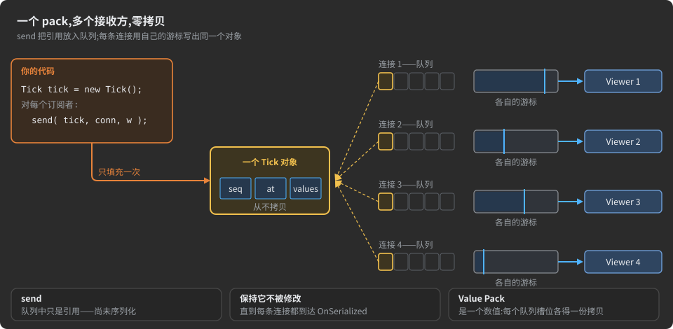

**问题。** 同一条消息要发给数百个对端。把它序列化一次成字节数组、再把该数组复制进每个
套接字，要按接收者付出内存；手工按接收者逐个序列化则重复劳动、重复代码。**手工实现：** 带
引用计数的预编码缓冲区，或者每个对端一份副本。

**使用 AdHoc，** 你造一个 pack 对象，在每条连接上发送它：

```java
Tick tick = new Tick();                                    // 一个对象，只填一次
for( Watch w = WATCHERS.head; w != null; w = w.next )      // 一个 [Grouped] actor 汇集所有连接的订阅者
    Watch.State.Live.ONE.transmitter.send( tick, w.connection, w );
```

- **按引用入队。** `send` 把 pack 的引用放入每条连接的队列后返回；此刻什么都不序列化、
  不复制。
- **读 N 次，零复制。** 套接字有空间时，它的发送器用自己的游标把 pack 从对象直接写进自己的发送
  缓冲区。一个对象服务每一条连接，不管有多少条。
- **慢对端不拖累任何人。** 每条连接按自己的节奏排空自己的队列；遍历订阅者只是入队。

**好在哪里。** 每个接收者的内存开销是一个队列槽，而不是消息的一份副本；代码就是一个 `send` 循环。

**限制。** 对象在最后一条连接写完它之前是共享的：在每条连接都到达该 pack 的
`OnSerialized` 事件之前，不要改动或复用它——每个事件造一个新对象。getter 读数据库
游标的 pack，或带 `Stream` 字段的 pack，只能读一次，无法共享。Value Pack 是一个数字：每个队列得到各自的副本，成本为零。

→ MANUAL：[带类型 pack 的扇出](MANUAL.zh-CN.md#fan-out-of-a-typed-pack-one-object-many-queues) ·
[发送：传输层拉取字节](MANUAL.zh-CN.md#sending-the-transport-pulls-the-bytes) ·
[多连接的 actor：Grouped](MANUAL.zh-CN.md#actors-of-many-connections-grouped)

<a id="r21-receive-store-and-broadcast-in-one-pass"></a>
### R21. 一次完成接收、存储与广播

*适用场景：记录事件并实时展示的监控后端 · 行情数据中心 · 既持久化又投递的聊天服务器 · 任何留存所收内容并转发的中继主机。*


**问题所在。** 主机从来源接收事件,把每个事件写入数据库并推送给实时订阅者。朴素的实现会把事件解码成对象,把值复制进数据库命令,然后再次编码对象——每个订阅者一次。**手工实现:** 一个解码器、一个到数据库的映射层、一个编码器,以及一个自带内存管理的扇出队列。

**用 AdHoc**,传入 pack 的字节在解码的同时被捕获,订阅者拿到的就是这一份捕获。AdHoc 自己的监控后端就是这样工作的(C#):

```csharp
_Allocator.DEFAULT.new_Monitoring_Sessions_Authorizer_CheckAttempt = receiver =>
{
    Feed.ONE.PrepareBroadcastIfAnySubscriber(receiver, CheckAttempt.__id_);   // 只在有人订阅时才捕获
    return pool.Acquire();                                                     // 一个抽象 pack:它的 setter 填充数据库命令
};

// pack 到达之后
try     { insert.ExecuteNonQuery(); }                     // 值已在命令的参数里
catch( Exception e ) { Console.WriteLine(e.Message); }
finally { Feed.ONE.Broadcast(conn.receiver); }            // 一份捕获,排入每个订阅者的队列
```

- **只遍历字节一次。** 这个 pack [没有实现](#packs-without-implementation-straight-into-your-own-structures):解码器调用的 setter 直接写入数据库命令的参数,而它消费的每一段接收缓冲区切片也都被复制进捕获。没有对象,没有映射层,没有第二次解码。
- **永不再次编码。** `Broadcast` 把捕获的字节交给每个订阅者的队列;每个发送器用自己的游标把它们复制进自己的发送缓冲区。引用计数在最后一次发送之后把捕获归还到池中。
- **无人监听时零开销。** 没有订阅者,就不做捕获。
- **慢订阅者错过,无人等待。** 广播永不阻塞:队列已满的订阅者跳过该事件并保持订阅;来源和其他订阅者继续。把*进入*主机的一段链路设为保证送达的链路,存储就不会错过任何内容。

**好处何在。** 解码一次存入存储,编码永远不发生:每个订阅者的成本只是向套接字缓冲区复制一次字节。

**限制。** 订阅者在 pack 完整到达并被存储之后才拿到它——先存储,再转发。捕获把 pack 的整个主体保存在一个池化数组里,直到最慢的订阅者发送完毕。订阅者的连接必须承载同一个 pack(它自己的头部无妨)。在 `finally` 中调用 `Broadcast`:它同时清空捕获槽。带 `Stream` 字段或变换链的 pack 不会被捕获;Value Pack 通过循环发送来扇出。

→ MANUAL:[广播已接收的 pack](MANUAL.zh-CN.md#broadcast-of-a-received-pack-the-bytes-captured-once) ·
[一个 pack 发往多个连接](MANUAL.zh-CN.md#one-pack-to-many-connections) ·
[实现修饰符](MANUAL.zh-CN.md#implementation-modifiers-who-holds-the-data) ·
[声明保证送达的链路](MANUAL.zh-CN.md#declaring-a-guaranteed-leg)

<a id="r22-serial-links-that-recover-after-a-damaged-byte"></a>
### R22. 在字节受损后恢复的串行链路

*适用场景:到控制器和传感器的 UART 与 RS-485 链路 · 无线电调制解调器 · 任何自身没有成帧的字节流。*


**问题所在。** 串行线路投递的是字节,不是消息。噪声翻转一个字节,缓冲区溢出丢一个字节,没有标记的协议就失去位置:故障之后的一切都是垃圾,直到有人重置链路。**手工实现:** 一个起始字节和字节填充、一个 CRC、一个重同步状态机,以及一个绝不能对 CRC 尚未到达的消息采取动作的解码器。

**用 AdHoc**,运行时的两个类位于生成的连接和端口之间:

```csharp
var rx = new AdHoc.Connection.Receiver.Framing(connection.receiver);        // 在生成的接收器之前
var tx = new AdHoc.Connection.Transmitter.Framing(connection.transmitter);  // 在生成的发送器之后

int n = port.Read(inBuffer, 0, inBuffer.Length);  if (0 < n) rx.Write(inBuffer, 0, n);
int m = tx.Read(outBuffer, 0, outBuffer.Length);  if (0 < m) port.Write(outBuffer, 0, m);
```

- **每个 pack 一帧。** 标记 `0xFF`、pack 的字节、一个 CRC-16。内部的字节 `0x7F` 或 `0xFF` 写成 `0x7F` 且其高位前移到下一个字节:一次转义花一个位,一帧最多每八字节多一个字节。
- **边到达边解码,完整才分发。** pack 随字节到来逐字段解码,但 `OnReceived` 处理程序只在 CRC 匹配之后才运行。损坏的 pack 永远到不了你的代码。
- **在下一个标记处恢复。** 一个受损字节只损失受损的 pack:接收器丢弃该帧,跳到下一个 `0xFF`,正常接收下一个 pack。错误——`CRC_ERROR`、`BYTES_DISTORTION`——进入你可以替换的处理程序。
- **其余一切不变。** 描述、Actor、状态和 pack 就是主机在 TCP 上用的那些;只有线路上的字节看起来不同。成帧在原地工作,就在同一批缓冲区里。

**好处何在。** 串行链路得到与 TCP 链路相同的协议、相同的生成代码和相同的状态机,而成帧、CRC 和重同步只是几行接线,而不是一个项目。

**限制。** 仅 C# 和 Java:TypeScript 主机运行在 TCP 或 WebSocket 承载字节的地方。CRC 检测损坏但不修复:丢失的 pack 一去不返,除非它在保证送达的链路上。每个 pack 都为它的帧付费——一个标记和两个 CRC 字节。

→ MANUAL:[串行链路与快速恢复:Framing](MANUAL.zh-CN.md#serial-links-and-fast-recovery-framing) ·
[运行时的连接](MANUAL.zh-CN.md#the-connection-at-runtime) ·
[声明保证送达的链路](MANUAL.zh-CN.md#declaring-a-guaranteed-leg)

<a id="capabilities"></a>
## 功能

下面每项功能都只是描述中的几条声明,或是生成的代码所运行的运行时的属性。每节说明功能是什么、它给你什么、它作用于何处,并链接到完整解释它的 [MANUAL.md](MANUAL.zh-CN.md) 章节。上面的[现成方案](#ready-solutions)展示了它们协同工作的样子。


| # | 功能 | 它给你什么 |
|:--|:--|:--|
| 1 | [一份描述](#one-description-the-whole-system-in-c) | 整个系统在一个 C# 文件里;每台主机的代码,各用其语言 |
| 2 | [运行时引擎](#the-runtime-engine-bytes-pulled-through-two-buffers) | 每个连接两个固定缓冲区;字节由套接字拉取;一个方向内无锁 |
| 3 | [数据](#data-packs-types-constants-your-own-metadata) | 面向真实数据的类型,各带声明的最大值;永不上路的常量与元数据 |
| 4 | [设计的字节](#designed-bytes-encodings-that-follow-your-declarations) | 范围、分布和枚变成最少的位;一个小 pack 变成一个整数 |
| 5 | [组合 pack 与 Pack Set](#composing-packs-and-pack-sets-define-once-select-by-rule) | 一个字段定义一次,随处使用;一套选择语言应对每条规则 |
| 6 | [主机](#hosts-generated-objects-or-your-own-structures) | 生成的对象或你自己的结构,按主机、语言、pack 和字段选择 |
| 7 | [会话过程](#conversations-connections-actors-states-rpc) | 两端同一个状态机;一行写出 RPC;一个套接字上多段会话过程 |
| 8 | [会话、保证送达、UDP](#sessions-that-outlive-sockets-guaranteed-delivery-udp) | 会话比套接字活得久;选定的 pack 恰好一次且有序;带保证的 UDP |
| 9 | [扇出与广播](#fan-out-and-broadcast-one-pack-many-connections) | 一个 pack 发往多个连接,无需按对端复制;已接收的 pack 无需再次编码即可转发 |
| 10 | [串行链路](#serial-links-framing-that-recovers-after-a-damaged-byte) | UART、RS-485 和无线链路:每个 pack 一帧,一个 CRC,在下一个标记处恢复 |
| 11 | [流](#streams-any-size-through-fixed-buffers) | 任意大小、甚至无尽的负载,穿过同样两个缓冲区 |
| 12 | [变换链](#transform-chains-compression-and-encryption-as-attributes) | 压缩与加密即特性:作用于字段、pack、链路或端到端 |
| 13 | [trim](#trims-stores-that-keep-bytes-they-never-parse) | 保存并重放它们从不解析的字节的存储 |
| 14 | [虚拟连接与中继](#virtual-connections-and-relays-middle-tiers-that-cannot-read) | 主机如同直连般对话,穿过无法读取的中继 |
| 15 | [多路复用](#multiplexing-one-port-many-peers-many-generations) | 多种对端和多个世代共用一个端口,每个套接字一个字节 |
| 16 | [标识](#identity-numbers-instead-of-field-tags) | 自由重命名和移动:实体按编号识别,不按名字 |
| 17 | [演进](#evolution-a-new-generation-is-a-new-host) | 新世代就是新主机;旧的保持冻结 |
| 18 | [影响报告](#impact-report-which-hosts-an-edit-reaches) | 一次编辑波及哪些主机,在生成任何东西之前就知道 |
| 19 | [复用](#reuse-extend-import-modify) | 在另一份描述之上构建,而不 fork 它 |
| 20 | [AdHocAgent](#adhocagent-one-command-line-tool-for-every-task) | 一个命令行工具:本地检查、生成、流水线 |
| 21 | [部署](#deployment-routes-smart-merge-backups) | 生成的文件路由进你的项目;你的代码保留;一切都有备份 |
| 22 | [AdHoc Observer](#adhoc-observer-the-description-as-live-diagrams) | 描述即实时的、可点击的图 |

<a id="one-description-the-whole-system-in-c"></a>
### 一份描述：用 C# 描述整个系统

*所处位置:流程 —— **描述** → AdHocAgent → 生成器 → **按主机和语言生成代码** → 部署*

一个 C# 文件承载数据、程序、程序之间的对话以及传输规则,AdHoc 从中为每个程序生成网络代码。这条流程画在
[AdHoc 的结构](#how-adhoc-is-organized)中,而生成代码的理由写在
[为什么从描述生成代码](#why-generate-code-from-a-description)中。本节是它的词汇表,以及你拿回来的东西。

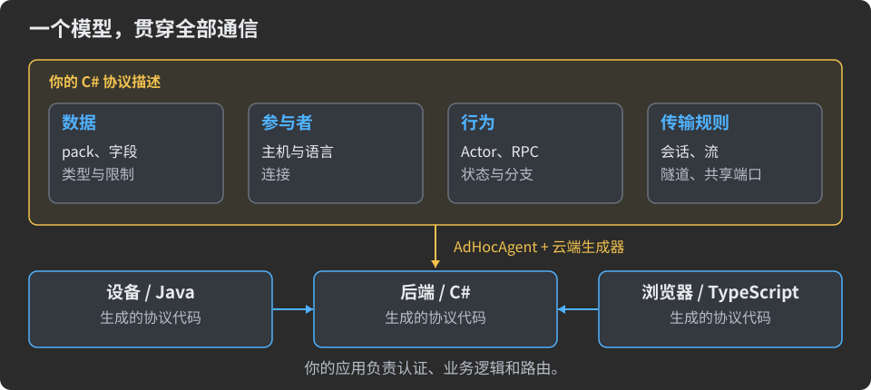

**你早已熟悉的 C#,被读作 AdHoc 实体:**

| 你写的 | AdHoc 把它读作 |
|:--|:--|
| 命名空间顶层的 `interface Shop` | 项目;命名空间成为生成代码的命名空间或包 |
| `struct Server : Host` 加上 `/// <see cref="InJAVA"/>` | 主机 —— 系统的一个程序 —— 及其语言 |
| `class Order { long id; }` | 一个 pack 及其字段;字段上的特性设置它的限制和编码 |
| `const`、`static`、`enum`、一个什么都没实现的 `struct` | 常量、枚举、常量容器:编译进主机,从不发送 |
| `interface Link : Connects<Client, Server>` | 一个连接;用 `VirtuallyConnects<L, R, PATH>` 时,则是经中继主机承载的连接 |
| `interface Job : Actor`;一个带 `[L____________<Next, Packs>]` 的空 `struct` | 一个 Actor;它的状态及状态的分支 |
| 连接体中的 `(L____________, Pong) ping(Ping req);` | 一个 RPC Actor,一行搞定 |
| `interface Reports : _<@Server.Report> { }` | 一个命名的 Pack Set |
| `interface Edge : Multiplex<(Link, AdminLink)> { }` | 一个端口承载多个连接 |

- **已检查、已生成、已测试。** 你输入时,IDE 和 C# 编译器就在检查这个文件。AdHocAgent 在你的机器上检查每一条
  AdHoc 规则,只上传通过检查的描述。文件名后加 `!` 时,云端生成器还会在资源允许的范围内测试代码。
  代码生成是免费的。
- **每个主机和语言一个文件夹**:`gen/` 放协议代码,每次生成时整体替换;`lib/` 放运行时库;
  `LICENSE-GRANT.md`;以及你要求时提供的演示和项目文件。以 MANUAL 的 `Telemetry` 为例 —— 一个 C# 的 `Sensor`、
  一个 Java 和 TypeScript 的 `Collector`:

  ```text
  > AdHocAgent .\Telemetry.cs
  <output folder>/Telemetry/InCS/Sensor/        gen/  lib/  LICENSE-GRANT.md
  <output folder>/Telemetry/InJAVA/Collector/   gen/  lib/  LICENSE-GRANT.md
  <output folder>/Telemetry/InTS/Collector/     gen/  lib/  LICENSE-GRANT.md
  ```

- **一份描述里放多个项目。** AdHocAgent 遇到的第一个项目是根项目,也就是生成其主机的那个;其余项目是它扩展并从中
  取用实体的库。一份描述可以跨多个文件,也可以是一个 `.csproj` 所列的文件。

**为什么这样好。** 系统只有一个事实来源,用你工具已经理解的语言写成。谁和谁对话、谈什么、遵循什么规则,都是
生成器的输入,所以它不可能与代码脱节。

→ MANUAL:[流程](MANUAL.zh-CN.md#the-pipeline-from-a-description-to-running-code) ·
[描述就是编译过的 C#](MANUAL.zh-CN.md#a-description-is-compiled-c) ·
[从 C# 构造到 AdHoc 实体](MANUAL.zh-CN.md#from-c-constructs-to-adhoc-entities) ·
[一份描述里放多个项目](MANUAL.zh-CN.md#several-projects-in-one-description) ·
[AdHoc 为每个主机生成什么](MANUAL.zh-CN.md#what-adhoc-generates-for-each-host) ·
[目标语言](MANUAL.zh-CN.md#target-languages-of-adhoc) · [开源](MANUAL.zh-CN.md#open-source)

<a id="the-runtime-engine-bytes-pulled-through-two-buffers"></a>
### 运行时引擎:字节被拉动着穿过两个缓冲区

*所处位置:运行时 —— 你的代码 → 生成的连接 → **一个发送缓冲区、一个接收缓冲区** → 套接字*

生成的代码运行在一个小型运行时库上,支持 TCP、WebSocket 和 UDP 传输层(除 TypeScript 和 Dart 外,所有运行时都支持 UDP)。每个连接拥有两个
缓冲区,大小由你的代码选定,每个 pack 的每个字节都经过它们。这如何让内存保持恒定、读取保持单趟,见
[就地读取,恒定内存](#read-in-place-constant-memory)。本节讲引擎的时序和线程。


- **套接字拉动。** `send(pack)` 把 pack 排队并立即返回。每当套接字能接收字节,Transmitter 就把 pack 的 id 和字段
  写进发送缓冲区,直到缓冲区写满;下一次填充精确地从停下的地方继续,必要时就在某个字段中间继续。一个 64 字节的
  状态 pack 和一个 GB 级的 `Stream` 字段走同一条路,而且两者都从不作为一个完整字节数组存在。
- **一个旋钮。** 缓冲区大小是传输层构造函数的一个参数 —— C# 默认 1024 字节,一般是几 KB,至少 **128 字节**:
  无论大小如何,每个 pack 都分批经过它。
  它决定每次系统调用发送多少字节,而不是一个 pack 可以多大。
- **两个循环,无锁。** 每个方向一次处理一个事件 —— pack 和超时 —— 每个都处理到底。同一侧的处理程序从不竞争,
  所以它们拥有的状态不需要锁;由接收处理程序和发送处理程序共享的状态,是你唯一需要协调的地方。
- **内置背压。** 无法接收更多数据的目的地 —— 一个已满的流接收端 —— 会让套接字停止读取。未读的数据等在网络里,
  而不是内存里。

```csharp
// 这个传输层打开的每个连接的两个缓冲区:1024 字节
var client = new Network.TCP.WebSocket.Client<CommunicationChannel.Connection>("My Client Name",
                 connection => new CommunicationChannel.Connection(connection),
                 Network.TCP.onFailurePrintConsole,
                 1024);   // bufferSize —— 不是对 pack 大小的限制
```

**为什么这样好。** 容量按连接数规划,而不是按最大的消息规划。垃圾回收器看不到每条消息的数组 —— C# 的 TCP
传输层甚至从共享池租用缓冲区。而处理程序就是朴素的顺序代码。

**限制。** 阻塞的处理程序会卡住它所在的方向,而在一个传输层各连接共享的循环线程上,它还会拖累其他连接:把耗时
工作交给另一个线程,把结果作为新的 pack 发回。两个缓冲区之外的内存由你自己计算:具体 pack 的对象、保证送达的
送达日志(默认最多 100 MB)、压缩和加密阶段的上下文。

→ MANUAL:[运行时模型:每个方向一个缓冲区](MANUAL.zh-CN.md#the-runtime-model-one-buffer-per-direction) ·
[发送](MANUAL.zh-CN.md#sending-the-transport-pulls-the-bytes) · [接收](MANUAL.zh-CN.md#receiving-bytes-are-consumed-where-they-land) ·
[序列化路径上的内存](MANUAL.zh-CN.md#memory-on-the-serialization-path) · [套接字缓冲区大小](MANUAL.zh-CN.md#the-socket-buffer-size) ·
[线程](MANUAL.zh-CN.md#threads-the-receive-loop-and-the-transmit-loop)

<a id="data-packs-types-constants-your-own-metadata"></a>
### 数据:pack、类型、常量、你自己的元数据

*所处位置:项目 → 主机 → 连接 → Actor → 状态 → 分支 → **pack → 字段**;常量:编译进主机,从不发送*

一个 **pack** 是一个 C# `class`,它的实例字段就是要传输的数据。字段类型覆盖真实系统交换的内容,每种大小都有
声明的最大值,而每个主机必须一致、却永远不需要发送的东西 —— 限制、查找表、你自己的元数据 —— 被编译进代码,
而不是拿来交换。

![一个字段在线上的开销:十六张卡片,每张是一种值、它的声明和它的开销。一个 bool,1 位;一个 MinMax(-40, 125) 的 short,1 字节;一个缺席的 uint?,1 位;一个三值枚举,2 位;一个 string,一个 varint 计数加上每个 UTF-16 代码单元 1 到 3 字节,按声明最多 64 个代码单元;D(32) Binary[],恰好 32 字节,无长度;一个最多 100 个 pack 的列表,1 字节长度加各项;一个最多 16 项的集合(或映射),一个计数加各项;一个嵌套 pack,就地放置,无 id;多个备选项中的一个,每个未设置的项占 1 位;一个空事件 pack,只有它的 id;DateTime,6 字节;一个 2000-2050 年、精度一秒的 DateTimeDef,4 字节;一个最多 30 000 步、每步 19 ms 的 Duration,2 字节;一个 Stream,经恒定内存分块传输,上限在两端强制执行;一个常量和一个自定义特性,0 字节 —— 编译进每个主机。橙色徽标标注声明的最大值。](docs/img/readme-type-palette.zh-CN.svg)

```csharp
enum Payment { Card, Cash, Voucher }                          // 以 2 位编码传输

class RetentionAttribute : Attribute { public RetentionAttribute(int days) { } }   // 你自己的元数据

struct Limits { public const byte MAX_ITEMS = 100; }          // 常量容器:编译进去,从不发送

class Item { uint sku; ushort qty; }                          // 用作字段类型的 pack

[Retention(30)]                                               // 变成 Purchase 的常量 Retention = 30
class Purchase
{
    [D(Limits.MAX_ITEMS)] Item[,,] items;                     // 最多 100 项的列表
    Payment                        payment;
    [D(+64)] string                note;                      // 最多 64 个字符
    [D(32)] Binary[]               signature;                 // 恰好 32 个原始字节:线上无长度
    [D(+16)] Map<string, string>   tags;                      // 最多 16 个条目
    DateTime                       placed;                    // 6 字节
    ulong?                         voucher_id;                // 可选:缺席时占 1 位

    static string[] PAYMENT_TEXT = { "card", "cash", "voucher" };   // 编译进每个主机的查找表
}

class Shipped { }                                             // 分支发送的空 pack:一个事件,只有它的 id 在线上传输
```

- **pack 和事件。** 声明在另一个类里面的类是它自己的 pack —— 嵌套只是给它命名;以 pack 为类型的字段把那个
  pack 携带在父 pack 之内。空 pack —— 分支发送的无字段类 —— 是事件:只有它的 id 在线上传输,由一个静态
  处理程序接收,零分配。
- **面向真实数据的类型。** 除 `decimal` 外的每个 C# 数值类型,以及 `bool`(1 位)和 `char`;可选值;字符串;
  常量、固定或动态长度的数组;`Map` 和 `Set`;多维数组;原始 `Binary`;以 pack 和枚举作为字段类型;命名类型
  别名(`TYPEDEF`);四种时间类型;`longJS` 和 `ulongJS`,用于 TypeScript `number` 能精确容纳的 64 位值。
- **多选一,无需联合类型。** 一个全是可选字段的 pack,未设置的备选项只占 1 位 —— 或者,对于整条消息,用几个
  由 pack id 区分的 pack。
- **每种大小都有最大值。** 数组、映射或集合最多容纳 255 项,字符串最多 255 个字符,除非它的 `[D(...)]` 另有
  说明;`_DefaultMaxLengthOf` 为整个项目修改默认值。这些限制在每种语言里都变成常量。
- **常量从不上路。** `const` 和 `static` 值以字面量写进各主机的生成代码。`static` 初始化器可以是任意 C#
  表达式:AdHocAgent 在生成时运行它,所以查找表在线上零开销。
- **你自己的元数据,零成本。** 声明一个特性类,把它放在项目、主机、pack、字段、连接、Actor、RPC 方法或状态上:
  每种语言都会得到该实体的对应常量 —— 路由标签、UI 标签、保留期限。线上字节有它没它都一样。

**为什么这样好。** 形状、限制和词汇只声明一次,在每种语言里都相同。接收方从自己的生成代码里就知道每个字符串和
集合的最大值,而双方只需要*知道*的东西从不放到线上。

→ MANUAL:[pack](MANUAL.zh-CN.md#packs) · [空 pack](MANUAL.zh-CN.md#empty-packs) ·
[字段类型一览](MANUAL.zh-CN.md#the-field-types-at-a-glance) ·
[备选项:多选一](MANUAL.zh-CN.md#alternatives-exactly-one-of-several) · [时间类型](MANUAL.zh-CN.md#time-types) ·
[集合限制](MANUAL.zh-CN.md#collection-limits-_defaultmaxlengthof) · [常量与枚举](MANUAL.zh-CN.md#constants-and-enums) ·
[常量与枚举的去向](MANUAL.zh-CN.md#where-constants-and-enums-end-up) · [自定义特性](MANUAL.zh-CN.md#custom-attributes)

<a id="designed-bytes-encodings-that-follow-your-declarations"></a>
### 设计出来的字节:跟随你的声明的编码

*所处位置:…… → pack → **字段 → 线上字节**;你的代码只看到你声明的值*

字段的线上形式由它的声明决定,而不是由它的 C# 类型决定。[线上更少的字节](#fewer-bytes-on-the-wire)在一个完整
pack 上展示了结果,[R13](#r13-every-byte-costs-airtime-telemetry-in-a-handful-of-bytes) 在一个遥测样本上展示了
结果。本节讲它们背后的工具箱。

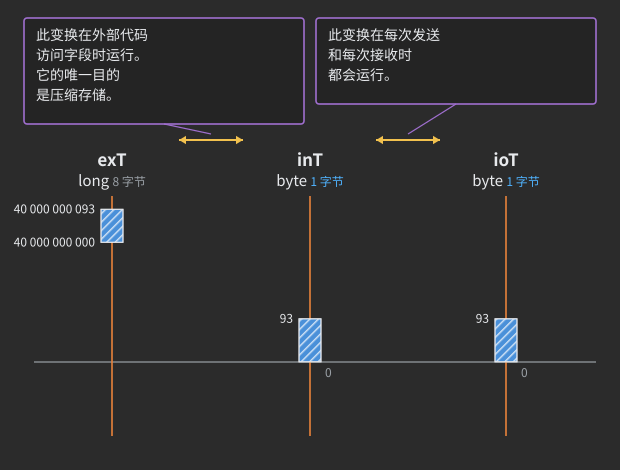

- **每个基元类型字段有三层**(集合的每个基元项也一样)。exTernal(`exT`):你的代码看到的类型。
  inTernal(`inT`):生成的代码如何存储这个值。线上 IO 类型(`ioT`):它如何传输,不带语言粒度。
  取值器、赋值器和常量只说 `exT`。
- **范围决定宽度 —— 也决定 API 类型。** `[MinMax]` 存储 `value - min`,只有跨度 `max - min` 决定宽度:低于
  128 时与其他字段共享一个位字段,到 255 占一个字节,再大就恰好占跨度在线上所需的字节数 —— 包括 3、5、6
  或 7 字节,尽管没有语言有这样的整数。取值器取能容纳该范围的最窄类型,可能比你写的类型更宽或更窄。
- **带基点和方向的 varint。** 靠近下限的值用 `[A]`,靠近上限用 `[V]`,围绕中心用 `[X]`(ZigZag)。开销跟随
  与该点的距离;如果一个 varint 的跨度能装进一个字节,AdHocAgent 会拒绝它,并把你指向 `[MinMax]`。
- **编码,而不是常量。** 枚举以编码传输:取值接近时传 `value - min`,更窄时传它在各值中的索引,标志枚举传下移
  后的掩码。空值是字段位数中的一个空闲编码,或者一个空值位。
- **小值共享位。** 在任何 pack 里,编码能装进 7 位的每个字段 —— `bool`(1 位)、`bool?`(2 位)、小枚举和
  小范围 —— 都进入这个 pack 的位存储,紧密排列,每个 pack 只向上取整到整字节一次;见
  [位字段](#bit-fields-small-values-share-the-packs-bits)。
- **Value Pack。** 字段能装进 64 位的 pack 被生成为一个整数:C# 里是套在一个无符号整数上的 struct,Java 里是
  带注解的基元类型,TypeScript 里是一个 `number`(最多 53 位)。无对象、无堆分配、无间接层 —— 三种语言产出
  相同的字节。
- **范围到达你的代码。** 每个数值字段上的 `MIN` 和 `MAX` 常量 —— 加上适用时的 `NULL` 和 `ZERO` —— 让你检查
  输入或设定滑块范围,而无需把任何数字复制进任何主机。

```csharp
enum Sparse { LOW = -7, MID = 0, HIGH = 300 }                 // 以索引 0、1、2 发送:2 位,而不是 9 位

class Point2 { float x; float y; }                            // 64 位:一个 Value Pack

class Calibration
{
    [MinMax(-1128, 873)]           byte     altitude_offset;  // 范围超出 byte:你的代码得到 short
    [MinMax(20, 120)]              int      temperature;      // 范围装得进 byte:你的代码得到 byte
    [MinMax(1_000_000, 1_080_000)] int      serial;           // 内存中是 int,线上恰好 3 字节
    [A]                            uint?    bytes_received;   // varint:取值贴近零
    Sparse                                  level;            // 2 位索引
    [D(16)]                        Point2[] outline;          // 16 个 Value Pack:16 个数字,无对象
}
```


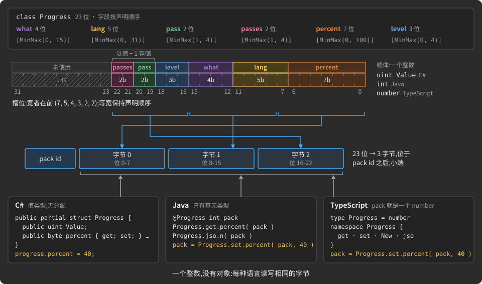

**为什么这样好。** 描述里装着只有它能知道的东西 —— 一个值的范围、取值的聚集位置、一个结构实际有多小 ——
而生成器把这些知识变成位,在每种语言里完全一致,并在途中检查。

**限制。** 字段按位置识别,所以它们的顺序是格式的一部分(见
[标识](#identity-numbers-instead-of-field-tags))。声明的范围是硬限制:超出范围的值无法发送。一个
`[MinMax]` 装得进 `float` 的 `double` 会变成 `float`。

→ MANUAL:[值如何变成字节](MANUAL.zh-CN.md#how-values-become-bytes) · [值分层](MANUAL.zh-CN.md#value-layers-ext-int-iot) ·
[用 MinMax 收窄](MANUAL.zh-CN.md#narrowing-a-primitive-field-with-minmax) ·
[varint 特性](MANUAL.zh-CN.md#the-varint-attributes-a-v-and-x) · [一字节规则](MANUAL.zh-CN.md#the-one-byte-rule) ·
[线上的枚举](MANUAL.zh-CN.md#enums-on-the-wire) · [缺席的值](MANUAL.zh-CN.md#absent-values-on-the-wire) ·
[范围常量](MANUAL.zh-CN.md#range-constants-in-the-generated-code) · [Value Pack](MANUAL.zh-CN.md#value-packs) ·
[pack 在线上的布局](MANUAL.zh-CN.md#the-layout-of-a-pack-on-the-wire)

<a id="composing-packs-and-pack-sets-define-once-select-by-rule"></a>
### 组合 pack 与 Pack Set:定义一次,按规则选择

*所处位置:**项目** → 主机 → 连接 → Actor → 状态 → **分支 → pack → 字段**;在生成任何代码之前由 AdHocAgent
解析*

两个工具让大型协议保持小巧。**组合**用 pack 构建 pack,所以一个字段只在一个地方定义,无论多少个 pack 携带它。
**Pack Set** 按名称、范围或标签选择 pack,所以像"订单的每个活跃 pack"这样的规则只写一次,每个需要它的地方
按名称引用。

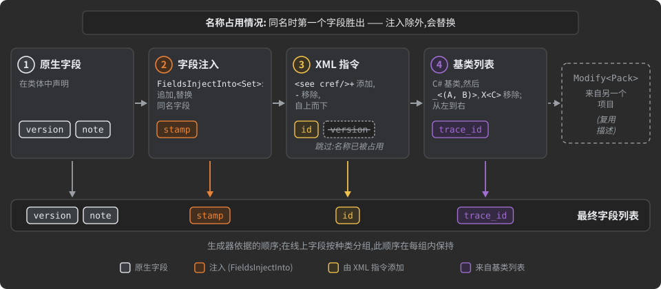

- **共享字段,而不是复制。** 用 C# 继承或 `_<(...)>` 取用字段,用 `/// <see cref="Pack.field"/>+` 和 `-`
  导入或丢弃单个字段。被导入的字段*就是*来源的字段:在那里修改它,每个取用它的 pack 都跟随;用 IDE 重命名它,
  引用也跟随。
- **字段注入。** `FieldsInjectInto<PackSet>` 把字段追加到一整族 pack —— 一个请求 id、一个事件编码。
- **头部。** `HeaderFor<PackSet>` 声明在 pack id 和负载之间传输、但不属于 pack 类的元数据;你的代码在负载被解析
  之前读取它。[R17](#r17-a-metadata-routed-payload-blind-middle-tier-audit-and-tracing) 在它之上构建了一个
  审计层。

```csharp
class Tracing { ulong trace_id; }                             // 定义一次的字段……

class Order : Tracing                                         // ……在这里继承
{
    long id;

    public class Line { int sku; int qty; }

    /// <see cref="Order.id"/>+
    public class Cancel { [D(+200)] string reason; }          // 导入 Order.id:同一个字段,不是副本

    /// ⛔ Legacy
    public class LineV1 { int sku; }
}

class Stamp : FieldsInjectInto<(Order, @Order)>               // 追加到 Order 及其内部的每个 pack
{
    uint request_id;
}

[SkipDoc(@"⛔")] interface ActiveOnly<SCOPE> { }              // 一个过滤模板:只写一次的策略

interface Link : Connects<Client, Server>
{
    [_____lr_____<ActiveOnly<(Order, @Order)>>]               // Order、Line、Cancel —— LineV1 被排除
    struct Start { }
}
```


- **一种选择语言通用于每条规则。** 一个 pack;一个带或不带 `@` 的范围(带 `@` 时包括嵌套的一切);
  `_<...>` 和 `X<...>`;命名的 Pack Set;以及过滤模板 `F<SCOPE>`,按 pack 完整路径上的正则表达式
  (`KeepName`、`SkipName`)或按它的注释和它在 pack 表中的标签(`KeepDoc`、`SkipDoc`)过滤。集合以并集、
  交集和差集组合。
- **同一个表达式用在所有地方。** 分支、RPC 方法、头部、注入器、保证送达、UDP 排除和主机配置都接受它。
  [R12](#r12-least-knowledge-hosts-every-role-sees-only-its-own-messages) 用它实现按角色的视图。
- **运行时什么都不留。** AdHocAgent 在读取描述时就解析每个集合;生成的代码只持有解析出来的 pack 列表。

**为什么这样好。** 一个字段活在一个地方,一条策略活在一个地方。后来添加、打了同样标签的 pack 会自动加入每个按
该标签选择的分支、头部和注入器,无需更新任何列表 —— 而这份灵活性在运行时不花任何成本。

**限制。** 注入器会改变它触及的每个 pack 的线上格式。过滤模式是区分大小写、不锚定的正则表达式,emoji 标签必须
逐代码点匹配。

→ MANUAL:[用 pack 构建 pack](MANUAL.zh-CN.md#building-packs-from-packs) ·
[pack 的字段列表如何组装](MANUAL.zh-CN.md#how-a-packs-field-list-is-assembled) ·
[字段注入](MANUAL.zh-CN.md#field-injection-fieldsinjectinto) · [pack 头部](MANUAL.zh-CN.md#pack-headers-headerfor) ·
[Pack Set](MANUAL.zh-CN.md#pack-sets) · [范围与 @](MANUAL.zh-CN.md#project-host-and-pack-scopes-and-) ·
[按名称和文档过滤](MANUAL.zh-CN.md#filtering-a-set-by-name-and-by-documentation) ·
[过滤模板](MANUAL.zh-CN.md#filter-templates-f) ·
[组合集合](MANUAL.zh-CN.md#combining-sets-union-intersection-difference)

<a id="hosts-generated-objects-or-your-own-structures"></a>
### 主机：生成的对象或你自己的结构

*所在位置：project → **host** → connection → … → **pack → field**；流程：生成器 → **按主机和语言生成代码***

**主机**是系统中的一个程序：`struct Server : Host`，其语言在文档注释中命名。它是节点的一个*类型*，所以任意多个运行中的程序都可以是同一台主机的实例。对于主机处理的每个 pack，由你选择谁来持有数据：生成的代码，还是你自己的结构。


- **具体实现（`+`）。** 生成的类持有值：填充它并发送；接收时每个字段都已解码。适合 pack *就是*你的数据模型的时候。
- **抽象实现（`-`）。** 生成的代码是一个接口，由你自己的类型实现。字节到达时解析器逐字段调用 setter，写出时序列化器逐字段调用 getter。没有生成的对象，没有拷贝，没有第二个需要保持同步的模型——pack 可以比你想花在它上面的内存还大。单字节项的数组以接收缓冲区本身的窗口形式到达。
- **按主机、语言、pack——或单个字段。** 同一个 pack 可以在把它保存在自己日志里的 broker 上是抽象的，而在新的仪表盘上是具体的；两种方式字节完全相同。一个普通 pack 中某个巨大的字段可以在到达时交给你的代码，而其余部分照常存储。
- **按需生成相等性与哈希。** 第二个 `+` 或 `-` 决定是否生成它们。

```csharp
class Frame
{
    long                   timestamp;
    int                    channel;
    [D(1_000_000)] int[,,] samples;          // 最多一百万项
}

/// <see cref='InJAVA'/>--          // broker：每个 pack 都是架在它自己对象上的接口
struct Broker : Host { }

/**
    <see cref='InCS'/>
    <see cref='InCS'/>-
    <see cref='Frame.samples'/>
*/
struct Router : Host { }            // C#：Frame 是普通对象，但 samples 到达时即移交

/// <see cref='InTS'/>              // 一个新的仪表盘：普通的生成对象
struct Dashboard : Host { }

interface ToRouter    : Connects<Broker, Router>    { [l____________<Frame>] struct Start { } }
interface ToDashboard : Connects<Broker, Dashboard> { [l____________<Frame>] struct Start { } }
```


AdHoc 自己两种都用。在 AdHocAgent 生成的 C# 代码中，它发送的 `Login` pack 是一个类，而把你解析后的描述带给生成器的 `Project` pack 是一个接口，由 agent 自己的模型类实现。

**为什么好。** 二进制协议可以加入已经有自己模型的系统——数据库节点、消息代理、客户端库——而无需 DTO 层和每条消息的拷贝，同时新程序得到普通对象。规则只有一个问题：这台主机里数据住在哪里？[R15](#r15-ingest-straight-into-your-own-data-structures) 全速展示抽象一侧。

**限制。** 收到的抽象 pack 落在你的代码提供的对象里：在第一个此类 pack 到达之前，在生成的 `_Allocator` 中指定它的工厂，否则默认工厂会抛出异常。

→ MANUAL：[声明主机](MANUAL.zh-CN.md#declaring-a-host) · [语言标记](MANUAL.zh-CN.md#language-markers) ·
[实现修饰符](MANUAL.zh-CN.md#implementation-modifiers-who-holds-the-data) ·
[抽象：你的代码持有数据](MANUAL.zh-CN.md#abstract---your-code-holds-the-data) ·
[选择 + 还是 -](MANUAL.zh-CN.md#choosing--or---generated-objects-or-your-own-structures) ·
[主机、pack 与字段规则](MANUAL.zh-CN.md#implementation-management-host-pack-and-field-rules) ·
[生成器为主机产出什么](MANUAL.zh-CN.md#what-the-generator-produces-for-a-host)

<a id="conversations-connections-actors-states-rpc"></a>
### 对话：连接、Actor、状态、RPC

*所在位置：project → host → **connection → actor → state → branch** → pack → field*

**连接**是两台主机之间的带类型管道。在连接内部，一个 **Actor** 是一段拥有自己的状态机的对话，**状态**是一个空 `struct`，状态的**分支**特性说明在该状态下哪一侧可以发送哪些 pack，以及每个 pack 通向哪个状态。两台主机由同一台状态机生成，所以它们按构造就对话顺序达成一致：当前状态不允许的 pack 在发出前就被拒绝，意外到达的 pack 在到达时被报告。


```csharp
interface Link : Connects<Client, Server>   // 主机及其 pack 在项目中别处声明
{
    // Actor0，连接自己的状态机：先登录，然后进入工作状态
    [L____________<Authorizing, Client.Login>]  // L：左侧主机发送 Login，状态前进
    struct Start { }

    [____________R<Ready, Server.Welcome>]      // R：右侧主机应答
    [____________R<Close, Server.Denied>]
    struct Authorizing { }

    [_____lr_____<Beat>]                        // lr：任一侧；小写：状态保持不动
    struct Ready { }

    // 函数组：Server 在任意时刻推送；无实例，无需跟踪
    interface Notify : Actor
    {
        [____________r<(Server.Note, Server.Alert)>]
        struct Messages { }
    }

    // 一行 RPC：一个 Call -> Reply -> End 的 Actor，无需你自己的关联 ID
    (L____________, Pong) ping(Ping req);

    // 实例群：这条连接上最多同时 8 个作业，每个有自己的时钟
    interface Job : Actor
    {
        int Actor.MaxActiveInstances => 8;

        [L____________<Running, Client.JobStart>]
        struct Start { }

        [Deadline(30)]
        [____________r<Server.JobProgress>]
        [____________R<End, Server.JobDone>]
        struct Running { }
    }
}
```

| 你声明 | 生成的代码在两台主机上做什么 |
|:--|:--|
| 状态上的分支 | 只发送和接受当前状态允许的 pack；处理器收到下一状态的发送器，因此只能用该状态允许的 pack 应答 |
| 单侧的迁移分支 | 该侧引领状态，也是唯一能移动它的一侧，因此迁移从不竞争；带实例的 Actor 的 pack 上有一个 4 位 epoch，用来丢弃来自前一状态的迟到 pack |
| 多个 Actor | 一个套接字上相互独立的对话：一个 Actor 传文件，另一个聊天 |
| 一个 RPC 方法 | 调用方池化的实例持有回调上下文，应答方获得一个池化的、未注册的上下文：池热起来后每次调用不分配任何 Actor 对象。没有方向标记时任一侧都可调用，分处两个永不碰撞的 Actor |
| `MaxActiveInstances` | `1`、`N`、`UNLIMITED` 或组播 `+N`；到达上限时 `Acquire` 返回 `null`，多开一个实例的对端会被中止连接 |
| `[Deadline]`、`[Idle]` | 结束一个卡住的实例，而连接和其他 Actor 继续存活；`[Idle]` 是一个只有收到对端 pack 才续期的租约 |
| `[Grouped]` | 把所有连接的实例聚成组，你的代码遍历这些组把事件扇出；加入和离开都是 O(1)，实例结束时自行离开 |
| `[TransmitTimeout]`、`[ReceiveTimeout]` | 连接级的停滞上限，由每个状态在进入时写入 |

连接的每个方向是一个事件循环：一侧的处理器逐个运行，对它们拥有的状态无需加锁。请求/响应仍然在这里，只是几种 Actor 形态之一：一个被接受、报告进度、然后交付的作业是一个三状态 Actor，一次经中间主机中继的调用是每跳一个 RPC。


用 C# 调用并应答上面的 RPC：

```csharp
// Client，调用方：先说明应答在这里意味着什么（一次），然后发起调用
ping.State.Reply.OnReceiveD.Pong.handlers += (pong, conn, actor) => Show(pong);
var actor = ping.Acquire(conn);
ping.State.Call.ONE.transmitter.send(request, conn, actor);

// Server，应答方：应答每个 Ping，Pong 发出后归还上下文
ping.OnReceiveD.Ping.handlers   += (req, conn, ctx) => ctx.send(MakePong(req), conn);
ping.OnSerializeD.Pong.handlers += (_, conn, ctx) => ctx.Release(conn);
```

**为什么好。** 在请求/响应里，调用顺序、谁可应答、合法回复、关联、并发上限和超时都活在文档里和两端手写的检查里。在这里它们是声明，由生成的代码在两端强制执行：通知无需跟踪成本，RPC 无需你的关联代码，实例群有界，开太多对话的对端会被切断。

**限制。** `UNLIMITED` 跳过上限检查，让对端随意开实例——只把它留给可信网络。一个慢处理器会卡住它的整个方向——在 C# 和 Java 中，所有连接由同一个传输层循环服务：把长工作交给另一个线程，把结果作为下一个事件发回。

**手册中：**[连接](MANUAL.zh-CN.md#connections) · [Actor、状态、分支](MANUAL.zh-CN.md#actors-states-branches) ·
[引领状态的一侧](MANUAL.zh-CN.md#the-side-that-leads-a-state) · [四种 Actor](MANUAL.zh-CN.md#four-kinds-of-actor) ·
[RPC 方法](MANUAL.zh-CN.md#rpc-methods) · [并发模式](MANUAL.zh-CN.md#concurrency-modes) ·
[按实例定时器](MANUAL.zh-CN.md#per-instance-timers-deadline-and-idle) · [`[Grouped]`](MANUAL.zh-CN.md#actors-of-many-connections-grouped) ·
[两个循环](MANUAL.zh-CN.md#the-two-loops-threads-and-actor-handlers) ·
[一台真实的状态机](MANUAL.zh-CN.md#a-real-state-machine-adhocs-communication-connection)

<a id="sessions-that-outlive-sockets-guaranteed-delivery-udp"></a>
### 比套接字长寿的会话、保证送达、UDP

*所在位置：project → host → **connection → session** → actor → state；运行时：什么比套接字长寿，哪些 pack 在套接字丢失后幸存*

运行时，连接的活实例是一个**会话**：生成的连接对象、它的 Actor、它们的状态以及你的代码附加到它们上的一切。套接字只是承载它。默认两者同生同灭；三个声明把它们解耦，每个都建立在前一个之上：

| 声明 | 它带来什么 |
|:--|:--|
| 连接或状态上的 `[Resumable(seconds)]` | 套接字丢失会**挂起**会话；及时回来并证明自己身份的对端可以继续它——同样的 Actor 处于同样的状态 |
| 连接体中的 `Resumable<HOST, PACKS>` | `HOST` 在那里发送的 pack **恰好一次、按序**到达，跨越套接字丢失 |
| 连接上的 `[UDP(seconds)]` | 连接跑在 UDP 上，**每个** pack 双向保证送达；`[UDP<EXCLUDE_PACKS_SET>(seconds)]` 让你点名的 pack 不受保护 |

![一个会话悬在两个套接字之上：在套接字 1 上 Actor 处于 Working 状态，pack 1 到 5 已发送；套接字在 pack 4 和 5 在途时丢失；会话挂起等待，最长 [Resumable(seconds)]；在新的套接字 2 上对端登录并调用 reclaim(session_id)；同一个 Actor 在同一状态继续，pack 4 和 5 从发送方的日志重放，然后才是 pack 6 和 7。页脚：在 TCP 上你保证不能丢的 pack；在 UDP 上每个 pack 都被保证，你排除可以丢的那些。](docs/img/tldr-session.zh-CN.svg)

```csharp
[Resumable(30 * 60)]                                   // 套接字丢失会把会话挂起至多 30 分钟
interface Orders : Connects<Client, Server>
{
    [Resumable(0)]                                     // 登录之前没有值得保留的东西
    [L____________<Authorizing, Client.Login>]
    struct Start { }

    [Resumable(0)]
    [____________R<Working, Server.Welcome>]
    [____________R<Close, Server.Denied>]
    struct Authorizing { }

    [l____________<(Client.Order, Client.Cancel)>]
    [____________r<(Server.Receipt, Server.Welcome)>]  // Welcome：被认领的会话从这里应答新的登录
    struct Working { }

    // Client 在这里发送的东西恰好一次、按序到达，跨越套接字丢失
    interface FromClient : Resumable<Client, (Client.Order, Client.Cancel)>
    {
        int resumable_megabytes => 20;
    }
}
```

**身份就是你自己的登录。** 每个新套接字都走你普通的登录状态。你的处理器认出对端之后，做一次调用，剩下的由运行时完成：

```csharp
// Server，在你对 Client.Login 的处理器里
var ext = conn.ext_connection;
long session_id = pack.resume_token != 0
                      ? ext.reclaim(pack.resume_token)   // 以此 ID 挂起的会话移到这个套接字上
                      : ext.identify(account_id);        // 首次登录：你自己的一个非零身份
// 用来自现在位于此套接字上的会话的 Welcome { session_id } 应答，ext.Internal
```

拨号侧也在自己的连接上调用 `identify`：只有被标识的连接才会挂起，只有被标识的发送方才能发送保证送达的 pack。然后运行时在两端触发 `resume(connection)`：接收方报出它已消费的位置——包括发到一半的 pack——发送方从那里重放日志，再发新的 pack。进程死过的发送方已丢失日志：它回答 `Lost_`，接收方听到 `resume(null)`——出现缺口，该重新同步而不是永远等待。没有"我进行到哪了"之类的 pack 需要你设计：表达这些的服务 pack（`Confirm_`、`Fresh_`、`Continue_`、`Ok_`、`Lost_`）由生成器自动为项目生成，编号排在你的 pack 之后。


挂起的会话保留它的槽位、它的 Actor 和状态、你的对象以及磁盘上的日志；它把套接字和传输层缓冲区还给池。优雅关闭或你自己代码的中止会立即结束会话——只有丢失才会挂起它。可以重建的状态根本不必挂起：把它描述成 pack 并存储，因为文件或数据库列里的 pack 与线路上的 pack 是同样的字节。

**UDP：在该可靠处可靠，在无关处保鲜。** 在 TCP 上你选择不能丢的 pack；在 UDP 上你选择可以丢的：

```csharp
interface Volatile : _<(Client.Position, Server.Telemetry)> { }   // 后一个替换前一个

[UDP<Volatile>(30 * 60)]         // 走 UDP；每个 pack 双向保证送达，Volatile 除外
interface GameLink : Connects<Client, Server>
{
    [l____________<(Client.Input, Client.Position)>]
    [____________r<(Server.Score, Server.Telemetry)>]
    struct Play { }
}
```


拥有静态 X25519 密钥的 UDP 服务器会加密每条连接（每个数据报一个 16 字节标签），带 pacing 的拥塞控制默认开启。除 TypeScript 和 Dart 外,UDP 连接存在于所有运行时中——浏览器无法打开 UDP 套接字。

**为什么好。** 重连逻辑、序列号、确认、重放缓冲区和恢复握手是联网软件中最容易出错的代码之一。在这里它们是带有书面代价的声明：Wi-Fi 掉线后同一个 Actor 在同一状态恢复，订单恰好一次、按序到达，在 UDP 上只有你排除的 pack 可能丢失——而且它们不花日志拷贝的代价。

**限制。** 会话 id 是一个槽位加一份身份，不是秘密：在 `reclaim` 之前先认证对端。挂起的会话持有它的对象和日志，直到对端回来或时间耗尽。每个保证送达的 pack 在每次发送时都会拷入日志——保证不能丢的，而不是一切。

**手册中：**[会话、保证送达、UDP](MANUAL.zh-CN.md#sessions-guaranteed-delivery-udp) ·
[挂起会话](MANUAL.zh-CN.md#parking-a-session) · [身份与认领](MANUAL.zh-CN.md#identity-and-reclaim) ·
[resume](MANUAL.zh-CN.md#resume-the-runtime-tells-your-code-that-the-session-continues) ·
[日志如何工作](MANUAL.zh-CN.md#how-the-journal-works) · [保证的代价](MANUAL.zh-CN.md#what-the-guarantee-costs) ·
[UDP 连接](MANUAL.zh-CN.md#udp-connections) · [在 UDP 上让 pack 不受保护](MANUAL.zh-CN.md#leaving-packs-unguarded-on-udp)

<a id="fan-out-and-broadcast-one-pack-many-connections"></a>
### 扇出与广播：一个 pack，许多连接

*作用位置：运行时——许多连接的**发送队列和发送器**同时*

把同一个 pack 发给数百个对端，既不花每对端一份拷贝，也不花第二次编码：

- **一个对象，许多队列。** `send` 把 pack 的引用放进每条连接的队列；每个发送器用自己的游标把它从对象写进自己的缓冲区。在每条连接都到达 `OnSerialized` 之前保持对象不变。
- **一次捕获，许多订阅者。** 转发所收内容的主机在解码传入 pack 的同时捕获它的字节（`Connection.Receiver.BytesCopy`），存储解码后的值，并把这一次捕获交给每个订阅者（`Connection.Transmitter.Broadcaster`）：只解码一次，永不再编码。捕获是引用计数且池化的，无人订阅时不捕获任何东西，队列已满的订阅者错过那次事件，其他人继续。

→ 方案：[R20. 一个 pack，许多接收者，零拷贝](#r20-one-pack-many-recipients-no-copies) ·
[R21. 一遍完成接收、存储与广播](#r21-receive-store-and-broadcast-in-one-pass) ·
MANUAL：[一个 pack 发给许多连接](MANUAL.zh-CN.md#one-pack-to-many-connections)

<a id="serial-links-framing-that-recovers-after-a-damaged-byte"></a>
### 串行链路：受损字节后能恢复的成帧

*作用位置：**生成的连接**与裸字节流之间——UART、RS-485 总线、无线电调制解调器*

`Connection.Receiver.Framing` 和 `Connection.Transmitter.Framing` 把每个 pack 包进一帧——标记 `0xFF`、以一位为代价转义 `0x7F` 和 `0xFF` 的 pack 字节、一个 CRC-16——让没有自带成帧的链路承载与 TCP 相同的协议。pack 边到达边解码，只有 CRC 匹配时才分发；受损字节之后接收方跳到下一个标记，故障只损失那一个 pack。两层都在原地工作，使用连接自己的缓冲区。支持 C# 和 Java；TypeScript 主机跑在 TCP 或 WebSocket 上。

→ 方案：[R22. 受损字节后能恢复的串行链路](#r22-serial-links-that-recover-after-a-damaged-byte) ·
MANUAL：[串行链路与快速恢复：Framing](MANUAL.zh-CN.md#serial-links-and-fast-recovery-framing)

<a id="streams-any-size-through-fixed-buffers"></a>
### 流:任意大小,穿过固定缓冲区

*所处位置:pack → **字段** → 线上字节;运行时:你的数据源 → **套接字缓冲区** → 线路 → **套接字缓冲区** → 你的接收端*

运行时从不把 pack 渲染成一个字节数组:发送器在套接字缓冲区有空位时才取字节,接收器在字节落地处直接消费它们。`Stream` 或 `File` 字段给这个核心加了一条**管道**:运行时将你的数据源直接读入发送缓冲区,把收到的字节直接写入你的接收端。一个 GB 与一个 64 字节的状态 pack 占用相同的缓冲区,唯一的大小限制是你声明的上限。

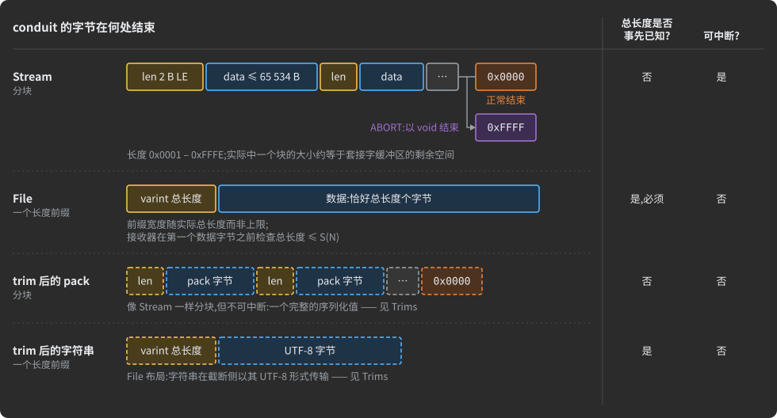

- **`Stream`** 不需要事先给出总长,可随时停止或永不停止(实时馈送),每个块的开销为 2 字节。
- **`File`** 事先发送一个长度——大小已知时更紧凑——并且接收器在第一个负载字节之前就拒绝超限的传输。
- **`[S(N)]`** 在每条管道上都是强制的,并且在两端都强制执行。
- **分块流的结束仅从成帧就能看出**,因此中继可以转发它、存储可以保存它,而无需解码任何一个字节——这就是虚拟连接和 trim 立足的基础。
- **无尽的馈送会给紧急 pack 让路。** `Stream` 何时结束由它的数据源说了算,因此以分段序列发送的实时馈送,可以让命令或告警在任意两段之间穿过——见
  [R19](#r19-live-video-and-audio-that-stop-for-an-urgent-command)。
- **大到装不下的类型化 pack 也可以流式传输**:在某台主机上生成为 abstract 时,它的解析器把一个又一个值交给你的代码,对象从不被分配。AdHoc 自己的服务器就是用这种方式解析每个上传的项目的。

AdHoc 自己的协议将一个项目的文件——agent 上传的源代码、它接收的代码——作为任意大小的归档来传输:

```csharp
[Zstd]
public class SrcZip : StreamFlowAttribute { }      // 归档的线上格式,只定义一次

public class FileEntry
{
    [D(+4096)]       string path;                 // 归档内部以 '/' 分隔的路径
    [S(0x5_000_000)] Stream bytes;                // 最大 80 MiB,在磁盘与套接字之间管线传输

    public class List
    {
        [D(0xFFFF)] FileEntry[,] files;           // 最多 65 535 个条目
    }
}

public class Result
{
    string task;
    [SrcZip] FileEntry.List result;               // 线上压缩,两端类型化
}
```

你的代码提供一个数据源、一个接收端和一个“是否有值”的回答——每条管道字段最多对应三个生成的成员。AdHocAgent 自己的实现在发送一个条目时返回 `File.OpenRead(src)`,在接收一个条目时返回一个新的 `FileStream`,因此每个文件在上传时从磁盘流出、在下载时写入磁盘。

![任意大小的归档以恒定内存从磁盘搬到磁盘,正如 AdHocAgent 接收生成的代码时那样。发送端:每个文件按块从磁盘读出,条目接着条目,由 SrcZip flow 的 Zstd 阶段用其固定的暂存缓冲区实时压缩,进入固定的发送缓冲区,以带长度前缀、以 0x0000 收尾的块上线路。接收端:固定的接收缓冲区、逆 Zstd,以及一个重复装配的 FileEntry(一个路径加一个 Stream),其接收端(一个 FileStream)把每个条目写入磁盘。两侧之间有一张图表:每侧占用的内存——缓冲区和编解码器上下文——保持平坦,而归档大小无限制地增长。说明:FileEntry 是一个路径加上一个 [S(0x5_000_000)] Stream,每个条目最大 80 MiB,最多 65 535 个条目,上限在两端校验。](docs/img/readme-archive-stream.zh-CN.svg)

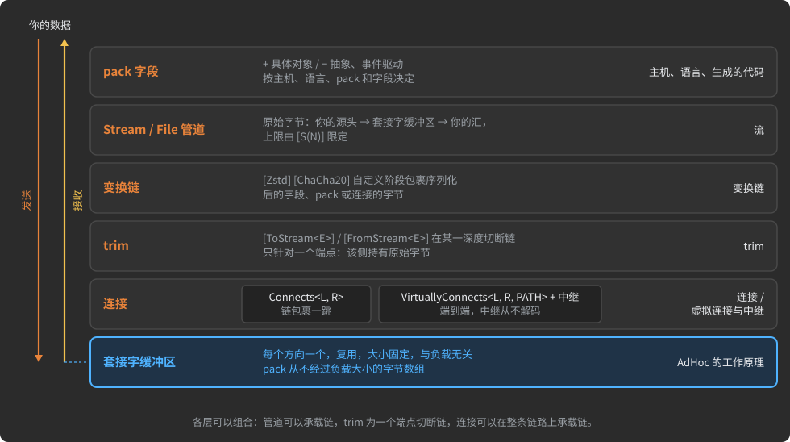

下面各节中的每一项传输功能,都是这个核心之上的一层,因此它们可以组合:管道承载一条链,trim 为某一端点切断一条链,而隧道本身就是一条分块流。

**为什么好。** 没有临时文件,没有 multipart 方案,没有你自己的分块协议,除声明的上限外没有上传限制:一个 GB 或一条无尽的馈送穿过与状态 pack 相同的缓冲区,而上限保护每个接收器。

**限制。** 带管道字段的 pack 永远不能直接以生成的形式使用——每台主机上你的代码都要提供数据源和接收端——并且管道不能放在集合里。一个 `Read` 会等待数据的数据源,会卡住整条连接的发送循环。

**手册中:** [流](MANUAL.zh-CN.md#streams) · [流式模型一览](MANUAL.zh-CN.md#the-streaming-model-at-a-glance) ·
[Stream 成帧](MANUAL.zh-CN.md#stream-framing---chunked-and-interruptible) · [File 成帧](MANUAL.zh-CN.md#file-framing---one-length-up-front) ·
[大小上限 `[S(N)]`](MANUAL.zh-CN.md#the-size-cap-of-a-conduit---sn) ·
[Binary、File 还是 Stream](MANUAL.zh-CN.md#binary-file-or-stream---choosing-by-the-shape-of-the-bytes) ·
[交付任意大小的归档](MANUAL.zh-CN.md#worked-example---delivering-an-archive-of-any-size) ·
[流式传输类型化 pack](MANUAL.zh-CN.md#streaming-typed-packs)

<a id="transform-chains-compression-and-encryption-as-attributes"></a>
### 变换链:以特性形式存在的压缩与加密

*所处位置:**字段、pack 或连接** → 序列化字节 → **阶段** → 分块成帧 → 套接字缓冲区*

链是一列写成特性的字节到字节阶段,按数据流顺序书写:左边是数据,右边是线路。`[Zstd, ChaCha20]` 在发送端先压缩再加密,接收端按相反顺序运行逆阶段。目标保持它的类型——链包裹它的序列化字节,而不是替换它们。

![一行特性 [Zstd(6), ChaCha20] Order secured; 的解读:Zstd(6) 是压缩,更靠近数据;ChaCha20 是密码,更靠近线路。发送行:类型化的 Order,序列化,经过 Zstd(6),然后 ChaCha20,然后分块成帧,上线路。接收行,从右到左:解帧、逆 ChaCha20、逆 Zstd、解析,再次得到类型化的 Order。每种语言一个徽标——C++、Rust、C#、Java、Go、Swift、C、Dart、Python、TypeScript:为每种语言生成同一条链,无需编写编解码器代码。脚注:Zstd 是无损的;ChaCha20 隐藏字节但不检测篡改;挂在不可能超过 1024 字节的 pack 上的链会自动去掉它的 Zstd 阶段,挂在字段上的链保持原样。](docs/img/readme-chain-line.zh-CN.svg)

```csharp
[Zstd(6), ChaCha20]
public class SealedFast : StreamFlowAttribute { }   // 一个 flow:一条命名的链,当作一个特性使用

public class MacAttribute : StreamStageAttribute { } // 你自己的一个阶段:它的编码和解码进同一个生成的文件

class Vault
{
    ulong sequence;
    [Zstd(6), ChaCha20] Order  secured;     // 先压缩,再加密;两端仍然是 Order
    [Zstd, D(+100_000)] string notes;       // 一个字符串字段
    [S(500_000), Zstd]  Stream feed;        // 一条原始流
}

class Orders
{
    [SealedFast] Order payload;             // 同一条链,按名称引用
    [Zstd, Mac]  Order audited;             // 压缩器之后跟一个自定义阶段
}

[Zstd(3)]                                    // 一条连接:这一跳承载的一切
interface AtoB : Connects<A, B> { /* 状态与分支 */ }
```

![链可以包裹字节的四个位置。在字段或 pack 上:阶段包裹从主机 A 到主机 B 的流中的一个值。在每条物理 Connects 上:Device 到 Gateway 与 Gateway 到 Cloud 各自运行自己的链,因此 Gateway 持有两把密钥并看到明文。在 VirtuallyConnects<Device, Cloud, Broker> 上:链只在两个端点运行,Broker 中继转发密封的块,既没有模式也没有密钥。在 [UDP] 或 Resumable 连接上:链应用于每个 pack,前面带 12 个明文字节的密钥 ID 和序列号。](docs/img/dev-16-chain-scope.zh-CN.svg)

| 阶段 | 它保证什么,代价是什么 |
|:--|:--|
| `[Zstd]`, `[Zstd(level)]` | 无损;级别 1 到 22,默认 3;在不可能超过 1024 字节的 pack(`_DefaultMaxLengthOf.Uncompressed`)上自动摘除并给出警告 |
| `[ChaCha20]` | 仅机密性——被修改的密文不会被检测到。挂在 pack 或字段上时,它使用会话的密钥,并为每个 pack 写入 12 个明文字节(密钥 ID 和序列号),因此每个 pack 都能独立解密 |
| 你自己的一个阶段 | 任意字节变换,可带压缩器角色、密码角色或都不带——例如用于完整性的 MAC;生成器为每个阶段输出一个文件,你在其中写的代码在重新生成时保留 |

**一把密钥换来的加密传输层。** 持有静态 X25519 密钥对的监听主机,会加密它接受的每条连接,TCP 或 WebSocket:一次 Noise NK 握手,然后对每条记录做带认证的 ChaCha20-Poly1305;客户端固定(pin)服务器的公钥。没有服务器密钥时传输层保持明文,零开销。会话的每条连接都把它的密钥加入会话,因此重连后从送达日志重放的 pack 仍能解密。

agent 在生成任何东西之前检查每条链:最多一个压缩器和一个密码,压缩器在密码左边,并且 `File`、基元类型、枚举、Value Pack 或集合字段上不允许挂链。

**为什么好。** 压缩与加密的决定存在于描述中,在代码评审中可见,并且在每种语言中以完全相同的方式应用。一把服务器密钥就给出带认证的加密传输层,而虚拟连接上的链让中继读不到它们所承载的内容。

**限制。** 物理连接上的链在每一跳终止:中间的网关看到明文——对于不许读取的中间层,给虚拟连接挂链。只在已知字节有冗余时压缩;不透明的负载一无所获。为一条流链注入的密钥和 nonce,绝不能用来加密两条流。

**手册中:** [变换链](MANUAL.zh-CN.md#transform-chains) · [阶段与数据流顺序](MANUAL.zh-CN.md#stages-and-dataflow-order) ·
[链可以挂在哪里](MANUAL.zh-CN.md#where-a-chain-may-sit) · [内置阶段](MANUAL.zh-CN.md#built-in-stages---zstd-and-chacha20) ·
[Zstd 与 ChaCha20 保证什么](MANUAL.zh-CN.md#what-zstd-and-chacha20-guarantee) · [密码的密钥](MANUAL.zh-CN.md#keys-of-a-cipher) ·
[Flow](MANUAL.zh-CN.md#flows---a-chain-declared-once) · [自定义阶段](MANUAL.zh-CN.md#custom-transform-stages) ·
[短 pack 不压缩](MANUAL.zh-CN.md#short-packs-go-uncompressed) · [连接上的链](MANUAL.zh-CN.md#chains-on-a-connection)

<a id="trims-stores-that-keep-bytes-they-never-parse"></a>
### Trims:保存从不解析的字节的存储

*所处位置:连接 **腿**(一条连接上的一个发送主机)→ pack → **字段 → 链 → 切断** → 线上字节*

序列化的 pack 没有长度头,而链是对称的:中间的主机既不能在不解析的情况下找到 pack 的结束位置,也不能避免运行整条逆链。**trim** 在你指名的腿上同时解决这两个问题:它为负载成帧,使其结束位置无需解析即可找到,并将其作为原始字节移交。

| Trim | 在 `E` 指名的腿上 |
|:--|:--|
| `[ToStream<E>]` | 发送方序列化一个类型化的值;接收方拿到原始字节 |
| `[FromStream<E>]` | 发送方提供原始字节(来自磁盘、来自数据库);接收方得到一个类型化的值 |
| `[Stream<To, From>]` | 两者,在同一深度:存储收到的字节与它重放的字节完全一致 |


```csharp
// Camera -> Recorder:源头处类型化,存储处为原始字节
public class RecordSnapshot
{
    [ToStream<IfSendingFrom<Camera, CameraToRecorder>>] public Snapshot snapshot;
}

// Recorder -> Viewer:从存储重放,在查看端再次类型化
public class ReplaySnapshot
{
    long recorded_at;
    [FromStream<IfSendingFrom<Recorder, RecorderToViewer>>] public Snapshot snapshot;
}
```

Recorder 不需要 `Snapshot` 的代码:`Snapshot` 可以增加字段,而 Recorder 既不被改动也不需要重新构建。每条腿上的线路是相同的——trim 是一个代码生成决定,而不是一种线路格式——它未指名的每条腿,两端都保持类型化的值。

**切断的深度决定存储要运行什么。** 写在一条链的各个阶段之间时,trim 标记解包在哪里停止:

```csharp
interface FromProducer : IfSendingFrom<Producer, ProducerToBroker> { }
interface FromBroker   : IfSendingFrom<Broker,   BrokerToConsumer> { }

// broker 保存压缩后的数据块:它解密自己的链路,从不解压,从不见到 Event
[Zstd, Stream<FromProducer, FromBroker>, ChaCha20]
public class Event { long at; [D(+100)] string topic; [D(65_000)] Binary[,] body; }
```

![trim 标记的位置决定存储要运行什么,图中三条链从叶子读到线路。在叶子处切断,[Stream<To,From>, Zstd, ChaCha20]:存储保留明文的序列化 pack,运行逆 ChaCha20 和逆 Zstd,持有密钥和两个阶段。在阶段之间切断,[Zstd, Stream<To,From>, ChaCha20]:它保留压缩后的数据块,只运行逆 ChaCha20,持有密钥。在线路处切断,[Zstd, ToStream<E>],即 AdHoc 自己的 Project.source:它保留线路字节,什么也不运行,什么也不持有。脚注:其余每条腿都运行整条链;让内置的 ChaCha20 位于其字节会被重放的切断点的右侧。](docs/img/dev-17-trim-depth.zh-CN.svg)

生产者只压缩一次,broker 存储并分发压缩后的字节,N 个消费者只花一次压缩的成本。图中没有一行需要负载的模式。被 trim 的 `string` 在其被切断的腿上以 UTF-8 传输,因此存储可以把文本和日志直接写入磁盘。方案:[对象存储](#r1-object-storage-that-keeps-bytes-it-cannot-read)与
[日志代理](#r11-a-log-broker-that-compresses-once-and-fans-out)。

**为什么好。** 对象以类型化形式离开生产者,以纯字节落在存储中——如果你在压缩器之后切断,它仍然是压缩的——又以同样的字节离开存储,而消费者收到的正是当初发送的那个对象。存储从不解析、从不重新编码、不需要模式,并且在负载变化时不必重新构建。

**限制。** 切断点左侧的阶段成为一种存储格式:改动它们,更早存入的数据就无法解码——把它们命名进一个 flow,并在旧 flow 旁边新增一个。内置的 `[ChaCha20]` 只为一条连接密封字节,因此一个必须保存它读不到的内容的存储,需要你自己的密码阶段,其密钥由生产者和消费者作为运行时注入的参数共享;这样 `[Zstd, MyCipher, Stream<To, From>]` 保留精确的线路字节,什么也不运行,也不持有密钥。在 `FromStream` 处注入的字节不受检查。

**手册中:** [Trims](MANUAL.zh-CN.md#trims) · [为什么存储的负载需要 trim](MANUAL.zh-CN.md#why-a-stored-payload-needs-a-trim) ·
[三种 trim](MANUAL.zh-CN.md#the-three-trims-and-who-holds-what) · [被 trim 的字符串](MANUAL.zh-CN.md#trimmed-strings) ·
[深度决定存储必须运行什么](MANUAL.zh-CN.md#the-depth-decides-what-the-store-must-run) ·
[不感知模式的记录器](MANUAL.zh-CN.md#worked-example---a-schema-blind-recorder) ·
[不感知模式的日志代理](MANUAL.zh-CN.md#worked-example---a-schema-blind-log-broker) · [Trim 陷阱](MANUAL.zh-CN.md#trim-pitfalls)

<a id="virtual-connections-and-relays-middle-tiers-that-cannot-read"></a>
### 虚拟连接与中继:读不到内容的中间层

*所处位置:项目 → 主机 → **连接,虚拟的,由 PATH 上的中继主机承载** → Actor → 状态 → pack → 分块隧道中的字节*

`VirtuallyConnects<L, R, PATH>` 把两台没有直接链路的主机连在一起。它们表现得如同直接相连——pack、Actor、状态机、RPC——而它们的字节经由 `PATH` 上的中继主机,搭乘物理连接。每台中继主机都得到一个生成的 **Relay**,它转发隧道而不解码它、不组装它,也不知道它的结构。

![浏览器中的 Viewer(TypeScript)与 Java 中的 Server 由一条虚线弧相连,VirtuallyConnects<Viewer, Server, Hub>:像有线直连一样交谈——pack、Actor、状态机、RPC。物理腿 ViewerToHub 和 HubToServer 穿过 Hub,其生成的 Relay 不持有模式、不持有密钥,只有一块内存区域,64 字节或 1 GB 都一样。密封的块在两条腿上传输;[Zstd(6), ChaCha20] 在 Viewer 处运行,逆运算在 Server 处运行。Hub 下方:一个帧是线路 ID、tunnel_id、块;每条链路最多 256 条隧道。脚注:改动 pack,Hub 不必重新构建;背压端到端生效;ABORT 结束一条隧道而非链路;ChaCha20 让中继读不到,但不防止篡改。](docs/img/readme-virtual-connection.zh-CN.svg)

```csharp
// Viewer 和 Server 像有线直连一样交谈;每个字节都经由 Hub 搭乘 ViewerToHub 和 HubToServer
[Zstd(6), ChaCha20]                          // 端到端:Hub 转发密封的块
interface ViewerToServer : VirtuallyConnects<Viewer, Server, Hub>
{
    [Idle(120)]   // 一份租约:Viewer 用 WatchSub 续租
    [Grouped]     // Server 汇集所有 Viewer 的订阅,以便向它们全体发送一个事件
    interface Watch : Actor
    {
        int Actor.MaxActiveInstances => 4;

        [L____________<Live, WatchSub>]
        struct Start { }

        [____________r<WatchEvent>]
        [l____________<WatchSub>]
        [L____________<End, WatchUnsub>]
        struct Live { }
    }
}

// 空主体:供两个端点自己的协议使用的一条原始字节管道
interface DeviceTunnel : VirtuallyConnects<Device, Server, Hub> { }
```

- **恒定内存。** 中继在两个套接字缓冲区之间最多持有一块区域:1 GB 的隧道和 64 字节的隧道开销相同。
- **无模式。** 它只依赖成帧:改动 pack,中继主机不必重新构建。
- **端到端背压。** 缓慢的出站侧会停止入站读取,TCP 把压力一路推回最初的生产者;没有用户态队列。
- **密封。** 虚拟连接上的链只在两个端点运行;中继既没有阶段代码也没有密钥。
- **一条链路上多条隧道。** 最多 `MaxTunnels` 条(默认 256,1 字节的 `tunnel_id`);`ABORT` 结束一条隧道,而不是共享的链路。你在一个生成的区域里写的代码,把 `tunnel_id` 映射到它的出站连接。
- **路由替你找。** `PATH` 可以以任意顺序列出多台中继;agent 找出那条物理路由,或者停下来并说明原因。


**为什么好。** 中间层不再是负担:它不持有模式,因此负载变化永远不会让它重新部署;它为端到端的链不持有密钥,因此它读不到对话;它对任何负载都以恒定内存运行,包括无尽的馈送。浏览器可以穿过一个从不解析的网关到达私有后端,NAT 后面的设备可以到达云服务。

**限制。** `[ChaCha20]` 让中继读不到,但不防止篡改:为完整性加上你自己的 MAC 阶段。当中继等待一条缓慢的出站连接时,它的入站连接收不到任何其他东西。中继不能保存、检查、过滤或扇出它所承载的内容:要保存并重放,就把中间主机做成一个带 trim 的端点;要检查或扇出,就构建一个智能中间层。

**手册中:** [虚拟连接与中继](MANUAL.zh-CN.md#virtual-connections-and-relays) ·
[声明虚拟连接](MANUAL.zh-CN.md#declaring-a-virtual-connection) ·
[纯隧道与结构化](MANUAL.zh-CN.md#tunnel-only-and-structured-virtual-connections) ·
[agent 如何找到路由](MANUAL.zh-CN.md#how-the-agent-finds-the-route) · [线上的隧道](MANUAL.zh-CN.md#the-tunnel-on-the-wire) ·
[Relay](MANUAL.zh-CN.md#relay-the-runtime-primitive-on-a-relay-host) · [隧道上的变换链](MANUAL.zh-CN.md#transform-chains-over-a-tunnel) ·
[选择中间层做什么](MANUAL.zh-CN.md#choosing-what-the-middle-tier-does)

<a id="multiplexing-one-port-many-peers-many-generations"></a>
### 多路复用：一个端口，多个对端，多代并存

*它位于：部署 - 监听主机 → **一个端口承载多条连接** → 第一个字节指明拨入主机 → 普通连接*

`Multiplex<(C1, C2, ...)>` 让一台主机在一个端口上服务它的多条连接。每个套接字都以一个字节开头——拨入主机的
uid——此后它就是那条连接的一条普通链路。这个字节每个套接字只付一次，绝不按 pack 支付;
在加密传输层上，它是握手之后的第一个字节，绝不以明文发送。

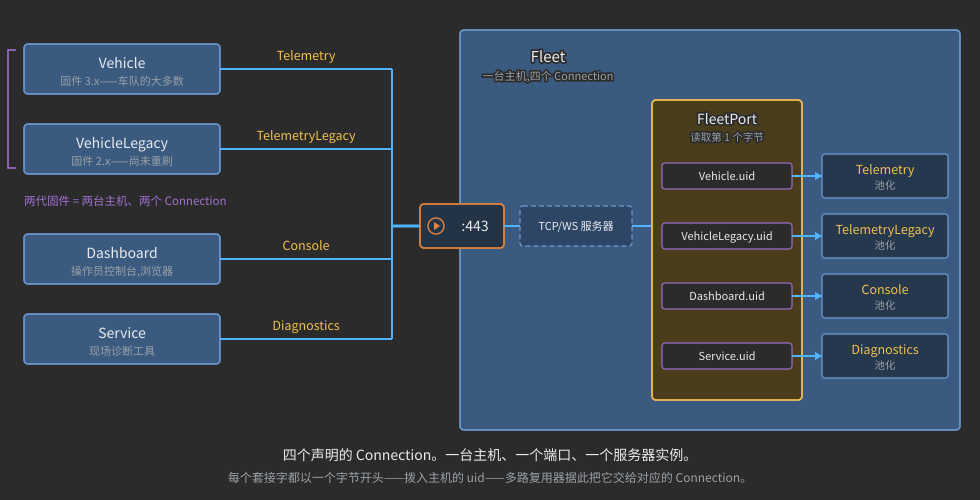

```csharp
struct Vehicle       : Host { }   // 固件 3.x
struct VehicleLegacy : Host { }   // 固件 2.x,仍在现场运行
struct Dashboard     : Host { }   // 操作员控制台
struct Service       : Host { }   // 诊断工具
struct Fleet         : Host { }   // 后端

interface Telemetry       : Connects<Vehicle,       Fleet> { /* 状态与分支 */ }
interface TelemetryLegacy : Connects<VehicleLegacy, Fleet> { /* 状态与分支 */ }
interface Console         : Connects<Dashboard,     Fleet> { /* 状态与分支 */ }
interface Diagnostics     : Connects<Service,       Fleet> { /* 状态与分支 */ }

interface FleetPort : Multiplex<(Telemetry, TelemetryLegacy, Console, Diagnostics)> { }
```

监听服务器把生成的 `FleetPort` 当作从第一个字节到连接的函数;拨入客户端则设置自己的
`mux` 标志。连接中没有任何东西引用多路复用器：它改变的是连接的部署方式，而不是连接本身。

- **一个地址、一张证书、一条防火墙或 NAT 规则**，覆盖每一种对端。
- **无需版本字段的版本化。** 一代新的固件或客户端就是一台新主机，拥有自己的连接。旧的
  保持冻结并继续工作，新的自由变化，两者拨入同一端口，而处理函数从不需要询问自己在和哪个版本
  对话——第一个字节已经解决了这个问题。退役就是删除。新一代服务器同样如此：两个多路复用器
  组合在一个进程中，位于一个端口之后。
- **声明一次，部署时选择。** 同一份生成的代码既可以服务自己的专属端口，也可以服务共享端口。
- **公共边缘之后的私有后端。** 多路复用器可以列出一条自己的主机并不参与的连接：边缘接受该
  套接字，并通过隧道把这条连接传送到一个从不暴露的后端。

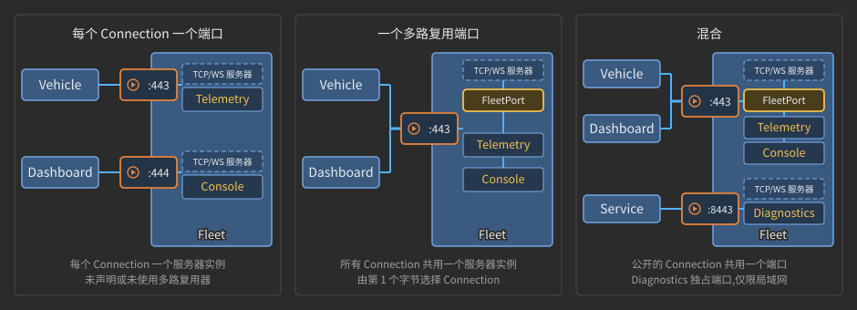

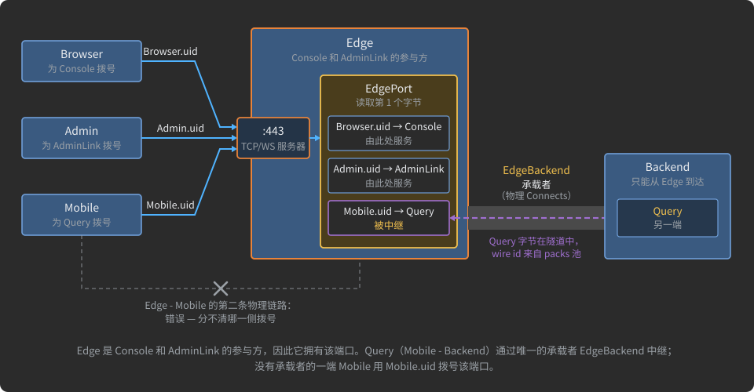

**为什么好。** 版本处理从每条消息、每个处理函数中移出，变成每个套接字一个字节加一处声明：旧
设备继续用它们出厂时的方言说话，新设备自由变化，而端口共享是运维决策，不是代码改动。

**限制。** 双方必须就端口是否多路复用达成一致。uid 是一个字节，所以一个项目连同它扩展的项目最多容纳
256 台主机。只有当某一代不再有任何设备拨入时才能退役它，因为它的 uid 会被释放给下一台新
主机。多路复用端口是 TCP 或 WebSocket——UDP 连接保留自己的端口——而 TypeScript 主机只能拨入。

**手册中：** [多路复用](MANUAL.zh-CN.md#multiplexing) · [第一个字节](MANUAL.zh-CN.md#the-first-byte-of-a-multiplexed-socket) ·
[声明一次，部署时选择](MANUAL.zh-CN.md#declared-once-chosen-at-deployment) ·
[一个端口之后的多代](MANUAL.zh-CN.md#several-kinds-of-peer-several-generations-behind-one-port) ·
[服务器代际](MANUAL.zh-CN.md#server-generations-behind-one-port) · [连接多路复用端口](MANUAL.zh-CN.md#wiring-a-multiplexed-port) ·
[中继连接](MANUAL.zh-CN.md#relayed-connections-in-a-multiplexer) · [新一代就是一台新主机](MANUAL.zh-CN.md#a-new-generation-is-a-new-host)

<a id="identity-numbers-instead-of-field-tags"></a>
### 标识：用编号代替字段标签

描述中的每个实体——项目、主机、连接、Actor、状态、分支、pack——在 AdHocAgent
第一次遇到它时都会得到一个**编号**。AdHocAgent 把所有编号保存在你文件顶部的两条文档注释中，即**编号表**;编号表下方
的声明则不携带编号。字段完全没有编号：字段靠它在 pack 中的位置来识别。


- **自由重构。** 在 IDE 中重命名一个 pack，把一台主机移到文件末尾，给连接排序：编号不变，随之不变的还有
  pack 的线路 ID、主机的 uid 字节，以及生成的文件中存放你代码的区域。
- **无需手工管理。** 没有需要分配、保留或退役的字段标签。AdHocAgent 负责写表、保持排序，并在编号变化时重写
  它们。唯一属于你的部分：pack 编号之后的标签——分支可以按这些词或表情符号来选择 pack。
- **线路 ID 很小。** 线路 ID 与标识分离：一个新的可传输 pack 取最小的空闲 ID，而接收器
  用同样固定的字节数读取一条连接中的每个 pack ID，字节数足够容纳最大的那个。
- **顺序就是线上。** 硬币的另一面：交换两个同类型的字段——比如两个数字——这个 pack 在线上
  就成了另一个 pack。见下一节。

首次运行之后，下一节中 `FleetProtocol` 描述的顶部是这样的（`/>` 之后是 base256 字符：
`ÿ` = 0, `Ā` = 1, `ā` = 2；十进制列是线路 ID；项目自身的编号因项目而异）:

```csharp
namespace com.fleet
{
    /** packs
        <see cref='Alarm'/>ā         2
        <see cref='Position'/>Ā      1
        <see cref='PositionV2'/>ÿ    0
    */
    /** project
        <see cref='FleetProtocol'/>ěƱNJŻč

        hosts
        <see cref='Fleet'/>ÿ
        <see cref='VehicleLegacy'/>Ā
        <see cref='Vehicle'/>ā

        connections
        <see cref='TelemetryLegacy'/>ÿ
        <see cref='Telemetry'/>Ā
    */
    public interface FleetProtocol
```

把重写后的文件纳入版本控制，用 IDE 重命名，绝不要手工编辑编号。

→ 手册：[编号表](MANUAL.zh-CN.md#numbers-tables) ·
[表中标识，pack 中位置](MANUAL.zh-CN.md#identity-in-a-table-position-in-a-pack) ·
[pack 的线路 ID](MANUAL.zh-CN.md#the-wire-id-of-a-pack) · [pack 的标签](MANUAL.zh-CN.md#tags-of-a-pack) ·
[编号表的陷阱](MANUAL.zh-CN.md#pitfalls-of-the-numbers-tables)

<a id="evolution-a-new-generation-is-a-new-host"></a>
### 演进：新一代就是一台新主机

线上的 pack 是它的线路 ID 加上按声明顺序排列的字段；字节中没有任何东西说明它们是描述的哪次编辑
产生的。所以 AdHoc 不原地演进 pack。一代已经部署且无法更新的对端是**冻结**的，
下一代则是**一台拥有自己连接的新主机**，声明在旧主机旁边。多路复用器把两者放到一个端口上：
每个套接字的第一个字节——拨入主机的 uid——把它交给属于它自己那一代的连接。


```csharp
using org.unirail.Meta;

namespace com.fleet
{
    public interface FleetProtocol
    {
        class PositionV2 { float lat; float lon; }                 // 固件 2.x 构建时所依据的
        class Position   { double lat; double lon; float speed; }  // 固件 3.x,可自由更改
        class Alarm      { string text; }

        ///<see cref = 'InJAVA'/>
        struct Fleet : Host { }          // 后端

        ///<see cref = 'InCS'/>
        struct VehicleLegacy : Host { }  // 固件 2.x:冻结,永不编辑

        ///<see cref = 'InCS'/>
        struct Vehicle : Host { }        // 固件 3.x

        interface TelemetryLegacy : Connects<VehicleLegacy, Fleet>
        {
            [l____________<PositionV2>]
            struct Start { }
        }

        interface Telemetry : Connects<Vehicle, Fleet>
        {
            [l____________<(Position, Alarm)>]
            struct Start { }
        }

        interface FleetPort : Multiplex<(Telemetry, TelemetryLegacy)> { }  // 两代共用一个端口
    }
}
```

- **没有版本字段，没有版本分支。** 每一代有自己的生成代码和自己的状态机。处理函数从不
  询问自己在和哪个固件对话：连接——或共享端口上的第一个字节——在第一个 pack 到达之前就已确定了这一点。
- **旧方言冻结，新方言自由。** `Telemetry` 可以丢弃一个 pack、重命名一个状态或更改字段类型，
  完全不用顾虑仍在现场运行的东西。
- **退役就是删除**旧的主机、连接和 pack，以及它们在编号表中的行
  （[一个注意事项](MANUAL.zh-CN.md#a-new-generation-is-a-new-host)适用于退役后只剩一条连接的端口）。
- **诚实的适用范围。** 你仍在服务的每一代，都是你要构建和部署的代码。这适合你了解的群体——你发出的
  设备、你能列出的对端——而不适合对代际数量没有上限的开放生态。

哪些编辑会产生新协议，哪些不会：


以此为基础的方案——一个公共端口之后的多代客户端与设备——是
[R2. 无需版本字段的版本化](#r2-versioning-without-version-fields)。

→ 手册：[演进协议](MANUAL.zh-CN.md#evolving-a-protocol) ·
[什么改变线上内容，什么不改变](MANUAL.zh-CN.md#what-changes-the-wire-and-what-does-not) ·
[新一代就是一台新主机](MANUAL.zh-CN.md#a-new-generation-is-a-new-host) ·
[何时适合分代](MANUAL.zh-CN.md#when-separate-generations-fit) ·
[多种对端、多代共用一个端口](MANUAL.zh-CN.md#several-kinds-of-peer-several-generations-behind-one-port)

<a id="impact-report-which-hosts-an-edit-reaches"></a>
### 影响报告：一次编辑触及哪些主机

`AdHocAgent .\FleetProtocol.cs~` 把描述与它的先前版本比较——默认是部署在备份中保存的、与当前文件不同的
最新版本——并写出一个 HTML 页面，回答一个问题：**哪些主机必须更新，以及为什么**。它在你的机器上用与代码生成相同的解析器
运行：不上传任何东西，不需要 UUID，两个版本都不会被写入。


- **每台主机一个结论**——update、new、removed、not reached——结论背后是每个原因一张卡片：什么变了、主机如何使用它
  ("通过 Telemetry 发送给 Fleet")、修改前后的声明并标出变化部分，以及指向该行的链接。
- **重命名会被识别**——通过编号表——并报告为重命名，而不是删除加新增。编辑过的注释单独
  列出，不触及任何主机。
- **为 CI 而生。** 同样的答案以一行 JSON 的形式放在页面中，因此流水线可以在冻结的一代被
  触及时让构建失败：

```shell
AdHocAgent ./FleetProtocol.cs~ > impact.log    # 重定向:不打开浏览器
grep -o '<script type="application/json" id="adhoc-impact">.*</script>' FleetProtocol.changes.html \
  | sed 's/<[^>]*>//g' > impact.json
jq -e '(.update + .removed) | index("VehicleLegacy") | not' impact.json \
  || { echo "冻结的一代 VehicleLegacy 被触及"; exit 1; }
```

交换 `PositionV2` 中的 `lat` 和 `lon`，并给 `Position` 添加一个字段：页面会列出 `Fleet`、`Vehicle` 和 `VehicleLegacy`，注明
一个 pack 中的字段交换了位置——而列表中出现的冻结主机说明这次编辑必须撤销，在生成任何一行代码之前。

→ 手册：[.cs~ 影响报告](MANUAL.zh-CN.md#the-cs-impact-report) ·
[什么让一台主机需要更新](MANUAL.zh-CN.md#what-makes-a-host-one-to-update) ·
[面向脚本的报告：adhoc-impact JSON](MANUAL.zh-CN.md#the-report-for-scripts-the-adhoc-impact-json) ·
[在流水线中守护冻结的一代](MANUAL.zh-CN.md#guarding-a-frozen-generation-in-a-pipeline)

<a id="reuse-extend-import-modify"></a>
### 复用：extend、import、modify

一个描述可以站在另一个描述之上——一个共享的 pack 库、一个厂商的公开协议、AdHoc 自己的协议——而无需复制
它，也无需编辑它的声明：

| 机制 | 声明方式 | 作用 |
|:--|:--|:--|
| **extend** 一个项目 | `interface MyProject : Library` | 引入 `Library` 及它所扩展的项目中的每台主机、每条连接、每个多路复用器、每个 pack、每个枚举和每组常量集 |
| **import** 单个声明 | 项目基类列表中的 `_<...>` | 添加一条连接，或把一个枚举、一组常量集广播到每台主机 |
| **modify** 一个导入的声明 | `class M : Modify<Target> { }` | 编辑 pack 的字段、替换它的特性、移除枚举或常量集的成员、为主机添加语言 |

![一个库项目和扩展它的项目。底部是 Library.cs 中的 interface Library,别人的描述,其声明不被编辑:主机 Server uid 0 和 Client uid 1,连接 Link,pack Hello id 0、Stamp id 1、Info id 2 和标记了 Zstd 的 Trace。一条粗的蓝色向上箭头——"extends:一切都进来",主机、连接、pack、枚举,连同它们的编号和线路 ID——指向 MyProject.cs 中的 interface MyProject : Library,画成你的:新主机 Metrics,uid 为 2,新 pack Sample,id 为 3,新连接 ServerToMetrics 从 Server 到 Metrics,以及两个修饰器,移除了 hops 的 TraceCut : Modify<Trace> 和带 Zstd(9) 的 TraceChain : Modify<Trace>。标注"Modify<> 原地编辑"的虚线箭头从两个修饰器指向右侧,即生成出来的组合项目:主机 Server、Client 和 Metrics;连接 Link 和 ServerToMetrics;pack Hello 0、Stamp 1、Info 2 和 Sample 3,新增的用绿色;Trace 只剩字段 origin,hops 被划掉,为每台主机——包括 Library 自己的 Client 和 Server——以 Zstd(9) 压缩。下方:字段合并,特性替换,最顶层获胜;AdHocAgent 记录每次替换,从 Zstd 到 Zstd(9)。底部三个徽章:": Library"扩展整个项目,"_<X>"导入一条连接或广播枚举或常量集,"Modify<T>"编辑导入的 pack、枚举、常量集或主机。](docs/img/readme-reuse.zh-CN.svg)

```csharp
public interface MyProject : com.lib.Library               // Library 的一切都进来
{
    class Sample { long value; }

    ///<see cref = 'InJAVA'/>
    struct Metrics : Host { }                              // 你自己的一台主机

    interface ServerToMetrics : Connects<Server, Metrics>  // 接入 Library 的 Server
    {
        [l____________<(Sample, Stamp)>]                   // 发送一个导入的 pack
        struct Start { }
    }

    /// <see cref="com.lib.Library.Trace.hops"/>-
    class TraceCut : Modify<Trace> { }                     // Trace 失去 hops——对每台主机

    [Zstd(9)]
    class TraceChain : Modify<Trace> { }                   // 并以更高强度压缩
}
```

- **标识在组合后存活。** 导入的主机和 pack 保留它们的编号和线路 ID；你的主机的 uid 和你的 pack 的
  线路 ID 接续在最大的导入编号之后（`Metrics` 是 uid 2, `Sample` 取线路 ID 3)。
- **分层，而非分叉。** 字段合并，特性替换，最顶层获胜。两个互不导入、又都替换同一个 pack
  特性的层会被拒绝：组合顺序绝不默默地决定结果。AdHocAgent 记录每一次替换，
  `["Zstd"] -> ["Zstd(9)"]`。
- **在自身上验证过。** AdHoc 自己的生成器服务的描述扩展了 AdHoc 的公开协议
  [`AdhocProtocol.cs`](AdhocProtocol.cs)，加入了内部主机——监控、测试、格式化、更新——一个生成的 `Server`
  同时服务两种协议。
- **知道边界。** 导入不做过滤（一切都进来）；导入项目的连接和状态不能被
  修改；AdHocAgent 会保持导入项目的编号表为最新，所以要让它的文件保持可写并纳入版本控制。

→ 手册：[复用描述](MANUAL.zh-CN.md#reusing-descriptions) · [扩展项目](MANUAL.zh-CN.md#extending-a-project) ·
[跨导入项目的编号](MANUAL.zh-CN.md#numbers-across-the-imported-projects) ·
[用 `_<>` 导入单个声明](MANUAL.zh-CN.md#importing-single-declarations-with-_) ·
[修改导入的声明：`Modify<>`](MANUAL.zh-CN.md#modifying-imported-declarations-modify) ·
[示例：对 AdHoc 自己协议的后端扩展](MANUAL.zh-CN.md#example-a-backend-extension-of-adhocs-own-protocol)

<a id="adhocagent-one-command-line-tool-for-every-task"></a>
### AdHocAgent：一个命令行工具完成所有任务

AdHocAgent 是你使用 AdHoc 所经由的 .NET 工具——在你的机器上，或作为构建流水线的一个步骤。它的第一个参数
选择任务：

| 命令 | 任务 | 离开你的机器 |
|:--|:--|:--|
| `AdHocAgent` | 打印帮助并写出模板 `MyProtocolDescription.cs` | - |
| `AdHocAgent <your-uuid>` | 把你的个人 UUID 存入 `AdHocAgent.toml` | - |
| `AdHocAgent .\MyProtocol.cs` | 检查描述、上传它、接收生成的代码、部署它 | **描述**，在它通过本地检查之后 |
| `AdHocAgent .\MyProtocol.cs!` | 同上，并在服务器资源允许的范围内测试代码 | **描述**，在它通过本地检查之后 |
| `AdHocAgent .\MyProtocol.cs~` | [影响报告](#impact-report-which-hosts-an-edit-reaches) | - |
| `AdHocAgent .\MyProtocol.md` | 在你更改路由之后，再次部署已接收的代码 | - |
| `AdHocAgent .\MyProtocol.cs?` | [AdHoc Observer](#adhoc-observer-the-description-as-live-diagrams) | - |

![AdHocAgent 的第一个参数选择任务。左侧一列终端中的六条命令行,每条都有一个箭头指向其结果:不带参数的 AdHocAgent 打印帮助并写出模板 MyProtocolDescription.cs;AdHocAgent 跟上你的 UUID 把 PersonalVolatileUUID 存入 AdHocAgent.toml;画成蓝色的 AdHocAgent .\MyProtocol.cs[!] 在本地检查描述并上传,代码进入 received 文件夹并被部署;AdHocAgent .\MyProtocol.cs~ 写出影响报告 MyProtocol.changes.html 以及供脚本使用的 JSON;AdHocAgent .\MyProtocol.md 在你编辑路由之后重新部署 received 文件夹;AdHocAgent .\MyProtocol.cs? 启动 AdHoc Observer,位于 localhost:4321 的交互式图表。除 .cs 之外的每个结果都带一个绿色"本地"徽章。一条虚线边界把"你的机器"与"网络"分开;唯一跨越它的线连接 .cs 的结果与一个黄色框——生成器,一个云服务,使用 .cs! 时在资源允许的范围内测试代码:描述出去,生成的代码回来——只有 .cs 任务在本地检查之后跨过这条线。底部一条黄色警告条:不带目录部分的 AdHocAgent MyProtocol.cs 会被当作 UUID,什么都不生成——在名字前写上 .\ 或 ./。一条小注:CI 中的 ADHOC_PARSE_ONLY=1 检查拉取请求而不上传。](docs/img/readme-agent-tasks.zh-CN.svg)

> [!WARNING]
> 任务文件要**带上目录部分**:`.\MyProtocol.cs`、`./MyProtocol.cs` 或完整路径。第一个参数如果既不含 `\`
> 也不含 `/`，就会被当作 UUID——`AdHocAgent MyProtocol.cs` 什么都不生成。

- **离开之前先检查。** 描述先由 AdHocAgent 的解析器编译和检查；出错会以
  文件、行号和修复方法停止运行。有错误的描述永远不会到达服务器。
- **无需登录，无需密码。** 访问凭据是一个个人**易失 UUID**，来自 GitHub 上的免费注册。服务器可能在一次
  生成期间替换它；AdHocAgent 会自己保存新的 UUID。代码生成是免费的。
- **在服务器上测试。** 文件名后加 `!` 时，生成器还会在资源允许的范围内测试代码；不加则只生成代码。
  它是一项服务，不是你自己测试的替代品。
- **为流水线而造。** `ADHOC_PARSE_ONLY=1` 校验拉取请求而不上传；重定向的输出打印纯文本进度
  行；`NO_COLOR` 关闭颜色。在多次运行之间持久保存 `AdHocAgent.toml`——它保存当前 UUID——并且要看日志，而不只是
  退出码。
- **开源项目**可以被列入使用 AdHoc 的项目目录：一个至少有 500 星的公开 GitHub 仓库、
  一个保存每个上传文件副本的 `adhoc` 文件夹，以及在命令行上传入的主题标签。
- **本身就是一个 AdHoc 应用。** AdHocAgent 通过 AdHoc 自己描述 `AdhocProtocol.cs` 的 `Communication` 连接
  与生成器对话——带有一个真实的、包含版本、登录和上传的状态机。

手头有其他语言的模式？独立的[到 AdHoc 协议的转换器](#start-from-a-schema-you-already-have)
可以把它变成一个可作为起点的 AdHoc 描述。

→ 手册：[AdHocAgent](MANUAL.zh-CN.md#adhocagent) · [AdHocAgent 如何选择任务](MANUAL.zh-CN.md#how-adhocagent-chooses-the-task) ·
[一次 .cs 运行逐步做什么](MANUAL.zh-CN.md#what-a-cs-run-does-step-by-step) ·
[进度与服务器端测试](MANUAL.zh-CN.md#progress-and-server-side-testing-of-generated-code) · [UUID](MANUAL.zh-CN.md#uuid) ·
[在流水线中运行 AdHocAgent](MANUAL.zh-CN.md#running-adhocagent-in-a-pipeline) · [开源](MANUAL.zh-CN.md#open-source) ·
[来自其他模式语言的描述](MANUAL.zh-CN.md#descriptions-from-other-schema-languages)

<a id="deployment-routes-smart-merge-backups"></a>
### 部署：路由、智能合并、备份

生成的代码不是一次性的脚手架。每次生成之后，AdHocAgent 按照一份 Markdown **指令文件**把收到的代码部署到你的项目中，
这份文件由它写一次、由你来编辑：每台主机行尾的一条路由，在你不使用的主机上标 `⛔`。

```markdown
- 📁[InCS](/D:/Generated/MyProtocol/InCS)
  - 📁[Server](/D:/Generated/MyProtocol/InCS/Server) [](/D:/Projects/server/protocol/)
- 📁[InJAVA](/D:/Generated/MyProtocol/InJAVA)
  - 📁[Device](/D:/Generated/MyProtocol/InJAVA/Device) ⛔ 尚未使用
- 📁[InTS](/D:/Generated/MyProtocol/InTS)
  - 📁[Browser](/D:/Generated/MyProtocol/InTS/Browser) [](/D:/Projects/web/src/protocol/)
```

![再生成循环,顺时针五个编号站点:1,编辑 MyProtocol.cs,你的描述;2,AdHocAgent .\MyProtocol.cs~ 在本地告诉你这次编辑触及哪些主机;3,AdHocAgent .\MyProtocol.cs[!] 检查、上传,生成器生成代码——加 ! 时还会在资源允许的范围内测试;4,部署:来自 MyProtocol.md 的路由,格式化器等处理步骤,智能合并进你的文件,备份和恢复脚本;5,构建并运行你的项目——gen、lib 和你的代码——然后回到编辑。循环中央,一个生成文件的注入点——#region> Actor,你的代码,#endregion>,后跟实体编号 Āÿÿ 和 .Actor——标注为"由实体编号键控:在再生成和重命名后存活;被编辑过的生成块会保留,生成器改动它时会有 todo 注记",并用虚线连到智能合并步骤。部署站点下方的红色标注:一个包含你代码的区域在新文件中消失了——部署在写入之前停止并询问 Proceed with the merge? (y/N)。与备份步骤相连的紫色标注:备份文件夹 MyProtocol_5,内含 restore.bat、restore.ps1、restore.sh 和 .description,即源描述。颜色图例:你的、本地检查、生成器、部署、备份、停止提示。](docs/img/readme-regenerate-loop.zh-CN.svg)

- **智能合并。** 生成的文件不会覆盖你的文件。新版本是模板，你在它的**注入点**中
  ——由实体编号键控的区域——的代码被逐区域地搬过去。你编辑过的生成块会保留；当
  生成器更改那个块时，它下方的一条 todo 注记会显示新版本。
- **不做静默丢失。** 当一个存放你代码的区域在新文件中消失时——比如它的 Actor 被移除了——部署会
  在写入任何内容之前停下来询问。
- **每次部署都可逆。** 被覆盖或删除的文件会先备份，连同生成这些代码所用的描述，
  以及 `restore.bat`、`restore.ps1` 和 `restore.sh`。
- **你的工具链在循环中。** 处理步骤——由文件路径上的正则表达式选择的格式化器——以及
  前置/后置钩子，都写进同一份 Markdown 文件。

<details>
<summary>智能合并如何对待注入点的每个块</summary>

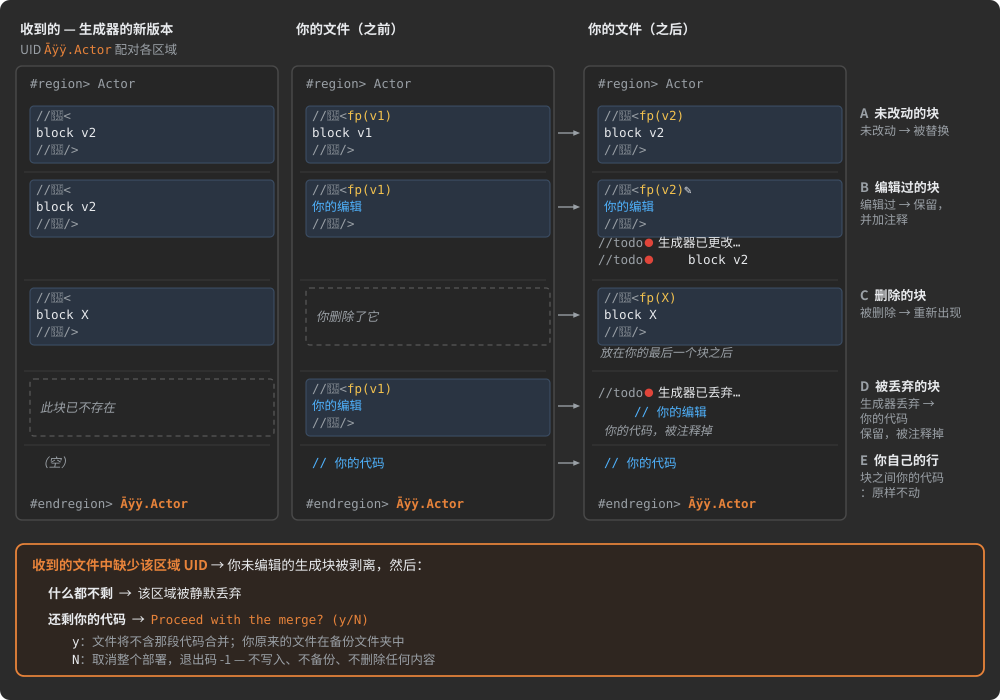

</details>

> [!WARNING]
> 目标文件夹属于生成器：其中不是由部署写入的文件会被备份并删除。把每台
> 主机路由到一个只放生成代码的文件夹——你源码旁边的一个 `protocol` 文件夹——绝不要路由到项目根目录。

→ 手册：[部署与智能合并](MANUAL.zh-CN.md#deployment-and-smart-merge) ·
[路由：收到的文件去哪里](MANUAL.zh-CN.md#routes-where-received-files-go) · [智能合并](MANUAL.zh-CN.md#smart-merge) ·
[注入点](MANUAL.zh-CN.md#injection-points) · [孤儿代码保护](MANUAL.zh-CN.md#orphaned-code-protection) ·
[部署前的处理步骤](MANUAL.zh-CN.md#processing-steps-before-deployment) ·
[自动备份与恢复](MANUAL.zh-CN.md#automated-backups-and-restoration)

<a id="adhoc-observer-the-description-as-live-diagrams"></a>
### AdHoc Observer:描述即动态图示

大型协议很难装进脑子里:谁和谁通信、每条消息携带什么、每段对话如何展开。**AdHoc
Observer** 把你的描述画成交互式图示,跟随你的编辑,并能跳回源码行。它是 AdHocAgent 的辅助
工具,完全在你自己的机器上运行:不上传任何内容,也不需要 UUID。

```shell
AdHocAgent .\MyProtocol.cs?                       # Windows;其他平台用 ./MyProtocol.cs?
AdHocAgent .\MyProtocol.cs? .\Library.cs .\work   # 带导入文件,以及一个用于布局的输出文件夹
```

然后 AdHocAgent 在 `http://localhost:4321/` 等待浏览器;打开该地址即可。

![工作中的 AdHoc Observer。左侧是描述文件 MyProtocol.cs 及其导入文件,以及命令 AdHocAgent .\MyProtocol.cs?,旁边有三个绿色徽章:本地运行、不上传任何内容、无需 UUID;下方有一条注释:浏览器接收解析后的模型,也就是生成器拿到的同一个 Project pack。一个标着"WebSocket - AdHoc packs"的蓝色双向箭头把命令连接到 localhost:4321 处的浏览器窗口;一条从文件指向浏览器的橙色箭头写着"保存 → 重绘",一条指回文件的蓝色箭头写着"在你的 IDE 中打开"。窗口内有:一个侧边栏,包含搜索框、可折叠的主机/pack/连接树,以及一个 Save Diagram 按钮;一块画布,上面是以 C# 生成的 Vehicle 和 VehicleLegacy 主机、以 Java 生成的 Fleet 主机,画成列出各自 pack 的方框,由 Telemetry 和 TelemetryLegacy 两条连接相连;一个弹窗"右键单击连接:它的状态机",显示 Start 状态和一个标着"l: Position, Alarm"的循环;一个弹窗"左键单击 pack:它的字段",列出 Position: double lat、double lon、float speed;还有一张黄色贴纸"双击背景"。下方三条标注:保存文件,图示即跟随——页面发起询问,AdHocAgent 重新读取文件,解析错误显示在页面中;跳转到源码——你的 IDE 打开到指定行和字符位置,由 show_code_exe 和 show_code_args 设置;一个文件夹图标——输出文件夹保存布局和贴纸,按实体编号建立索引,因此重命名也能保留布局。](docs/img/readme-observer.zh-CN.svg)

| 在浏览器中 | 你得到什么 |
|:--|:--|
| 图 | 所有主机、每个主机处理的 pack,以及它们之间的连接 |
| 右键单击一条连接 | 弹窗显示它的状态机:状态和分支 |
| 左键单击一个 pack | 它的字段、字段类型和嵌套结构 |
| 侧边栏 | 可搜索、可折叠的主机/pack/连接树 |
| 双击背景 | 一张贴纸:图示上的富文本注释 |
| 侧边栏中的 **Save Diagram** | 节点位置、平移和缩放保存到输出文件夹中的 `layout` |

- **实时。** 保存描述,图示即跟随:页面询问 AdHocAgent 是否有变化,AdHocAgent 重新读取
  文件并发送新模型。无法解析的描述会在页面中显示错误。
- **一键跳到源码。** 在 `AdHocAgent.toml` 中配置 `show_code_exe` 和 `show_code_args`,Observer 就能在你的 IDE 中打开
  声明处——占位符 `<path to file>`、`<line number>`、`<char number>`:

  ```toml
  show_code_exe = "X:/VSCode/Code.exe"
  show_code_args = "--goto <path to file>:<line number>:<char number>"
  ```
- **经得起重构的布局。** 位置按协议使用的同一套编号建立索引,因此重命名或移动一个
  声明不会改变它在图上的位置。贴纸以 HTML 文件的形式保存在布局旁边;未保存就关闭的浏览器
  会把它的工作留在输出文件夹的 `unsaved/` 中——把它上移一级文件夹即可恢复。
- **AdHoc 用在自己身上。** Observer 本身就是 AdHoc 自己的描述中的一个主机:它通过
  `ObserverCommunication` 连接接收解析后的模型——也就是生成器拿到的同一个 `Project` pack——而布局文件则是通过
  `SaveLayout` 连接写入的 AdHoc pack:pack 被用作文件格式。

和运行 `.cs` 一样,一次 Observer 运行也会让描述的编号表保持最新。

<details>
<summary>AdHoc Observer 的一张截图</summary>


</details>

<a id="when-adhoc-is-not-the-right-tool"></a>
## AdHoc 不适用的情况

AdHoc 为对端已知的系统而建:由你部署它们,你能列出它们,并且你在意每个字节、每个缓冲区
的开销。超出这个范围,纯文本的请求/响应设计往往是更好的选择——早点知道这一点能为你节省时间。


<a id="where-adhoc-does-not-fit"></a>
### AdHoc 不适用的场景

- **开放的生态。** AdHoc 不会就地演化一个 pack:在任何位置新增一个字段都会得到另一个 pack,而冻结的一代
  会作为独立主机来承载。这适用于你已发货的设备和你控制的客户端;不适用于那种
  客户端你永远不会见到、代数没有上限的公共 API。
- **需要肉眼阅读的流量。** 线上的 pack 就是它的 id 和按位置排列的字段——没有名字,没有标签,前面也没有长度。一个
  抓到的数据包离开描述就毫无意义,通用代理也无法检视它。
- **稀少的小调用。** 当一个系统每分钟只发几个小调用时,字节、内存和解析上的收益太小,抵不上
  一份描述、一个生成器和生成的代码的成本。

<a id="limits-of-adhoc-today"></a>
### AdHoc 目前的限制

| 限制 | 对你意味着什么 |
|:--|:--|
| **TypeScript 只能发起呼叫** | TypeScript 主机——比如浏览器仪表盘——没有服务器端,也没有 UDP 传输层:它总是主动打开连接。监听端口属于其他语言,UDP 也属于它们,Dart 除外。 |
| **生成器是云服务** | 生成代码需要网络连接和一个(免费的)个人 UUID。检查描述(`ADHOC_PARSE_ONLY=1`)、影响报告和重新部署都在本地运行。 |
| **字段顺序即线上格式** | 交换两个同类型字段的顺序,或者新增一个字段,都会改变协议:pack 的两端要一起重新生成、一起部署。 |
| **`[ChaCha20]` 隐藏内容,但不做认证** | 篡改密文不会被发现。加密传输层会认证每条记录,但那是按物理连接的:穿过中继的端到端加密让中继无法读取,却无法阻止它篡改。需要完整性时,加上你自己的阶段。 |
| **保证送达有代价** | 发送方为每个保证送达的 pack 保留一份副本,直到接收方确认(先存内存,再存磁盘,默认上限 100 MB),而且保证只在发送方会话存续期间有效:发送方崩溃且日志丢失时,接收方必须重新同步。 |
| **处理器不得阻塞** | 你的处理器运行在接收循环和发送循环上;一个阻塞的处理器会卡住它所在的整个方向,以及与其共享线程的其他连接。耗时的工作交给别的线程。 |
| **中继从不读取** | 生成的中继转发它读不懂的字节;必须测量、过滤或转码内容的中间主机,要由你的代码来消费流——AdHoc 不生成这样的主机。 |
| **服务器端测试是可选的** | 文件名后加 `!` 时,生成器还会在资源允许的范围内测试代码;不加则只生成代码。你自己项目的测试要保留。 |

二进制 pack 与文本负载之间的取舍,在[为什么是二进制协议而不是 HTTP](#why-a-binary-protocol-not-http)中有权衡分析。

→ MANUAL:[何时适合分离的各代协议](MANUAL.zh-CN.md#when-separate-generations-fit) ·
[AdHoc 的目标语言](MANUAL.zh-CN.md#target-languages-of-adhoc) · [UDP 连接](MANUAL.zh-CN.md#udp-connections) ·
[字段顺序是线上格式的一部分](MANUAL.zh-CN.md#the-order-of-fields-is-part-of-the-wire-format) ·
[内置阶段——Zstd 与 ChaCha20](MANUAL.zh-CN.md#built-in-stages---zstd-and-chacha20) ·
[保证送达](MANUAL.zh-CN.md#guaranteed-delivery) ·
[线程:接收循环与发送循环](MANUAL.zh-CN.md#threads-the-receive-loop-and-the-transmit-loop) ·
[选择中间层的职责](MANUAL.zh-CN.md#choosing-what-the-middle-tier-does)

<a id="getting-started"></a>
## 快速入门

从一个空文件夹到你自己项目里生成的代码,只需五步。每一步都链接到手册中完整讲解它的
章节;图中的步骤编号与手册一致。

![首次运行,画成一个由编号步骤组成的 U 形。顶行从左到右:第 2 步,AdHocAgent 跟上你的 UUID,把它作为 PersonalVolatileUUID 存入可执行文件旁边的 AdHocAgent.toml;第 4 步,在描述项目的文件夹中不带参数运行 AdHocAgent,会在那里写入模板 MyProtocolDescription.cs;第 5 步,你在 IDE 中编辑该文件来组合你的协议——pack 及其字段、主机及其语言、连接、状态和分支——IDE 会在你输入时检查 C#。一个箭头沿右侧下行到底行,底行从右往左读:第 6 步,AdHocAgent .\MyProtocolDescription.cs 把编号表加入描述,用 .description、InCS、InJAVA 和 InTS 主机文件夹填充收到的 MyProtocolDescription 文件夹,写出 MyProtocolDescription.md,然后停止;一条警告说明:不带目录部分的纯文件名会被当作 UUID,什么也不会生成。第 7 步:在你添加指向 D:/Projects/server/protocol/ 的路由、并为未使用的主机加上禁用标记之后,AdHocAgent .\MyProtocolDescription.md 会把该主机的 gen、lib 和 LICENSE-GRANT.md 复制到那个文件夹——一个只放生成代码的文件夹。](docs/img/dev-02-first-run.zh-CN.svg)

1. **安装。** 安装 .NET 10 SDK、一个 C# IDE,以及从
   [发布页面](https://github.com/AdHoc-Protocol/AdHoc-protocol/releases)下载的 AdHocAgent,放在它自己的文件夹里。
   → [第 1 步](MANUAL.zh-CN.md#step-1-install-net-and-adhocagent)
2. **获取你的个人 UUID——代码生成是免费的。** 在
   [Sign-Up Discussion](https://github.com/orgs/AdHoc-Protocol/discussions/categories/sign-up) 中发一条消息;机器人会为你创建一个私有项目,
   其中有一个存放你 UUID 的任务。存储一次即可:
   `AdHocAgent 100b9fd2-e593-485b-a2fe-9b9c82bc1e3f`。→ [第 2 步](MANUAL.zh-CN.md#step-2-get-your-personal-uuid)
3. **创建描述项目并获取模板。** 一个认识 AdHoc 词汇的 C# 类库——把
   [`Meta.cs`](src/Meta.cs) 加进去,或引用 `AdHocAgent.dll`——这样 IDE 就能在你输入时检查描述。在该文件夹中不带参数运行
   `AdHocAgent`:它会写入模板 `MyProtocolDescription.cs`(覆盖同名文件),这个模板原样就能通过
   所有检查。
   → [第 3 步](MANUAL.zh-CN.md#step-3-create-the-description-project)、[第 4 步](MANUAL.zh-CN.md#step-4-get-the-template)
4. **组合你的协议。** pack 及其字段、主机及其语言、连接及其状态和分支。IDE
   会在你输入时检查 C#;AdHoc 自己的规则由 AdHocAgent 在下一步检查。
   → [第 5 步](MANUAL.zh-CN.md#step-5-compose-your-protocol)
5. **生成并部署。** `AdHocAgent .\MyProtocolDescription.cs` 检查描述、加入编号表、上传描述,并
   接收每个主机的代码;首次运行还会写出说明文件 `MyProtocolDescription.md`,然后停止。为你使用的每个主机添加路由,为其余主机加上
   `⛔`,然后运行 `AdHocAgent .\MyProtocolDescription.md`。此后,每次生成都按同样的路由部署。→ [第 6 步](MANUAL.zh-CN.md#step-6-generate-the-first-code)、
   [第 7 步](MANUAL.zh-CN.md#step-7-deploy-the-first-code-into-your-project)

> [!IMPORTANT]
> - 传递描述时要带目录部分——Windows 上用 `.\`,其他平台用 `./`。`AdHocAgent MyProtocolDescription.cs` 会被当作
>   UUID,什么也不会生成。
> - 只把你的描述文件交给 AdHocAgent,永远不要给 `Meta.cs`:词汇已内置于 AdHocAgent。
> - 把每个主机路由到一个只放生成代码的文件夹,比如源码旁边的 `protocol` 文件夹。

<a id="start-from-a-schema-you-already-have"></a>
### 从你已有的 schema 开始

你的消息可能已经用另一种 schema 语言描述过了。AdHoc-Protocol 组织维护着一批
[现成的转换器](https://github.com/AdHoc-Protocol#converters-to-adhoc-protocol),每个都是独立的开源仓库,可以把这样的
schema 转成 AdHoc 描述。在第 4 步中用转换结果代替模板:它是供你手工完善的起点,而不是
成品协议。检查转换器写出的内容,然后补上源 schema 无法表达的东西,比如主机和语言、
连接状态、会话和变换链。

| 转换器 | 读取 | 这类 schema 常见于 |
|:--|:--|:--|
| [OpenAPI-to-AdHoc](https://github.com/AdHoc-Protocol/OpenAPI-to-AdHoc) | OpenAPI 3.x 和 Swagger 2.0 文档 | REST API |
| [Protobuf-to-AdHoc](https://github.com/AdHoc-Protocol/Protobuf-to-AdHoc) | Protocol Buffers `.proto` 和 gRPC 服务 | RPC 服务 |
| [Thrift-to-AdHoc](https://github.com/AdHoc-Protocol/Thrift-to-AdHoc) | Apache Thrift IDL | 服务、Hadoop 技术栈 |
| [Avro-to-AdHoc](https://github.com/AdHoc-Protocol/Avro-to-AdHoc) | Apache Avro schema 和协议(`.avsc`、`.avpr`) | 数据流水线、Kafka |
| [FlatBuffers-to-AdHoc](https://github.com/AdHoc-Protocol/FlatBuffers-to-AdHoc) | FlatBuffers schema(`.fbs`) | 游戏、Apache Arrow |
| [ASN1-to-AdHoc](https://github.com/AdHoc-Protocol/ASN1-to-AdHoc) | ASN.1 模块,包括 X.880 操作 | 电信、PKI、X.500 |
| [FIX-to-AdHoc](https://github.com/AdHoc-Protocol/FIX-to-AdHoc) | FIX SBE schema 和 QuickFIX 字典 | 电子交易 |
| [ROS2-to-AdHoc](https://github.com/AdHoc-Protocol/ROS2-to-AdHoc) | ROS 2 `.msg`、`.srv` 和 `.action` 接口 | 机器人 |
| [MAVLink-to-AdHoc](https://github.com/AdHoc-Protocol/MAVLink-to-AdHoc) | MAVLink 方言 XML | 无人机、飞控栈 |
| [DSDL-to-AdHoc](https://github.com/AdHoc-Protocol/DSDL-to-AdHoc) | OpenCyphal 和 DroneCAN DSDL | 车载总线 |
| [CRSF-MSP-to-AdHoc](https://github.com/AdHoc-Protocol/CRSF-MSP-to-AdHoc) | CRSF 和 MSP 固件头文件 | 遥控链路、飞行控制器 |
| [DBC-to-AdHoc](https://github.com/AdHoc-Protocol/DBC-to-AdHoc) | Vector CAN 数据库(`.dbc`) | 汽车 CAN 总线 |
| [Matter-to-AdHoc](https://github.com/AdHoc-Protocol/Matter-to-AdHoc) | Matter(CSA)簇 XML | 智能家居设备 |
| [LwM2M-to-AdHoc](https://github.com/AdHoc-Protocol/LwM2M-to-AdHoc) | OMA LwM2M 对象 XML | IoT 设备管理 |

每个转换器都带着 GitHub 主题 [`adhoc-converter`](https://github.com/topics/adhoc-converter)。
→ MANUAL:[来自其他 schema 语言的描述](MANUAL.zh-CN.md#descriptions-from-other-schema-languages)

<a id="learn-more"></a>
## 了解更多

<a id="manualmd-part-by-part"></a>
### MANUAL.md 逐部分介绍

[MANUAL.md](MANUAL.zh-CN.md) 是完整的开发者手册:描述如何编写、生成器从中产出什么,以及
生成的代码在运行时如何表现。它遵循与本页相同的模型和流程。


| 部分 | 章节 | 读它了解 |
|:--|:--|:--|
| **I. 导览** | [AdHoc 如何工作](MANUAL.zh-CN.md#how-adhoc-works) · [快速入门](MANUAL.zh-CN.md#getting-started) · [描述文件](MANUAL.zh-CN.md#the-description-file) | 流程、模型、每个方向一个缓冲区的运行时、首次运行、[术语表](MANUAL.zh-CN.md#glossary-of-adhoc-terms) |
| **II. 数据** | [Packs](MANUAL.zh-CN.md#packs) · [字段与类型](MANUAL.zh-CN.md#fields-and-types) · [常量与枚举](MANUAL.zh-CN.md#constants-and-enums) · [值如何变成字节](MANUAL.zh-CN.md#how-values-become-bytes) | pack 能携带什么,以及线上确切的字节 |
| **III. 组合数据** | [由 pack 构建 pack](MANUAL.zh-CN.md#building-packs-from-packs) · [Pack Set](MANUAL.zh-CN.md#pack-sets) | 共享字段、头部、按名称、标签和作用域选择 pack |
| **IV. 主机** | [主机、语言、生成的代码](MANUAL.zh-CN.md#hosts-languages-generated-code) | 语言,以及生成的对象或你自己的结构 |
| **V. 对话** | [连接](MANUAL.zh-CN.md#connections) · [Actor、状态、分支](MANUAL.zh-CN.md#actors-states-branches) · [Actor 种类与运行时的 Actor](MANUAL.zh-CN.md#actor-kinds-and-the-actor-at-runtime) | 状态机、RPC、定时器、组、线程 |
| **VI. 送达与传输层** | [会话、保证送达、UDP](MANUAL.zh-CN.md#sessions-guaranteed-delivery-udp) · [流](MANUAL.zh-CN.md#streams) · [变换链](MANUAL.zh-CN.md#transform-chains) · [Trim](MANUAL.zh-CN.md#trims) · [虚拟连接与中继](MANUAL.zh-CN.md#virtual-connections-and-relays) · [多路复用](MANUAL.zh-CN.md#multiplexing) | 跨丢失套接字的送达、任意大小的负载、压缩与加密、存储、中继、共享端口 |
| **VII. 标识、演化、复用** | [编号表](MANUAL.zh-CN.md#numbers-tables) · [演化协议](MANUAL.zh-CN.md#evolving-a-protocol) · [复用描述](MANUAL.zh-CN.md#reusing-descriptions) | 标识、各代协议、影响报告、扩展项目 |
| **VIII. 参考与工具** | [特性](MANUAL.zh-CN.md#attributes) · [AdHocAgent](MANUAL.zh-CN.md#adhocagent) · [部署与智能合并](MANUAL.zh-CN.md#deployment-and-smart-merge) | 每个特性、每条命令和选项、部署 |

<a id="code-releases-and-forums"></a>
### 代码、发布与论坛

- [`AdhocProtocol.cs`](AdhocProtocol.cs)——AdHoc 自己的协议,用 AdHoc 描述:AdHocAgent 与生成器之间的连接,
  以及 AdHocAgent 的其他连接。一份真实、完整、可读的描述。
- [`src/Meta.cs`](src/Meta.cs)——描述的词汇:你可以使用的每个接口和特性。
- [Releases](https://github.com/AdHoc-Protocol/AdHoc-protocol/releases)——AdHocAgent 下载。
- [Sign-Up Discussion](https://github.com/orgs/AdHoc-Protocol/discussions/categories/sign-up)——你的个人 UUID。
- [转换到 AdHoc 协议的转换器](https://github.com/AdHoc-Protocol#converters-to-adhoc-protocol)——把其他语言的 schema
  转成 AdHoc 描述;完整列表见[快速入门](#start-from-a-schema-you-already-have)。
- 提问与交流的论坛:[AdHocAgent 及综合](https://github.com/AdHoc-Protocol/AdHoc-protocol/discussions) ·
  [TypeScript 生成器](https://github.com/AdHoc-Protocol/InTS/discussions) · [Java 生成器](https://github.com/AdHoc-Protocol/InJAVA/discussions) ·
  [C# 生成器](https://github.com/AdHoc-Protocol/InCS/discussions)

